# FileStorage Offload 实现解读

> 对应《Mooncake + KVClient 双写》第 2.2 节第 1 条："FileStorage offload：本地文件、NVMe KV、OSS"。
>
> 代码基线：`main` @ `67df8c41`（工作区干净）。文中行号均基于该版本；链接形式为
> `[文件:行号](../Mooncake/mooncake-store/src/file_storage.cpp#L662)`，从本文档所在目录指向仓库根目录。

---

## 0. 一句话结论

`FileStorage` 是 **RealClient 进程内、由内存副本持有者自己驱动** 的二级存储子系统：

- **写**：Master 先把"哪些对象该落盘"放进该 Client 的任务邮箱；`FileStorage` 的心跳线程拉取任务 → 用 Master 返回的**本进程已注册内存地址**直接读对象 → 交给 backend 落盘 → 成功后向 Master 登记一条 `LOCAL_DISK` 副本（`client_id + transport_endpoint + object_size`）。应用的 `Put` 只负责写内存，落盘是之后独立发生的事。
- **读**：请求端从 Master 的副本列表里看到 `LOCAL_DISK`，但数据不在自己手上。它向该副本记录的**所属 Client** 发 offload RPC；对方把数据从后端读进自己的 `ClientBuffer`，回一组指针；请求端再用 TE 把数据从对方 buffer **拉**到自己的目标 buffer，最后通知对方释放暂存 buffer。
- **语义**：`LOCAL_DISK` 表示"**由一个 Client 代读**"，而不是"数据在本机磁盘"。因此三个后端（本地文件 / NVMe KV / OSS）可以共用同一条控制面和读路径；代价是**读依赖 owner 进程存活**。

---

## 1. 组件与数据结构

> 原文配图（`exports-2026-10-20T06-56-54/assets/Mooncake-FileStorage.excalidraw.png`）：
>
> 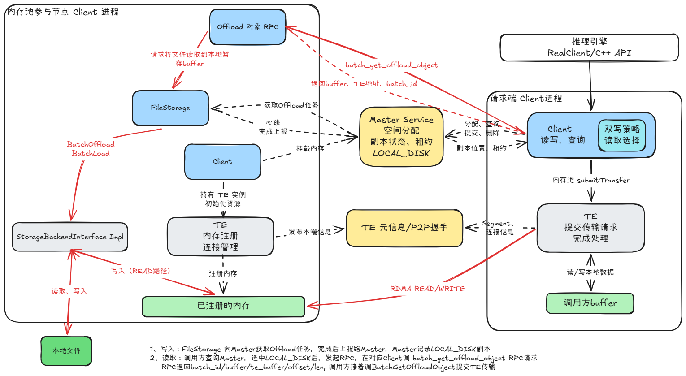

### 1.1 进程内位置

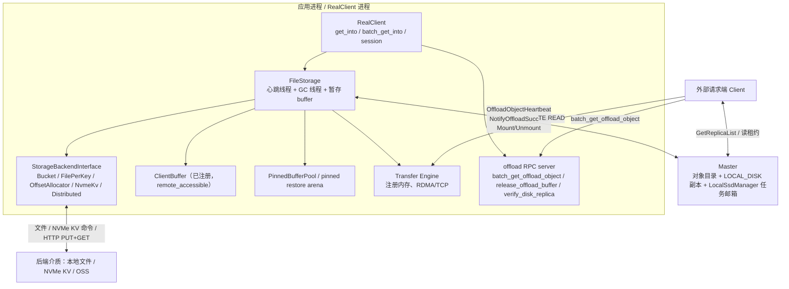

要点：

1. **`FileStorage` 只存在于 `RealClient`**，随 `enable_ssd_offload` 创建（[real_client.cpp:1458-1519](../Mooncake/mooncake-store/src/real_client.cpp#L1458)）。Dummy 模式把请求转发给本机 RealClient，因此同一套逻辑覆盖 Dummy/Real 两种部署。
2. **offload RPC server 和 TE 是两条独立的通道**：RPC 只传"元数据 + 指针"（`BatchGetOffloadObjectResponse`），真正的数据走 TE。
3. **Master 不转发数据**，只负责：调度任务、登记/删除 `LOCAL_DISK` 副本、发放读租约、清理失联 owner 的副本。

### 1.2 角色表

| 角色 | 代码位置 | 职责 |
| --- | --- | --- |
| `FileStorage` | [file_storage.h](../Mooncake/mooncake-store/include/file_storage.h) / [file_storage.cpp](../Mooncake/mooncake-store/src/file_storage.cpp) | 心跳循环、任务执行、暂存 buffer 分配与生命周期、扫描恢复、下线 drain |
| `StorageBackendInterface` | [storage_backend.h:262-318](../Mooncake/mooncake-store/include/storage_backend.h#L262) | 统一 `Init / BatchOffload / BatchLoad / IsExist / ScanMeta / EvictAboveDiskWatermark` |
| 五个 backend | [storage_backend.cpp:5579-5661](../Mooncake/mooncake-store/src/storage_backend.cpp#L5579) 工厂 | 本地文件的三种布局 + NVMe KV + Distributed（OSS/DFS） |
| `ClientBufferAllocator` | [file_storage.cpp:50-51](../Mooncake/mooncake-store/src/file_storage.cpp#L50) | 读回暂存区；构造时即决定大小，`Init` 时注册进 TE |
| `PinnedBufferPool` | [file_storage.cpp:49](../Mooncake/mooncake-store/src/file_storage.cpp#L49) | 设备数据 D2H 暂存、GPU 恢复用的 pinned arena |
| `RealClient` offload RPC | [real_client.cpp:1458-1478](../Mooncake/mooncake-store/src/real_client.cpp#L1458) | 对外提供 `batch_get_offload_object` 等 handler |
| `ClientRequester` | [real_client.cpp:9021-9080](../Mooncake/mooncake-store/src/real_client.cpp#L9021) | 请求端到 owner 的 RPC 连接池，独立超时/重试配置 |
| `LocalSsdManager` + 邮箱 | [local_ssd/manager.h](../Mooncake/mooncake-store/include/local_ssd/manager.h) / [manager.cpp:29-40](../Mooncake/mooncake-store/src/local_ssd/manager.cpp#L29) | Master 侧：每个 Client 一份 pending offload/promotion 队列、容量/已用字节统计 |
| `TransferSubmitter` | [transfer_task.cpp:1614-1694](../Mooncake/mooncake-store/src/transfer_task.cpp#L1614) | 把"从 owner buffer 拉数据"翻译成 TE READ 或本地 memcpy |

### 1.3 关键类型

```cpp
// 任务：Master -> Client（types.h:250）
struct OffloadTaskItem { std::string tenant_id; std::string key; int64_t size; };

// 落盘元数据：Client -> Master（types.h:539）
struct StorageObjectMetadata {
    int64_t bucket_id;      // -1 表示后端不使用 bucket
    int64_t offset;         // -1 表示不使用偏移
    int64_t key_size;
    int64_t data_size;      // 对象长度；NotifyOffloadSuccess 里 -1 是失败哨兵
    std::string transport_endpoint;  // owner 的 offload RPC 地址
};

// Master 中登记的副本描述（replica.h:280）
struct LocalDiskDescriptor { UUID client_id; uint64_t object_size; std::string transport_endpoint; };

// 读回响应（rpc_types.h:313）
struct BatchGetOffloadObjectResponse {
    uint64_t batch_id;                 // 用于 release_offload_buffer
    std::vector<uint64_t> pointers;    // owner 的 ClientBuffer 内地址
    std::string transfer_engine_addr;  // owner 的 TE segment endpoint
    uint64_t gc_ttl_ms;                // 兜底回收 TTL
};
```

注意 `StorageObjectMetadata` 的三个 int64 对后端是**开放语义**：bucket 后端用 `bucket_id/offset`，文件后端都填 `-1/0`，OSS 只关心 `data_size` 与 `key_size`。Master 只用 `data_size` 和 `transport_endpoint`。

---

## 2. 启动装配

### 2.1 流程

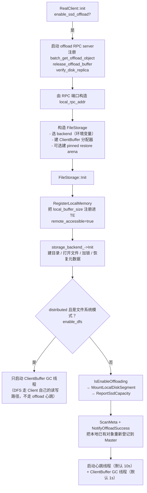

### 2.2 逐步说明

1. **RPC 端口是动态的**。`offload_rpc_server_` 用 port 0 让内核分配，再把 `host:port` 拼成 `local_rpc_addr`（[real_client.cpp:1461-1483](../Mooncake/mooncake-store/src/real_client.cpp#L1461)）。这个地址后面会写进每条 `LOCAL_DISK` 副本的 `transport_endpoint`。
2. **本地缓冲一次分配、长期驻留**。`client_buffer_allocator_` 由 `FileStorageConfig::local_buffer_size`（默认 1.2 GB）决定，构造时创建；`Init` 里以 `remote_accessible=true` 注册（[file_storage.cpp:1075-1090](../Mooncake/mooncake-store/src/file_storage.cpp#L1075)）。注释点明了原因：**远端要 RDMA READ 这块内存，必须有 rkey**，所以不能只做地址范围登记。
3. **pinned restore arena 只服务同进程 GPU 读**。仅当 `use_uring=false`、本机 memcpy 可用（`CanUseLocalMemcpy(local endpoint)`）且 `pinned_restore_arena_size>0` 时才创建（[file_storage.cpp:56-77](../Mooncake/mooncake-store/src/file_storage.cpp#L56)）。它是 pinned host 内存，**不注册进 TE**，靠 memcpy/H2D 使用。
4. **挂载 `LOCAL_DISK` segment**。`MountLocalDiskSegment` 要求 Master 侧 `--enable_offload=true`，否则返回 `UNABLE_OFFLOAD`（[master_service.cpp:8784-8828](../Mooncake/mooncake-store/src/master_service.cpp#L8784)）；成功后在 `LocalSsdManager` 里建一条 Client 记录，之后心跳才有地方挂任务。
5. **启动时扫描恢复**。`ScanMeta` 遍历后端（Bucket 读 `.meta`、FilePerKey 递归扫目录、OSS/S3 发 LIST），对每批 key 调 `NotifyOffloadSuccess` 重新登记。**对支持扫描的后端，owner 重启后 Master 里丢掉的 `LOCAL_DISK` 记录能自动补回来**，应用无感。两个例外：OffsetAllocator 启动时截断数据文件，旧对象不可恢复；NVMe KV 的 `ScanMeta` 目前是空实现（[backend.cpp:1516-1525](../Mooncake/mooncake-store/src/nvme_kv/backend.cpp#L1516)），重启后不会自动补登记。
6. **`enable_dfs` 分流**。构造时若 backend 是 `DistributedStorageBackend` 且用的是文件系统 adapter（posix/hf3fs），`config_.enable_dfs=true` 并把自己交给 `Client::SetDfsStorageBackend`（[file_storage.cpp:86-93](../Mooncake/mooncake-store/src/file_storage.cpp#L86)）。此时 FileStorage 不挂盘、不跑 offload 心跳 —— DFS 副本由请求端在 `Put`/`Get` 时直接读写共享文件系统，是另一条路径。

### 2.3 关键配置

| 环境变量 | 作用 | 默认 |
| --- | --- | --- |
| `MOONCAKE_OFFLOAD_STORAGE_BACKEND_DESCRIPTOR` | `bucket_storage_backend` / `file_per_key_storage_backend` / `offset_allocator_storage_backend` / `nvme_kv_storage_backend` / `distributed_storage_backend` | bucket |
| `MOONCAKE_OFFLOAD_FILE_STORAGE_PATH` | 落盘根目录 | `/data/file_storage` |
| `MOONCAKE_OFFLOAD_LOCAL_BUFFER_SIZE_BYTES` | 读回暂存区大小 | 1.2 GB |
| `MOONCAKE_OFFLOAD_HEARTBEAT_INTERVAL_SECONDS` | 心跳周期 | 10 |
| `MOONCAKE_OFFLOAD_CLIENT_BUFFER_GC_TTL_MS` / `..._GC_INTERVAL_SECONDS` | 暂存 buffer 租约与 GC 周期 | 5000 / 1 |
| `MOONCAKE_OFFLOAD_TOTAL_KEYS_LIMIT` / `..._TOTAL_SIZE_LIMIT_BYTES` | 后端容量上限 | 1e7 / 2 TB |
| `MOONCAKE_OFFLOAD_USE_URING` | io_uring / O_DIRECT 路径 | false |
| `MOONCAKE_OFFLOAD_ENABLE_DISK_WATERMARK_EVICTION` + high/low ratio | 主动水位淘汰 | true / 0.90 / 0.80 |
| Master: `--enable_offload` / `--offload_on_evict` / `--offloading_queue_limit` / `--promotion_on_hit` | 是否启用、淘汰时入队、队列上限、命中回迁 | false / false / 50000 / false |

---

## 3. 写入：内存 → 外部存储（offload）

### 3.1 触发点有两个，但落到同一个邮箱

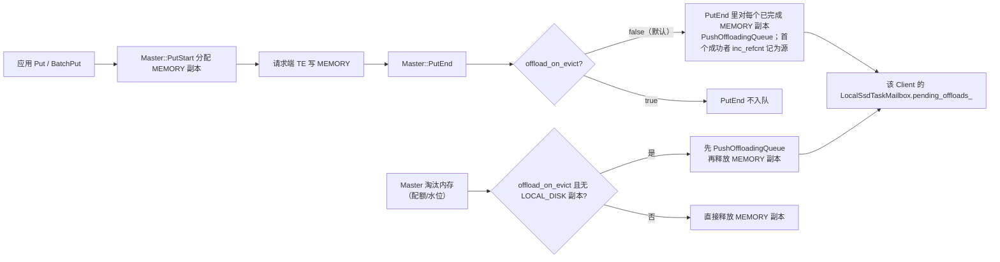

要点：

- **默认模式（`offload_on_evict=false`）**：`PutEnd` 就为每个内存副本入队（[master_service.cpp:5785-5811](../Mooncake/mooncake-store/src/master_service.cpp#L5785)），所以"刚写完内存"就会在下一个心跳被落盘。这解释了原文"应用写内存与后台 offload 是两个过程"：**入队是同步的，落盘是异步的**。
- **`offload_on_evict=true`**：只有真正要淘汰内存时才入队，落盘变成"淘汰前抢救"（[master_service.cpp:10695-10748](../Mooncake/mooncake-store/src/master_service.cpp#L10695)）。一旦对象已有 `LOCAL_DISK` 副本，直接释放内存，不重复入队。
- 入队时 Master 会：校验源副本是**已完成的 MEMORY 副本**、解析 segment 的 owner client、对源副本 `inc_refcnt()`，并在对象状态里记 `offloading_task{source_id, time, mirror_clients}`（[master_service.cpp:9161-9246](../Mooncake/mooncake-store/src/master_service.cpp#L9161)）。refcnt 的作用是**在落盘完成前阻止源内存副本被淘汰/复用**。
- 队列上限 `offloading_queue_limit`（默认 5 万，**按 Client 邮箱计**）；超限返回 `KEYS_ULTRA_LIMIT`，对象就不入队了。

下面把这条链路的代码逐段展开。

#### 3.1.1 三个数据结构

```cpp
// master_service.cpp 侧：每个 key 一份的运行时状态（object_runtime_state.h:43）
struct OffloadingTask {
    ReplicaID source_id;                     // 被 refcnt 钉住的那条 MEMORY 副本
    std::chrono::system_clock::time_point start_time;  // TTL reaper 的计时起点
    std::vector<UUID> mirror_clients;        // 哪些 Client 的邮箱里压着这个 key
};
```

注释里写明了 `mirror_clients` 的设计：offload 是**按已完成的 MEMORY 副本逐个推**的，多副本对象会推到不同 Client，一个 marker 覆盖多个 mirror。

```cpp
// Master 侧每个 Client 一个邮箱（local_ssd/manager.h）
std::unordered_map<std::string, OffloadTaskItem> pending_offloads_;  // scoped key -> task
bool enable_offloading_;                                             // 由 Client 心跳参数刷新
```

```cpp
// 副本上的原子引用计数（replica.h:438/648/652）
bool is_busy() const { return refcnt_.load() > 0; }
void inc_refcnt() { refcnt_.fetch_add(1); }
void dec_refcnt() { refcnt_.fetch_sub(1); }
```

三者关系：**Master 的对象状态记录"谁在落盘"，Client 邮箱记录"还没被取走的落盘任务"，副本 refcnt 记录"这份内存还不能被释放"**。

#### 3.1.2 路径 A：`PutEnd` 同步入队（默认模式）

[master_service.cpp:5785-5811](../Mooncake/mooncake-store/src/master_service.cpp#L5785)：

```cpp
if (replica_type != ReplicaType::DFS && enable_offload_ &&
    !offload_on_evict_ && !metadata.HasReplica([](const Replica& replica) {
        return replica.is_dfs_replica() && replica.is_processing();
    })) {
    auto& state = accessor.GetState();
    std::optional<ReplicaID> source_id;
    std::vector<UUID> mirror_clients;
    metadata.VisitReplicas(
        [](const Replica& replica) {
            return replica.is_completed() && replica.is_memory_replica();
        },
        [this, &object_id, &source_id, &mirror_clients](Replica& replica) {
            auto result = PushOffloadingQueue(object_id, replica, &mirror_clients);
            if (result && !source_id.has_value()) {
                replica.inc_refcnt();
                source_id = replica.id();
            }
        });
    if (source_id.has_value() && !state.offloading_task) {
        state.offloading_task = OffloadingTask{*source_id, std::chrono::system_clock::now(),
                                               std::move(mirror_clients)};
    }
}
```

逐条读：

| 条件 | 原因 |
| --- | --- |
| `replica_type != DFS` | 这次 `PutEnd` 如果只是在提交 DFS 副本，说明数据本身还没写进内存池，没有可 offload 的源 |
| `enable_offload_` | Master 启动参数；关掉时整条链路不存在 |
| `!offload_on_evict_` | 默认模式才在 `PutEnd` 入队；淘汰模式留给 3.1.5 |
| 没有 `PROCESSING` 的 DFS 副本 | DFS 写还可能要用内存里的数据，先不抢 |
| 只遍历 `is_completed() && is_memory_replica()` | 源必须是**已写完**的内存副本；`PROCESSING` 副本可能正在被 RDMA 写 |

三个容易忽略的细节：

1. **`inc_refcnt()` 只对"第一个入队成功"的副本做**，`source_id` 也只记这一个。多副本对象中其余副本同样被推入各自 owner 的邮箱（进 `mirror_clients`），但它们不受 refcnt 保护：如果它们在客户端读取前被淘汰，对应 mirror 的 offload 会失败并走 NACK，属于可接受的 best-effort。
2. **`!state.offloading_task` 才记录**：这个 guard 保证一个 key 同时只有一个 offload marker 持有 `source_id` 的 refcnt。若 marker 已存在还继续覆盖，旧的 `source_id` 就再没有持有者去 `dec_refcnt`，只能等 TTL reaper。
3. **"入队成功"不等于"落盘成功"**：`PushOffloadingQueue` 只保证任务写进了邮箱。`PutEnd` 返回时数据还在 DRAM，只是被 refcnt 钉住，等待客户端心跳取走。

#### 3.1.3 `PushOffloadingQueue`：从副本找到 owner

[master_service.cpp:9161-9246](../Mooncake/mooncake-store/src/master_service.cpp#L9161)，核心是一个"副本 → segment → owner client → 邮箱"的解析过程：

```cpp
const auto& segment_names = replica.get_segment_names();
if (segment_names.empty() ||
    std::none_of(segment_names.begin(), segment_names.end(),
                 [](const auto& name) { return name.has_value(); })) {
    return tl::make_unexpected(ErrorCode::UNABLE_OFFLOADING);   // 见 #2997 注释
}
Replica::Descriptor source_descriptor;
if (!TryGetReadableReplicaDescriptor(replica, source_descriptor) ||
    !source_descriptor.is_memory_replica()) {
    return tl::make_unexpected(ErrorCode::UNAVAILABLE_IN_CURRENT_STATUS);
}
const auto liveness = replica.getClientLiveness();     // 源副本所属 Client 的存活记录
if (!liveness || !liveness->IsServing()) return ...;

for (const auto& segment_name_it : segment_names) {
    std::optional<UUID> client_id = allocator_access.GetOwnerClientId(segment_name_it.value());
    ...
    auto err = local_ssd_manager_.EnqueueOffload(
        *client_id,
        OffloadTaskItem{.tenant_id = object_id.tenant_id.value(),
                        .key = object_id.user_key,
                        .size = size},              // size 取 memory descriptor 的 buffer 长度
        offloading_queue_limit_);
    if (err == ErrorCode::SEGMENT_NOT_FOUND) return tl::make_unexpected(ErrorCode::UNABLE_OFFLOADING);
    if (err != ErrorCode::OK) {
        if (err == ErrorCode::KEYS_ULTRA_LIMIT) MasterMetricManager::...inc_offload_enqueue_rejected(...);
        return tl::make_unexpected(err);
    }
    if (mirror_clients != nullptr) mirror_clients->push_back(*client_id);
    any_enqueued = true;
}
if (!any_enqueued) return tl::make_unexpected(ErrorCode::UNABLE_OFFLOADING);
```

几个防坑点，注释里都标了：

- **空 segment 列表必须显式失败**。早期版本在这里静默返回 `{}`，调用方以为入队成功，于是 `inc_refcnt()` 却没有真实任务，refcnt 只能等 10 分钟的 TTL reaper 释放（issue #2997 的回归）。
- **owner 要解析两次**：一次拿 `client_id`，一次在 `EnqueueOffload` 前重新确认 owner 未变、副本仍可读。中间可能发生 segment 迁移/卸载。
- **`liveness->IsServing()`** 是"服务中"判定；正在 drain/离线的 Client 不再接收新任务。
- **错误语义是分层的**：`SEGMENT_NOT_FOUND`（Client 没有挂 `LOCAL_DISK`）转成 `UNABLE_OFFLOADING`；队列满保留 `KEYS_ULTRA_LIMIT` 并单独打点；其余错误原样上抛。

#### 3.1.4 邮箱：去重、限流、"取走即不可取消"

[manager.cpp:13-27](../Mooncake/mooncake-store/src/local_ssd/manager.cpp#L13)：

```cpp
ErrorCode LocalSsdTaskMailbox::EnqueueOffload(OffloadTaskItem task, size_t limit) {
    if (!enable_offloading_) return ErrorCode::UNABLE_OFFLOADING;
    if (pending_offloads_.size() >= limit) return ErrorCode::KEYS_ULTRA_LIMIT;
    auto index = TenantId(task.tenant_id).MakeScopedKey(task.key);
    if (!pending_offloads_.emplace(std::move(index), std::move(task)).second)
        return ErrorCode::OBJECT_ALREADY_EXISTS;   // 同一 key 已在队列里
    return ErrorCode::OK;
}
```

- `enable_offloading_` 由 `MountLocalDiskSegment(enable_offloading)` 初始化，并在**每次心跳**由 `SetOffloadingAndTakePending(enabled)` 刷新。客户端因为 `KEYS_ULTRA_LIMIT` 关闭落盘后，Master 下一轮心跳会把积压任务整体清掉并 `dec_refcnt`（[master_service.cpp:8904-8928](../Mooncake/mooncake-store/src/master_service.cpp#L8904)），不会无限堆积。
- 去重键是 **tenant-scoped key**，和落盘文件名里的 scope 一致。
- `SetOffloadingAndTakePending` 一次性**取走并清空**整个 map（[manager.cpp:29-40](../Mooncake/mooncake-store/src/local_ssd/manager.cpp#L29)）。这是"可取消窗口"的边界：任务还在邮箱里时 Master 可以取消；一旦被心跳取走，就只能等 `NotifyOffloadSuccess`（或 NACK/TTL）。

#### 3.1.5 路径 B：淘汰时入队

有两个入口，逻辑同构：

| 入口 | 代码 | 触发 |
| --- | --- | --- |
| `BatchEvict(evict_ratio_target, lowerbound)` | [master_service.cpp:10916](../Mooncake/mooncake-store/src/master_service.cpp#L10916) | `EvictionThreadFunc` 周期检查内存水位/分配压力 |
| `EvictTenantMemoryForQuota(tenant, target_bytes)` | [master_service.cpp:10640](../Mooncake/mooncake-store/src/master_service.cpp#L10640) | 多租户配额超限 |

`BatchEvict` 的 offload 分支（[10974-11056](../Mooncake/mooncake-store/src/master_service.cpp#L10974)）：

```cpp
if (!offload_on_evict_) return evict_replicas(...);          // 未开启：直接淘汰
if (has_local_disk_replica(metadata)) return evict_replicas(...);  // 已有落盘副本：直接释放内存
if (offload_force_evict_ && offload_queued_this_cycle >= offload_cap)
    return evict_replicas(...);                              // 本轮抢救名额用完：强制淘汰

bool queued = false;
metadata.VisitReplicas(is_evictable_memory_replica,
    [..](Replica& replica) {
        if (queued) return;                                  // 只钉一条
        std::vector<UUID> mirror_clients;
        auto result = PushOffloadingQueue(...);
        if (result) {
            replica.inc_refcnt();
            auto& task = state.offloading_task;
            if (!task) task = OffloadingTask{replica.id(), now, std::move(mirror_clients)};
            queued = true;
        }
    });

if (queued) {
    ++offload_queued_this_cycle;
    // 其余 refcnt==0 的副本是冗余拷贝，数据已由"钉住的副本 → 磁盘"保证
    return evict_replicas(quota_account, metadata, deferred_replicas);
}
if (offload_force_evict_) { ...; return evict_replicas(...); }
return 0;   // 默认：本轮放弃淘汰这个 key，等队列排空后下一轮再试
```

关键点：

1. **"先钉一条，再淘汰其余"**：`evict_replicas` 内部用同一个 `is_evictable_memory_replica` 谓词弹副本，而该谓词要求 `refcnt == 0`（见 3.1.6），所以刚 `inc_refcnt` 的那条不会被弹走，其余副本正常释放。一个多副本对象因此在内存里只留下"待落盘的那一份"。
2. **名额与降级策略**：开启 `offload_force_evict` 时，本轮最多抢救 `offloading_queue_limit × offload_cap_ratio`（默认 5 万 × 0.5）个对象，用完后强制淘汰。默认 `offload_force_evict=false`，入队失败就 `return 0` 跳过——**宁可少淘汰，也不丢数据**。
3. **`enable_oplog_` 时直接淘汰**（[10996-10998](../Mooncake/mooncake-store/src/master_service.cpp#L10996)），不走 offload 抢救。
4. `EvictTenantMemoryForQuota` 的版本多了配额台账的释放逻辑，但"钉一条 + 淘汰其余 + 失败跳过"的顺序完全一致（[10695-10748](../Mooncake/mooncake-store/src/master_service.cpp#L10695)）。

#### 3.1.6 `refcnt` 为什么能"钉住"源副本

淘汰不是看"这个副本有没有人用"，而是看一个统一谓词（[master_service.cpp:4726-4729](../Mooncake/mooncake-store/src/master_service.cpp#L4726)）：

```cpp
bool MasterService::IsEvictableMemoryReplica(const Replica& replica) const {
    return replica.is_memory_replica() && IsReplicaReadable(replica) &&
           replica.get_refcnt() == 0;
}
```

`BatchEvict`、`EvictTenantMemoryForQuota`、`NoFBatchEvict` 都用它（或同构版本）来挑受害者。所以 `inc_refcnt()` 之后：

- 这个 MEMORY 副本不会被内存淘汰选中；
- 对象记录、`LOCAL_DISK` 登记、租约等元数据不受影响；
- 但副本仍在 `GetReplicaList` 中可见，读请求照常可以读它（refcnt 只挡淘汰，不挡读）。

`dec_refcnt()` 共有六条出口，缺一条就会泄漏到 TTL：

| 出口 | 代码 | 场景 |
| --- | --- | --- |
| `NotifyOffloadSuccess`（成功） | [9063-9069](../Mooncake/mooncake-store/src/master_service.cpp#L9063) | 正常落盘完成 |
| `NotifyOffloadSuccess`（NACK，`data_size < 0`） | [9008-9018](../Mooncake/mooncake-store/src/master_service.cpp#L9008) | 客户端明确说"这批没写成" |
| `OffloadObjectHeartbeat(enable_offloading=false)` | [8912-8927](../Mooncake/mooncake-store/src/master_service.cpp#L8912) | 客户端关闭落盘，Master 清空邮箱 |
| `CancelQueuedOffloadTask` | [9264-9270](../Mooncake/mooncake-store/src/master_service.cpp#L9264) | 任务还在邮箱里时被 Upsert 取消 |
| `EraseMetadata` | [2052-2062](../Mooncake/mooncake-store/src/master_service.cpp#L2052) | key 被删除/覆盖，连同 `RemoveOffloadFromAll` 清邮箱 |
| TTL reaper | [10552-10573](../Mooncake/mooncake-store/src/master_service.cpp#L10552) | `put_start_release_timeout_sec_`（默认 600s）到期 |

TTL reaper 是最后兜底：`task->start_time + 600s` 后强制 `dec_refcnt`、清 task，并打 `Offloading task expired for key` 警告。正常路径上 NACK 的意义就是**不让一次失败把 refcnt 拖到 10 分钟**。

#### 3.1.7 冲突：原地覆盖一个正在 offload 的 key

`UpsertStart`（原地覆盖，[master_service.cpp:6147](../Mooncake/mooncake-store/src/master_service.cpp#L6147)）在对象已存在时会先尝试取消排队中的 offload（[master_service.cpp:6242-6251](../Mooncake/mooncake-store/src/master_service.cpp#L6242)）：

```cpp
// Cancel a still-queued offload so the upsert can take the key over.
// Once a store worker owns the task it is reading the source buffer for its
// SSD write, so the upsert waits for NotifyOffloadSuccess to clear the marker.
if (!CancelQueuedOffloadTask(accessor.it_->second, object_id)) {
    return tl::make_unexpected(ErrorCode::OBJECT_HAS_REPLICATION_TASK);
}
```

`CancelQueuedOffloadTask`（[9248-9272](../Mooncake/mooncake-store/src/master_service.cpp#L9248)）→ `CancelOffloadsIfAllPending(mirror_clients, ...)`（[manager.cpp:256-297](../Mooncake/mooncake-store/src/local_ssd/manager.cpp#L256)）：

- 先把所有 mirror 的邮箱锁按 client_id 排序后**一次性全拿**；
- **所有** mirror 都还持有这个 key 才一起删，然后 `dec_refcnt` + 清 task；
- 只要有一个已经被心跳取走，就返回 false，整个取消失败。

"全有或全无"是必要的：否则会留下"部分 Client 已经在落盘、Master 却认为任务取消了"的状态。取消失败时调用方拿到 `OBJECT_HAS_REPLICATION_TASK`（和复制任务复用同一个错误码），客户端应当等待 offload 完成后再重试覆盖。

对照一下普通 `PutStart`：它**不取消** offload，对象已有完成副本时直接返回 `OBJECT_ALREADY_EXISTS`，而 `Client::Put` 把这个错误当作幂等成功（[client_service.cpp:1995-1999](../Mooncake/mooncake-store/src/client_service.cpp#L1995)）。所以"同一个 key 再 Put 一次"不会打断在途落盘，只有"原地 Upsert 覆盖"才会去争抢源 buffer。

#### 3.1.8 完整时序（默认模式）

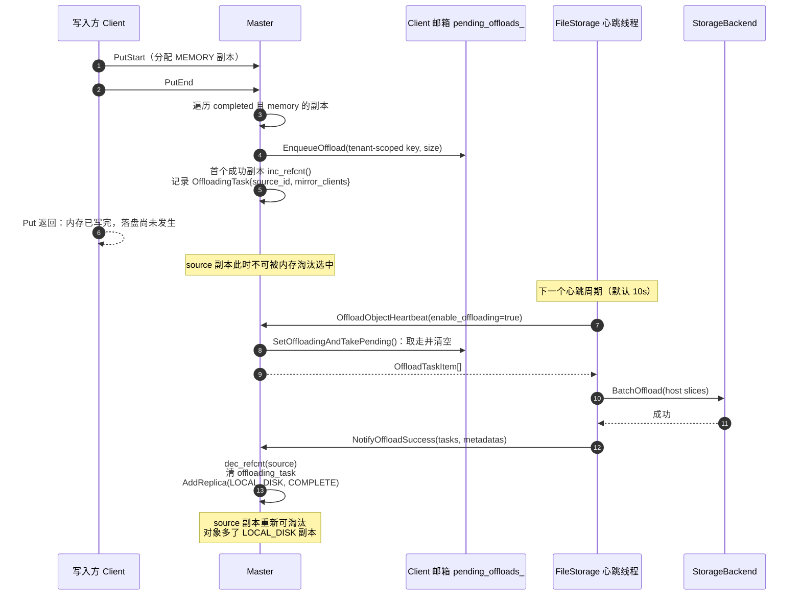

失败分支对应 3.1.6 的表格：客户端明确失败 → NACK 立刻释放；客户端失联/超时 → 600s TTL reaper 释放。

### 3.2 心跳循环（owner 侧）

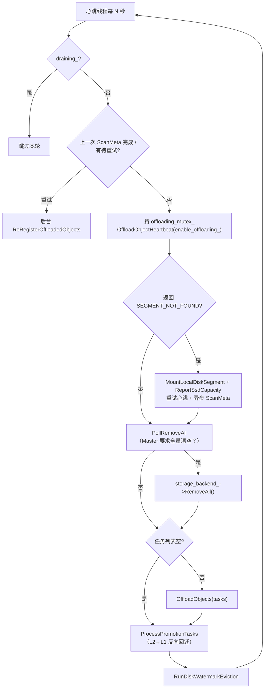

代码：[file_storage.cpp:662-812](../Mooncake/mooncake-store/src/file_storage.cpp#L662)。

两个容易被忽略的设计：

1. **`SEGMENT_NOT_FOUND` 自愈**：Master 重启会丢掉 `LOCAL_DISK` segment 注册和对象记录。心跳发现后重新挂载、重报容量，并在后台跑一次 `ScanMeta` 把对象补登记，不需要重启 Client。
2. **`draining_` 双重检查**：`DrainLocalDiskSegment` 在 `offloading_mutex_` 下置位并注销 segment；心跳在入口和拿到锁后各查一次，避免"读到 false 后被调度出去，醒来看到 SEGMENT_NOT_FOUND 又把 segment 挂回去"（[file_storage.cpp:829-866](../Mooncake/mooncake-store/src/file_storage.cpp#L829)，注释写得很清楚）。这是进程优雅退出（SIGTERM）链路的一部分。

### 3.3 `OffloadObjects`：一轮任务怎么落盘

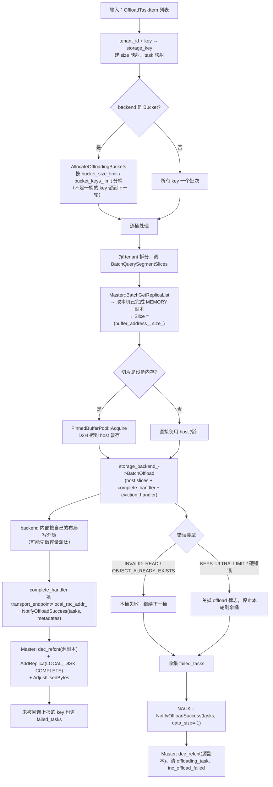

代码：[file_storage.cpp:307-577](../Mooncake/mooncake-store/src/file_storage.cpp#L307)。

#### 3.3.1 源数据怎么读到的（零拷贝的关键）

`BatchQuerySegmentSlices`（[file_storage.cpp:1047-1073](../Mooncake/mooncake-store/src/file_storage.cpp#L1047)）：

```cpp
auto batched_query_results = client_->BatchQuery(keys, tenant_id);   // 一次批量 RPC，拿副本描述
for (...) for (auto& descriptor : results[i]->replicas) {
    if (client_->IsReplicaOnLocalMemory(descriptor)) {               // endpoint == 本机
        auto& md = descriptor.get_memory_descriptor();
        slices.emplace_back(Slice{(void*)md.buffer_descriptor.buffer_address_,
                                  md.buffer_descriptor.size_});
        break;
    }
}
```

- 这里**没有 TE 传输**：`buffer_address_` 就是本进程 `mooncake_malloc` 出来的虚拟地址，直接当 slice 用。
- 它同时向 Master 申请了一次读租约（`BatchGetReplicaList` 内部 `GrantReadLease`），租约期内源副本不会被淘汰，配合 `offloading_task` 的 refcnt 形成双重保护。
- 这一步是"best-effort"的：找不到本机副本的 key 直接进 `failed_tasks`，不会打断整轮（[file_storage.cpp:399-412](../Mooncake/mooncake-store/src/file_storage.cpp#L399)）。

#### 3.3.2 设备数据的 D2H 暂存

backend 约定只接收 **host 指针**（`BuildBucket` 会直接 memcpy iovec、`ConcatSlicesToString` 会拼接、OSS adapter 会把 iovec 交给 libcurl）。所以 `OffloadObjects` 在调 `BatchOffload` 前做一次过滤（[file_storage.cpp:418-468](../Mooncake/mooncake-store/src/file_storage.cpp#L418)）：

- `RuntimeAccelerators().FindDeviceForPointer(slice.ptr)` 命中 → `pinned_buffer_pool_->Acquire(size)` → `Copy(kDeviceToHost)` → 用 pinned host slice 替换；
- 否则原样传递（CPU 内存零拷贝）；
- 失败的 key 进 `failed_tasks`；整桶都失败则跳过 `BatchOffload` 并把暂存 buffer 归还。

这是 GPU 场景下 offload 唯一的额外拷贝；纯 CPU 场景是 zeros-copy 落盘。

#### 3.3.3 回调、幂等与部分成功

`BucketStorageBackend::BatchOffload` 的顺序是刻意的（[storage_backend.cpp:1514-1684](../Mooncake/mooncake-store/src/storage_backend.cpp#L1514)）：

```
BuildBucket → PrepareEviction（锁内摘除旧桶）→ eviction_handler（先通知 Master）
→ CommitPreparedEviction → FinalizeEviction（删文件）
→ WriteBucket（写数据 + 写 meta + datasync）
→ 锁内提交 object_bucket_map_ / total_size_ / lru_index_
→ complete_handler（NotifyOffloadSuccess）
```

即 **先让本地索引可见，再通知 Master**：这样 Master 一旦把读请求指过来，本进程一定能在 `object_bucket_map_` 里查到。反过来若 `complete_handler` 失败，`RollbackCommittedBucket` 会把本地索引和文件一起回滚，避免产生"本机可读、Master 不知道"的幽灵副本。

- **重复 offload 幂等**：分桶阶段用 `IsExist` 跳过已落盘 key；`PrepareEviction` 用 `pending_write_keys_` 挡并发重复；提交阶段再按 `object_bucket_map_` 二次去重。只有真正提交的 key 才会进 `committed_keys` 去回调 Master（[storage_backend.cpp:1589-1660](../Mooncake/mooncake-store/src/storage_backend.cpp#L1589)）。
- **部分成功**：`FileStorage` 记录 `reported_keys`，未被上报的 key 进 `failed_tasks`，最后统一 NACK。
- **NACK 哨兵**：`NotifyOffloadSuccess` 收到 `data_size < 0` 时只做清理，不 `AddReplica`（[master_service.cpp:9001-9021](../Mooncake/mooncake-store/src/master_service.cpp#L9001)）。这是"任务被取走了但没写成"的回收通道，避免 `offloading_task` 和源副本 refcnt 卡到 TTL 到期。
- **软/硬错误分类**：`INVALID_READ`（源数据读不到）、`OBJECT_ALREADY_EXISTS`（并发/重复）只影响当前桶；`KEYS_ULTRA_LIMIT` 会关掉 `enable_offloading_` 并中止本轮剩余桶，但仍会先把已取出的任务全部 NACK 掉（[file_storage.cpp:511-576](../Mooncake/mooncake-store/src/file_storage.cpp#L511)）。

### 3.4 `NotifyOffloadSuccess`：Master 侧登记

[master_service.cpp:8973-9159](../Mooncake/mooncake-store/src/master_service.cpp#L8973) 的三种分支：

| 场景 | 处理 |
| --- | --- |
| 对象存在，且有 `offloading_task` | `dec_refcnt(源副本)`、清 task；若该对象还没有任何 `LOCAL_DISK` 副本则 `AddReplica`，否则只**刷新已有副本的 endpoint / object_size**（重复上报幂等） |
| 对象存在，但**没有** task 标记 | 走常规登记 `AddReplicaForRetainedClient`（这正是 `ScanMeta` 重启恢复的路径） |
| 对象不存在（`OBJECT_NOT_FOUND`） | 跳过，不凭空造对象 |

另外两点：

- **segment 必须仍在挂载状态**。登记和 `UnmountLocalDiskSegment` 的注销在同一把 `master_state_mutex_` 下排序，drain 期间的迟到登记会被拒绝并返回 `SEGMENT_NOT_FOUND`（[master_service.cpp:9028-9047](../Mooncake/mooncake-store/src/master_service.cpp#L9028)）。
- **容量统计**：只有新增 `LOCAL_DISK` 副本时才 `AdjustUsedBytes(client, data_size)`；`ReportSsdCapacity` 单独上报分母。这套统计只反映 Master 视角，不等于真实磁盘占用。

---

## 4. 读取：`LOCAL_DISK` → 应用 buffer

### 4.1 入口与副本选择

`LOCAL_DISK` 的分发在 **RealClient 层**，不在 `Client` 层。原因很直接：`Client::Get` 只有 `TransferRead`（memory）和 `ReadDfsReplica`（DFS），没有 LOCAL_DISK 分支；`FindFirstCompleteReplica` 又只是"取第一个 COMPLETE"。所以 RealClient 先用自己的策略选副本，再决定走哪条路：

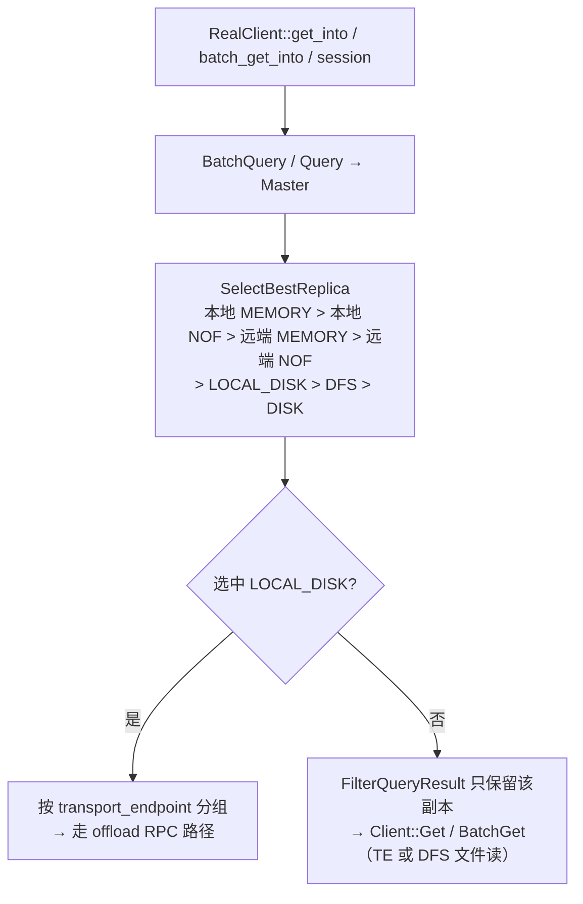

- 选择顺序在 [replica_selection.h:120-180](../Mooncake/mooncake-store/include/replica_selection.h#L120)。
- 单键路径见 [real_client.cpp:3762-3826](../Mooncake/mooncake-store/src/real_client.cpp#L3762)；批量路径见 [real_client.cpp:4151-4330](../Mooncake/mooncake-store/src/real_client.cpp#L4151)。
- `FilterQueryResult`（[real_client.cpp:493-500](../Mooncake/mooncake-store/src/real_client.cpp#L493)）把 QueryResult 裁成只剩选中的那一个副本，防止 `Client::Get` 内部再选出 LOCAL_DISK 去走 TE（那会失败）。
- 注意：`LOCAL_DISK` 优先级**低于任何 MEMORY/NOF**，但**高于 DFS 和 DISK**。在混合部署里这意味着"内存不在就找 owner 代读"，而不是直接去读共享文件。

### 4.2 跨进程读（主路径）

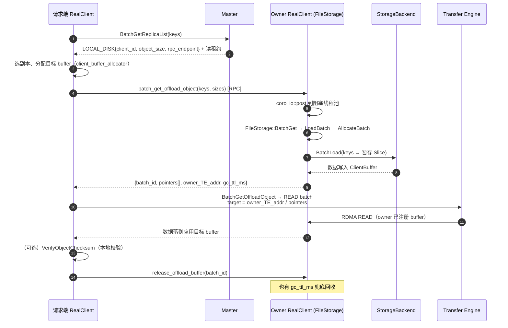

请求端的实现（[real_client.cpp:8893-9019](../Mooncake/mooncake-store/src/real_client.cpp#L8893)）：

1. `restore_offload_objects()` 把用户 key 加租户前缀 `tenant.MakeScopedKey(key)`，然后 `ClientRequester::batch_get_offload_object(owner_endpoint, keys, sizes)`。
2. 返回的 `pointers[i]` 是 owner 进程 `ClientBuffer` 里的地址；`transfer_engine_addr` 是 owner 的 `Client::GetSegmentEndpoint()`。
3. `client_->BatchGetOffloadObject(...)` → `TransferSubmitter::submit_batch_get_offload_object`（[transfer_task.cpp:1614-1694](../Mooncake/mooncake-store/src/transfer_task.cpp#L1614)）：
   - `openSegment(owner_endpoint)` 一次，整批共用；
   - 每个 slice 生成一条 `TransferRequest{opcode=READ, target_offset = pointers[i]+offset, length}`；
   - 统一 `submitTransfer(requests, kForegroundGet)` 并等待完成。
4. `OffloadRestoreLease` 析构时调 `release_offload_buffer(batch_id)`（[real_client.cpp:586-636](../Mooncake/mooncake-store/src/real_client.cpp#L586)），fire-and-forget。

owner 侧的 RPC handler（[real_client.cpp:8694-8722](../Mooncake/mooncake-store/src/real_client.cpp#L8694)）：

```cpp
auto try_result = co_await coro_io::post([s]() {
    return s->file_storage->BatchGet(s->keys, s->sizes);   // 阻塞 IO 移出 RPC IO 线程
});
co_return BatchGetOffloadObjectResponse(batch_id, std::move(pointers),
                                        client_->GetSegmentEndpoint(),
                                        file_storage_->config_.client_buffer_gc_ttl_ms);
```

`FileStorage::BatchGet` → `LoadBatch(prefer_pinned=false)` → `AllocateBatch`（从 `ClientBufferAllocator` 里按对象大小逐块分配）→ `storage_backend_->BatchLoad(slices)` → 记录 `batch_id → AllocatedBatch` 映射（含 lease 超时）→ 返回指针（[file_storage.cpp:267-300](../Mooncake/mooncake-store/src/file_storage.cpp#L267)）。

这里有一个值得注意的细节：BatchLoad 后 `slice.ptr` 可能被 O_DIRECT 对齐修正过，`BatchGet` 会把 `pointers[i]` 重新对齐到真实数据位置（[file_storage.cpp:253-262](../Mooncake/mooncake-store/src/file_storage.cpp#L253)）。

### 4.3 同进程 GPU 读（pinned arena + H2D）

当**请求端和 owner 是同一进程**，且目标 buffer 全是设备指针时，可以省掉 RPC 和 TE，直接在进程内 memcpy：

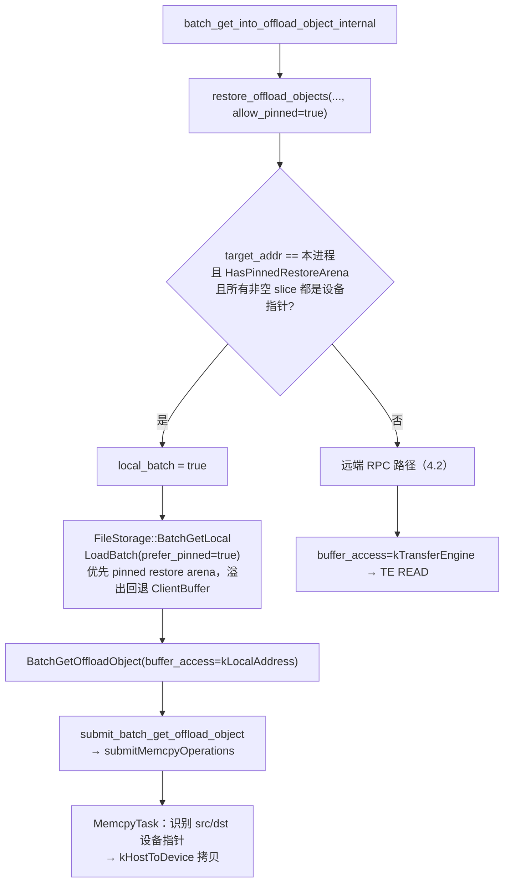

判断条件在 [real_client.cpp:8873-8891](../Mooncake/mooncake-store/src/real_client.cpp#L8873)：`target_rpc_service_addr == local_rpc_addr`、pinned arena 存在、**所有**待写 slice 都是设备指针（只要有 CPU 指针就走普通路径）。`BatchGetLocal` 返回的 `LocalBatchResult` 用 `shared_ptr<void> owner` 持有分配，RAII 释放，不走 `batch_id` 映射（[file_storage.h:56-62](../Mooncake/mooncake-store/include/file_storage.h#L56)）。

memcpy 分支在 [transfer_task.cpp:1675-1693](../Mooncake/mooncake-store/src/transfer_task.cpp#L1675)，设备识别与方向选择在 [transfer_task.cpp:723-761](../Mooncake/mooncake-store/src/transfer_task.cpp#L723)。

### 4.4 会话区间读（session range read）

Session 读的对象可能很大、只取一段，且目标必须是 TE 可达的地址：

1. 先 `restore_offload_objects(..., allow_pinned=false)`，把**整个对象**恢复到 owner 的 `ClientBuffer`；
2. 再用 `BatchTransferReadOffloadRanges(owner_TE_addr, remote_bases, remote_sizes, slices, src_offsets)` 把 `[source_offset, +len)` 的片段 scatter 到多个目标 slice（[real_client.cpp:7178-7300](../Mooncake/mooncake-store/src/real_client.cpp#L7178)）；
3. 同一 key 的多个区间只 restore 一次，按对象合并。

这里 **必须** `allow_pinned=false`：session scatter 走 TE，pinned arena 没注册，TE 看不到。

### 4.5 buffer 生命周期

| 路径 | 谁释放 | 何时 |
| --- | --- | --- |
| 远端 RPC | 请求端 `release_offload_buffer(batch_id)` | `OffloadRestoreLease` 析构（TE 完成后） |
| 远端 RPC 失败/进程崩 | owner 的 GC 线程 | 超过 `client_buffer_gc_ttl_ms`（默认 5s） |
| 同进程 pinned | `LocalBatchResult::owner`（RAII） | 函数返回/异常 |
| 同进程回退到 ClientBuffer | 同上，仍在 `AllocatedBatch` 里 | 同上，且不进远端映射表 |

`ClientBufferGCThreadFunc` 每秒扫一次 `client_buffer_allocated_batches_`，过期即回收（[file_storage.cpp:1169-1192](../Mooncake/mooncake-store/src/file_storage.cpp#L1169)）。`AllocateBatch` 在分配失败时也会就地触发一次 GC 再重试（[file_storage.cpp:1127-1144](../Mooncake/mooncake-store/src/file_storage.cpp#L1127)）。

另外请求端还有一层保护：`OffloadRestoreLease::LeaseExpired()` 会在 `gc_ttl_ms` 到期时让本次读返回 `OBJECT_HAS_LEASE`，因为此时 owner 可能已经回收了 buffer（[real_client.cpp:9015-9017](../Mooncake/mooncake-store/src/real_client.cpp#L9015)）。

### 4.6 读取失败与"悬空副本"修复

`LOCAL_DISK` 副本可能指向一个文件已经没了的 owner（磁盘被清、bucket 被淘汰、重启后目录换掉）。读失败后请求端不会立刻放弃：

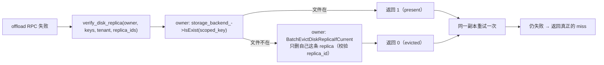

- 入口：`heal_disk_replica_for_read`（批量路径在 [real_client.cpp:4354-4400](../Mooncake/mooncake-store/src/real_client.cpp#L4354)）。
- owner 端 handler 在 [real_client.cpp:8733-8871](../Mooncake/mooncake-store/src/real_client.cpp#L8733)，用 `replica_ids` 做条件删除，避免误删同名对象的新副本；租户 scope 的处理（`resolved_tenant_id` 与 `default` 双探）在注释里写得很细。
- `Put` 路径也有对应修复：`PutStart` 遇到 `OBJECT_ALREADY_EXISTS` 且探测到文件已丢，会先 `EvictDiskReplicaIfCurrent` 再重试 `PutStart`（[client_service.cpp:1988-1993](../Mooncake/mooncake-store/src/client_service.cpp#L1988)，探针由 `SetLocalDiskProbe` 注入）。

---

## 5. 淘汰、清理与下线

### 5.1 后端两阶段淘汰（以 Bucket 为例）

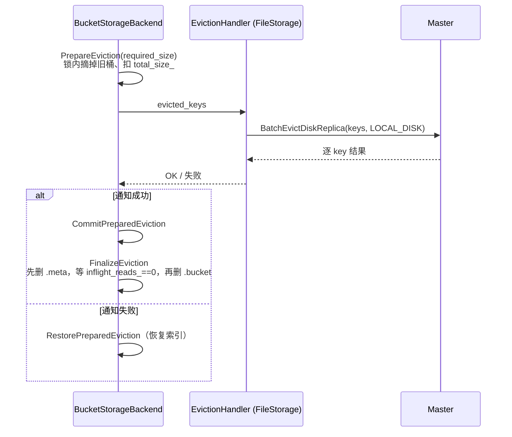

- **先通知 Master、再删文件**：保证 Master 不会把一个已经删掉的文件位置发给读者。
- **`BucketReadGuard` + `inflight_reads_`**：`BatchLoad` 期间持有 guard，`FinalizeEviction` 自旋等待计数归零（10s 超时），保证正在读的请求能完成（[storage_backend.h:112-154](../Mooncake/mooncake-store/include/storage_backend.h#L112)，[storage_backend.cpp:1703-1774](../Mooncake/mooncake-store/src/storage_backend.cpp#L1703)）。
- 淘汰策略 FIFO / LRU；LRU 索引是惰性维护的 `{last_access_ns_, bucket_id}` 集合。

### 5.2 主动水位淘汰

心跳末尾的 `RunDiskWatermarkEviction`（[file_storage.cpp:628-647](../Mooncake/mooncake-store/src/file_storage.cpp#L628)）：后端用量超过 high watermark 时，把用量压到 low watermark，淘汰同样走 `eviction_handler` → `BatchEvictDiskReplica`。这条路径不依赖新写入，避免"没有新 Put 就永远不降水位"。

支持情况：Bucket（FIFO/LRU）、FilePerKey（FIFO 队列）、OffsetAllocator（当前 no-op）、NVMe KV / OSS（无本地容量淘汰，由设备/云端负责）。

### 5.3 Master 侧的清理

| 场景 | 代码 | 行为 |
| --- | --- | --- |
| owner 失联 | `CleanupStaleHandles`（[master_service.cpp:8328-8384](../Mooncake/mooncake-store/src/master_service.cpp#L8328)） | `has_stale_local_disk_client` 命中则删副本；最后一个副本删掉后对象记录也消失 |
| 主动卸载 | `UnmountLocalDiskSegment`（[master_service.cpp:8830-8881](../Mooncake/mooncake-store/src/master_service.cpp#L8830)） | 注销 segment → 按 owner id 扫全部 shard 删除其 `LOCAL_DISK` 副本 |
| 后端淘汰 | `BatchEvictDiskReplica` → `EvictDiskReplicaImpl`（[master_service.cpp:6660-6791](../Mooncake/mooncake-store/src/master_service.cpp#L6660)） | 只删 `client_id` 匹配的 LOCAL_DISK 副本；可带 `ReplicaID` 做条件删除 |

### 5.4 优雅下线

`RealClient::drainLocalDiskSegment(grace_seconds)`（[real_client.cpp:2362-2375](../Mooncake/mooncake-store/src/real_client.cpp#L2362)）→ `FileStorage::DrainLocalDiskSegment`（[file_storage.cpp:829-866](../Mooncake/mooncake-store/src/file_storage.cpp#L829)）：

1. 置 `draining_`（在 `offloading_mutex_` 下，与心跳 RPC 互斥）；
2. `UnmountLocalDiskSegment`：Master 立刻不再把该 owner 的 `LOCAL_DISK` 副本发给读者，并扫掉其副本；
3. sleep 一个 grace period，等在途的 offload 读请求结束；
4. 之后心跳不再挂回 segment（`draining_` 不可逆）。

这是 `LOCAL_DISK` "读依赖进程"这一语义换来的必要代价：内存副本由网卡直接服务，进程死了也不影响；磁盘副本必须由进程读出来再推给读者。

---

## 6. 三个后端（以及 DFS）的具体差异

### 6.1 对比

| 维度 | Bucket（默认） | FilePerKey | OffsetAllocator | NVMe KV | OSS（Distributed） |
| --- | --- | --- | --- | --- | --- |
| 对象布局 | 多 key 聚合为一个 bucket | 一 key 一文件 | 单文件 + 区间分配 | 设备 value，大对象分块 + root manifest | 一 key 一 OSS object（owner 前缀） |
| 元数据 | `.meta` 文件（keys + offset/key_size/data_size） | 文件路径（key 哈希） | 内存分片表 + 持久化 checkpoint | root value 内的 header/identity/manifest | 无（靠 LIST） |
| 写路径 | iovec 直写 + datasync | 序列化 KVEntry + 写文件 | 记录头 + value 写偏移 | NVMe KV Store（store-if-not-exists） | HTTP PUT（并发） |
| 读路径 | 按 bucket 分组批量 pread/io_uring | 读文件 + 反序列化 + memcpy | 读 header + value | Retrieve（可直读目标 buffer）+ 校验 | HTTP GET（并发，直接写入目标 buffer） |
| 容量淘汰 | FIFO/LRU + 逻辑/物理上限 + 水位 | FIFO 队列 + 水位 | 有淘汰框架（水位 no-op） | 无（设备/上层负责） | 无 |
| 重启恢复 | `ScanMeta` 读 `.meta` | `ScanMeta` 递归扫目录 | 截断重来（不可恢复） | `ScanMeta` 当前为空实现，不自动恢复 | `ScanMeta` LIST 对象 |
| 单设备/单路径约束 | 一个 `storage_path` 只允许一个活 Client（flock） | 同左 | 同左 | 当前面向单个本地设备 | 每 owner 独立 prefix |

### 6.2 BucketStorageBackend

- 分桶：`GroupOffloadingKeysByBucket`（[storage_backend.cpp:2294-2405](../Mooncake/mooncake-store/src/storage_backend.cpp#L2294)）按 `bucket_keys_limit`（默认 500）和 `bucket_size_limit`（默认 256 MB）聚桶；不足一桶的 key 放进 `ungrouped_offloading_objects_` 等下一轮；`MOONCAKE_OFFLOAD_FLUSH_PARTIAL_BUCKETS=1` 可以让尾桶当轮落盘（见设计文档对 issue #3006 的说明）。
- 数据文件布局：`[key bytes][value bytes][key bytes][value bytes]...`，`BucketObjectMetadata{offset, key_size, data_size}` 记录每段的偏移（[storage_backend.cpp:2408-2437](../Mooncake/mooncake-store/src/storage_backend.cpp#L2408)）。
- 读：先按 bucket 分组，一次性建 ReadPlan（锁内只拷元数据），锁外批量 I/O；io_uring 模式下用 `batch_read` 并把对齐修正后的真实地址写回 `batch_object[key].ptr`。
- 所有权：`Init` 里对 `<storage_path>/.mooncake_local_disk.lock` 拿非阻塞 `flock`，第二个活 Client 直接失败 —— 所以"同一块盘多 rank 共用目录"不是受支持部署。

### 6.3 FilePerKey（`StorageBackendAdaptor`）

- 每 key 一个文件，路径由 key 两级哈希得到；写时把 slices 拼成 `KVEntry{key,value}` 并 `struct_pb` 序列化，再交给通用 `StorageBackend::StoreObject`（FIFO 队列 + 配额淘汰）。
- 读时要**整文件读进 `std::string` 再 memcpy 到目标**（[storage_backend.cpp:1311-1338](../Mooncake/mooncake-store/src/storage_backend.cpp#L1311)），多一次分配和拷贝；这是它和 Bucket/OffsetAllocator 的主要性能差异。

### 6.4 OffsetAllocator

- 单个预分配文件 `kv_cache.data`，`OffsetAllocator` 管空闲区间，1024 个分片表降低锁竞争。
- 记录格式 v3：`[key_len u32][value_len u32][seq u64][flags u32][crc32 u32][key][padding][value]`，value 在记录内 4 KiB 对齐（为 cuFile/GDS 之类 DMA 写入预留）。
- 读时只校验 header/key 与长度，CRC 只在恢复时校验 —— 热路径不付校验成本（[storage_backend.cpp:5319-5330](../Mooncake/mooncake-store/src/storage_backend.cpp#L5319)）。
- **BatchOffload 假定单写者**（只有一条心跳线程），注释明确写了并发 offload 需要重审（[storage_backend.cpp:4844-4854](../Mooncake/mooncake-store/src/storage_backend.cpp#L4844)）。

### 6.5 NVMe KV（`NvmeKvStorageBackend`）

分层与原文一致：backend 负责逻辑对象布局，`NvmeKvConnector` 绑定设备，`NvmeKvCommandExecutor` 用 io_uring 或 ioctl 下发命令。

- **物理 key 编码**（[key_codec.cpp](../Mooncake/mooncake-store/src/nvme_kv/key_codec.cpp)）：逻辑 key 是变长字符串，设备 key 固定 16 字节。用两组种子不同的 XXH64 生成 root/chunk 物理 key，用四组种子 XXH64 生成写进 root header 的 identity 校验值。
- **冲突处理**（[key_conflict_policy.cpp](../Mooncake/mooncake-store/src/nvme_kv/key_conflict_policy.cpp)）：最多 64 个冲突槽；每次都是 `store-if-not-exists`；命中已存在时 Retrieve 比较字节 —— 相同视为幂等成功，不同则换下一个槽。读时逐槽探测，直到 header 里的 identity 与请求 key 一致。
- **对象布局**（[object_layout.cpp](../Mooncake/mooncake-store/src/nvme_kv/object_layout.cpp)）：小对象 inline（header + identity + payload）；大对象拆成 raw chunk values，最后写 root manifest（manifest 记录每个 chunk 的物理 key/长度/校验和）。**root 最后写，充当可见性标记**。
- **写路径**（[backend.cpp:479-975](../Mooncake/mooncake-store/src/nvme_kv/backend.cpp#L479)）：prepare worker 建 payload 视图/校验和/chunk/manifest；chunk lane 提交；某个对象的 chunk 全部完成后才把它的 root 投到 root lane；失败时只清理本次尝试创建的 key。
- **读路径**（[backend.cpp:1167+](../Mooncake/mooncake-store/src/nvme_kv/backend.cpp#L1167)）：解析并校验 root → inline 直接 memcpy；manifest 则生成 chunk 读计划。目标地址对齐且 executor 支持时走 `RetrieveIntoBatch`（设备直读目标 buffer），否则用 executor 自带 buffer + 校验后拷贝。
- **尚未覆盖**：RFC 里"从设备恢复对象目录"在 Backend 的 `ScanMeta` 里没有实现（空函数），所以 owner 重启后 Master 侧的 `LOCAL_DISK` 记录不会自动重建；多设备选择/容量满清理也没有接入。

### 6.6 OSS / DistributedStorageBackend

- `UsesObjectStorage()` 为真时走对象存储语义：`BatchOffload` 把每个 key 的 slices 变成 iovec 数组交给 `ObjectStorageAdapter::PutBatch`，**没有 eviction handler**（有也会被忽略）；`BatchLoad` 变成 `GetBatch`，逐项校验返回长度（[distributed_storage_backend.cpp:359-444](../Mooncake/mooncake-store/src/storage/distributed/distributed_storage_backend.cpp#L359)、[:815-845](../Mooncake/mooncake-store/src/storage/distributed/distributed_storage_backend.cpp#L815)）。
- 物理 key = `owner_prefix + "/" + URIEncode(storage_key)`；PUT 直接覆盖，不做 store-if-not-exists，靠 owner 前缀隔离不同写入者。
- 每个 batch 自建 `CURLM`，最多 `MOONCAKE_OSS_MAX_CONNECTIONS`（默认 64）并发；GET 的 libcurl 回调直接写目标 buffer，避免整对象临时字符串。
- **限制**：Master 里的 `LOCAL_DISK` 记录仍然必需，读仍依赖 owner 进程；不做 multipart、不做云端 GC，删 Master 元数据不会发 DELETE。

---

## 7. 按调用链的代码串讲

这一节按"从上到下"的顺序串一遍，便于对照源码阅读。

### 7.1 进程装配

| 步骤 | 代码 |
| --- | --- |
| 启动 offload RPC server（3 个 handler） | [real_client.cpp:1458-1478](../Mooncake/mooncake-store/src/real_client.cpp#L1458) |
| 构造 FileStorage（选 backend、建 buffer 池） | [real_client.cpp:1484-1491](../Mooncake/mooncake-store/src/real_client.cpp#L1484) |
| 注册"文件是否还在"的探针 | [real_client.cpp:1498-1518](../Mooncake/mooncake-store/src/real_client.cpp#L1498) |
| `FileStorage` 构造：校验配置、建 pinned arena、`CreateStorageBackend`、DFS 分流 | [file_storage.cpp:41-115](../Mooncake/mooncake-store/src/file_storage.cpp#L41) |

### 7.2 `FileStorage::Init`

[file_storage.cpp:129-228](../Mooncake/mooncake-store/src/file_storage.cpp#L129)：

```
RegisterLocalMemory()          // TE 注册暂存区，remote_accessible=true
storage_backend_->Init()       // 目录/文件/锁/恢复
if (enable_dfs) { start GC; return; }
IsEnableOffloading()           // 后端是否还有空间
MountLocalDiskSegment()        // Master 建 LOCAL_DISK segment
ReportSsdCapacity()            // 上报分母
ScanMeta(handler)              // 对已存在对象逐批 NotifyOffloadSuccess
start heartbeat_thread_        // while(running) { Heartbeat(); sleep(interval); }
start client_buffer_gc_thread_
```

### 7.3 `Heartbeat`

[file_storage.cpp:662-812](../Mooncake/mooncake-store/src/file_storage.cpp#L662)，逐段：

1. `draining_` 快速检查；join 上一次 `rescan_future_`；失败过的 rescan 重试（`metadata_resync_pending_`）。
2. `offloading_mutex_` 内：再次检查 `draining_` → `OffloadObjectHeartbeat(enable_offloading_, tasks)`。
3. `SEGMENT_NOT_FOUND` 分支：重新 `MountLocalDiskSegment` + `ReportSsdCapacity` + 重试心跳 + 启动后台 `ReRegisterOffloadedObjects`。
4. `PollRemoveAll()`：Master 要求"全量清空"（如租户级/全局 RemoveAll）时调用 `storage_backend_->RemoveAll()`。
5. `OffloadObjects(tasks)`。
6. `ProcessPromotionTasks()`：反向的 L2→L1，见 7.11。
7. `RunDiskWatermarkEviction()`。

### 7.4 `OffloadObjects`

[file_storage.cpp:307-577](../Mooncake/mooncake-store/src/file_storage.cpp#L307)，建议按四个块读：

| 行段 | 内容 |
| --- | --- |
| 312-340 | 建 `storage_key ↔ task` 双映射；Bucket 后端分桶，其他后端单批 |
| 342-367 | `complete_handler`：补 `transport_endpoint`，按 `storage_key` 找回 task，调 `NotifyOffloadSuccess` |
| 369-468 | 逐桶：按租户取本机内存 slices → D2H 暂存 |
| 470-548 | 调 `BatchOffload`；统计 metric；成功则 NACK 未被上报的 key；失败则分类处理 |
| 550-576 | 兜底：分桶阶段被跳过的 key 一并 NACK；如有中止错误则返回 |

### 7.5 存储后端入口

- 工厂：[storage_backend.cpp:5579-5661](../Mooncake/mooncake-store/src/storage_backend.cpp#L5579)。
- 接口约定：`BatchOffload(map<string, vector<Slice>>, complete_handler, eviction_handler)`、`BatchLoad(map<string, Slice>&)`、`ScanMeta(handler)`、`IsExist`、`IsEnableOffloading`、`EvictAboveDiskWatermark`（[storage_backend.h:262-318](../Mooncake/mooncake-store/include/storage_backend.h#L262)）。
- 约定三条：
  1. **只接收 host 指针**（FileStorage 已做 D2H）；
  2. `BatchLoad` 的目标 Slice 由调用方分配并保证大小精确匹配；
  3. `complete_handler` 只在本地提交成功后被调用，其返回值失败时应回滚本地提交（Bucket 的做法）。

### 7.6 `BatchLoad` 与 `AllocateBatch`

[file_storage.cpp:1092-1167](../Mooncake/mooncake-store/src/file_storage.cpp#L1092)：

- 每个 key 独立 `allocator.allocate(alloc_size)`；`use_uring` 时按 4 KiB 向上取整并多留 2 个对齐块，供 O_DIRECT 读的起止对齐用；
- 首次失败触发一次租约过期清理再重试；
- `AllocatedBatch` 持有 `BufferHandle`（RAII）→ `pointers` / `slices` / `lease_timeout` / `total_size`；
- GC 线程与 `ReleaseBuffer` 都只是从 `client_buffer_allocated_batches_` 里 erase 这个 shared_ptr。

### 7.7 owner 侧 RPC

| 函数 | 说明 |
| --- | --- |
| `batch_get_offload_object` | [real_client.cpp:8694-8722](../Mooncake/mooncake-store/src/real_client.cpp#L8694)，阻塞 IO 丢给线程池，返回 batch_id + pointers + TE endpoint + TTL |
| `release_offload_buffer` | [real_client.cpp:8724-8731](../Mooncake/mooncake-store/src/real_client.cpp#L8724) |
| `verify_disk_replica` | [real_client.cpp:8733-8871](../Mooncake/mooncake-store/src/real_client.cpp#L8733) |

`ClientRequester` 的连接池参数值得注意（[real_client.cpp:9021-9052](../Mooncake/mooncake-store/src/real_client.cpp#L9021)）：`connect_retry_count=3`、`reconnect_wait_time=1s`、`host_alive_detect_duration=0`（关闭无边界的后台重连日志），并复用 Master 同一套 RPC 超时覆盖。原因是读路径**选中一个已经死掉的 owner** 时，默认 30s 连接超时 × 3 次重试会让单次读卡 90s 以上。

### 7.8 请求端恢复与传输

| 步骤 | 代码 |
| --- | --- |
| `restore_offload_objects`：租户前缀、选本地/远端、构造 lease | [real_client.cpp:8893-8948](../Mooncake/mooncake-store/src/real_client.cpp#L8893) |
| `batch_get_into_offload_object_internal`：算 restore_size、range 偏移、发起 TE/memcpy | [real_client.cpp:8950-9019](../Mooncake/mooncake-store/src/real_client.cpp#L8950) |
| `OffloadRestoreLease`：析构释放、TTL 判定 | [real_client.cpp:586-636](../Mooncake/mooncake-store/src/real_client.cpp#L586) |
| `can_use_pinned_restore_arena` | [real_client.cpp:8873-8891](../Mooncake/mooncake-store/src/real_client.cpp#L8873) |
| `submit_batch_get_offload_object`（TE READ / memcpy） | [transfer_task.cpp:1614-1694](../Mooncake/mooncake-store/src/transfer_task.cpp#L1614) |

### 7.9 Master 侧

| 函数 | 行号 | 要点 |
| --- | --- | --- |
| `MountLocalDiskSegment` | [8784](../Mooncake/mooncake-store/src/master_service.cpp#L8784) | 需要 `enable_offload_`；重复挂载视为成功 |
| `UnmountLocalDiskSegment` | [8830](../Mooncake/mooncake-store/src/master_service.cpp#L8830) | 独占 `master_state_mutex_` 注销 + 按 owner 删副本 |
| `OffloadObjectHeartbeat` | [8887](../Mooncake/mooncake-store/src/master_service.cpp#L8887) | 取空邮箱并返回；`enable_offloading=false` 时清空队列并 `dec_refcnt` |
| `NotifyOffloadSuccess` | [8973](../Mooncake/mooncake-store/src/master_service.cpp#L8973) | NACK 分支、task 分支、常规登记分支 |
| `PushOffloadingQueue` | [9161](../Mooncake/mooncake-store/src/master_service.cpp#L9161) | 校验源副本、解析 segment owner、`EnqueueOffload` |
| `GetReplicaList` / `BatchGetReplicaList` | [4818](../Mooncake/mooncake-store/src/master_service.cpp#L4818) / [4995](../Mooncake/mooncake-store/src/master_service.cpp#L4995) | 返回副本并 `GrantReadLease`；无内存副本但有 `LOCAL_DISK` 时可触发 promotion |
| `EvictDiskReplicaImpl` | [6660](../Mooncake/mooncake-store/src/master_service.cpp#L6660) | 只删 owner 自己的副本；支持 `expected_replica_id` |
| `CleanupStaleHandles` | [8328](../Mooncake/mooncake-store/src/master_service.cpp#L8328) | owner 失联/segment 卸载后的副本清理 |

### 7.10 启动恢复

`ReRegisterOffloadedObjects`（[file_storage.cpp:1216-1286](../Mooncake/mooncake-store/src/file_storage.cpp#L1216)）先 `ResetScanIterator()`（Bucket 的游标扫描器在 `Init` 后已耗尽，不重置会"扫不到任何桶"），再 `ScanMeta` 逐批登记；`draining_` 置位时主动中止，避免把即将下线的 owner 又登记回去。

### 7.11 反向路径：L2→L1 promotion

同一套心跳里还有一条反向流水线（[file_storage.cpp:868-1016](../Mooncake/mooncake-store/src/file_storage.cpp#L868)）：

1. `PromotionObjectHeartbeat` 从 Master 拉任务（Master 在 `promotion_on_hit` 打开、且对象只有 `LOCAL_DISK` 副本时入队）；
2. `PromotionAllocStart` 在某个 DRAM segment 上建一条 `PROCESSING` 的 MEMORY 副本；
3. `AllocateBatch` + `BatchLoad` 把对象从后端读进暂存区；
4. `PromotionWrite` 用 TE 写进新副本；
5. `NotifyPromotionSuccess` 把它翻成 `COMPLETE`。

任何一步失败都会 `NotifyPromotionFailure` 归还 Master 侧名额（否则 `promotion_queue_limit` 会被卡到 reaper TTL）。这条路径说明 `LOCAL_DISK` 不只是"只读归档"，也能被回迁为热副本。

### 7.12 关键错误语义速查

| 错误 | 出现位置 | 含义/处理 |
| --- | --- | --- |
| `INVALID_READ` | 后端 BatchOffload | 源数据读不到；本桶失败、继续其他桶 |
| `OBJECT_ALREADY_EXISTS` | 后端 BatchOffload | 已落盘或并发落盘；本桶原子拒绝、继续其他桶 |
| `KEYS_ULTRA_LIMIT` | 后端/adapter | 超 key/容量上限；关闭 offloading、中止本轮 |
| `BUFFER_OVERFLOW` | `AllocateBatch` | 暂存区不足；先 GC 再试，仍失败则该批读失败 |
| `SEGMENT_NOT_FOUND` | 心跳 / Notify | Master 丢了 segment；Client 重挂 + 重扫；Master 拒绝迟到登记 |
| `OBJECT_NOT_FOUND` | BatchLoad / Evict | 键不在后端 / 对象已不在 Master；dangling 修复路径会用到 |
| `OBJECT_HAS_LEASE` | 读路径 | restore buffer 的 GC TTL 已过，或会话租约过期 |
| `FILE_READ_FAIL` | NVMe KV 校验失败等 | 数据不可信，按读失败返回 |
| `UNABLE_OFFLOAD` | Mount | Master 未开 `--enable_offload` |
| `UNAVAILABLE_IN_CURRENT_STATUS` | 多个 RPC | Client liveness 处于 draining/offline，拒绝新工作 |

---

## 8. 与原文描述的对照

| 原文说法 | 代码核对 | 结论 |
| --- | --- | --- |
| "FileStorage 运行在持有内存副本的 Client 中" | `RealClient` 内创建；Dummy 转发到本机 RealClient | ✅ |
| "后台通过 OffloadObjectHeartbeat 取得 Master 下发的任务" | [file_storage.cpp:712-716](../Mooncake/mooncake-store/src/file_storage.cpp#L712) | ✅ |
| "从本节点内存副本取数据" | `BatchQuerySegmentSlices` 取本机已注册内存地址，零拷贝 | ✅（可补充：走 Master 的 `BatchGetReplicaList`，并顺带拿读租约） |
| "成功后通知 Master，登记 LOCAL_DISK 副本，记录所属 Client、RPC 地址和对象长度" | `NotifyOffloadSuccess` → `Replica(client_id, data_size, transport_endpoint)` | ✅ |
| "应用写内存与后台 offload 是两个过程" | 入队在 PutEnd（默认）或淘汰时，落盘在心跳线程 | ✅（可补充：`offload_on_evict` 两种模式） |
| "本地文件：Bucket、FilePerKey、OffsetAllocator 三种布局" | 另有 `StorageBackendAdaptor`（FilePerKey 的实现类名）；三者都实现同一接口 | ✅ |
| "NVMe KV：物理 key 编码、对象校验、大对象分块；Connector/Executor/io_uring 或 ioctl；当前面向单个本地设备" | [nvme-kv-backend.md](../Mooncake/docs/source/design/store/nvme-kv-backend.md) + 代码一致 | ✅ |
| "OSS：DistributedStorageBackend 走 adapter PUT/GET；key 带 owner 前缀；Store 仍登记 LOCAL_DISK" | [distributed_storage_backend.cpp:359-444](../Mooncake/mooncake-store/src/storage/distributed/distributed_storage_backend.cpp#L359) | ✅（S3 复用同一 backend，adapter 不同） |
| "跨进程读取：查 Master → 向所属 Client 发 batch_get_offload_object → 读入 ClientBuffer → 返回描述 → 请求端 TE 拉取 → 释放" | 4.2 节 | ✅ |
| "同进程 GPU 读取另有 pinned buffer + H2D" | 4.3 节；额外条件：目标全是设备指针且本机 memcpy 可用 | ✅（可补充条件） |
| "LOCAL_DISK 并不表示底层只能是本地磁盘" | 三个后端 + OSS 都登记为 LOCAL_DISK | ✅ |

**原文没有展开、但实现里很重要、建议在双写方案里一并考虑的几点：**

1. **offload 有两个触发点**（PutEnd 入队 / 淘汰入队），且入队时 Master 会对源副本 `inc_refcnt`。KVClient 双写如果要在 `Put` 同步路径里"双写",需要明确它和这条异步流水线是**互斥还是叠加**：叠加会导致同一个对象既走 FileStorage 又走 KVClient；互斥则要处理已有 `offloading_task` 的对象。
2. **失败回收依赖 NACK 哨兵**（`data_size=-1`）和 TTL reaper。外部 KV 写入失败时同样需要一条"释放源副本引用"的通道，否则会阻塞后续 Put（`OBJECT_HAS_REPLICATION_TASK`）。
3. **读路径的暂存区是 owner 的进程内资源**，有 5s 租约和容量上限。KVClient 方案里"由存储端直接写调用方 buffer"正好消掉了这一跳，但要保证 SDK 的 `Wait` 返回后确实不再访问调用方 buffer（原文末尾也提到了这个待讨论点）。
4. **同进程 GPU 读有专门优化**（pinned arena + memcpy 直写设备）。如果 KVClient 的 load 直接写设备内存，这条路径会被替代，需要确认 D2H/注册语义是否仍需要保留。
5. **优雅下线是 `LOCAL_DISK` 的固有成本**（drain + grace period）。KVClient 方式如果能让"存储端直接服务读者"，就不需要 owner 进程在下线前等待在途读。
6. **`LOCAL_DISK` 副本和 Master 元数据强绑定**：对象记录被回收后，即使 OSS/磁盘上还有数据，也读不到（除非重新 `ScanMeta` 或再 Put）。这正是双写方案第 1.1 节要解决的问题。

---

## 9. 小结

- 这条路径的本质是 **"控制面在 Master、数据面在 owner Client"** 的三段式：Master 调度 + owner 落盘/代读 + requester 用 TE 拉取。
- 三个后端共享同一套控制面（心跳、任务、登记、淘汰通知、读回暂存），差异被收敛在 `StorageBackendInterface` 的四个方法里；这也是为什么 OSS 这种"底层根本不是磁盘"的存储能直接登记成 `LOCAL_DISK`。
- `LOCAL_DISK` 这个名字描述的是 **副本的归属与访问方式**（由某个 Client 负责读），不是介质类型。
- 这条设计的主要代价有两个：**读依赖 owner 进程存活**、**读回多一次"后端 → owner buffer → requester"的搬运**。KVClient 双写方案要解决的正是这两点，同时保留"外部容量不需要逐项登记到 Master"这一收益。

---

## 附录 A：关键文件

| 文件 | 作用 |
| --- | --- |
| [mooncake-store/include/file_storage.h](../Mooncake/mooncake-store/include/file_storage.h) | FileStorage 接口与状态 |
| [mooncake-store/src/file_storage.cpp](../Mooncake/mooncake-store/src/file_storage.cpp) | 心跳、offload、读回、GC、drain、re-scan |
| [mooncake-store/include/storage_backend.h](../Mooncake/mooncake-store/include/storage_backend.h) | backend 接口、Bucket/FilePerKey/OffsetAllocator 声明、记录格式 |
| [mooncake-store/src/storage_backend.cpp](../Mooncake/mooncake-store/src/storage_backend.cpp) | 三个本地 backend 的实现与工厂 |
| [mooncake-store/src/nvme_kv/](../Mooncake/mooncake-store/src/nvme_kv/) | NVMe KV backend / key codec / 冲突策略 / 对象布局 / executor |
| [mooncake-store/src/storage/distributed/distributed_storage_backend.cpp](../Mooncake/mooncake-store/src/storage/distributed/distributed_storage_backend.cpp) | OSS/DFS 共用 backend |
| [mooncake-store/src/real_client.cpp](../Mooncake/mooncake-store/src/real_client.cpp) | offload RPC server/handler、LOCAL_DISK 分发、restore、session 读 |
| [mooncake-store/src/client_service.cpp](../Mooncake/mooncake-store/src/client_service.cpp) | Client 侧 RPC 封装、副本选择、Get/BatchGet |
| [mooncake-store/src/transfer_task.cpp](../Mooncake/mooncake-store/src/transfer_task.cpp) | TE READ / memcpy 两条拉取实现 |
| [mooncake-store/src/master_service.cpp](../Mooncake/mooncake-store/src/master_service.cpp) | 挂载/心跳/登记/淘汰/清理/副本列表 |
| [mooncake-store/src/local_ssd/manager.cpp](../Mooncake/mooncake-store/src/local_ssd/manager.cpp) | 每 Client 的任务邮箱与容量统计 |
| [docs/source/design/store/ssd-offload.md](../Mooncake/docs/source/design/store/ssd-offload.md) | SSD offload 设计 |
| [docs/source/design/store/nvme-kv-backend.md](../Mooncake/docs/source/design/store/nvme-kv-backend.md) | NVMe KV 设计 |
| [docs/source/design/store/oss-backend.md](../Mooncake/docs/source/design/store/oss-backend.md) | OSS 设计 |

## 附录 B：文中 mermaid 图索引

1. 进程内组件位置（1.1）
2. 启动装配（2.1）
3. offload 触发点（3.1）
4. 心跳循环（3.2）
5. `OffloadObjects` 流程（3.3）
6. 读路径副本选择（4.1）
7. 跨进程读时序（4.2）
8. 同进程 GPU 读（4.3）
9. 悬空副本修复（4.6）
10. 两阶段淘汰时序（5.1）
