# FileStorage Offload 实现解读

> 对应《Mooncake + KVClient 双写》第 2.2 节第 1 条："FileStorage offload：本地文件、NVMe KV、OSS"。
>
> 代码基线：`main` @ `67df8c41`（工作区干净）。文中行号均基于该版本；链接形式为
> `[文件:行号](../Mooncake/mooncake-store/src/file_storage.cpp#L662)`，从本文档所在目录指向仓库根目录。
>
> 阅读方式：第 1–5 节的每张流程图/时序图后面都有一节"图中节点 → 代码"的对照和逐段串讲；
> 图中的每个描述都能在该节找到对应实现。第 7 节是按调用链的速查索引。

---

## 0. 一句话结论

`FileStorage` 是 **RealClient 进程内、由内存副本持有者自己驱动** 的二级存储子系统：

- **写**：Master 先把"哪些对象该落盘"放进该 Client 的任务邮箱；`FileStorage` 的心跳线程拉取任务 → 用 Master 返回的**本进程已注册内存地址**直接读对象 → 交给 backend 落盘 → 成功后向 Master 登记一条 `LOCAL_DISK` 副本（`client_id + transport_endpoint + object_size`）。应用的 `Put` 只负责写内存，落盘是之后独立发生的事。
- **读**：请求端从 Master 的副本列表里看到 `LOCAL_DISK`，但数据不在自己手上。它向该副本记录的**所属 Client** 发 offload RPC；对方把数据从后端读进自己的 `ClientBuffer`，回一组指针；请求端再用 TE 把数据从对方 buffer **拉**到自己的目标 buffer，最后通知对方释放暂存 buffer。
- **语义**：`LOCAL_DISK` 表示"**由一个 Client 代读**"，而不是"数据在本机磁盘"。因此三个后端（本地文件 / NVMe KV / OSS）可以共用同一条控制面和读路径；代价是**读依赖 owner 进程存活**。

---

## 1. 组件与数据结构

> 原文配图（`exports-2026-10-20T06-56-54/assets/Mooncake-FileStorage.excalidraw.png`）：
>
> 

### 1.1 进程内位置

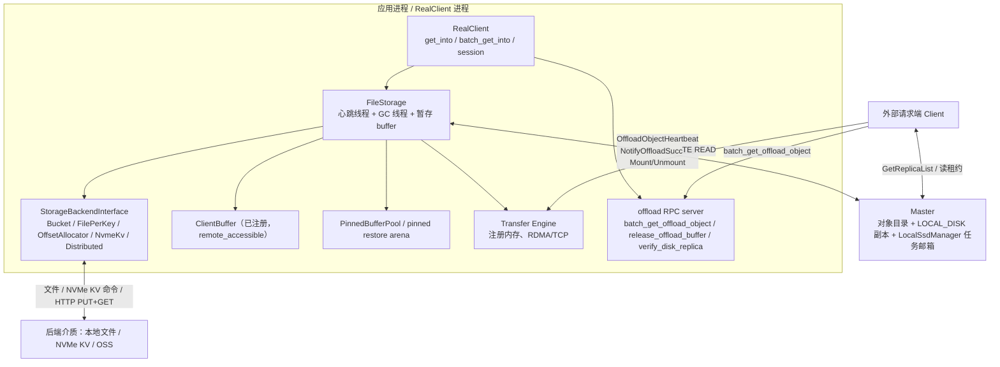

图中每个组件对应的代码入口：

| 图中节点 | 代码入口 |
| --- | --- |
| `RealClient`（API） | [real_client.cpp:1458-1519](../Mooncake/mooncake-store/src/real_client.cpp#L1458) 装配；读路径分发见 [3762-3826](../Mooncake/mooncake-store/src/real_client.cpp#L3762)、[4145-4330](../Mooncake/mooncake-store/src/real_client.cpp#L4145) |
| `FileStorage` | [file_storage.h:12-257](../Mooncake/mooncake-store/include/file_storage.h#L12)、[file_storage.cpp:41-1288](../Mooncake/mooncake-store/src/file_storage.cpp#L41) |
| `StorageBackendInterface` 及五个实现 | [storage_backend.h:262-318](../Mooncake/mooncake-store/include/storage_backend.h#L262)、工厂 [storage_backend.cpp:5579](../Mooncake/mooncake-store/src/storage_backend.cpp#L5579) |
| `ClientBuffer`（已注册） | 分配器构造 [file_storage.cpp:50-51](../Mooncake/mooncake-store/src/file_storage.cpp#L50)、注册 [1075-1090](../Mooncake/mooncake-store/src/file_storage.cpp#L1075)、分配 [1092-1167](../Mooncake/mooncake-store/src/file_storage.cpp#L1092) |
| `PinnedBufferPool` / pinned arena | [file_storage.cpp:56-77](../Mooncake/mooncake-store/src/file_storage.cpp#L56)（创建）、[418-468](../Mooncake/mooncake-store/src/file_storage.cpp#L418)（D2H 暂存） |
| `Transfer Engine` | [real_client.cpp:8997-9001](../Mooncake/mooncake-store/src/real_client.cpp#L8997) → [transfer_task.cpp:1614-1694](../Mooncake/mooncake-store/src/transfer_task.cpp#L1614) |
| offload RPC server | [real_client.cpp:1461-1483](../Mooncake/mooncake-store/src/real_client.cpp#L1461) 启动；handler [8694-8731](../Mooncake/mooncake-store/src/real_client.cpp#L8694)、[8733-8871](../Mooncake/mooncake-store/src/real_client.cpp#L8733) |
| `Master` 对象目录 + `LocalSsdManager` | [master_service.cpp:8784-9246](../Mooncake/mooncake-store/src/master_service.cpp#L8784)、[local_ssd/manager.cpp](../Mooncake/mooncake-store/src/local_ssd/manager.cpp) |
| 外部请求端 Client | `ClientRequester` [real_client.cpp:9021-9080](../Mooncake/mooncake-store/src/real_client.cpp#L9021) |
| 后端介质 | 各 backend 的 `BatchOffload/BatchLoad`，见第 6 节 |

要点：

1. **`FileStorage` 只存在于 `RealClient`**，随 `enable_ssd_offload` 创建（[real_client.cpp:1458-1519](../Mooncake/mooncake-store/src/real_client.cpp#L1458)）。Dummy 模式把请求转发给本机 RealClient，因此同一套逻辑覆盖 Dummy/Real 两种部署。
2. **offload RPC server 和 TE 是两条独立的通道**：RPC 只传"元数据 + 指针"（`BatchGetOffloadObjectResponse`），真正的数据走 TE。
3. **Master 不转发数据**，只负责：调度任务、登记/删除 `LOCAL_DISK` 副本、发放读租约、清理失联 owner 的副本。

### 1.2 角色表

| 角色 | 代码位置 | 职责 |
| --- | --- | --- |
| `FileStorage` | [file_storage.h](../Mooncake/mooncake-store/include/file_storage.h) / [file_storage.cpp](../Mooncake/mooncake-store/src/file_storage.cpp) | 心跳循环、任务执行、暂存 buffer 分配与生命周期、扫描恢复、下线 drain |
| `StorageBackendInterface` | [storage_backend.h:262-318](../Mooncake/mooncake-store/include/storage_backend.h#L262) | 统一 `Init / BatchOffload / BatchLoad / IsExist / ScanMeta / EvictAboveDiskWatermark` |
| 五个 backend | [storage_backend.cpp:5579-5661](../Mooncake/mooncake-store/src/storage_backend.cpp#L5579) 工厂 | 本地文件的三种布局 + NVMe KV + Distributed（OSS/DFS） |
| `ClientBufferAllocator` | [file_storage.cpp:50-51](../Mooncake/mooncake-store/src/file_storage.cpp#L50) | 读回暂存区；构造时即决定大小，`Init` 时注册进 TE |
| `PinnedBufferPool` | [file_storage.cpp:49](../Mooncake/mooncake-store/src/file_storage.cpp#L49) | 设备数据 D2H 暂存、GPU 恢复用的 pinned arena |
| `RealClient` offload RPC | [real_client.cpp:1458-1478](../Mooncake/mooncake-store/src/real_client.cpp#L1458) | 对外提供 `batch_get_offload_object` 等 handler |
| `ClientRequester` | [real_client.cpp:9021-9080](../Mooncake/mooncake-store/src/real_client.cpp#L9021) | 请求端到 owner 的 RPC 连接池，独立超时/重试配置 |
| `LocalSsdManager` + 邮箱 | [local_ssd/manager.h](../Mooncake/mooncake-store/include/local_ssd/manager.h) / [manager.cpp:29-40](../Mooncake/mooncake-store/src/local_ssd/manager.cpp#L29) | Master 侧：每个 Client 一份 pending offload/promotion 队列、容量/已用字节统计 |
| `TransferSubmitter` | [transfer_task.cpp:1614-1694](../Mooncake/mooncake-store/src/transfer_task.cpp#L1614) | 把"从 owner buffer 拉数据"翻译成 TE READ 或本地 memcpy |

### 1.3 关键类型

```cpp
// 任务：Master -> Client（types.h:250）
struct OffloadTaskItem { std::string tenant_id; std::string key; int64_t size; };

// 落盘元数据：Client -> Master（types.h:539）
struct StorageObjectMetadata {
    int64_t bucket_id;      // -1 表示后端不使用 bucket
    int64_t offset;         // -1 表示不使用偏移
    int64_t key_size;
    int64_t data_size;      // 对象长度；NotifyOffloadSuccess 里 -1 是失败哨兵
    std::string transport_endpoint;  // owner 的 offload RPC 地址
};

// Master 中登记的副本描述（replica.h:280）
struct LocalDiskDescriptor { UUID client_id; uint64_t object_size; std::string transport_endpoint; };

// 读回响应（rpc_types.h:313）
struct BatchGetOffloadObjectResponse {
    uint64_t batch_id;                 // 用于 release_offload_buffer
    std::vector<uint64_t> pointers;    // owner 的 ClientBuffer 内地址
    std::string transfer_engine_addr;  // owner 的 TE segment endpoint
    uint64_t gc_ttl_ms;                // 兜底回收 TTL
};
```

注意 `StorageObjectMetadata` 的三个 int64 对后端是**开放语义**：bucket 后端用 `bucket_id/offset`，文件后端都填 `-1/0`，OSS 只关心 `data_size` 与 `key_size`。Master 只用 `data_size` 和 `transport_endpoint`。

---

## 2. 启动装配

### 2.1 流程

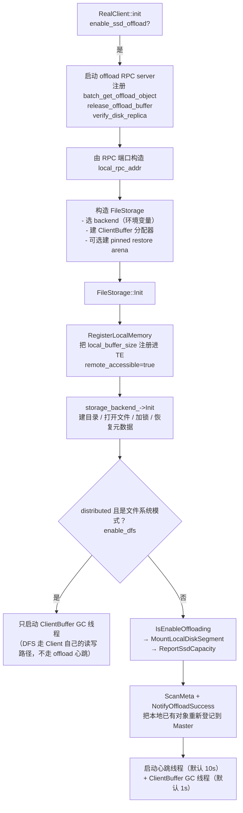

### 2.2 逐步说明

1. **RPC 端口是动态的**。`offload_rpc_server_` 用 port 0 让内核分配，再把 `host:port` 拼成 `local_rpc_addr`（[real_client.cpp:1461-1483](../Mooncake/mooncake-store/src/real_client.cpp#L1461)）。这个地址后面会写进每条 `LOCAL_DISK` 副本的 `transport_endpoint`。
2. **本地缓冲一次分配、长期驻留**。`client_buffer_allocator_` 由 `FileStorageConfig::local_buffer_size`（默认 1.2 GB）决定，构造时创建；`Init` 里以 `remote_accessible=true` 注册（[file_storage.cpp:1075-1090](../Mooncake/mooncake-store/src/file_storage.cpp#L1075)）。注释点明了原因：**远端要 RDMA READ 这块内存，必须有 rkey**，所以不能只做地址范围登记。
3. **pinned restore arena 只服务同进程 GPU 读**。仅当 `use_uring=false`、本机 memcpy 可用（`CanUseLocalMemcpy(local endpoint)`）且 `pinned_restore_arena_size>0` 时才创建（[file_storage.cpp:56-77](../Mooncake/mooncake-store/src/file_storage.cpp#L56)）。它是 pinned host 内存，**不注册进 TE**，靠 memcpy/H2D 使用。
4. **挂载 `LOCAL_DISK` segment**。`MountLocalDiskSegment` 要求 Master 侧 `--enable_offload=true`，否则返回 `UNABLE_OFFLOAD`（[master_service.cpp:8784-8828](../Mooncake/mooncake-store/src/master_service.cpp#L8784)）；成功后在 `LocalSsdManager` 里建一条 Client 记录，之后心跳才有地方挂任务。
5. **启动时扫描恢复**。`ScanMeta` 遍历后端（Bucket 读 `.meta`、FilePerKey 递归扫目录、OSS/S3 发 LIST），对每批 key 调 `NotifyOffloadSuccess` 重新登记。**对支持扫描的后端，owner 重启后 Master 里丢掉的 `LOCAL_DISK` 记录能自动补回来**，应用无感。两个例外：OffsetAllocator 默认（`persist_mode=kDisabled`）启动时截断数据文件、旧对象不可恢复，开启持久化后可从 `kv_cache.meta` 恢复（见 6.9）；NVMe KV 的 `ScanMeta` 目前是空实现（[backend.cpp:1516-1525](../Mooncake/mooncake-store/src/nvme_kv/backend.cpp#L1516)），重启后不会自动补登记。
6. **`enable_dfs` 分流**。构造时若 backend 是 `DistributedStorageBackend` 且用的是文件系统 adapter（posix/hf3fs），`config_.enable_dfs=true` 并把自己交给 `Client::SetDfsStorageBackend`（[file_storage.cpp:86-93](../Mooncake/mooncake-store/src/file_storage.cpp#L86)）。此时 FileStorage 不挂盘、不跑 offload 心跳 —— DFS 副本由请求端在 `Put`/`Get` 时直接读写共享文件系统，是另一条路径。

#### 2.2.1 RealClient 侧装配（图的上半部分）

[real_client.cpp:1458-1519](../Mooncake/mooncake-store/src/real_client.cpp#L1458)：

```cpp
if (enable_ssd_offload && start_offload_rpc_server) {
    offload_rpc_server_ = std::make_unique<coro_rpc::coro_rpc_server>(1, 0, "0.0.0.0");
    offload_rpc_server_->register_handler<&RealClient::batch_get_offload_object>(this);
    offload_rpc_server_->register_handler<&RealClient::release_offload_buffer>(this);
    offload_rpc_server_->register_handler<&RealClient::verify_disk_replica>(this);
    offload_rpc_server_->async_start();
    offload_rpc_port_ = offload_rpc_server_->port();
    local_rpc_addr = buildHostNameWithPort(getHostNameWithoutPort(local_hostname),
                                           offload_rpc_port_);   // 写进 LOCAL_DISK 副本
}
if (enable_ssd_offload) {
    auto cfg = FileStorageConfig::FromEnvironment();
    if (!ssd_offload_path.empty()) cfg.storage_filepath = ssd_offload_path;
    file_storage_ = std::make_shared<FileStorage>(cfg, client_, local_rpc_addr,
                                                  client_->GetSsdMetricPtr());
    if (auto r = file_storage_->Init(); !r) return r;            // ← 下一步
    client_->SetLocalDiskProbe([weak_storage, tenant_id](const std::string& key)
        -> std::optional<bool> {                                 // true=文件已丢
            auto storage = weak_storage.lock();
            if (!storage) return std::nullopt;
            auto exists = storage->Exists(TenantId(tenant_id).MakeScopedKey(key));
            if (!exists) return std::nullopt;
            return !*exists;
        });
}
```

三个顺序上的要点直接对应图：

- **先起 RPC server，再构造 FileStorage**：`local_rpc_addr` 要用 `offload_rpc_port_` 拼出来，而 FileStorage 的 `local_rpc_addr_` 会写进每条 `LOCAL_DISK` 副本的 `transport_endpoint`。
- **`start_offload_rpc_server` 与 `enable_ssd_offload` 是两个开关**：不开 RPC server 时仍可构造 FileStorage（只做本进程落盘），但其它进程无法来读。
- **probe 只在构造之后注册**：它是 `Client::Put` 修复悬空副本时用来问"这个对象的文件还在不在"的回调（4.6 节）。

#### 2.2.2 `FileStorage::Init`（图的下半部分）

[file_storage.cpp:129-228](../Mooncake/mooncake-store/src/file_storage.cpp#L129)：

```cpp
auto r1 = RegisterLocalMemory();                 // 1075-1090：注册暂存区，带 rkey
if (!r1) return r1;
auto r2 = storage_backend_->Init();              // 建目录/打开文件/flock/恢复元数据
if (!r2) return r2;
if (config_.enable_dfs) {                        // DFS：只起 GC 线程，不挂盘
    client_buffer_gc_running_ = true;
    client_buffer_gc_thread_ = std::thread(&FileStorage::ClientBufferGCThreadFunc, this);
    return {};
}
auto enable = IsEnableOffloading();              // 649-660：问 backend 还有没有空间
{
    MutexLocker locker(&offloading_mutex_);
    enable_offloading_ = enable.value();
    auto m = client_->MountLocalDiskSegment(enable_offloading_);  // 161-171
    if (!m) return m;
}
if (config_.total_size_limit > 0)                // 176-182：上报容量分母
    client_->ReportSsdCapacity(config_.total_size_limit);
auto scan = storage_backend_->ScanMeta(          // 184-199：把已有对象重新登记
    [this](const std::vector<std::string>& keys,
           std::vector<StorageObjectMetadata>& metadatas) {
        for (auto& m : metadatas) m.transport_endpoint = local_rpc_addr_;
        auto tasks = BuildOffloadTasksFromStorageKeys(keys, metadatas);
        auto r = client_->NotifyOffloadSuccess(tasks, metadatas);
        return r ? ErrorCode::OK : r.error();
    });
heartbeat_running_ = true;                       // 213-223
heartbeat_thread_ = std::thread([this] { while (heartbeat_running_) { Heartbeat(); sleep(...); } });
client_buffer_gc_running_ = true;                // 224-226
client_buffer_gc_thread_ = std::thread(&FileStorage::ClientBufferGCThreadFunc, this);
```

`ScanMeta` 的回调值得单独说明。

- `BuildOffloadTasksFromStorageKeys`（[file_storage.cpp:23-37](../Mooncake/mooncake-store/src/file_storage.cpp#L23)）把后端里的 **tenant-scoped key** 拆回 `{tenant_id, key}`，再配上 `data_size` 组成 `OffloadTaskItem`——因为 `NotifyOffloadSuccess` 的入参是 tasks + metadatas 两个等长数组。
- `metadata.transport_endpoint = local_rpc_addr_` 必须在回调里补。后端只知道自己存了哪些 key、多大，并不知道这层 RPC 地址；Master 侧新建的 `LOCAL_DISK` 副本要用它来路由读者的请求。
- 扫描路径调用 `NotifyOffloadSuccess` 时，对象上**没有** `offloading_task`，所以走的是"对象存在 + 无 task → 常规登记"分支（3.3.3 节第 3 类），与正常落盘完成的路径汇合。

#### 2.2.3 注册暂存区：为什么必须 `remote_accessible=true`

[file_storage.cpp:1075-1090](../Mooncake/mooncake-store/src/file_storage.cpp#L1075)：

```cpp
auto error_code = client_->RegisterLocalMemory(
    client_buffer_allocator_->getBase(),   // 起始地址
    config_.local_buffer_size,             // 大小
    kWildcardLocation,
    /*remote_accessible=*/true,            // ← 关键
    /*update_metadata=*/true);
```

注释写得很明确：这块内存是给**远端通过 RDMA READ 拉取**的，如果 `remote_accessible=false`，TE 只会在本地地址范围表里登记、不会发布 rkey，远端读会直接报 `No rkey for MR access`。后面读路径（4.2）里 `pointers[]` 指向的就是这块内存。

#### 2.2.4 `storage_backend_->Init()`：目录、独占锁与恢复

以默认的 Bucket 后端为例（[storage_backend.cpp:1906-1990](../Mooncake/mooncake-store/src/storage_backend.cpp#L1906)）：

```cpp
// ① 一个 storage_path 只允许一个活 Client
fs::create_directories(storage_path_);
owner_lock_fd_ = ::open((storage_path_ / ".mooncake_local_disk.lock").c_str(),
                        O_CREAT | O_RDWR | O_CLOEXEC, 0644);
if (::flock(owner_lock_fd_, LOCK_EX | LOCK_NB) != 0)
    return tl::make_unexpected(ErrorCode::FILE_OPEN_FAIL);   // 已有活 Client

SharedMutexLocker lock(&mutex_);
object_bucket_map_.clear(); buckets_.clear(); lru_index_.clear(); total_size_ = 0;

// ② 扫 .meta 恢复桶索引与 total_size_
for (const auto& entry : fs::recursive_directory_iterator(storage_path_)) {
    if (entry.path().extension() == BUCKET_METADATA_FILE_SUFFIX) {
        auto bucket_id = std::stoll(entry.path().stem());
        auto [it, ok] = buckets_.try_emplace(bucket_id, std::make_shared<BucketMetadata>());
        if (ok) lru_index_.emplace(0LL, bucket_id);
        if (!LoadBucketMetadata(bucket_id, it->second)) {      // 坏桶：删掉数据 + 元数据
            fs::remove(GetBucketDataPath(bucket_id).value());
            fs::remove(GetBucketMetadataPath(bucket_id).value());
            buckets_.erase(bucket_id);
        }
    }
}
```

这段对应图中 `E1` 节点里的三件事：

- **建目录/打开文件**：`storage_path_` 不存在则创建；
- **加锁**：`flock` 非阻塞独占，第二个活 Client 直接失败——所以"多个 rank 共用一个 `ssd_offload_path`"不是受支持部署；
- **恢复元数据**：`Init` 只恢复 backend 自己的索引；把对象重新登记到 Master 是后面 `ScanMeta → NotifyOffloadSuccess` 的事（2.2.2）。

`flock` 之后还会扫一遍没有 `.meta` 的孤儿桶并清理（`CleanupOrphanedBucket`），对应"上次写桶写到一半崩溃"的场景。

### 2.3 关键配置

| 环境变量 | 作用 | 默认 |
| --- | --- | --- |
| `MOONCAKE_OFFLOAD_STORAGE_BACKEND_DESCRIPTOR` | `bucket_storage_backend` / `file_per_key_storage_backend` / `offset_allocator_storage_backend` / `nvme_kv_storage_backend` / `distributed_storage_backend` | bucket |
| `MOONCAKE_OFFLOAD_FILE_STORAGE_PATH` | 落盘根目录 | `/data/file_storage` |
| `MOONCAKE_OFFLOAD_LOCAL_BUFFER_SIZE_BYTES` | 读回暂存区大小 | 1.2 GB |
| `MOONCAKE_OFFLOAD_HEARTBEAT_INTERVAL_SECONDS` | 心跳周期 | 10 |
| `MOONCAKE_OFFLOAD_CLIENT_BUFFER_GC_TTL_MS` / `..._GC_INTERVAL_SECONDS` | 暂存 buffer 租约与 GC 周期 | 5000 / 1 |
| `MOONCAKE_OFFLOAD_TOTAL_KEYS_LIMIT` / `..._TOTAL_SIZE_LIMIT_BYTES` | 后端容量上限 | 1e7 / 2 TB |
| `MOONCAKE_OFFLOAD_USE_URING` | io_uring / O_DIRECT 路径 | false |
| `MOONCAKE_OFFLOAD_ENABLE_DISK_WATERMARK_EVICTION` + high/low ratio | 主动水位淘汰 | true / 0.90 / 0.80 |
| Master: `--enable_offload` / `--offload_on_evict` / `--offloading_queue_limit` / `--promotion_on_hit` | 是否启用、淘汰时入队、队列上限、命中回迁 | false / false / 50000 / false |

---

## 3. 写入：内存 → 外部存储（offload）

### 3.1 触发点有两个，但落到同一个邮箱

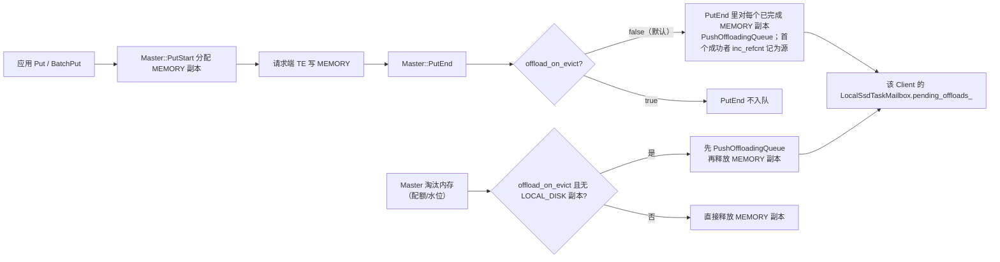

要点：

- **默认模式（`offload_on_evict=false`）**：`PutEnd` 就为每个内存副本入队（[master_service.cpp:5785-5811](../Mooncake/mooncake-store/src/master_service.cpp#L5785)），所以"刚写完内存"就会在下一个心跳被落盘。这解释了原文"应用写内存与后台 offload 是两个过程"：**入队是同步的，落盘是异步的**。
- **`offload_on_evict=true`**：只有真正要淘汰内存时才入队，落盘变成"淘汰前抢救"（[master_service.cpp:10695-10748](../Mooncake/mooncake-store/src/master_service.cpp#L10695)）。一旦对象已有 `LOCAL_DISK` 副本，直接释放内存，不重复入队。
- 入队时 Master 会：校验源副本是**已完成的 MEMORY 副本**、解析 segment 的 owner client、对源副本 `inc_refcnt()`，并在对象状态里记 `offloading_task{source_id, time, mirror_clients}`（[master_service.cpp:9161-9246](../Mooncake/mooncake-store/src/master_service.cpp#L9161)）。refcnt 的作用是**在落盘完成前阻止源内存副本被淘汰/复用**。
- 队列上限 `offloading_queue_limit`（默认 5 万，**按 Client 邮箱计**）；超限返回 `KEYS_ULTRA_LIMIT`，对象就不入队了。

下面把这条链路的代码逐段展开。

#### 3.1.1 三个数据结构

```cpp
// master_service.cpp 侧：每个 key 一份的运行时状态（object_runtime_state.h:43）
struct OffloadingTask {
    ReplicaID source_id;                     // 被 refcnt 钉住的那条 MEMORY 副本
    std::chrono::system_clock::time_point start_time;  // TTL reaper 的计时起点
    std::vector<UUID> mirror_clients;        // 哪些 Client 的邮箱里压着这个 key
};
```

注释里写明了 `mirror_clients` 的设计：offload 是**按已完成的 MEMORY 副本逐个推**的，多副本对象会推到不同 Client，一个 marker 覆盖多个 mirror。

```cpp
// Master 侧每个 Client 一个邮箱（local_ssd/manager.h）
std::unordered_map<std::string, OffloadTaskItem> pending_offloads_;  // scoped key -> task
bool enable_offloading_;                                             // 由 Client 心跳参数刷新
```

```cpp
// 副本上的原子引用计数（replica.h:438/648/652）
bool is_busy() const { return refcnt_.load() > 0; }
void inc_refcnt() { refcnt_.fetch_add(1); }
void dec_refcnt() { refcnt_.fetch_sub(1); }
```

三者关系：**Master 的对象状态记录"谁在落盘"，Client 邮箱记录"还没被取走的落盘任务"，副本 refcnt 记录"这份内存还不能被释放"**。

#### 3.1.2 路径 A：`PutEnd` 同步入队（默认模式）

[master_service.cpp:5785-5811](../Mooncake/mooncake-store/src/master_service.cpp#L5785)：

```cpp
if (replica_type != ReplicaType::DFS && enable_offload_ &&
    !offload_on_evict_ && !metadata.HasReplica([](const Replica& replica) {
        return replica.is_dfs_replica() && replica.is_processing();
    })) {
    auto& state = accessor.GetState();
    std::optional<ReplicaID> source_id;
    std::vector<UUID> mirror_clients;
    metadata.VisitReplicas(
        [](const Replica& replica) {
            return replica.is_completed() && replica.is_memory_replica();
        },
        [this, &object_id, &source_id, &mirror_clients](Replica& replica) {
            auto result = PushOffloadingQueue(object_id, replica, &mirror_clients);
            if (result && !source_id.has_value()) {
                replica.inc_refcnt();
                source_id = replica.id();
            }
        });
    if (source_id.has_value() && !state.offloading_task) {
        state.offloading_task = OffloadingTask{*source_id, std::chrono::system_clock::now(),
                                               std::move(mirror_clients)};
    }
}
```

逐条读：

| 条件 | 原因 |
| --- | --- |
| `replica_type != DFS` | 这次 `PutEnd` 如果只是在提交 DFS 副本，说明数据本身还没写进内存池，没有可 offload 的源 |
| `enable_offload_` | Master 启动参数；关掉时整条链路不存在 |
| `!offload_on_evict_` | 默认模式才在 `PutEnd` 入队；淘汰模式留给 3.1.5 |
| 没有 `PROCESSING` 的 DFS 副本 | DFS 写还可能要用内存里的数据，先不抢 |
| 只遍历 `is_completed() && is_memory_replica()` | 源必须是**已写完**的内存副本；`PROCESSING` 副本可能正在被 RDMA 写 |

三个容易忽略的细节：

1. **`inc_refcnt()` 只对"第一个入队成功"的副本做**，`source_id` 也只记这一个。多副本对象中其余副本同样被推入各自 owner 的邮箱（进 `mirror_clients`），但它们不受 refcnt 保护：如果它们在客户端读取前被淘汰，对应 mirror 的 offload 会失败并走 NACK，属于可接受的 best-effort。
2. **`!state.offloading_task` 才记录**：这个 guard 保证一个 key 同时只有一个 offload marker 持有 `source_id` 的 refcnt。若 marker 已存在还继续覆盖，旧的 `source_id` 就再没有持有者去 `dec_refcnt`，只能等 TTL reaper。
3. **"入队成功"不等于"落盘成功"**：`PushOffloadingQueue` 只保证任务写进了邮箱。`PutEnd` 返回时数据还在 DRAM，只是被 refcnt 钉住，等待客户端心跳取走。

#### 3.1.3 `PushOffloadingQueue`：从副本找到 owner

[master_service.cpp:9161-9246](../Mooncake/mooncake-store/src/master_service.cpp#L9161)，核心是一个"副本 → segment → owner client → 邮箱"的解析过程：

```cpp
const auto& segment_names = replica.get_segment_names();
if (segment_names.empty() ||
    std::none_of(segment_names.begin(), segment_names.end(),
                 [](const auto& name) { return name.has_value(); })) {
    return tl::make_unexpected(ErrorCode::UNABLE_OFFLOADING);   // 见 #2997 注释
}
Replica::Descriptor source_descriptor;
if (!TryGetReadableReplicaDescriptor(replica, source_descriptor) ||
    !source_descriptor.is_memory_replica()) {
    return tl::make_unexpected(ErrorCode::UNAVAILABLE_IN_CURRENT_STATUS);
}
const auto liveness = replica.getClientLiveness();     // 源副本所属 Client 的存活记录
if (!liveness || !liveness->IsServing()) return ...;

for (const auto& segment_name_it : segment_names) {
    std::optional<UUID> client_id = allocator_access.GetOwnerClientId(segment_name_it.value());
    ...
    auto err = local_ssd_manager_.EnqueueOffload(
        *client_id,
        OffloadTaskItem{.tenant_id = object_id.tenant_id.value(),
                        .key = object_id.user_key,
                        .size = size},              // size 取 memory descriptor 的 buffer 长度
        offloading_queue_limit_);
    if (err == ErrorCode::SEGMENT_NOT_FOUND) return tl::make_unexpected(ErrorCode::UNABLE_OFFLOADING);
    if (err != ErrorCode::OK) {
        if (err == ErrorCode::KEYS_ULTRA_LIMIT) MasterMetricManager::...inc_offload_enqueue_rejected(...);
        return tl::make_unexpected(err);
    }
    if (mirror_clients != nullptr) mirror_clients->push_back(*client_id);
    any_enqueued = true;
}
if (!any_enqueued) return tl::make_unexpected(ErrorCode::UNABLE_OFFLOADING);
```

几个防坑点，注释里都标了：

- **空 segment 列表必须显式失败**。早期版本在这里静默返回 `{}`，调用方以为入队成功，于是 `inc_refcnt()` 却没有真实任务，refcnt 只能等 10 分钟的 TTL reaper 释放（issue #2997 的回归）。
- **owner 要解析两次**：一次拿 `client_id`，一次在 `EnqueueOffload` 前重新确认 owner 未变、副本仍可读。中间可能发生 segment 迁移/卸载。
- **`liveness->IsServing()`** 是"服务中"判定；正在 drain/离线的 Client 不再接收新任务。
- **错误语义是分层的**：`SEGMENT_NOT_FOUND`（Client 没有挂 `LOCAL_DISK`）转成 `UNABLE_OFFLOADING`；队列满保留 `KEYS_ULTRA_LIMIT` 并单独打点；其余错误原样上抛。

#### 3.1.4 邮箱：去重、限流、"取走即不可取消"

[manager.cpp:13-27](../Mooncake/mooncake-store/src/local_ssd/manager.cpp#L13)：

```cpp
ErrorCode LocalSsdTaskMailbox::EnqueueOffload(OffloadTaskItem task, size_t limit) {
    if (!enable_offloading_) return ErrorCode::UNABLE_OFFLOADING;
    if (pending_offloads_.size() >= limit) return ErrorCode::KEYS_ULTRA_LIMIT;
    auto index = TenantId(task.tenant_id).MakeScopedKey(task.key);
    if (!pending_offloads_.emplace(std::move(index), std::move(task)).second)
        return ErrorCode::OBJECT_ALREADY_EXISTS;   // 同一 key 已在队列里
    return ErrorCode::OK;
}
```

- `enable_offloading_` 由 `MountLocalDiskSegment(enable_offloading)` 初始化，并在**每次心跳**由 `SetOffloadingAndTakePending(enabled)` 刷新。客户端因为 `KEYS_ULTRA_LIMIT` 关闭落盘后，Master 下一轮心跳会把积压任务整体清掉并 `dec_refcnt`（[master_service.cpp:8904-8928](../Mooncake/mooncake-store/src/master_service.cpp#L8904)），不会无限堆积。
- 去重键是 **tenant-scoped key**，和落盘文件名里的 scope 一致。
- `SetOffloadingAndTakePending` 一次性**取走并清空**整个 map（[manager.cpp:29-40](../Mooncake/mooncake-store/src/local_ssd/manager.cpp#L29)）。这是"可取消窗口"的边界：任务还在邮箱里时 Master 可以取消；一旦被心跳取走，就只能等 `NotifyOffloadSuccess`（或 NACK/TTL）。

#### 3.1.5 路径 B：淘汰时入队

有两个入口，逻辑同构：

| 入口 | 代码 | 触发 |
| --- | --- | --- |
| `BatchEvict(evict_ratio_target, lowerbound)` | [master_service.cpp:10916](../Mooncake/mooncake-store/src/master_service.cpp#L10916) | `EvictionThreadFunc` 周期检查内存水位/分配压力 |
| `EvictTenantMemoryForQuota(tenant, target_bytes)` | [master_service.cpp:10640](../Mooncake/mooncake-store/src/master_service.cpp#L10640) | 多租户配额超限 |

`BatchEvict` 的 offload 分支（[10974-11056](../Mooncake/mooncake-store/src/master_service.cpp#L10974)）：

```cpp
if (!offload_on_evict_) return evict_replicas(...);          // 未开启：直接淘汰
if (has_local_disk_replica(metadata)) return evict_replicas(...);  // 已有落盘副本：直接释放内存
if (offload_force_evict_ && offload_queued_this_cycle >= offload_cap)
    return evict_replicas(...);                              // 本轮抢救名额用完：强制淘汰

bool queued = false;
metadata.VisitReplicas(is_evictable_memory_replica,
    [..](Replica& replica) {
        if (queued) return;                                  // 只钉一条
        std::vector<UUID> mirror_clients;
        auto result = PushOffloadingQueue(...);
        if (result) {
            replica.inc_refcnt();
            auto& task = state.offloading_task;
            if (!task) task = OffloadingTask{replica.id(), now, std::move(mirror_clients)};
            queued = true;
        }
    });

if (queued) {
    ++offload_queued_this_cycle;
    // 其余 refcnt==0 的副本是冗余拷贝，数据已由"钉住的副本 → 磁盘"保证
    return evict_replicas(quota_account, metadata, deferred_replicas);
}
if (offload_force_evict_) { ...; return evict_replicas(...); }
return 0;   // 默认：本轮放弃淘汰这个 key，等队列排空后下一轮再试
```

关键点：

1. **"先钉一条，再淘汰其余"**：`evict_replicas` 内部用同一个 `is_evictable_memory_replica` 谓词弹副本，而该谓词要求 `refcnt == 0`（见 3.1.6），所以刚 `inc_refcnt` 的那条不会被弹走，其余副本正常释放。一个多副本对象因此在内存里只留下"待落盘的那一份"。
2. **名额与降级策略**：开启 `offload_force_evict` 时，本轮最多抢救 `offloading_queue_limit × offload_cap_ratio`（默认 5 万 × 0.5）个对象，用完后强制淘汰。默认 `offload_force_evict=false`，入队失败就 `return 0` 跳过——**宁可少淘汰，也不丢数据**。
3. **`enable_oplog_` 时直接淘汰**（[10996-10998](../Mooncake/mooncake-store/src/master_service.cpp#L10996)），不走 offload 抢救。
4. `EvictTenantMemoryForQuota` 的版本多了配额台账的释放逻辑，但"钉一条 + 淘汰其余 + 失败跳过"的顺序完全一致（[10695-10748](../Mooncake/mooncake-store/src/master_service.cpp#L10695)）。

#### 3.1.6 `refcnt` 为什么能"钉住"源副本

淘汰不是看"这个副本有没有人用"，而是看一个统一谓词（[master_service.cpp:4726-4729](../Mooncake/mooncake-store/src/master_service.cpp#L4726)）：

```cpp
bool MasterService::IsEvictableMemoryReplica(const Replica& replica) const {
    return replica.is_memory_replica() && IsReplicaReadable(replica) &&
           replica.get_refcnt() == 0;
}
```

`BatchEvict`、`EvictTenantMemoryForQuota`、`NoFBatchEvict` 都用它（或同构版本）来挑受害者。所以 `inc_refcnt()` 之后：

- 这个 MEMORY 副本不会被内存淘汰选中；
- 对象记录、`LOCAL_DISK` 登记、租约等元数据不受影响；
- 但副本仍在 `GetReplicaList` 中可见，读请求照常可以读它（refcnt 只挡淘汰，不挡读）。

`dec_refcnt()` 共有六条出口，缺一条就会泄漏到 TTL：

| 出口 | 代码 | 场景 |
| --- | --- | --- |
| `NotifyOffloadSuccess`（成功） | [9063-9069](../Mooncake/mooncake-store/src/master_service.cpp#L9063) | 正常落盘完成 |
| `NotifyOffloadSuccess`（NACK，`data_size < 0`） | [9008-9018](../Mooncake/mooncake-store/src/master_service.cpp#L9008) | 客户端明确说"这批没写成" |
| `OffloadObjectHeartbeat(enable_offloading=false)` | [8912-8927](../Mooncake/mooncake-store/src/master_service.cpp#L8912) | 客户端关闭落盘，Master 清空邮箱 |
| `CancelQueuedOffloadTask` | [9264-9270](../Mooncake/mooncake-store/src/master_service.cpp#L9264) | 任务还在邮箱里时被 Upsert 取消 |
| `EraseMetadata` | [2052-2062](../Mooncake/mooncake-store/src/master_service.cpp#L2052) | key 被删除/覆盖，连同 `RemoveOffloadFromAll` 清邮箱 |
| TTL reaper | [10552-10573](../Mooncake/mooncake-store/src/master_service.cpp#L10552) | `put_start_release_timeout_sec_`（默认 600s）到期 |

TTL reaper 是最后兜底：`task->start_time + 600s` 后强制 `dec_refcnt`、清 task，并打 `Offloading task expired for key` 警告。正常路径上 NACK 的意义就是**不让一次失败把 refcnt 拖到 10 分钟**。

#### 3.1.7 冲突：原地覆盖一个正在 offload 的 key

`UpsertStart`（原地覆盖，[master_service.cpp:6147](../Mooncake/mooncake-store/src/master_service.cpp#L6147)）在对象已存在时会先尝试取消排队中的 offload（[master_service.cpp:6242-6251](../Mooncake/mooncake-store/src/master_service.cpp#L6242)）：

```cpp
// Cancel a still-queued offload so the upsert can take the key over.
// Once a store worker owns the task it is reading the source buffer for its
// SSD write, so the upsert waits for NotifyOffloadSuccess to clear the marker.
if (!CancelQueuedOffloadTask(accessor.it_->second, object_id)) {
    return tl::make_unexpected(ErrorCode::OBJECT_HAS_REPLICATION_TASK);
}
```

`CancelQueuedOffloadTask`（[9248-9272](../Mooncake/mooncake-store/src/master_service.cpp#L9248)）→ `CancelOffloadsIfAllPending(mirror_clients, ...)`（[manager.cpp:256-297](../Mooncake/mooncake-store/src/local_ssd/manager.cpp#L256)）：

- 先把所有 mirror 的邮箱锁按 client_id 排序后**一次性全拿**；
- **所有** mirror 都还持有这个 key 才一起删，然后 `dec_refcnt` + 清 task；
- 只要有一个已经被心跳取走，就返回 false，整个取消失败。

"全有或全无"是必要的：否则会留下"部分 Client 已经在落盘、Master 却认为任务取消了"的状态。取消失败时调用方拿到 `OBJECT_HAS_REPLICATION_TASK`（和复制任务复用同一个错误码），客户端应当等待 offload 完成后再重试覆盖。

对照一下普通 `PutStart`：它**不取消** offload，对象已有完成副本时直接返回 `OBJECT_ALREADY_EXISTS`，而 `Client::Put` 把这个错误当作幂等成功（[client_service.cpp:1995-1999](../Mooncake/mooncake-store/src/client_service.cpp#L1995)）。所以"同一个 key 再 Put 一次"不会打断在途落盘，只有"原地 Upsert 覆盖"才会去争抢源 buffer。

#### 3.1.8 完整时序（默认模式）

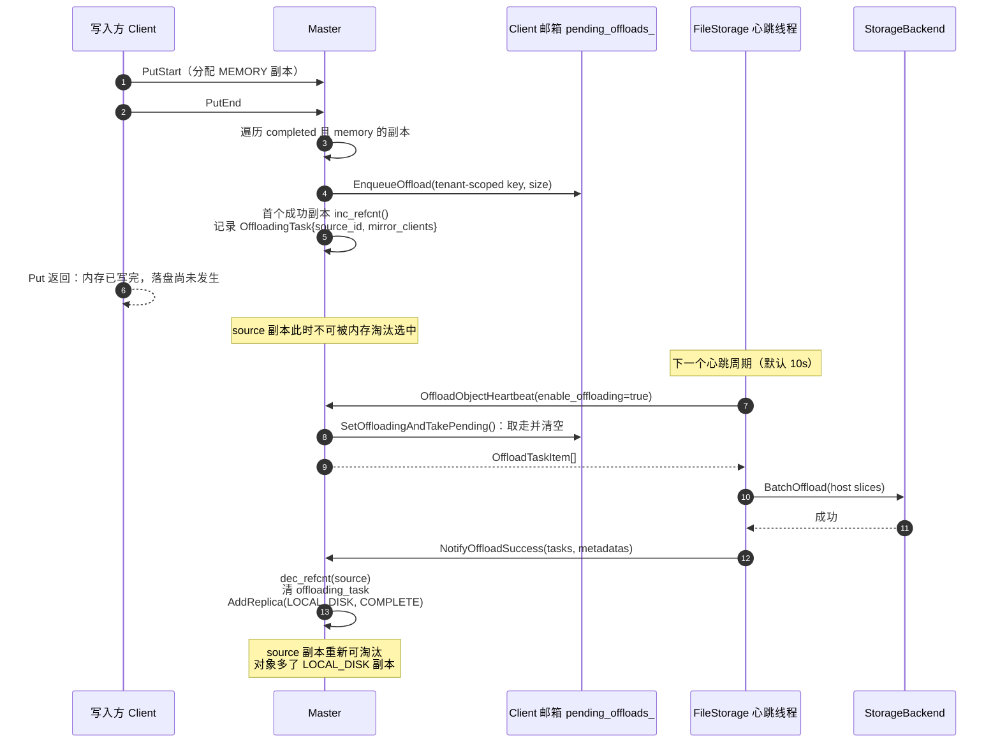

失败分支对应 3.1.6 的表格：客户端明确失败 → NACK 立刻释放；客户端失联/超时 → 600s TTL reaper 释放。

### 3.2 心跳循环（owner 侧）

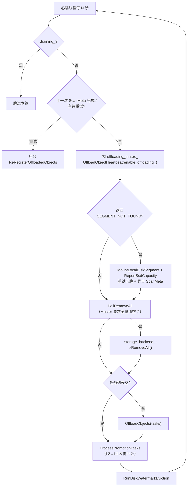

代码：[file_storage.cpp:662-812](../Mooncake/mooncake-store/src/file_storage.cpp#L662)。

#### 3.2.1 图中每个节点对应的代码

| 图节点 | 代码 | 说明 |
| --- | --- | --- |
| `心跳线程每 N 秒` | [Init 213-223](../Mooncake/mooncake-store/src/file_storage.cpp#L213) | 线程体就是 `while (heartbeat_running_) { Heartbeat(); sleep(heartbeat_interval_seconds); }` |
| `draining_?` | [674-676](../Mooncake/mooncake-store/src/file_storage.cpp#L674)、[709-711](../Mooncake/mooncake-store/src/file_storage.cpp#L709) | 入口一次、拿锁后一次 |
| `上一次 ScanMeta 完成 / 有待重试?` | [679-696](../Mooncake/mooncake-store/src/file_storage.cpp#L679) | join 已完成的 future；`metadata_resync_pending_` 为真则再起一个 |
| `后台 ReRegisterOffloadedObjects` | [687-695](../Mooncake/mooncake-store/src/file_storage.cpp#L687) → [1216-1286](../Mooncake/mooncake-store/src/file_storage.cpp#L1216) | `ResetScanIterator()` + `ScanMeta` + `NotifyOffloadSuccess` |
| `持 offloading_mutex_ OffloadObjectHeartbeat` | [702-716](../Mooncake/mooncake-store/src/file_storage.cpp#L702) → [client_service.cpp:4200-4211](../Mooncake/mooncake-store/src/client_service.cpp#L4200) → [master_service.cpp:8887-8929](../Mooncake/mooncake-store/src/master_service.cpp#L8887) | 一次 RPC 取走邮箱里的全部任务 |
| `返回 SEGMENT_NOT_FOUND?` | [717-776](../Mooncake/mooncake-store/src/file_storage.cpp#L717) | 重挂 + 重报容量 + 重试 + 异步 ScanMeta |
| `MountLocalDiskSegment + ReportSsdCapacity` | [727-742](../Mooncake/mooncake-store/src/file_storage.cpp#L727) → [master_service.cpp:8784](../Mooncake/mooncake-store/src/master_service.cpp#L8784) / [8937](../Mooncake/mooncake-store/src/master_service.cpp#L8937) | |
| `PollRemoveAll` | [779-783](../Mooncake/mooncake-store/src/file_storage.cpp#L779) → [master_service.cpp:8931-8935](../Mooncake/mooncake-store/src/master_service.cpp#L8931) → [manager.cpp:112-115](../Mooncake/mooncake-store/src/local_ssd/manager.cpp#L112) | 无参 RPC，返回并清除 `pending_remove_all_` |
| `storage_backend_->RemoveAll()` | [FileStorage::RemoveAll 814-827](../Mooncake/mooncake-store/src/file_storage.cpp#L814) | 清空后端物理数据 |
| `OffloadObjects(tasks)` | [785-793](../Mooncake/mooncake-store/src/file_storage.cpp#L785) → [307-577](../Mooncake/mooncake-store/src/file_storage.cpp#L307) | 见 3.3 |
| `ProcessPromotionTasks` | [798-801](../Mooncake/mooncake-store/src/file_storage.cpp#L798) → [868-1016](../Mooncake/mooncake-store/src/file_storage.cpp#L868) | L2→L1，见 7.11 |
| `RunDiskWatermarkEviction` | [803-810](../Mooncake/mooncake-store/src/file_storage.cpp#L803) → [628-647](../Mooncake/mooncake-store/src/file_storage.cpp#L628) | 见 5.1 |

#### 3.2.2 逐段代码

[file_storage.cpp:662-812](../Mooncake/mooncake-store/src/file_storage.cpp#L662)：

```cpp
tl::expected<void, ErrorCode> FileStorage::Heartbeat() {
    if (client_ == nullptr) return tl::make_unexpected(ErrorCode::INVALID_PARAMS);
    if (draining_.load()) return {};                       // ① 下线后不再取任务
    if (rescan_future_.valid() && rescan_future_.wait_for(0s) == ready)
        rescan_future_ = std::future<void>();              // ② 回收上一轮 rescan
    if (metadata_resync_pending_.load() && !rescan_future_.valid()) {
        rescan_future_ = std::async(std::launch::async, [this] {   // ③ 后台重试
            auto r = ReRegisterOffloadedObjects();
            if (!r) LOG(ERROR) << ...; else metadata_resync_pending_.store(false);
        });
    }

    std::vector<OffloadTaskItem> offloading_objects;
    {
        MutexLocker locker(&offloading_mutex_);
        if (draining_.load()) return {};                   // ④ 持锁二次检查
        auto heartbeat_result = client_->OffloadObjectHeartbeat(enable_offloading_,
                                                                offloading_objects);
        if (!heartbeat_result && heartbeat_result.error() == SEGMENT_NOT_FOUND) {
            auto remount = client_->MountLocalDiskSegment(enable_offloading_);
            if (remount) {
                if (config_.total_size_limit > 0) client_->ReportSsdCapacity(...);
                heartbeat_result = client_->OffloadObjectHeartbeat(enable_offloading_,
                                                                    offloading_objects);
                if (!rescan_future_.valid()) {
                    metadata_resync_pending_.store(true);
                    rescan_future_ = std::async(std::launch::async, [this] {
                        auto r = ReRegisterOffloadedObjects();
                        if (!r) LOG(ERROR) << ...; else metadata_resync_pending_.store(false);
                    });
                }
            } else return tl::make_unexpected(remount.error());
        } else if (!heartbeat_result) return heartbeat_result;
    }                                                        // ⑤ 锁只包住 RPC

    auto remove_all = client_->PollRemoveAll();
    if (remove_all && remove_all.value()) RemoveAll();       // ⑥ Master 要求全量清空

    if (!offloading_objects.empty()) {
        auto offload_result = OffloadObjects(offloading_objects);   // ⑦
        if (!offload_result) return offload_result;
    }
    (void)ProcessPromotionTasks();                           // ⑧ 失败不冒泡
    auto evict = RunDiskWatermarkEviction();                 // ⑨ 失败只告警
    if (!evict) LOG(WARNING) << ...;
    return {};
}
```

对应到图里的三条分支：

- **`R -> R1`**：`rescan_future_` 用完要显式置空，否则 `std::future` 一直 `valid()`，后续的 `SEGMENT_NOT_FOUND` 分支会误以为"已有 rescan 在跑"从而不再触发。`metadata_resync_pending_` 保证失败后下一轮还能重试。
- **`E1 -> RM`**：Master 重启后 `LOCAL_DISK` segment 与对象记录一起丢失。`MountLocalDiskSegment` 只恢复 segment 注册，对象要靠 `ReRegisterOffloadedObjects` 重新 `ScanMeta` 才能登记回来。两个动作分别负责"能收任务"和"能读旧数据"。
- **`P -> RA`**：`PollRemoveAll` 不是查询状态，而是**消费型**的：`ConsumeRemoveAll` 用 `std::exchange(pending_remove_all_, false)` 返回并清除标志（[manager.cpp:112-115](../Mooncake/mooncake-store/src/local_ssd/manager.cpp#L112)）。Master 的全局 `RemoveAll` 会对所有 LocalSSD Client 置位（[master_service.cpp:7890](../Mooncake/mooncake-store/src/master_service.cpp#L7890)），租户级 `RemoveAll` 只对持有该租户磁盘副本的 Client 置位（[8130-8131](../Mooncake/mooncake-store/src/master_service.cpp#L8130)）。

#### 3.2.3 两个容易被忽略的设计

1. **`SEGMENT_NOT_FOUND` 自愈**：Master 重启会丢掉 `LOCAL_DISK` segment 注册和对象记录。心跳发现后重新挂载、重报容量，并在后台跑一次 `ScanMeta` 把对象补登记，不需要重启 Client。
2. **`draining_` 双重检查**：`DrainLocalDiskSegment` 在 `offloading_mutex_` 下置位并注销 segment；心跳在入口和拿到锁后各查一次，避免"读到 false 后被调度出去，醒来看到 SEGMENT_NOT_FOUND 又把 segment 挂回去"（[file_storage.cpp:829-866](../Mooncake/mooncake-store/src/file_storage.cpp#L829)，注释写得很清楚）。这是进程优雅退出（SIGTERM）链路的一部分。

#### 3.2.4 心跳 RPC 在 Master 侧做了什么

`Client::OffloadObjectHeartbeat` 只是一个薄封装（[client_service.cpp:4200-4211](../Mooncake/mooncake-store/src/client_service.cpp#L4200)）。Master 侧（[master_service.cpp:8887-8929](../Mooncake/mooncake-store/src/master_service.cpp#L8887)）：

```cpp
auto record = FindClientRecord(client_id);
auto serving_guard = record ? record->TryAcquireServingGuard() : std::nullopt;
if (!serving_guard) return tl::make_unexpected(UNAVAILABLE_IN_CURRENT_STATUS);

std::shared_lock<std::shared_mutex> shared_lock(master_state_mutex_);
auto pending = local_ssd_manager_.SetOffloadingAndTakePending(client_id, enable_offloading);
if (!pending) return tl::make_unexpected(pending.error());   // SEGMENT_NOT_FOUND
if (enable_offloading) return std::move(*pending);

// 客户端关闭落盘：清空队列并释放每条的 offloading_task + refcnt
for (auto& task : *pending) { ... source->dec_refcnt(); offloading_task.reset(); }
return std::vector<OffloadTaskItem>{};
```

三个语义点：

- **`TryAcquireServingGuard()`**：处于 draining/离线的 Client 连心跳都不处理，直接 `UNAVAILABLE_IN_CURRENT_STATUS`。
- **`enable_offloading` 是客户端上报的**（来自 backend 的 `IsEnableOffloading()`），不是 Master 的开关。客户端磁盘满了会主动说 false，Master 随即把积压任务全部释放（3.1.6 的第二个出口）。
- **返回的 `OffloadTaskItem` 里没有 owner/副本信息**，只有 `{tenant_id, key, size}`。客户端要靠 `BatchQuery` 再去 Master 查"本机哪个内存副本"（3.3.1）。这是刻意的最小任务描述，避免 Master 把地址下发错。

### 3.3 `OffloadObjects`：一轮任务怎么落盘

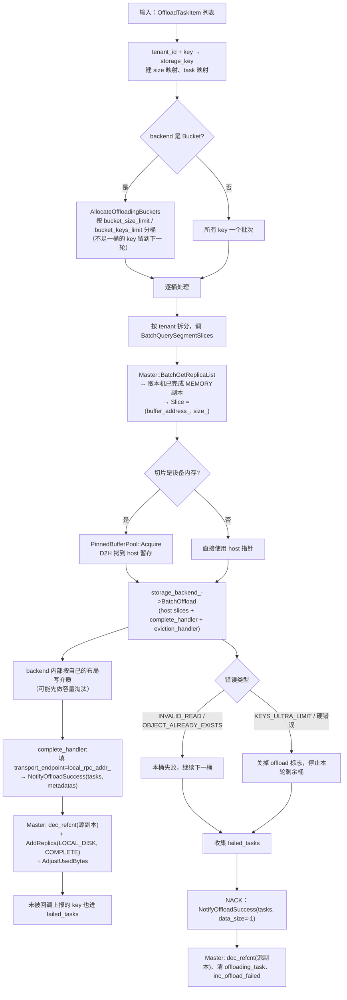

代码：[file_storage.cpp:307-577](../Mooncake/mooncake-store/src/file_storage.cpp#L307)。

图中每个节点对应的代码：

| 图节点 | 代码 |
| --- | --- |
| `A` 输入任务列表 | 心跳 [785-793](../Mooncake/mooncake-store/src/file_storage.cpp#L785) |
| `B` tenant_id + key → storage_key | [312-321](../Mooncake/mooncake-store/src/file_storage.cpp#L312) |
| `C/C1` Bucket 分桶 | [323-340](../Mooncake/mooncake-store/src/file_storage.cpp#L323) → [BucketStorageBackend::AllocateOffloadingBuckets 2278-2281](../Mooncake/mooncake-store/src/storage_backend.cpp#L2278) → [GroupOffloadingKeysByBucket 2294-2405](../Mooncake/mooncake-store/src/storage_backend.cpp#L2294) |
| `C2` 其他后端单批 | [333-340](../Mooncake/mooncake-store/src/file_storage.cpp#L333) |
| `D` 逐桶处理 | [379](../Mooncake/mooncake-store/src/file_storage.cpp#L379) |
| `E` 按 tenant 拆分 + `BatchQuerySegmentSlices` | [381-413](../Mooncake/mooncake-store/src/file_storage.cpp#L381)、[1047-1073](../Mooncake/mooncake-store/src/file_storage.cpp#L1047) |
| `E1` Master `BatchGetReplicaList` | [client_service.cpp:1259-1292](../Mooncake/mooncake-store/src/client_service.cpp#L1259) → [master_service.cpp:4904-5050](../Mooncake/mooncake-store/src/master_service.cpp#L4904) |
| `F/F1/F2` 设备判定与 D2H | [421-453](../Mooncake/mooncake-store/src/file_storage.cpp#L421) |
| `G` `BatchOffload` | [501-505](../Mooncake/mooncake-store/src/file_storage.cpp#L501) |
| `H` 后端内部 | 3.3.3 节 + 第 6 节 |
| `I` `complete_handler` | [342-367](../Mooncake/mooncake-store/src/file_storage.cpp#L342) |
| `J` Master `dec_refcnt` + `AddReplica` | [master_service.cpp:8973-9159](../Mooncake/mooncake-store/src/master_service.cpp#L8973) |
| `K/K1/K2` 错误分类 | [521-547](../Mooncake/mooncake-store/src/file_storage.cpp#L521)、[302-305](../Mooncake/mooncake-store/src/file_storage.cpp#L302) |
| `L/M/N/O` NACK | [470-519](../Mooncake/mooncake-store/src/file_storage.cpp#L470)、[550-576](../Mooncake/mooncake-store/src/file_storage.cpp#L550) |

#### 3.3.1 源数据怎么读到的（零拷贝的关键）

`BatchQuerySegmentSlices`（[file_storage.cpp:1047-1073](../Mooncake/mooncake-store/src/file_storage.cpp#L1047)）：

```cpp
auto batched_query_results = client_->BatchQuery(keys, tenant_id);   // 一次批量 RPC，拿副本描述
for (...) for (auto& descriptor : results[i]->replicas) {
    if (client_->IsReplicaOnLocalMemory(descriptor)) {               // endpoint == 本机
        auto& md = descriptor.get_memory_descriptor();
        slices.emplace_back(Slice{(void*)md.buffer_descriptor.buffer_address_,
                                  md.buffer_descriptor.size_});
        break;
    }
}
```

- 这里**没有 TE 传输**：`buffer_address_` 就是本进程 `mooncake_malloc` 出来的虚拟地址，直接当 slice 用。
- 它同时向 Master 申请了一次读租约（`BatchGetReplicaList` 内部 `GrantReadLease`），租约期内源副本不会被淘汰，配合 `offloading_task` 的 refcnt 形成双重保护。
- 这一步是"best-effort"的：找不到本机副本的 key 直接进 `failed_tasks`，不会打断整轮（[file_storage.cpp:399-412](../Mooncake/mooncake-store/src/file_storage.cpp#L399)）。

#### 3.3.2 设备数据的 D2H 暂存

backend 约定只接收 **host 指针**（`BuildBucket` 会直接 memcpy iovec、`ConcatSlicesToString` 会拼接、OSS adapter 会把 iovec 交给 libcurl）。所以 `OffloadObjects` 在调 `BatchOffload` 前做一次过滤（[file_storage.cpp:418-468](../Mooncake/mooncake-store/src/file_storage.cpp#L418)）：

- `RuntimeAccelerators().FindDeviceForPointer(slice.ptr)` 命中 → `pinned_buffer_pool_->Acquire(size)` → `Copy(kDeviceToHost)` → 用 pinned host slice 替换；
- 否则原样传递（CPU 内存零拷贝）；
- 失败的 key 进 `failed_tasks`；整桶都失败则跳过 `BatchOffload` 并把暂存 buffer 归还。

这是 GPU 场景下 offload 唯一的额外拷贝；纯 CPU 场景是 zeros-copy 落盘。

#### 3.3.3 回调、幂等与部分成功

`BucketStorageBackend::BatchOffload` 的顺序是刻意的（[storage_backend.cpp:1514-1684](../Mooncake/mooncake-store/src/storage_backend.cpp#L1514)）：

```
BuildBucket → PrepareEviction（锁内摘除旧桶）→ eviction_handler（先通知 Master）
→ CommitPreparedEviction → FinalizeEviction（删文件）
→ WriteBucket（写数据 + 写 meta + datasync）
→ 锁内提交 object_bucket_map_ / total_size_ / lru_index_
→ complete_handler（NotifyOffloadSuccess）
```

即 **先让本地索引可见，再通知 Master**：这样 Master 一旦把读请求指过来，本进程一定能在 `object_bucket_map_` 里查到。反过来若 `complete_handler` 失败，`RollbackCommittedBucket` 会把本地索引和文件一起回滚，避免产生"本机可读、Master 不知道"的幽灵副本。

- **重复 offload 幂等**：分桶阶段用 `IsExist` 跳过已落盘 key；`PrepareEviction` 用 `pending_write_keys_` 挡并发重复；提交阶段再按 `object_bucket_map_` 二次去重。只有真正提交的 key 才会进 `committed_keys` 去回调 Master（[storage_backend.cpp:1589-1660](../Mooncake/mooncake-store/src/storage_backend.cpp#L1589)）。
- **部分成功**：`FileStorage` 记录 `reported_keys`，未被上报的 key 进 `failed_tasks`，最后统一 NACK。
- **NACK 哨兵**：`NotifyOffloadSuccess` 收到 `data_size < 0` 时只做清理，不 `AddReplica`（[master_service.cpp:9001-9021](../Mooncake/mooncake-store/src/master_service.cpp#L9001)）。这是"任务被取走了但没写成"的回收通道，避免 `offloading_task` 和源副本 refcnt 卡到 TTL 到期。
- **软/硬错误分类**：`INVALID_READ`（源数据读不到）、`OBJECT_ALREADY_EXISTS`（并发/重复）只影响当前桶；`KEYS_ULTRA_LIMIT` 会关掉 `enable_offloading_` 并中止本轮剩余桶，但仍会先把已取出的任务全部 NACK 掉（[file_storage.cpp:511-576](../Mooncake/mooncake-store/src/file_storage.cpp#L511)）。

#### 3.3.4 分桶、错误分类与兜底 NACK（代码）

**(1) 先统一 key 形态**（[file_storage.cpp:312-321](../Mooncake/mooncake-store/src/file_storage.cpp#L312)）：

```cpp
for (const auto& task : offloading_objects) {
    const auto storage_key = TenantId(task.tenant_id).MakeScopedKey(task.key);
    storage_object_sizes.emplace(storage_key, task.size);   // 给分桶用
    task_by_storage_key.emplace(storage_key, task);         // 回调时反查原始 task
}
```

后端、邮箱、`NotifyOffloadSuccess` 用的都是 **tenant-scoped key**，只有 RPC/应用层用裸 key。这里建立双向映射，后面 `complete_handler` 才能把后端上报的 key 翻译回 `{tenant_id, key}`。

**(2) 分桶**（[323-340](../Mooncake/mooncake-store/src/file_storage.cpp#L323) → [2294-2405](../Mooncake/mooncake-store/src/storage_backend.cpp#L2294)）：

```cpp
if (auto bucket = std::dynamic_pointer_cast<BucketStorageBackend>(storage_backend_)) {
    auto r = bucket->AllocateOffloadingBuckets(storage_object_sizes, buckets_keys);
    if (!r) return r;                 // 分配/元数据错误：整轮失败
} else {
    buckets_keys.emplace_back(all_storage_keys);   // 其他后端一批提交
}
```

`GroupOffloadingKeysByBucket` 的规则：

- 上一轮没凑满的 key 先取出来（`carryover_objects`），和本轮新任务一起重新分桶；
- 每桶受 `bucket_keys_limit`（默认 500）和 `bucket_size_limit`（默认 256 MB）双重约束；
- 单个对象大于 `bucket_size_limit` 直接跳过（无法放进任何桶）；
- 后端里已存在（`IsExist`）的 key 跳过——**重复 offload 是幂等 no-op**；
- 走到末尾仍不满一桶时：`flush_partial_buckets=true` 就当轮写掉，否则放回 `ungrouped_offloading_objects_` 等下一轮。

这里有一个与 NACK 相关的细节：被跳过的 key（太大、已存在、留下轮）不会出现在任何桶里，因此也不会被 `complete_handler` 上报。于是 `OffloadObjects` 在最后做一次**兜底扫描**（[550-556](../Mooncake/mooncake-store/src/file_storage.cpp#L550)）：

```cpp
for (const auto& [storage_key, task] : task_by_storage_key) {
    if (all_bucket_keys.find(storage_key) == all_bucket_keys.end())
        failed_tasks.push_back(task);      // 本轮没机会落盘 → NACK
}
```

**(3) 错误分类**（[521-547](../Mooncake/mooncake-store/src/file_storage.cpp#L521)）：

```cpp
if (!offload_res) {
    for (const auto& [key, _] : host_batch_object)
        failed_tasks.push_back(task_by_storage_key.at(key));   // 整桶都算失败
    if (offload_res.error() == ErrorCode::KEYS_ULTRA_LIMIT) {
        MutexLocker locker(&offloading_mutex_);
        enable_offloading_ = false;                           // 磁盘满：停止后续 offload
    }
    if (!IsPerBucketSoftOffloadError(offload_res.error())) {   // 硬错误
        abort_error = offload_res.error();
        break;                                                // 停止剩余桶，但仍然会走下面的 NACK
    }
    // soft：INVALID_READ / OBJECT_ALREADY_EXISTS → 继续下一桶
}
```

`IsPerBucketSoftOffloadError`（[302-305](../Mooncake/mooncake-store/src/file_storage.cpp#L302)）只认两个码。注释解释了为什么 `OBJECT_ALREADY_EXISTS` 必须是 soft：Bucket 后端对重复 key 是整桶原子拒绝的，早期把它当致命错误会导致任务泄漏、Master/SSD 元数据不一致，最终在读路径上表现为假的 `INVALID_KEY`（issue #2827）。

**(4) 统一 NACK**（[558-571](../Mooncake/mooncake-store/src/file_storage.cpp#L558)）：

```cpp
if (!failed_tasks.empty()) {
    std::vector<StorageObjectMetadata> failed_metadatas(
        failed_tasks.size(), StorageObjectMetadata{-1, 0, 0, -1, ""});
    client_->NotifyOffloadSuccess(failed_tasks, failed_metadatas);   // data_size = -1
}
```

`{-1, 0, 0, -1, ""}` 里最后那个 `-1` 是 `data_size` 哨兵。Master 看到它只做"释放"不做"登记"（[master_service.cpp:9001-9021](../Mooncake/mooncake-store/src/master_service.cpp#L9001)），因此 NACK 是幂等的，重复发也不会造出副本。

**(5) 成功但没被回调上报的 key**（[470-519](../Mooncake/mooncake-store/src/file_storage.cpp#L470)）：

`BatchOffload` 返回成功不代表每个 key 都提交了——Bucket 后端会跳过重复 key、部分后端允许逐 key 失败。`FileStorage` 用 `bucket_complete_handler` 记录 `reported_keys`，`BatchOffload` 返回后把差值补进 `failed_tasks`：

```cpp
if (offload_res) {
    for (const auto& [key, _] : host_batch_object)
        if (reported_keys.find(key) == reported_keys.end())
            failed_tasks.push_back(task_by_storage_key.at(key));
}
```

这就是图里 `J → M` 那条边的含义：**成功路径也要做一次差集**，否则被后端静默跳过的 key 的 `offloading_task` 会一直挂到 TTL。

### 3.4 `NotifyOffloadSuccess`：Master 侧登记

[master_service.cpp:8973-9159](../Mooncake/mooncake-store/src/master_service.cpp#L8973) 的三种分支：

| 场景 | 处理 |
| --- | --- |
| 对象存在，且有 `offloading_task` | `dec_refcnt(源副本)`、清 task；若该对象还没有任何 `LOCAL_DISK` 副本则 `AddReplica`，否则只**刷新已有副本的 endpoint / object_size**（重复上报幂等） |
| 对象存在，但**没有** task 标记 | 走常规登记 `AddReplicaForRetainedClient`（这正是 `ScanMeta` 重启恢复的路径） |
| 对象不存在（`OBJECT_NOT_FOUND`） | 跳过，不凭空造对象 |

#### 3.4.1 代码：一个循环里的三个分支

[master_service.cpp:8992-9150](../Mooncake/mooncake-store/src/master_service.cpp#L8992)（截取主干）：

```cpp
for (size_t i = 0; i < tasks.size(); ++i) {
    const auto& task = tasks[i];
    const auto& metadata = metadatas[i];
    const auto request_object_id = MakeObjectIdentityForRequest(task.key, tenant);

    // ① NACK：只释放，不登记
    if (metadata.data_size < 0) {
        MetadataAccessorRW accessor(this, request_object_id);
        if (accessor.Exists()) {
            auto& offloading_task = accessor.GetState().offloading_task;
            if (offloading_task) {
                auto source = accessor.Get().GetReplicaByID(offloading_task->source_id);
                if (source) source->dec_refcnt();
                offloading_task.reset();
                MasterMetricManager::instance().inc_offload_failed(UuidToString(client_id));
            }
        }
        continue;
    }

    Replica replica(client_id, metadata.data_size, metadata.transport_endpoint,
                    ReplicaStatus::COMPLETE, record);
    bool handled_existing_object = false;
    bool added_new_local_disk_replica = false;
    {
        std::shared_lock<std::shared_mutex> shared_lock(master_state_mutex_);
        const bool segment_mounted = !enable_offload_ || HasMountedLocalDiskSegment(client_id);
        MetadataAccessorRW accessor(this, request_object_id);
        if (accessor.Exists()) {
            auto& obj_metadata = accessor.Get();
            auto& offloading_task = accessor.GetState().offloading_task;
            if (offloading_task) {
                // ② 正常完成：先释放源，再登记/刷新
                auto source = obj_metadata.GetReplicaByID(offloading_task->source_id);
                if (source) source->dec_refcnt();
                offloading_task.reset();

                if (!segment_mounted) {
                    refused_unmounted = true;                 // 迟到的登记，拒绝
                } else if (!obj_metadata.HasReplica(&Replica::fn_is_local_disk_replica)) {
                    obj_metadata.AddReplicas({std::move(replica)});   // 首次登记
                    accessor.OnDiskReplicaAdded(obj_metadata);
                    added_new_local_disk_replica = true;
                } else {
                    obj_metadata.VisitReplicas(/* 同 client_id 的 LOCAL_DISK */,
                        [&replica](Replica& rep) {
                            rep.get_descriptor().get_local_disk_descriptor().transport_endpoint =
                                replica.get_descriptor().get_local_disk_descriptor().transport_endpoint;
                            rep.get_descriptor().get_local_disk_descriptor().object_size =
                                replica.get_descriptor().get_local_disk_descriptor().object_size;
                        });                                       // 幂等刷新
                }
                handled_existing_object = true;
            }
        }
    }

    // ③ 没有 task 标记：ScanMeta / 重启恢复路径
    if (!handled_existing_object) {
        auto res = AddReplicaForRetainedClient(client_id, object_id.user_key,
                                               object_id.tenant_id, replica);
        if (!res && res.error() == ErrorCode::OBJECT_NOT_FOUND) continue;
        if (!res && res.error() == ErrorCode::SEGMENT_NOT_FOUND) { refused_unmounted = true; continue; }
        added_new_local_disk_replica = res.value();
    }
    if (metadata.data_size > 0 && added_new_local_disk_replica)
        local_ssd_manager_.AdjustUsedBytes(client_id, metadata.data_size);
}
if (refused_unmounted) return tl::make_unexpected(ErrorCode::SEGMENT_NOT_FOUND);
```

对照图里的 `J → O` 和 `I → J`：

- **`dec_refcnt` 一定发生**，即使 `segment_mounted == false`。注释特意说明"offload bookkeeping 仍然执行，只拒绝登记"，否则源副本会永远钉住。
- **`AddReplica` 只在"还没有任何 LOCAL_DISK 副本"时做**。同一个 owner 重复上报（例如 ScanMeta 与正常落盘撞上）走的是"刷新 endpoint/object_size"，不会产生第二条副本。
- **`segment_mounted` 检查放在 `master_state_mutex_` 共享锁内、shard 锁之前**，与 `UnmountLocalDiskSegment` 的独占锁互斥，避免"注销扫描已过、登记又落进来"的竞态（[9031-9047](../Mooncake/mooncake-store/src/master_service.cpp#L9031)）。
- **只有新增副本才 `AdjustUsedBytes`**，所以重复上报不会把 Master 的已用容量越加越大。

另外两点：

- **segment 必须仍在挂载状态**。登记和 `UnmountLocalDiskSegment` 的注销在同一把 `master_state_mutex_` 下排序，drain 期间的迟到登记会被拒绝并返回 `SEGMENT_NOT_FOUND`（[master_service.cpp:9028-9047](../Mooncake/mooncake-store/src/master_service.cpp#L9028)）。
- **容量统计**：只有新增 `LOCAL_DISK` 副本时才 `AdjustUsedBytes(client, data_size)`；`ReportSsdCapacity` 单独上报分母。这套统计只反映 Master 视角，不等于真实磁盘占用。

---

## 4. 读取：`LOCAL_DISK` → 应用 buffer

### 4.1 入口与副本选择

`LOCAL_DISK` 的分发在 **RealClient 层**，不在 `Client` 层。原因很直接：`Client::Get` 只有 `TransferRead`（memory）和 `ReadDfsReplica`（DFS），没有 LOCAL_DISK 分支；`FindFirstCompleteReplica` 又只是"取第一个 COMPLETE"。所以 RealClient 先用自己的策略选副本，再决定走哪条路：

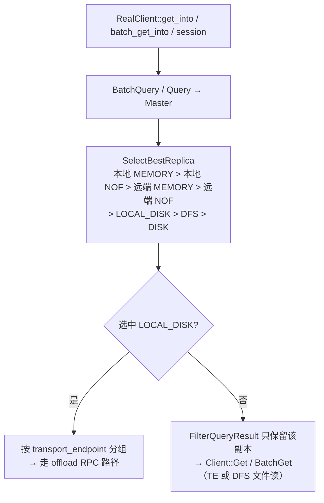

#### 4.1.1 为什么不能在 `Client::Get` 里选

`Client::Get`（[client_service.cpp:1382-1455](../Mooncake/mooncake-store/src/client_service.cpp#L1382)）：

```cpp
Replica::Descriptor replica;
ErrorCode err = FindFirstCompleteReplica(query_result.replicas, replica);  // 只是"第一个 COMPLETE"
...
if (replica.is_dfs_replica()) err = ReadDfsReplica(object_key, replica, slices);
else                          err = TransferRead(replica, slices);
```

而 `FindFirstCompleteReplica`（[5459-5472](../Mooncake/mooncake-store/src/client_service.cpp#L5459)）完全忽略副本类型：

```cpp
for (size_t i = 0; i < replica_list.size(); ++i)
    if (replica_list[i].status == ReplicaStatus::COMPLETE) { replica = replica_list[i]; return OK; }
```

如果 LocalDisk 恰好排在列表第一个，`Client::Get` 会拿它去 `TransferRead` —— 那是一条 TE READ，源地址根本不在任何已注册 segment 里，必然失败。所以分发必须上移到 RealClient。

#### 4.1.2 `SelectBestReplica`：真正的优先级

[replica_selection.h:120-180](../Mooncake/mooncake-store/include/replica_selection.h#L120)：

```cpp
for (const auto &r : replicas) {
    if (r.status != ReplicaStatus::COMPLETE) continue;
    if (r.is_memory_replica()) {
        if (local_endpoints.count(r.get_memory_descriptor().buffer_descriptor.transport_endpoint_))
            { if (!local_memory) local_memory = &r; }
        else { if (!first_memory) first_memory = &r; }
    } else if (r.is_nof_replica()) { /* 同样分本地/远端 */ }
}
if (local_memory) return local_memory;
if (local_nof)    return local_nof;
if (first_memory) return first_memory;
if (first_nof)    return first_nof;

const Replica::Descriptor *best = nullptr;
for (const auto &r : replicas) {
    if (r.status != ReplicaStatus::COMPLETE) continue;
    if (r.is_local_disk_replica())            best = &r;   // 覆盖 DFS / DISK
    else if (r.is_dfs_replica())              { if (!best || !best->is_local_disk_replica()) best = &r; }
    else if (r.is_disk_replica() && !best)    best = &r;
}
return best;
```

两段循环对应图里的一行优先级：**本地 MEMORY > 本地 NOF > 远端 MEMORY（可按打分挑）> 远端 NOF > LOCAL_DISK > DFS > DISK**。注意第一段里"本地"判断的是 `transport_endpoint` 是否在本进程已挂载的 segment 集合中——内存副本的 endpoint 就是 segment 名，而 LOCAL_DISK 副本的 endpoint 是**对方的 offload RPC 地址**，两者语义不同。

#### 4.1.3 三个入口的分发

RealClient 有多个读入口，但分发模式一致：**先选副本，命中 LOCAL_DISK 就单独拎出来**。

```cpp
// 单键缓冲读（real_client.cpp:3762-3826）
const auto *best = SelectBestReplica(replica_list, local_endpoints);
auto alloc = client_buffer_allocator->allocate(calculate_total_size(*best));
if (best->is_local_disk_replica()) {
    const auto &endpoint = best->get_local_disk_descriptor().transport_endpoint;
    std::unordered_map<std::string, std::vector<Slice>> objects{
        {key, {{buffer_handle->ptr(), total_length}}}};
    auto r = batch_get_into_offload_object_internal(endpoint, objects);   // → 4.2
    ...
    return buffer_handle;
}

// 批量读（4151-4188）
const auto *best = SelectBestReplica(query_result_values.replicas, local_endpoints);
if (replica.is_local_disk_replica()) {
    disk_ops.emplace_back(DiskKeyOp{...});   // 稍后按 endpoint 分组
    continue;
}
valid_ops.emplace_back(KeyOp{...});          // MEMORY / DFS / DISK 走 Client::BatchGet

// 单键 get_into 整对象读（4639-4662）
if (replica.is_local_disk_replica()) {
    objects.emplace(key, {{dst, size}});
    return batch_get_into_offload_object_internal(endpoint, objects);
}
```

批量路径在收集完之后按 `transport_endpoint` 分组成 `offload_objects`，每个 endpoint 发一次 RPC（[4285-4330](../Mooncake/mooncake-store/src/real_client.cpp#L4285)）——这就是图里 `E` 节点的"按 transport_endpoint 分组"。

#### 4.1.4 `FilterQueryResult`：为什么非 LOCAL_DISK 还要过滤

[real_client.cpp:493-500](../Mooncake/mooncake-store/src/real_client.cpp#L493)：

```cpp
inline QueryResult FilterQueryResult(const QueryResult &qr, const Replica::Descriptor &replica,
                                     bool include_object_checksum = true) {
    return QueryResult({replica}, qr.lease_timeout, ... , qr.resolved_tenant_id);
}
```

把 QueryResult 裁成只剩选中的那一个副本。原因还是 4.1.1：只要列表里有 LOCAL_DISK，`FindFirstCompleteReplica` 就可能选中它。过滤之后 `Client::Get/BatchGet` 只可能操作调用方已经决定的那个副本。同时保留 `lease_timeout` 与 `object_checksum`，读后校验和租约检查不受影响。

#### 4.1.5 其余要点

- `Query`/`BatchQuery` 本身很薄：一次 `GetReplicaList`/`BatchGetReplicaList`，把 `lease_ttl_ms` 换算成本地 deadline 存进 `QueryResult`（[client_service.cpp:1240-1292](../Mooncake/mooncake-store/src/client_service.cpp#L1240)）。Master 侧在返回副本前已经 `GrantReadLease`（[master_service.cpp:4832-4833](../Mooncake/mooncake-store/src/master_service.cpp#L4832)），这是非 refcnt 的第二层读保护。
- `LOCAL_DISK` 优先级**低于任何 MEMORY/NOF**，但**高于 DFS 和 DISK**。在混合部署里这意味着"内存不在就找 owner 代读"，而不是直接去读共享文件。
- 一批里可能同时有 MEMORY 和 LOCAL_DISK：RealClient 把它们拆成 `valid_ops` / `disk_ops` 两组并发推进，最后按原始下标合并结果（[4213-4283](../Mooncake/mooncake-store/src/real_client.cpp#L4213)、[4285-4415](../Mooncake/mooncake-store/src/real_client.cpp#L4285)）。

### 4.2 跨进程读（主路径）

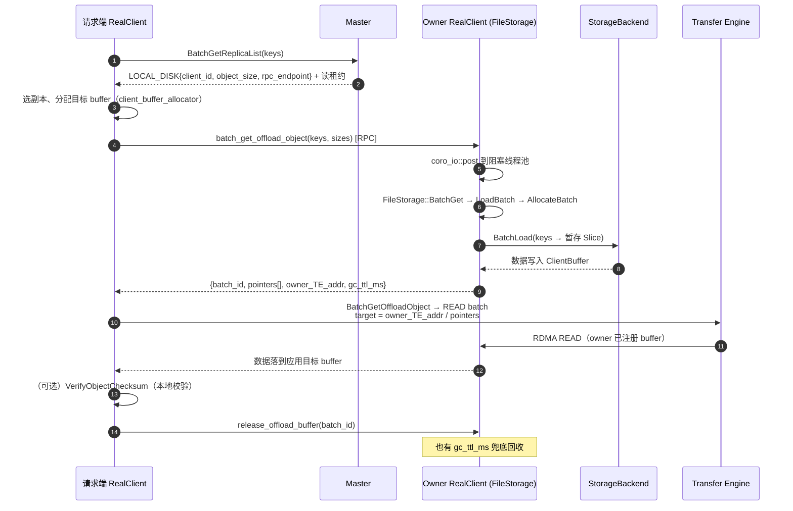

#### 4.2.1 图中第 1–3 步：查询、选副本、分配目标 buffer

**① `BatchGetReplicaList`**（[master_service.cpp:4904-5050](../Mooncake/mooncake-store/src/master_service.cpp#L4904)）取出 `GetReadableReplicaDescriptors(metadata)`，其中 `LOCAL_DISK` 副本的 descriptor 就是 `LocalDiskDescriptor{client_id, object_size, transport_endpoint}`（[replica.h:279-285](../Mooncake/mooncake-store/include/replica.h#L279)）。返回前给对象续租：

```cpp
metadata.GrantReadLease(std::chrono::milliseconds(default_kv_lease_ttl_));
results[original_idx] = GetReplicaListResponse(std::move(replica_list),
                                               default_kv_lease_ttl_,
                                               metadata.GetPart(0).checksum());
```

Client 侧把它换算成本地 deadline（[client_service.cpp:1259-1292](../Mooncake/mooncake-store/src/client_service.cpp#L1259)）：

```cpp
results.emplace_back(tl::in_place, std::move(response[i].value().replicas),
                     start_time + std::chrono::milliseconds(response[i].value().lease_ttl_ms),
                     response[i].value().object_checksum,
                     response[i].value().resolved_tenant_id);
```

**② 选副本**：4.1 节的 `SelectBestReplica`。

**③ 分配目标 buffer**（[real_client.cpp:4165-4176](../Mooncake/mooncake-store/src/real_client.cpp#L4165)）：

```cpp
auto alloc_result = allocator->allocate(total_size);          // client_buffer_allocator_
auto buffer_handle = std::make_unique<BufferHandle>(std::move(*alloc_result));
std::vector<Slice> slices;
allocateSlices(slices, replica, buffer_handle->ptr());        // LOCAL_DISK: 单 slice
```

`BufferHandle` 是 RAII，函数返回时把 buffer 还给应用（或在失败时释放）。

#### 4.2.2 图中第 4–5 步：发 RPC，owner 把阻塞 IO 挪出 RPC 线程

请求端 `restore_offload_objects`（[real_client.cpp:8893-8948](../Mooncake/mooncake-store/src/real_client.cpp#L8893)）：

```cpp
offload_rpc_read_count_.fetch_add(1, std::memory_order_relaxed);
const auto start_time = std::chrono::steady_clock::now();
const bool local_batch = allow_pinned && can_use_pinned_restore_arena(target_rpc_service_addr, objects);

const TenantId tenant_id(client_->tenant_id());
std::vector<std::string> storage_keys;
for (const auto &key : keys)
    storage_keys.emplace_back(tenant_id.MakeScopedKey(key));   // 读端用自己的 tenant scope

auto response = [&]() -> tl::expected<BatchGetOffloadObjectResponse, ErrorCode> {
    if (!local_batch)
        return client_requester_->batch_get_offload_object(target_rpc_service_addr,
                                                           storage_keys, restore_sizes);
    /* 同进程分支见 4.3 */
}();
auto lease = std::make_unique<OffloadRestoreLease>(this, target_rpc_service_addr, local_batch,
                                                   std::move(local_owner), std::move(*response),
                                                   start_time);
```

`ClientRequester` 定义的超时/重试直接决定"选中一个已经死掉的 owner"时读多久失败（[real_client.cpp:9021-9052](../Mooncake/mooncake-store/src/real_client.cpp#L9021)）。

owner 侧 handler（[real_client.cpp:8694-8722](../Mooncake/mooncake-store/src/real_client.cpp#L8694)）把整段 SSD 读丢给阻塞线程池，RPC IO 线程只做协程调度：

```cpp
struct CallState { std::vector<std::string> keys; std::vector<int64_t> sizes;
                   std::shared_ptr<FileStorage> file_storage; };
auto state = std::make_unique<CallState>();
state->keys = keys; state->sizes = sizes; state->file_storage = file_storage_;
auto *s = state.get();
auto try_result = co_await coro_io::post([s]() {
    return s->file_storage->BatchGet(s->keys, s->sizes);
});
auto result = try_result.value();
if (!result) co_return tl::make_unexpected(result.error());
co_return BatchGetOffloadObjectResponse(result.value().batch_id,
                                        std::move(result.value().pointers),
                                        client_->GetSegmentEndpoint(),
                                        file_storage_->config_.client_buffer_gc_ttl_ms);
```

`CallState` 放堆上是为了让 lambda 只捕获裸指针——`coro_io::post` 的返回类型必须可默认构造，捕获 `unique_ptr` 会编译失败。

#### 4.2.3 图中第 6–8 步：在 owner 的 `ClientBuffer` 里恢复对象

**⑥ `FileStorage::BatchGet`**（[file_storage.cpp:267-300](../Mooncake/mooncake-store/src/file_storage.cpp#L267)）：

```cpp
auto load_result = LoadBatch(keys, sizes, /*prefer_pinned=*/false);   // 远端读必须用已注册 buffer
auto allocated_batch = std::move(load_result.value());
uint64_t batch_id = allocated_batch->batch_id;
BatchGetResult batch_result{batch_id, allocated_batch->pointers};

MutexLocker locker(&client_buffer_mutex_);
client_buffer_allocated_batches_.emplace(batch_id, std::move(allocated_batch));   // 供 release/GC
return batch_result;
```

`LoadBatch`（[230-265](../Mooncake/mooncake-store/src/file_storage.cpp#L230)）：

```cpp
auto allocate_res = AllocateBatch(keys, sizes, *client_buffer_allocator_);
auto allocated_batch = std::move(allocate_res.value());
auto result = BatchLoad(allocated_batch->slices);      // backend 把数据读进 slices
for (size_t i = 0; i < keys.size(); ++i) {             // O_DIRECT 对齐修正后回写 pointers
    auto it = allocated_batch->slices.find(keys[i]);
    if (it != allocated_batch->slices.end())
        allocated_batch->pointers[i] = reinterpret_cast<uintptr_t>(it->second.ptr);
}
```

`AllocateBatch`（[1092-1167](../Mooncake/mooncake-store/src/file_storage.cpp#L1092)）的关键行：

```cpp
if (sizes[i] < 0 || sizes[i] > config_.local_buffer_size)
    return tl::make_unexpected(ErrorCode::INVALID_PARAMS);      // 单对象不能超过整个暂存区
size_t alloc_size = std::max<size_t>(data_size, 1);
if (config_.use_uring)
    alloc_size = align_up(data_size, kDirectIOAlignment) + 2 * kDirectIOAlignment;  // O_DIRECT 余量
auto alloc_result = allocator.allocate(alloc_size);
if (!alloc_result && !gc_triggered && &allocator == client_buffer_allocator_.get()) {
    gc_triggered = true;
    /* 锁内清掉过期 batch，再试一次 */
    alloc_result = allocator.allocate(alloc_size);
}
if (!alloc_result) return tl::make_unexpected(ErrorCode::BUFFER_OVERFLOW);
...
result->lease_timeout = now + std::chrono::milliseconds(config_.client_buffer_gc_ttl_ms);
```

**⑦ `storage_backend_->BatchLoad`**（[file_storage.cpp:1018-1045](../Mooncake/mooncake-store/src/file_storage.cpp#L1018)）：只做计时/打点，真正读盘在 backend。以 Bucket 为例，它先建 `ReadPlan`（锁内拷元数据 + `BucketReadGuard`），锁外按桶批量 `pread`/io_uring `batch_read`，并把对齐修正后的真实地址写回 `batch_object[key].ptr`（[storage_backend.cpp:1703-1891](../Mooncake/mooncake-store/src/storage_backend.cpp#L1703)）。

#### 4.2.4 图中第 9–13 步：回包、TE 拉取与校验

**⑧** `Client::BatchGetOffloadObject`（[client_service.cpp:4239-4259](../Mooncake/mooncake-store/src/client_service.cpp#L4239)）：

```cpp
auto future = transfer_submitter_->submit_batch_get_offload_object(
    transfer_engine_addr, keys, pointers, batch_slices, buffer_access, intent);
auto result = future->get();
```

**⑨** `submit_batch_get_offload_object`（[transfer_task.cpp:1614-1694](../Mooncake/mooncake-store/src/transfer_task.cpp#L1614)）：

```cpp
SegmentHandle seg = 0;
if (!use_local_memcpy) {
    seg = engine_.openSegment(transfer_engine_addr);       // owner 的 TE segment，整批共用
    if (seg == ERR_INVALID_ARGUMENT) return std::nullopt;
}
for (size_t i = 0; i < keys.size(); ++i) {
    auto it = batched_slices.find(keys[i]);
    uint64_t offset = 0;
    for (const auto& slice : it->second) {
        if (slice.size == 0) continue;
        requests.emplace_back(TransferRequest{
            .opcode = TransferRequest::READ,
            .source = static_cast<char*>(slice.ptr),       // 应用目标 buffer
            .target_id = seg,                              // owner 的 segment
            .target_offset = pointers[i] + offset,         // owner ClientBuffer 内地址
            .length = slice.size});
        offset += slice.size;
    }
}
return use_local_memcpy ? submitMemcpyOperations(...) : submitTransfer(requests, intent);
```

注意方向：`source` = 本地目标，`target` = 远端。TE 的 READ 语义是"从 target 读到 source"，所以请求由请求端发起、数据从 owner 拉过来——这正是原文说的"请求端通过 TE 拉取"。

**⑩** 校验在请求端本地做（[real_client.cpp:4335-4346](../Mooncake/mooncake-store/src/real_client.cpp#L4335)）：

```cpp
auto checksum_result = client_->VerifyObjectChecksum(key, slices, op.total_size,
                                                     op.query_result.object_checksum);
if (!checksum_result) { op_status[...] = checksum_result.error(); continue; }
```

`VerifyObjectChecksum` 内部对设备内存先 D2H 分块再算 CRC（[client_service.cpp:1349-1372](../Mooncake/mooncake-store/src/client_service.cpp#L1349)）。

#### 4.2.5 图中第 14 步：释放

`OffloadRestoreLease` 析构（[real_client.cpp:586-636](../Mooncake/mooncake-store/src/real_client.cpp#L586)）：

```cpp
~OffloadRestoreLease() {
    if (owner_ == nullptr || local_batch_ || owner_->client_requester_ == nullptr) return;
    owner_->client_requester_->release_offload_buffer(endpoint_, response_.batch_id);
}
```

owner 侧 `FileStorage::ReleaseBuffer`（[1202-1214](../Mooncake/mooncake-store/src/file_storage.cpp#L1202)）就是从 `client_buffer_allocated_batches_` 里 erase，`AllocatedBatch` 的 `BufferHandle` 随之析构。另有 `ClientBufferGCThreadFunc`（[1169-1192](../Mooncake/mooncake-store/src/file_storage.cpp#L1169)）每秒扫一遍过期 batch 作兜底。

这里有一个值得注意的细节：BatchLoad 后 `slice.ptr` 可能被 O_DIRECT 对齐修正过，`BatchGet` 会把 `pointers[i]` 重新对齐到真实数据位置（[file_storage.cpp:253-262](../Mooncake/mooncake-store/src/file_storage.cpp#L253)）。

### 4.3 同进程 GPU 读（pinned arena + H2D）

当**请求端和 owner 是同一进程**，且目标 buffer 全是设备指针时，可以省掉 RPC 和 TE，直接在进程内 memcpy：

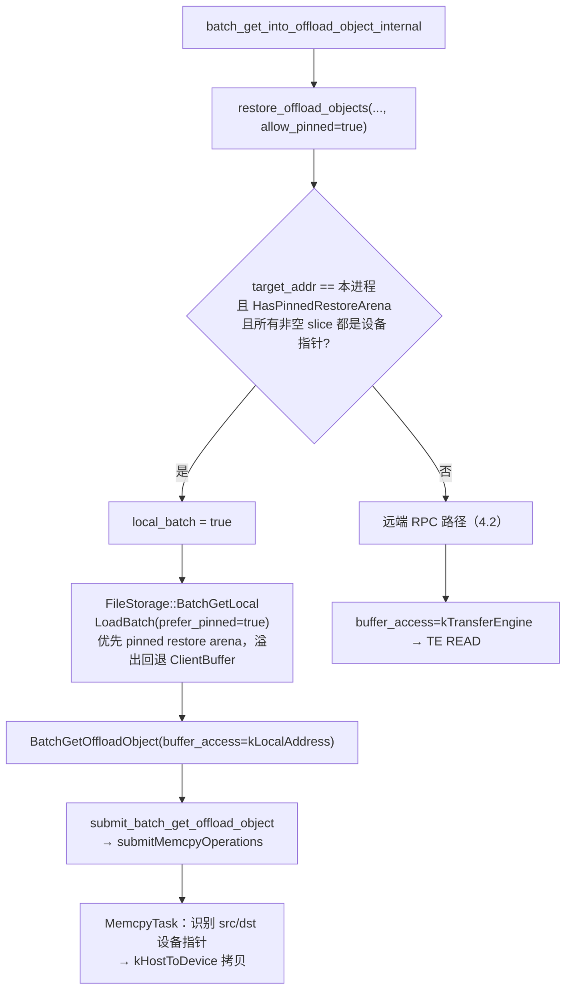

判断条件在 [real_client.cpp:8873-8891](../Mooncake/mooncake-store/src/real_client.cpp#L8873)：`target_rpc_service_addr == local_rpc_addr`、pinned arena 存在、**所有**待写 slice 都是设备指针（只要有 CPU 指针就走普通路径）。`BatchGetLocal` 返回的 `LocalBatchResult` 用 `shared_ptr<void> owner` 持有分配，RAII 释放，不走 `batch_id` 映射（[file_storage.h:56-62](../Mooncake/mooncake-store/include/file_storage.h#L56)）。

memcpy 分支在 [transfer_task.cpp:1675-1693](../Mooncake/mooncake-store/src/transfer_task.cpp#L1675)，设备识别与方向选择在 [transfer_task.cpp:723-761](../Mooncake/mooncake-store/src/transfer_task.cpp#L723)。

#### 4.3.1 图中每个节点对应的代码

| 图节点 | 代码 | 说明 |
| --- | --- | --- |
| `A` `batch_get_into_offload_object_internal` | [8950-9019](../Mooncake/mooncake-store/src/real_client.cpp#L8950) | 算 size、range 偏移，调 `restore_offload_objects` |
| `B` `restore_offload_objects(allow_pinned=true)` | [8893-8948](../Mooncake/mooncake-store/src/real_client.cpp#L8893) | 默认参数 `allow_pinned=true`，见 [real_client.h:906-912](../Mooncake/mooncake-store/include/real_client.h#L906) |
| `C` 同进程 + arena + 全设备指针 | [8873-8891](../Mooncake/mooncake-store/src/real_client.cpp#L8873) | `can_use_pinned_restore_arena` |
| `D` `local_batch = true` | [8905-8907](../Mooncake/mooncake-store/src/real_client.cpp#L8905) | |
| `E` `BatchGetLocal` | [8916-8931](../Mooncake/mooncake-store/src/real_client.cpp#L8916) → [file_storage.cpp:289-300](../Mooncake/mooncake-store/src/file_storage.cpp#L289) → [230-241](../Mooncake/mooncake-store/src/file_storage.cpp#L230) | `prefer_pinned=true`，溢出回退 |
| `F` 远端 RPC | [8919-8922](../Mooncake/mooncake-store/src/real_client.cpp#L8919) | 4.2 |
| `G` `BatchGetOffloadObject(kLocalAddress)` | [8997-9001](../Mooncake/mooncake-store/src/real_client.cpp#L8997) → [client_service.cpp:4239-4259](../Mooncake/mooncake-store/src/client_service.cpp#L4239) | |
| `H` `submit_batch_get_offload_object` | [transfer_task.cpp:1625-1631](../Mooncake/mooncake-store/src/transfer_task.cpp#L1625)、[1675-1693](../Mooncake/mooncake-store/src/transfer_task.cpp#L1675) | `use_local_memcpy=true` → `submitMemcpyOperations` |
| `I` `MemcpyTask` 方向识别 | [transfer_task.cpp:723-761](../Mooncake/mooncake-store/src/transfer_task.cpp#L723) | 设备指针 → `kHostToDevice` |
| `J` TE 分支 | [1681-1688](../Mooncake/mooncake-store/src/transfer_task.cpp#L1681) | `TransferRequest{READ, target_offset=pointers[i]+offset}` |

#### 4.3.2 判定条件（C 节点）

[real_client.cpp:8873-8891](../Mooncake/mooncake-store/src/real_client.cpp#L8873)：

```cpp
bool RealClient::can_use_pinned_restore_arena(
    const std::string &target_rpc_service_addr,
    const std::unordered_map<std::string, std::vector<Slice>> &objects) const {
    if (!file_storage_ || target_rpc_service_addr != local_rpc_addr ||
        !file_storage_->HasPinnedRestoreArena())
        return false;                                  // 不是本进程 / 没有 arena
    auto accelerators = device::GetAcceleratorRegistry().RuntimeAccelerators();
    bool has_data = false;
    for (const auto &object : objects) {
        for (const auto &slice : object.second) {
            if (slice.size && !accelerators.FindDeviceForPointer(slice.ptr))
                return false;                          // 有 CPU 指针 → 不值得走 pinned
            has_data |= slice.size != 0;
        }
    }
    return has_data;
}
```

三个都满足才走本地分支，任一不满足就退回 4.2 的 RPC + TE。注意它要求**全部**非空 slice 都是设备指针，而不是"至少一个"——因为本地分支用 `memcpy`/H2D 直写目标，混入 CPU 指针会让路径判断失真。

#### 4.3.3 `restore_offload_objects` 的本地分支（D/E 节点）

[real_client.cpp:8905-8931](../Mooncake/mooncake-store/src/real_client.cpp#L8905)：

```cpp
const bool local_batch = allow_pinned &&
                         can_use_pinned_restore_arena(target_rpc_service_addr, objects);
...
std::optional<FileStorage::LocalBatchResult> local_owner;
auto response = [&]() -> tl::expected<BatchGetOffloadObjectResponse, ErrorCode> {
    if (!local_batch)
        return client_requester_->batch_get_offload_object(target_rpc_service_addr,
                                                           storage_keys, restore_sizes);
    auto result = file_storage_->BatchGetLocal(storage_keys, restore_sizes);
    if (!result) return tl::unexpected(result.error());
    local_owner.emplace(std::move(result.value()));
    return BatchGetOffloadObjectResponse(0, std::move(local_owner->pointers),
                                         client_->GetSegmentEndpoint(), 0);
}();
```

和远端分支的三点差异：

- `batch_id = 0`、`gc_ttl_ms = 0`：本地分配不经过 `client_buffer_allocated_batches_`，也不存在远端释放；
- `pointers[]` 直接来自 `LocalBatchResult`，所有权挂在 `local_owner` 上，随 `OffloadRestoreLease` 析构自动归还（`LocalBatchResult::owner` 是 `shared_ptr<void>`）；
- `transfer_engine_addr` 仍填本进程 endpoint，但后续 `buffer_access = kLocalAddress`，这个字段不会被 `openSegment` 使用。

`FileStorage::BatchGetLocal` 与 `LoadBatch`（[file_storage.cpp:289-300](../Mooncake/mooncake-store/src/file_storage.cpp#L289)、[230-241](../Mooncake/mooncake-store/src/file_storage.cpp#L230)）：

```cpp
auto load_result = LoadBatch(keys, sizes, /*prefer_pinned=*/true);
...
const bool use_pinned = prefer_pinned && pinned_restore_arena_allocator_;
auto& allocator = use_pinned ? *pinned_restore_arena_allocator_ : *client_buffer_allocator_;
auto allocate_res = AllocateBatch(keys, sizes, allocator);
if (!allocate_res && use_pinned && allocate_res.error() == ErrorCode::BUFFER_OVERFLOW) {
    VLOG(1) << "Pinned SSD restore arena exhausted; using default arena";
    allocate_res = AllocateBatch(keys, sizes, *client_buffer_allocator_);   // 回退
}
```

pinned arena 的创建条件（[file_storage.cpp:56-77](../Mooncake/mooncake-store/src/file_storage.cpp#L56)）：`pinned_restore_arena_size > 0`、`use_uring == false`（该模式下直接打日志禁用）、`CanUseLocalMemcpy(本端 endpoint)`。`CanUseLocalMemcpy` 保证"本进程确实能直接寻址这块内存"，否则 memcpy 分支就无从谈起。

#### 4.3.4 memcpy / H2D（G/H/I 节点）

`transfer_task.cpp:1625-1631`：

```cpp
const bool use_local_memcpy = buffer_access == OffloadBufferAccess::kLocalAddress;
if (use_local_memcpy && !canUseLocalMemcpy(transfer_engine_addr)) {
    LOG(ERROR) << "Offload source is not locally addressable: " << transfer_engine_addr;
    return std::nullopt;
}
```

`transfer_task.cpp:1675-1693`：

```cpp
if (use_local_memcpy) {
    operations.emplace_back(slice.ptr,                                   // 目标（可能是 GPU）
                            reinterpret_cast<const void*>(pointers[i] + offset),  // pinned host
                            slice.size);
} else {
    requests.emplace_back(TransferRequest{ .opcode = READ, .source = slice.ptr,
                                           .target_id = seg,
                                           .target_offset = pointers[i] + offset,
                                           .length = slice.size });
}
return use_local_memcpy ? submitMemcpyOperations(std::move(operations))
                        : submitTransfer(requests, intent);
```

`submitMemcpyOperations` 把操作交给 `memcpy_pool_` 执行；`MemcpyTask` 在真正拷贝前用加速器注册表识别源/目的（[transfer_task.cpp:723-761](../Mooncake/mooncake-store/src/transfer_task.cpp#L723)）：

```cpp
auto *src_device = runtime_accelerator.FindDeviceForPointer(op.src);
auto *dst_device = runtime_accelerator.FindDeviceForPointer(op.dst);
...
direction = device::CopyDirection::kHostToDevice;   // dst 是设备、src 是 host
```

所以"pinned buffer 加 H2D"在代码里是**一条 memcpy 操作**：pinned arena → 应用设备 buffer，由 `memcpy_pool_` 异步执行，`TransferFuture` 等待完成。它也解释了为什么这条路径必须在同进程：`pointers[]` 是本地虚拟地址，只有本进程能直接解引用。

### 4.4 会话区间读（session range read）

Session 读的对象可能很大、只取一段，且目标必须是 TE 可达的地址：

1. 先 `restore_offload_objects(..., allow_pinned=false)`，把**整个对象**恢复到 owner 的 `ClientBuffer`；
2. 再用 `BatchTransferReadOffloadRanges(owner_TE_addr, remote_bases, remote_sizes, slices, src_offsets)` 把 `[source_offset, +len)` 的片段 scatter 到多个目标 slice（[real_client.cpp:7178-7300](../Mooncake/mooncake-store/src/real_client.cpp#L7178)）；
3. 同一 key 的多个区间只 restore 一次，按对象合并。

这里 **必须** `allow_pinned=false`：session scatter 走 TE，pinned arena 没注册，TE 看不到。

### 4.5 buffer 生命周期

| 路径 | 谁释放 | 何时 |
| --- | --- | --- |
| 远端 RPC | 请求端 `release_offload_buffer(batch_id)` | `OffloadRestoreLease` 析构（TE 完成后） |
| 远端 RPC 失败/进程崩 | owner 的 GC 线程 | 超过 `client_buffer_gc_ttl_ms`（默认 5s） |
| 同进程 pinned | `LocalBatchResult::owner`（RAII） | 函数返回/异常 |
| 同进程回退到 ClientBuffer | 同上，仍在 `AllocatedBatch` 里 | 同上，且不进远端映射表 |

`ClientBufferGCThreadFunc` 每秒扫一次 `client_buffer_allocated_batches_`，过期即回收（[file_storage.cpp:1169-1192](../Mooncake/mooncake-store/src/file_storage.cpp#L1169)）。`AllocateBatch` 在分配失败时也会就地触发一次 GC 再重试（[file_storage.cpp:1127-1144](../Mooncake/mooncake-store/src/file_storage.cpp#L1127)）。

另外请求端还有一层保护：`OffloadRestoreLease::LeaseExpired()` 会在 `gc_ttl_ms` 到期时让本次读返回 `OBJECT_HAS_LEASE`，因为此时 owner 可能已经回收了 buffer（[real_client.cpp:9015-9017](../Mooncake/mooncake-store/src/real_client.cpp#L9015)）。

### 4.6 读取失败与"悬空副本"修复

`LOCAL_DISK` 副本可能指向一个文件已经没了的 owner（磁盘被清、bucket 被淘汰、重启后目录换掉）。读失败后请求端不会立刻放弃：

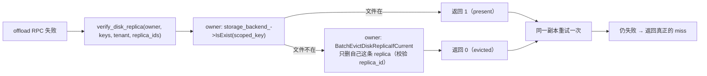

- 入口：`heal_disk_replica_for_read`（批量路径在 [real_client.cpp:4354-4400](../Mooncake/mooncake-store/src/real_client.cpp#L4354)）。
- owner 端 handler 在 [real_client.cpp:8733-8871](../Mooncake/mooncake-store/src/real_client.cpp#L8733)，用 `replica_ids` 做条件删除，避免误删同名对象的新副本；租户 scope 的处理（`resolved_tenant_id` 与 `default` 双探）在注释里写得很细。
- `Put` 路径也有对应修复：`PutStart` 遇到 `OBJECT_ALREADY_EXISTS` 且探测到文件已丢，会先 `EvictDiskReplicaIfCurrent` 再重试 `PutStart`（[client_service.cpp:1988-1993](../Mooncake/mooncake-store/src/client_service.cpp#L1988)，探针由 `SetLocalDiskProbe` 注入）。

#### 4.6.1 `A → B`：请求端发起校验

[real_client.cpp:3685-3727](../Mooncake/mooncake-store/src/real_client.cpp#L3685)：

```cpp
RealClient::DiskReadHealResult RealClient::heal_disk_replica_for_read(
    const std::string &key, const Replica::Descriptor &local_disk_replica,
    const std::optional<std::string> &resolved_tenant_id) {
    const auto &endpoint = local_disk_replica.get_local_disk_descriptor().transport_endpoint;

    VerifyDiskReplicaRequest request{std::string(client_->tenant_id()), {key}};
    if (resolved_tenant_id && !resolved_tenant_id->empty())
        request.resolved_tenant_id = *resolved_tenant_id;   // Master 解析出的写 scope
    request.replica_ids = std::vector<uint64_t>{local_disk_replica.id};  // 条件删除依据

    auto verify = client_requester_->verify_disk_replica(endpoint, request);
    if (!verify) return DiskReadHealResult::kUnknown;
    if (verify->states.empty() || verify->states[0] > 1) return DiskReadHealResult::kUnknown;
    if (verify->states[0] == 1) return DiskReadHealResult::kPresent;
    return DiskReadHealResult::kEvicted;
}
```

两个字段决定修复是否安全：

- `resolved_tenant_id`：Master 为这次查询解析出的租户 scope，也就是**写入时用的 scope**。老版本 Reader 没有这个字段时退回自己的 tenant。
- `replica_ids`：本次读失败的那条副本的 id。owner 端把它当作 Master 条件删除的前置条件。

三态返回：`1 = 文件还在`（`kPresent`）、`0 = 已确认丢失并由 owner 删除`（`kEvicted`）、`2/缺失 = 无法判断`（`kUnknown`，调用方不重试）。

#### 4.6.2 `B → C/D/E/F`：owner 端校验并条件删除

[real_client.cpp:8763-8779](../Mooncake/mooncake-store/src/real_client.cpp#L8763) 先确定探测 scope：

```cpp
if (request.resolved_tenant_id && !request.resolved_tenant_id->empty()) {
    state->tenant_id = *request.resolved_tenant_id;
    state->exact_scope = true;      // 就是写 scope，单次探测即可
} else {
    state->tenant_id = request.tenant_id;
    state->exact_scope = false;     // 可能是老 Reader
}
const TenantId scoped_tenant(state->tenant_id);
for (auto &key : request.keys) {
    state->scoped_keys.emplace_back(scoped_tenant.MakeScopedKey(key));
    state->default_scoped_keys.emplace_back(TenantId::Default().MakeScopedKey(key));
}
```

[8785-8868](../Mooncake/mooncake-store/src/real_client.cpp#L8785) 的判定：

```cpp
auto exists = s->file_storage->Exists(s->scoped_keys[i]);     // backend->IsExist
if (!exists)                     { states.push_back(2); continue; }  // 后端答不了
if (*exists)                     { states.push_back(1); continue; }  // 文件在 → 让调用方重试
if (!s->exact_scope && s->tenant_id != TenantId::Default().value()) {
    // 老 Reader 且 scope 不明确：再探 default scope，miss 也不下结论
    auto default_exists = s->file_storage->Exists(s->default_scoped_keys[i]);
    if (!default_exists || *default_exists) { states.push_back(2); continue; }
}
// 确认文件丢失：owner 自己发起条件删除
auto evicted = s->client->EvictDiskReplicaIfCurrent(s->raw_keys[i], s->tenant_id,
                                                    ReplicaType::LOCAL_DISK,
                                                    s->replica_ids[i]);
```

为什么必须 owner 自己删：Master 的 `EvictDiskReplica` 只允许删除**属于调用方 client_id** 的 `LOCAL_DISK` 副本（[master_service.cpp:6692-6699](../Mooncake/mooncake-store/src/master_service.cpp#L6692)）。Reader 不是 owner，删不动；只能让 owner 在 verify RPC 里代删。

为什么必须带 `replica_id`：从 Reader 查询到这个 verify 之间，Key 可能已经被重新 Put 并登记了新副本。条件删除（[master_service.cpp:6703-6713](../Mooncake/mooncake-store/src/master_service.cpp#L6703)）只在"Master 当前记录仍是这条 replica"时才删除：

```cpp
if (expected_replica_id != nullptr &&
    !metadata.HasReplica([&](const Replica& r) { return target_pred(r) && r.id() == *expected_replica_id; }))
    return false;      // 记录已变：不动，让 Reader 重新查询
```

删除本身（[6776-6784](../Mooncake/mooncake-store/src/master_service.cpp#L6776)）只摘 `LOCAL_DISK` 副本，并同步磁盘副本计数：

```cpp
} else if (replica_type == ReplicaType::LOCAL_DISK) {
    bool had_completed_disk = metadata.HasReplica([](const Replica& r) {
        return r.is_local_disk_replica() && r.is_completed(); });
    EraseReplicasWithCacheTotalAccounting(metadata, target_pred);
    if (had_completed_disk) accessor.OnDiskReplicaRemoved(had_completed_disk, metadata);
}
```

#### 4.6.3 `D/F → G → H`：重试一次

批量路径（[real_client.cpp:4390-4411](../Mooncake/mooncake-store/src/real_client.cpp#L4390)）：

```cpp
const auto heal = failed_replica ? heal_disk_replica_for_read(key, *failed_replica,
                                                              op.query_result.resolved_tenant_id)
                                 : DiskReadHealResult::kUnknown;
if (heal == DiskReadHealResult::kEvicted || heal == DiskReadHealResult::kPresent) {
    auto healed = batch_get_buffer_internal({key}, client_buffer_allocator,
                                            /*heal_dangling_disk_replica=*/false);
    if (!healed.empty() && healed[0] && healed[0]->size() == op.total_size)
        CopyMaybeDevice(op.buffer_handle->ptr(), healed[0]->ptr(), op.total_size, ...);
}
```

- `kPresent`：文件还在，说明刚才是瞬时失败（例如 owner 正忙），用**同一个副本**重试。
- `kEvicted`：Master 记录已被删，`batch_get_buffer_internal` 会**重新 Query**，此时 Master 只会返回剩余副本（内存 / DFS / 另一条 `LOCAL_DISK`）；没有可用副本才返回真正的 miss。
- `kUnknown`：不下结论、不重试，直接把原始错误返回给应用，避免把瞬时故障放大成副本删除。

单键 `get_buffer_internal` 的写法相同（[3805-3814](../Mooncake/mooncake-store/src/real_client.cpp#L3805)），只是用 `heal_dangling_disk_replica=false` 防止递归。

#### 4.6.4 Put 路径的同类修复

[client_service.cpp:1988-1993](../Mooncake/mooncake-store/src/client_service.cpp#L1988)：

```cpp
auto start_result = master_client_.PutStart(key, slice_lengths, client_cfg);
if (!start_result && start_result.error() == ErrorCode::OBJECT_ALREADY_EXISTS &&
    healDanglingLocalDiskReplica(key) == DiskReplicaHealResult::kEvicted) {
    start_result = master_client_.PutStart(key, slice_lengths, client_cfg);   // 重试一次
}
```

`healDanglingLocalDiskReplica` 比读路径多一层限制：只有当"该对象的所有已完成副本都是本 Client 的 `LOCAL_DISK`"时才尝试修复（否则 `PutStart` 的 `OBJECT_ALREADY_EXISTS` 是正常的幂等语义）。它用的探针就是 2.2.1 注册的 `SetLocalDiskProbe` → `FileStorage::Exists`（[file_storage.cpp:1194-1200](../Mooncake/mooncake-store/src/file_storage.cpp#L1194)）：

```cpp
tl::expected<bool, ErrorCode> FileStorage::Exists(const std::string& key) {
    return storage_backend_->IsExist(key);
}
```

返回值语义是"文件还在吗"，探针 lambda 把它取反成"是否已丢"，这样 `Client` 不需要知道 `FileStorage` 的存在。

---

## 5. 淘汰、清理与下线

### 5.1 后端两阶段淘汰（以 Bucket 为例）

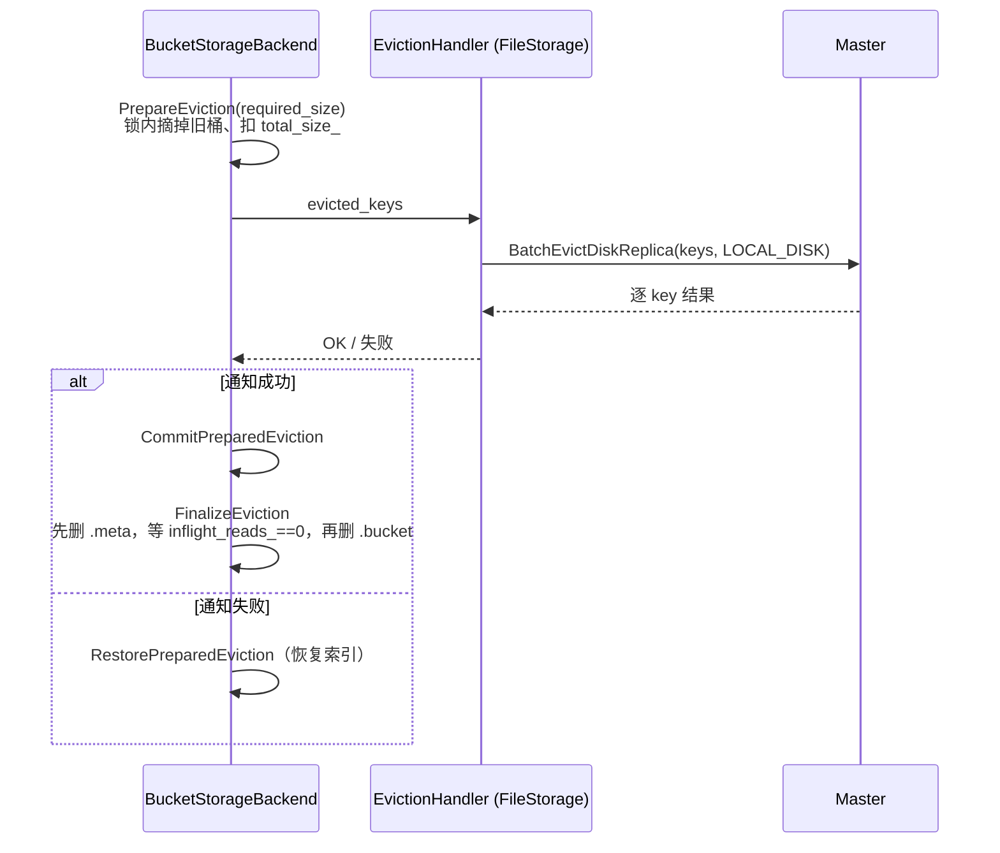

- **先通知 Master、再删文件**：保证 Master 不会把一个已经删掉的文件位置发给读者。
- **`BucketReadGuard` + `inflight_reads_`**：`BatchLoad` 期间持有 guard，`FinalizeEviction` 自旋等待计数归零（10s 超时），保证正在读的请求能完成（[storage_backend.h:112-154](../Mooncake/mooncake-store/include/storage_backend.h#L112)，[storage_backend.cpp:1703-1774](../Mooncake/mooncake-store/src/storage_backend.cpp#L1703)）。
- 淘汰策略 FIFO / LRU；LRU 索引是惰性维护的 `{last_access_ns_, bucket_id}` 集合。

#### 5.1.1 调用点：`BatchOffload` 里的固定顺序

[storage_backend.cpp:1548-1583](../Mooncake/mooncake-store/src/storage_backend.cpp#L1548)：

```cpp
const int64_t required_size = bucket->data_size + bucket->meta_size;
auto prepare_result = PrepareEviction(required_size, bucket->keys);   // ① 锁内摘旧桶
if (!prepare_result) return tl::make_unexpected(prepare_result.error());
PendingEviction pending = std::move(prepare_result.value());

if (eviction_handler && !pending.keys.empty()) {                      // ② 先通知 Master
    auto notify_result = eviction_handler(pending.keys);
    if (!notify_result) {
        RestorePreparedEviction(std::move(pending));                  // ②' 失败恢复索引
        return tl::make_unexpected(notify_result.error());
    }
}
CommitPreparedEviction(pending);                                      // ③ 记账

auto finalize_result = FinalizeEviction(pending);                     // ④ 删文件
if (!finalize_result) LOG(ERROR) << ...;                              //    失败不阻断写入

auto write_bucket_result = WriteBucket(bucket_id, bucket, iovs);      // ⑤ 写新桶
```

顺序不能换：如果先删文件再通知，Master 可能在两步之间把已删文件的位置发给读者；如果先写新桶再淘汰，磁盘在写入时可能已经满了。

#### 5.1.2 `PrepareEviction`：只改内存，不动文件

[storage_backend.cpp:2813-3000](../Mooncake/mooncake-store/src/storage_backend.cpp#L2813)：

```cpp
// 1) 写前去重：已存在 / 正在被并发写 → skip；正在被淘汰 → 报 OBJECT_ALREADY_EXISTS
for (const auto& key : write_keys) {
    if (object_bucket_map_.count(key) || pending_write_keys_.count(key)) {
        result.skipped_keys.push_back(key); continue;
    }
    if (pending_eviction_keys_.count(key))
        return tl::make_unexpected(ErrorCode::OBJECT_ALREADY_EXISTS);
    result.write_keys.push_back(key);
}
if (!result.write_keys.empty()) {
    pending_write_size_ += required_size;
    pending_write_keys_.insert(result.write_keys.begin(), result.write_keys.end());
}
```

然后按三种上限循环选受害者（[2918-2977](../Mooncake/mooncake-store/src/storage_backend.cpp#L2918)）：

```cpp
while (!buckets_.empty() && evict_count < kMaxEvictionBuckets /*1000*/) {
    bool quota_exceeded = total_size_ + pending_eviction_size_ + pending_write_size_ +
                          synthetic_required_size > max_total_size;      // 逻辑上限
    bool disk_still_full = initial_disk_full && accumulated_freed_space < deficit;  // 真实磁盘不足
    bool phys_exceeded = phys_over_cap(accumulated_freed_space);         // 物理目录上限
    if (!quota_exceeded && !disk_still_full && !phys_exceeded) break;

    auto evict_it = SelectEvictionCandidate();      // FIFO: buckets_.begin()；LRU: lru_index_
    if (evict_it == buckets_.end()) break;
    // 从 buckets_ / object_bucket_map_ 摘除，扣 total_size_，收集 keys / buckets
    ...
    result.keys.push_back(key);                     // ← 只把这些上报给 Master
    result.buckets.emplace_back(evict_id, std::move(evict_meta));
    pending_eviction_keys_.insert(key);
}
```

关键点：

- `result.keys` 只包含**真正指向被摘除桶**的 key。一个 key 若在提交阶段因为"已存在"被跳过，它指向的是另一个权威桶，这里绝不能上报，否则 Master 会删掉一个仍然可读的副本（注释在 [2952-2955](../Mooncake/mooncake-store/src/storage_backend.cpp#L2952)）。
- 淘汰完仍超上限（且本轮是真实写入）→ `RestorePreparedEvictionLocked` 回滚并返回 `FILE_WRITE_FAIL`（[2988-2991](../Mooncake/mooncake-store/src/storage_backend.cpp#L2988)），上游按 offload 未命中处理，不会写出半个桶。
- `pending_eviction_size_` / `pending_write_size_` 把"已摘除但还没删文件"的桶和"正在写"的桶都计入，避免并发 BatchOffload 重复超额。

#### 5.1.3 `H → M`：`NotifyEvictedDiskReplicas`

[file_storage.cpp:579-626](../Mooncake/mooncake-store/src/file_storage.cpp#L579)：

```cpp
for (const auto& [tenant_id, keys] : keys_by_tenant) {
    auto results = client_->BatchEvictDiskReplica(keys, tenant_id.value(),
                                                  ReplicaType::LOCAL_DISK);
    if (results.size() != keys.size()) { ... first_error = INTERNAL_ERROR; continue; }
    for (size_t i = 0; i < results.size(); ++i) {
        if (!results[i]) {
            if (results[i].error() == ErrorCode::OBJECT_NOT_FOUND) continue;  // Master 已无记录
            if (!first_error) first_error = results[i].error();
        }
    }
}
```

- 先按 tenant 分组再批量 RPC；erased key 的 scope 必须和写入时一致。
- `OBJECT_NOT_FOUND` 被视为成功——对象可能已经被别的路径删掉了，目的（Master 不再指向该文件）已经达到。
- 任何 key 失败都会让整个 handler 返回错误，触发 5.1.1 的 `RestorePreparedEviction`。这会放弃本轮淘汰，但保证 Master 与本地索引一致。

Master 侧 `EvictDiskReplicaImpl` 的删除范围是"`client_id` 匹配的 `LOCAL_DISK` 副本"（[master_service.cpp:6692-6701](../Mooncake/mooncake-store/src/master_service.cpp#L6692)），所以同一对象的其他 owner 或 MEMORY/DFS 副本不受影响。

#### 5.1.4 `CommitPreparedEviction` / `RestorePreparedEviction`

[storage_backend.cpp:3047-3078](../Mooncake/mooncake-store/src/storage_backend.cpp#L3047)：

```cpp
void BucketStorageBackend::CommitPreparedEviction(const PendingEviction& pending) {
    SharedMutexLocker lock(&mutex_);
    CHECK_GE(pending_eviction_size_, pending.evicted_size);
    pending_eviction_size_ -= pending.evicted_size;   // 淘汰已确定，转成"待删文件"
}
```

恢复路径则把 key 放回 `object_bucket_map_`、把桶放回 `buckets_`、把空间加回 `total_size_`，并撤销 `pending_eviction_keys_` / `pending_write_keys_`（[3007-3046](../Mooncake/mooncake-store/src/storage_backend.cpp#L3007)）。**只有 Master 明确拒绝时才恢复**；一旦 Master 接受，删文件失败只会留下孤儿文件，由重启恢复清理。

#### 5.1.5 `FinalizeEviction`：删文件 + 等待在途读

[storage_backend.cpp:3080-3176](../Mooncake/mooncake-store/src/storage_backend.cpp#L3080)：

```cpp
for (const auto& [bucket_id, bucket_meta] : pending.buckets) {
    // ① 先删 .meta：即使后续数据文件删除失败，重启也不会把这个桶恢复出来
    fs::remove(GetBucketMetadataPath(bucket_id).value(), ec);

    // ② 自旋等 inflight_reads_ 归零（10s 超时）
    while (bucket_meta->inflight_reads_.load(std::memory_order_acquire) > 0) {
        if (++spin_count > 1000) { std::this_thread::yield(); spin_count = 0;
            if (now - wait_start > 10s) { timed_out = true; break; } }
        else PAUSE();
    }
    if (timed_out) { ++cleanup_failed_count; continue; }

    // ③ 先清文件句柄缓存，再删 .bucket
    { MutexLocker cache_locker(&file_cache_mutex_);
      file_cache_.erase(GetBucketDataPath(bucket_id).value()); }
    fs::remove(GetBucketDataPath(bucket_id).value(), ec);
}
{
    SharedMutexLocker lock(&mutex_);
    cached_disk_bytes_ = -1;      // 物理用量缓存失效，下次重新 stat
}
```

`inflight_reads_` 的加减在 `BucketReadGuard`（[storage_backend.h:112-154](../Mooncake/mooncake-store/include/storage_backend.h#L112)）：`BatchLoad` 在锁内为每个桶建一个 guard（[1749-1764](../Mooncake/mooncake-store/src/storage_backend.cpp#L1749)），guard 一直活到函数返回，所以"读计划已生成、数据还没读完"的请求不会被删文件打断。

#### 5.1.6 水位淘汰复用同一套两阶段

`EvictAboveDiskWatermark`（[storage_backend.cpp:3179-3230](../Mooncake/mooncake-store/src/storage_backend.cpp#L3179)）只是换了一种"要腾多少空间"的计算方式：

```cpp
total_size = total_size_;
if (total_size <= max_total_size * high_watermark_ratio) return {};   // 未过高端水位
const int64_t target = max_total_size * low_watermark_ratio;
const int64_t synthetic_required_size = max_total_size - target;      // 造一个"假写入"
auto pending = PrepareEviction(synthetic_required_size);              // ← 同一个 Phase 1
...
eviction_handler(pending.keys) → CommitPreparedEviction → FinalizeEviction;  // ← 同一套 Phase 2
```

`synthetic_required_size` 的注释在 `PrepareEviction` 里：它不是真实写入，所以不计入物理磁盘空闲检查，只用来驱动逻辑配额淘汰。FileStorage 侧由 `RunDiskWatermarkEviction`（[file_storage.cpp:628-647](../Mooncake/mooncake-store/src/file_storage.cpp#L628)）在每个心跳末尾调用。

### 5.2 主动水位淘汰

心跳末尾的 `RunDiskWatermarkEviction`（[file_storage.cpp:628-647](../Mooncake/mooncake-store/src/file_storage.cpp#L628)）：后端用量超过 high watermark 时，把用量压到 low watermark，淘汰同样走 `eviction_handler` → `BatchEvictDiskReplica`。这条路径不依赖新写入，避免"没有新 Put 就永远不降水位"。

支持情况：Bucket（FIFO/LRU）、FilePerKey（FIFO 队列）、OffsetAllocator（当前 no-op）、NVMe KV / OSS（无本地容量淘汰，由设备/云端负责）。

### 5.3 Master 侧的清理

| 场景 | 代码 | 行为 |
| --- | --- | --- |
| owner 失联 | `CleanupStaleHandles`（[master_service.cpp:8328-8384](../Mooncake/mooncake-store/src/master_service.cpp#L8328)） | `has_stale_local_disk_client` 命中则删副本；最后一个副本删掉后对象记录也消失 |
| 主动卸载 | `UnmountLocalDiskSegment`（[master_service.cpp:8830-8881](../Mooncake/mooncake-store/src/master_service.cpp#L8830)） | 注销 segment → 按 owner id 扫全部 shard 删除其 `LOCAL_DISK` 副本 |
| 后端淘汰 | `BatchEvictDiskReplica` → `EvictDiskReplicaImpl`（[master_service.cpp:6660-6791](../Mooncake/mooncake-store/src/master_service.cpp#L6660)） | 只删 `client_id` 匹配的 LOCAL_DISK 副本；可带 `ReplicaID` 做条件删除 |

### 5.4 优雅下线

`RealClient::drainLocalDiskSegment(grace_seconds)`（[real_client.cpp:2362-2375](../Mooncake/mooncake-store/src/real_client.cpp#L2362)）→ `FileStorage::DrainLocalDiskSegment`（[file_storage.cpp:829-866](../Mooncake/mooncake-store/src/file_storage.cpp#L829)）：

1. 置 `draining_`（在 `offloading_mutex_` 下，与心跳 RPC 互斥）；
2. `UnmountLocalDiskSegment`：Master 立刻不再把该 owner 的 `LOCAL_DISK` 副本发给读者，并扫掉其副本；
3. sleep 一个 grace period，等在途的 offload 读请求结束；
4. 之后心跳不再挂回 segment（`draining_` 不可逆）。

这是 `LOCAL_DISK` "读依赖进程"这一语义换来的必要代价：内存副本由网卡直接服务，进程死了也不影响；磁盘副本必须由进程读出来再推给读者。

---

## 6. 三个后端（以及 DFS）的具体差异

### 6.1 对比

| 维度 | Bucket（默认） | FilePerKey | OffsetAllocator | NVMe KV | OSS（Distributed） |
| --- | --- | --- | --- | --- | --- |
| 对象布局 | 多 key 聚合为一个 bucket | 一 key 一文件 | 单文件 + 区间分配 | 设备 value，大对象分块 + root manifest | 一 key 一 OSS object（owner 前缀） |
| 元数据 | `.meta` 文件（keys + offset/key_size/data_size） | 文件路径（key 哈希） | 内存分片表 + 持久化 checkpoint | root value 内的 header/identity/manifest | 无（靠 LIST） |
| 写路径 | iovec 直写 + datasync | 序列化 KVEntry + 写文件 | 记录头 + value 写偏移 | NVMe KV Store（store-if-not-exists） | HTTP PUT（并发） |
| 读路径 | 按 bucket 分组批量 pread/io_uring | 读文件 + 反序列化 + memcpy | 读 header + value | Retrieve（可直读目标 buffer）+ 校验 | HTTP GET（并发，直接写入目标 buffer） |
| 容量淘汰 | FIFO/LRU + 逻辑/物理上限 + 水位 | FIFO 队列 + 水位 | 有淘汰框架（水位 no-op） | 无（设备/上层负责） | 无 |
| 重启恢复 | `ScanMeta` 读 `.meta` | `ScanMeta` 递归扫目录 | 默认 `kDisabled` 时截断重来；开启持久化后由 `Init` 从 `kv_cache.meta` 恢复（见 6.9） | `ScanMeta` 当前为空实现，不自动恢复 | `ScanMeta` LIST 对象 |
| 单设备/单路径约束 | 一个 `storage_path` 只允许一个活 Client（flock） | 同左 | 同左 | 当前面向单个本地设备 | 每 owner 独立 prefix |

### 6.2 BucketStorageBackend

- 分桶：`GroupOffloadingKeysByBucket`（[storage_backend.cpp:2294-2405](../Mooncake/mooncake-store/src/storage_backend.cpp#L2294)）按 `bucket_keys_limit`（默认 500）和 `bucket_size_limit`（默认 256 MB）聚桶；不足一桶的 key 放进 `ungrouped_offloading_objects_` 等下一轮；`MOONCAKE_OFFLOAD_FLUSH_PARTIAL_BUCKETS=1` 可以让尾桶当轮落盘（见设计文档对 issue #3006 的说明）。
- 数据文件布局：`[key bytes][value bytes][key bytes][value bytes]...`，`BucketObjectMetadata{offset, key_size, data_size}` 记录每段的偏移（[storage_backend.cpp:2408-2437](../Mooncake/mooncake-store/src/storage_backend.cpp#L2408)）。
- 读：先按 bucket 分组，一次性建 ReadPlan（锁内只拷元数据），锁外批量 I/O；io_uring 模式下用 `batch_read` 并把对齐修正后的真实地址写回 `batch_object[key].ptr`。
- 所有权：`Init` 里对 `<storage_path>/.mooncake_local_disk.lock` 拿非阻塞 `flock`，第二个活 Client 直接失败 —— 所以"同一块盘多 rank 共用目录"不是受支持部署。

### 6.3 FilePerKey（`StorageBackendAdaptor`）

- 每 key 一个文件，路径由 key 两级哈希得到；写时把 slices 拼成 `KVEntry{key,value}` 并 `struct_pb` 序列化，再交给通用 `StorageBackend::StoreObject`（FIFO 队列 + 配额淘汰）。
- 读时要**整文件读进 `std::string` 再 memcpy 到目标**（[storage_backend.cpp:1311-1338](../Mooncake/mooncake-store/src/storage_backend.cpp#L1311)），多一次分配和拷贝；这是它和 Bucket/OffsetAllocator 的主要性能差异。

### 6.4 OffsetAllocator

- 单个预分配文件 `kv_cache.data`，`OffsetAllocator` 管空闲区间，1024 个分片表降低锁竞争。
- 记录格式 v3：`[key_len u32][value_len u32][seq u64][flags u32][crc32 u32][key][padding][value]`，value 在记录内 4 KiB 对齐（为 cuFile/GDS 之类 DMA 写入预留）。
- 读时只校验 header/key 与长度，CRC 只在恢复时校验 —— 热路径不付校验成本（[storage_backend.cpp:5319-5330](../Mooncake/mooncake-store/src/storage_backend.cpp#L5319)）。
- **BatchOffload 假定单写者**（只有一条心跳线程），注释明确写了并发 offload 需要重审（[storage_backend.cpp:4844-4854](../Mooncake/mooncake-store/src/storage_backend.cpp#L4844)）。

### 6.5 NVMe KV（`NvmeKvStorageBackend`）

分层与原文一致：backend 负责逻辑对象布局，`NvmeKvConnector` 绑定设备，`NvmeKvCommandExecutor` 用 io_uring 或 ioctl 下发命令。

- **物理 key 编码**（[key_codec.cpp](../Mooncake/mooncake-store/src/nvme_kv/key_codec.cpp)）：逻辑 key 是变长字符串，设备 key 固定 16 字节。用两组种子不同的 XXH64 生成 root/chunk 物理 key，用四组种子 XXH64 生成写进 root header 的 identity 校验值。
- **冲突处理**（[key_conflict_policy.cpp](../Mooncake/mooncake-store/src/nvme_kv/key_conflict_policy.cpp)）：最多 64 个冲突槽；每次都是 `store-if-not-exists`；命中已存在时 Retrieve 比较字节 —— 相同视为幂等成功，不同则换下一个槽。读时逐槽探测，直到 header 里的 identity 与请求 key 一致。
- **对象布局**（[object_layout.cpp](../Mooncake/mooncake-store/src/nvme_kv/object_layout.cpp)）：小对象 inline（header + identity + payload）；大对象拆成 raw chunk values，最后写 root manifest（manifest 记录每个 chunk 的物理 key/长度/校验和）。**root 最后写，充当可见性标记**。
- **写路径**（[backend.cpp:479-975](../Mooncake/mooncake-store/src/nvme_kv/backend.cpp#L479)）：prepare worker 建 payload 视图/校验和/chunk/manifest；chunk lane 提交；某个对象的 chunk 全部完成后才把它的 root 投到 root lane；失败时只清理本次尝试创建的 key。
- **读路径**（[backend.cpp:1167+](../Mooncake/mooncake-store/src/nvme_kv/backend.cpp#L1167)）：解析并校验 root → inline 直接 memcpy；manifest 则生成 chunk 读计划。目标地址对齐且 executor 支持时走 `RetrieveIntoBatch`（设备直读目标 buffer），否则用 executor 自带 buffer + 校验后拷贝。
- **尚未覆盖**：RFC 里"从设备恢复对象目录"在 Backend 的 `ScanMeta` 里没有实现（空函数），所以 owner 重启后 Master 侧的 `LOCAL_DISK` 记录不会自动重建；多设备选择/容量满清理也没有接入。

### 6.6 OSS / DistributedStorageBackend

- `UsesObjectStorage()` 为真时走对象存储语义：`BatchOffload` 把每个 key 的 slices 变成 iovec 数组交给 `ObjectStorageAdapter::PutBatch`，**没有 eviction handler**（有也会被忽略）；`BatchLoad` 变成 `GetBatch`，逐项校验返回长度（[distributed_storage_backend.cpp:359-444](../Mooncake/mooncake-store/src/storage/distributed/distributed_storage_backend.cpp#L359)、[:815-845](../Mooncake/mooncake-store/src/storage/distributed/distributed_storage_backend.cpp#L815)）。
- 物理 key = `owner_prefix + "/" + URIEncode(storage_key)`；PUT 直接覆盖，不做 store-if-not-exists，靠 owner 前缀隔离不同写入者。
- 每个 batch 自建 `CURLM`，最多 `MOONCAKE_OSS_MAX_CONNECTIONS`（默认 64）并发；GET 的 libcurl 回调直接写目标 buffer，避免整对象临时字符串。
- **限制**：Master 里的 `LOCAL_DISK` 记录仍然必需，读仍依赖 owner 进程；不做 multipart、不做云端 GC，删 Master 元数据不会发 DELETE。

---

### 6.7 NVMe KV 与 DFS 的对照

两者都"扩容量但不加 `MEMORY` 副本"，但控制面和数据面完全不同：

- **NVMe KV** 是 `StorageBackendInterface` 的一个实现，挂在 `FileStorage` 的 offload 链路上。Master 登记的是 `LOCAL_DISK` 副本（owner = 落盘的 RealClient）；读要靠 owner 代读，数据再多走一跳 TE。
- **DFS** 是独立的副本类型。Master 只分配一段共享文件里的区间并下发 `DistributedFSDescriptor`；任何挂载了同一共享文件系统的 Client 都能直接做 positional I/O。没有 owner、没有 offload 心跳、没有 TE 搬运。

两者共用 `StorageBackendInterface` 工厂，所以 `DistributedStorageBackend` 由 `FileStorage` 构造（[file_storage.cpp:86-93](../Mooncake/mooncake-store/src/file_storage.cpp#L86)），但构造完立刻交给 `Client::SetDfsStorageBackend`（[client_service.cpp:4275-4278](../Mooncake/mooncake-store/src/client_service.cpp#L4275)）；`FileStorage::Init` 检测到 `enable_dfs` 后**只起 GC 线程就返回**（[file_storage.cpp:142-146](../Mooncake/mooncake-store/src/file_storage.cpp#L142)），不挂 `LOCAL_DISK` segment、不跑 offload 心跳。这是理解两条路径的关键：**同一个 backend 类，两种装配方式**。

#### 6.7.1 差异速查

| 维度 | NVMe KV（`LOCAL_DISK`） | DFS（`DFS`） |
| --- | --- | --- |
| 副本类型 | `LOCAL_DISK` | `DFS` |
| Master 元数据 | owner client id + key→owner 索引 + 已用字节 | `DistributedFSDescriptor{file_path, offset, object_size, aligned_size, shard_idx}` |
| 空间分配者 | owner 的后端自己（物理 key 槽、root/chunk 记录） | Master 的 `DfsAllocatorInterface`（`ShardAllocator` / `ImmutableBucketAllocator`） |
| 谁能读 | 只有 owner 进程；它读设备后把数据推给读者 | 任何挂载同一共享文件系统的 Client |
| 数据面 | reader → offload RPC → owner 读盘进 `ClientBuffer` → TE READ | reader → `pread`/USRBIO 直接写进调用方 slices |
| `Put` 完成时机 | 异步：`Put` 返回时还没落盘，等心跳 | 同步：`WriteAt` 返回后才 `PutEnd` |
| 介质 | 节点本地 NVMe KV namespace（`/dev/...`，io_uring 或 ioctl） | 共享 DFS（3FS / CephFS / JuiceFS…） |
| 故障单位 | owner 进程 + 心跳租约；悬空副本靠 verify RPC 修复 | 共享文件系统 + master 侧 allocator 状态，无 owner |
| 重启恢复 | `ScanMeta` + `NotifyOffloadSuccess`（NVMe KV 的 `ScanMeta` 目前为空实现，不自动恢复） | 无 allocator 恢复；与 snapshot/oplog 互斥（[master_service.cpp:503-508](../Mooncake/mooncake-store/src/master_service.cpp#L503)） |
| 容量淘汰 | 后端水位淘汰（NVMe KV 未实现该钩子，由设备/上层负责） | master 侧水位 + deferred free |
| 多租户 | 支持 | 不支持；`single_tenant=false` 时 master 直接关闭 DFS（[master_service.cpp:512-517](../Mooncake/mooncake-store/src/master_service.cpp#L512)） |
| 读优先级 | 高于 DFS | 高于 legacy `DISK`，低于 `LOCAL_DISK`（[replica_selection.h:122-175](../Mooncake/mooncake-store/include/replica_selection.h#L122)） |

#### 6.7.2 NVMe KV 类图

```mermaid
classDiagram
    direction LR
    class Client {
        +Put()
        +PutToLocalFile()
        +OffloadObjectHeartbeat()
        +NotifyOffloadSuccess()
    }
    class FileStorage {
        -storage_backend_ StorageBackendInterface
        -client_buffer_allocator_
        -heartbeat_thread_
        +Init()
        +Heartbeat()
        +OffloadObjects()
        +BatchGet()
        +BatchGetLocal()
    }
    class StorageBackendInterface {
        <<interface>>
        +Init()
        +BatchOffload()
        +BatchLoad()
        +ScanMeta()
        +EvictAboveDiskWatermark()
    }
    class NvmeKvStorageBackend {
        -connector_ NvmeKvConnector
        -manifest_cache_
        +BatchOffload()
        +BatchLoad()
    }
    class NvmeKvConnector {
        -executor_ NvmeKvCommandExecutor
        +Store()
        +StoreBatch()
        +Retrieve()
        +RetrieveIntoBatch()
        +Delete()
    }
    class NvmeKvCommandExecutor {
        <<interface>>
        +Store()
        +Retrieve()
        +Delete()
    }
    class NvmeKvIoUringExecutor
    class NvmeKvIoctlExecutor
    class NvmeKvStubExecutor

    Client --> FileStorage
    FileStorage --> StorageBackendInterface
    StorageBackendInterface <|-- NvmeKvStorageBackend
    NvmeKvStorageBackend --> NvmeKvConnector
    NvmeKvConnector --> NvmeKvCommandExecutor
    NvmeKvCommandExecutor <|-- NvmeKvIoUringExecutor
    NvmeKvCommandExecutor <|-- NvmeKvIoctlExecutor
    NvmeKvCommandExecutor <|-- NvmeKvStubExecutor
```

图中节点 → 代码：

| 节点 | 代码 |
| --- | --- |
| `NvmeKvStorageBackend` | [backend.h:21](../Mooncake/mooncake-store/include/nvme_kv/backend.h#L21)；`BatchOffload` [backend.cpp:479](../Mooncake/mooncake-store/src/nvme_kv/backend.cpp#L479)；`BatchLoad` [backend.cpp:1167](../Mooncake/mooncake-store/src/nvme_kv/backend.cpp#L1167) |
| `NvmeKvConnector` | [connector.h:16](../Mooncake/mooncake-store/include/nvme_kv/connector.h#L16)；`Init` 选 executor [connector.cpp:26](../Mooncake/mooncake-store/src/nvme_kv/connector.cpp#L26)、[47](../Mooncake/mooncake-store/src/nvme_kv/connector.cpp#L47) |
| `NvmeKvCommandExecutor` | [executor.h:19](../Mooncake/mooncake-store/include/nvme_kv/executor.h#L19) |
| io_uring / ioctl / stub 实现 | [executor_io_uring.cpp:377](../Mooncake/mooncake-store/src/nvme_kv/executor_io_uring.cpp#L377)、[executor_ioctl.cpp:22](../Mooncake/mooncake-store/src/nvme_kv/executor_ioctl.cpp#L22)、[executor_stub.cpp:14](../Mooncake/mooncake-store/src/nvme_kv/executor_stub.cpp#L14) |
| `StorageBackendInterface` | [storage_backend.h:262](../Mooncake/mooncake-store/include/storage_backend.h#L262) |
| `FileStorage` | [file_storage.h:12](../Mooncake/mooncake-store/include/file_storage.h#L12) |

#### 6.7.3 NVMe KV 全链路时序

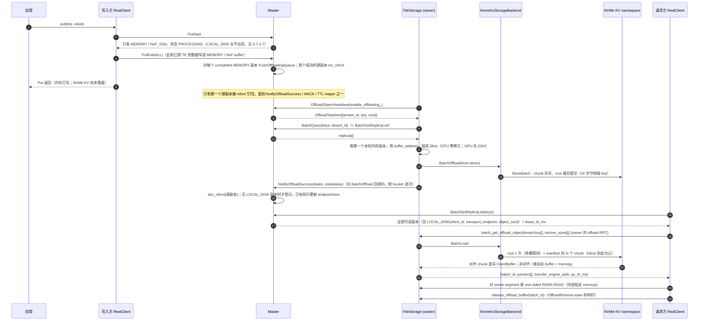

图中节点 → 代码：

| 阶段 | 代码 |
| --- | --- |
| `PutStart` 只分配 MEMORY / NoF_SSD | [master_service.cpp:5140-5315](../Mooncake/mooncake-store/src/master_service.cpp#L5140)（见 6.7.4.7） |
| `PutEnd` 触发入队 + `inc_refcnt` | [master_service.cpp:5785-5811](../Mooncake/mooncake-store/src/master_service.cpp#L5785) |
| 心跳取任务 | [file_storage.cpp:702-716](../Mooncake/mooncake-store/src/file_storage.cpp#L702) → [master_service.cpp:8887-8929](../Mooncake/mooncake-store/src/master_service.cpp#L8887) |
| `BatchQuerySegmentSlices` 取本机内存 | 先 [client_service.cpp:1259-1263](../Mooncake/mooncake-store/src/client_service.cpp#L1259)（master RPC），再 [file_storage.cpp:1047-1073](../Mooncake/mooncake-store/src/file_storage.cpp#L1047) |
| `BatchOffload` → NVMe KV 写 | [file_storage.cpp:501-505](../Mooncake/mooncake-store/src/file_storage.cpp#L501) → [backend.cpp:479](../Mooncake/mooncake-store/src/nvme_kv/backend.cpp#L479) |
| `NotifyOffloadSuccess` 登记 | [master_service.cpp:8973-9159](../Mooncake/mooncake-store/src/master_service.cpp#L8973) |
| 查询 + 选副本 | [client_service.cpp:1259-1263](../Mooncake/mooncake-store/src/client_service.cpp#L1259)、[real_client.cpp:4110-4154](../Mooncake/mooncake-store/src/real_client.cpp#L4110)（批量）/ [3744-3767](../Mooncake/mooncake-store/src/real_client.cpp#L3744)（单 key）、[replica_selection.h:122](../Mooncake/mooncake-store/include/replica_selection.h#L122) |
| 对象级读租约（`lease_ttl_ms`） | [master_service.cpp:5006](../Mooncake/mooncake-store/src/master_service.cpp#L5006)（`GrantReadLease`）；它**不保护** offload 数据，offload buffer 的租约是第 22 步的 `gc_ttl_ms` |
| offload RPC 读 | [real_client.cpp:8694-8722](../Mooncake/mooncake-store/src/real_client.cpp#L8694) → [file_storage.cpp:267-300](../Mooncake/mooncake-store/src/file_storage.cpp#L267) |
| TE 拉取 / 释放 | [transfer_task.cpp:1614-1694](../Mooncake/mooncake-store/src/transfer_task.cpp#L1614)、[real_client.cpp:586-636](../Mooncake/mooncake-store/src/real_client.cpp#L586) |

> **读图注意**：第 3 步只回 MEMORY / NoF_SSD 的原因、第 5 步为什么只钉一个源副本、第 9–11 步为什么是一次 master RPC 加一次本地取址、第 14 步为什么说"在回调内"、第 20 步为什么是"root 1 次 + chunk N 次"、第 24 步为什么是 RAII 释放 —— 逐条代码依据见 6.7.4.6；第 3 步的完整推导见 6.7.4.7。

#### 6.7.4 NVMe KV 代码导读

上面两张图给的是"形状"。这一节按 **接口面 → 对象模型 → 语义层 → 设备绑定 → 命令层 → 与图不符的地方 → 第 3 步的解释** 的顺序往下走，把 6.7.2 / 6.7.3 里的每个节点落到具体函数，并标出图上看不见的分支。

##### 6.7.4.1 对外暴露了什么：三层接口 + 一组环境变量

先给结论：**NVMe KV 没有自己的公开 API**。对上层它是 `StorageBackendInterface` 的第五个实现；对设备它只有 Store / Retrieve / Delete 三个动作；运维只有环境变量。

| 通道 | 面向谁 | 接口 | 位置 |
| --- | --- | --- | --- |
| 落盘 / 读回 | `FileStorage` | `StorageBackendInterface` 的 6 个纯虚函数 | [storage_backend.h:262](../Mooncake/mooncake-store/include/storage_backend.h#L262) |
| 设备绑定 | `NvmeKvStorageBackend` | `NvmeKvConnector::Init/Store/StoreBatch/Retrieve/RetrieveBufferBatch/RetrieveIntoBatch/Delete/GetCapabilities` | [connector.h:16](../Mooncake/mooncake-store/include/nvme_kv/connector.h#L16) |
| 命令下发 | `NvmeKvConnector` | `NvmeKvCommandExecutor` 的同名方法 + `Capabilities` | [executor.h:19](../Mooncake/mooncake-store/include/nvme_kv/executor.h#L19) |
| 装配 / 调优 | 部署者 | `MOONCAKE_NVME_KV_*` 环境变量 | 见本节（4） |

**（1）`StorageBackendInterface`：6 个实现 + 3 个默认空实现**

| 方法 | 语义 | NVMe KV 实现 |
| --- | --- | --- |
| `Init()` | 打开设备、建线程池 | [backend.cpp:461](../Mooncake/mooncake-store/src/nvme_kv/backend.cpp#L461) |
| `BatchOffload(map, complete_handler, eviction_handler)` | 把一批本机内存 slices 落盘；**真正的成功集合靠回调上报** | [backend.cpp:479](../Mooncake/mooncake-store/src/nvme_kv/backend.cpp#L479) |
| `BatchLoad(map&)` | 把数据读进调用方给的切片；map 是 in/out | [backend.cpp:1167](../Mooncake/mooncake-store/src/nvme_kv/backend.cpp#L1167) |
| `IsExist(key)` | 只答存在性，不分配读 buffer | [backend.cpp:1487](../Mooncake/mooncake-store/src/nvme_kv/backend.cpp#L1487) |
| `IsEnableOffloading()` | 后端自己的容量判断 | [backend.cpp:1503](../Mooncake/mooncake-store/src/nvme_kv/backend.cpp#L1503) |
| `ScanMeta(handler)` | 重启后重建目录 | [backend.cpp:1516](../Mooncake/mooncake-store/src/nvme_kv/backend.cpp#L1516) —— 空实现 |

未覆盖的钩子：`EvictAboveDiskWatermark()`（[storage_backend.h:311](../Mooncake/mooncake-store/include/storage_backend.h#L311)，返回空 vector）、`RemoveAll()`、`ResetScanIterator()`、`SetTestFailurePredicate()`。

三条必须记住的契约：

1. **`BatchOffload` 的返回值不等于成功集合**。`complete_handler(keys, metadatas)` 只对真正落盘的 key 调用，而函数本身仍可能返回 `first_error`（[backend.cpp:963-972](../Mooncake/mooncake-store/src/nvme_kv/backend.cpp#L963)）。`FileStorage` 用"回调里没出现的 key"做 NACK，`data_size=-1`（[file_storage.cpp:511-520](../Mooncake/mooncake-store/src/file_storage.cpp#L511)、[558-571](../Mooncake/mooncake-store/src/file_storage.cpp#L558)）。
2. **`BatchLoad` 是 all-or-nothing**。任何一个 key 的 chunk 失败，整批返回该错误（[backend.cpp:1470-1475](../Mooncake/mooncake-store/src/nvme_kv/backend.cpp#L1470)），没有部分成功。
3. **`eviction_handler` 被直接丢弃**（[backend.cpp:485](../Mooncake/mooncake-store/src/nvme_kv/backend.cpp#L485)）。所以"后端会在容量高时淘汰旧对象"这个假设在这里不成立。

**（2）`NvmeKvConnector`：`Init` 之外都是纯转发**

`Store/StoreBatch/Retrieve/RetrieveBufferBatch/RetrieveIntoBatch/Delete/GetCapabilities` 都只是 executor 的同名调用，附一层 `executor_ == nullptr` 的兜底（每个请求填 `INTERNAL_ERROR`，[connector.cpp:97-157](../Mooncake/mooncake-store/src/nvme_kv/connector.cpp#L97)）。唯一有决策的是 `Init()`，见 6.7.4.4。

**（3）`NvmeKvCommandExecutor`：16 字节 key + 同步批量**

```cpp
using PhysicalKey = std::array<uint8_t, 16>;

virtual tl::expected<void, ErrorCode> Store(const PhysicalKey&, std::string);
virtual void StoreBatch(std::vector<StoreRequest>&);                          // 默认实现是串行 for
virtual tl::expected<std::string, ErrorCode> Retrieve(const PhysicalKey&,
                                                      uint32_t size_hint = 0) const;
virtual void RetrieveBufferBatch(std::vector<RetrieveBufferRequest>&) const;   // 默认实现是串行 for
virtual void RetrieveIntoBatch(std::vector<RetrieveIntoRequest>&) const;      // 默认先 Buffer 再 memcpy
virtual tl::expected<void, ErrorCode> Delete(const PhysicalKey&);
virtual const Capabilities& GetCapabilities() const;
```

三条约定：

- **固定 16 字节**：设备 key 上限，编码方式见 6.7.4.2。
- **批量是同步的**：注释写死在 [executor.h:65-66](../Mooncake/mooncake-store/include/nvme_kv/executor.h#L65)，实现返回前必须停止访问所有 request-owned buffer。所以 `StoreRequest::value` 是 `string_view` 而不需要生命周期管理；改成异步会立刻悬垂。
- **默认实现就是串行**（[executor.h:67-119](../Mooncake/mooncake-store/include/nvme_kv/executor.h#L67)）：stub 与 ioctl 都走它，只有 io_uring 重写成真正的批量提交。

**（4）环境变量**

| 变量 | 默认 | 作用 |
| --- | --- | --- |
| `MOONCAKE_NVME_KV_DEVICE_PATH` | 必填 | 设备 / generic char device 路径，空值直接 `INVALID_PARAMS`（[connector_config.cpp:59](../Mooncake/mooncake-store/src/nvme_kv/config/connector_config.cpp#L59)） |
| `MOONCAKE_NVME_KV_NSID` | 1 | 写进每条命令的 `cmd.nsid` |
| `MOONCAKE_NVME_KV_TRANSPORT` | `auto` | `auto` / `io_uring` / `ioctl`（[connector_config.cpp:24](../Mooncake/mooncake-store/src/nvme_kv/config/connector_config.cpp#L24)） |
| `MOONCAKE_NVME_KV_QUEUE_DEPTH` | 256 | io_uring 环深度、攒批大小、并发预算的共同输入 |
| `MOONCAKE_NVME_KV_RUNTIME_TRANSFER_LIMIT` | 270336 | 与协议上限共同决定 `effective_max_value_size` |
| `MOONCAKE_NVME_KV_TRANSFER_ALIGNMENT_BYTES` | 4096 | DMA buffer 的对齐单位 |
| `MOONCAKE_NVME_KV_VALUE_BLOCK_UNIT_BYTES` | 512 | 命令 `cdw12` 的块计数单位 |
| `MOONCAKE_NVME_KV_PROTOCOL_MAX_VALUE_SIZE` | 512 KiB | 协议层单值上限 |
| `MOONCAKE_NVME_KV_READ_PLAN_BATCH_SIZE` | 8 | 读路径每个流水线分组的对象数 |
| `MOONCAKE_NVME_KV_{IO,BATCH_SUBMIT,ROOT_SUBMIT,PREPARE,MAX_IO}_CONCURRENCY` | 18 / 6 / 1 / 12 / 256 | 后端三级线程池规模（[io_concurrency_config.cpp:43](../Mooncake/mooncake-store/src/nvme_kv/config/io_concurrency_config.cpp#L43)） |
| `MOONCAKE_NVME_KV_DRIVER=stub` | 无 | 仅在 `MOONCAKE_ENABLE_NVME_KV_TEST_STUB` 编译开启时生效（[connector.cpp:30-41](../Mooncake/mooncake-store/src/nvme_kv/connector.cpp#L30)） |

**四个"看着像接口、其实不是"的点：**

1. `ScanMeta` 存在，但不重建目录（代码位置 [backend.cpp:1516](../Mooncake/mooncake-store/src/nvme_kv/backend.cpp#L1516)）。
2. `EvictAboveDiskWatermark` 存在，但用基类默认实现。
3. `eviction_handler` 是接收后忽略的参数。
4. `Delete` 存在，但只在写失败清理时被调用（[backend.cpp:832-856](../Mooncake/mooncake-store/src/nvme_kv/backend.cpp#L832)、[1010-1036](../Mooncake/mooncake-store/src/nvme_kv/backend.cpp#L1010)）。没有"按 key 删设备数据"的公开路径 —— 这是覆盖写不回收旧槽（6.7.4.2）的根因。

##### 6.7.4.2 对象模型：三个无状态模块

这一层不持有状态，全是 `key → bytes` 的确定性变换，可以脱离并发单独读懂。

**（1）`key_codec`：逻辑 key → 16 字节物理 key**

```
derivation_input = version(1) | u32(key_len) | logical_key | role | u32(slot) | has_chunk [| u32(chunk_index)]
physical_key     = XXH64(input, seed=0) || XXH64(input, seed=1)     // 各 8 字节
```

- `role = 1` 是 root，`role = 2` 是 chunk（[key_codec.cpp:10-12](../Mooncake/mooncake-store/src/nvme_kv/key_codec.cpp#L10)）；
- 两组种子拼成 16 字节，正好一个设备 key；
- 输入里包含 slot 和 chunk_index，**同一对象的不同槽 / 不同分块天然落在不同物理 key 上**；
- `ComputeNvmeKvVerifyHash` 用种子 0..3 生成 32 字节，写进 header，读时用它确认"这个物理 key 里装的确实是这个逻辑 key"（[key_codec.cpp:82](../Mooncake/mooncake-store/src/nvme_kv/key_codec.cpp#L82)）。

多租户不是命名空间，而是 key 本身：`FileStorage` 传下来的是 `TenantId::MakeScopedKey()` 之后的字符串（[file_storage.cpp:316-321](../Mooncake/mooncake-store/src/file_storage.cpp#L316)），物理 key 由它派生。

**（2）`object_layout`：header + identity + payload**

| 字段 | 类型 | 用途 |
| --- | --- | --- |
| `magic` | u32 = `0x4e564b56` | 快速识别 |
| `object_type` | u32 | 1 = inline，2 = manifest |
| `payload_size` | u32 | payload 长度 |
| `verify_hash` | u8[32] | 逻辑 key 的 4×XXH64 |
| `payload_checksum` | u32 | payload 的 XXH32 |
| `header_checksum` | u32 | header 自身 XXH32（计算时先清零本字段） |
| `identity_metadata_size` | u32 | 紧随 header 的 identity 区长度 |

identity 区 = `{resolved_physical_key, resolved_slot}` + canonical identity（[object_layout.cpp:62](../Mooncake/mooncake-store/src/nvme_kv/object_layout.cpp#L62)）。它把"我是谁、我在哪个槽"写进对象本身，所以读路径不需要任何外部元数据就能自证。

```
inline:   [header][identity][payload]
manifest: [header][identity][manifest_payload]
manifest_payload = {logical_payload_size, chunk_count} + N × {physical_key(16), payload_size(4), payload_checksum(4)}
chunk:    设备里裸存 payload（没有 header）
```

`ValidateNvmeKvHeader`（[object_layout.cpp:95](../Mooncake/mooncake-store/src/nvme_kv/object_layout.cpp#L95)）把 6 项校验串起来：magic、type、payload_size、identity_size、header_checksum、verify_hash。

**（3）`key_conflict_policy`：切块与槽位决策**

`BuildWritePlan`（[key_conflict_policy.cpp:32](../Mooncake/mooncake-store/src/nvme_kv/key_conflict_policy.cpp#L32)）是唯一决定"inline 还是 manifest"的地方：

```cpp
fixed_overhead = sizeof(NvmeKvObjectHeader) + identity_metadata_size;   // 56 + (25 + keylen)
inline_limit   = max_value_size - fixed_overhead;
store_inline   = payload.size() <= inline_limit;

chunk_limit    = max_value_size;          // 默认 270336 = 66 × 4096
chunk_count    = ceil(payload / chunk_limit);
// 且要求：8 + 24 * chunk_count + 56 + identity_metadata_size <= max_value_size
```

三个容易漏的量化结论（默认参数、64 字节 key）：

- **inline 上限** = 270336 − 56 − 89 = 270191 字节；
- **单对象上限**不是无限，受"manifest 自己要塞进一个 value"约束：`N ≤ (270336 − 56 − 89 − 8) / 24 ≈ 11257`，即 payload 约 **2.8 GiB** 封顶（另受 `payload ≤ UINT32_MAX` 约束）；
- 每个 chunk 是 **raw payload 切片**，没有独立 header；长度和校验和只存在 manifest 里。

`ValidateResolvedRootPlacement`（[key_conflict_policy.cpp:23](../Mooncake/mooncake-store/src/nvme_kv/key_conflict_policy.cpp#L23)）是读路径的"防串槽"检查：stored identity 里记的物理 key、实际读到的 key、`Encode(logical_key, stored_slot)` 三者必须一致。

**（4）冲突策略：`store-if-not-exists` + 字节比较 + 64 槽**

设备侧所有写都是 store-if-not-exists（`cdw11[15:8] = 0x02`）。命中已存在时，`ResolveExistingObject` 把已有值读回来与本次要写的 blob 做 `memcmp`（[key_conflict_policy.cpp:125](../Mooncake/mooncake-store/src/nvme_kv/key_conflict_policy.cpp#L125)）：

- 相同 → `kSameObject`，视为"上次其实写成功了"，返回 `{stored=true, inserted=false}`，不占新槽；
- 不同 → `kDifferentObject`，说明两个不同逻辑 key 的物理 key 相撞（或同 key 内容变了），换下一个槽（最多 64 个，[key_codec.h:18](../Mooncake/mooncake-store/include/nvme_kv/key_codec.h#L18)）。

两个隐含后果：

1. **root 是提交标记**。chunk 先写、root 后写，所以"读到合法 manifest 却读不到 chunk"只可能来自设备静默丢数据。
2. **覆盖写不回收旧槽**。批量快路径只试 slot 0，内容不同则换槽；`Delete` 只清理本次失败写入。同一逻辑 key 的多份内容会各占一槽，空间只增不减 —— 与"没有淘汰钩子"是一致的。

##### 6.7.4.3 语义层：`NvmeKvStorageBackend`

**（1）`Init`：先设备，再线程**

[backend.cpp:461](../Mooncake/mooncake-store/src/nvme_kv/backend.cpp#L461) 用 `compare_exchange_strong` 保证只初始化一次；失败时复位 `initialized_`，允许重试。顺序是 `InitDevice()`（new Connector + `Init()`）→ `InitIoWorkers()`。

并发度不是拍脑袋定的（[io_concurrency_config.cpp:43-84](../Mooncake/mooncake-store/src/nvme_kv/config/io_concurrency_config.cpp#L43)）：

```
io_concurrency       = min(queue_depth, 18, max_io_concurrency)
batch_submit ≤ io_concurrency - 1
prepare      ≤ io_concurrency - batch_submit
```

只有大于 1 才创建对应的 `ThreadPool`（[backend.cpp:192-214](../Mooncake/mooncake-store/src/nvme_kv/backend.cpp#L192)）。`submit_workers_` 与 `root_submit_workers_` 是**成对创建**的，这条约束决定了 `BatchOffload` 走不走流水线。

**（2）`BatchOffload` 的四个阶段**

[backend.cpp:479](../Mooncake/mooncake-store/src/nvme_kv/backend.cpp#L479)，约 500 行，但结构清晰：

1. **准入**：累加 payload 并检查 `int64_t` 溢出；`total_keys_ / total_size_` 对上限；`IsEnableOffloading()`。`slices.empty()` 的对象被静默跳过（[backend.cpp:501-504](../Mooncake/mooncake-store/src/nvme_kv/backend.cpp#L501)），所以返回值是"实际处理的对象数"。
2. **prepare**（[backend.cpp:560-574](../Mooncake/mooncake-store/src/nvme_kv/backend.cpp#L560)）：`BuildPayloadView` **单 slice 零拷贝**指向 segment 内存，多 slice 才拼接（[backend.cpp:78-92](../Mooncake/mooncake-store/src/nvme_kv/backend.cpp#L78)）；然后 `BuildWritePlan(..., slot = 0, ...)` —— **批量路径只试 0 号槽**。
3. **写**：两条流水线，见下。
4. **收尾**：失败的槽位清理本轮写入 → 未走流水线的对象补写 root → 成功的对象计入 `total_*` 并进回调 → 仍需回落的走 `OffloadOne`。

**两条写流水线**（[backend.cpp:598-830](../Mooncake/mooncake-store/src/nvme_kv/backend.cpp#L598)）：

```cpp
if (io_workers_ == nullptr || submit_workers_ == nullptr ||
    root_submit_workers_ == nullptr || batch_submit_concurrency_ <= 1) {
    // 串行版：prepare 并行 → 汇总所有 chunk → StoreBatchParallel → 汇总 root → StoreBatchParallel
}
// 流水线版：
//   producer            → chunk lane（轮询入队）
//   chunk lane 消费者    → 按 queue_depth 攒批 StoreBatch
//                        最后一个 chunk 成功 → root_queue.Push(plan)
//   root lane 消费者     → 按 queue_depth 攒批 StoreBatch(root_blob)
```

关键点：

- **root 只在最后一个 chunk 成功后才入 root 队列**（[backend.cpp:746-755](../Mooncake/mooncake-store/src/nvme_kv/backend.cpp#L746)）；
- 攒批单位是 `queue_depth`（[backend.cpp:733-734](../Mooncake/mooncake-store/src/nvme_kv/backend.cpp#L733)），因为底下一次 `StoreBatch` 最多塞满一个 io_uring 环；
- 异常路径用 `set_consumer_error()` 关闭所有队列，producer 的 `Push` 返回 false → 该对象填 `INTERNAL_ERROR`，不会死锁（[backend.cpp:639-654](../Mooncake/mooncake-store/src/nvme_kv/backend.cpp#L639)）；
- `StoreBatchParallel`（[backend.cpp:409-447](../Mooncake/mooncake-store/src/nvme_kv/backend.cpp#L409)）把请求按 `worker_index, worker_index+k, …` **交错分片**给 `batch_submit_concurrency_` 个 worker，让每个 worker 的批次更均匀。

**（3）`OffloadOne`：逐槽位重试**

[backend.cpp:976](../Mooncake/mooncake-store/src/nvme_kv/backend.cpp#L976)。槽 0..63 依次尝试 `BuildWritePlan` → 写 chunk → 写 root。三条细节：

- 每个 chunk 撞车都要单独判定；只要有一个 chunk 属于别的对象，整个对象换槽（[backend.cpp:1068-1093](../Mooncake/mooncake-store/src/nvme_kv/backend.cpp#L1068)）；
- `cleanup_new_writes` 只删本次尝试创建的 key（[backend.cpp:1010-1036](../Mooncake/mooncake-store/src/nvme_kv/backend.cpp#L1010)），从不删已存在的老对象；
- 64 槽用尽仍冲突，返回 `{stored=false, inserted=false}`（[backend.cpp:1164](../Mooncake/mooncake-store/src/nvme_kv/backend.cpp#L1164)），该 key 既不上报也不报错，由 FileStorage 当失败 NACK。

**（4）`BatchLoad` 的三个阶段**

[backend.cpp:1167](../Mooncake/mooncake-store/src/nvme_kv/backend.cpp#L1167)。

1. **准备**（[backend.cpp:1198-1277](../Mooncake/mooncake-store/src/nvme_kv/backend.cpp#L1198)）：`ResolveRoot` 从槽 0 线性探测（[backend.cpp:147-184](../Mooncake/mooncake-store/src/nvme_kv/backend.cpp#L147)）；解析并校验 header；inline → `memcpy` 后结束；manifest → 解析 chunk 记录并 `CacheManifest`。**命中 manifest 缓存的对象跳过整个准备阶段**（[backend.cpp:1300-1307](../Mooncake/mooncake-store/src/nvme_kv/backend.cpp#L1300)）。
2. **读**（[backend.cpp:1336-1431](../Mooncake/mooncake-store/src/nvme_kv/backend.cpp#L1336)）：按 `READ_PLAN_BATCH_SIZE`（默认 8 个对象）分组。每个 chunk 选路：`CanRetrieveDirectlyInto(dest, size)` 为真走 `RetrieveIntoBatch`（设备直写目标 buffer），否则走 `RetrieveBufferBatch` + 拷贝。
3. **校验**（[backend.cpp:1433-1467](../Mooncake/mooncake-store/src/nvme_kv/backend.cpp#L1433)）：buffer 路径已在拷贝前校验；这一阶段只复核直读 chunk 的 checksum。两阶段通过 `RunPipelinedIo` 重叠（[backend.cpp:1469](../Mooncake/mooncake-store/src/nvme_kv/backend.cpp#L1469)）。

**"设备直读"不是无条件的**：`CanRetrieveDirectlyInto` 要求长度是 4096 的整数倍且目标地址 4 KiB 对齐（[backend.cpp:69-76](../Mooncake/mooncake-store/src/nvme_kv/backend.cpp#L69)）。chunk 只有"满块"（270336 = 66×4096）满足，**尾块必然走 buffer + memcpy**。

**root 读取的往返次数**：`ResolveRoot` 用 `size_hint = 0`，首读固定 4096 字节（[executor_util.cpp:84-92](../Mooncake/mooncake-store/src/nvme_kv/executor_util.cpp#L84)）：

- root blob ≤ 4096 → **一次读完**。默认参数下这覆盖到 payload 约 **42 MiB**（manifest 记录数 ≤ 164）；
- root blob 在 (4096, 270336] → 设备对 4 KiB 请求报 `0x85`，走最大 buffer 重试，**共两次**；
- 更大则 `BUFFER_OVERFLOW`（实际不会发生，因为 manifest 在写入时就受限）。

**（5）`IsExist` / `IsEnableOffloading` / `ScanMeta`**

- `IsExist` 复用 `ResolveRoot`（[backend.cpp:1496](../Mooncake/mooncake-store/src/nvme_kv/backend.cpp#L1496)）："存在" = "有一个 header 合法且 identity 匹配的 root"。这是悬空副本校验的基础。
- `IsEnableOffloading` 就是两个计数器与两个限制的比较（[backend.cpp:1510-1513](../Mooncake/mooncake-store/src/nvme_kv/backend.cpp#L1510)）。
- `ScanMeta` 返回空（[backend.cpp:1516](../Mooncake/mooncake-store/src/nvme_kv/backend.cpp#L1516)）。配合 `Init` 把计数器清零，得到两个后果：**重启后 Master 侧的 `LOCAL_DISK` 记录不会重建，配额从 0 起算**。

##### 6.7.4.4 设备绑定：`NvmeKvConnector`

只有 `Init` 有决策（[connector.cpp:26-95](../Mooncake/mooncake-store/src/nvme_kv/connector.cpp#L26)）：

```cpp
#ifdef MOONCAKE_ENABLE_NVME_KV_TEST_STUB
    if (getenv("MOONCAKE_NVME_KV_DRIVER") == "stub") { ... }
#endif
    return InitRealExecutor();

// InitRealExecutor：auto 策略
#ifdef MOONCAKE_HAVE_NVME_URING_CMD
    io_uring 先试，失败只 LOG(WARNING) 后继续
#endif
    ioctl 兜底
```

- `MOONCAKE_HAVE_NVME_URING_CMD` 是**编译期**开关；未定义时 `CreateNvmeKvIoUringExecutor` 直接返回 `INVALID_PARAMS`（[executor_io_uring.cpp:784-788](../Mooncake/mooncake-store/src/nvme_kv/executor_io_uring.cpp#L784)）。
- 显式指定 `io_uring` 而编译不支持时直接失败，**不静默降级**；只有 `auto` 会回退。
- `storage_path_`（`<storage_filepath>/nvme_kv_blobs`）只在 stub 模式使用，真实 executor 不碰文件系统。

##### 6.7.4.5 命令层：executor 与 NVMe 命令编码

**（1）`Capabilities` 向上决定对象布局**

[executor_util.cpp:116-129](../Mooncake/mooncake-store/src/nvme_kv/executor_util.cpp#L116)：

```cpp
effective_max_value_size = RoundDownToNvmeKvTransferBytes(min(protocol_max_value_size, runtime_transfer_limit));
queue_depth              = queue_depth ?: 256;
```

默认 270336。它同时是**单值设备上限**和**后端切块大小**，所以改这个环境变量会改变磁盘上的对象布局；`queue_depth` 同时是环深度、攒批大小和并发预算的输入。

**（2）一条命令的每个字段从哪来**

[executor_util.h:80-122](../Mooncake/mooncake-store/include/nvme_kv/executor_util.h#L80)：

| 字段 | store | retrieve | delete |
| --- | --- | --- | --- |
| `opcode` | `0x01` | `0x02` | `0x10` |
| `nsid` | `config.nsid` | 同 | 同 |
| `addr` / `data_len` | DMA buffer / 传输字节 | 同 | — |
| `cdw10` | 传输字节 | 传输字节 | — |
| `cdw11[7:0]` | key 长度（16） | 16 | 16 |
| `cdw11[15:8]` | `0x02` = store-if-not-exists | — | — |
| `cdw12` | `ceil(RoundUp(bytes) / 512) − 1` | 同 | — |
| `cdw2 / cdw3 / cdw14 / cdw15` | 16 字节物理 key | 同 | 同 |
| `timeout_ms` | 30000 | 同 | 同 |

key 打包（[executor_util.cpp:142-151](../Mooncake/mooncake-store/src/nvme_kv/executor_util.cpp#L142)）：

```cpp
cdw2  = LE32(key[0..3]);
cdw3  = LE32(key[4..7]);
cdw14 = (0x01 << 24) | (LE32(key[8..11]) & 0x00FFFFFF);   // 高 8 位是 Command Set Identifier
cdw15 = LE32(key[12..15]);
```

第 12 个字节的高 8 位被 CSI 占用，实际可用 120 bit，由两组 XXH64 拼成。

**（3）对齐与补零**

设备要求传输长度按 4096 对齐、块计数按 512 计算：

- 写：`ResolveNvmeKvStoreSubmissionBytes(size)` 向上取整到 4096，buffer `memset 0` 后只拷逻辑长度（[executor_ioctl.cpp:64-69](../Mooncake/mooncake-store/src/nvme_kv/executor_ioctl.cpp#L64)）。**设备里存的是补齐后的值**，真实长度靠 header 反推。
- 读：`RoundUpToNvmeKvTransferBytes` 分配对齐 buffer；`AllocateNvmeKvAlignedBuffer` 用 `posix_memalign(4096)`（[executor_util.cpp:39-47](../Mooncake/mooncake-store/src/nvme_kv/executor_util.cpp#L39)）。

**写路径的零拷贝是机会性的**：`CanSubmitCallerBufferDirectly` 要求"长度本来就对齐"且"源地址 4 KiB 对齐"（[executor_io_uring.cpp:36-44](../Mooncake/mooncake-store/src/nvme_kv/executor_io_uring.cpp#L36)）。满块 chunk（270336）满足长度条件，尾块和 inline root 永远不满足，必然补零拷贝；源地址是否对齐取决于 segment 分配器，代码在这里不做假设。

**（4）io_uring executor**

`NvmeKvIoUringExecutor` 自己不持有 ring，而是用 `SharedNvmeUringRing::Instance(queue_depth)`（[executor_io_uring.cpp:85-93](../Mooncake/mooncake-store/src/nvme_kv/executor_io_uring.cpp#L85)）——**每线程一个 `thread_local` ring**，队列深度变化时重建。所以并发模型是：`io_parallelism_` 个线程 → 最多同样多的环 → 每个环一次最多 `queue_depth` 条在途。

ring 初始化必须 `IORING_SETUP_SQE128`（必要时加 `CQE32`，[executor_io_uring.cpp:287-309](../Mooncake/mooncake-store/src/nvme_kv/executor_io_uring.cpp#L287)）：`struct nvme_uring_cmd` 72 字节，超过标准 64 字节 SQE 的 16 字节 `cmd[]` 区。`CQE32` 用来读回 32 位 result（retrieve 的实际长度）；不支持时 `has_observed_result = false`，直读路径退回 `request.size`，buffer 路径退回 header 解析 / `size_hint` 推断。

`SubmitBatch`（[executor_io_uring.cpp:97-278](../Mooncake/mooncake-store/src/nvme_kv/executor_io_uring.cpp#L97)）是一个带窗口的提交-收割循环：

```
while (completed < n):
    填 SQE 直到 inflight + prepared == queue_depth
    io_uring_submit_and_wait(1) / io_uring_submit()
    标记 submitted、inflight_ops++
    wait_and_drain(1)：尽可能多地 peek 已完成 CQE
```

`user_data = (token << 32) | (index + 1)`（[executor_io_uring.cpp:346-360](../Mooncake/mooncake-store/src/nvme_kv/executor_io_uring.cpp#L346)），每次 `SubmitBatch` 换 token。上次调用残留的 CQE 会被识别为 stale token 而不是错记到本次请求；无法归属时按 `complete_unknown_inflight` 逐个补 `INTERNAL_ERROR` 并计数，防止 `inflight_ops` 永远清零不了。协议错误后 `ResetRing()` 重建环。

**（5）ioctl executor**

[NvmeKvIoctlExecutor](../Mooncake/mooncake-store/src/nvme_kv/executor_ioctl.cpp#L22) 是"一次系统调用一条命令"：

```cpp
int ret = ::ioctl(fd_, NVME_IOCTL_IO_CMD, &cmd);
// ret < 0  → MapNvmeKvTransportError(errno)
// ret > 0  → MapNvmeKvStatus(ret)        ← NVMe status code
// ret == 0 → 成功；retrieve 时 cmd.result 是设备报告的字节数
```

批量方法全部用基类的串行默认实现，所以单线程没有并行度；它的价值是兼容性（不要求内核 5.19+ / generic char device）。后端线程池会把不同对象分到不同线程，多少补回并发。

**（6）读时的长度发现**

两个 executor 都实现同一套三段式（[executor_util.cpp:84-114](../Mooncake/mooncake-store/src/nvme_kv/executor_util.cpp#L84)）：

1. **首读按 `size_hint`**：`size_hint == 0` 时取 `max(sizeof(header), 4096) = 4096`；否则 `RoundUp(size_hint)`，上限 `effective_max_value_size`。
2. **从前缀反推长度**：`ResolveNvmeKvObjectBlobSize` 读 header 的 `payload_size + identity_metadata_size + 56`（[object_layout.cpp:160-171](../Mooncake/mooncake-store/src/nvme_kv/object_layout.cpp#L160)）。
3. **按需重读**：设备报 `0x85`（buffer 太小）且 `size_hint == 0` → 用最大 buffer 重试一次；header 说更大 → 用精确长度重试一次；超过上限 → `BUFFER_OVERFLOW`。

**（7）stub executor**

[NvmeKvStubExecutor](../Mooncake/mooncake-store/src/nvme_kv/executor_stub.cpp#L14)：内存 map + `<hex>.blob` 文件，先查内存再查文件；`Store` 用"查 map + `filesystem::exists`"模拟 store-if-not-exists。批量走基类默认实现。它让整条链路（冲突策略、manifest、pipeline）能在没有 NVMe KV 设备时跑测试。

**（8）错误映射**

[executor_util.cpp:163-206](../Mooncake/mooncake-store/src/nvme_kv/executor_util.cpp#L163)：

| NVMe status | ErrorCode | 语义 |
| --- | --- | --- |
| `0x81` capacity exceeded | `KEYS_ULTRA_LIMIT` | 设备满 → FileStorage 关闭 offloading（[file_storage.cpp:532-536](../Mooncake/mooncake-store/src/file_storage.cpp#L532)） |
| `0x85` invalid value size | `INVALID_PARAMS` | 读 buffer 太小，触发最大 buffer 重试 |
| `0x86` invalid key size | `INVALID_PARAMS` | 编码 bug |
| `0x87` key not found | `OBJECT_NOT_FOUND` | 槽位探测继续 / `IsExist` 为假 |
| `0x88` unrecovered read | `FILE_READ_FAIL` | 介质错误 |
| `0x89` key exists | `OBJECT_ALREADY_EXISTS` | **控制流**，不是错误（`IsNvmeKvControlFlowError`） |

`errno` 侧：`ENOSPC → KEYS_ULTRA_LIMIT`、`ENOENT → OBJECT_NOT_FOUND`、`EINVAL → INVALID_PARAMS`、`ENOMEM → BUFFER_OVERFLOW`。

##### 6.7.4.6 与 6.7.2 / 6.7.3 两图不符的地方

6.7.3 的图已按本节结论修正；下面按重要性记录**改了什么、为什么**。第 1–3 条是 6.7.2 类图的结构性错误（图本身未改，按图阅读时需自行修正），第 7、12 条会直接误导实现，其余是步骤精度。

1. **类图的所有权方向画反了**。图中是 `Client --> FileStorage`，但 `FileStorage` 由 `PyClient/RealClient` 持有（[pyclient.h:578](../Mooncake/mooncake-store/include/pyclient.h#L578)），而 `FileStorage` 反过来持有 `std::shared_ptr<Client>`（[file_storage.h:228](../Mooncake/mooncake-store/include/file_storage.h#L228)）。`Client` 本身没有 `FileStorage` 成员。正确关系是 `PyClient/RealClient --> FileStorage --> Client`（后者仅用于 RPC）。
2. **`PutToLocalFile` 不是 public**。它在 `Client` 的 private 区（[client_service.h:931](../Mooncake/mooncake-store/include/client_service.h#L931)），类图上的 `+` 应改 `-`。`OffloadObjectHeartbeat` / `NotifyOffloadSuccess` 确实是 `Client` 的 public 方法（[client_service.h:557](../Mooncake/mooncake-store/include/client_service.h#L557)、[644](../Mooncake/mooncake-store/include/client_service.h#L644)），但它们由 `FileStorage` 调用，不在 `Client → FileStorage` 方向上。
3. **同一张类图漏了 `IsExist` / `IsEnableOffloading`**，却把 `EvictAboveDiskWatermark` 画成接口方法。后者是基类的**非纯虚默认实现**（返回空 vector），NVMe KV 并没有 override 它；前两个才是它真正实现的纯虚函数。
4. **第 20 步不是一次读**（原文写的是"Retrieve / RetrieveIntoBatch"）。对 manifest 对象是 **1 次 root + N 次 chunk**；对 inline 对象才是 1 次。而且 root 读在 64 个槽上逐个探测，miss 是正常控制流（[backend.cpp:147-184](../Mooncake/mooncake-store/src/nvme_kv/backend.cpp#L147)）。
5. **第 5 步不是"给一个副本入队"**。`PutEnd` 对**每个** completed MEMORY 副本调 `PushOffloadingQueue`；`inc_refcnt` 只发生在**第一个成功入队**的源副本上，任务标记里记下全部 `mirror_clients`（[master_service.cpp:5792-5810](../Mooncake/mooncake-store/src/master_service.cpp#L5792)、[9161-9246](../Mooncake/mooncake-store/src/master_service.cpp#L9161)）。入队本身是**尽力而为**：owner 未 serving、未挂 LOCAL_DISK、队列满都会失败，`PutEnd` 静默忽略，`Put` 仍成功。入队还有三个门：`replica_type != DFS`、`enable_offload_`、`!offload_on_evict_`（[master_service.cpp:5785-5788](../Mooncake/mooncake-store/src/master_service.cpp#L5785)）；`offload_on_evict_ = true` 时改为淘汰路径入队（[10701-10735](../Mooncake/mooncake-store/src/master_service.cpp#L10701)）。
6. **第 6 步"尚未落盘"只对 NVMe KV 成立**。若本次还分配并写成功了 `NoF_SSD` 副本，那份副本在 `PutEnd` 之前就已经同步写到 Nvme-oF SSD 上了；"尚未落盘"指的是还没有 `LOCAL_DISK` 副本。
7. **第 9–11 步不是 FS 内部一步**。`BatchQuerySegmentSlices` 先发一次 `BatchQuery`（即 `BatchGetReplicaList`）到 master（[client_service.cpp:1259-1263](../Mooncake/mooncake-store/src/client_service.cpp#L1259)、[file_storage.cpp:1050](../Mooncake/mooncake-store/src/file_storage.cpp#L1050)），再在本地取**第一个** `IsReplicaOnLocalMemory()` 为真的副本地址（[file_storage.cpp:1054-1069](../Mooncake/mooncake-store/src/file_storage.cpp#L1054)）。它是 best-effort：找不到本机内存副本的 key 直接进失败集合（[file_storage.cpp:399-411](../Mooncake/mooncake-store/src/file_storage.cpp#L399)）。"零拷贝"也只对 CPU 内存成立，GPU 指针在同一函数里 D2H 拷到 pinned buffer（[file_storage.cpp:426-453](../Mooncake/mooncake-store/src/file_storage.cpp#L426)）。
8. **第 13 步必须区分"chunk 先、root 后"**，而不是笼统的"chunk/root"。大对象如果 chunk 写失败，root 根本不会写；批量快路径还只试 0 号槽，冲突才回落 `OffloadOne` 逐槽重试（[backend.cpp:746-755](../Mooncake/mooncake-store/src/nvme_kv/backend.cpp#L746)、[976](../Mooncake/mooncake-store/src/nvme_kv/backend.cpp#L976)）。
9. **第 14 步比图上更早发生**。`NotifyOffloadSuccess` 是在 `BatchOffload` 内部的 `complete_handler` 里同步调用的（[file_storage.cpp:342-367](../Mooncake/mooncake-store/src/file_storage.cpp#L342)），而且**按 bucket 逐次**上报，不是整批一次；失败的 key 走同一个 RPC、`data_size = -1` 作 NACK（[file_storage.cpp:558-571](../Mooncake/mooncake-store/src/file_storage.cpp#L558)）。
10. **第 15 步不是无条件 `AddReplica`**。只有存在 `offloading_task` 标记、LOCAL_DISK 段仍挂载、且对象**还没有** LOCAL_DISK 副本时才新增；已有副本时只就地更新同 client 的 `transport_endpoint / object_size`；NACK（`data_size < 0`）只 `dec_refcnt` + 清任务（[master_service.cpp:9003-9021](../Mooncake/mooncake-store/src/master_service.cpp#L9003)、[9046-9107](../Mooncake/mooncake-store/src/master_service.cpp#L9046)）。
11. **第 17 步的描述符有三个字段**，图上原来只写了两个：`LocalDiskDescriptor{client_id, object_size, transport_endpoint}`（[replica.h:294](../Mooncake/mooncake-store/include/replica.h#L294)）。这里的 `transport_endpoint` 是 **owner 的 offload RPC 地址**（写入时由 FileStorage 改成 `local_rpc_addr_`，[file_storage.cpp:347-349](../Mooncake/mooncake-store/src/file_storage.cpp#L347)），不是 TE 地址；TE 地址在第 22 步的回包里。
12. **第 17 步的 `lease_ttl_ms` 保护的不是 offload 数据**。它来自 `metadata.GrantReadLease(default_kv_lease_ttl_)`（[master_service.cpp:5006](../Mooncake/mooncake-store/src/master_service.cpp#L5006)），是**对象级**租约，用于防止 MEMORY 副本在读期间被淘汰；它不会阻止 master 用 `BatchEvictDiskReplica` 删掉 `LOCAL_DISK` 副本。offload 数据的租约是第 22 步回包里的 `gc_ttl_ms`（[rpc_types.h:313-330](../Mooncake/mooncake-store/include/rpc_types.h#L313)），而且它只是**读者侧**的截止时间：超过后判据在 [real_client.cpp:625-627](../Mooncake/mooncake-store/src/real_client.cpp#L625)，读完再检查、返回 `OBJECT_HAS_LEASE`（[9015-9016](../Mooncake/mooncake-store/src/real_client.cpp#L9015)）。
13. **第 23 步只在跨进程时是 RDMA READ**。读者就是 owner 时走 `OffloadBufferAccess::kLocalAddress`，最终退化为本地 memcpy（[real_client.cpp:8997-9001](../Mooncake/mooncake-store/src/real_client.cpp#L8997)、[transfer_task.cpp:1625-1629](../Mooncake/mooncake-store/src/transfer_task.cpp#L1625)）。跨进程时它是一条 one-sided READ，但要注意 `TransferRequest` 的字段命名：`source` 是**读者本地的落点 slice**，`target_id / target_offset` 才指向 owner segment 的 `pointers[i] + offset`（[transfer_task.cpp:1681-1687](../Mooncake/mooncake-store/src/transfer_task.cpp#L1681)）；owner 进程不参与拷贝。
14. **第 24 步不是显式调用**。释放由 `OffloadRestoreLease` 的析构函数完成（[real_client.cpp:600-607](../Mooncake/mooncake-store/src/real_client.cpp#L600)）；而且它是**带返回值的 RPC**（`invoke_rpc` 内部 `syncAwait`），只是调用点不检查结果。local batch 路径没有这个 RPC；读者异常退出时靠 `client_buffer_gc_ttl_ms` 到期的 GC 线程兜底（[file_storage.cpp:1202-1214](../Mooncake/mooncake-store/src/file_storage.cpp#L1202)）。

##### 6.7.4.7 第 3 步为什么只有 MEMORY / NoF

结论先说：**`PutStart` 返回的副本完全由 `AllocateReplicas` 决定，而这个函数没有任何分支会产生 `LOCAL_DISK`；`LOCAL_DISK` 只在落盘成功后被"登记"出来。**

**（1）`AllocateReplicas` 的全部产出**

[master_service.cpp:5140-5315](../Mooncake/mooncake-store/src/master_service.cpp#L5140) 只有四个分支：

| 分支 | 条件 | 产物 |
| --- | --- | --- |
| MEMORY | `config.replica_num > 0` | `allocation_strategy_->Allocate(..., ReplicaType::MEMORY)`（[5197-5217](../Mooncake/mooncake-store/src/master_service.cpp#L5197)） |
| NOF_SSD | **三个条件同时成立**：编译时 `-DUSE_NOF=ON`（默认 OFF，[CMakeLists.txt:38](../Mooncake/CMakeLists.txt#L38)）、`nof_replica_num > 0`、NoF segment 已挂载 | `Allocate(..., ReplicaType::NOF_SSD)`（[5215-5249](../Mooncake/mooncake-store/src/master_service.cpp#L5215)） |
| legacy DISK | `use_disk_replica_`（只有 master 带 `--root_fs_dir` 时置位，[462-463](../Mooncake/mooncake-store/src/master_service.cpp#L462)；该参数默认空串） | `Replica(file_path, size, PROCESSING)`（[5292-5296](../Mooncake/mooncake-store/src/master_service.cpp#L5292)） |
| DFS | `config.dfs_replica_num > 0`，且 master 的 `enable_dfs_` 与 `dfs_allocator_` 已初始化（否则 `DFS_SERVICE_UNAVAILABLE`） | `dfs_allocator_->Allocate(key, size)`（[5297-5315](../Mooncake/mooncake-store/src/master_service.cpp#L5297)） |

**没有第五个分支。** `LOCAL_DISK` 不会被 `PutStart` 分配。分配出的副本状态统一是 `PROCESSING`（[replica_allocator.cpp:189](../Mooncake/mooncake-store/src/placement/replica_allocator.cpp#L189)、[201](../Mooncake/mooncake-store/src/placement/replica_allocator.cpp#L201)）。

**（2）默认配置下就是 1 个 MEMORY**

`ReplicateConfig` 的默认值是 `replica_num = 1`、`nof_replica_num = 0`、`dfs_replica_num = 0`（[replica.h:110-112](../Mooncake/mooncake-store/include/replica.h#L110)）。所以在默认的 NVMe KV 部署里，第 3 步返回的列表恰好是**一个 MEMORY 描述符（PROCESSING）**。要出现第二个类型，必须显式改配置：

- `NOF_SSD`：`USE_NOF` 构建 + `nof_replica_num > 0` + 有 NoF segment 挂载；
- `DFS`：`dfs_replica_num = 1`（上限就是 1）+ master 开启 DFS；
- `DISK`：master 配了 `--root_fs_dir`（与 offload 部署互斥）。

另外一条容易忽略的短路：`PutStart` 返回 `OBJECT_ALREADY_EXISTS` 时，`Client::Put` **直接把它当成功返回**（[client_service.cpp:1993-1997](../Mooncake/mooncake-store/src/client_service.cpp#L1993)），根本不会拿到描述符列表 —— 所以第 3 步在幂等重复 Put 上不会发生。

**（3）为什么设计成"不给写目标"**

`PutStart` 的职责是回答一个问题：**"把数据写到哪里？"** 答案必须是客户端此刻能直接寻址的 buffer：

- MEMORY / NOF_SSD 是 segment 分配器给的现成地址，客户端用 TE 直接写；
- DFS 也是（master 分配共享文件区间，客户端 positional write）；
- legacy DISK 也是（master 生成路径，客户端写共享盘）。

而 `LOCAL_DISK` **不是写目标，是读结果**。NVMe KV 的数据布局（16 字节物理 key、chunk/manifest、槽位冲突处理）全部由 owner 的 `FileStorage` 在后端内部完成，客户端既没有设备写接口，也不该知道物理 key 怎么算。所以 `LOCAL_DISK` 只能等落盘成功后由 `NotifyOffloadSuccess` 登记：

```cpp
// master_service.cpp:9023-9025
Replica replica(client_id, metadata.data_size,
                metadata.transport_endpoint, ReplicaStatus::COMPLETE, record);
```

这个构造函数是 LOCAL_DISK 专用的（[replica.h:321-325](../Mooncake/mooncake-store/include/replica.h#L321)），`transport_endpoint` 就是 owner 的 RPC 地址，读请求据此找到代读进程。

**（4）由此得到一条读图规则**

> `PutStart` 的返回列表里出现 `LOCAL_DISK`，意味着 master 认为数据**已经在盘上**。

当前实现里这不会发生在 Put 的同步路径上，只会发生在之后的 `BatchGetReplicaList`（[master_service.cpp:4905](../Mooncake/mooncake-store/src/master_service.cpp#L4905)）。Put 的完整顺序因此是：

1. `PutStart` → 拿到 MEMORY/NoF 描述符；
2. 客户端按类型分支写数据：MEMORY / NoF 走 `TransferWrite`（[client_service.cpp:2033-2046](../Mooncake/mooncake-store/src/client_service.cpp#L2033)），DISK 走 `PutToLocalFile`（[2018-2031](../Mooncake/mooncake-store/src/client_service.cpp#L2018)），DFS 走 `WriteDfsReplicas`（[2048-2068](../Mooncake/mooncake-store/src/client_service.cpp#L2048)）—— **`LOCAL_DISK` 没有写分支**，因为客户端没有它的写接口；
3. `PutEnd(ALL)` → 副本置 COMPLETE，并触发 offload 入队。`ALL` 在 `is_target_replica` 里展开为 memory | nof | dfs（[master_service.cpp:5683-5688](../Mooncake/mooncake-store/src/master_service.cpp#L5683)），所以 DFS 副本也在这一步置 COMPLETE —— 这与 NVMe KV 的"写内存完成即 PutEnd、落盘另算"是同一条 RPC 的两种语义。

这也解释了 6.7.3 第 6 步的"Put 返回但尚未落盘"：`Put` 的同步语义只覆盖到 MEMORY/NoF 的传输完成，不覆盖后端写入。

#### 6.7.5 DFS 类图

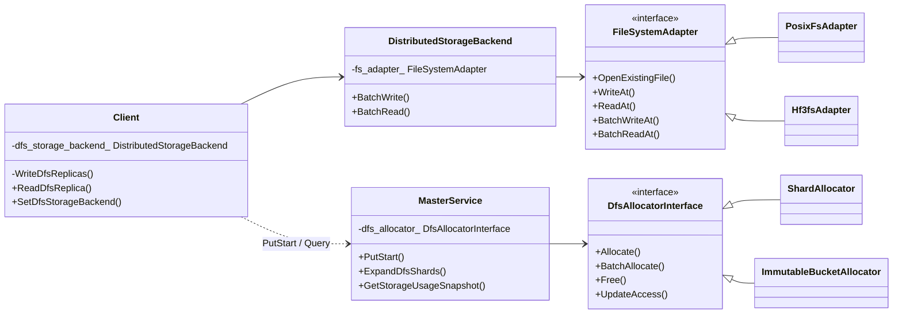

图中节点 → 代码：

| 节点 | 代码 |
| --- | --- |
| `MasterService` + `dfs_allocator_` | 初始化 [master_service.cpp:498-545](../Mooncake/mooncake-store/src/master_service.cpp#L498)；分配 [5293](../Mooncake/mooncake-store/src/master_service.cpp#L5293)（另见 5300-5315 的 `dfs_replica_num` 分支） |
| `DfsAllocatorInterface` | [dfs_allocator_interface.h:45](../Mooncake/mooncake-store/include/storage/distributed/dfs_allocator_interface.h#L45) |
| `ShardAllocator` / `ImmutableBucketAllocator` | [shard_allocator.h:27](../Mooncake/mooncake-store/include/storage/distributed/shard_allocator.h#L27)、[immutable_bucket_allocator.h:46](../Mooncake/mooncake-store/include/storage/distributed/immutable_bucket_allocator.h#L46) |
| `DistributedStorageBackend` | [distributed_storage_backend.h:44](../Mooncake/mooncake-store/include/storage/distributed/distributed_storage_backend.h#L44) |
| `FileSystemAdapter` 及实现 | [fs_adapter.h:34](../Mooncake/mooncake-store/include/storage/distributed/fs_adapter.h#L34)、[posix_fs_adapter.h:7](../Mooncake/mooncake-store/include/storage/distributed/posix_fs_adapter.h#L7)、[hf3fs_adapter.h:13](../Mooncake/mooncake-store/include/storage/distributed/hf3fs_adapter.h#L13) |
| `Client` 侧 | `SetDfsStorageBackend` [client_service.cpp:4275](../Mooncake/mooncake-store/src/client_service.cpp#L4275)；`WriteDfsReplicas` [2884](../Mooncake/mooncake-store/src/client_service.cpp#L2884)；`ReadDfsReplica` [5046](../Mooncake/mooncake-store/src/client_service.cpp#L5046) |

#### 6.7.6 DFS 全链路时序

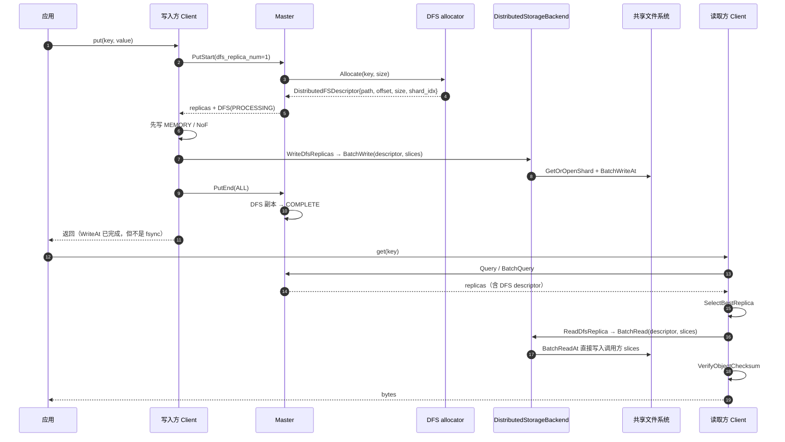

图中节点 → 代码：

| 阶段 | 代码 |
| --- | --- |
| `PutStart` 分配 DFS 区间 | [master_service.cpp:5300-5315](../Mooncake/mooncake-store/src/master_service.cpp#L5300)（`DfsAllocatorInterface::Allocate`） |
| 客户端写 DFS | [client_service.cpp:2048-2068](../Mooncake/mooncake-store/src/client_service.cpp#L2048) → `WriteDfsReplicas` [2884](../Mooncake/mooncake-store/src/client_service.cpp#L2884) → `BatchWrite` [2988](../Mooncake/mooncake-store/src/client_service.cpp#L2988) |
| backend 内部分发 | [distributed_storage_backend.cpp:600](../Mooncake/mooncake-store/src/storage/distributed/distributed_storage_backend.cpp#L600)（`BatchWriteAt` / `BatchReadAt`）、[634](../Mooncake/mooncake-store/src/storage/distributed/distributed_storage_backend.cpp#L634)、[722](../Mooncake/mooncake-store/src/storage/distributed/distributed_storage_backend.cpp#L722) |
| `PutEnd(ALL)` 含 DFS | [master_service.cpp:5683-5688](../Mooncake/mooncake-store/src/master_service.cpp#L5683) |
| 读：`Client::Get` → `ReadDfsReplica` | [client_service.cpp:1382-1405](../Mooncake/mooncake-store/src/client_service.cpp#L1382)、[5046-5075](../Mooncake/mooncake-store/src/client_service.cpp#L5046) |
| 选副本 | [replica_selection.h:122-175](../Mooncake/mooncake-store/include/replica_selection.h#L122) |

#### 6.7.7 DFS 代码导读

上面两张图给的是"形状"。这一节按 **接口面 → 控制面 → 分配器 → 写路径 → 读路径 → 适配层 → 失败语义** 的顺序往下走，把 6.7.5 里每个节点落到具体函数，并标出图上看不见的分支。

##### 6.7.7.1 对外暴露了什么：四条互不相通的通道

先给结论：**DFS 没有自己的公开 API**。应用只碰得到一个字段，装配只靠环境变量，真正的数据面接口只在 C++ 库内部可见。

| 通道 | 面向谁 | 接口 | 位置 |
| --- | --- | --- | --- |
| 应用读写 | Python / C++ 用户 | `ReplicateConfig.dfs_replica_num`（默认 0）随 `put/put_batch` 下发 | [replica.h:111](../Mooncake/mooncake-store/include/replica.h#L111)、[store_py.cpp:2174](../Mooncake/mooncake-integration/store/store_py.cpp#L2174)、[client_service.h:232](../Mooncake/mooncake-store/include/client_service.h#L232) |
| 数据面装配 | 部署者 | `MOONCAKE_OFFLOAD_STORAGE_BACKEND_DESCRIPTOR=distributed_storage_backend` + `MOONCAKE_DFS_*`；master 侧 `MOONCAKE_ENABLE_DFS` | [file_storage_config.cpp:51](../Mooncake/mooncake-store/src/config/file_storage_config.cpp#L51)、[distributed_storage_config.cpp:127](../Mooncake/mooncake-store/src/config/distributed_storage_config.cpp#L127)、[dfs_enablement_config.cpp:8](../Mooncake/mooncake-store/src/config/dfs_enablement_config.cpp#L8) |
| 库内接口 | C++ 库使用者 | `Client::SetDfsStorageBackend`、`DfsAllocatorInterface`、`DistributedStorageBackend::BatchWrite/BatchRead`、`FileSystemAdapter` | [client_service.h:650](../Mooncake/mooncake-store/include/client_service.h#L650)、[dfs_allocator_interface.h:45](../Mooncake/mooncake-store/include/storage/distributed/dfs_allocator_interface.h#L45)、[distributed_storage_backend.h:74](../Mooncake/mooncake-store/include/storage/distributed/distributed_storage_backend.h#L74)、[fs_adapter.h:34](../Mooncake/mooncake-store/include/storage/distributed/fs_adapter.h#L34) |
| 运维 | SRE | `GET/PUT /api/v1/dfs/shard_count`；`master_dfs_allocated_bytes` 等 gauge | [master_admin_service.cpp:1430](../Mooncake/mooncake-store/src/master_admin_service.cpp#L1430)、[master_metric_manager.cpp:54](../Mooncake/mooncake-store/src/master_metric_manager.cpp#L54) |

**（1）应用读写通道：只有一个旋钮**

Python 侧 `dfs_replica_num` 通过 `.def_readwrite` 暴露（[store_py.cpp:2174](../Mooncake/mooncake-integration/store/store_py.cpp#L2174)），随 `ReplicateConfig` 原样进入 `PutStart/BatchPutStart`。C++ 侧是 `Client::Put/BatchPut`（[client_service.cpp:1959](../Mooncake/mooncake-store/src/client_service.cpp#L1959)、[3596](../Mooncake/mooncake-store/src/client_service.cpp#L3596)），DFS 逻辑全部藏在这两个函数内部，`RealClient` 只是 Python 封装（[real_client.cpp:2514](../Mooncake/mooncake-store/src/real_client.cpp#L2514)）。

两个硬限制在这一层就生效，不必等到运行期：`dfs_replica_num > 1` 直接 `INVALID_PARAMS`（[master_service.cpp:5456-5461](../Mooncake/mooncake-store/src/master_service.cpp#L5456)），非 default 租户同样拒绝（[5462-5466](../Mooncake/mooncake-store/src/master_service.cpp#L5462)）。也就是说 **一个 key 最多一段 DFS 区间**，所谓"DFS 多副本"在当前实现里不存在。

**（2）装配通道：名字叫 offload，选的是 DFS**

客户端完全不认识 `MOONCAKE_ENABLE_DFS`，它只认 `MOONCAKE_OFFLOAD_STORAGE_BACKEND_DESCRIPTOR`。取到 `distributed_storage_backend` 后，`CreateStorageBackend` 按 `MOONCAKE_DFS_FS_ADAPTER` 造 adapter；只要不是 `oss`/`s3`，`FileStorage` 构造函数就把 backend 判为 DFS 并交给 Client：

```cpp
// file_storage.cpp:86-93
if (auto distributed_backend =
        std::dynamic_pointer_cast<DistributedStorageBackend>(storage_backend_)) {
    config_.enable_dfs = !distributed_backend->UsesObjectStorage();
    if (config_.enable_dfs && client_)
        client_->SetDfsStorageBackend(distributed_backend);
}
```

随后 `FileStorage::Init` 检测到 `enable_dfs`，只启动 buffer GC 线程就 `return`（[file_storage.cpp:142-146](../Mooncake/mooncake-store/src/file_storage.cpp#L142)），跳过 `MountLocalDiskSegment`、`ScanMeta` 与 offload 心跳——这就是 6.7 开头说的"同一个 backend 类，两种装配方式"。

三个容易踩的配置事实：

- **`--enable_offload` 不是 DFS 开关**。它只服务 `LOCAL_DISK` offload 队列，而 `PutEnd` 的入队条件显式排除仍处于 PROCESSING 的 DFS 副本（[master_service.cpp:5785-5788](../Mooncake/mooncake-store/src/master_service.cpp#L5785)）。
- **master 没有任何 `--dfs*` flag**，只认 `MOONCAKE_ENABLE_DFS`（旧名 `MOONCAKE_DFS_ENABLED`，[dfs_enablement_config.cpp:8-18](../Mooncake/mooncake-store/src/config/dfs_enablement_config.cpp#L8)）。
- **DFS 模式下仍需 `MOONCAKE_OFFLOAD_FILE_STORAGE_PATH` 是存在且可写的绝对目录**（[file_storage_config.cpp:146-210](../Mooncake/mooncake-store/src/config/file_storage_config.cpp#L146)），尽管数据实际写在 `MOONCAKE_DFS_ROOT_DIR`。

**（3）库内接口：类图里真正的方法**

- `Client::SetDfsStorageBackend` 是 **public**，但只对 C++ 可见（RealClient/PyClient 上没有对应方法）。它不只是赋值：还会 `EnsureStorageControlPlaneStarted()`，顺手拉起 storage heartbeat 与 task poll 线程（[client_service.cpp:4275-4279](../Mooncake/mooncake-store/src/client_service.cpp#L4275)）。而 `WriteDfsReplicas` / `ReadDfsReplica` 是 **private**（[client_service.h:924](../Mooncake/mooncake-store/include/client_service.h#L924)、[999](../Mooncake/mooncake-store/include/client_service.h#L999)）。
- `DfsAllocatorInterface` 是 master 唯一依赖的分配抽象：`Allocate / BatchAllocate / Free / UpdateAccess / GetUsedBytes / GetTotalCapacity / GetFileCount / IsEvictionEnabled / GetEvictionCheckInterval`（[dfs_allocator_interface.h:56-78](../Mooncake/mooncake-store/include/storage/distributed/dfs_allocator_interface.h#L56)）。**`BatchAllocate` 在生产路径没有调用者**，只在测试里出现；`PutStart` 是逐 key 调 `Allocate`。
- `DistributedStorageBackend::BatchWrite/BatchRead` **不是** `StorageBackendInterface` 的 override，而是 DFS 专有的 public 方法（[distributed_storage_backend.h:74-78](../Mooncake/mooncake-store/include/storage/distributed/distributed_storage_backend.h#L74)）。原因是接口里的 `BatchLoad` 是 key 语义，无法定位分片；DFS 必须由调用方携带 descriptor。
- `FileSystemAdapter` 的方法分五组，见 6.7.7.6。

**（4）运维通道：只有 shard 模式有扩容口**

`GET/PUT /api/v1/dfs/shard_count` 是唯一的 DFS 专属管理 API（[master_admin_service.cpp:1430](../Mooncake/mooncake-store/src/master_admin_service.cpp#L1430)），且只对 `ShardAllocator` 生效；bucket 模式返回 `UNAVAILABLE_IN_CURRENT_MODE`（[master_service.cpp:491-496](../Mooncake/mooncake-store/src/master_service.cpp#L491)）。容量观测走 `GetStorageUsageSnapshot` → Prometheus gauge，注意它**不是 RPC**（`WrappedMasterService` 里有同名包装但没注册到 `RegisterRpcService`）。

**四个"看着像接口、其实不是"的点：**

1. **描述符是 RPC 的返回值，不是 API 的参数**。客户端永远不能自己指定 `file_path/offset`。
2. **描述符是单向的**。`PutEnd` 只回 `ObjectMeta{key, object_checksum}`（[rpc_types.h:15](../Mooncake/mooncake-store/include/rpc_types.h#L15)），客户端没有任何描述符缓存。
3. **C ABI 缺字段**。`mooncake_replicate_config` 只有 `replica_num / with_hard_pin / preferred_segments / soft_pin_*`（[store_c.h:39-54](../Mooncake/mooncake-store/include/store_c.h#L39)），C 用户无法请求 DFS。
4. **能写不等于能读**。读 DFS 需要本进程也挂了 backend；否则 `ReadDfsReplica` 直接返回 `DFS_SERVICE_UNAVAILABLE`（[client_service.cpp:5052-5059](../Mooncake/mooncake-store/src/client_service.cpp#L5052)）。

##### 6.7.7.2 控制面：master 只是"记账"，不碰数据

`MasterService` 对 DFS 的全部职责是：启动时建 allocator、写时分配区间、完成时改副本状态、删除时归还区间、容量高时淘汰。它从不打开 shard 文件，也不校验客户端是否真的写了。

**（1）启动装配：四道门，两种失败方式**

[InitDfsAllocatorFromEnvironment](../Mooncake/mooncake-store/src/master_service.cpp#L498) 依次过四道：

| 顺序 | 条件 | 行为 | 性质 |
| --- | --- | --- | --- |
| 1 | `MOONCAKE_ENABLE_DFS` 关闭 | 直接返回 | 正常 |
| 2 | `enable_oplog_` 为真（HA + oplog） | `throw std::invalid_argument` | **硬失败，进程起不来** |
| 3 | `single_tenant=false` | `enable_dfs_=false` 后返回 | 静默降级，只有一条 ERROR 日志 |
| 4 | allocator `Init` 失败 | reset 指针、`enable_dfs_=false` | 静默降级 |

第 2 条是本层最重要的设计约束：**allocator 的 key→区间映射不落盘**，如果 master 从 oplog/snapshot 恢复出"对象 A 在 shard 3 的 offset 4096"，而 allocator 把这段重新分给对象 B，就会直接覆盖仍在被读的数据。所以宁可拒绝启动。HA 切换同理，`RestoreFromStandbyState` 见到 `enable_dfs_` 就返回 `DFS_SERVICE_UNAVAILABLE`（[master_service.cpp:3763-3767](../Mooncake/mooncake-store/src/master_service.cpp#L3763)）。

第 3、4 条只在 master 侧留日志，客户端要到第一次 `PutStart` 才收到 `-1601`。这是排障时最容易误判"配置生效了"的地方。

**（2）写前校验：四连拒**

`PrepareWriteStart`（[master_service.cpp:5442](../Mooncake/mooncake-store/src/master_service.cpp#L5442)）在分配之前拦掉四类请求：

```text
三种副本数全 0 / key 为空 / slice_length==0   → INVALID_PARAMS
dfs_replica_num > 1                            → INVALID_PARAMS
dfs_replica_num > 0 且非 default tenant         → INVALID_PARAMS
dfs_replica_num > 0 且 allocator 未就绪         → DFS_SERVICE_UNAVAILABLE (-1601)
```

**（3）分配顺序：DFS 排在最后**

`AllocateReplicas`（[master_service.cpp:5140](../Mooncake/mooncake-store/src/master_service.cpp#L5140)）的顺序是 `MEMORY → NOF_SSD → 可选 DISK → DFS`。DFS 段在 [5300-5317](../Mooncake/mooncake-store/src/master_service.cpp#L5300)：

```cpp
auto alloc = dfs_allocator_->Allocate(key, value_length);
if (!alloc) {
    if (dfs_allocation_failed != nullptr)
        *dfs_allocation_failed = (alloc.error() == ErrorCode::NO_AVAILABLE_HANDLE);
    return tl::make_unexpected(alloc.error());
}
replicas.emplace_back(std::move(*alloc), ReplicaStatus::PROCESSING);
```

两个细节：**只有 `NO_AVAILABLE_HANDLE` 会被记成"DFS 容量不足"**（供后面的强制驱逐用），其它错误不触发；**已分配的内存/NoF 副本没有显式回滚代码**，靠局部 vector 析构经 `AllocatedBuffer::~AllocatedBuffer` 归还。

**（4）下发：descriptor 带 `PROCESSING` 出生**

`InsertMetadata` 用 `get_descriptor()` 把每个副本转成 `Descriptor`，`status` 一起拷进去（[replica.h:869-873](../Mooncake/mooncake-store/include/replica.h#L869)、[911-913](../Mooncake/mooncake-store/include/replica.h#L911)）。所以客户端拿到的 DFS 描述符天生是 `PROCESSING`，读者不可见；`GetReadableReplicaDescriptors` 只放 `COMPLETE`（[master_service.cpp:4716-4719](../Mooncake/mooncake-store/src/master_service.cpp#L4716)）。

**（5）PutEnd：bucket 先提交，再置 COMPLETE**

`PutEnd`（[master_service.cpp:5663](../Mooncake/mooncake-store/src/master_service.cpp#L5663)）分三步：

1. **bucket 模式先 `MarkCommitted`**：把仍是 `PROCESSING` 的 DFS 条目从 `PENDING` 提升为 `COMMITTED`；任一失败返回 `FILE_WRITE_FAIL`，且**不回滚**（[5725-5743](../Mooncake/mooncake-store/src/master_service.cpp#L5725)）。shard 模式没有这一步。
2. `mark_complete()`，并对 DFS 补一次 `UpdateAccess`（[5748-5763](../Mooncake/mooncake-store/src/master_service.cpp#L5748)）。这次调用是必须的——`Allocate` 从不写 LRU，不补这一下新对象永远进不了淘汰候选。
3. checksum 只在 `object_checksum` 有值或 `replica_type ∈ {ALL, MEMORY, NOF_SSD}` 时写入（[5772-5777](../Mooncake/mooncake-store/src/master_service.cpp#L5772)）。

`ReplicaType::ALL` 的谓词显式列出三类副本（[5682-5689](../Mooncake/mooncake-store/src/master_service.cpp#L5682)），**新增副本类型必须同步改这里和 `PutRevoke` 的同一段**，否则会被 ALL 语义静默漏掉。

**（6）回收：`FreeDfsReplicas` 是唯一出口**

所有删除路径最终都落到 `EraseMetadata` → `FreeDfsReplicas`（[master_service.cpp:8386](../Mooncake/mooncake-store/src/master_service.cpp#L8386)）：`Remove/RemoveAll`、写失败 `PutRevoke`、被 Upsert 抢占、过期 PROCESSING 丢弃、容量驱逐。它对非 DFS 副本是 no-op。

注意"没有 owner"在这里的含义：客户端断开**不会**释放 DFS 副本。`CleanupStaleHandles` 只匹配失效的 MEMORY/NOF handle 和过期 LOCAL_DISK owner（[master_service.cpp:8328-8348](../Mooncake/mooncake-store/src/master_service.cpp#L8328)），DFS 不在其中。真正兜底的是 `DiscardExpiredProcessingReplicas`：`PutStart` 后超时未 `PutEnd` 的副本被 Pop 并 `FreeDfsReplicas`（[master_service.cpp:10309-10426](../Mooncake/mooncake-store/src/master_service.cpp#L10309)）。

**（7）两级"延迟释放"不是一回事**

| 层 | 保存什么 | 目的 | 位置 |
| --- | --- | --- | --- |
| master `discarded_replicas_` | `Replica` 对象 | 让旧 buffer/descriptor 晚点析构；**DFS 区间在入列前就已归还** | [master_service.cpp:5638-5642](../Mooncake/mooncake-store/src/master_service.cpp#L5638) |
| allocator `pending_free` | offset handle | 让刚 Free 的区间晚 `deferred_free_duration`（默认 30s）再复用，保护仍在读的客户端 | [shard_allocator.cpp:588-611](../Mooncake/mooncake-store/src/storage/distributed/shard_allocator.cpp#L588) |

把两者混为一谈，会误以为 `discarded_replicas_` 在保护 DFS 数据——它保护的是内存。

**（8）驱逐：两套节奏，一句话区别**

- shard 模式：allocator 按**每个 shard 自己的**高/低水位挑 LRU 候选并冻结 → master 逐条校验（非 PROCESSING、非 hard pin、租约已过期）→ `ResolvePreparedEviction` 提交或回滚（[master_service.cpp:8589-8725](../Mooncake/mooncake-store/src/master_service.cpp#L8589)）。
- bucket 模式：以**整桶**为单位，桶内所有 key 都通过校验才 `CommitEvictionLogical`，再删文件（[master_service.cpp:8410-8578](../Mooncake/mooncake-store/src/master_service.cpp#L8410)）。任一 key 被保护就整桶放弃，并把这个桶挪到 LRU 的 MRU 端，避免"坏桶"每轮被反复选中。

分配失败时还有一条**现场**回收路径：`AdmitWithDfsRecovery` 在 `dfs_bucket_recovery_mutex_` 下重跑 admit，仍失败就 `force_one` 强制删一个通过校验的桶（[master_service.cpp:5562-5587](../Mooncake/mooncake-store/src/master_service.cpp#L5562)）。它只对 bucket 模式生效，shard 模式只能等后台水位驱逐。

##### 6.7.7.3 两个 allocator：可复用区间 vs append-only 桶

同一个 `DfsAllocatorInterface`，两种完全不同的空间模型。

**（1）ShardAllocator：固定分片 + 区间复用**

- **布局**：`root_dir` 下若干 `dfs_shard_<两位数字>.data`，每个容量固定 `shard_capacity`（默认 4 GiB），启动时用 `PreallocateFile` 建好（POSIX `ftruncate` 稀疏文件）。已有文件**不截断不删除**，但大小必须精确等于 `shard_capacity`，否则 `INVALID_PARAMS`。
- **初始化只恢复布局**：`offset_to_handle` 与 LRU 都是空的（[shard_allocator.cpp:91-93](../Mooncake/mooncake-store/src/storage/distributed/shard_allocator.cpp#L91) 注释写明不支持 snapshot/oplog 恢复）。重启后旧数据仍在文件里，但新分配会把它覆盖掉。
- **选片**：`hash(key) % shard_count` 取首选，失败后线性探测其余 shard（[shard_allocator.cpp:277-298](../Mooncake/mooncake-store/src/storage/distributed/shard_allocator.cpp#L277)）。这样扩容新增的 shard 能真正缓解写满的 shard。对象**不允许跨 shard**，所以单对象上限就是一个 shard。
- **两个尺寸**：`aligned_size = align_up(object_size, alignment)`；实际向 `OffsetAllocator` 申请的是 `aligned_size + alignment - 1`（[shard_allocator.cpp:269](../Mooncake/mooncake-store/src/storage/distributed/shard_allocator.cpp#L269)）。多要这一段不是笔误——`OffsetAllocator` 只按内部 quantum 对齐，返回值还要再 `AlignSize(handle->address())` 一次才得到最终 offset（[290](../Mooncake/mooncake-store/src/storage/distributed/shard_allocator.cpp#L290)）。
- **LRU 只由 `UpdateAccess` 写**：`Allocate` 不插 LRU。调用点只有三处——`GetReplicaList`、`BatchGetReplicaList`、`PutEnd`（[master_service.cpp:4802](../Mooncake/mooncake-store/src/master_service.cpp#L4802)、[4975](../Mooncake/mooncake-store/src/master_service.cpp#L4975)、[5761](../Mooncake/mooncake-store/src/master_service.cpp#L5761)）。用 regex 查询或 admin 接口访问过的对象**不会变热**。
- **`Free` 是延迟的**：立即从 LRU 与 `offset_to_handle` 摘除，但 handle 进 `pending_free`，等 30s 后由下一次 `Allocate`/`PrepareEviction` 在同一 shard 上惰性回收（[shard_allocator.cpp:398-400](../Mooncake/mooncake-store/src/storage/distributed/shard_allocator.cpp#L398)、[588-611](../Mooncake/mooncake-store/src/storage/distributed/shard_allocator.cpp#L588)）。没有后台回收线程。
- **水位用 `EffectiveUsage`**：把 `pending_free_bytes` 算作空闲，再做容量裁剪（[613-635](../Mooncake/mooncake-store/src/storage/distributed/shard_allocator.cpp#L613)）；高水位置 `eviction_active`，低于低水位才清，形成滞回。`GetUsedBytes` 则相反，把 pending 仍算已用——指标偏高、淘汰判断偏松，是刻意的。

**（2）ImmutableBucketAllocator：只追加，整桶回收**

- **布局极简**：桶文件里**没有文件头、没有 entry 头、没有 checksum、没有 key 哈希**，只有 `[value bytes][zero padding]`，entry 由 `offset/object_size/aligned_size` 三个整数描述（[bucket_entry_layout.h:12-19](../Mooncake/mooncake-store/include/storage/distributed/bucket_entry_layout.h#L12)）。key→entry 索引只在 master 内存里。
- **分配即追加**：当前 active 桶装得下就沿 `append_offset` 切一段；装不下就把它 `SEALED` 并放进 LRU，再 `next_bucket_id_++` 新建一个（[immutable_bucket_allocator.cpp:140-166](../Mooncake/mooncake-store/src/storage/distributed/immutable_bucket_allocator.cpp#L140)）。**id 单调递增、永不复用**，这是"旧 descriptor 不会读到新数据"的物理前提。
- **两阶段提交**：分配出的 entry 是 `PENDING`，`PutEnd` 调 `MarkCommitted` 才转 `COMMITTED`（[342-354](../Mooncake/mooncake-store/src/storage/distributed/immutable_bucket_allocator.cpp#L342)）。`pending_entries != 0` 的桶完全不允许被淘汰。
- **`Free` 只打墓碑**：状态置 `TOMBSTONE`、摘掉 `key_index_`，但 `append_offset` 永不回退，字节仍计入 `GetUsedBytes`（[356-363](../Mooncake/mooncake-store/src/storage/distributed/immutable_bucket_allocator.cpp#L356)）。同 key 反复覆盖会持续消耗同一个桶——这是预期行为，不是泄漏。
- **`shard_idx` 就是 bucket id**：`MakeBucketDescriptor` 把 `bucket_id` 截成 `int` 写进 `shard_idx`（[bucket_entry_layout.h:57-62](../Mooncake/mooncake-store/include/storage/distributed/bucket_entry_layout.h#L57)），上限 `INT32_MAX`，超限返回 `INTERNAL_ERROR`。接口注释明确这是"保持 wire-compatible"的字段复用（[dfs_allocator_interface.h:39-44](../Mooncake/mooncake-store/include/storage/distributed/dfs_allocator_interface.h#L39)）。任何按"shard 序号"理解这个字段的新代码都会在 bucket 模式下读错。
- **重启不友好**：`Init` 看到 root 里已有任何 `bucket_*.data/.meta` 就直接拒绝（[101-109](../Mooncake/mooncake-store/src/storage/distributed/immutable_bucket_allocator.cpp#L101)），因为元数据不落盘、无法判断这些文件属于谁。master 侧随后静默降级 `enable_dfs_=false`。

**（3）对照**

| 维度 | ShardAllocator | ImmutableBucketAllocator |
| --- | --- | --- |
| 分配单位 | 对齐后的区间（可复用） | 桶内 append 的一段 |
| 回收单位 | 单个区间（延迟 30s） | 整个桶 |
| 覆盖写 | 允许（新分配覆盖旧区间） | 不允许原地写，master 走 Case C 重新分配（[master_service.cpp:6370-6374](../Mooncake/mooncake-store/src/master_service.cpp#L6370)） |
| 元数据 | 内存，重启只恢复容量布局 | 内存，重启直接拒绝 |
| 满容量 | 所有 shard 探测失败 → `NO_AVAILABLE_HANDLE` | 桶数达 `max_bucket_count` → `NO_AVAILABLE_HANDLE` |
| 淘汰 | per-shard 水位 + LRU 两阶段 | 整桶 LRU + 全 key 校验 |
| 扩容 | `ExpandShards` 在线可扩 | 无（受 `max_bucket_count` 约束） |
| 单对象上限 | `shard_capacity` | `bucket_capacity` |

##### 6.7.7.4 写路径：DFS 排在内存之后，且是同步的

**（1）`Client::Put` 的真实顺序**

```text
PutStart(ALL) ──► ① DISK 副本（异步投递 write_thread_pool_，自己 PutEnd(DISK)）
                ② MEMORY / NOF_SSD 副本（TransferWrite，同步等待）
                ③ DFS 副本（仅当 ② 全部成功）──► BatchWrite
                ④ PutEnd(ALL) 或 PutRevoke(ALL)
```

对应 [client_service.cpp:2020-2099](../Mooncake/mooncake-store/src/client_service.cpp#L2020)。三个容易画错的点：

- **DISK 排在最前，而且是异步的**。`PutToLocalFile` 只同步做拷贝，`StoreObject` 被丢进 `write_thread_pool_`，由异步任务自己 `PutEnd(DISK)`（[4647-4692](../Mooncake/mooncake-store/src/client_service.cpp#L4647)）。所以"DISK 已写完"与"Put 返回"不是同一时刻。
- **DFS 的门禁是"非 DFS 副本全成功"**：条件是 `allocated_dfs_replicas > 0 && NonDfsTransfersSucceeded(...)`（[2048-2049](../Mooncake/mooncake-store/src/client_service.cpp#L2048)）。而 `NonDfsTransfersSucceeded` 只统计 memory 与 NoF（[308-315](../Mooncake/mooncake-store/src/client_service.cpp#L308)），**不含 DISK/LOCAL_DISK**——本地盘写失败不会阻止 DFS 写。
- **被跳过时不是静默的**：代码专门记 `dfs_writes_skipped`（[2069-2084](../Mooncake/mooncake-store/src/client_service.cpp#L2069)），否则这次"消失的写"在指标上完全不可见。

**（2）`WriteDfsReplicas`：三个等长向量，一次 BatchWrite**

签名是 `(keys, vector<const vector<Slice>*>, descriptors)`（[2884](../Mooncake/mooncake-store/src/client_service.cpp#L2884)）。它做三件事：

1. **设备指针 D2H**：`FindDeviceForPointer` 命中就向 pinned pool 借暂存 buffer，`Copy(kDeviceToHost)`，再把 slice 换成 host 地址（[2941-2965](../Mooncake/mooncake-store/src/client_service.cpp#L2941)）。暂存 buffer 活到 `BatchWrite` 返回。
2. **拼请求**：`DfsWriteRequest{key, descriptor, host_slices}`（[2978-2980](../Mooncake/mooncake-store/src/client_service.cpp#L2978)）。
3. **一次调用**：`dfs_storage_backend_->BatchWrite(requests)`（[2988](../Mooncake/mooncake-store/src/client_service.cpp#L2988)），返回条数不符则整批记 `INTERNAL_ERROR`。

注意 **`aligned_size` 的尾部 padding 客户端不写**。backend 强制 `sum(slices) == object_size`（[distributed_storage_backend.cpp:698-704](../Mooncake/mooncake-store/src/storage/distributed/distributed_storage_backend.cpp#L698)），尾部零来自预分配留下的稀疏零页。`aligned_size` 只用于分配与 Free 粒度。

**（3）backend `BatchWrite`：三次短路 + 两个正交开关**

[distributed_storage_backend.cpp:634](../Mooncake/mooncake-store/src/storage/distributed/distributed_storage_backend.cpp#L634) 的结构非常规整：

```text
UsesObjectStorage()  → 整批 NOT_SUPPORTED
!initialized_        → 整批 DFS_SERVICE_UNAVAILABLE
逐请求：descriptor 几何校验 → slice 归一化 → 构造 DfsIoOp
batch_io ? 收集后批量执行 : 立即 ExecuteSingleIo
```

两个开关**互不影响**：

| 开关 | 取值来源 | 决定什么 |
| --- | --- | --- |
| `bucket_mode` | 本地 `allocator_type == "bucket"`（[324-326](../Mooncake/mooncake-store/src/storage/distributed/distributed_storage_backend.cpp#L324)） | 用哪套容量校验、短 I/O 是否续传、开桶还是开 shard |
| `batch_io` | `fs_adapter_->SupportsBatchIo()`（[657](../Mooncake/mooncake-store/src/storage/distributed/distributed_storage_backend.cpp#L657)） | 逐条执行还是收集后一次提交、是否持 shard 锁 |

**（4）执行器分派**

| | `batch_io=false`（POSIX） | `batch_io=true`（3FS） |
| --- | --- | --- |
| shard | `ExecuteSingleIo`：持 `shard.mutex`，单次 `WriteAt`，硬失败可 reopen 重试一次 | `ExecuteShardBatchIo`：复用缓存 fd，**不持锁**，短写判失败 |
| bucket | `ExecuteSingleIo`：每请求 open → 传 → close，短写用 `TransferAll` 续传 | `ExecuteBucketBatchIo`：按 `(file_path, shard_idx)` 分组，每批最多 64 个 fd，提交后关闭 |

短 I/O 的两种语义是这一层最容易忽略的差异：**shard 布局视为损坏（直接失败），bucket 布局视为可续传**（`complete_short_io`）。

**（5）没有 fsync**

整条 DFS 写路径只到 `BatchWriteAt`/`pwritev`（[600-601](../Mooncake/mooncake-store/src/storage/distributed/distributed_storage_backend.cpp#L600)），没有 `fsync/fdatasync`。所以 `Put` 返回表示"数据已交给内核/文件系统"，不是"已持久化"。对比本地文件 offload 路径是有 `datasync()` 的。

**（6）BatchPut：DFS 写被推迟到整批末尾**

`BatchPut` 的顺序是 `StartBatchPut` → `StageWriteBuffersForRemoteReplicas` → `SubmitTransfers/WaitForTransfers`（所有 key 的 memory/NoF）→ **`SubmitDfsWrites`**（[3625](../Mooncake/mooncake-store/src/client_service.cpp#L3625)）→ `FinalizeBatchPut`。`SubmitDfsWrites` 收集所有合格 key，只调一次 `WriteDfsReplicas`（[3035-3092](../Mooncake/mooncake-store/src/client_service.cpp#L3035)）。所以批量场景下 DFS 写不是"每个 key 之后立刻做"，而是整批一次。

**（7）失败 = 整条 Put 失败**

`dfs_replica_num > 0` 会把写模式强制成 `RELIABLE_MULTI_REPLICA`（[replica.h:226-237](../Mooncake/mooncake-store/include/replica.h#L226)）。`DetermineFinalizeDecision` 要求"分配数 == 请求数且全部传输成功"才发 `PutEnd(ALL)`，否则 `PutRevoke(ALL)`（[client_service.cpp:365-388](../Mooncake/mooncake-store/src/client_service.cpp#L365)）。DFS 不能像 `FLEXIBLE_DUAL_REPLICA` 那样"另一侧成功就算成功"。

还有两个不对称：

- **`PutEnd` 自身失败时不会再 revoke**（[2092-2100](../Mooncake/mooncake-store/src/client_service.cpp#L2092)），副本留在 PROCESSING，只能等 master 的 `put_start_discard_timeout`。
- **客户端从不 Free**。它只发 `PutRevoke`，区间由 master 的 `FreeDfsReplicas` 归还。

##### 6.7.7.5 读路径：选副本发生在 RealClient，不在 Client

**（1）两层选副本，别混**

```text
RealClient::get_*  → Query/BatchQuery → SelectBestReplica() → FilterQueryResult() → Client::Get/BatchGet
Client::Get/BatchGet → FindFirstCompleteReplica() → is_dfs? ReadDfsReplica : TransferRead
```

- `SelectBestReplica` 定义在 [replica_selection.h:122](../Mooncake/mooncake-store/include/replica_selection.h#L122)，由 **RealClient** 调用；优先级是 `local MEMORY > local NOF > remote MEMORY > remote NOF > LOCAL_DISK > DFS > DISK`，全程跳过非 `COMPLETE`。
- `Client::Get/BatchGet` 内部用的是 `FindFirstCompleteReplica`（[client_service.cpp:5459](../Mooncake/mooncake-store/src/client_service.cpp#L5459)），取"列表里第一个 COMPLETE"。所以 RealClient 必须先调 `FilterQueryResult` 把 `QueryResult` 裁成只含选中那一个副本（[real_client.cpp:493-500](../Mooncake/mooncake-store/src/real_client.cpp#L493)），否则下层可能改选到 DFS。
- 直接调 `Client` 层 API 而不经过 RealClient，就会退化成"master 返回顺序里的第一个 COMPLETE"。

**（2）单 key 与批量的分叉**

- **单 key**：`Client::Get` → `ReadDfsReplica`（[5046](../Mooncake/mooncake-store/src/client_service.cpp#L5046)）。它只校验副本类型与 backend，把 `slices` 原样塞进一个单元素 `DfsReadRequest`，同步调 `BatchRead`。**不切 buffer，也不校验 checksum**。
- **批量**：`BatchGet` 不调用 `ReadDfsReplica`。它把 DFS key 攒进 `dfs_read_requests`（[1746-1760](../Mooncake/mooncake-store/src/client_service.cpp#L1746)），循环结束后一次性 `BatchRead`（[1795-1798](../Mooncake/mooncake-store/src/client_service.cpp#L1795)），并与已提交的 RDMA transfer future 重叠执行。

**（3）backend `BatchRead`：读契约比写宽松**

读只要求 `slice` 总容量 **≥** `object_size`，多余部分按 `min()` 截断（[766-797](../Mooncake/mooncake-store/src/storage/distributed/distributed_storage_backend.cpp#L766)）；不足才 `INVALID_PARAMS`。读路径**没有暂存 buffer**，`slice.ptr` 直接组成 iovec 交给 `preadv`/USRBIO，是真正的零额外拷贝。

**（4）checksum：默认是空操作**

`VerifyObjectChecksum` 在 `ReadDfsReplica` 之外，由 `Client::Get`（[1425-1435](../Mooncake/mooncake-store/src/client_service.cpp#L1425)）与 `BatchGet`（[1837-1847](../Mooncake/mooncake-store/src/client_service.cpp#L1837)）调用。但 `ClientObjectChecksumConfig::enabled` **默认 false**（[client_object_checksum_config.h:6](../Mooncake/mooncake-store/src/config/client_object_checksum_config.h#L6)），函数首行就返回。时序图把 `VerifyObjectChecksum` 画成必经步骤时，要注明 `MOONCAKE_STORE_CHECKSUM=true`。

另外 checksum 是**对象级**的（`ObjectMeta` / `ObjectPart`），既不在 `DistributedFSDescriptor` 里，也不在 `Replica` 上。

**（5）range read 的真实拒绝点**

`Client::Get(..., src_offset)` 直接要求 memory 副本，否则 `INVALID_REPLICA`（[client_service.cpp:1470-1474](../Mooncake/mooncake-store/src/client_service.cpp#L1470)）。`TransferSubmitter::submitRangeRead` 只有 memory / nof / disk 三个分支：`1928-1929` 拒绝 NoF、`1930-1933` 拒绝 DISK/LOCAL_DISK，**DFS 根本没有分支**，会静默落到 `nullopt` 再由上层变成 `TRANSFER_FAIL`（[transfer_task.cpp:1907-1941](../Mooncake/mooncake-store/src/transfer_task.cpp#L1907)）。

RealClient 层的"DFS 部分读"是有的，但实现是**整对象读进临时 buffer 再 scatter**（[real_client.cpp:4813-4833](../Mooncake/mooncake-store/src/real_client.cpp#L4813)），不省 I/O。

**（6）失败没有降级**

描述符里没有 owner、没有 endpoint，也没有 liveness。所以 DFS 读失败：

- 没有 `LOCAL_DISK` 那样的 verify → evict → retry 修复链；
- 没有"换下一个副本"的循环——`FilterQueryResult` 已经把列表裁成一个；
- 错误直接透传（`FILE_NOT_FOUND` / `FILE_READ_FAIL` / `DFS_SERVICE_UNAVAILABLE`）。

master 侧的回收只由容量/LRU 驱动，与客户端读失败没有因果关系。

##### 6.7.7.6 适配层：两个能力开关决定四种执行形状

`FileSystemAdapter` 的方法分五组，读代码时先认清哪组是"必须实现"、哪组是"可选钩子"：

| 组 | 方法 | 默认行为 |
| --- | --- | --- |
| 文件管理（纯虚） | `DeleteFile / FileExists / ListFiles / Init / Shutdown / GetName` | 必须实现 |
| 便利默认实现 | `GetFileSize / DeleteFiles / ListFilesWithInfo` | 可直接用 |
| fd 钩子 | `OpenFile / OpenExistingFile / CloseFile / PreallocateFile / WriteAt / ReadAt` | 全部 `NOT_SUPPORTED` |
| 能力查询 | `SupportsFdReopen / SupportsBatchIo` | 均 `false` |
| 批量钩子 | `BatchWriteAt / BatchReadAt` | 逐条调 `WriteAt/ReadAt` |

**（1）PosixFsAdapter：plain fd 缓存器**

`OpenFile` 用 `O_RDWR|O_CREAT|O_CLOEXEC`，`OpenExistingFile` 用 `O_RDWR|O_CLOEXEC` 且对 EINTR 重试；读写是 `pwritev/preadv` + EINTR 重试，并**返回真实短传输字节数**。没有 `O_DIRECT`，也不检查对齐。它只声明 `SupportsFdReopen()=true`（[posix_fs_adapter.h:37](../Mooncake/mooncake-store/include/storage/distributed/posix_fs_adapter.h#L37)），于是 backend 在硬失败时可以关掉旧 fd、重新校验打开、原地重试一次。

**（2）Hf3fsAdapter：USRBIO + bounce buffer，且没有真正并行**

- `OpenFile` 是"普通 `open()`（FUSE 命名空间）+ `hf3fs_reg_fd` 注册"；注册失败会 `close`，不泄漏。
- `WriteAt/ReadAt` 先把用户 iovec **memcpy 进线程私有的注册 iov**，再按 `iov_size` 分块 `prep → submit → wait(1)` 同步完成（[hf3fs_adapter.cpp:186-220](../Mooncake/mooncake-store/src/storage/distributed/hf3fs_adapter.cpp#L186)）。未传满直接返回 `FILE_*_FAIL`，**不返回短计数**。
- 它只声明 `SupportsBatchIo()=true`（[hf3fs_adapter.h:43](../Mooncake/mooncake-store/include/storage/distributed/hf3fs_adapter.h#L43)），**没有重写 `BatchWriteAt/BatchReadAt`**。所以"批量"带来的收益是：一次适配器调用、不持 shard 锁、bucket fd 数量受限——**不是**单批内部并行。`Hf3fsConfig` 里的 `io_depth` 在当前调用模式下基本不生效。
- `Init` 永远返回成功（挂载点反推失败就退回原路径），配置错误要等第一次 I/O 才暴露。

**（3）两个标志的正交性**

| `SupportsBatchIo` | `SupportsFdReopen` | 谁 | 后果 |
| --- | --- | --- | --- |
| false | true | POSIX | 逐条执行 + 持 shard 锁；失败可 close/reopen 重试一次 |
| true | false | 3FS | 收集后批量提交 + 不持 shard 锁；失败不重试 |
| true | true | 目前没有 | **危险组合**：批量路径下无锁，reopen 会 close 掉别人正在用的 fd |
| false | false | 新适配器默认 | 逐条执行，无自愈 |

这条不变量的依据在 `distributed_storage_backend.h` 的注释里（[144-151](../Mooncake/mooncake-store/include/storage/distributed/distributed_storage_backend.h#L144)）：批量路径依赖"fd 只在 open 时改变，batch adapter 永不 reopen"。

**（4）新增一个适配器的最小工作集**

实现 6 个纯虚 + 至少 `OpenFile/OpenExistingFile/CloseFile/PreallocateFile/WriteAt/ReadAt`，按需覆盖两个能力标志；再改四处：config 白名单（[distributed_storage_config.cpp:43-48](../Mooncake/mooncake-store/src/config/distributed_storage_config.cpp#L43)）、三个工厂点（[storage_backend.cpp:5622](../Mooncake/mooncake-store/src/storage_backend.cpp#L5622)、[shard_allocator.cpp:69](../Mooncake/mooncake-store/src/storage/distributed/shard_allocator.cpp#L69)、[immutable_bucket_allocator.cpp:82](../Mooncake/mooncake-store/src/storage/distributed/immutable_bucket_allocator.cpp#L82)）。注意第三个工厂有 `else` 兜底，第二个**没有**——漏改会得到空指针解引用。

##### 6.7.7.7 一串失败会走到哪

| 阶段 | 错误 | 处理者 | 最终状态 |
| --- | --- | --- | --- |
| 配置/装配 | adapter 未编译、未知 `MOONCAKE_DFS_FS_ADAPTER` | `CreateStorageBackend` → `FileStorage` 抛 `runtime_error` | `setup()` 抛异常 |
| master 启动 | DFS + oplog/snapshot | `InitDfsAllocatorFromEnvironment` `throw` | 进程起不来 |
| master 启动 | 多租户 / allocator `Init` 失败 | 静默 `enable_dfs_=false` | DFS 写返回 `-1601` |
| `PutStart` | 容量不足 `NO_AVAILABLE_HANDLE` | `AdmitWithDfsRecovery`（仅 bucket 强制驱逐一次） | 仍失败则 `PutStart` 失败 |
| 客户端写 | 内存/NoF 传输失败 | 跳过 DFS 写，记 `dfs_writes_skipped` | `PutRevoke(ALL)` |
| 客户端写 | `BatchWrite` 部分失败 | `DetermineFinalizeDecision` | 整个 `Put` 失败 + `PutRevoke(ALL)` |
| `PutEnd` | bucket `MarkCommitted` 失败 | 返回 `FILE_WRITE_FAIL`，**不回滚** | 副本停在 PROCESSING，等 TTL 丢弃 |
| `PutEnd` | RPC 本身失败 | 客户端直接返回，**不再 revoke** | 同上 |
| 客户端消失 | 无 owner 可清理 | `DiscardExpiredProcessingReplicas` | 超时后 `FreeDfsReplicas` |
| 读 | 未挂载 / 文件被删 / 短读 | 客户端直接返回错误 | 无重试、无换副本 |
| 驱逐 | 物理删桶失败 | 记 `failed_deletions_`，桶停在 EVICTING | 容量继续占用，下轮 `RetryFailedEvictions` |

一句话：**DFS 的失败处理是"各段自扫门前雪"**，没有跨阶段的补偿事务。能自愈的只有 POSIX 的 reopen 一次和 bucket 的续传/删桶重试。

##### 6.7.7.8 与 6.7.5 / 6.7.6 两图不符的地方

读代码后需要修正的几处，按重要性排：

1. **`SelectBestReplica` 不在 `Client` 里**。时序图把它画成"读取方 Client"的一步；实际它定义在 [replica_selection.h:122](../Mooncake/mooncake-store/include/replica_selection.h#L122)，由 **RealClient** 调用（[real_client.cpp:3767](../Mooncake/mooncake-store/src/real_client.cpp#L3767)）。`Client::Get/BatchGet` 内部用的是 `FindFirstCompleteReplica`。类图上应把它移到 RealClient 层，或标注为"RealClient 选完、裁剪后再下传"。
2. **`ReadDfsReplica` 只服务单 key**（唯一调用点 [client_service.cpp:1403](../Mooncake/mooncake-store/src/client_service.cpp#L1403)）。`BatchGet` 不走它，而是攒批后直接 `BatchRead`。时序图的"读"分支要画成两条。
3. **`BatchAllocate` 在生产路径没有调用者**。`PutStart` 每 key 调一次 `Allocate`，即使 `BatchPutStart` 也是逐 key 转 `PutStart`（[rpc_service.cpp:561-568](../Mooncake/mooncake-store/src/rpc_service.cpp#L561)）。时序图若画成"批量分配"要改。
4. **`DistributedStorageBackend::BatchWrite/BatchRead` 不是接口 override**，而是 DFS 专有的 public 方法；`StorageBackendInterface::BatchLoad` 是 key 语义，无法定位分片。
5. **`Put` 时序漏了 DISK**。真实顺序是 `DISK（异步）→ MEMORY/NOF → DFS → PutEnd`，且 DISK 早于内存写、完成于异步线程。两个限定：DISK 只在 master 配了 `--root_fs_dir`（`use_disk_replica_`）时才被分配；`NoF` 默认 `nof_replica_num=0`，默认配置下这一步实际只写一个 MEMORY 副本。
6. **`VerifyObjectChecksum` 默认为空操作**，需要 `MOONCAKE_STORE_CHECKSUM=true` 才是必经步骤。
7. **`transfer_task.cpp:1929` 拒绝的是 NoF，不是 DFS**。DFS 在 `submitRangeRead` 里没有分支，静默落 `nullopt`；显式拒绝在 [client_service.cpp:1470-1474](../Mooncake/mooncake-store/src/client_service.cpp#L1470)。
8. **类图把 `+ReadDfsReplica()` 画成了 public**：它声明在 `private:` 区（[client_service.h:874](../Mooncake/mooncake-store/include/client_service.h#L874) 起，声明在 [924](../Mooncake/mooncake-store/include/client_service.h#L924)）。同一节点里的 `-WriteDfsReplicas()`（[999](../Mooncake/mooncake-store/include/client_service.h#L999)）和 `+SetDfsStorageBackend()`（[650](../Mooncake/mooncake-store/include/client_service.h#L650)）符号是对的。外部能注入 backend，但不能直接调这两个读写方法。
9. **`Client ..> MasterService` 这条依赖画得过于直接**：`Client` 并不持有 `MasterService`，它持有一个 RPC 存根 `MasterClient master_client_`（[client_service.h:1020](../Mooncake/mooncake-store/include/client_service.h#L1020)），经 coro_rpc 打到 `WrappedMasterService`。标签里的 "Query" 在 master 侧实际是 `GetReplicaList`（[client_service.cpp:1244](../Mooncake/mooncake-store/src/client_service.cpp#L1244)）。建议改成 `Client ..> MasterClient : PutStart / GetReplicaList`。
10. **描述符字段名与真实结构不符**：图写 `{path, offset, size, shard_idx}`，真实是 `{file_path, offset, object_size, aligned_size, shard_idx}`（[replica.h:264-271](../Mooncake/mooncake-store/include/replica.h#L264)）。`size` 混淆了 `object_size`（用户字节数，写侧校验 `sum(slices)==object_size`）与 `aligned_size`（分配/回收粒度），两者不能合并。
11. **时序图缺"非 DFS 传输成功才写 DFS"的门禁**。`WriteDfsReplicas` 的前置条件是 `allocated_dfs_replicas > 0 && NonDfsTransfersSucceeded(...)`（[client_service.cpp:2048-2049](../Mooncake/mooncake-store/src/client_service.cpp#L2048)）；任一 memory/NoF 写失败，DFS 写会被整体跳过并只记 `dfs_writes_skipped`，随后走 `PutRevoke(ALL)`。
12. **时序图 `M->>M: DFS 副本 → COMPLETE` 缺 bucket 模式的预提交**。`allocator_type=bucket` 时 `PutEnd` 必须先对每个仍 PROCESSING 的 DFS 描述符调 `MarkCommitted`（PENDING→COMMITTED），失败直接返回 `FILE_WRITE_FAIL` 且不回滚；之后才 `mark_complete` + `UpdateAccess`（[master_service.cpp:5725-5763](../Mooncake/mooncake-store/src/master_service.cpp#L5725)）。

（第 7 条同时修正 6.7.8 结论第 4 条的引用。）

##### 6.7.7.9 部署前必查：客户端与 master 的配置一致性

DFS 的 descriptor 里**没有布局模式字段**，客户端完全用本地环境变量判断 bucket/shard、用本地容量做校验。所以下面几项必须逐项一致，否则表现是"合法 descriptor 在本地被判 `INVALID_PARAMS`"，错误信息不会提示"配置不一致"：

| 项 | 用在哪 | 不一致的后果 |
| --- | --- | --- |
| `MOONCAKE_DFS_ROOT_DIR` | `GetOrOpenShard` 要求 descriptor 的父目录等于本地 root | 全部 I/O `INVALID_PARAMS`（词法路径不同也算） |
| `MOONCAKE_DFS_ALLOCATOR` | 决定 `UsesBucketAllocator()` | 用错文件名规则/容量校验 |
| `MOONCAKE_DFS_ALIGNMENT` | descriptor 对齐校验 | 合法 descriptor 被判未对齐 |
| `MOONCAKE_DFS_SHARD_CAPACITY` / `BUCKET_CAPACITY` | 要求文件大小**精确等于**容量 | 全部 I/O `INVALID_PARAMS` |
| `MOONCAKE_DFS_FS_ADAPTER` | 选 adapter | 打不开文件或走错实现 |

另外两条部署事实：环境变量解析非法值时只打 warning 用默认值（[environ.h:79-97](../Mooncake/mooncake-common/src/environ.h#L79)），所以"写错了也能启动"；未挂载共享文件系统时，`Init` 的 `create_directories` 可能先在本地盘建出同名目录，把故障推迟到首次读。

#### 6.7.8 由流程导出的几条结论

1. **`LOCAL_DISK` 是"归属语义"，`DFS` 是"位置语义"**。前者说"这条副本由某个 Client 代读"，后者说"数据在共享文件的这一段，谁都能读"。
2. **DFS 省掉了两跳**：owner 进程和 TE 搬运。代价是所有参与者必须挂载同一共享文件系统，且 master 的 allocator 状态不可恢复（与 snapshot/oplog 互斥）。
3. **两者的 `Put` 语义不同**：NVMe KV 的 `Put` 只保证内存写完，落盘是后台事；DFS 的 `Put` 等到 `WriteAt` 返回才成功，但也不是 `fsync` 级持久化。
4. **都只支持整对象**：range read 只允许 memory 副本（[client_service.cpp:1470-1474](../Mooncake/mooncake-store/src/client_service.cpp#L1470)），`submitRangeRead` 只处理 memory / NoF / disk 三类（[transfer_task.cpp:1926-1933](../Mooncake/mooncake-store/src/transfer_task.cpp#L1926)），DFS 没有分支、静默落空。RealClient 层的"DFS 部分读"实际是整对象读回后再 scatter（[real_client.cpp:4813-4833](../Mooncake/mooncake-store/src/real_client.cpp#L4813)）。
5. **失败处理不对称**：NVMe KV 有 `verify_disk_replica` + 条件删除的悬空副本修复（4.6）；DFS 没有 owner，读失败直接返回错误，由 master 侧 allocator 负责回收。

### 6.8 后端实现 → 副本类型对照

工厂 `CreateStorageBackend`（[storage_backend.cpp:5579-5661](../Mooncake/mooncake-store/src/storage_backend.cpp#L5579)）根据 `MOONCAKE_OFFLOAD_STORAGE_BACKEND_DESCRIPTOR` 选实现；**同一个 `DistributedStorageBackend` 类会因 adapter 不同而产出两种副本类型**。判据是 `UsesObjectStorage()`（`fs_adapter_type` 为 `oss`/`s3`）：

```cpp
// file_storage.cpp:86-93
if (auto distributed_backend =
        std::dynamic_pointer_cast<DistributedStorageBackend>(storage_backend_)) {
    config_.enable_dfs = !distributed_backend->UsesObjectStorage();   // 文件系统模式 → DFS
    if (config_.enable_dfs && client_)
        client_->SetDfsStorageBackend(distributed_backend);           // 交给 Client 直接读写
}
```

| # | descriptor 取值 | 实现类 | 副本类型 | 写入方 / 时机 | 读取方 | Master 描述符 | 备注 |
| --- | --- | --- | --- | --- | --- | --- | --- |
| 1 | `bucket_storage_backend`（默认） | `BucketStorageBackend` | `LOCAL_DISK` | owner 心跳 `BatchOffload`，异步 | owner offload RPC 代读 | `LocalDiskDescriptor{client_id, object_size, transport_endpoint}`（[replica.h:294](../Mooncake/mooncake-store/include/replica.h#L294)） | 一个 `storage_path` 只允许一个活 Client（flock） |
| 2 | `file_per_key_storage_backend` | `StorageBackendAdaptor` | `LOCAL_DISK` | 同上 | 同上 | 同上 | 一 key 一文件，读时整文件读入内存再拷贝 |
| 3 | `offset_allocator_storage_backend` | `OffsetAllocatorStorageBackend` | `LOCAL_DISK` | 同上 | 同上 | 同上 | 单文件 + 区间分配；默认 `kDisabled` 时重启截断，开启持久化后可从 `kv_cache.meta` 恢复（见 6.9） |
| 4 | `nvme_kv_storage_backend` | `NvmeKvStorageBackend` | `LOCAL_DISK` | 同上（设备侧 `Store`/`StoreBatch`） | 同上 | 同上 | 物理 key 16 字节；`ScanMeta` 当前为空实现，重启不自动恢复 |
| 5 | `distributed_storage_backend` + `MOONCAKE_DFS_FS_ADAPTER=oss`/`s3` | `DistributedStorageBackend`（`kObjectStorage`） | `LOCAL_DISK` | 同上（adapter HTTP PUT） | 同上（owner 读回暂存区） | 同上 | 底层是对象存储，但**仍登记为 LOCAL_DISK** |
| 6 | `distributed_storage_backend` + `MOONCAKE_DFS_FS_ADAPTER=posix`/`hf3fs` | `DistributedStorageBackend`（`kFileSystem`） | **`DFS`** | 请求端 `Client::WriteDfsReplicas`，`Put` 内**同步**（[client_service.cpp:2884](../Mooncake/mooncake-store/src/client_service.cpp#L2884)） | 任意挂载同一共享文件系统的 Client（`ReadDfsReplica`，[client_service.cpp:5046](../Mooncake/mooncake-store/src/client_service.cpp#L5046)） | `DistributedFSDescriptor{file_path, offset, object_size, aligned_size, shard_idx}`（[replica.h:264](../Mooncake/mooncake-store/include/replica.h#L264)） | 不挂 `LOCAL_DISK` segment、不跑 offload 心跳；空闲区间由 master 的 `DfsAllocatorInterface` 分配 |
| 7 | （非 backend）master `--root_fs_dir` | 无（master 生成路径，client 用 `StorageBackend` 写） | `DISK` | 任意 client `PutToLocalFile`，异步（[client_service.cpp:4599](../Mooncake/mooncake-store/src/client_service.cpp#L4599)） | 任意 client 本地读（依赖共享挂载） | `DiskDescriptor{file_path, object_size}`（[replica.h:288](../Mooncake/mooncake-store/include/replica.h#L288)） | legacy 路径，与 `--enable_offload` 互斥 |

几点需要单独说明：

- **第 5 行容易被误解**：`distributed_storage_backend` 这个名字同时覆盖对象存储和共享文件系统两种模式，但只有文件系统模式会走 `SetDfsStorageBackend`。对象存储模式仍然由 `FileStorage` 心跳驱动、仍然登记 `LOCAL_DISK`，读仍依赖 owner 进程（见 6.6）。
- **一个 `FileStorage` 实例只能选一个 backend**：对象存储不与本地文件 / NVMe KV 在同一实例内并存，也不构成"SSD → OSS"的层级缓存。
- **第 6 行的 `PutEnd` 语义**：`PutStart` 时 master 就返回 `PROCESSING` 的 DFS 描述符；客户端写完共享文件后才 `PutEnd(ALL)`，而 `ALL` 包含 DFS（[master_service.cpp:5683-5688](../Mooncake/mooncake-store/src/master_service.cpp#L5683)），副本此时才变 `COMPLETE`。
- **第 7 行不是 `StorageBackendInterface` 实现**：它由 master 启动参数 `--root_fs_dir` 打开（[master_service.cpp:462-472](../Mooncake/mooncake-store/src/master_service.cpp#L462)），路径在 `PutStart` 时生成（[master_service.cpp:5293-5297](../Mooncake/mooncake-store/src/master_service.cpp#L5293)）。列在这里是为了和 `LOCAL_DISK` 区分：`LOCAL_DISK` 是 owner 代读，`DISK` 是谁都能直接读共享文件。
- `MEMORY` 和 `NOF_SSD` **不来自这些后端**：它们由 segment 分配器（DRAM / NVMe-oF segment）产生，与本表无关。

### 6.9 五套 `ScanMeta` 实现对照

`ScanMeta` 是唯一能把"盘上已有对象"告知 Master 的接口。调用点只有两个：`FileStorage::Init`
（见 2.2.2）与 `SEGMENT_NOT_FOUND` 后的后台重扫（见 3.2.2 / 3.2.3）；稳态运行期不扫描。
五套实现的能力差异很大，下表是对照，逐行代码注解见附录 C。

| 后端 | 数据来源 | 遍历方式 | 分批 | `ResetScanIterator` | 真实恢复能力 |
| --- | --- | --- | --- | --- | --- |
| `StorageBackendAdaptor`（file-per-key） | 磁盘目录 + 文件内容 | 三层 `directory_iterator`，逐文件全量读 + protobuf 反解 | `scanmeta_iterator_keys_limit` + 每个叶子目录强制 flush | 默认 no-op（每次全扫） | 完整 |
| `BucketStorageBackend` | 内存 `buckets_`（`Init` 时由 `*.meta` 重建） | `next_bucket_` 游标，整桶原子拷贝 | 跨 bucket 累计到 limit，单桶超限直接报错 | `next_bucket_ = -1` | 完整（元数据在 `Init` 里加载） |
| `OffsetAllocatorStorageBackend` | 内存 shard map | 遍历 `shards_[i].map`（`kNumShards = 1024`） | 到 limit 即 flush | 默认 no-op | 取决于 `persist_mode`；默认 `kDisabled` 时为空 |
| `DistributedStorageBackend` | 对象存储 LIST | `ListKeys()` 内部翻页，再分批回调 | `scanmeta_iterator_keys_limit` | 默认 no-op | 仅对象存储；posix/hf3fs 返回 `NOT_SUPPORTED` |
| `NvmeKvStorageBackend` | 无 | 无 | — | 默认 no-op | 无 |

**五套实现完全一致的部分**（改后端时不用改的部分）：

- 回调契约相同：`handler(keys, metadatas)` 返回 `OK` 继续、非 `OK` 立即中止；`metadatas[i]`
  与 `keys[i]` 下标一一对应。
- 后端一律填 `transport_endpoint = ""`，由 `FileStorage` 的 handler 统一覆盖为 `local_rpc_addr_`
  （[file_storage.cpp:187-189](../Mooncake/mooncake-store/src/file_storage.cpp#L187)）。
- Master 只消费 `data_size` 与 `transport_endpoint`；`bucket_id` / `offset` 是后端私有信息。
- 失败语义都是"首错即停"，没有部分进度；重试依赖 `FileStorage` 的整轮重扫。

**1. `StorageBackendAdaptor` —— 唯一真正扫盘的实现**
（[storage_backend.cpp:1359-1444](../Mooncake/mooncake-store/src/storage_backend.cpp#L1359)）

- 路径固定三层 `root/fsdir/<d1>/<d2>/file`，只处理最内层 regular file；层级不符静默跳过。
- key **不是**从文件名反解的：文件名是 `SanitizeKey` 后的有损形式。必须整文件读入 +
  `struct_pb::from_pb` 出 `KVEntry` 才能拿到 key。
- 代价是 **O(文件总字节数)** 的磁盘读，不是纯目录遍历。
- 整段扫描持有 `mutex_`，而 handler 里是同步的 `NotifyOffloadSuccess` RPC
  （[storage_backend.cpp:1384](../Mooncake/mooncake-store/src/storage_backend.cpp#L1384)）——慢 RPC 会阻塞该后端的批量写入与 `RemoveAll`。
- root 不存在时直接 `meta_scanned_ = true` 返回成功，handler 一次不调用；单个文件读失败
  `continue`，损坏/丢失不会让 `Init` 失败。
- 不重置 `total_keys` / `total_size`，重复扫描会累加。

**2. `BucketStorageBackend` —— 内存索引游标**
（[storage_backend.cpp:2217-2239](../Mooncake/mooncake-store/src/storage_backend.cpp#L2217)，实现在 `HandleNext` / `BucketScan`）

- **完全不读盘**。持久化元数据的解析发生在 `Init()`：递归扫 `*.meta` → `LoadBucketMetadata`
  → 重建 `buckets_` / `object_bucket_map_`（[storage_backend.cpp:1947-2068](../Mooncake/mooncake-store/src/storage_backend.cpp#L1947)），另有一次 `.bucket` 孤儿清理。
- 游标初值 `-1`（[storage_backend.h:1114](../Mooncake/mooncake-store/include/storage_backend.h#L1114)），`0` 表示结束，`HasNext()` 判 `!= 0`；一次扫完游标为 `0`，再次调用会立刻返回且一个 key 都不发——所以 `ReRegisterOffloadedObjects` 必须先 `ResetScanIterator()`（[storage_backend.h:824-827](../Mooncake/mooncake-store/include/storage_backend.h#L824)）。
- 单桶是原子单位，`bucket->keys.size() > limit` 直接 `KEYS_EXCEED_BUCKET_LIMIT` 让整次扫描失败。
- 空 store 时 `HandleNext` 仍会以空批调一次 handler；`buckets` 出参是无效输出。
- handler 在 `iterator_mutex_` 内执行，含同步 RPC。

**3. `OffsetAllocatorStorageBackend` —— 只枚举内存，不碰数据文件**
（[storage_backend.cpp:5439-5522](../Mooncake/mooncake-store/src/storage_backend.cpp#L5439)）

- 源码注释写得很直白：`// V1: Scan only in-memory maps (no disk scanning)`。
- 对全部 1024 个分片加共享锁，把 `{bucket_id=0, entry.offset, key.size(), entry.value_size}`
  分批交出去。
- handler 在持有全部分片共享锁的作用域内被调用，一次慢 RPC 会阻塞所有 `BatchOffload` 的元数据提交。
- "从盘上重建"发生在 `Init`：`TryRecoverFromMetadata` 读 `kv_cache.meta`（version 3）→
  `RebuildShardMapsFromAllocator` 用 allocator 的 `visit_used_nodes` 跳读每个 used extent 的
  24 B header + key，校验 CRC/seq，`seq >= checkpoint` 的丢弃。
- **`persist_mode` 默认 `kDisabled`**：默认配置重启后 map 为空，`ScanMeta` 返回 OK 但 handler
  零次调用，且没有任何 warning。

**4. `DistributedStorageBackend` —— 远端 LIST 分页**
（[distributed_storage_backend.cpp:863-904](../Mooncake/mooncake-store/src/storage/distributed/distributed_storage_backend.cpp#L863)）

- `if (!UsesObjectStorage()) return NOT_SUPPORTED;`，posix/hf3fs 模式不参与。
- `ListKeys()` 把全部页累积成一个 `vector<KeyInfo>` 才返回，`ScanMeta` 只做
  `scanmeta_iterator_keys_limit` 的回调分批。
- 两层"分页"不等价：1000 是 HTTP 页大小（`max-keys` 硬编码），20000 是 handler 批大小。
- 非流式：任一分页失败则 handler 一个 batch 都收不到。
- size 直接取 LIST 的 `<Size>`，不发 HEAD；逻辑 key 需要 `UriDecode → 去前缀 → 再解码`。

**5. `NvmeKvStorageBackend` —— 真正的空实现**
（[backend.cpp:1516-1525](../Mooncake/mooncake-store/src/nvme_kv/backend.cpp#L1516)）

- 未初始化返回 `INTERNAL_ERROR`；成功路径 `(void)handler; return {};`，**完全没有日志**。
- 不是偷懒——底层没有枚举能力：executor 只有 Store/Retrieve/Delete，connector 没有 list。
- 但读不依赖索引：`BatchLoad` / `IsExist` 用 `XXH64` 派生物理 key + `ResolveRoot` 在 slot 0..63
  逐个 `Retrieve` 探测，`manifest_cache_` 只是缓存（见 6.5、6.7）。
- 准确说法是：**客户端重启无害**（Master 元数据还在，读写照常）；**Master 元数据丢失则设备上的
  数据成为不可达孤儿**。

**结论**

1. 只有 Adaptor / Bucket / 对象存储三种实现能在 Master 丢元数据后完整重建；OffsetAllocator 取决于
   `persist_mode`（默认不恢复）；NVMe KV 完全不恢复。
2. `ScanMeta` 的代价不只是磁盘 IO：Adaptor 与 OffsetAllocator 都会在**持锁状态下**做同步 RPC，
   扫描期间写路径会被阻塞。
3. 三个恢复能力完整（`persist_mode` 开启后为四个）的实现，都是因为"元数据另有载体"：`.meta` 文件、
   目录结构、对象名 + LIST。**没有持久元数据载体的后端，运行期读没问题，重建不了账本。**

---

## 7. 按调用链速查

这一节是**索引**：按"从上到下"的顺序把关键函数列一遍，便于对照源码跳转；每个环节的详细代码与解释见第 2–5 节。7.12 是错误语义速查表。

### 7.1 进程装配

| 步骤 | 代码 |
| --- | --- |
| 启动 offload RPC server（3 个 handler） | [real_client.cpp:1458-1478](../Mooncake/mooncake-store/src/real_client.cpp#L1458) |
| 构造 FileStorage（选 backend、建 buffer 池） | [real_client.cpp:1484-1491](../Mooncake/mooncake-store/src/real_client.cpp#L1484) |
| 注册"文件是否还在"的探针 | [real_client.cpp:1498-1518](../Mooncake/mooncake-store/src/real_client.cpp#L1498) |
| `FileStorage` 构造：校验配置、建 pinned arena、`CreateStorageBackend`、DFS 分流 | [file_storage.cpp:41-115](../Mooncake/mooncake-store/src/file_storage.cpp#L41) |

### 7.2 `FileStorage::Init`

[file_storage.cpp:129-228](../Mooncake/mooncake-store/src/file_storage.cpp#L129)：

```
RegisterLocalMemory()          // TE 注册暂存区，remote_accessible=true
storage_backend_->Init()       // 目录/文件/锁/恢复
if (enable_dfs) { start GC; return; }
IsEnableOffloading()           // 后端是否还有空间
MountLocalDiskSegment()        // Master 建 LOCAL_DISK segment
ReportSsdCapacity()            // 上报分母
ScanMeta(handler)              // 对已存在对象逐批 NotifyOffloadSuccess
start heartbeat_thread_        // while(running) { Heartbeat(); sleep(interval); }
start client_buffer_gc_thread_
```

### 7.3 `Heartbeat`

[file_storage.cpp:662-812](../Mooncake/mooncake-store/src/file_storage.cpp#L662)，逐段：

1. `draining_` 快速检查；join 上一次 `rescan_future_`；失败过的 rescan 重试（`metadata_resync_pending_`）。
2. `offloading_mutex_` 内：再次检查 `draining_` → `OffloadObjectHeartbeat(enable_offloading_, tasks)`。
3. `SEGMENT_NOT_FOUND` 分支：重新 `MountLocalDiskSegment` + `ReportSsdCapacity` + 重试心跳 + 启动后台 `ReRegisterOffloadedObjects`。
4. `PollRemoveAll()`：Master 要求"全量清空"（如租户级/全局 RemoveAll）时调用 `storage_backend_->RemoveAll()`。
5. `OffloadObjects(tasks)`。
6. `ProcessPromotionTasks()`：反向的 L2→L1，见 7.11。
7. `RunDiskWatermarkEviction()`。

### 7.4 `OffloadObjects`

[file_storage.cpp:307-577](../Mooncake/mooncake-store/src/file_storage.cpp#L307)，建议按四个块读：

| 行段 | 内容 |
| --- | --- |
| 312-340 | 建 `storage_key ↔ task` 双映射；Bucket 后端分桶，其他后端单批 |
| 342-367 | `complete_handler`：补 `transport_endpoint`，按 `storage_key` 找回 task，调 `NotifyOffloadSuccess` |
| 369-468 | 逐桶：按租户取本机内存 slices → D2H 暂存 |
| 470-548 | 调 `BatchOffload`；统计 metric；成功则 NACK 未被上报的 key；失败则分类处理 |
| 550-576 | 兜底：分桶阶段被跳过的 key 一并 NACK；如有中止错误则返回 |

### 7.5 存储后端入口

- 工厂：[storage_backend.cpp:5579-5661](../Mooncake/mooncake-store/src/storage_backend.cpp#L5579)。
- 接口约定：`BatchOffload(map<string, vector<Slice>>, complete_handler, eviction_handler)`、`BatchLoad(map<string, Slice>&)`、`ScanMeta(handler)`、`IsExist`、`IsEnableOffloading`、`EvictAboveDiskWatermark`（[storage_backend.h:262-318](../Mooncake/mooncake-store/include/storage_backend.h#L262)）。
- 约定三条：
  1. **只接收 host 指针**（FileStorage 已做 D2H）；
  2. `BatchLoad` 的目标 Slice 由调用方分配并保证大小精确匹配；
  3. `complete_handler` 只在本地提交成功后被调用，其返回值失败时应回滚本地提交（Bucket 的做法）。

### 7.6 `BatchLoad` 与 `AllocateBatch`

[file_storage.cpp:1092-1167](../Mooncake/mooncake-store/src/file_storage.cpp#L1092)：

- 每个 key 独立 `allocator.allocate(alloc_size)`；`use_uring` 时按 4 KiB 向上取整并多留 2 个对齐块，供 O_DIRECT 读的起止对齐用；
- 首次失败触发一次租约过期清理再重试；
- `AllocatedBatch` 持有 `BufferHandle`（RAII）→ `pointers` / `slices` / `lease_timeout` / `total_size`；
- GC 线程与 `ReleaseBuffer` 都只是从 `client_buffer_allocated_batches_` 里 erase 这个 shared_ptr。

### 7.7 owner 侧 RPC

| 函数 | 说明 |
| --- | --- |
| `batch_get_offload_object` | [real_client.cpp:8694-8722](../Mooncake/mooncake-store/src/real_client.cpp#L8694)，阻塞 IO 丢给线程池，返回 batch_id + pointers + TE endpoint + TTL |
| `release_offload_buffer` | [real_client.cpp:8724-8731](../Mooncake/mooncake-store/src/real_client.cpp#L8724) |
| `verify_disk_replica` | [real_client.cpp:8733-8871](../Mooncake/mooncake-store/src/real_client.cpp#L8733) |

`ClientRequester` 的连接池参数值得注意（[real_client.cpp:9021-9052](../Mooncake/mooncake-store/src/real_client.cpp#L9021)）：`connect_retry_count=3`、`reconnect_wait_time=1s`、`host_alive_detect_duration=0`（关闭无边界的后台重连日志），并复用 Master 同一套 RPC 超时覆盖。原因是读路径**选中一个已经死掉的 owner** 时，默认 30s 连接超时 × 3 次重试会让单次读卡 90s 以上。

### 7.8 请求端恢复与传输

| 步骤 | 代码 |
| --- | --- |
| `restore_offload_objects`：租户前缀、选本地/远端、构造 lease | [real_client.cpp:8893-8948](../Mooncake/mooncake-store/src/real_client.cpp#L8893) |
| `batch_get_into_offload_object_internal`：算 restore_size、range 偏移、发起 TE/memcpy | [real_client.cpp:8950-9019](../Mooncake/mooncake-store/src/real_client.cpp#L8950) |
| `OffloadRestoreLease`：析构释放、TTL 判定 | [real_client.cpp:586-636](../Mooncake/mooncake-store/src/real_client.cpp#L586) |
| `can_use_pinned_restore_arena` | [real_client.cpp:8873-8891](../Mooncake/mooncake-store/src/real_client.cpp#L8873) |
| `submit_batch_get_offload_object`（TE READ / memcpy） | [transfer_task.cpp:1614-1694](../Mooncake/mooncake-store/src/transfer_task.cpp#L1614) |

### 7.9 Master 侧

| 函数 | 行号 | 要点 |
| --- | --- | --- |
| `MountLocalDiskSegment` | [8784](../Mooncake/mooncake-store/src/master_service.cpp#L8784) | 需要 `enable_offload_`；重复挂载视为成功 |
| `UnmountLocalDiskSegment` | [8830](../Mooncake/mooncake-store/src/master_service.cpp#L8830) | 独占 `master_state_mutex_` 注销 + 按 owner 删副本 |
| `OffloadObjectHeartbeat` | [8887](../Mooncake/mooncake-store/src/master_service.cpp#L8887) | 取空邮箱并返回；`enable_offloading=false` 时清空队列并 `dec_refcnt` |
| `NotifyOffloadSuccess` | [8973](../Mooncake/mooncake-store/src/master_service.cpp#L8973) | NACK 分支、task 分支、常规登记分支 |
| `PushOffloadingQueue` | [9161](../Mooncake/mooncake-store/src/master_service.cpp#L9161) | 校验源副本、解析 segment owner、`EnqueueOffload` |
| `GetReplicaList` / `BatchGetReplicaList` | [4818](../Mooncake/mooncake-store/src/master_service.cpp#L4818) / [4995](../Mooncake/mooncake-store/src/master_service.cpp#L4995) | 返回副本并 `GrantReadLease`；无内存副本但有 `LOCAL_DISK` 时可触发 promotion |
| `EvictDiskReplicaImpl` | [6660](../Mooncake/mooncake-store/src/master_service.cpp#L6660) | 只删 owner 自己的副本；支持 `expected_replica_id` |
| `CleanupStaleHandles` | [8328](../Mooncake/mooncake-store/src/master_service.cpp#L8328) | owner 失联/segment 卸载后的副本清理 |

### 7.10 启动恢复

`ReRegisterOffloadedObjects`（[file_storage.cpp:1216-1286](../Mooncake/mooncake-store/src/file_storage.cpp#L1216)）先 `ResetScanIterator()`（Bucket 的游标扫描器在 `Init` 后已耗尽，不重置会"扫不到任何桶"），再 `ScanMeta` 逐批登记；`draining_` 置位时主动中止，避免把即将下线的 owner 又登记回去。

### 7.11 反向路径：L2→L1 promotion

同一套心跳里还有一条反向流水线（[file_storage.cpp:868-1016](../Mooncake/mooncake-store/src/file_storage.cpp#L868)）：

1. `PromotionObjectHeartbeat` 从 Master 拉任务（Master 在 `promotion_on_hit` 打开、且对象只有 `LOCAL_DISK` 副本时入队）；
2. `PromotionAllocStart` 在某个 DRAM segment 上建一条 `PROCESSING` 的 MEMORY 副本；
3. `AllocateBatch` + `BatchLoad` 把对象从后端读进暂存区；
4. `PromotionWrite` 用 TE 写进新副本；
5. `NotifyPromotionSuccess` 把它翻成 `COMPLETE`。

任何一步失败都会 `NotifyPromotionFailure` 归还 Master 侧名额（否则 `promotion_queue_limit` 会被卡到 reaper TTL）。这条路径说明 `LOCAL_DISK` 不只是"只读归档"，也能被回迁为热副本。

### 7.12 关键错误语义速查

| 错误 | 出现位置 | 含义/处理 |
| --- | --- | --- |
| `INVALID_READ` | 后端 BatchOffload | 源数据读不到；本桶失败、继续其他桶 |
| `OBJECT_ALREADY_EXISTS` | 后端 BatchOffload | 已落盘或并发落盘；本桶原子拒绝、继续其他桶 |
| `KEYS_ULTRA_LIMIT` | 后端/adapter | 超 key/容量上限；关闭 offloading、中止本轮 |
| `BUFFER_OVERFLOW` | `AllocateBatch` | 暂存区不足；先 GC 再试，仍失败则该批读失败 |
| `SEGMENT_NOT_FOUND` | 心跳 / Notify | Master 丢了 segment；Client 重挂 + 重扫；Master 拒绝迟到登记 |
| `OBJECT_NOT_FOUND` | BatchLoad / Evict | 键不在后端 / 对象已不在 Master；dangling 修复路径会用到 |
| `OBJECT_HAS_LEASE` | 读路径 | restore buffer 的 GC TTL 已过，或会话租约过期 |
| `FILE_READ_FAIL` | NVMe KV 校验失败等 | 数据不可信，按读失败返回 |
| `UNABLE_OFFLOAD` | Mount | Master 未开 `--enable_offload` |
| `UNAVAILABLE_IN_CURRENT_STATUS` | 多个 RPC | Client liveness 处于 draining/offline，拒绝新工作 |

---

## 8. 与原文描述的对照

| 原文说法 | 代码核对 | 结论 |
| --- | --- | --- |
| "FileStorage 运行在持有内存副本的 Client 中" | `RealClient` 内创建；Dummy 转发到本机 RealClient | ✅ |
| "后台通过 OffloadObjectHeartbeat 取得 Master 下发的任务" | [file_storage.cpp:712-716](../Mooncake/mooncake-store/src/file_storage.cpp#L712) | ✅ |
| "从本节点内存副本取数据" | `BatchQuerySegmentSlices` 取本机已注册内存地址，零拷贝 | ✅（可补充：走 Master 的 `BatchGetReplicaList`，并顺带拿读租约） |
| "成功后通知 Master，登记 LOCAL_DISK 副本，记录所属 Client、RPC 地址和对象长度" | `NotifyOffloadSuccess` → `Replica(client_id, data_size, transport_endpoint)` | ✅ |
| "应用写内存与后台 offload 是两个过程" | 入队在 PutEnd（默认）或淘汰时，落盘在心跳线程 | ✅（可补充：`offload_on_evict` 两种模式） |
| "本地文件：Bucket、FilePerKey、OffsetAllocator 三种布局" | 另有 `StorageBackendAdaptor`（FilePerKey 的实现类名）；三者都实现同一接口 | ✅ |
| "NVMe KV：物理 key 编码、对象校验、大对象分块；Connector/Executor/io_uring 或 ioctl；当前面向单个本地设备" | [nvme-kv-backend.md](../Mooncake/docs/source/design/store/nvme-kv-backend.md) + 代码一致 | ✅ |
| "OSS：DistributedStorageBackend 走 adapter PUT/GET；key 带 owner 前缀；Store 仍登记 LOCAL_DISK" | [distributed_storage_backend.cpp:359-444](../Mooncake/mooncake-store/src/storage/distributed/distributed_storage_backend.cpp#L359) | ✅（S3 复用同一 backend，adapter 不同） |
| "跨进程读取：查 Master → 向所属 Client 发 batch_get_offload_object → 读入 ClientBuffer → 返回描述 → 请求端 TE 拉取 → 释放" | 4.2 节 | ✅ |
| "同进程 GPU 读取另有 pinned buffer + H2D" | 4.3 节；额外条件：目标全是设备指针且本机 memcpy 可用 | ✅（可补充条件） |
| "LOCAL_DISK 并不表示底层只能是本地磁盘" | 三个后端 + OSS 都登记为 LOCAL_DISK | ✅ |

**原文没有展开、但实现里很重要、建议在双写方案里一并考虑的几点：**

1. **offload 有两个触发点**（PutEnd 入队 / 淘汰入队），且入队时 Master 会对源副本 `inc_refcnt`。KVClient 双写如果要在 `Put` 同步路径里"双写",需要明确它和这条异步流水线是**互斥还是叠加**：叠加会导致同一个对象既走 FileStorage 又走 KVClient；互斥则要处理已有 `offloading_task` 的对象。
2. **失败回收依赖 NACK 哨兵**（`data_size=-1`）和 TTL reaper。外部 KV 写入失败时同样需要一条"释放源副本引用"的通道，否则会阻塞后续 Put（`OBJECT_HAS_REPLICATION_TASK`）。
3. **读路径的暂存区是 owner 的进程内资源**，有 5s 租约和容量上限。KVClient 方案里"由存储端直接写调用方 buffer"正好消掉了这一跳，但要保证 SDK 的 `Wait` 返回后确实不再访问调用方 buffer（原文末尾也提到了这个待讨论点）。
4. **同进程 GPU 读有专门优化**（pinned arena + memcpy 直写设备）。如果 KVClient 的 load 直接写设备内存，这条路径会被替代，需要确认 D2H/注册语义是否仍需要保留。
5. **优雅下线是 `LOCAL_DISK` 的固有成本**（drain + grace period）。KVClient 方式如果能让"存储端直接服务读者"，就不需要 owner 进程在下线前等待在途读。
6. **`LOCAL_DISK` 副本和 Master 元数据强绑定**：对象记录被回收后，即使 OSS/磁盘上还有数据，也读不到（除非重新 `ScanMeta` 或再 Put）。这正是双写方案第 1.1 节要解决的问题。

---

## 9. 小结

- 这条路径的本质是 **"控制面在 Master、数据面在 owner Client"** 的三段式：Master 调度 + owner 落盘/代读 + requester 用 TE 拉取。
- 三个后端共享同一套控制面（心跳、任务、登记、淘汰通知、读回暂存），差异被收敛在 `StorageBackendInterface` 的四个方法里；这也是为什么 OSS 这种"底层根本不是磁盘"的存储能直接登记成 `LOCAL_DISK`。
- `LOCAL_DISK` 这个名字描述的是 **副本的归属与访问方式**（由某个 Client 负责读），不是介质类型。
- 这条设计的主要代价有两个：**读依赖 owner 进程存活**、**读回多一次"后端 → owner buffer → requester"的搬运**。KVClient 双写方案要解决的正是这两点，同时保留"外部容量不需要逐项登记到 Master"这一收益。

---

## 附录 A：关键文件

| 文件 | 作用 |
| --- | --- |
| [mooncake-store/include/file_storage.h](../Mooncake/mooncake-store/include/file_storage.h) | FileStorage 接口与状态 |
| [mooncake-store/src/file_storage.cpp](../Mooncake/mooncake-store/src/file_storage.cpp) | 心跳、offload、读回、GC、drain、re-scan |
| [mooncake-store/include/storage_backend.h](../Mooncake/mooncake-store/include/storage_backend.h) | backend 接口、Bucket/FilePerKey/OffsetAllocator 声明、记录格式 |
| [mooncake-store/src/storage_backend.cpp](../Mooncake/mooncake-store/src/storage_backend.cpp) | 三个本地 backend 的实现与工厂 |
| [mooncake-store/src/nvme_kv/](../Mooncake/mooncake-store/src/nvme_kv/) | NVMe KV backend / key codec / 冲突策略 / 对象布局 / executor |
| [mooncake-store/src/storage/distributed/distributed_storage_backend.cpp](../Mooncake/mooncake-store/src/storage/distributed/distributed_storage_backend.cpp) | OSS/DFS 共用 backend |
| [mooncake-store/src/real_client.cpp](../Mooncake/mooncake-store/src/real_client.cpp) | offload RPC server/handler、LOCAL_DISK 分发、restore、session 读 |
| [mooncake-store/src/client_service.cpp](../Mooncake/mooncake-store/src/client_service.cpp) | Client 侧 RPC 封装、副本选择、Get/BatchGet |
| [mooncake-store/src/transfer_task.cpp](../Mooncake/mooncake-store/src/transfer_task.cpp) | TE READ / memcpy 两条拉取实现 |
| [mooncake-store/src/master_service.cpp](../Mooncake/mooncake-store/src/master_service.cpp) | 挂载/心跳/登记/淘汰/清理/副本列表 |
| [mooncake-store/src/local_ssd/manager.cpp](../Mooncake/mooncake-store/src/local_ssd/manager.cpp) | 每 Client 的任务邮箱与容量统计 |
| [docs/source/design/store/ssd-offload.md](../Mooncake/docs/source/design/store/ssd-offload.md) | SSD offload 设计 |
| [docs/source/design/store/nvme-kv-backend.md](../Mooncake/docs/source/design/store/nvme-kv-backend.md) | NVMe KV 设计 |
| [docs/source/design/store/oss-backend.md](../Mooncake/docs/source/design/store/oss-backend.md) | OSS 设计 |

## 附录 B：文中 mermaid 图索引

1. 进程内组件位置（1.1）
2. 启动装配（2.1）
3. offload 触发点（3.1）
4. 完整时序：默认模式（3.1.8）
5. 心跳循环（3.2）
6. `OffloadObjects` 流程（3.3）
7. 读路径副本选择（4.1）
8. 跨进程读时序（4.2）
9. 同进程 GPU 读（4.3）
10. 悬空副本修复（4.6）
11. 两阶段淘汰时序（5.1）
12. NVMe KV 类图（6.7.2）
13. NVMe KV 全链路时序（6.7.3）
14. DFS 类图（6.7.5）
15. DFS 全链路时序（6.7.6）

## 附录 C：五套 `ScanMeta` 逐行注解

> 代码基线：`main` @ `67df8c41`。行号会随上游变动，定位时以函数名为准。
> 建议阅读顺序：先看 C.0（所有后端共享的调用点与 handler 语义），再按需看具体后端，
> 最后看 C.6 的横向对比。对照表见 6.9。

### C.0 公共调用点

#### C.0.1 `FileStorage::Init`（[file_storage.cpp:129-228](../Mooncake/mooncake-store/src/file_storage.cpp#L129)，`ScanMeta` 段 184-211）

```cpp
auto scan_meta_result = storage_backend_->ScanMeta(
    [this](const std::vector<std::string>& keys,
           std::vector<StorageObjectMetadata>& metadatas) {
        for (auto& metadata : metadatas) {
            metadata.transport_endpoint = local_rpc_addr_;
        }
        auto tasks = BuildOffloadTasksFromStorageKeys(keys, metadatas);
        auto add_object_result =
            client_->NotifyOffloadSuccess(tasks, metadatas);
        if (!add_object_result) {
            LOG(ERROR) << "Failed to add object to master: "
                       << add_object_result.error();
            return add_object_result.error();
        }
        return ErrorCode::OK;
    });

if (!scan_meta_result) {
    if (config_.enable_dfs &&
        scan_meta_result.error() == ErrorCode::NOT_SUPPORTED) {
        LOG(INFO) << "Currently, DFS backend does not support ScanMeta; "
                     "skip re-registering offloaded objects";
    } else {
        LOG(ERROR) << "Failed to scan meta and send to master: "
                   << scan_meta_result.error();
        return scan_meta_result;
    }
}
```

| 行 | 代码 | 说明 |
| --- | --- | --- |
| 136 | `storage_backend_->Init()` | 必须先完成：Bucket/Offset 的索引在各自 `Init` 里重建 |
| 142-147 | `if (config_.enable_dfs) { ...; return {}; }` | DFS 模式在这里就返回，**不会执行 184 行的 ScanMeta** |
| 184-199 | `ScanMeta([this](keys, metadatas){ ... })` | 同步执行；扫描期间心跳线程尚未启动（213-223），无并发 |
| 187-189 | `metadata.transport_endpoint = local_rpc_addr_;` | 后端填的是空串，这里是唯一赋值点 |
| 190 | `BuildOffloadTasksFromStorageKeys(keys, metadatas)` | 把 scoped key 拆成 `(tenant_id, key)`，取 `metadatas[i].data_size` 作 size（[file_storage.cpp:23-37](../Mooncake/mooncake-store/src/file_storage.cpp#L23)） |
| 191-192 | `client_->NotifyOffloadSuccess(tasks, metadatas)` | 同步 RPC；Master 侧追加一条 `COMPLETE` 的 `LOCAL_DISK` replica |
| 193-197 | `return add_object_result.error();` | handler 返回非 OK → 各后端立即中止扫描 → `Init` 失败（无重试） |
| 201-211 | 错误分支 | `NOT_SUPPORTED` 只在 `enable_dfs` 时容忍；但该分支在 `Init` 中**不可达**（142-147 已提前返回），不要据此认为"DFS 会走 Init 扫描" |

#### C.0.2 `ReRegisterOffloadedObjects`（[file_storage.cpp:1216-1285](../Mooncake/mooncake-store/src/file_storage.cpp#L1216)）

```cpp
tl::expected<void, ErrorCode> FileStorage::ReRegisterOffloadedObjects() {
    LOG(INFO) << "ReRegisterOffloadedObjects: starting ScanMeta to re-register "
              << "offloaded objects with master";
    int total_keys = 0;
    int total_batches = 0;
    int total_failures = 0;
    // Reset the scan iterator so ScanMeta starts from the beginning.
    // BucketStorageBackend uses cursor-based iteration (next_bucket_);
    // after Init() completes the cursor is 0 and HasNext() returns false,
    // which would make ScanMeta skip all buckets.
    storage_backend_->ResetScanIterator();
    ...
    auto scan_meta_result =
        storage_backend_->ScanMeta(
            [this, &total_keys, &total_batches, &total_failures](
                const std::vector<std::string>& keys,
                std::vector<StorageObjectMetadata>& metadatas) {
                if (draining_.load()) {
                    LOG(INFO) << "ReRegisterOffloadedObjects: aborting scan, "
                              << "the disk tier is draining";
                    return ErrorCode::SEGMENT_NOT_FOUND;
                }
                total_batches++;
                total_keys += keys.size();
                for (auto& metadata : metadatas) {
                    metadata.transport_endpoint = local_rpc_addr_;
                }
                auto tasks = BuildOffloadTasksFromStorageKeys(keys, metadatas);
                auto add_object_result =
                    client_->NotifyOffloadSuccess(tasks, metadatas);
                if (!add_object_result) {
                    total_failures++;
                    ...
                    return add_object_result.error();
                }
                ...
                return ErrorCode::OK;
            });
    ...
}
```

| 行 | 代码 | 说明 |
| --- | --- | --- |
| 1216 | 函数入口 | 唯一触发点：心跳收到 `SEGMENT_NOT_FOUND`（Master 重启丢失 segment/元数据），file_storage.cpp:749-766 |
| 1226 | `storage_backend_->ResetScanIterator();` | **唯一调用点**；对 Bucket 是必需品，对其他后端是 no-op |
| 1240-1244 | `if (draining_.load()) return SEGMENT_NOT_FOUND;` | 第一批就中止，避免把正在下线的磁盘层重新注册 |
| 1245-1246 | `total_batches++ / total_keys += keys.size();` | 仅统计，用于日志 |
| 1247-1249 | endpoint 覆盖 | 与 `Init` 相同 |
| 1250-1252 | `NotifyOffloadSuccess` | 与 `Init` 相同 |
| 1253-1261 | `total_failures++; return error;` | 任一批失败即中止；**已成功的批次不回滚** |
| 1268-1281 | 错误处理 | 失败时 `metadata_resync_pending_` 保持 true，下个心跳重试（file_storage.cpp:685-696） |

### C.1 `StorageBackendAdaptor::ScanMeta`（[storage_backend.cpp:1359-1444](../Mooncake/mooncake-store/src/storage_backend.cpp#L1359)）

```cpp
tl::expected<void, ErrorCode> StorageBackendAdaptor::ScanMeta(
    const std::function<
        ErrorCode(const std::vector<std::string>& keys,
                  std::vector<StorageObjectMetadata>& metadatas)>& handler) {
    namespace fs = std::filesystem;

    fs::path root = fs::path(file_storage_config_.storage_filepath) /
                    file_per_key_config_.fsdir;
    if (!fs::exists(root)) {
        meta_scanned_.store(true, std::memory_order_release);
        return {};
    }

    std::vector<std::string> keys;
    std::vector<StorageObjectMetadata> metas;

    auto flush = [&]() -> tl::expected<void, ErrorCode> {
        if (keys.empty()) return {};
        auto ec = handler(keys, metas);
        if (ec != ErrorCode::OK) return tl::make_unexpected(ec);
        keys.clear();
        metas.clear();
        return {};
    };

    MutexLocker lock(&mutex_);
    ...
                uintmax_t sz = fs::file_size(p, ec_leaf);
                if (ec_leaf) continue;

                std::string buf;
                auto r =
                    storage_backend_->LoadObject(p.string(), buf, (int64_t)sz);
                if (!r) continue;

                KVEntry kv;
                struct_pb::from_pb(kv, buf);
                storage_backend_->UpdateFileRecordKey(p.string(), kv.key);

                total_keys++;
                total_size += buf.size();

                keys.emplace_back(std::move(kv.key));
                metas.emplace_back(StorageObjectMetadata{
                    -1, 0, (int64_t)keys.back().size(),
                    static_cast<int64_t>(kv.value.size()), ""});

                if ((int64_t)keys.size() >=
                    file_storage_config_.scanmeta_iterator_keys_limit) {
                    auto fr = flush();
                    if (!fr) return fr;
                }
    ...
    meta_scanned_.store(true, std::memory_order_release);
    return {};
}
```

| 行 | 代码 | 说明 |
| --- | --- | --- |
| 1365-1366 | `root = storage_filepath / fsdir` | 与写路径同源（`ResolvePathFromKey`，[file_util.cpp:117-129](../Mooncake/mooncake-store/src/common/file_util.cpp#L117)） |
| 1367-1370 | `if (!fs::exists(root)) { meta_scanned_=true; return {}; }` | **"空扫描成功"**：handler 一次不调用，也不报错 |
| 1375-1382 | `flush` lambda | 空批不发；handler 非 OK 原样透传；成功后清空缓冲 |
| 1384 | `MutexLocker lock(&mutex_);` | 覆盖后续**全部** handler 调用；`IsEnableOffloading`（1350）与 `RemoveAll`（1455）也会被阻塞 |
| 1387-1392 | 第一层目录 | `is_directory` 失败即 `continue`，静默跳过 |
| 1395-1400 | 第二层目录 | 同上；层级不符的文件永远扫不到 |
| 1403-1408 | 第三层 regular file | 只处理 `is_regular_file`；目录名/临时文件不会被误报 |
| 1410-1411 | `fs::file_size` | 取得期望读取长度 |
| 1413-1416 | `LoadObject(path, buf, sz)` | 精确长度整读；打不开或长度不符 → `continue`（该 key 被静默丢弃） |
| 1418-1419 | `struct_pb::from_pb(kv, buf)` | key 只能从**文件内容**反解；**没有 try/catch**，坏数据可能抛异常穿出 `ScanMeta` |
| 1420 | `UpdateFileRecordKey(path, key)` | 回填淘汰队列 `FileRecord.key`（该字段在 `Init` 建队列时为空） |
| 1422-1423 | `total_keys++ / total_size += buf.size()` | 供 `IsEnableOffloading`（仅 `enable_eviction=false` 时）使用；**不重置**，重复扫描会累加 |
| 1425-1428 | `keys/metas.emplace_back(...)` | `bucket_id=-1`、`offset=0`、`key_size=key.size()`、`data_size=value.size()`、endpoint 空串 |
| 1430-1434 | 达到 `scanmeta_iterator_keys_limit` 即 flush | 默认 20000（[storage_backend.h:218-220](../Mooncake/mooncake-store/include/storage_backend.h#L218)） |
| 1437-1438 | 每个叶子目录结束强制 flush | 目录边界分批，避免尾批过大 |
| 1442-1443 | `meta_scanned_ = true` | 只有全部成功后置位；handler 失败时不会置位 |

补充约束：

- 目录层级写死为三层（`root/fsdir/<d1>/<d2>/file`，两级 16 路 hash）；分片规则变化时扫描器不会自动适配。
- 与并发写/删**不互斥**：写删走的是 `StorageBackend` 的 path 级条带锁，与 `mutex_` 无关。
- 文件名是 `SanitizeKey` 后的有损形式（`/ \ : * ? " < > |`、NUL → `_`），不同 key 可能同名。

### C.2 `BucketStorageBackend::ScanMeta`（[storage_backend.cpp:2217-2239](../Mooncake/mooncake-store/src/storage_backend.cpp#L2217) 等）

```cpp
tl::expected<void, ErrorCode> BucketStorageBackend::ScanMeta(
    const std::function<
        ErrorCode(const std::vector<std::string>& keys,
                  std::vector<StorageObjectMetadata>& metadatas)>& handler) {
    while (true) {
        auto has_next_res = HasNext();
        if (!has_next_res) { ... return tl::make_unexpected(has_next_res.error()); }
        if (!has_next_res.value()) break;
        auto add_all_object_res = HandleNext(handler);
        if (!add_all_object_res) { ... return add_all_object_res; }
    }
    return {};
}
```

| 行 | 代码 | 说明 |
| --- | --- | --- |
| 2221-2237 | `while (true) { HasNext(); HandleNext(handler); }` | 游标驱动；每次 `HandleNext` 处理**至少一个完整 bucket** |
| 2228-2230 | `if (!has_next_res.value()) break;` | `next_bucket_ == 0` 表示扫完 |
| 2231-2236 | 错误直接返回 | handler / BucketScan 的错误原样透传 |

```cpp
tl::expected<void, ErrorCode> BucketStorageBackend::HandleNext(
    const std::function<...>& handler) {
    MutexLocker locker(&iterator_mutex_);
    std::vector<std::string> keys;
    std::vector<StorageObjectMetadata> metadatas;
    std::vector<int64_t> buckets;
    auto key_iterator_result =
        BucketScan(next_bucket_, keys, metadatas, buckets,
                   file_storage_config_.scanmeta_iterator_keys_limit);
    ...
    auto handle_result = handler(keys, metadatas);
    if (handle_result != ErrorCode::OK) { ... return unexpected(handle_result); }
    next_bucket_ = key_iterator_result.value();
    return {};
}
```

| 行 | 代码 | 说明 |
| --- | --- | --- |
| 3526 | `MutexLocker locker(&iterator_mutex_);` | 覆盖整个函数，**包括 handler 里的同步 RPC** |
| 3530-3532 | `BucketScan(next_bucket_, ..., limit)` | 以游标为下界、limit 为上限做一次快照 |
| 3538-3542 | `handler(keys, metadatas)` | 空 store 时也会以空批调用一次（`BucketScan` 返回 0，`HandleNext` 不检查空批） |
| 3543 | `next_bucket_ = key_iterator_result.value();` | **只有 handler 成功才推进**；失败时游标停在原地（但重试路径会先 Reset） |
| 3529 | `std::vector<int64_t> buckets;` | 传给 `BucketScan` 但从未被读取，属于无效输出 |

```cpp
tl::expected<int64_t, ErrorCode> BucketStorageBackend::BucketScan(
    int64_t bucket_id, std::vector<std::string>& keys,
    std::vector<StorageObjectMetadata>& metadatas,
    std::vector<int64_t>& buckets, int64_t limit) {
    SharedMutexLocker lock(&mutex_, shared_lock);
    auto bucket_it = buckets_.lower_bound(bucket_id);
    for (; bucket_it != buckets_.end(); ++bucket_it) {
        if (static_cast<int64_t>(bucket_it->second->keys.size()) > limit) {
            return tl::make_unexpected(ErrorCode::KEYS_EXCEED_BUCKET_LIMIT);
        }
        if (static_cast<int64_t>(bucket_it->second->keys.size() + keys.size()) >
            limit) {
            return bucket_it->first;
        }
        buckets.emplace_back(bucket_it->first);
        for (size_t i = 0; i < bucket_it->second->keys.size(); i++) {
            keys.emplace_back(bucket_it->second->keys[i]);
            metadatas.emplace_back(StorageObjectMetadata{
                bucket_it->first, bucket_it->second->metadatas[i].offset,
                bucket_it->second->metadatas[i].key_size,
                bucket_it->second->metadatas[i].data_size, ""});
        }
    }
    return 0;
}
```

| 行 | 代码 | 说明 |
| --- | --- | --- |
| 2245 | `SharedMutexLocker lock(&mutex_, shared_lock);` | 只护住索引遍历；返回后释放，handler 在锁外 |
| 2246 | `buckets_.lower_bound(bucket_id)` | 游标是 bucket_id，不是下标；`-1` 等价于从头开始 |
| 2248-2253 | 单桶超限 → `KEYS_EXCEED_BUCKET_LIMIT` | **整次扫描失败**，不会跳过该桶 |
| 2255-2258 | 累计超限 → 返回本桶 id | 本桶留给下一轮，作为新的游标 |
| 2260-2266 | 整桶拷贝 keys/metadatas | `bucket_id` 填真实值、`offset` 为桶内偏移、endpoint 空串 |
| 2268 | `return 0;` | 扫到尾，`HasNext()` 下一轮返回 false |

```cpp
// storage_backend.h:824-827
void ResetScanIterator() override {
    MutexLocker locker(&iterator_mutex_);
    next_bucket_ = -1;
}

// storage_backend.h:1114
int64_t GUARDED_BY(mutex_) next_bucket_ = -1;   // 注：实际由 iterator_mutex_ 保护
```

- 游标初值 `-1`，`0` 为结束哨兵；`Init` **不调用** `ResetScanIterator`，靠成员初值。
- 一次完整扫描后游标为 `0`，再次调用 `ScanMeta` 会立即返回且零回调。

### C.3 `OffsetAllocatorStorageBackend::ScanMeta`（[storage_backend.cpp:5439-5522](../Mooncake/mooncake-store/src/storage_backend.cpp#L5439)）

```cpp
tl::expected<void, ErrorCode> OffsetAllocatorStorageBackend::ScanMeta(
    const std::function<...>& handler) {
    if (!initialized_.load(std::memory_order_acquire)) {
        return tl::make_unexpected(ErrorCode::INTERNAL_ERROR);
    }

    // V1: Scan only in-memory maps (no disk scanning)
    // Lock all shards to get consistent cross-shard snapshot
    std::vector<std::string> keys;
    std::vector<StorageObjectMetadata> metadatas;

    auto flush = [&]() -> tl::expected<void, ErrorCode> {
        if (keys.empty()) return {};
        auto error_code = handler(keys, metadatas);
        if (error_code != ErrorCode::OK) { ... return tl::make_unexpected(error_code); }
        keys.clear();
        metadatas.clear();
        return {};
    };

    {
        std::vector<std::unique_ptr<SharedMutexLocker>> shard_locks;
        ...
        for (size_t i = 0; i < kNumShards; ++i) {
            shard_locks.emplace_back(std::make_unique<SharedMutexLocker>(
                &shards_[i].mutex, shared_lock));
            estimated_total += shards_[i].map.size();
        }
        ...
        for (size_t i = 0; i < kNumShards; ++i) {
            for (const auto& [key, entry] : shards_[i].map) {
                keys.push_back(key);
                metadatas.push_back(StorageObjectMetadata{
                    0, static_cast<int64_t>(entry.offset),
                    static_cast<int64_t>(key.size()),
                    static_cast<int64_t>(entry.value_size), ""});
                if (static_cast<int64_t>(keys.size()) >=
                    file_storage_config_.scanmeta_iterator_keys_limit) {
                    auto flush_result = flush();
                    if (!flush_result) return flush_result;
                }
            }
        }
    }  // Release all shard locks
    auto flush_result = flush();
    if (!flush_result) return flush_result;
    return {};
}
```

| 行 | 代码 | 说明 |
| --- | --- | --- |
| 5443-5447 | `if (!initialized_) return INTERNAL_ERROR;` | 未 `Init` 直接失败 |
| 5449-5450 | 注释 + 全分片加锁 | `kNumShards = 1024`（[storage_backend.h:1425-1426](../Mooncake/mooncake-store/include/storage_backend.h#L1425)），保证跨分片快照一致 |
| 5457-5467 | `flush` lambda | 到 limit 或结尾时回调；空批不发 |
| 5475-5479 | 先加锁再估算 `estimated_total` | 用于 `reserve`，避免反复扩容 |
| 5491-5501 | 双重循环遍历 `shards_[i].map` | `bucket_id=0`、`offset` 为数据文件绝对偏移、`key_size=key.size()`、`data_size=value_size`（不含 24 B header 与对齐填充） |
| 5503-5510 | 达到 limit 即 flush | **flush 在锁区内**：handler 的同步 RPC 期间，所有分片的排他锁申请（`BatchOffload` 提交索引）都会被阻塞 |
| 5513-5519 | 作用域结束释放锁，再 flush 尾批 | 尾批的 handler 在锁外执行 |

补充：

- `ScanMeta` **不做任何校验**：不读 header、不算 CRC；上报内容的可信度完全依赖 `Init` 阶段
  `TryRecoverFromMetadata` 的一次性校验。
- `persist_mode` 默认 `kDisabled`：`Init` 走 fresh start，map 为空，`ScanMeta` 返回 OK 且 handler
  零次调用、无 warning。
- 没有游标；`scanmeta_iterator_keys_limit` 只是单次回调的批量上限。

### C.4 `DistributedStorageBackend::ScanMeta`（[distributed_storage_backend.cpp:863-904](../Mooncake/mooncake-store/src/storage/distributed/distributed_storage_backend.cpp#L863)）

```cpp
tl::expected<void, ErrorCode> DistributedStorageBackend::ScanMeta(
    const std::function<...>& handler) {
    if (!UsesObjectStorage()) {
        return tl::make_unexpected(ErrorCode::NOT_SUPPORTED);
    }
    if (!initialized_) {
        return tl::make_unexpected(ErrorCode::INTERNAL_ERROR);
    }

    std::vector<std::string> batch_keys;
    std::vector<StorageObjectMetadata> batch_metas;
    const size_t batch_limit = static_cast<size_t>(std::max<int64_t>(
        1, file_storage_config_.scanmeta_iterator_keys_limit));

    auto key_infos = object_storage_adapter_->ListKeys();
    if (!key_infos) { ... return tl::make_unexpected(key_infos.error()); }

    for (const auto& info : *key_infos) {
        batch_keys.push_back(info.logical_key);
        batch_metas.emplace_back(-1, 0,
                                 static_cast<int64_t>(info.logical_key.size()),
                                 static_cast<int64_t>(info.size), "");
        if (batch_keys.size() >= batch_limit) {
            auto err = handler(batch_keys, batch_metas);
            if (err != ErrorCode::OK) return tl::make_unexpected(err);
            batch_keys.clear();
            batch_metas.clear();
        }
    }
    if (!batch_keys.empty()) {
        auto err = handler(batch_keys, batch_metas);
        if (err != ErrorCode::OK) return tl::make_unexpected(err);
    }
    return {};
}
```

| 行 | 代码 | 说明 |
| --- | --- | --- |
| 867-869 | `if (!UsesObjectStorage()) return NOT_SUPPORTED;` | posix/hf3fs 模式入口即拒绝；`FileStorage` 仅在 `enable_dfs` 时当跳过 |
| 870-873 | `if (!initialized_) return INTERNAL_ERROR;` | 未 `Init` 失败 |
| 877-878 | `batch_limit = max(1, scanmeta_iterator_keys_limit)` | 防 0 值导致空批/死循环 |
| 880 | `object_storage_adapter_->ListKeys()` | **一次性取得全部 key**，分页在 adapter 内部；失败则 handler 零调用 |
| 887-891 | 逐条转 `StorageObjectMetadata` | `bucket_id=-1`、`offset=0`、`key_size=logical_key.size()`、`data_size=info.size`（来自 LIST 的 `<Size>`） |
| 892-897 | 每满 `batch_limit` 回调一次 | 与 HTTP 页大小无关 |
| 899-902 | 尾批回调 | 与 `flush` 语义一致 |

`ListKeys` 的分页（[rest_object_storage_adapter.cpp:878-915](../Mooncake/mooncake-store/src/storage/distributed/rest_object_storage_adapter.cpp#L878)）：

```cpp
const std::string prefix = PhysicalPrefix();
std::vector<KeyInfo> keys;
std::string token;
do {
    std::map<std::string, std::string> query{{"encoding-type", "url"},
                                             {"list-type", "2"},
                                             {"max-keys", "1000"},
                                             {"prefix", prefix}};
    if (!token.empty()) query["continuation-token"] = token;
    auto response = Request("GET", "", query);
    ...
    auto page = object_storage_xml::ParseListObjectsV2(response->body);
    ...
    for (auto& object : page->objects) {
        auto logical_key = PhysicalToLogicalKey(UriDecode(object.key));
        if (!logical_key) return tl::make_unexpected(logical_key.error());
        keys.push_back({std::move(*logical_key), object.size});
    }
    token = std::move(page->next_continuation_token);
    if (ContinuationTokenIsUrlEncoded()) token = UriDecode(token);
    if (!page->is_truncated) token.clear();
    if (page->is_truncated && token.empty())
        return tl::make_unexpected(ErrorCode::FILE_READ_FAIL);
} while (!token.empty());
return keys;
```

| 行 | 代码 | 说明 |
| --- | --- | --- |
| 879 | `PhysicalPrefix()` | 配置的 `key_prefix_` 加 `/`；为空时等于枚举整个 bucket |
| 883-887 | `list-type=2 / max-keys=1000 / encoding-type=url` | 页大小**硬编码 1000**，与 20000 的批大小是两回事 |
| 887-888 | `continuation-token` | 翻页游标 |
| 897-902 | `ParseListObjectsV2` | 严格解析：缺 Key/Size/IsTruncated 直接失败 |
| 903-907 | `UriDecode → PhysicalToLogicalKey` | 两次解码：`encoding-type=url` 一次，逻辑 key 的 percent 编码再一次 |
| 908-912 | token 处理 | `is_truncated=true` 但 token 为空 → `FILE_READ_FAIL`，避免静默丢对象 |
| 913-914 | `while (!token.empty())` | 全部页累积到 `keys` 后才返回；**非流式** |

补充：size 只来自 LIST 的 `<Size>`，不发 HEAD；对象体没有 header/CRC，读路径只校验长度（见 6.6）。

### C.5 `NvmeKvStorageBackend::ScanMeta`（[backend.cpp:1516-1525](../Mooncake/mooncake-store/src/nvme_kv/backend.cpp#L1516)）

```cpp
tl::expected<void, ErrorCode> NvmeKvStorageBackend::ScanMeta(
    const std::function<
        ErrorCode(const std::vector<std::string> &keys,
                  std::vector<StorageObjectMetadata> &metadatas)> &handler) {
    if (!initialized_.load(std::memory_order_acquire)) {
        return tl::make_unexpected(ErrorCode::INTERNAL_ERROR);
    }
    (void)handler;
    return {};
}
```

| 行 | 代码 | 说明 |
| --- | --- | --- |
| 1520-1522 | `if (!initialized_) return INTERNAL_ERROR;` | 唯一失败路径；注意不是返回 OK |
| 1523 | `(void)handler;` | 显式丢弃回调，**一次都不调用** |
| 1524 | `return {};` | 返回成功，调用方无从区分"扫了但没有对象"与"没扫" |
| — | **无任何日志** | 运维无法发现"恢复没有发生" |

为什么没有枚举能力（不是实现取舍）：

- `NvmeKvCommandExecutor` 只有 `Store` / `Retrieve` / `Delete` 三类命令，命令集常量只有三个 opcode。
- `NvmeKvConnector` 只能按 16 字节 physical key 访问，没有 list/scan 接口。
- 后端不写任何本地 manifest 文件；`manifest_cache_` 只是进程内缓存。

读不依赖索引：

- `BatchLoad` / `IsExist` 用 `XXH64(identity)` 派生 root physical key，再在 slot `0..63` 逐个
  `Retrieve` 探测；命中后按 `object_type` 走 inline 直拷或 manifest → chunk（见 6.5）。
- 因此**客户端重启无害**；只有 **Master 元数据丢失**时，设备上的对象才成为不可达孤儿。

### C.6 横向对比：锁、失败、重复调用

| 后端 | handler 执行时持有的锁 | handler 失败 | 重复调用 | 是否读盘 |
| --- | --- | --- | --- | --- |
| `StorageBackendAdaptor` | `mutex_`（全程） | 立即中断，`meta_scanned_` 不置位 | 全量重扫；`total_keys/total_size` 累加 | ✅ 每文件整读 |
| `BucketStorageBackend` | `iterator_mutex_`（期间 `mutex_` 已释放） | 立即中断，游标不前进 | 游标为 0 时零回调，必须先 `ResetScanIterator` | ❌ 只读内存索引 |
| `OffsetAllocator` | 全部 1024 个分片共享锁 | 立即中断 | 每次全量重扫（无游标） | ❌ 只读内存 map |
| `Distributed` | 无 | 立即中断；LIST 失败时 handler 零调用 | 每次全量重 LIST | ✅ 远端 LIST |
| `NvmeKv` | 无 | 不适用 | 空转 | ❌ |

三条通用结论：

1. **handler 里做同步 RPC 会放大锁的影响面**：Adaptor 阻塞写与 `RemoveAll`，OffsetAllocator
   阻塞所有 `BatchOffload` 的索引提交。新增后端若实现 `ScanMeta`，应在锁外回调。
2. **失败语义都是"首错即停"**，没有部分进度恢复；重试依赖 `FileStorage` 的整轮重扫。
3. **重复调用只有 Bucket 不是幂等的**（需要显式 Reset），其余每次都从头扫。
