# Mooncake + KVClient L3 接入（Kvcs）— 三个 PR 的实施设计

版本：v1.5　更新日期：2026-11-19
对应设计文档：`Mooncake + KVClient L3 接入（Kvcs）- v3.md` v4.10
代码核对基线：`Mooncake` main `46c5eca8`

本文把落地工作拆成三个 PR，每个 PR 给出类图、流程图、时序图与关键伪代码。三个 PR 按顺序合入，合并后仓库始终可构建。

| PR | 模块 | 标题 | 依赖 | 预算 |
| --- | --- | --- | --- | --- |
| 1 | M1 配置构建 + 适配器控制面 | `[Store] Add kvclient backend wiring and adapter control plane` | 无 | 495 |
| 2 | M2 适配器数据面 + Master | `[Store] Implement kvclient batch data path and master gates` | PR1 | 490 |
| 3 | M3 Client 集成 + 测试 | `[Store] Adopt value-first delete for KVClient and add adapter tests` | PR2 | 460 |

---

## PR1：配置构建 + 适配器控制面

### 1.1 目标

让 `fs_adapter_type=kvclient` 在运行时可达：配置能解析、工厂能创建适配器、FileStorage/RealClient 能注入 DFS 后端、SDK 缺失失败。适配器只落地控制面（`Init`、等待、错误映射、删除），读写方法以 `NOT_SUPPORTED` 占位，PR2 替换。

### 1.2 改动文件

| 文件 | 改动 |
| --- | --- |
| `mooncake-common/include/environment_variables.h` | 新增 `KvClientEnvironmentVariables`（仅 `MOONCAKE_KVCLIENT_CONFIG`） |
| `include/storage/distributed/kvclient/kvclient_config.h` | 新增，header-only：`KvClientAdapterConfig { std::string config_path; }`、`FromEnvironment()`、`Validate()` |
| `include/storage/distributed/kvclient/kvclient_adapter_factory.h` | 新增，厂商无关工厂声明 |
| `include/storage/distributed/kvclient/kvclient_object_storage_adapter.h` | 新增，类定义（`kKvClientAdapterName`、注入构造、全部纯虚 override；数据方法占位；含 `Completion` 与 `waitForCompletion`，删除路径依赖它） |
| `src/storage/distributed/kvclient/kvclient_object_storage_adapter.cpp` | 新增，控制面实现（`Init`、`Delete`、`DeleteBatch`、私有 `MakeCacheKey` 编码）+ 数据方法 NOT_SUPPORTED 占位 + 工厂实现 |
| `include/config/distributed_storage_config.h`、`src/config/distributed_storage_config.cpp` | `UsesKvClient()`、`Validate()` 分支、`UsesObjectStorage()` 列表 |
| `src/config/file_storage_config.cpp` | `Validate()` 跳过本地目录校验 |
| `include/storage/distributed/distributed_storage_backend.h` | 新增 `UsesKvClient()` |
| `src/storage_backend.cpp` | 工厂新增 `UsesKvClient()` 分支 |
| `src/file_storage.cpp` | `enable_dfs` 加入 `UsesKvClient()` |
| `src/real_client.cpp` | 新增 `enable_kvclient`；构造条件与 `kDistributed` 强制均加入 |
| `src/CMakeLists.txt` | pkg-config / `find_path`+`find_library` 检测、条件源、define/link（具体落点见 1.6.6） |
| `tests/distributed_storage_config_test.cpp` | 新增 kvclient 解析、校验、allocator 与 SDK 缺失工厂用例 |
| `tests/CMakeLists.txt` | SDK 缺失时给配置测试定义 `MOONCAKE_KVCLIENT_TEST_NO_SDK=1` |

### 1.3 类图

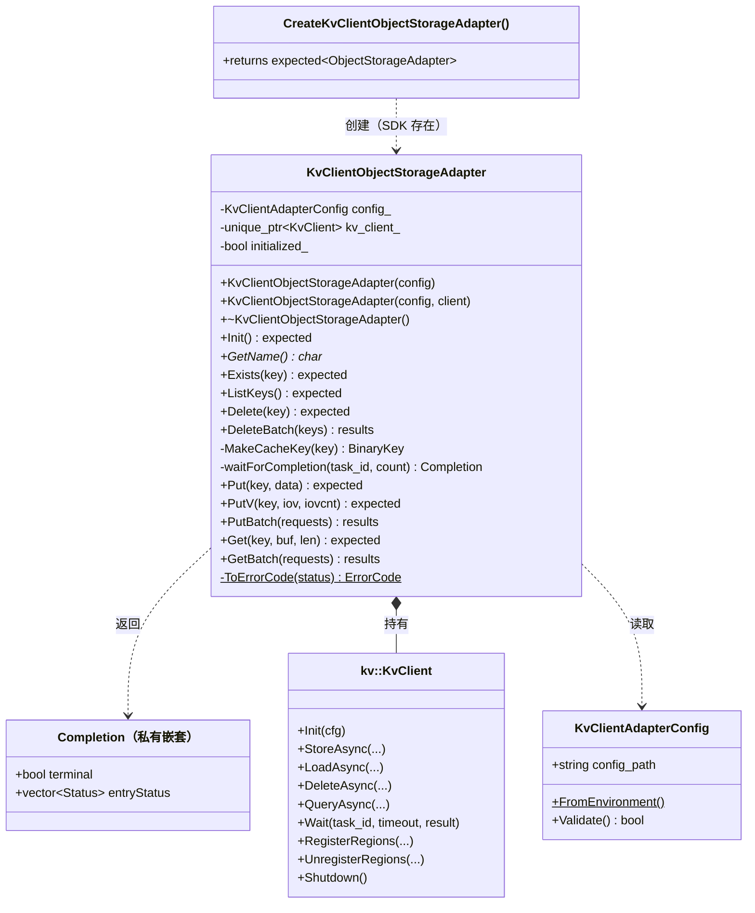

> 数据面只有 batch 一条路径：`Put` / `PutV` / `Get` 都只是把单条请求包装成 `PutBatch` / `GetBatch` 调用，不单独实现 I/O；`Delete` 同样只是 `DeleteBatch` 的单条包装。PR1 实现 `Delete` 与 `DeleteBatch`（控制面删除），`Put` / `PutV` / `PutBatch` / `Get` / `GetBatch` 以 `NOT_SUPPORTED` 占位。PR2 把 `PutBatch` / `GetBatch` 变成真实数据路径，并实现 `Exists`；`Put` / `PutV` 按 KVCS 结构改为 `Put` → `PutV` → `PutBatch` 的包装，`Get` 保持 `NOT_SUPPORTED`（读路径在步骤 6）。`GetName()` 的真实签名是 `const char* GetName() const override`，不是 `char*`；适配器头必须 override `object_storage_adapter.h` 的全部纯虚函数（`Put` / `PutV` / `Get` / `Exists` / `Delete` / `ListKeys` / `Init` / `GetName`），并声明析构 `~KvClientObjectStorageAdapter() override`，否则类保持抽象、`make_unique` 无法编译。
>
> **PR2 实现注意**：`Completion` 是 PR1 已存在的类内私有嵌套类型，图中仅示意，PR2 **不要**重新声明；PR2 不再有 `BufferPlan`。buffer 注册由匿名命名空间的 `RegisterBuffers` / `UnregisterBuffers` 在每次 batch 调用内完成，不修改请求结构或上层接口。

### 1.4 流程图

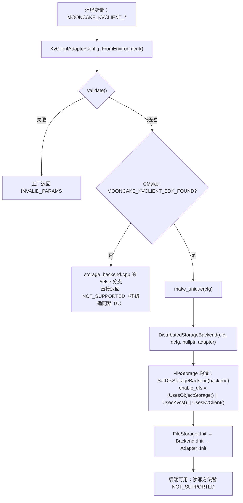

### 1.5 时序图

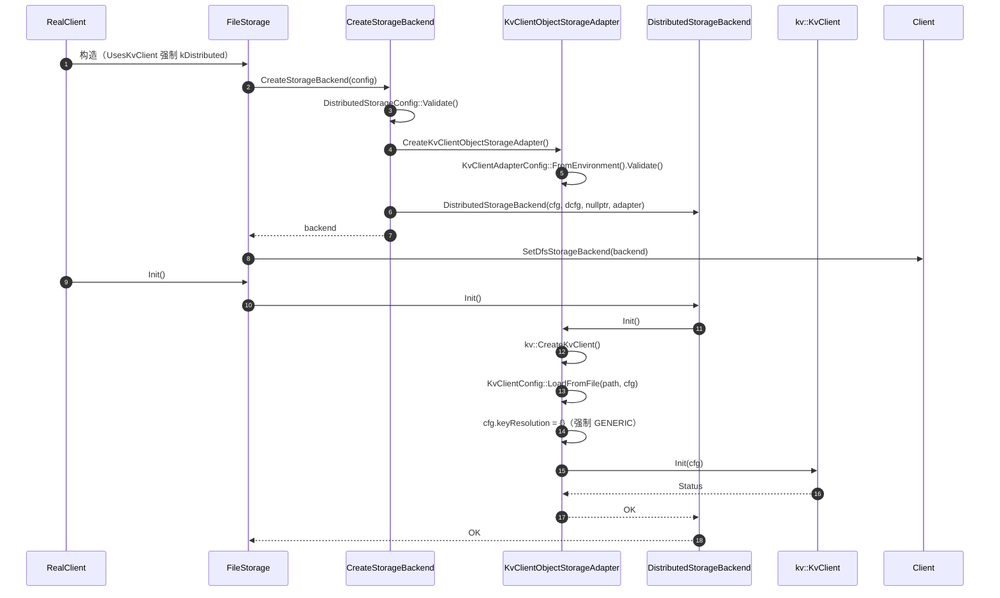

### 1.6 伪代码

#### 1.6.1 配置

```cpp
// mooncake-common/include/environment_variables.h
struct KvClientEnvironmentVariables {
    MC_DEFINE_ENV_VAR(std::string, MOONCAKE_KVCLIENT_CONFIG);
};

// kvclient_config.h（header-only，不包含 SDK 头）
struct KvClientAdapterConfig {
    std::string config_path;

    static tl::expected<KvClientAdapterConfig, ErrorCode> FromEnvironment() {
        KvClientAdapterConfig cfg;
        cfg.config_path = Environ::ReadOr(
            KvClientEnvironmentVariables::MOONCAKE_KVCLIENT_CONFIG,
            std::string{});
        if (!cfg.Validate())
            return tl::make_unexpected(ErrorCode::INVALID_PARAMS);
        return cfg;
    }

    bool Validate() const { return !config_path.empty(); }
};
```

> PR1 的配置只保留 `config_path`；请求参数与超时由 KvClient SDK 负责，适配器不做数值校验。

#### 1.6.2 key 编码（适配器私有方法）

编码逻辑只存在于 `KvClientObjectStorageAdapter::MakeCacheKey`，不单独建头文件：

```cpp
// kvclient_object_storage_adapter.cpp（匿名命名空间）
inline constexpr uint64_t kKvClientHashSeed = 5381;   // 与 SDK key_resolver 一致

kv::BinaryKey KvClientObjectStorageAdapter::MakeCacheKey(
    std::string_view logical_key) const {
    uint64_t hash =
        XXH64(logical_key.data(), logical_key.size(), kKvClientHashSeed);
    if (hash == 0) hash = kKvClientHashSeed;   // 全零映射为非零常量
    kv::BinaryKey key{};
    // 显式小端逐字节写入，与 SDK key_resolver 的打包方式一致；
    // 不用 memcpy（主机字节序），否则大小端客户端会得到不同的 CacheKey。
    for (size_t i = 0; i < sizeof(hash); ++i)
        key[i] = static_cast<std::byte>(hash >> (8 * i));
    return key;
}
```

> 三个 wire 值必须同时固定：seed `5381`、`hash == 0` 的替代值 `5381`（不是 `1`）、以及小端字节序。SDK 的 `key_resolver` 对 string key 使用 `XXH64(..., 5381)` 后逐字节取低 8 位，见 `kv_semantics/src/client/key_resolver.cc:51-55`；Mooncake 只传 `CacheKey::FromBytes`，不走 SDK 的 string 路径。

#### 1.6.3 工厂与 SDK 缺失分支

```cpp
// kvclient_adapter_factory.h（厂商无关）
tl::expected<std::unique_ptr<ObjectStorageAdapter>, ErrorCode>
CreateKvClientObjectStorageAdapter();

// storage_backend.cpp（工厂分支；SDK 缺失时不引用任何 SDK 符号）
// 只允许包含厂商无关的 kvclient_adapter_factory.h；不得包含适配器头或 key codec。
#if defined(MOONCAKE_HAVE_KVCLIENT_SDK)
#include "storage/distributed/kvclient/kvclient_adapter_factory.h"
#endif
...
// 接在既有 UsesKvcs() 分支之后；object_storage_adapter 变量在分支前已声明。
} else if (distributed_config.UsesKvClient()) {
#ifdef MOONCAKE_HAVE_KVCLIENT_SDK
    auto adapter = CreateKvClientObjectStorageAdapter();
    if (!adapter) return tl::make_unexpected(adapter.error());
    object_storage_adapter = std::move(*adapter);
#else
    LOG(ERROR) << "KVClient SDK not built in; kvclient backend unavailable";
    return tl::make_unexpected(ErrorCode::NOT_SUPPORTED);
#endif
}

// 与既有分支共用收尾：工厂返回的是 ObjectStorageAdapter，
// 必须包装进 DistributedStorageBackend；不能直接 return 工厂结果。
return std::make_shared<DistributedStorageBackend>(
    config, distributed_config, std::move(fs_adapter),
    std::move(object_storage_adapter));

// kvclient_object_storage_adapter.cpp（SDK 存在时才参与编译）
tl::expected<std::unique_ptr<ObjectStorageAdapter>, ErrorCode>
CreateKvClientObjectStorageAdapter() {
    auto config = KvClientAdapterConfig::FromEnvironment();
    if (!config) return tl::make_unexpected(config.error());
    return std::make_unique<KvClientObjectStorageAdapter>(*config);
}
```

#### 1.6.4 控制面

适配器头必须声明名称常量、注入构造、析构，并 override 全部纯虚函数：

```cpp
inline constexpr char kKvClientAdapterName[] = "kvclient";
```

`Init` 的关键是**把 client 创建到局部变量，成功后才写入成员**。SDK `Init` 非幂等（第二次调用返回 `RESOURCE_BUSY`），因此每次重试都必须重新执行配置加载与校验，任何失败路径都不能留下"非空但未初始化"的 `kv_client_`。

```cpp
tl::expected<void, ErrorCode> KvClientObjectStorageAdapter::Init() {
    if (initialized_) return {};
    if (!config_.Validate()) return tl::make_unexpected(ErrorCode::INVALID_PARAMS);

    // 注入构造已提供 client（测试缝）：只校验适配器配置，跳过 SDK 级初始化。
    if (kv_client_) {
        initialized_ = true;
        return {};
    }

    auto client = kv::CreateKvClient();      // 先建到局部变量，成功后才赋值
    if (!client) return tl::make_unexpected(ErrorCode::DFS_SERVICE_UNAVAILABLE);

    kv::KvClientConfig cfg;
    if (!kv::KvClientConfig::LoadFromFile(config_.config_path, cfg).ok())
        return tl::make_unexpected(ErrorCode::INVALID_PARAMS);
    cfg.keyResolution = {};                  // 强制 GENERIC
    // Init 非幂等；局部 client 只在成功后提交，重试会从新的 client 开始。
    if (!client->Init(cfg).ok())
        return tl::make_unexpected(ErrorCode::DFS_SERVICE_UNAVAILABLE);

    kv_client_ = std::move(client);          // 仅在此处提交，失败不会污染成员
    initialized_ = true;
    LOG(INFO) << "KVClient adapter initialized";
    return {};
}

KvClientObjectStorageAdapter::~KvClientObjectStorageAdapter() {
    // 没有独立的 Shutdown()：先停止受理，再由 SDK 排空 pending task。
    if (kv_client_) kv_client_->Shutdown();
}

ErrorCode KvClientObjectStorageAdapter::ToErrorCode(const kv::Status& s) {
    using kv::StatusCode;
    switch (s.code) {
        case StatusCode::OK: return ErrorCode::OK;
        case StatusCode::TIMEOUT:
        case StatusCode::CQE_IO_TIMEOUT: return ErrorCode::RPC_TIMEOUT;
        case StatusCode::IN_PROGRESS:
        case StatusCode::CANCELED: return ErrorCode::INTERNAL_ERROR;

        // 对象 miss：只有 entry 级 key-not-found 才是 OBJECT_NOT_FOUND。
        case StatusCode::CQE_KEY_NOT_EXIST:
        case StatusCode::ENTRY_KEY_NOT_FOUND:
        case StatusCode::ENTRY_KEY_NOT_EXIST: return ErrorCode::OBJECT_NOT_FOUND;

        // NOT_FOUND 是路由/配置/视图错误，不是对象 miss；
        // 映射为 OBJECT_NOT_FOUND 会让 PR3 误删元数据、PR2 误触发 miss 清理。
        case StatusCode::NOT_FOUND:
        case StatusCode::NOT_INITIALIZED:
        case StatusCode::CONNECTION_ERROR:
        case StatusCode::IO_ERROR:
        case StatusCode::UNSUPPORTED:
        // Delete 的逐项失败码；ENTRY_KEY_NOT_EXIST 是 QUERY 专用。
        case StatusCode::ENTRY_DELETE_FAILED:
            return ErrorCode::DFS_SERVICE_UNAVAILABLE;

        case StatusCode::INVALID_ARGUMENT:
        case StatusCode::BUFFER_NOT_REGISTERED:
        case StatusCode::BUFFER_NOT_SUPPORTED: return ErrorCode::INVALID_PARAMS;
        case StatusCode::CQE_OUT_OF_CREATE_SIZE:
        case StatusCode::RESOURCE_BUSY:
        case StatusCode::CQE_RESOURCE_BUSY: return ErrorCode::NO_AVAILABLE_HANDLE;
        default: return ErrorCode::INTERNAL_ERROR;
    }
}

KvClientObjectStorageAdapter::Completion
KvClientObjectStorageAdapter::waitForCompletion(kv::TaskId task_id,
                                                size_t entry_count) {
    kv::TaskResult result;
    // 0 表示由 SDK 决定超时。
    const auto wait_status = kv_client_->Wait(task_id, 0, result);
    const auto code = wait_status.ok() ? result.status.code : wait_status.code;
    const kv::Status& task_status = wait_status.ok() ? result.status : wait_status;

    Completion c;
    switch (code) {
        case kv::StatusCode::OK:
        case kv::StatusCode::PARTIAL_FAILED:
            // 只有这两个 task 状态携带可信的逐项结果。
            c.terminal = true;
            break;
        case kv::StatusCode::TASK_NOT_FOUND:
            // Wait 在超时后也会移除 task；未知 task 不能证明底层 I/O 已结束。
            // 保守地按非终态处理，让调用方保留 handle（零拷贝下不保留内存）。
            c.terminal = false;
            c.entryStatus.assign(
                entry_count,
                kv::Status::Error(kv::StatusCode::INTERNAL_ERROR,
                                  "task not found"));
            return c;
        case kv::StatusCode::TIMEOUT:
        case kv::StatusCode::IN_PROGRESS:
        case kv::StatusCode::CANCELED:
            // SDK 在返回超时前可能已填充 entryStatus，但 task 未终态；
            // 逐项结果不可信，统一用 task 级状态填充并保留资源。
            c.terminal = false;
            c.entryStatus.assign(entry_count, task_status);
            return c;
        default:
            // task 级最终错误；entryStatus 可能仍是提交时的 OK，不能逐项读取。
            c.terminal = true;
            c.entryStatus.assign(entry_count, task_status);
            return c;
    }

    if (result.entryStatus.size() != entry_count) {
        c.entryStatus.assign(
            entry_count,
            kv::Status::Error(kv::StatusCode::INTERNAL_ERROR,
                              "entry count mismatch"));
        return c;
    }
    c.entryStatus = std::move(result.entryStatus);
    return c;
}
```

#### 1.6.5 删除（PR1 已落地的唯一数据方法）

```cpp
ObjectStorageIoResults KvClientObjectStorageAdapter::DeleteBatch(
    std::span<const std::string> keys) {
    // Init 前或 Init 失败后直接调用：逐项失败，不解引用空 client。
    if (!initialized_ || !kv_client_) {
        return ObjectStorageIoResults(
            keys.size(),
            tl::make_unexpected(ErrorCode::DFS_SERVICE_UNAVAILABLE));
    }
    ObjectStorageIoResults results(keys.size());
    if (keys.empty()) return results;

    std::vector<kv::CacheKey> cache_keys;
    std::vector<size_t> indices;
    for (size_t i = 0; i < keys.size(); ++i) {
        if (keys[i].empty()) {
            results[i] = tl::make_unexpected(ErrorCode::INVALID_PARAMS);
            continue;
        }
        cache_keys.push_back(kv::CacheKey::FromBytes(MakeCacheKey(keys[i])));
        indices.push_back(i);
    }
    if (cache_keys.empty()) return results;

    kv::TaskId task_id = kv::kInvalidTaskId;
    const auto submit = kv_client_->DeleteAsync(cache_keys, task_id);
    if (!submit.ok()) {
        for (size_t i : indices) results[i] = tl::make_unexpected(ToErrorCode(submit));
        return results;
    }
    const auto completion = waitForCompletion(task_id, cache_keys.size());
    for (size_t j = 0; j < indices.size(); ++j) {
        results[indices[j]] = completion.entryStatus[j].ok()
                                  ? tl::expected<void, ErrorCode>{}
                                  : tl::make_unexpected(
                                        ToErrorCode(completion.entryStatus[j]));
    }
    return results;
}

// Delete 只是 DeleteBatch 的单条包装；PR1 即落地，不属于 NOT_SUPPORTED 占位。
tl::expected<void, ErrorCode> KvClientObjectStorageAdapter::Delete(
    const std::string& key) {
    std::array<std::string, 1> keys{key};
    auto results = DeleteBatch(keys);
    return results.empty()
               ? tl::make_unexpected(ErrorCode::INVALID_PARAMS)
               : std::move(results.front());
}
```

#### 1.6.6 构建（CMake）

四个落点必须分开，不能把 KVCS 的写法整体照搬：

```cmake
# ① 检测块：与 src/CMakeLists.txt 的 KVCS 检测块并列
set(MOONCAKE_KVCLIENT_SDK_FOUND OFF)
set(MOONCAKE_KVCLIENT_SDK_ROOT "" CACHE PATH
    "KVClient SDK source tree or install prefix")
option(MOONCAKE_KVCLIENT_REQUIRED
       "Fail configuration when the KVClient SDK is not found" OFF)

find_package(PkgConfig QUIET)
if(PkgConfig_FOUND)
  pkg_check_modules(KVCLIENT QUIET IMPORTED_TARGET GLOBAL "kvclient")
endif()

if(TARGET PkgConfig::KVCLIENT)
  add_library(Mooncake::kvclient INTERFACE IMPORTED GLOBAL)
  set_target_properties(Mooncake::kvclient PROPERTIES
                        INTERFACE_LINK_LIBRARIES PkgConfig::KVCLIENT)
  set(MOONCAKE_KVCLIENT_SDK_FOUND ON)
  message(STATUS "KVClient SDK found via pkg-config: kvclient backend enabled")
else()
  set(_kvclient_hints)
  if(MOONCAKE_KVCLIENT_SDK_ROOT)
    list(APPEND _kvclient_hints "${MOONCAKE_KVCLIENT_SDK_ROOT}")
  endif()
  if(DEFINED ENV{MOONCAKE_KVCLIENT_SDK_ROOT})
    list(APPEND _kvclient_hints "$ENV{MOONCAKE_KVCLIENT_SDK_ROOT}")
  endif()
  find_path(MOONCAKE_KVCLIENT_INCLUDE_DIR
            NAMES kv_client.h
            HINTS ${_kvclient_hints}
            PATH_SUFFIXES include kv_semantics/include include/kv_semantics)
  find_library(MOONCAKE_KVCLIENT_LIBRARY
               NAMES kv_client
               HINTS ${_kvclient_hints}
               PATH_SUFFIXES lib lib64 kv_semantics/src ucm/store/asu src
                             build/src build)
  find_library(MOONCAKE_KVCLIENT_TRANSPORT_LIBRARY
               NAMES kv_transport
               HINTS ${_kvclient_hints}
               PATH_SUFFIXES lib lib64 kv_semantics/src ucm/store/asu src
                             build/src build)
  if(MOONCAKE_KVCLIENT_INCLUDE_DIR AND MOONCAKE_KVCLIENT_LIBRARY)
    add_library(Mooncake::kvclient UNKNOWN IMPORTED GLOBAL)
    set(_kvclient_link_libraries "${MOONCAKE_KVCLIENT_LIBRARY}")
    if(MOONCAKE_KVCLIENT_TRANSPORT_LIBRARY)
      list(APPEND _kvclient_link_libraries
           "${MOONCAKE_KVCLIENT_TRANSPORT_LIBRARY}")
    endif()
    set_target_properties(
      Mooncake::kvclient
      PROPERTIES IMPORTED_LOCATION "${MOONCAKE_KVCLIENT_LIBRARY}"
                 INTERFACE_INCLUDE_DIRECTORIES
                 "${MOONCAKE_KVCLIENT_INCLUDE_DIR}"
                 INTERFACE_LINK_LIBRARIES "${_kvclient_link_libraries}")
    set(MOONCAKE_KVCLIENT_SDK_FOUND ON)
    message(STATUS "KVClient SDK found: include=${MOONCAKE_KVCLIENT_INCLUDE_DIR}"
                   ", library=${MOONCAKE_KVCLIENT_LIBRARY}")
  endif()
endif()

if(NOT MOONCAKE_KVCLIENT_SDK_FOUND)
  if(MOONCAKE_KVCLIENT_REQUIRED OR MOONCAKE_KVCLIENT_SDK_ROOT)
    message(
      FATAL_ERROR
        "KVClient SDK not found (MOONCAKE_KVCLIENT_REQUIRED=ON or "
        "MOONCAKE_KVCLIENT_SDK_ROOT was set). Set MOONCAKE_KVCLIENT_SDK_ROOT "
        "to a source tree or install prefix that contains kv_client.h and "
        "libkv_client, or set MOONCAKE_KVCLIENT_INCLUDE_DIR and "
        "MOONCAKE_KVCLIENT_LIBRARY.")
  endif()
  message(
    STATUS
      "KVClient SDK not found: adapter disabled. Set "
      "MOONCAKE_KVCLIENT_SDK_ROOT or pass -DMOONCAKE_KVCLIENT_REQUIRED=ON "
      "to make this fatal.")
endif()
set(MOONCAKE_KVCLIENT_SDK_FOUND
    ${MOONCAKE_KVCLIENT_SDK_FOUND}
    PARENT_SCOPE)

# ② 条件源：必须在 add_library(mooncake_store_client_objects ...) 之前
if(MOONCAKE_KVCLIENT_SDK_FOUND)
  list(APPEND MOONCAKE_STORE_CLIENT_SOURCES
       storage/distributed/kvclient/kvclient_object_storage_adapter.cpp)
endif()

# ③ define/link：storage_backend.cpp 与适配器 TU 都在 client objects 中。
#    挂到 mooncake_store_shared_objects 会让 storage_backend.cpp 永远走 #else。
if(MOONCAKE_KVCLIENT_SDK_FOUND)
  target_compile_definitions(mooncake_store_client_objects
                             PRIVATE MOONCAKE_HAVE_KVCLIENT_SDK=1)
  target_link_libraries(mooncake_store_client_objects
                        PRIVATE Mooncake::kvclient)
endif()

# ④ 最终库：OBJECT 库的 PRIVATE 链接不传播，mooncake_store 需要再链一次
if(MOONCAKE_KVCLIENT_SDK_FOUND)
  target_link_libraries(mooncake_store PRIVATE Mooncake::kvclient)
endif()
```

> - SDK 只安装 `libkv_client.so` / `libkv_transport.so`，**不安装头文件、不生成 `kvclient.pc`**。因此检测顺序是：pkg-config（未来兼容）→ `MOONCAKE_KVCLIENT_SDK_ROOT` / `MOONCAKE_KVCLIENT_INCLUDE_DIR` + `MOONCAKE_KVCLIENT_LIBRARY` 的 `find_path`/`find_library`。SDK 源码树可直接作为 root：头文件在 `kv_semantics/include`，库在 `build/src` 或安装目录 `kv_semantics/src`。`MOONCAKE_KVCLIENT_REQUIRED=ON` 或显式设置 `MOONCAKE_KVCLIENT_SDK_ROOT` 时，未找到 SDK 直接 `FATAL_ERROR`，避免"构建成功但适配器从未编译"掩盖编译错误。
> - `mooncake_store_master` 不链接 KVClient SDK。适配器源不得放进 `MOONCAKE_STORE_SHARED_SOURCES`（该对象库会经 `$<TARGET_OBJECTS>` 进入 master）。`storage_backend.cpp` 只允许在 `MOONCAKE_HAVE_KVCLIENT_SDK` 内包含厂商无关的 `kvclient_adapter_factory.h`，不得包含 `kvclient_object_storage_adapter.h`。检测到 SDK 时适配器 TU 才参与编译；SDK 缺失时工厂的 `#else` 分支返回 `NOT_SUPPORTED`，不引用任何 SDK 符号。

### 1.7 验收

| 项 | 预期 |
| --- | --- |
| SDK 缺失构建 | 工厂分支返回 `NOT_SUPPORTED`，适配器 TU 不参与编译，其余后端不受影响 |
| SDK 存在但未检测到且 `MOONCAKE_KVCLIENT_REQUIRED=ON` 或设置了 `SDK_ROOT` | configure 阶段 `FATAL_ERROR`，不会生成"未编译适配器"的构建 |
| 指定 `MOONCAKE_KVCLIENT_SDK_ROOT` 或 include/library | 适配器 TU 参与编译，`MOONCAKE_HAVE_KVCLIENT_SDK` 生效 |
| 配置缺失/空 `MOONCAKE_KVCLIENT_CONFIG` | 工厂返回 `INVALID_PARAMS`，不启动 SDK |
| SDK client 配置文件无法加载 | `Init` 失败 `INVALID_PARAMS` |
| 读写方法 | `Put` / `PutV` / `PutBatch` / `Get` / `GetBatch` 返回 `NOT_SUPPORTED`（PR2 替换）；`Delete` / `DeleteBatch` 已实现 |

---

## PR2：适配器数据面 + Master

### 2.1 目标

实现批读写（写零拷贝、读在 `waitForCompletion` 内同步完成）、适配器内部 buffer 注册与 `Exists` 查询；并把 Master 侧的描述符铸造与门控接上，使 KVClient 后端可端到端读写。

#### 2.1.1 已确认决策（2026-11-19）

| 决策项 | 结论 | 对实施的影响 |
| --- | --- | --- |
| 写路径 | 零拷贝；成功与否由 KvClient 判定 | 适配器不 staging、不补齐、不校验；只保留空 key、N==0、空指针、重复 key 守卫 |
| 读路径 | 适配器内部注册目标 buffer 做零拷贝读；`LoadAsync` + `waitForCompletion` 同步完成 | `GetBatch` 在调用内注册目标 buffer，返回时逐项结果已就绪；返回后 buffer 可复用，无完成句柄 |
| buffer 注册 | **适配器内部按请求注册，调用返回前注销**；不改上层接口 | `PutBatch` / `GetBatch` 内用 `RegisterBuffers` 注册 `iov[0].base` / 目标 buffer，返回前用 `UnregisterBuffers` 统一注销；`ObjectPutRequest` / `ObjectGetRequest`、`ObjectStorageAdapter` 与 `DistributedStorageBackend` 均不变 |
| 超时 | 由 KvClient SDK 负责 | `Wait(task_id, 0, result)`；适配器不设超时状态、不重试、不保留资源 |
| `Exists` | PR2 实现：`QueryAsync` + `Wait` | 不注册 buffer；按 entry 级 `ENTRY_KEY_EXIST` / `ENTRY_KEY_NOT_EXIST` 返回 |
| provider 模式 | 不要求 `asuSharedProvider=1` | 部署按 KV 默认配置执行，文档不再把 SHARED 作为前置条件 |
| SDK 覆盖语义 | `StoreAsync` 对已存在 key 为覆盖写（upsert） | `PutBatch` 不做预删，不需要 `DeleteAsync` + `StoreAsync` 组合；重复写不会返回 `CQE_KEY_ALREADY_EXISTED` |
| kvclient + oplog | `InitDfsAllocatorFromEnvironment` 在 `enable_oplog_` 为真时 `LOG(FATAL)` 拒绝启动 | kvclient 不支持快照/oplog 恢复；恢复门保持 KVCS-only，不并入 `use_kvclient_` |
| PR2 测试归属 | PR2 自带适配器单测（原文档放在 PR3） | `tests/kvclient_object_storage_adapter_test.cpp` 与 `tests/CMakeLists.txt` 纳入 PR2 改动面 |

### 2.2 改动文件

| 文件 | 改动 |
| --- | --- |
| `include/storage/distributed/kvclient/kvclient_object_storage_adapter.h` | `GetBatch`、`Exists` |
| `src/storage/distributed/kvclient/kvclient_object_storage_adapter.cpp` | `RegisterBuffers` / `UnregisterBuffers`（按请求注册、批量注销）、`Put`/`PutV` 单条包装、写零拷贝、读零拷贝（`LoadAsync` + `waitForCompletion`）、`Exists` 查询 |
| `include/master_service.h` / `src/master_service.cpp` | `use_kvclient_`、门控、descriptor、白名单；`InitDfsAllocatorFromEnvironment` 新增 kvclient 早退分支（`enable_oplog_` 拒绝） |
| `tests/kvclient_object_storage_adapter_test.cpp` | 新增，适配器数据面、handle 透传与读结果单测（SDK 存在时编译） |
| `tests/CMakeLists.txt` | SDK 存在时新增测试目标并 `target_link_libraries(... Mooncake::kvclient)` |

> **buffer 注册**：由适配器内部的 `RegisterBuffers` / `UnregisterBuffers` 完成。`RegisterBuffers` 按请求调用 `RegisterRegions` 拿到 handle，`UnregisterBuffers` 在 batch 返回前逐个 `UnregisterRegions`；注销失败只打 `LOG(WARNING)`。适配器不维护跨调用的注册表。
>
> **写路径**：适配器用刚注册的 handle 构造 `KVBuffer` 并 `StoreAsync`；不拷贝、不补齐；成功与否由 KvClient 判定。
>
> **读路径**：适配器在 `GetBatch` 内注册目标 buffer，`LoadAsync` 后用 `waitForCompletion` 同步等待并逐项映射；返回前注销 handle。
>
> **超时**：全部由 KvClient SDK 负责；适配器只映射 SDK 返回的状态。
>
> **接口不变**：不改 `ObjectStorageAdapter`、`ObjectPutRequest` / `ObjectGetRequest` 与 `DistributedStorageBackend`；读接口保持同步，`Client`/`RealClient` 无需改动。
>
> **测试归属**：PR2 自带 §2.7 的适配器级用例；PR3 再补 Client 集成、删除顺序与 miss 自愈用例。

### 2.3 类图

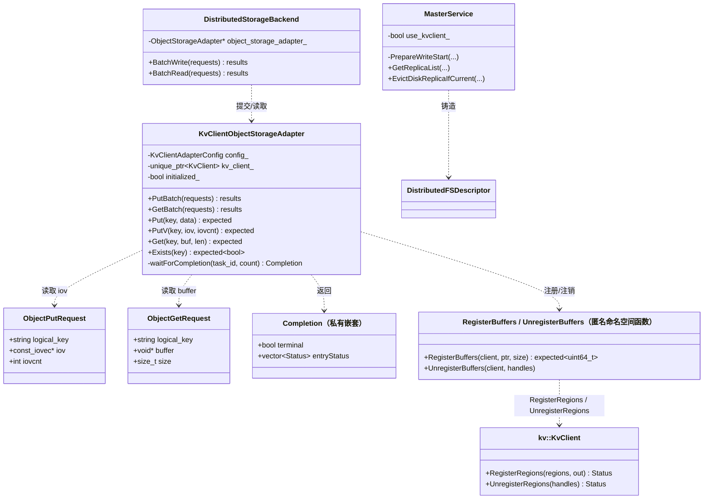

> 本图只列 PR2 新增或变更的成员；`Init` / `Delete` / `DeleteBatch` / `ListKeys` 等 PR1 成员未重复列出。

### 2.4 流程图（写/读共用骨架）

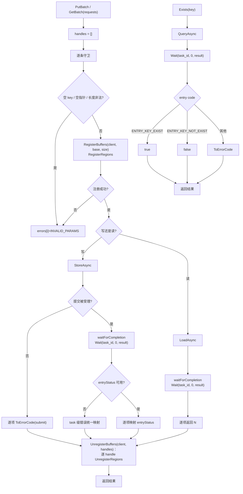

### 2.5 时序图（写路径）

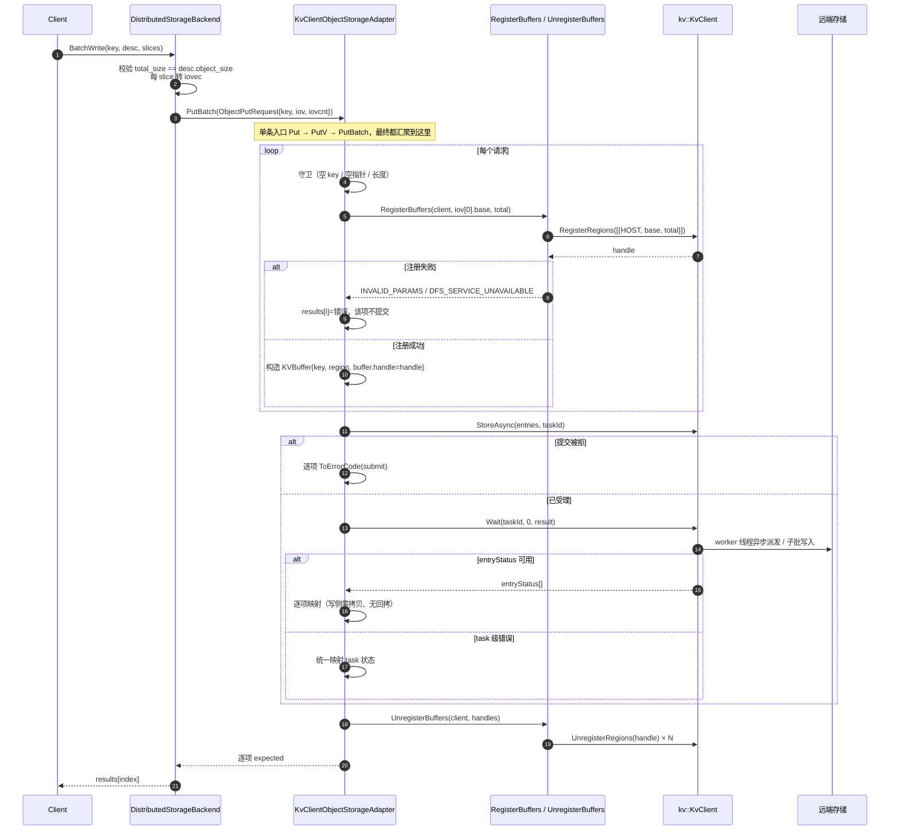

### 2.5.1 时序图（读路径）

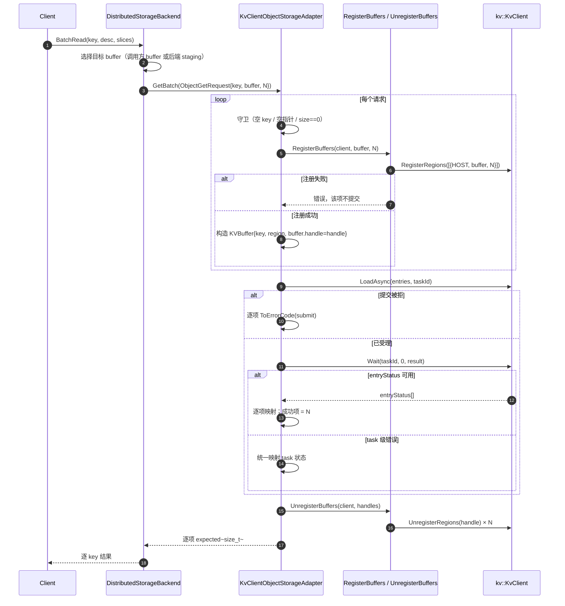

### 2.5.2 时序图（Exists）

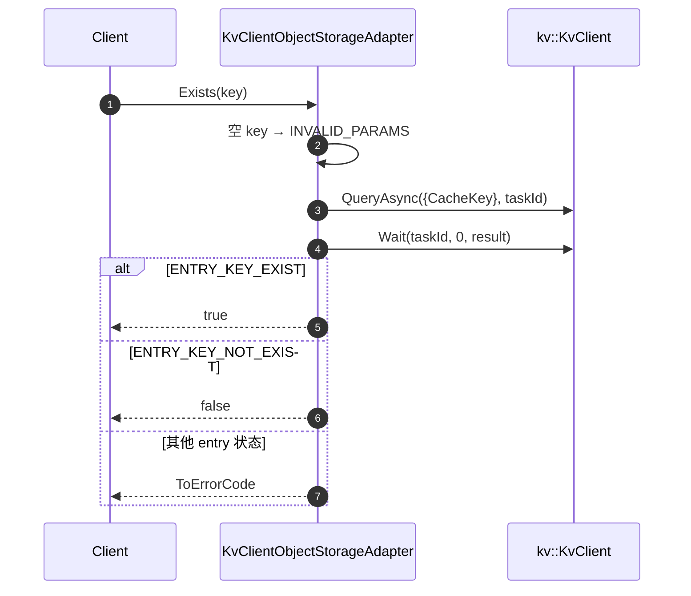

### 2.6 伪代码

#### 2.6.1 适配器内部 buffer 注册

注册与注销是两个匿名命名空间函数，不引入额外类型：

```cpp
// 注册单块 host 内存并返回 handle；handle 在交给 UnregisterBuffers 前保持有效。
tl::expected<uint64_t, ErrorCode> RegisterBuffers(kv::KvClient& client,
                                                  void* ptr, size_t size) {
    if (ptr == nullptr || size == 0) {
        return tl::make_unexpected(ErrorCode::INVALID_PARAMS);
    }
    std::vector<kv::MemoryRegion> regions{
        {kv::MemoryType::HOST, reinterpret_cast<uint64_t>(ptr), size, -1, -1}};
    std::vector<kv::RegisteredMemory> registered;
    const auto status = client.RegisterRegions(regions, registered);
    if (!status.ok() || registered.size() != 1) {
        return tl::make_unexpected(ErrorCode::DFS_SERVICE_UNAVAILABLE);
    }
    return registered[0].handle;
}

// 批量注销；失败只记日志：SDK 保留该注册，且调用方无 handle 可重试。
void UnregisterBuffers(kv::KvClient& client,
                       const std::vector<uint64_t>& handles) {
    for (uint64_t handle : handles) {
        const auto status = client.UnregisterRegions({handle});
        if (!status.ok()) {
            LOG(WARNING) << "KVClient buffer unregister failed, handle="
                         << handle << ", error=" << status.message;
        }
    }
}
```

```cpp
struct Completion {
    bool terminal = false;
    std::vector<kv::Status> entryStatus;
};
```

约束：

- 请求结构与上层接口均不变：`ObjectPutRequest` / `ObjectGetRequest`、`ObjectStorageAdapter`、`DistributedStorageBackend` 不新增字段或虚函数。
- `PutBatch` / `GetBatch` 在调用内把已注册 handle 收进局部 `std::vector<uint64_t>`，返回前统一调用 `UnregisterBuffers`；注销失败只记 `LOG(WARNING)`，残留注册由会话结束时的 `Shutdown()` 兜底。
- 注册失败按项隔离：该项返回错误、不写入 `seen`，不影响同批其他请求。
- 分段求和直接内联在 `PutBatch` 的逐请求循环中，不单独提供 helper。
- `PutBatch` 用 `try/catch` 包住注册与提交：异常展开时在 `catch` 中先 `UnregisterBuffers` 再 `throw`，不依赖 RAII。
- 适配器只在上述两个函数中调用 SDK 的 `RegisterRegions` / `UnregisterRegions`。

> **读路径**：零拷贝读在 §2.6.2.1 的 `GetBatch` 内注册目标 buffer，`LoadAsync` + `waitForCompletion` 同步完成；返回前 `UnregisterBuffers` 注销，buffer 随后可复用。

#### 2.6.2 批提交

```cpp
// 单条入口与 KVCS 一致：Put → PutV → PutBatch。
tl::expected<void, ErrorCode> KvClientObjectStorageAdapter::Put(
    const std::string& logical_key, std::span<const char> data) {
    iovec iov{const_cast<char*>(data.data()), data.size()};
    return PutV(logical_key, &iov, 1);
}

tl::expected<void, ErrorCode> KvClientObjectStorageAdapter::PutV(
    const std::string& logical_key, const iovec* iov, int iovcnt) {
    auto results = PutBatch({{logical_key, iov, iovcnt}});
    return results.empty() ? tl::make_unexpected(ErrorCode::INVALID_PARAMS)
                           : std::move(results.front());
}

std::vector<tl::expected<void, ErrorCode>>
KvClientObjectStorageAdapter::PutBatch(
    const std::vector<ObjectPutRequest>& requests) {
    std::vector<tl::expected<void, ErrorCode>> results(requests.size());
    if (!initialized_ || !kv_client_) {
        for (auto& result : results) {
            result = tl::make_unexpected(ErrorCode::DFS_SERVICE_UNAVAILABLE);
        }
        return results;
    }

    std::vector<uint64_t> handles;
    handles.reserve(requests.size());
    // 注册过的 handle 必须在异常展开时也释放。
    try {
        std::set<kv::BinaryKey> seen;   // 仅写侧：同批重复 key
        std::vector<kv::KVBuffer> entries;
        std::vector<size_t> indices;
        entries.reserve(requests.size());
        indices.reserve(requests.size());
        for (size_t i = 0; i < requests.size(); ++i) {
            if (requests[i].logical_key.empty() || requests[i].iov == nullptr ||
                requests[i].iovcnt <= 0) {
                results[i] = tl::make_unexpected(ErrorCode::INVALID_PARAMS);
                continue;
            }
            const auto binary_key = MakeCacheKey(requests[i].logical_key);
            if (seen.find(binary_key) != seen.end()) {
                results[i] = tl::make_unexpected(ErrorCode::INVALID_PARAMS);
                continue;
            }
            // 逐段求和：空段或回绕都会导致注册/提交区间错误。
            size_t total = 0;
            bool valid = true;
            for (int j = 0; j < requests[i].iovcnt; ++j) {
                const auto& segment = requests[i].iov[j];
                if (segment.iov_base == nullptr || segment.iov_len == 0 ||
                    segment.iov_len >
                        std::numeric_limits<size_t>::max() - total) {
                    valid = false;
                    break;
                }
                total += segment.iov_len;
            }
            if (!valid || total == 0) {
                results[i] = tl::make_unexpected(ErrorCode::INVALID_PARAMS);
                continue;
            }
            auto handle = RegisterBuffers(*kv_client_,
                                          requests[i].iov[0].iov_base, total);
            if (!handle) {
                results[i] = tl::make_unexpected(handle.error());
                continue;
            }
            // 先登记 handle，后续分配抛异常时 catch 仍能释放它。
            handles.push_back(*handle);
            seen.insert(binary_key);

            kv::KVBuffer entry;
            entry.key = kv::CacheKey::FromBytes(binary_key);
            entry.buffer.region = {
                kv::MemoryType::HOST,
                reinterpret_cast<uint64_t>(requests[i].iov[0].iov_base), total,
                -1, -1};
            entry.buffer.handle = *handle;
            entry.offset = 0;
            entry.mrKey = std::nullopt;   // SDK 按 handle 回填
            entries.push_back(std::move(entry));
            indices.push_back(i);
        }

        if (!entries.empty()) {
            kv::TaskId task_id = kv::kInvalidTaskId;
            const auto submit = kv_client_->StoreAsync(entries, task_id);
            if (!submit.ok()) {
                for (size_t i : indices)
                    results[i] = tl::make_unexpected(ToErrorCode(submit));
            } else {
                const auto completion =
                    waitForCompletion(task_id, entries.size());
                if (completion.entryStatus.size() != entries.size()) {
                    for (size_t i : indices)
                        results[i] =
                            tl::make_unexpected(ErrorCode::INTERNAL_ERROR);
                } else if (!completion.terminal) {
                    const auto error = ToErrorCode(completion.entryStatus[0]);
                    for (size_t i : indices)
                        results[i] = tl::make_unexpected(error);
                } else {
                    for (size_t j = 0; j < entries.size(); ++j) {
                        const auto& st = completion.entryStatus[j];
                        results[indices[j]] =
                            st.ok() ? tl::expected<void, ErrorCode>{}
                                    : tl::make_unexpected(ToErrorCode(st));
                    }
                }
            }
        }
    } catch (...) {
        UnregisterBuffers(*kv_client_, handles);
        throw;
    }
    UnregisterBuffers(*kv_client_, handles);
    return results;
}
```

> **实现约束**：
>
> 1. 入口先检查 `!initialized_ || !kv_client_`，逐项返回 `DFS_SERVICE_UNAVAILABLE`。
> 2. 写路径零拷贝：不分配 staging、不拷贝、不补齐；成功与否由 `StoreAsync` 判定。
> 3. 每个参与项在提交前调用 `RegisterBuffers`；注册失败只影响该项，且该项不占用 key。
> 4. `StoreAsync` 已确认是覆盖写，因此不预删。
> 5. Task 级错误统一映射到参与项；适配器不设超时状态；返回前用 `UnregisterBuffers` 注销已注册 handle。
> 6. `Put` / `PutV` 只是单条包装：`Put` 把 `span` 转成一个 iovec 调 `PutV`，`PutV` 用单元素 `PutBatch` 提交，与 KVCS 结构一致。
> 7. `PutBatch` 用 `try/catch` 包住注册与提交；`catch` 中先 `UnregisterBuffers` 再 `throw`，异常路径同样释放 handle。

#### 2.6.2.1 读路径：同步 `GetBatch`

读路径与写路径同构：`RegisterBuffers` 在调用内注册目标 buffer，`LoadAsync` 提交，`waitForCompletion` 等待，成功项返回 N；返回前用 `UnregisterBuffers` 注销。

```cpp
std::vector<tl::expected<size_t, ErrorCode>>
KvClientObjectStorageAdapter::GetBatch(
    const std::vector<ObjectGetRequest>& requests) {
    std::vector<tl::expected<size_t, ErrorCode>> results(requests.size());
    if (!initialized_ || !kv_client_) {
        for (auto& result : results) {
            result = tl::make_unexpected(ErrorCode::DFS_SERVICE_UNAVAILABLE);
        }
        return results;
    }

    std::vector<kv::KVBuffer> entries;
    std::vector<size_t> indices;
    std::vector<uint64_t> handles;
    entries.reserve(requests.size());
    indices.reserve(requests.size());
    handles.reserve(requests.size());
    for (size_t i = 0; i < requests.size(); ++i) {
        if (requests[i].logical_key.empty() || requests[i].buffer == nullptr ||
            requests[i].size == 0) {
            results[i] = tl::make_unexpected(ErrorCode::INVALID_PARAMS);
            continue;
        }
        auto handle = RegisterBuffers(*kv_client_, requests[i].buffer,
                                      requests[i].size);
        if (!handle) {
            results[i] = tl::make_unexpected(handle.error());
            continue;
        }
        handles.push_back(*handle);

        kv::KVBuffer entry;
        entry.key =
            kv::CacheKey::FromBytes(MakeCacheKey(requests[i].logical_key));
        entry.buffer.region = {
            kv::MemoryType::HOST,
            reinterpret_cast<uint64_t>(requests[i].buffer), requests[i].size,
            -1, -1};
        entry.buffer.handle = *handle;
        entry.offset = 0;
        entry.mrKey = std::nullopt;   // SDK 按 handle 回填
        entries.push_back(std::move(entry));
        indices.push_back(i);
    }
    if (entries.empty()) return results;

    kv::TaskId task_id = kv::kInvalidTaskId;
    const auto submit = kv_client_->LoadAsync(entries, task_id);
    if (!submit.ok()) {
        UnregisterBuffers(*kv_client_, handles);
        for (size_t i : indices)
            results[i] = tl::make_unexpected(ToErrorCode(submit));
        return results;
    }

    const auto completion = waitForCompletion(task_id, entries.size());
    if (completion.entryStatus.size() != entries.size()) {
        for (size_t i : indices)
            results[i] = tl::make_unexpected(ErrorCode::INTERNAL_ERROR);
    } else if (!completion.terminal) {
        const auto error = ToErrorCode(completion.entryStatus[0]);
        for (size_t i : indices)
            results[i] = tl::make_unexpected(error);
    } else {
        for (size_t j = 0; j < entries.size(); ++j) {
            const auto& st = completion.entryStatus[j];
            const size_t index = indices[j];
            results[index] =
                st.ok() ? tl::expected<size_t, ErrorCode>{
                              requests[index].size}
                        : tl::make_unexpected(ToErrorCode(st));
        }
    }
    UnregisterBuffers(*kv_client_, handles);
    return results;
}
```

> **实现约束**：
>
> 1. 入口先检查 `!initialized_ || !kv_client_`，逐项返回 `DFS_SERVICE_UNAVAILABLE`。
> 2. 空 key / `size == 0` / 空指针的参与项返回 `INVALID_PARAMS`；每个参与项由 `RegisterBuffers` 注册目标 buffer，失败只影响该项。
> 3. 返回值是 N（请求长度），不是 SDK 传输长度。
> 4. `Wait` 在 `GetBatch` 内完成；返回前用 `UnregisterBuffers` 注销 handle，buffer 随后可复用。
> 5. 多切片由后端 staging 承接，`GetBatch` 返回后散回；适配器只看到一段连续目标 buffer。

#### 2.6.2.2 Exists

`Exists` 走 SDK 的查询接口，不注册 buffer：

```cpp
tl::expected<bool, ErrorCode> KvClientObjectStorageAdapter::Exists(
    const std::string& logical_key) {
    if (!initialized_ || !kv_client_) {
        return tl::make_unexpected(ErrorCode::DFS_SERVICE_UNAVAILABLE);
    }
    if (logical_key.empty()) {
        return tl::make_unexpected(ErrorCode::INVALID_PARAMS);
    }

    std::vector<kv::CacheKey> keys{
        kv::CacheKey::FromBytes(MakeCacheKey(logical_key))};
    kv::TaskId task_id = kv::kInvalidTaskId;
    const auto submit = kv_client_->QueryAsync(keys, task_id);
    if (!submit.ok()) return tl::make_unexpected(ToErrorCode(submit));

    kv::TaskResult result;
    const auto wait = kv_client_->Wait(task_id, 0, result);
    if (!wait.ok()) return tl::make_unexpected(ToErrorCode(wait));
    if (result.status.code != kv::StatusCode::OK &&
        result.status.code != kv::StatusCode::PARTIAL_FAILED) {
        return tl::make_unexpected(ToErrorCode(result.status));
    }
    if (result.entryStatus.size() != 1 ||
        (result.queryResult &&
         result.queryResult->exists.size() != 1)) {
        return tl::make_unexpected(ErrorCode::INTERNAL_ERROR);
    }
    switch (result.entryStatus[0].code) {
        case kv::StatusCode::ENTRY_KEY_EXIST: return true;
        case kv::StatusCode::ENTRY_KEY_NOT_EXIST: return false;
        default:
            return tl::make_unexpected(ToErrorCode(result.entryStatus[0]));
    }
}
```

约束：

- **不能用 `entryStatus[0].ok()`**：查询成功的 entry 是 `ENTRY_KEY_EXIST`（非 `OK`），必须按 code 分支。
- `queryResult->exists` 只做一致性校验；布尔值以 entryStatus 的明确 code 为准。
- `Wait` 失败按 SDK 状态映射；查询不注册 buffer，无额外资源需要保留。
- 空 key 在本地拒绝，不发起 SDK 查询。
- `ListKeys` 仍保持 `NOT_SUPPORTED`：SDK 没有 key 枚举接口。

#### 2.6.3 单条入口包装

handle 由适配器内部注册产生，单条入口无需额外参数，按 KVCS 的结构包装到 batch 路径：

```cpp
// Put → PutV → PutBatch
tl::expected<void, ErrorCode> KvClientObjectStorageAdapter::Put(
    const std::string& logical_key, std::span<const char> data) {
    iovec iov{const_cast<char*>(data.data()), data.size()};
    return PutV(logical_key, &iov, 1);
}

tl::expected<void, ErrorCode> KvClientObjectStorageAdapter::PutV(
    const std::string& logical_key, const iovec* iov, int iovcnt) {
    auto results = PutBatch({{logical_key, iov, iovcnt}});
    return results.empty() ? tl::make_unexpected(ErrorCode::INVALID_PARAMS)
                           : std::move(results.front());
}

// 读路径在步骤 6 实现
tl::expected<size_t, ErrorCode> KvClientObjectStorageAdapter::Get(
    const std::string&, void*, size_t) {
    return tl::make_unexpected(ErrorCode::NOT_SUPPORTED);
}
```

约束：

- `Put` 把 `span` 转成单个 iovec 调 `PutV`；`PutV` 构造单元素 `PutBatch` 并取回唯一结果，两者都不单独实现 I/O。
- `Get` 在当前步骤保持 `NOT_SUPPORTED`，读路径随 `GetBatch` 在步骤 6 落地。

#### 2.6.4 Master 门控

```cpp
// 初始化落点：MasterService::InitDfsAllocatorFromEnvironment(const MasterServiceConfig&)
// （实际 master_service.cpp:855-951；文档旧行号 :906-911 已漂移）
const auto dfs_config = DistributedStorageConfig::FromEnvironment();
enable_dfs_ = DfsEnablementConfig::FromEnvironment().enabled ||
              dfs_config.UsesKvcs() || dfs_config.UsesKvClient();
if (!enable_dfs_) return;

// ... Validate() / single_tenant 检查不变 ...

// 必须在 filesystem allocator 初始化（:930）之前新增 kvclient 早退分支，
// 否则会落入 oplog 检查（throw）或 ShardAllocator::Init（必然失败）。
if (dfs_config.UsesKvClient()) {
    if (enable_oplog_) {
        // kvclient 不支持元数据恢复；启动期拒绝，避免运行期 restore 静默失败。
        LOG(FATAL) << "kvclient backend does not support snapshot/oplog recovery";
    }
    use_kvclient_ = true;
    // 不创建 EFC target 与水位淘汰；直接返回。
    LOG(INFO) << "KVClient distributed object storage initialized, config={"
              << dfs_config.FormatStr() << "}";
    return;
}

// DFS 可用性门（实际 master_service.cpp:5154-5156）：保留 !enable_dfs_ 前缀
if (config.dfs_replica_num > 0 &&
    (!enable_dfs_ ||
     (!use_kvcs_ && !use_kvclient_ &&
      (!dfs_allocator_ || !dfs_allocator_->IsInitialized())))) {
    // 现有实现返回 DFS_SERVICE_UNAVAILABLE（:5160），不要改成 INVALID_PARAMS。
    return tl::make_unexpected(ErrorCode::DFS_SERVICE_UNAVAILABLE);
}

// PrepareWriteStart：只保留 NOF 拒绝（覆盖 PutStart / UpsertStart / BatchPutStart）
if (config.dfs_replica_num > 0 && use_kvclient_ &&
    config.nof_replica_num > 0) {
    return INVALID_PARAMS;   // NOF 与 kvclient 不共存
}

// descriptor 铸造：kvclient 与 KVCS 形状一致
if (config.dfs_replica_num > 0) {
    if (use_kvcs_ || use_kvclient_) {
        DistributedFSDescriptor d;
        d.object_size = value_length;
        d.aligned_size = value_length;
        d.shard_idx = -1;
        replicas.emplace_back(std::move(d), ReplicaStatus::PROCESSING);
    } else if (!dfs_allocator_ || !dfs_allocator_->IsInitialized()) {
        return tl::make_unexpected(ErrorCode::DFS_SERVICE_UNAVAILABLE);
    }
}

// 白名单 1：replica_type 校验
const bool supports_dfs_condition =
    replica_type == ReplicaType::DFS &&
    expected_replica_id != nullptr &&
    (use_kvcs_ || use_kvclient_);

// 白名单 2：target_pred 里同样要放宽（实际 :6345-6360）
auto target_pred = [this, replica_type, &client_id, expected_replica_id](
                       const Replica& r) {
    if (replica_type == ReplicaType::DFS) {
        return (use_kvcs_ || use_kvclient_) &&
               expected_replica_id != nullptr &&
               r.is_dfs_replica() && r.id() == *expected_replica_id;
    }
    // DISK / LOCAL_DISK 分支保持原样
    return false;
};
```

> **Master 侧实现约束**：
>
> - 不新增请求参数预检；参数合法性由 SDK 判定。
> - descriptor 与 KVCS 形状一致（`aligned_size = value_length`），不需要 `CheckedAlignUp` 或 `kvclient_config.h`。
> - 恢复门（`master_service.cpp:3434 / 3726 / 4014`）保持 KVCS-only，**不要**并入 `use_kvclient_`；kvclient 的恢复能力由启动期 `LOG(FATAL)` 拒绝 `enable_oplog_` 兜底。
> - `nof_replica_num > 0` 的拒绝在默认构建已有 `#ifndef USE_NOF` 分支（`:5170-5177`），kvclient 需要**无条件**拒绝，避免 `-DUSE_NOF=ON` 构建下漏拦。
> - `PrepareWriteStart` 同时覆盖 `PutStart`、`UpsertStart` 与 `BatchPutStart`。
> - `EvictDiskReplica` / `BatchEvictDiskReplica` 以 `expected_replica_id = nullptr` 调用共享实现，DFS 永远被拒；PR2 不改变该行为，只有 `EvictDiskReplicaIfCurrent` 可用。

### 2.7 验收

| 场景 | 预期 | 层级 |
| --- | --- | --- |
| N=1024 零拷贝写 | 不暂存、不拷贝；适配器内按请求 `RegisterBuffers` 并只用返回的 handle；`StoreAsync` 成功 | 适配器单测 |
| SDK 拒绝无效请求 | 适配器不校验、不补齐；按 SDK 状态映射 | 适配器单测 |
| 同批重复 key | 第一条受理，后续条目 `INVALID_PARAMS` | 适配器单测 |
| buffer 注册失败 | 该参与项 `INVALID_PARAMS` / `DFS_SERVICE_UNAVAILABLE`，不提交、不占用 key；其余项不受影响 | 适配器单测 |
| 写 task 级错误 | 参与项统一映射 task 状态；`PutBatch` 返回前用 `UnregisterBuffers` 注销全部 handle | 适配器单测 |
| 单条 `Put` / `PutV` | `Put` 转成单 iovec 调 `PutV`；`PutV` 走单元素 `PutBatch`，结果与批量路径一致；`Get` 仍 `NOT_SUPPORTED` | 适配器单测 |
| 已存在 key 覆盖写 | `StoreAsync` 直接覆盖；调用序列中不出现 `DeleteAsync` | 适配器单测（fake client） |
| 空 key / N=0 | 逐项 `INVALID_PARAMS`，不进入提交 | 适配器单测 |
| Init 前调用 `PutBatch` / `GetBatch` | 逐项 `DFS_SERVICE_UNAVAILABLE`，不空指针 | 适配器单测 |
| 读成功 | `GetBatch` → 注册目标 buffer → `LoadAsync` + `Wait`；逐项返回 N；返回前注销 handle | 适配器单测 |
| 读提交失败 | 逐项 `ToErrorCode(submit)`；调用方 buffer 未被触碰 | 适配器单测 |
| 读 task 级错误 | 不读 `entryStatus`；逐项统一映射 task 状态；返回前注销 handle | 适配器单测 |
| 读 miss | 适配器返回 `OBJECT_NOT_FOUND`；触发 miss 清理属于 PR3 | 单测 + PR3 集成 |
| `Exists` 存在/不存在 | `QueryAsync` entry 为 `ENTRY_KEY_EXIST` / `ENTRY_KEY_NOT_EXIST` → `true` / `false`；不得用 `ok()` 判断 | 适配器单测 |
| `Exists` 错误 | entry 级错误按 `ToErrorCode` 映射；空 key → `INVALID_PARAMS` | 适配器单测 |
| `ListKeys` | 仍为 `NOT_SUPPORTED` | 适配器单测 |
| kvclient + `enable_oplog` | Master 启动期 `LOG(FATAL)`，拒绝启动 | 启动验收 |
| Master descriptor | `object_size=N`；`aligned_size=N`；`shard_idx=-1` | 集成 |
| 恢复门 | 保持 KVCS-only；kvclient 不做元数据恢复 | 代码审查 |

---

## PR3：Client 集成 + 测试

### 3.1 目标

把删除顺序改为 value-first、放宽 miss 清理与 Remove 门控、改名 `ReconcileMissingKvReplica`，并补齐单元/集成测试。

### 3.2 改动文件

| 文件 | 改动 |
| --- | --- |
| `include/client_service.h` | `ReconcileMissingKvcsReplica` → `ReconcileMissingKvReplica` |
| `src/client_service.cpp` | 改名（声明 + 2 处调用点 `:1626`、`:1936`）；`BatchRemove` 的 KVClient 分支；`Remove`/`RemoveAll`/`RemoveByRegex` 门控；`AttachHostId` |
| `tests/kvclient_object_storage_adapter_test.cpp` | 新增（含 `MakeCacheKey` 稳定性/小端断言） |
| `tests/CMakeLists.txt` | 新增测试目标（仅 SDK 存在时），并 `target_link_libraries(... Mooncake::kvclient)` |

### 3.3 类图

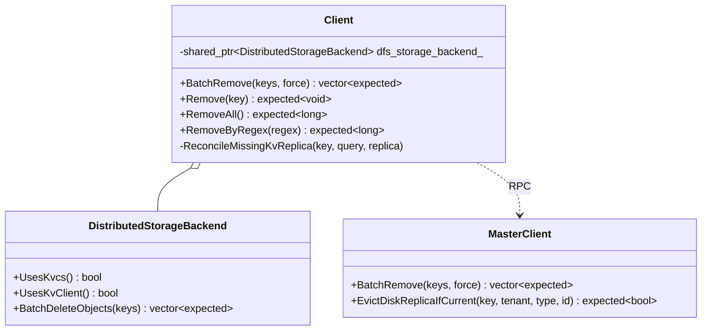

### 3.4 流程图（BatchRemove）

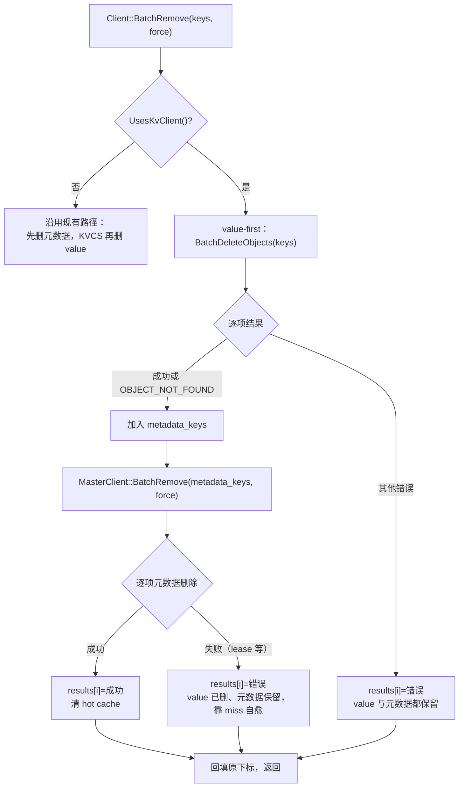

### 3.5 时序图（value-first 删除）

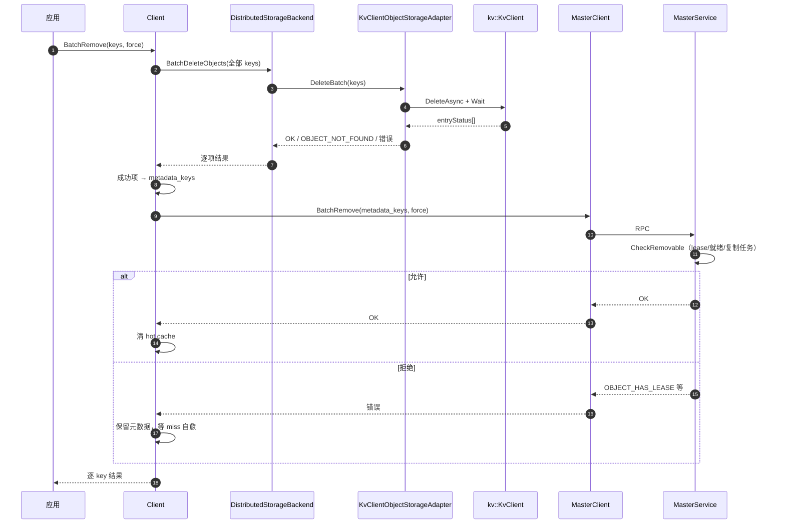

### 3.6 伪代码

#### 3.6.1 BatchRemove

```cpp
std::vector<tl::expected<void, ErrorCode>> Client::BatchRemove(
    const std::vector<std::string>& keys, bool force) {
    std::vector<tl::expected<void, ErrorCode>> results(keys.size());
    if (hot_cache_) hot_cache_->BumpKeyGenerations(keys);
    const bool kvclient =
        dfs_storage_backend_ && dfs_storage_backend_->UsesKvClient();

    std::vector<std::string> metadata_keys;
    std::vector<size_t> metadata_indices;

    if (kvclient) {
        const auto deleted = dfs_storage_backend_->BatchDeleteObjects(keys);
        if (deleted.size() != keys.size()) {
            for (auto& r : results)
                r = tl::make_unexpected(ErrorCode::INTERNAL_ERROR);
            return results;
        }
        for (size_t i = 0; i < keys.size(); ++i) {
            if (deleted[i] ||
                deleted[i].error() == ErrorCode::OBJECT_NOT_FOUND) {
                metadata_keys.push_back(keys[i]);
                metadata_indices.push_back(i);
            } else {
                results[i] = tl::make_unexpected(deleted[i].error());
            }
        }
    } else {
        metadata_keys = keys;
        metadata_indices.resize(keys.size());
        std::iota(metadata_indices.begin(), metadata_indices.end(), 0);
    }

    if (!metadata_keys.empty()) {
        const auto master = master_client_.BatchRemove(metadata_keys, force);
        for (size_t j = 0; j < metadata_indices.size(); ++j) {
            results[metadata_indices[j]] =
                j < master.size() ? master[j]
                                  : tl::make_unexpected(ErrorCode::RPC_FAIL);
        }
    }

    if (!kvclient && dfs_storage_backend_ &&
        dfs_storage_backend_->UsesKvcs()) {
        std::vector<std::string> removed;
        std::vector<size_t> indices;
        for (size_t i = 0; i < keys.size(); ++i) {
            if (results[i]) { removed.push_back(keys[i]); indices.push_back(i); }
        }
        if (!removed.empty()) {
            const auto vals = dfs_storage_backend_->BatchDeleteObjects(removed);
            for (size_t j = 0; j < indices.size(); ++j) {
                if (j >= vals.size())
                    results[indices[j]] = tl::make_unexpected(ErrorCode::INTERNAL_ERROR);
                else if (!vals[j])
                    results[indices[j]] = vals[j];
            }
        }
    }

    if (hot_cache_) {
        std::vector<std::string> hot;
        for (size_t j = 0; j < metadata_indices.size(); ++j)
            if (results[metadata_indices[j]]) hot.push_back(metadata_keys[j]);
        if (!hot.empty()) hot_cache_->RemoveHotKeys(hot);
    }
    return results;
}
```

#### 3.6.2 miss 清理门控

```cpp
void Client::ReconcileMissingKvReplica(
    const std::string& key, const QueryResult& query,
    const Replica::Descriptor& replica) {
    if (!dfs_storage_backend_ ||
        !(dfs_storage_backend_->UsesKvcs() ||
          dfs_storage_backend_->UsesKvClient()) ||
        !replica.is_dfs_replica() ||
        !query.resolved_tenant_id.has_value()) {
        return;
    }
    auto r = master_client_.EvictDiskReplicaIfCurrent(
        key, *query.resolved_tenant_id, ReplicaType::DFS, replica.id);
    if (!r) {
        LOG(WARNING) << "conditional eviction failed, key=" << key
                     << ", error=" << toString(r.error());
    }
}
```

#### 3.6.3 门控放宽

```cpp
// Remove：单 key
if (!dfs_storage_backend_ ||
    !(dfs_storage_backend_->UsesKvcs() ||
      dfs_storage_backend_->UsesKvClient())) {
    // ...原有路径...
}

// RemoveAll / RemoveByRegex
if (dfs_storage_backend_ &&
    (dfs_storage_backend_->UsesKvcs() ||
     dfs_storage_backend_->UsesKvClient())) {
    return tl::make_unexpected(ErrorCode::NOT_SUPPORTED);   // 不删元数据
}

// AttachHostId：const 入参，改本地副本
ReplicateConfig Client::AttachHostId(const ReplicateConfig& config) const {
    ReplicateConfig client_cfg = config;
    if (dfs_storage_backend_ &&
        (dfs_storage_backend_->UsesKvcs() ||
         dfs_storage_backend_->UsesKvClient())) {
        client_cfg.dfs_replica_num = 1;
    }
    if (!host_id_.empty()) client_cfg.host_id = host_id_;
    return client_cfg;
}
```

#### 3.6.4 测试清单

```cpp
TEST(KvClientAdapter, MakeCacheKeyIsStableAndLittleEndian) { /* T-01 */ }
TEST(KvClientAdapter, RejectEmptyKeyZeroLengthAndDuplicate) { /* T-02 */ }
TEST(KvClientAdapter, DirectAndStagedPaths) { /* T-03 */ }
TEST(KvClientAdapter, RegisterFailureFailsBatch) { /* T-20 */ }
TEST(KvClientAdapter, TimeoutKeepsHandlesAndStaging) { /* T-08 */ }
TEST(KvClientAdapter, BufferNotRegisteredFailsSubBatch) { /* T-07 */ }
TEST(KvClientClient, ValueFirstDeleteOrder) { /* T-17 */ }
TEST(KvClientClient, RemoveAllAndRegexAreNotSupported) { /* T-18 */ }
```

### 3.7 验收

| 场景 | 预期 |
| --- | --- |
| value 删除失败 | 该 key 不删元数据，两者保留可重试 |
| value 删除成功、元数据被 lease 拒绝 | value 已删、元数据保留；后续读 miss 自愈 |
| `RemoveAll` / `RemoveByRegex` | `NOT_SUPPORTED`，元数据完全未变 |
| miss 清理 | 仅 `use_kvcs_ \|\| use_kvclient_` 且 DFS 副本且 tenant 已解析时触发；ReplicaID 不匹配保留 R2 |

---

## 合并顺序与回滚

1. PR1 合并后：`kvclient` 配置可启动，读写返回 `NOT_SUPPORTED`，所有既有后端回归通过。
2. PR2 合并后：KVClient 后端端到端可用；Master 门控生效。
3. PR3 合并后：删除语义与 miss 自愈生效，测试补齐。

任一步回滚不需要数据迁移：配置项未启用时新代码路径不可达；已写入的 L3 对象不依赖 PR3 的 Client 逻辑。
