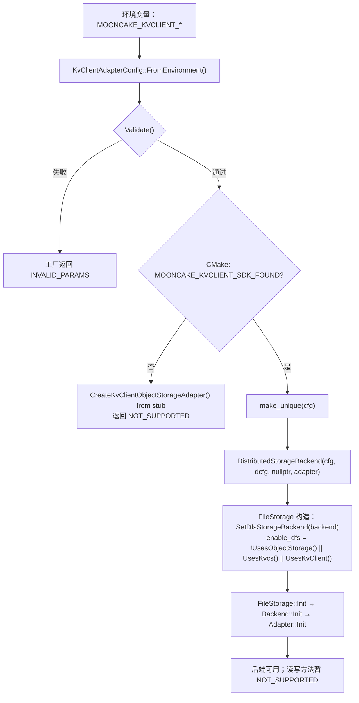
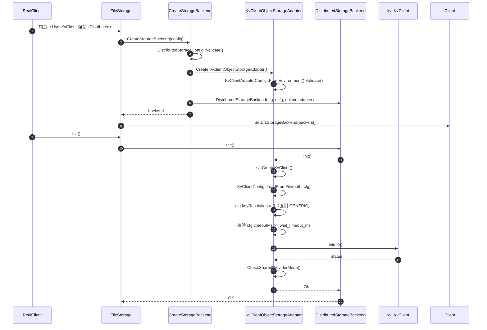
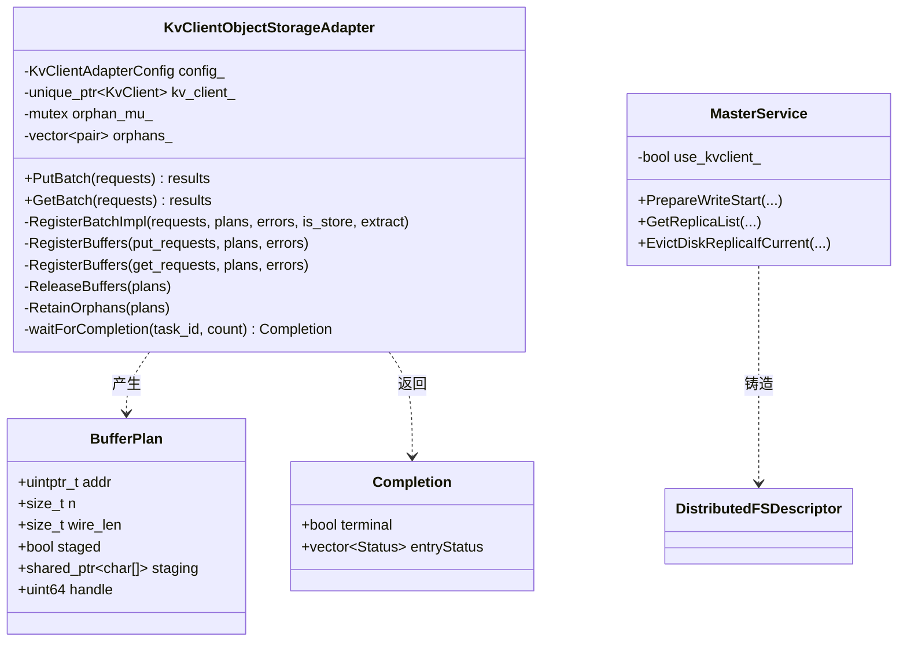
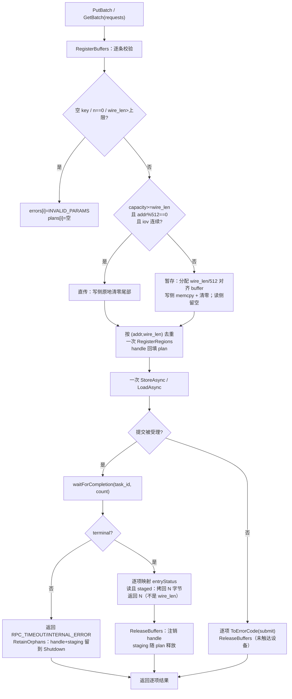
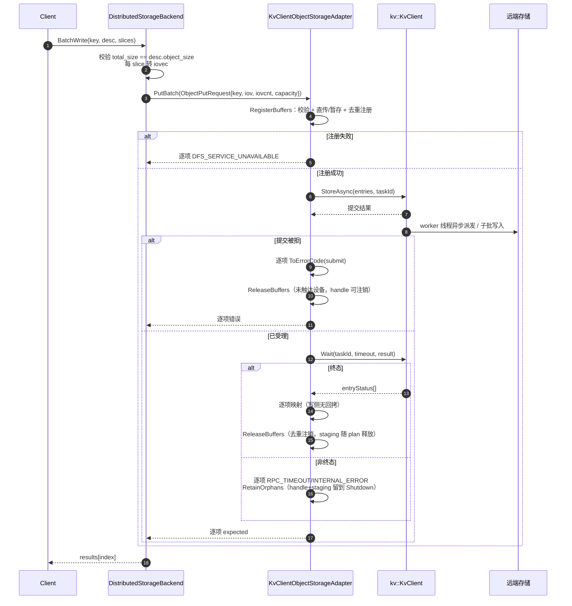
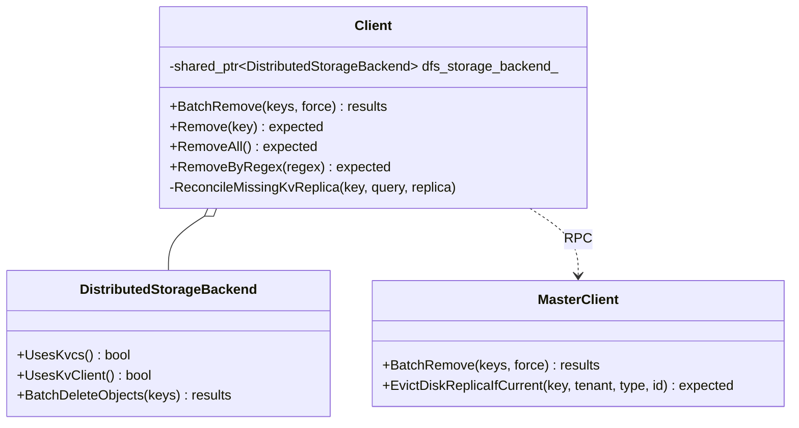
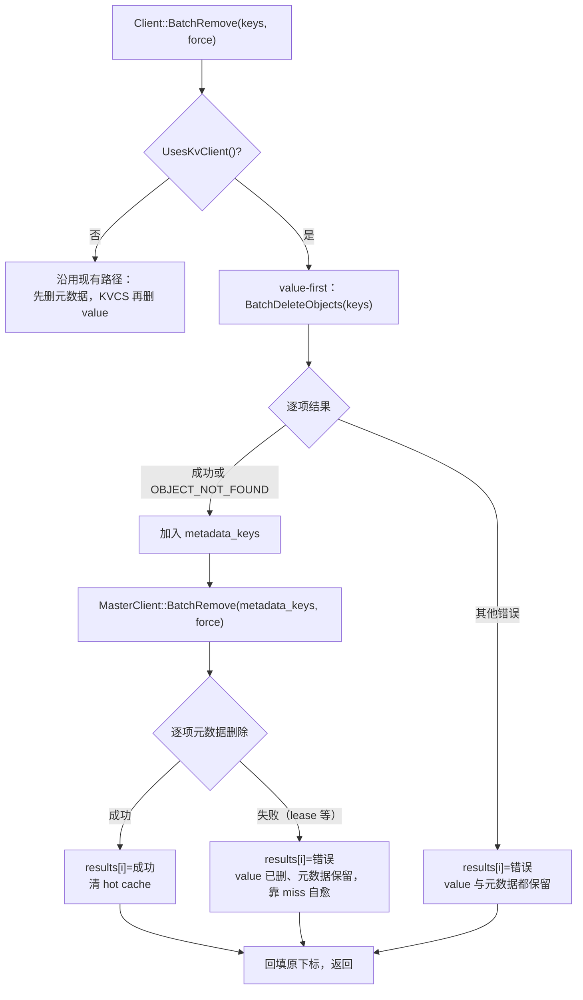
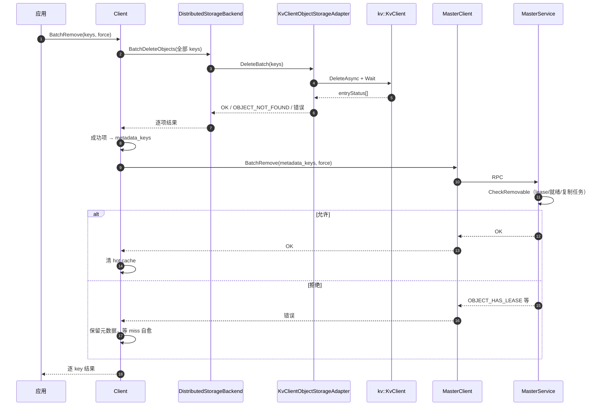

# Mooncake + KVClient L3 接入（Kvcs）— 三个 PR 的实施设计

版本：v1.0　更新日期：2026-11-13
对应设计文档：`Mooncake + KVClient L3 接入（Kvcs）- v3.md` v4.6
代码核对基线：`Mooncake` main `46c5eca8`

本文把落地工作拆成三个 PR，每个 PR 给出类图、流程图、时序图与关键伪代码。三个 PR 按顺序合入，合并后仓库始终可构建。

| PR | 模块 | 标题 | 依赖 | 预算 |
| --- | --- | --- | --- | --- |
| 1 | M1 配置构建 + 适配器控制面 | `[Store] Add kvclient backend wiring and adapter control plane` | 无 | 495 |
| 2 | M2 适配器数据面 + Master | `[Store] Implement kvclient batch data path and master gates` | PR1 | 490 |
| 3 | M3 Client 集成 + 测试 | `[Store] Adopt value-first delete for KVClient and add adapter tests` | PR2 | 460 |

---

## PR1：配置构建 + 适配器控制面

### 1.1 目标

让 `fs_adapter_type=kvclient` 在运行时可达：配置能解析、工厂能创建适配器、FileStorage/RealClient 能注入 DFS 后端、SDK 缺失时走 stub。适配器只落地控制面（`Init`、等待、错误映射、删除），读写方法以 `NOT_SUPPORTED` 占位，PR2 替换。

### 1.2 改动文件

| 文件 | 改动 |
| --- | --- |
| `mooncake-common/include/environment_variables.h` | 新增 `KvClientEnvironmentVariables`（三个 env 变量声明） |
| `include/storage/distributed/kvclient/kvclient_config.h` | 新增，header-only：`kKvClientMaxValueBytes`、`KvClientAdapterConfig`、`FromEnvironment()`、`Validate()` |
| `include/storage/distributed/kvclient/kvclient_key_codec.h` | 新增，header-only：`kKvClientHashSeed`、`EncodeBinaryKey`（`MakeCacheKey` 是适配器私有方法，转调它） |
| `include/storage/distributed/kvclient/kvclient_backend.h` | 新增，厂商无关工厂声明 |
| `src/storage/distributed/kvclient/kvclient_backend_stub.cpp` | 新增，SDK 缺失时的 `NOT_SUPPORTED` 实现 |
| `include/storage/distributed/kvclient/kvclient_object_storage_adapter.h` | 新增，类定义（数据方法占位；含 `Completion` 与 `waitForCompletion`，删除路径依赖它） |
| `src/storage/distributed/kvclient/kvclient_object_storage_adapter.cpp` | 新增，控制面实现 + 数据方法 stub + 工厂实现 |
| `include/config/distributed_storage_config.h`、`src/config/distributed_storage_config.cpp` | `UsesKvClient()`、`Validate()` 分支、`UsesObjectStorage()` 列表 |
| `src/config/file_storage_config.cpp` | `Validate()` 跳过本地目录校验 |
| `include/storage/distributed/distributed_storage_backend.h` | 新增 `UsesKvClient()` |
| `src/storage_backend.cpp` | 工厂新增 `UsesKvClient()` 分支 |
| `src/file_storage.cpp` | `enable_dfs` 加入 `UsesKvClient()` |
| `src/real_client.cpp` | `enable_kvcs` 判断加入 `UsesKvClient()` |
| `src/CMakeLists.txt` | pkg-config、条件源、define/link |

### 1.3 类图

```mermaid
classDiagram
    direction TB

    class KvClientAdapterConfig {
        +string config_path
        +uint64 max_object_bytes
        +uint64 wait_timeout_ms
        +FromEnvironment()$
        +Validate() bool
    }

    class Completion {
        +bool terminal
        +vector~Status~ entryStatus
    }

    class KvClientObjectStorageAdapter {
        -KvClientAdapterConfig config_
        -unique_ptr~kv::KvClient~ kv_client_
        -bool initialized_
        +Init() expected
        +GetName() char*
        +Exists(key) expected
        +ListKeys() expected
        +Delete(key) expected
        +DeleteBatch(keys) results
        -MakeCacheKey(key) BinaryKey
        -waitForCompletion(task_id, count) Completion
        +Put(key, data) expected
        +PutV(key, iov, iovcnt) expected
        +PutBatch(requests) results
        +Get(key, buf, len) expected
        +GetBatch(requests) results
        -ToErrorCode(status) ErrorCode$
        -CheckSharedProviderMode(cfg) bool
    }

    KvClientObjectStorageAdapter ..> Completion : 返回

    class SdkKvClient["kv::KvClient"] {
        +Init(cfg)
        +StoreAsync(...)
        +LoadAsync(...)
        +DeleteAsync(...)
        +QueryAsync(...)
        +Wait(task_id, timeout, result)
        +RegisterRegions(...)
        +UnregisterRegions(...)
        +Shutdown()
    }

    class Factory["CreateKvClientObjectStorageAdapter()"] {
        +returns tl::expected~unique_ptr~ObjectStorageAdapter~~, ErrorCode~
    }

    KvClientObjectStorageAdapter *-- SdkKvClient : 持有
    KvClientObjectStorageAdapter ..> KvClientAdapterConfig : 读取
    Factory ..> KvClientObjectStorageAdapter : 创建（SDK 存在）
    Factory ..> Stub["kvclient_backend_stub.cpp"] : NOT_SUPPORTED（SDK 缺失）
```

### 1.4 流程图



### 1.5 时序图



### 1.6 伪代码

#### 1.6.1 配置

```cpp
// mooncake-common/include/environment_variables.h
struct KvClientEnvironmentVariables {
    MC_DEFINE_ENV_VAR(std::string, MOONCAKE_KVCLIENT_CONFIG);
    MC_DEFINE_ENV_VAR(uint64_t, MOONCAKE_KVCLIENT_MAX_OBJECT_BYTES);
    MC_DEFINE_ENV_VAR(uint64_t, MOONCAKE_KVCLIENT_WAIT_TIMEOUT_MS);
};

// kvclient_config.h（header-only，不包含 SDK 头）
inline constexpr uint64_t kKvClientMaxValueBytes = 16'776'704;
// 与 SDK 的 kAlignmentBytes 同值；本地声明，避免配置单元依赖 SDK 头。
inline constexpr size_t kKvClientAlignment = 512;

struct KvClientAdapterConfig {
    std::string config_path;
    uint64_t max_object_bytes = kKvClientMaxValueBytes;
    uint64_t wait_timeout_ms = 30'000;

    static tl::expected<KvClientAdapterConfig, ErrorCode> FromEnvironment() {
        KvClientAdapterConfig cfg;
        cfg.config_path = Environ::ReadOr(
            KvClientEnvironmentVariables::MOONCAKE_KVCLIENT_CONFIG,
            std::string{});
        cfg.max_object_bytes = Environ::ReadOr(
            KvClientEnvironmentVariables::MOONCAKE_KVCLIENT_MAX_OBJECT_BYTES,
            kKvClientMaxValueBytes);
        cfg.wait_timeout_ms = Environ::ReadOr(
            KvClientEnvironmentVariables::MOONCAKE_KVCLIENT_WAIT_TIMEOUT_MS,
            uint64_t{30'000});
        if (!cfg.Validate()) return tl::make_unexpected(ErrorCode::INVALID_PARAMS);
        return cfg;
    }

    bool Validate() const {
        return !config_path.empty() &&
               max_object_bytes % kKvClientAlignment == 0 &&
               max_object_bytes <= kKvClientMaxValueBytes &&
               wait_timeout_ms > 0;
    }
};
```

#### 1.6.2 key 编码

```cpp
// kvclient_key_codec.h
inline constexpr uint64_t kKvClientHashSeed = 5381;   // 与 key_resolver 一致

inline kv::BinaryKey EncodeBinaryKey(std::string_view logical_key) {
    uint64_t hash = XXH64(logical_key.data(), logical_key.size(), kKvClientHashSeed);
    if (hash == 0) hash = 1;              // 全零映射为非零常量
    kv::BinaryKey key{};
    std::memcpy(key.data(), &hash, sizeof(hash));
    return key;
}
```

#### 1.6.3 工厂与 stub

```cpp
// kvclient_backend.h（厂商无关）
tl::expected<std::unique_ptr<ObjectStorageAdapter>, ErrorCode>
CreateKvClientObjectStorageAdapter();

// kvclient_backend_stub.cpp（SDK 缺失）
tl::expected<std::unique_ptr<ObjectStorageAdapter>, ErrorCode>
CreateKvClientObjectStorageAdapter() {
    LOG(ERROR) << "KVClient SDK not built in; kvclient backend unavailable";
    return tl::make_unexpected(ErrorCode::NOT_SUPPORTED);
}

// kvclient_object_storage_adapter.cpp（SDK 存在）
tl::expected<std::unique_ptr<ObjectStorageAdapter>, ErrorCode>
CreateKvClientObjectStorageAdapter() {
    auto cfg = KvClientAdapterConfig::FromEnvironment();
    if (!cfg) return tl::make_unexpected(cfg.error());
    return std::make_unique<KvClientObjectStorageAdapter>(*cfg);
}
```

#### 1.6.4 控制面

```cpp
tl::expected<void, ErrorCode> KvClientObjectStorageAdapter::Init() {
    if (initialized_) return {};
    if (!config_.Validate()) return tl::make_unexpected(ErrorCode::INVALID_PARAMS);

    if (!kv_client_) {                       // 注入构造已提供 client 时跳过
        kv_client_ = kv::CreateKvClient();
        if (!kv_client_) return tl::make_unexpected(ErrorCode::DFS_SERVICE_UNAVAILABLE);

        kv::KvClientConfig cfg;
        if (!kv::KvClientConfig::LoadFromFile(config_.config_path, cfg).ok())
            return tl::make_unexpected(ErrorCode::INVALID_PARAMS);
        cfg.keyResolution = {};              // 强制 GENERIC
        if (cfg.timeoutMs < config_.wait_timeout_ms)
            return tl::make_unexpected(ErrorCode::INVALID_PARAMS);
        if (!kv_client_->Init(cfg).ok())
            return tl::make_unexpected(ErrorCode::DFS_SERVICE_UNAVAILABLE);
        if (!CheckSharedProviderMode(cfg))
            return tl::make_unexpected(ErrorCode::DFS_SERVICE_UNAVAILABLE);
    }
    initialized_ = true;
    return {};
}

KvClientObjectStorageAdapter::~KvClientObjectStorageAdapter() {
    // 没有独立的 Shutdown()：先停止受理，再由 SDK 排空 pending task。
    if (kv_client_) kv_client_->Shutdown();
}

ErrorCode KvClientObjectStorageAdapter::ToErrorCode(const kv::Status& s) {
    using kv::StatusCode;
    switch (s.code) {
        case StatusCode::OK: return ErrorCode::OK;
        case StatusCode::TIMEOUT:
        case StatusCode::CQE_IO_TIMEOUT: return ErrorCode::RPC_TIMEOUT;
        case StatusCode::IN_PROGRESS:
        case StatusCode::CANCELED: return ErrorCode::INTERNAL_ERROR;
        case StatusCode::NOT_FOUND:
        case StatusCode::CQE_KEY_NOT_EXIST:
        case StatusCode::ENTRY_KEY_NOT_FOUND:
        case StatusCode::ENTRY_KEY_NOT_EXIST: return ErrorCode::OBJECT_NOT_FOUND;
        case StatusCode::INVALID_ARGUMENT:
        case StatusCode::BUFFER_NOT_REGISTERED:
        case StatusCode::BUFFER_NOT_SUPPORTED: return ErrorCode::INVALID_PARAMS;
        case StatusCode::CQE_OUT_OF_CREATE_SIZE:
        case StatusCode::RESOURCE_BUSY:
        case StatusCode::CQE_RESOURCE_BUSY: return ErrorCode::NO_AVAILABLE_HANDLE;
        case StatusCode::CONNECTION_ERROR:
        case StatusCode::IO_ERROR:
        case StatusCode::UNSUPPORTED: return ErrorCode::DFS_SERVICE_UNAVAILABLE;
        default: return ErrorCode::INTERNAL_ERROR;
    }
}

KvClientObjectStorageAdapter::Completion
KvClientObjectStorageAdapter::waitForCompletion(kv::TaskId task_id,
                                                size_t entry_count) {
    kv::TaskResult result;
    const auto wait_status =
        kv_client_->Wait(task_id, config_.wait_timeout_ms, result);
    const auto code = wait_status.ok() ? result.status.code : wait_status.code;

    Completion c;
    if (code == kv::StatusCode::TASK_NOT_FOUND) {
        // 任务已不存在，没有在途 I/O，handle 可以安全注销。
        c.terminal = true;
        c.entryStatus.assign(
            entry_count,
            kv::Status::Error(kv::StatusCode::INTERNAL_ERROR, "task not found"));
        return c;
    }

    c.terminal = (code == kv::StatusCode::OK ||
                  code == kv::StatusCode::PARTIAL_FAILED);
    if (!c.terminal) {
        // TIMEOUT / CANCELED / IN_PROGRESS：用 task 级状态填充，不可当逐项结果。
        const kv::Status& task_status = wait_status.ok() ? result.status : wait_status;
        c.entryStatus.assign(entry_count, task_status);
        return c;
    }
    if (result.entryStatus.size() != entry_count) {
        c.entryStatus.assign(
            entry_count,
            kv::Status::Error(kv::StatusCode::INTERNAL_ERROR,
                              "entry count mismatch"));
        return c;
    }
    c.entryStatus = std::move(result.entryStatus);
    return c;
}
```

#### 1.6.5 删除（控制面唯一的数据方法）

```cpp
ObjectStorageIoResults KvClientObjectStorageAdapter::DeleteBatch(
    std::span<const std::string> keys) {
    ObjectStorageIoResults results(keys.size());
    if (keys.empty()) return results;

    std::vector<kv::CacheKey> cache_keys;
    std::vector<size_t> indices;
    for (size_t i = 0; i < keys.size(); ++i) {
        if (keys[i].empty()) {
            results[i] = tl::make_unexpected(ErrorCode::INVALID_PARAMS);
            continue;
        }
        cache_keys.push_back(kv::CacheKey::FromBytes(MakeCacheKey(keys[i])));
        indices.push_back(i);
    }
    if (cache_keys.empty()) return results;

    kv::TaskId task_id = kv::kInvalidTaskId;
    const auto submit = kv_client_->DeleteAsync(cache_keys, task_id);
    if (!submit.ok()) {
        for (size_t i : indices) results[i] = tl::make_unexpected(ToErrorCode(submit));
        return results;
    }
    const auto completion = waitForCompletion(task_id, cache_keys.size());
    for (size_t j = 0; j < indices.size(); ++j) {
        results[indices[j]] = completion.entryStatus[j].ok()
                                  ? tl::expected<void, ErrorCode>{}
                                  : tl::make_unexpected(
                                        ToErrorCode(completion.entryStatus[j]));
    }
    return results;
}
```

### 1.7 验收

| 项 | 预期 |
| --- | --- |
| SDK 缺失构建 | 后端 stub 返回 `NOT_SUPPORTED`，其余后端不受影响 |
| 配置非法 | 工厂返回 `INVALID_PARAMS`，不启动 SDK |
| `sharedProviderMode != SHARED` | `Init` 失败 `DFS_SERVICE_UNAVAILABLE` |
| `timeoutMs < wait_timeout_ms` | `Init` 失败 `INVALID_PARAMS` |
| 读写方法 | 返回 `NOT_SUPPORTED`（PR2 替换） |

---

## PR2：适配器数据面 + Master

### 2.1 目标

实现直传/暂存两种模式的批读写、按批注册与释放、超时保留；并把 Master 侧的描述符铸造与门控接上，使 KVClient 后端可端到端读写。

### 2.2 改动文件

| 文件 | 改动 |
| --- | --- |
| `include/storage/distributed/object_storage_adapter.h` | `ObjectPutRequest` / `ObjectGetRequest` 末尾追加 `size_t capacity = 0` |
| `include/storage/distributed/distributed_storage_backend.h` | `DfsWriteRequest` / `DfsReadRequest` 末尾追加 `size_t capacity = 0` |
| `src/storage/distributed/distributed_storage_backend.cpp` | 透传 capacity |
| `include/storage/distributed/kvclient/kvclient_object_storage_adapter.h` | `BufferPlan`、`RegisterBuffers`/`ReleaseBuffers`/`RetainOrphans`、`orphans_` 成员（`Completion` 已在 PR1 声明） |
| `src/storage/distributed/kvclient/kvclient_object_storage_adapter.cpp` | 数据面实现；析构中清理 `orphans_` |
| `include/master_service.h` / `src/master_service.cpp` | `use_kvclient_`、门控、descriptor、白名单 |

### 2.3 类图



### 2.4 流程图（写/读共用骨架）



### 2.5 时序图（写路径，读路径对称）



### 2.6 伪代码

#### 2.6.1 BufferPlan 与注册

```cpp
// 文件内 helper（kvclient_object_storage_adapter.cpp）
struct BufferView {
    iovec single{};          // 读路径的单段 view 落在自身
    const iovec* iov = nullptr;
    int iovcnt = 0;
    size_t n = 0;
    size_t capacity = 0;
};

inline size_t AlignUp(size_t n, size_t a) { return (n + a - 1) & ~(a - 1); }

size_t SumIov(const iovec* iov, int iovcnt);

bool IsContiguous(const iovec* iov, int iovcnt) {
    for (int j = 0; j + 1 < iovcnt; ++j) {
        const auto end = reinterpret_cast<uintptr_t>(iov[j].iov_base) +
                         iov[j].iov_len;
        if (end != reinterpret_cast<uintptr_t>(iov[j + 1].iov_base)) return false;
    }
    return true;
}

void CopyIovTo(char* dst, const iovec* iov, int iovcnt);

std::shared_ptr<char[]> AllocateStaging(size_t wire_len);  // 512B 对齐，失败返回 null

template <typename T>
void FillError(std::vector<tl::expected<T, ErrorCode>>& results, ErrorCode e) {
    for (auto& r : results) r = tl::make_unexpected(e);
}
```

```cpp
struct BufferPlan {
    uintptr_t addr = 0;
    size_t n = 0;                 // 逻辑长度
    size_t wire_len = 0;          // AlignUp(n, 512)
    bool staged = false;
    std::shared_ptr<char[]> staging;
    kv::MRHandle handle = kv::kInvalidMRHandle;
};

struct Completion {
    bool terminal = false;
    std::vector<kv::Status> entryStatus;
};
```

```cpp
template <typename RequestT, typename Extract>
tl::expected<void, ErrorCode> KvClientObjectStorageAdapter::RegisterBatchImpl(
    std::span<const RequestT> requests,
    std::vector<std::optional<BufferPlan>>& plans,
    std::span<ErrorCode> errors, bool is_store, Extract&& extract) {
    plans.assign(requests.size(), std::nullopt);

    auto make_plan = [&](const BufferView& v,
                         ErrorCode& error) -> std::optional<BufferPlan> {
        if (v.iov == nullptr || v.iovcnt <= 0 || v.n == 0 ||
            v.iov[0].iov_base == nullptr) {
            error = ErrorCode::INVALID_PARAMS;
            return std::nullopt;
        }
        const size_t wire_len = AlignUp(v.n, kv::kAlignmentBytes);
        if (wire_len > config_.max_object_bytes) {
            error = ErrorCode::INVALID_PARAMS;
            return std::nullopt;
        }

        BufferPlan plan;
        plan.n = v.n;
        plan.wire_len = wire_len;
        plan.addr = reinterpret_cast<uintptr_t>(v.iov[0].iov_base);

        const bool direct = v.capacity >= wire_len &&
                            plan.addr % kv::kAlignmentBytes == 0 &&
                            IsContiguous(v.iov, v.iovcnt);
        if (!direct) {
            plan.staging = AllocateStaging(wire_len);   // 512B 对齐，失败返回 null
            if (!plan.staging) {
                error = ErrorCode::NO_AVAILABLE_HANDLE;
                return std::nullopt;
            }
            plan.addr = reinterpret_cast<uintptr_t>(plan.staging.get());
            plan.staged = true;
            if (is_store) CopyIovTo(plan.staging.get(), v.iov, v.iovcnt);
        }
        if (is_store && wire_len > v.n) {
            std::memset(reinterpret_cast<char*>(plan.addr) + v.n, 0,
                        wire_len - v.n);
        }
        return plan;
    };

    std::set<kv::BinaryKey> seen;   // 仅写侧
    std::vector<kv::MemoryRegion> regions;
    std::vector<size_t> plan_to_region(requests.size(), SIZE_MAX);

    for (size_t i = 0; i < requests.size(); ++i) {
        if (requests[i].logical_key.empty()) {
            errors[i] = ErrorCode::INVALID_PARAMS;
            continue;
        }
        if (is_store && !seen.insert(MakeCacheKey(requests[i].logical_key)).second) {
            errors[i] = ErrorCode::INVALID_PARAMS;   // 同批重复 key
            continue;
        }
        BufferView view;
        extract(requests[i], view);
        auto plan = make_plan(view, errors[i]);
        if (!plan) continue;

        size_t region = regions.size();
        for (size_t j = 0; j < regions.size(); ++j) {
            if (regions[j].addr == plan->addr &&
                regions[j].size == plan->wire_len) {
                region = j;
                break;
            }
        }
        if (region == regions.size()) {
            regions.push_back({kv::MemoryType::HOST, plan->addr,
                               plan->wire_len, -1, -1});
        }
        plans[i] = std::move(*plan);
        plan_to_region[i] = region;
    }

    if (regions.empty()) return {};

    std::vector<kv::RegisteredMemory> out;
    if (!kv_client_->RegisterRegions(regions, out).ok() ||
        out.size() != regions.size()) {
        return tl::make_unexpected(ErrorCode::DFS_SERVICE_UNAVAILABLE);
    }
    for (size_t i = 0; i < plans.size(); ++i) {
        if (plans[i]) plans[i]->handle = out[plan_to_region[i]].handle;
    }
    return {};
}
```

#### 2.6.2 批提交

```cpp
std::vector<tl::expected<void, ErrorCode>> KvClientObjectStorageAdapter::PutBatch(
    const std::vector<ObjectPutRequest>& requests) {
    std::vector<tl::expected<void, ErrorCode>> results(requests.size());
    std::vector<std::optional<BufferPlan>> plans;
    std::vector<ErrorCode> errors(requests.size(), ErrorCode::INVALID_PARAMS);

    if (!RegisterBuffers(requests, plans, errors)) {
        FillError(results, ErrorCode::DFS_SERVICE_UNAVAILABLE);
        return results;
    }
    for (size_t i = 0; i < plans.size(); ++i)
        if (!plans[i]) results[i] = tl::make_unexpected(errors[i]);

    std::vector<kv::KVBuffer> entries;
    std::vector<size_t> indices;
    for (size_t i = 0; i < plans.size(); ++i) {
        if (!plans[i]) continue;
        kv::KVBuffer e;
        e.key = kv::CacheKey::FromBytes(MakeCacheKey(requests[i].logical_key));
        e.buffer.region = {kv::MemoryType::HOST, plans[i]->addr,
                           plans[i]->wire_len, -1, -1};
        e.buffer.handle = plans[i]->handle;
        e.offset = 0;
        e.mrKey = std::nullopt;
        entries.push_back(std::move(e));
        indices.push_back(i);
    }
    if (entries.empty()) return results;

    kv::TaskId task_id = kv::kInvalidTaskId;
    const auto submit = kv_client_->StoreAsync(entries, task_id);
    bool terminal = !submit.ok();

    if (submit.ok()) {
        const auto completion = waitForCompletion(task_id, entries.size());
        terminal = completion.terminal;
        if (completion.entryStatus.size() != entries.size()) {
            FillError(results, ErrorCode::INTERNAL_ERROR);
        } else {
            for (size_t j = 0; j < entries.size(); ++j) {
                const size_t i = indices[j];
                const auto& st = completion.entryStatus[j];
                if (!st.ok()) results[i] = tl::make_unexpected(ToErrorCode(st));
                else if (!terminal) results[i] = tl::make_unexpected(ErrorCode::RPC_TIMEOUT);
                else results[i] = {};
            }
        }
    } else {
        FillError(results, ToErrorCode(submit));
    }

    if (terminal) ReleaseBuffers(plans);
    else {
        RetainOrphans(plans);
        LOG(ERROR) << "action=kvclient_batch_release_skipped, task_id=" << task_id;
    }
    return results;
}
```

#### 2.6.3 Master 门控

```cpp
// 初始化（MasterService 构造 / 配置注入）
use_kvcs_ = (distributed_config.fs_adapter_type == "kvcs-lowlevel");
use_kvclient_ = (distributed_config.fs_adapter_type == "kvclient");
enable_dfs_ = DfsEnablementConfig::FromEnvironment().enabled ||
              distributed_config.UsesKvcs() ||
              distributed_config.UsesKvClient();

// DFS 可用性门（master_service.cpp:5273-5275）：保留 !enable_dfs_ 前缀
if (config.dfs_replica_num > 0 &&
    (!enable_dfs_ ||
     (!use_kvcs_ && !use_kvclient_ &&
      (!dfs_allocator_ || !dfs_allocator_->IsInitialized())))) {
    return tl::make_unexpected(ErrorCode::INVALID_PARAMS);
}

// PrepareWriteStart：长度上限 + 三副本拒绝
if (config.dfs_replica_num > 0 && use_kvclient_) {
    if (slice_length > 16'776'704) return INVALID_PARAMS;
    if (config.nof_replica_num > 0) return INVALID_PARAMS;   // 三副本不支持
}

// descriptor 铸造
if (use_kvclient_) {
    DistributedFSDescriptor d;
    d.object_size = value_length;
    d.aligned_size = AlignUp(value_length, 512);
    d.shard_idx = -1;
    replicas.emplace_back(std::move(d), ReplicaStatus::PROCESSING);
}

// 白名单 1：replica_type 校验
const bool supports_dfs_condition =
    replica_type == ReplicaType::DFS &&
    expected_replica_id != nullptr &&
    (use_kvcs_ || use_kvclient_);

// 白名单 2：target_pred 里同样要放宽（:6481）
auto target_pred = [this, replica_type, &client_id, expected_replica_id](
                       const Replica& r) {
    if (replica_type == ReplicaType::DFS) {
        return (use_kvcs_ || use_kvclient_) &&
               expected_replica_id != nullptr &&
               r.is_dfs_replica() && r.id() == *expected_replica_id;
    }
    // DISK / LOCAL_DISK 分支保持原样
    return false;
};
```

### 2.7 验收

| 场景 | 预期 |
| --- | --- |
| N=513 直传 | 尾部补零；提交成功；`Get` 返回 513 |
| N=513 暂存（capacity=0） | 调用方 buffer 不被写；读回 513 字节正确 |
| 多段 iov / 未对齐 | 自动走暂存，不报 `INVALID_PARAMS` |
| 同批重复 key | 只失败重复条目 |
| 注册失败 | 整批 `DFS_SERVICE_UNAVAILABLE`，不提交 SDK |
| `Wait` 超时 | 逐项 `RPC_TIMEOUT`；handle+staging 保留；不误报成功 |
| 读 miss | `OBJECT_NOT_FOUND` 触发 miss 清理；超时不触发 |

---

## PR3：Client 集成 + 测试

### 3.1 目标

把删除顺序改为 value-first、放宽 miss 清理与 Remove 门控、改名 `ReconcileMissingKvReplica`，并补齐单元/集成测试。

### 3.2 改动文件

| 文件 | 改动 |
| --- | --- |
| `include/client_service.h` | `ReconcileMissingKvcsReplica` → `ReconcileMissingKvReplica` |
| `src/client_service.cpp` | 改名（声明 + 2 处调用点 `:1626`、`:1936`）；`BatchRemove` 的 KVClient 分支；`Remove`/`RemoveAll`/`RemoveByRegex` 门控；`AttachHostId` |
| `tests/kvclient_key_codec_test.cpp` | 新增 |
| `tests/kvclient_object_storage_adapter_test.cpp` | 新增 |
| `tests/CMakeLists.txt` | 新增两个测试目标（仅 SDK 存在时），并 `target_link_libraries(... PkgConfig::KVCLIENT)` |

### 3.3 类图



### 3.4 流程图（BatchRemove）



### 3.5 时序图（value-first 删除）



### 3.6 伪代码

#### 3.6.1 BatchRemove

```cpp
std::vector<tl::expected<void, ErrorCode>> Client::BatchRemove(
    const std::vector<std::string>& keys, bool force) {
    std::vector<tl::expected<void, ErrorCode>> results(keys.size());
    if (hot_cache_) hot_cache_->BumpKeyGenerations(keys);
    const bool kvclient =
        dfs_storage_backend_ && dfs_storage_backend_->UsesKvClient();

    std::vector<std::string> metadata_keys;
    std::vector<size_t> metadata_indices;

    if (kvclient) {
        const auto deleted = dfs_storage_backend_->BatchDeleteObjects(keys);
        if (deleted.size() != keys.size()) {
            for (auto& r : results)
                r = tl::make_unexpected(ErrorCode::INTERNAL_ERROR);
            return results;
        }
        for (size_t i = 0; i < keys.size(); ++i) {
            if (deleted[i] ||
                deleted[i].error() == ErrorCode::OBJECT_NOT_FOUND) {
                metadata_keys.push_back(keys[i]);
                metadata_indices.push_back(i);
            } else {
                results[i] = tl::make_unexpected(deleted[i].error());
            }
        }
    } else {
        metadata_keys = keys;
        metadata_indices.resize(keys.size());
        std::iota(metadata_indices.begin(), metadata_indices.end(), 0);
    }

    if (!metadata_keys.empty()) {
        const auto master = master_client_.BatchRemove(metadata_keys, force);
        for (size_t j = 0; j < metadata_indices.size(); ++j) {
            results[metadata_indices[j]] =
                j < master.size() ? master[j]
                                  : tl::make_unexpected(ErrorCode::RPC_FAIL);
        }
    }

    if (!kvclient && dfs_storage_backend_ &&
        dfs_storage_backend_->UsesKvcs()) {
        std::vector<std::string> removed;
        std::vector<size_t> indices;
        for (size_t i = 0; i < keys.size(); ++i) {
            if (results[i]) { removed.push_back(keys[i]); indices.push_back(i); }
        }
        if (!removed.empty()) {
            const auto vals = dfs_storage_backend_->BatchDeleteObjects(removed);
            for (size_t j = 0; j < indices.size(); ++j) {
                if (j >= vals.size())
                    results[indices[j]] = tl::make_unexpected(ErrorCode::INTERNAL_ERROR);
                else if (!vals[j])
                    results[indices[j]] = vals[j];
            }
        }
    }

    if (hot_cache_) {
        std::vector<std::string> hot;
        for (size_t j = 0; j < metadata_indices.size(); ++j)
            if (results[metadata_indices[j]]) hot.push_back(metadata_keys[j]);
        if (!hot.empty()) hot_cache_->RemoveHotKeys(hot);
    }
    return results;
}
```

#### 3.6.2 miss 清理门控

```cpp
void Client::ReconcileMissingKvReplica(
    const std::string& key, const QueryResult& query,
    const Replica::Descriptor& replica) {
    if (!dfs_storage_backend_ ||
        !(dfs_storage_backend_->UsesKvcs() ||
          dfs_storage_backend_->UsesKvClient()) ||
        !replica.is_dfs_replica() ||
        !query.resolved_tenant_id.has_value()) {
        return;
    }
    auto r = master_client_.EvictDiskReplicaIfCurrent(
        key, *query.resolved_tenant_id, ReplicaType::DFS, replica.id);
    if (!r) {
        LOG(WARNING) << "conditional eviction failed, key=" << key
                     << ", error=" << toString(r.error());
    }
}
```

#### 3.6.3 门控放宽

```cpp
// Remove：单 key
if (!dfs_storage_backend_ ||
    !(dfs_storage_backend_->UsesKvcs() ||
      dfs_storage_backend_->UsesKvClient())) {
    // ...原有路径...
}

// RemoveAll / RemoveByRegex
if (dfs_storage_backend_ &&
    (dfs_storage_backend_->UsesKvcs() ||
     dfs_storage_backend_->UsesKvClient())) {
    return tl::make_unexpected(ErrorCode::NOT_SUPPORTED);   // 不删元数据
}

// AttachHostId：const 入参，改本地副本
ReplicateConfig Client::AttachHostId(const ReplicateConfig& config) const {
    ReplicateConfig client_cfg = config;
    if (dfs_storage_backend_ &&
        (dfs_storage_backend_->UsesKvcs() ||
         dfs_storage_backend_->UsesKvClient())) {
        client_cfg.dfs_replica_num = 1;
    }
    if (!host_id_.empty()) client_cfg.host_id = host_id_;
    return client_cfg;
}
```

#### 3.6.4 测试清单

```cpp
TEST(KvClientCodec, IdempotentAndInjective) { /* T-01 */ }
TEST(KvClientAdapter, RejectEmptyKeyZeroLengthAndDuplicate) { /* T-02 */ }
TEST(KvClientAdapter, DirectAndStagedPaths) { /* T-03 */ }
TEST(KvClientAdapter, RegisterFailureFailsBatch) { /* T-20 */ }
TEST(KvClientAdapter, TimeoutKeepsHandlesAndStaging) { /* T-08 */ }
TEST(KvClientAdapter, BufferNotRegisteredFailsSubBatch) { /* T-07 */ }
TEST(KvClientClient, ValueFirstDeleteOrder) { /* T-17 */ }
TEST(KvClientClient, RemoveAllAndRegexAreNotSupported) { /* T-18 */ }
```

### 3.7 验收

| 场景 | 预期 |
| --- | --- |
| value 删除失败 | 该 key 不删元数据，两者保留可重试 |
| value 删除成功、元数据被 lease 拒绝 | value 已删、元数据保留；后续读 miss 自愈 |
| `RemoveAll` / `RemoveByRegex` | `NOT_SUPPORTED`，元数据完全未变 |
| miss 清理 | 仅 `use_kvcs_ \|\| use_kvclient_` 且 DFS 副本且 tenant 已解析时触发；ReplicaID 不匹配保留 R2 |

---

## 合并顺序与回滚

1. PR1 合并后：`kvclient` 配置可启动，读写返回 `NOT_SUPPORTED`，所有既有后端回归通过。
2. PR2 合并后：KVClient 后端端到端可用；Master 门控生效。
3. PR3 合并后：删除语义与 miss 自愈生效，测试补齐。

任一步回滚不需要数据迁移：配置项未启用时新代码路径不可达；已写入的 L3 对象不依赖 PR3 的 Client 逻辑。
