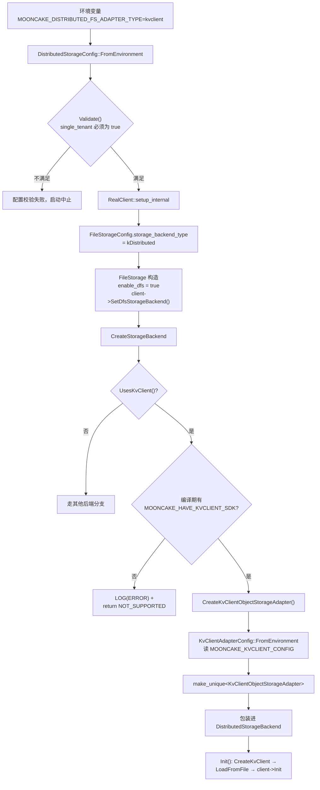
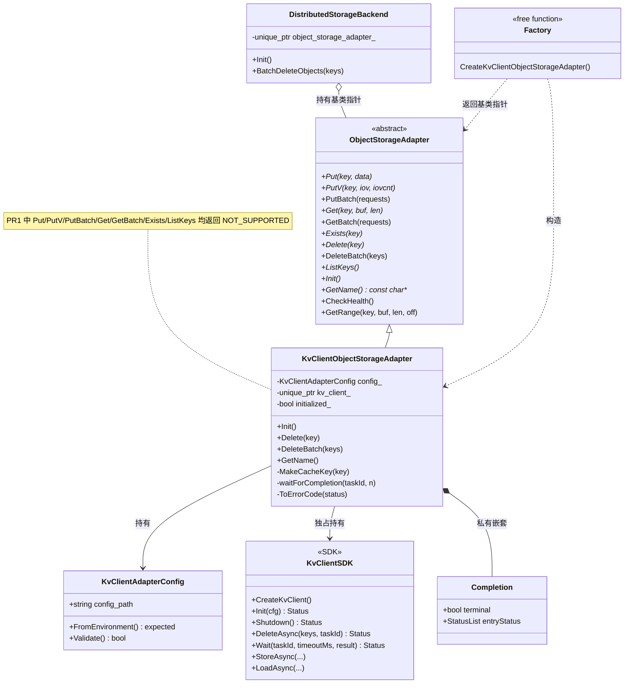
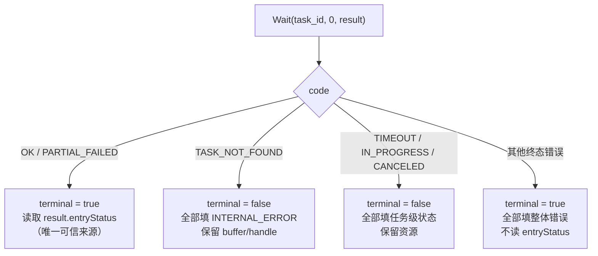

# Mooncake + KVClient L3 接入（Kvcs）— PR1 串讲文档

版本：v1.0　日期：2026-11-23

用途：PR1 上会串讲。第一部分讲功能、结构与类图（约 5 分钟），第二部分讲代码实现（约 7 分钟），附录含时间分配、预期提问与风险清单。

---

## 基线

| 项 | 值 |
| --- | --- |
| PR1 分支 | `origin/PR1` |
| **PR1 权威 tip** | **`8af2fc10`**（含 7 个提交） |
| PR1 diff 基线 | `6076241e`（= `git merge-base origin/PR1 upstream/main`） |
| 改动规模 | **15 个文件，+630 / −11** |
| 提交 | `93ec9401` 接线+控制面 → `5c4162e4` 单租户说明 → `757edd7c` factory 头改名 → `86fe246e` 删除版本下限 → `f3c8ffd5` 非 pkg-config 检测 → `95f88152` 超时/结果归 SDK → **`8af2fc10` 单 key 走 batch 协议** |
| 目标 SDK | `tmp_pr1641/ucm-pr`，分支 `feat/kvclient-typed-keys-namespaces`，tip `0149f2b` |

> **链接说明**：两个适配器文件的链接指向 **PR1 提交 `8af2fc10` 的 GitHub 永久链接**——因为工作区已含未提交的 PR2 改动，指向工作区会看到 PR2 代码而非 PR1。其余 13 个文件的 kvclient 行未被后续合并触碰，链接指向工作区本地路径。

---

# 第一部分：功能、结构与类图

## 1.1 一句话定位

> PR1 让 `fs_adapter_type=kvclient` 在运行时**能被选中并初始化**，但**还不会读写数据**——数据面在 PR2。它是纯接线 + 控制面的地基型 PR。

一句话版本：**"能起来，但还不干活。"**

## 1.2 PR 边界

| PR1 交付 | 留给后续 |
| --- | --- |
| 配置解析：`fs_adapter_type=kvclient` 可识别、可校验 | `PutBatch` / `GetBatch` / `Exists` 数据面 → **PR2** |
| SDK 检测：无 `.pc` 文件时靠手工探测 + fail-fast | Master 门控与描述符铸造 → **PR2** |
| 后端工厂接线：`CreateStorageBackend` → 适配器实例 | Client value-first 删除、miss 自愈 → **PR3** |
| 适配器控制面：`Init` / `Delete` / `DeleteBatch` | 可观测性（metric、结构化日志）→ 未排期 |
| 单租户强制、错误码映射、key 编码 | |

**数据面现状**：`Put`/`PutV`/`PutBatch`/`Get`/`GetBatch`/`Exists`/`ListKeys` 全部返回 `NOT_SUPPORTED`。这是**刻意的**，不是没写完。

## 1.3 端到端链路：从环境变量到适配器实例



这条链路有三个决策点值得在串讲中点出来：**单租户校验**（1.2 的 C）、**编译期 SDK 门控**（I）、**工厂而不是直接构造**（J）。

## 1.4 类图



**类图要点（口述）**：

1. **一个实现类，两套头文件**。`KvClientObjectStorageAdapter` 继承 `ObjectStorageAdapter`，但它的头**含 SDK 头**（`kv_client.h`/`kv_types.h`），所以只有 SDK-enabled 的编译单元能 include 它。
2. **工厂返回基类指针**。`CreateKvClientObjectStorageAdapter()` 声明在 [kvclient_adapter_factory.h](mooncake-store/include/storage/distributed/kvclient/kvclient_adapter_factory.h) 这个 **SDK-free** 的头里，返回 `unique_ptr<ObjectStorageAdapter>`。这样 `storage_backend.cpp` 无需知道派生类、无需 SDK 头就能创建它——这是整个结构成立的关键。
3. **`Completion` 是私有嵌套结构**，只服务于 `waitForCompletion` 的返回值，不外泄到接口。

## 1.5 文件结构与分层

| 层 | 文件 | 职责 |
| --- | --- | --- |
| **配置** | [environment_variables.h](mooncake-common/include/environment_variables.h#L176) | 声明 `MOONCAKE_KVCLIENT_CONFIG` |
| | [kvclient_config.h](mooncake-store/include/storage/distributed/kvclient/kvclient_config.h) | SDK-free 配置单元 |
| | [distributed_storage_config.h](mooncake-store/include/config/distributed_storage_config.h#L27) | 识别 `kvclient` 后端类型 |
| | [distributed_storage_config.cpp](mooncake-store/src/config/distributed_storage_config.cpp#L78) | 单租户强制、跳过文件系统校验 |
| **接线** | [distributed_storage_backend.h](mooncake-store/include/storage/distributed/distributed_storage_backend.h#L78) | 后端级 `UsesKvClient()` 谓词 |
| | [file_storage_config.cpp](mooncake-store/src/config/file_storage_config.cpp#L238) | 跳过本地目录校验 |
| | [file_storage.cpp](mooncake-store/src/file_storage.cpp#L162) | 启用 DFS 路径 |
| | [real_client.cpp](mooncake-store/src/real_client.cpp#L1618) | 客户端启动接线 |
| | [storage_backend.cpp](mooncake-store/src/storage_backend.cpp#L6522) | 创建适配器 |
| **适配器** | [kvclient_adapter_factory.h](mooncake-store/include/storage/distributed/kvclient/kvclient_adapter_factory.h) | SDK-free 工厂声明 |
| | [kvclient_object_storage_adapter.h](mooncake-store/include/storage/distributed/kvclient/kvclient_object_storage_adapter.h) | 类声明（含 SDK 头） |
| | [kvclient_object_storage_adapter.cpp](mooncake-store/src/storage/distributed/kvclient/kvclient_object_storage_adapter.cpp) | 实现（PR1 版 295 行） |
| **构建** | [src/CMakeLists.txt](mooncake-store/src/CMakeLists.txt#L223) | SDK 检测 + 编译接线 |
| **测试** | [tests/CMakeLists.txt](mooncake-store/tests/CMakeLists.txt#L402) / [distributed_storage_config_test.cpp](mooncake-store/tests/distributed_storage_config_test.cpp#L194) | 宏门控 + 5 个新用例 |

## 1.6 三条关键契约

**① 接口契约**（基类 [object_storage_adapter.h](mooncake-store/include/storage/distributed/object_storage_adapter.h)）

- 批量接口必须**每个请求返回一个结果、顺序一致**。数量不符会被上层判整批 `INTERNAL_ERROR`。
- 所以即使是 `NOT_SUPPORTED` 的桩，也要填充**正确数量**的错误。

**② SDK 契约**

- `Wait(taskId, 0, result)` 中的 `0` 表示"用 SDK 配置的 `defaultWaitTimeoutMs`"——**超时策略完全归 SDK**。
- SDK 在**提交期**就把 `entryStatus` 每项预填为 `OK`，所以任务级失败后**不能读** `entryStatus`。
- `Wait` 即使超时也会 `Remove(taskId)`，所以"任务查不到"**不代表** IO 已结束。

**③ 部署契约**

- **必须 `single_tenant=true`**（写路径传原始 key，多租户会碰撞）。
- **`MOONCAKE_DISTRIBUTED_HEALTH_CHECK` 必须为 false**（默认即符合）。适配器没有实现 `CheckHealth()`，误开启会让后端 `Init` 以 `NOT_SUPPORTED` 失败——是**启动即失败**，不会带病运行。

---

# 第二部分：代码实现

> 代码链接均指向 **PR1 提交 `8af2fc10`**（适配器两文件），或工作区（其余文件）。

## 2.1 配置层

### 2.1.1 环境变量

[kvclient_config.h](mooncake-store/include/storage/distributed/kvclient/kvclient_config.h#L15)

```cpp
struct KvClientAdapterConfig {
    std::string config_path;

    static tl::expected<KvClientAdapterConfig, ErrorCode> FromEnvironment() {
        KvClientAdapterConfig cfg;
        cfg.config_path = Environ::ReadOr(
            KvClientEnvironmentVariables::MOONCAKE_KVCLIENT_CONFIG,
            std::string{});
        if (!cfg.Validate())
            return tl::make_unexpected(ErrorCode::INVALID_PARAMS);
        return cfg;
    }

    bool Validate() const { return !config_path.empty(); }
};
```

- **只有一个字段**：SDK 配置文件路径。max-object-size、wait-timeout 都删了——超时归 SDK，大小与对齐由 KvClient 判定。
- **这个头必须保持 SDK-free**（[L13-14](mooncake-store/include/storage/distributed/kvclient/kvclient_config.h#L13) 的注释）：`storage_backend.cpp` 在 SDK 缺失时也要编译，而它经工厂头间接依赖本文件。
- 环境变量声明在 [environment_variables.h:176-178](mooncake-common/include/environment_variables.h#L176)，`MC_DEFINE_ENV_VAR` 展开为 `inline static constexpr` 常量，无需注册表。

### 2.1.2 后端类型识别

[distributed_storage_config.h:27-33](mooncake-store/include/config/distributed_storage_config.h#L27)

```cpp
bool UsesObjectStorage() const {
    return fs_adapter_type == "oss" || fs_adapter_type == "s3" ||
           fs_adapter_type == "kvcs-lowlevel" ||
           fs_adapter_type == "kvclient";
}
bool UsesKvcs() const { return fs_adapter_type == "kvcs-lowlevel"; }
bool UsesKvClient() const { return fs_adapter_type == "kvclient"; }
```

> **这一行的杠杆最大。** 把 `"kvclient"` 加进 `UsesObjectStorage()` 后，kvclient 自动继承所有对象存储的既有行为：跳过文件系统分配器、走 object adapter 路径、被 `ValidateForAllocator` 拒绝。

### 2.1.3 校验分支（单租户强制）

[distributed_storage_config.cpp:78-92](mooncake-store/src/config/distributed_storage_config.cpp#L78)

```cpp
if (UsesKvClient()) {
    if (!single_tenant) {
        // Client::Put/BatchPut -> WriteDfsReplicas -> DfsWriteRequest ->
        // ObjectPutRequest passes the raw user key; only the offload/read
        // RPC paths use TenantId::MakeScopedKey. The SDK's IoOptions.kvns
        // is not consumed in this version, so two tenants sharing a key
        // would collide in the KV namespace.
        LOG(ERROR) << "DistributedStorageConfig: KVClient requires "
                      "single_tenant=true";
        return false;
    }
    // KVClient has no capacity API, so eviction_check_interval is not required.
    return true;
}
```

**两个要点**：

1. **位置**：在 `UsesKvcs()` 之后、`fsdir` 检查之前。顺序重要——必须先于文件系统路径检查返回，否则 kvclient 会被"`fsdir` 不能为空/必须是绝对路径"误拒。
2. **单租户为什么是硬约束**（有代码依据）：
   - 同步写路径 `Client::Put/BatchPut` → `WriteDfsReplicas` → `DfsWriteRequest` → `ObjectPutRequest` 传的是**原始用户键**；
   - 只有 offload/read 的 RPC 路径用 `TenantId::MakeScopedKey`；
   - SDK 的 `IoOptions.kvns` 本可做命名空间隔离，但当前版本**未被消费**。
   - 结论：多租户下两个租户的同名键会在 KV 命名空间**直接碰撞**。

## 2.2 接线层

### 2.2.1 启动接线

[real_client.cpp:1618-1623](mooncake-store/src/real_client.cpp#L1618)

```cpp
const bool enable_kvcs = distributed_config.UsesKvcs();
const bool enable_kvclient = distributed_config.UsesKvClient();
if (enable_ssd_offload || enable_kvcs || enable_kvclient) {
    auto file_storage_config = FileStorageConfig::FromEnvironment();
    if (enable_kvcs || enable_kvclient) {
        file_storage_config.storage_backend_type =
            StorageBackendType::kDistributed;
    }
```

- **必须强制 `kDistributed`**：`FileStorageConfig::FromEnvironment()` 的默认类型不是分布式，不强制则 `CreateStorageBackend` 走本地文件后端，适配器根本不会被创建。

### 2.2.2 启用 DFS 路径

[file_storage.cpp:162-166](mooncake-store/src/file_storage.cpp#L162)

```cpp
config_.enable_dfs = !distributed_backend->UsesObjectStorage() ||
                     distributed_backend->UsesKvcs() ||
                     distributed_backend->UsesKvClient();
if (config_.enable_dfs && client_) {
    client_->SetDfsStorageBackend(distributed_backend);
}
```

- **这三行是 kvclient 能被 client 侧看到的关键**：没有它 `dfs_storage_backend_` 为 null，PR2/PR3 的数据面调用都无从发起。

### 2.2.3 工厂分支

[storage_backend.cpp:6522-6535](mooncake-store/src/storage_backend.cpp#L6522)

```cpp
} else if (distributed_config.UsesKvClient()) {
#ifdef MOONCAKE_HAVE_KVCLIENT_SDK
    auto adapter = CreateKvClientObjectStorageAdapter();
    if (!adapter)
        return tl::make_unexpected(adapter.error());
    object_storage_adapter = std::move(*adapter);
#else
    LOG(ERROR) << "KVClient SDK not built in; kvclient backend unavailable";
    return tl::make_unexpected(ErrorCode::NOT_SUPPORTED);
#endif
}
```

**与 kvcs 分支的差异**：kvcs 用 `make_unique` 直接构造，kvclient 必须走工厂——因为 `storage_backend.cpp` 在 SDK 缺失时也要编译，不能 include 含 SDK 的头。这就是那个 16 行工厂头存在的全部理由。

`#else` 分支是**显式失败**，不是静默降级：用户配了 `kvclient` 却拿到"看起来正常但什么都做不了"的后端，是最难排查的故障。

## 2.3 适配器：`Init()`

[kvclient_object_storage_adapter.cpp:46-79](https://github.com/zwj20000328-dotcom/Mooncake/blob/8af2fc10/mooncake-store/src/storage/distributed/kvclient/kvclient_object_storage_adapter.cpp#L46)

```cpp
tl::expected<void, ErrorCode> KvClientObjectStorageAdapter::Init() {
    if (initialized_) return {};
    if (!config_.Validate())
        return tl::make_unexpected(ErrorCode::INVALID_PARAMS);

    // Injected client (test seam): only the adapter config is validated.
    if (kv_client_) {
        initialized_ = true;
        return {};
    }

    auto client = kv::CreateKvClient();
    if (!client) return tl::make_unexpected(ErrorCode::DFS_SERVICE_UNAVAILABLE);

    kv::KvClientConfig cfg;
    if (!kv::KvClientConfig::LoadFromFile(config_.config_path, cfg).ok())
        return tl::make_unexpected(ErrorCode::INVALID_PARAMS);
    cfg.keyResolution = {};  // Force GENERIC.
    cfg.useBatchIoForSingleKey = true;
    // Init is not idempotent; the local client is only committed to the member
    // after this succeeds, so a retry starts from a fresh client.
    if (!client->Init(cfg).ok())
        return tl::make_unexpected(ErrorCode::DFS_SERVICE_UNAVAILABLE);

    kv_client_ = std::move(client);
    initialized_ = true;
    LOG(INFO) << "KVClient adapter initialized";
    return {};
}
```

**三个决策点**：

1. **用局部变量 `client`，成功后才提交给成员**。这是修过的缺陷：SDK 的 `Init` **不幂等**（无条件置 `initialized_`），如果失败时成员已被污染，重试会撞上"半初始化客户端"从而**假成功**。用局部变量保证失败后成员状态完全不变。
2. **`cfg.keyResolution = {}`** 强制 GENERIC。当前 SDK tip 上这行**可观测效果为零**（适配器只提交 `BinaryKey`，SDK 的 `Resolve` 对它短路直通），是**防御性代码**——保证适配器不依赖 engine 配置。
3. **`cfg.useBatchIoForSingleKey = true`**（提交 `8af2fc10`）：非 batch 的 LOAD/STORE 路径只返回 CQE 状态、**没有逐条结果缓冲**，那样建不起数据面——读 miss 会表现为通用失败而非 `OBJECT_NOT_FOUND`。

## 2.4 适配器：错误码映射

[kvclient_object_storage_adapter.cpp:81-123](https://github.com/zwj20000328-dotcom/Mooncake/blob/8af2fc10/mooncake-store/src/storage/distributed/kvclient/kvclient_object_storage_adapter.cpp#L81)

| SDK `StatusCode` | → `ErrorCode` | 理由 |
| --- | --- | --- |
| `OK` | `OK` | 直通 |
| `TIMEOUT`、`CQE_IO_TIMEOUT` | `RPC_TIMEOUT` | 区分"超时"与"服务挂了" |
| `CQE_KEY_NOT_EXIST`、`ENTRY_KEY_NOT_FOUND`、`ENTRY_KEY_NOT_EXIST` | `OBJECT_NOT_FOUND` | 真正的"对象不存在" |
| `NOT_FOUND`、`NOT_INITIALIZED`、`CONNECTION_ERROR`、`IO_ERROR`、`UNSUPPORTED`、`ENTRY_DELETE_FAILED` | `DFS_SERVICE_UNAVAILABLE` | 可重试的服务错误 |
| `INVALID_ARGUMENT`、`BUFFER_NOT_REGISTERED`、`BUFFER_NOT_SUPPORTED` | `INVALID_PARAMS` | 调用方错误 |
| `CQE_OUT_OF_CREATE_SIZE`、`RESOURCE_BUSY`、`CQE_RESOURCE_BUSY` | `NO_AVAILABLE_HANDLE` | 资源耗尽，可退避 |
| 其余 14 个 | `INTERNAL_ERROR` | 兜底 |

> **最重要的一条**：`NOT_FOUND` **不能**映射成 `OBJECT_NOT_FOUND`。SDK 的任务级 `NOT_FOUND` 是**路由/视图/配置**找不到目标，不是对象不存在。若误映射，上层会认为对象真没了 → PR2 驱逐仍有效的元数据、PR3 删除 Master 元数据 → **数据丢失**。

覆盖性核对（现算）：SDK `StatusCode` 共 **34** 个枚举值（基础 16 + `ENTRY_*` 7 + `CQE_*` 11）；PR1 的 switch 有 **20** 个显式 `case`，其余 **14** 个落 default：

`PARTIAL_FAILED`、`TASK_NOT_FOUND`、`INTERNAL_ERROR`、`ENTRY_RETRY_ADVISED`、`ENTRY_NO_RETRY_ADVISED`、`ENTRY_DATA_NOT_EXIST`、`ENTRY_KEY_EXIST`、`CQE_INVALID_COMMAND_OPCODE`、`CQE_INVALID_FIELD_IN_COMMAND`、`CQE_INTERNAL_ERROR`、`CQE_WRITE_FAULT`、`CQE_UNRECOVERED_READ_ERROR`、`CQE_KEY_ALREADY_EXISTED`、`CQE_CHECK_RESULT_BUFFER`

已逐一核对：**没有把重要错误码误落 default**。其中 `PARTIAL_FAILED`/`TASK_NOT_FOUND` 由 `waitForCompletion` 提前分流，不经过本函数；`ENTRY_*` 三项属 PR2 数据面的状态码，PR1 不产生。

## 2.5 适配器：`waitForCompletion()` —— 核心

[kvclient_object_storage_adapter.cpp:125-181](https://github.com/zwj20000328-dotcom/Mooncake/blob/8af2fc10/mooncake-store/src/storage/distributed/kvclient/kvclient_object_storage_adapter.cpp#L125)

### 等待与双层状态

```cpp
kv::TaskResult result;
// 0 lets the SDK use its configured defaultWaitTimeoutMs; the adapter does
// not impose a second timeout. The SDK reports TIMEOUT via the result.
const auto wait_status = kv_client_->Wait(task_id, 0, result);
const auto code = wait_status.ok() ? result.status.code : wait_status.code;
const kv::Status& task_status =
    wait_status.ok() ? result.status : wait_status;
```

- **`Wait(task_id, 0, ...)`**：`0` = 用 SDK 配置的 `defaultWaitTimeoutMs`（SDK 头文件明确写了 "zero uses the default timeout"）。**适配器里没有任何超时常量**，原来那套 `MOONCAKE_KVCLIENT_WAIT_TIMEOUT_MS` + 交叉校验已删除——两套超时会互相打架。
- **双层状态**：`Wait` 返回值是**等待层**状态（如 `TASK_NOT_FOUND`），`result.status` 是**任务层**状态（如 `PARTIAL_FAILED`）。等待层成功时才看任务层。

### 四个分支



| 分支 | 终态 | 逐条结果 | 依据 |
| --- | --- | --- | --- |
| `OK` / `PARTIAL_FAILED` | ✅ | **读**（唯一可信） | 只有这两种任务状态携带有效逐条结果 |
| `TASK_NOT_FOUND` | ❌ | 填 `INTERNAL_ERROR` | `Wait` 超时后也会 `Remove(taskId)`，查不到不代表 IO 结束 |
| `TIMEOUT` / `IN_PROGRESS` / `CANCELED` | ❌ | 填任务级状态 | 非终态，逐条结果不可信 |
| 其他终态错误 | ✅ | 填整体错误 | **不能读** `entryStatus`（见下） |

### 为什么"终态错误不能读 entryStatus"

> SDK 在**提交期**就把 `entryStatus` 每一项预填成 `OK`（`kv_client_impl.cc:510`，紧挨 `Submit` 之前：`ctx->entryStatus.assign(keys.size(), Status::OK());`）。若任务级最终失败后仍去读它，就会把**整体失败误判为逐条成功** → 假成功。**这正是提交 `95f88152` 修的 bug。**

### 条目数校验

```cpp
if (result.entryStatus.size() != entry_count) {
    completion.entryStatus.assign(
        entry_count, kv::Status::Error(kv::StatusCode::INTERNAL_ERROR,
                                       "entry count mismatch"));
    return completion;
}
completion.entryStatus = std::move(result.entryStatus);
```

返回条目数与提交数不符 = 契约违背，用 `INTERNAL_ERROR` 填满，避免下游索引越界。`std::move` 避免拷贝整个 `vector<Status>`（每个含一个 `std::string`）。

## 2.6 适配器：`MakeCacheKey()`

[kvclient_object_storage_adapter.cpp:183-196](https://github.com/zwj20000328-dotcom/Mooncake/blob/8af2fc10/mooncake-store/src/storage/distributed/kvclient/kvclient_object_storage_adapter.cpp#L183)

```cpp
kv::BinaryKey KvClientObjectStorageAdapter::MakeCacheKey(
    std::string_view logical_key) const {
    uint64_t hash =
        XXH64(logical_key.data(), logical_key.size(), kKvClientHashSeed);
    // The protocol rejects an all-zero key; map it to the seed to keep the
    // wire key non-zero without a second constant.
    if (hash == 0) hash = kKvClientHashSeed;
    kv::BinaryKey key{};
    // Pack explicitly little-endian like the SDK's key_resolver; a memcpy of
    // the host-order uint64_t would differ on big-endian clients.
    for (size_t i = 0; i < sizeof(hash); ++i)
        key[i] = static_cast<std::byte>(hash >> (8 * i));
    return key;
}
```

| 要点 | 说明 |
| --- | --- |
| 种子 5381 | 与 SDK `key_resolver.cc:29` 的 `HASH_SEED_VALUE (5381)` 同值 |
| 显式小端 | 与 SDK `key_resolver.cc:154-157` 的 `hash & 0xff; hash >>= 8` 等价；不用 `memcpy` 是为了避免大端机器上与 SDK 不一致 |
| 全零守卫 | 协议在**六处**拒绝全零键（Store/Retrieve/BatchStore/BatchRetrieve/**Delete**/Exist），`XXH64` 有 2⁻⁶⁴ 概率返回 0，不加守卫该键永远写不进也删不掉 |

> **一个容易讲反的点**：PR2 写的对象 PR1 能删掉，靠的是**适配器内部只用同一个 `MakeCacheKey`**，**不是**靠种子与 SDK 相同。因为适配器只提交 `BinaryKey`，SDK 的 `Resolve` 对它**短路直通**、根本不调 `XXH64`。匹配 5381 真正买到的是**互通性**：绕开 Mooncake、直接用引擎字符串键访问同一份 KV 数据的客户端，会落在同一个物理键上。

## 2.7 适配器：`Delete()` / `DeleteBatch()`

### `Delete` 单键包装

[kvclient_object_storage_adapter.cpp:198-205](https://github.com/zwj20000328-dotcom/Mooncake/blob/8af2fc10/mooncake-store/src/storage/distributed/kvclient/kvclient_object_storage_adapter.cpp#L198)

```cpp
tl::expected<void, ErrorCode> KvClientObjectStorageAdapter::Delete(
    const std::string& key) {
    std::array<std::string, 1> keys{key};
    auto results = DeleteBatch(keys);
    return results.empty() ? tl::make_unexpected(ErrorCode::INVALID_PARAMS)
                           : std::move(results.front());
}
```

复用批量路径，避免两套逻辑不一致（这是评审指出的缺陷：原先 `Delete` 与 `DeleteBatch` 行为不同）。`std::array` 在栈上，`std::span` 可隐式从它构造，零堆分配。

### `DeleteBatch` 的三个关键设计

[kvclient_object_storage_adapter.cpp:207-249](https://github.com/zwj20000328-dotcom/Mooncake/blob/8af2fc10/mooncake-store/src/storage/distributed/kvclient/kvclient_object_storage_adapter.cpp#L207)

**① 双重守卫**

```cpp
if (!initialized_ || !kv_client_) {
    return ObjectStorageIoResults(
        keys.size(), tl::make_unexpected(ErrorCode::DFS_SERVICE_UNAVAILABLE));
}
```

既查标志也查指针。`Init()` 失败时两者都为空；若只查 `initialized_`，注入构造（`kv_client_` 已设但未 `Init`）的路径会有歧义。

**② 索引压缩映射**

```cpp
std::vector<kv::CacheKey> cache_keys;
std::vector<size_t> indices;
for (size_t i = 0; i < keys.size(); ++i) {
    if (keys[i].empty()) {
        results[i] = tl::make_unexpected(ErrorCode::INVALID_PARAMS);
        continue;                       // 空键跳过，不提交给 SDK
    }
    cache_keys.push_back(kv::CacheKey::FromBytes(MakeCacheKey(keys[i])));
    indices.push_back(i);               // 记录原始下标
}
```

空键被跳过 → 两个数组长度不等 → 必须有 `indices` 做反映射。

**③ 回填时逐条映射，且提交失败只遍历已提交项**

```cpp
const auto completion = waitForCompletion(task_id, cache_keys.size());
for (size_t j = 0; j < indices.size(); ++j) {
    results[indices[j]] =
        completion.entryStatus[j].ok()
            ? tl::expected<void, ErrorCode>{}
            : tl::make_unexpected(ToErrorCode(completion.entryStatus[j]));
}
```

- `entry_count` 传 **`cache_keys.size()`**（已提交数），保证 `entryStatus.size() == indices.size()`，无越界。
- 提交失败时遍历 **`indices`**（只覆盖已提交项），而不是 `0..keys.size()`——否则会把空键的 `INVALID_PARAMS` 覆盖成提交错误，**丢失更精确的诊断**。
- 返回时 `results` 的**每个下标都被显式赋值**（空键 / 提交失败 / 正常），没有依赖默认构造的成功值。

## 2.8 数据面桩与工厂

### PR1 的桩（[8af2fc10 版 L251-286](https://github.com/zwj20000328-dotcom/Mooncake/blob/8af2fc10/mooncake-store/src/storage/distributed/kvclient/kvclient_object_storage_adapter.cpp#L251)）

```cpp
tl::expected<void, ErrorCode> KvClientObjectStorageAdapter::Put(
    const std::string&, std::span<const char>) {       // 形参匿名
    return tl::make_unexpected(ErrorCode::NOT_SUPPORTED);
}

std::vector<tl::expected<void, ErrorCode>>
KvClientObjectStorageAdapter::PutBatch(
    const std::vector<ObjectPutRequest>& requests) {
    return Errors<void>(requests.size(), ErrorCode::NOT_SUPPORTED);
}
```

- **形参匿名**：明确表示不使用，同时避免 `-Wunused-parameter`。
- **批量桩要填充正确数量的错误**：即使不支持，也必须满足基类契约"每个请求一个结果"。用 `Errors<T>` 模板 helper（[L22](https://github.com/zwj20000328-dotcom/Mooncake/blob/8af2fc10/mooncake-store/src/storage/distributed/kvclient/kvclient_object_storage_adapter.cpp#L22)）批量填充。

七个桩：`Put`、`PutV`、`PutBatch`、`Get`、`GetBatch`、`Exists`、`ListKeys`。

### 工厂

[kvclient_object_storage_adapter.cpp:288-293](https://github.com/zwj20000328-dotcom/Mooncake/blob/8af2fc10/mooncake-store/src/storage/distributed/kvclient/kvclient_object_storage_adapter.cpp#L288)

```cpp
tl::expected<std::unique_ptr<ObjectStorageAdapter>, ErrorCode>
CreateKvClientObjectStorageAdapter() {
    auto config = KvClientAdapterConfig::FromEnvironment();
    if (!config) return tl::make_unexpected(config.error());
    return std::make_unique<KvClientObjectStorageAdapter>(*config);
}
```

返回**基类** `unique_ptr`，与 [kvclient_adapter_factory.h:13-14](mooncake-store/include/storage/distributed/kvclient/kvclient_adapter_factory.h#L13) 逐字一致。只调生产构造函数——`Init()` 由后端稍后调用。

## 2.9 构建系统：SDK 检测

### 为什么必须自己写

> KVClient SDK **不发布 `kvclient.pc`**，纯 `pkg_check_modules` 必然失败。更糟的是：适配器源文件被 `if(MOONCAKE_KVCLIENT_SDK_FOUND)` 包着，**SDK 没找到时 CMake 只打一行 "adapter disabled"，整个构建照样绿灯，但那个文件从来没被编译过**。

所以 PR1 补了两件事：

**① 手工探测** [src/CMakeLists.txt:255-268](mooncake-store/src/CMakeLists.txt#L255)

```cmake
find_path(MOONCAKE_KVCLIENT_INCLUDE_DIR
          NAMES kv_client.h
          HINTS ${_kvclient_hints}
          PATH_SUFFIXES include kv_semantics/include include/kv_semantics)
find_library(MOONCAKE_KVCLIENT_LIBRARY
             NAMES kv_client
             HINTS ${_kvclient_hints}
             PATH_SUFFIXES lib lib64 kv_semantics/src ucm/store/asu src
                           build/src build)
find_library(MOONCAKE_KVCLIENT_TRANSPORT_LIBRARY
             NAMES kv_transport ...)
```

**② fail-fast** [src/CMakeLists.txt:289-298](mooncake-store/src/CMakeLists.txt#L289)

```cmake
if(NOT MOONCAKE_KVCLIENT_SDK_FOUND)
  if(MOONCAKE_KVCLIENT_REQUIRED OR MOONCAKE_KVCLIENT_SDK_ROOT)
    message(FATAL_ERROR "KVClient SDK not found ...")
  endif()
  message(STATUS "KVClient SDK not found: adapter disabled ...")
endif()
```

显式要求（`REQUIRED=ON`）或显式指定了 root 却找不到 → **中止 configure**。

### 宏覆盖：为什么定义在 object library 上

[src/CMakeLists.txt:760-767](mooncake-store/src/CMakeLists.txt#L760)

```cmake
if(MOONCAKE_KVCLIENT_SDK_FOUND)
  # storage_backend.cpp and the adapter TU are both compiled into this object
  # library, so the define must live here rather than on shared objects.
  target_compile_definitions(mooncake_store_client_objects
                             PRIVATE MOONCAKE_HAVE_KVCLIENT_SDK=1)
  target_link_libraries(mooncake_store_client_objects
                        PRIVATE Mooncake::kvclient)
endif()
```

核查过：`storage_backend.cpp` **只**出现在 `MOONCAKE_STORE_CLIENT_SOURCES`（[L119](mooncake-store/src/CMakeLists.txt#L119)），该列表**只**喂给 `mooncake_store_client_objects`（[L739-740](mooncake-store/src/CMakeLists.txt#L739)），适配器源文件也在同一 target（[L734-735](mooncake-store/src/CMakeLists.txt#L734)），宏也定义在这里 → **无 TU 漏掉宏**。适配器**不进** `SHARED_SOURCES`，所以 master 保持厂商中立。

最终库 [L881-883](mooncake-store/src/CMakeLists.txt#L881) 再链接一次——object library 的 `PRIVATE` 链接不会自动传播到最终库。

## 2.10 测试

五个新用例在 [distributed_storage_config_test.cpp](mooncake-store/tests/distributed_storage_config_test.cpp)：

| 用例 | 锁定的行为 |
|---|---|
| [L194](mooncake-store/tests/distributed_storage_config_test.cpp#L194) `ExplicitKvClientAdapterSelectsObjectStorage` | 字符串解析 + 两个谓词互斥 |
| [L207](mooncake-store/tests/distributed_storage_config_test.cpp#L207) `KvClientFactoryReturnsNotSupportedWithoutSdk` | SDK 缺失时 `#else` 分支返回 `NOT_SUPPORTED`（**只在 SDK 缺失的构建里编译**） |
| [L309](mooncake-store/tests/distributed_storage_config_test.cpp#L309) `KvClientRejectsMultiTenant` | 单租户强制 |
| [L316](mooncake-store/tests/distributed_storage_config_test.cpp#L316) `KvClientSkipsFilesystemRootChecks` | kvclient 分支在 `fsdir` 检查之前返回 |
| [L328](mooncake-store/tests/distributed_storage_config_test.cpp#L328) `KvClientIsNotAValidAllocatorBackend` | 不能当文件系统分配器后端 |

测试宏门控在 [tests/CMakeLists.txt:402-405](mooncake-store/tests/CMakeLists.txt#L402)，**取反**：只在 SDK **缺失**时定义 `MOONCAKE_KVCLIENT_TEST_NO_SDK=1`——因为要测的正是"SDK 缺失时的降级行为"。

---

# 附录 A：串讲时间分配

| 段落 | 时长 | 要点 |
| --- | --- | --- |
| 定位与边界 | 1 min | "能起来，但还不干活"；数据面全 `NOT_SUPPORTED` 是刻意的 |
| 端到端链路 | 2 min | 三个决策点：单租户校验、编译期 SDK 门控、走工厂 |
| 类图 | 2 min | 一个实现类 + SDK-free 工厂头 |
| `Init` | 1 min | 局部变量提交（非幂等）、`useBatchIoForSingleKey` |
| `ToErrorCode` | 1 min | `NOT_FOUND` 不能映射成"对象不存在" |
| `waitForCompletion` | 2.5 min | 四个分支 + 为什么终态错误不能读 `entryStatus` |
| `DeleteBatch` | 1.5 min | 索引压缩映射、提交失败只遍历已提交项 |
| CMake 检测 | 1 min | 无 `.pc` 文件、静默跳过陷阱 |
| 风险与提问 | 2 min | 见附录 C |

---

# 附录 B：预期提问

**Q: 为什么数据面全是 `NOT_SUPPORTED`？是不是没写完？**
> 是刻意的分层。PR1 只交付控制面，让 `kvclient` 能被选中、能 `Init`、能 `Delete`。`Put`/`Get` 涉及 buffer 注册、512B 对齐契约、Master 门控，那些是 PR2 的完整议题，混进来会让这个 PR 无法单独评审。

**Q: 为什么不复用 kvcs 那套实现？**
> kvcs 是低层 POSIX 语义（string key、driver 直连），kvclient 是异步任务模型（`TaskId` + `Wait` + 逐条 status）。共同点只有 `ObjectStorageAdapter` 接口，内部模型完全不同，硬合并会变成一堆 `if (type == ...)`。

**Q: 为什么 `Wait` 传 0 而不是传一个明确的超时？**
> 让 SDK 单点管理超时。SDK 头文件写明 `0` = 用配置里的 `defaultWaitTimeoutMs`。适配器再设一套，两套超时就会互相打架——评审特意要求删掉适配器侧的 `MOONCAKE_KVCLIENT_WAIT_TIMEOUT_MS`。

**Q: 单租户这条以后能放开吗？**
> 能，但要两条同时满足：写路径也走 `MakeScopedKey`，或者 SDK 真正消费 `IoOptions.kvns` 做命名空间隔离。目前两条都不成立。

**Q: 为什么 `NOT_SUPPORTED` 的桩要返回正确数量的错误？**
> 基类契约要求"每个请求一个结果、顺序一致"。数量不对，上层 `DistributedStorageBackend` 会直接判整批 `INTERNAL_ERROR`，报错反而失真。

**Q: 怎么保证这个文件真的能编过？**
> CI 编不了它（`.github/` 下没有任何 `KVCLIENT` 字样）。PR1 提交版已用**真实构建的 SDK**（不是 stub）编译验证：exit 0、0 error、0 warning（`-Wall -Wextra`），并用 `nm` 确认产物里的符号与 PR1 源码一致。

---

# 附录 C：已知风险（主动交代）

| 风险 | 说明 | 建议 |
| --- | --- | --- |
| **依赖未合并的 SDK 分支** | 用的是 `feat/kvclient-typed-keys-namespaces`（tip `0149f2b`），未合入 develop。CMake 只按**文件名**匹配、不校验 API 变体——指向错误 SDK 快照会 configure 绿灯、编译红灯 | PR 描述写死提交号，或加符号探测 |
| **`PATH_SUFFIXES` 缺一项** | 缺 `build/kv_semantics/src`（SDK 顶层构建产物路径），照注释推荐用法会 FATAL | 一行修复 |
| **Delete 目前无生产调用路径** | `BatchDeleteObjects` 唯一调用点仍被 `UsesKvcs()` 门控。PR1 阶段无害（没有对象被写入），**PR2 落地写入后必须扩到 kvclient**，否则对象只写不删 | 记入 PR2 清单 |
| **可观测性缺失** | 无 metric、无 `cache_key`/`task_id` 结构化日志，key 碰撞在生产上不可诊断 | 未排期 |
| `Completion::terminal` 在 PR1 中只写不读 | 为 PR2 的 buffer 生命周期预留；**PR2 已开始读它** | 保留，无需改 |
| 部署约束 | 必须 `single_tenant=true`；`MOONCAKE_DISTRIBUTED_HEALTH_CHECK` 必须为 false | 写进部署文档 |

---

# 附录 D：验证状态

**PR1 提交版 `8af2fc10` 的适配器 TU，2026-11-23 针对真实构建的 SDK 实测**

| 项 | 结果 |
| --- | --- |
| 编译退出码 | **0** |
| `error:` / `warning:` 计数 | **0 / 0**（`-Wall -Wextra`） |
| 所用 SDK | 真实构建的 `0149f2b`（非 stub） |
| 符号核对 | PR1 符号齐全、PR2 专有符号计数 0 |
| 配置层单测 | 18/18 通过 |

做法：导出 PR1 提交版源码到独立目录，用 `-I` 前置遮蔽工作区头文件，复用构建目录 `compile_commands.json` 的原始编译命令。

> 注意：`~/kv/mc_build` 里 2026-11-20 17:44 那个 `.o` 含 PR2 专有符号，是 **PR2 版**，不能当作 PR1 的验证证据。
