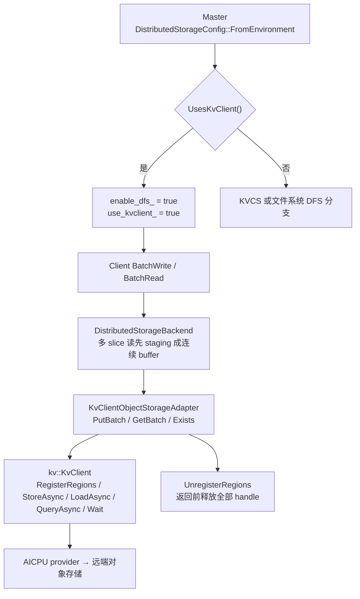
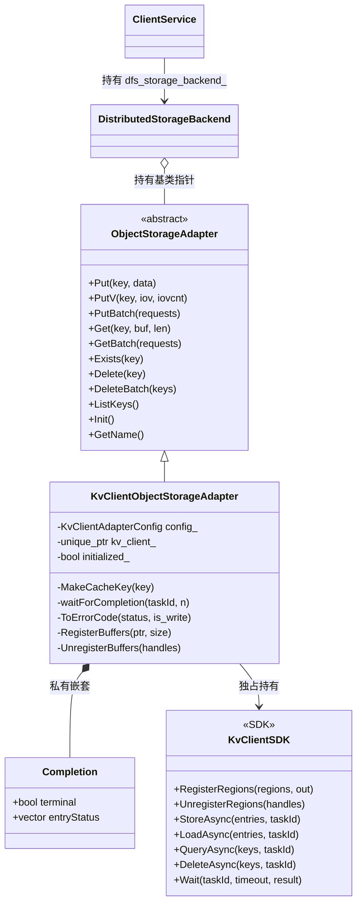
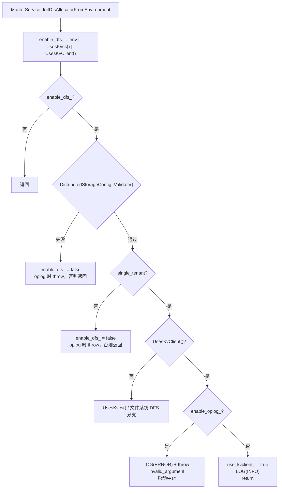
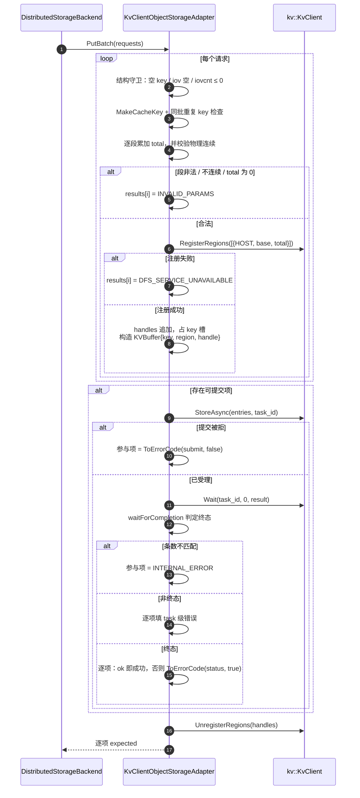
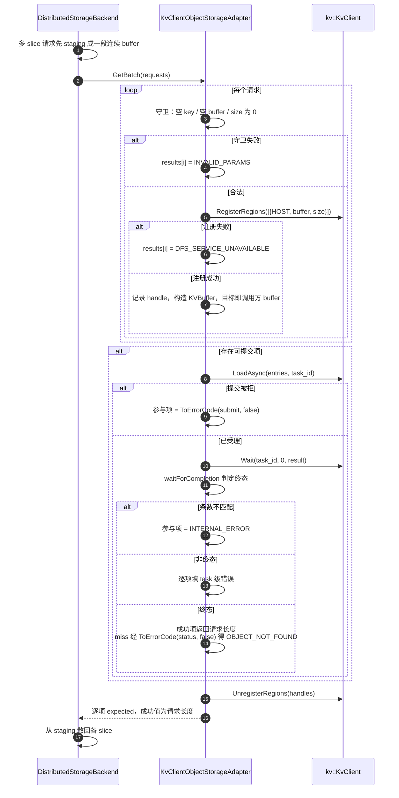
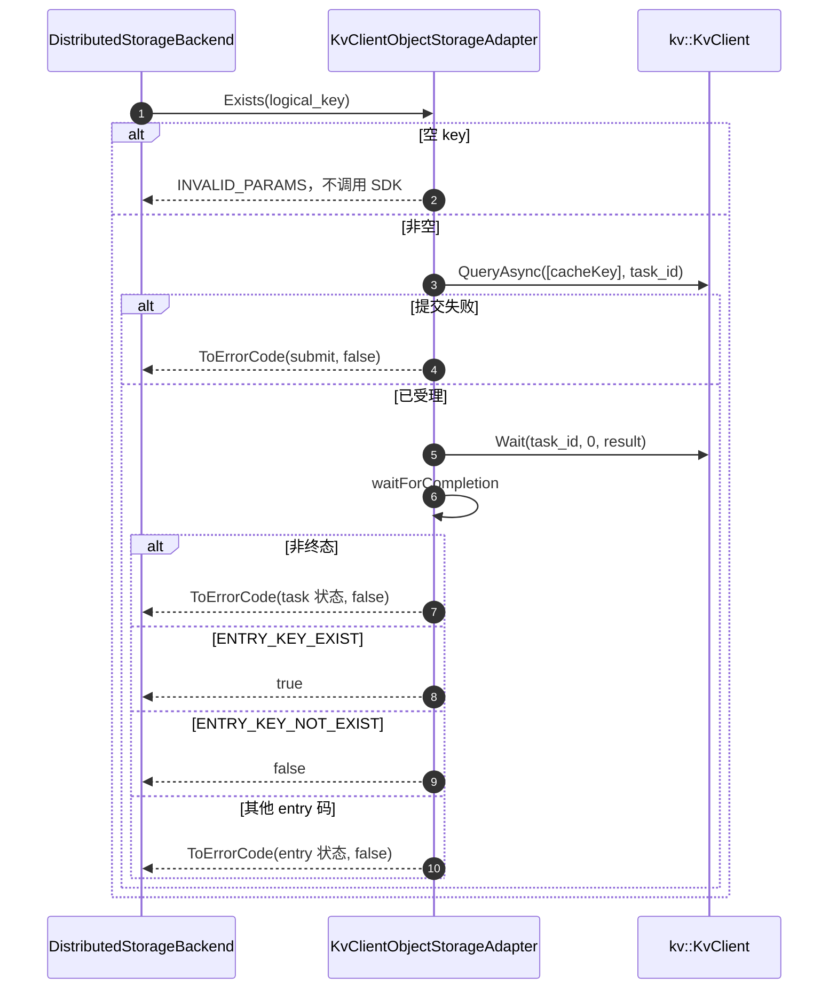

# Mooncake + KVClient L3 接入（Kvcs）— PR2 串讲文档

版本：v1.0　日期：2026-11-23

---

## 基线

| 项 | 值 |
| --- | --- |
| 分支 | `Mooncake_l3_pr2`，基线 `a2841229`（已合入 `upstream/main`） |
| 代码状态 | **未提交**：5 个修改文件 + 1 个新增测试文件 |
| 改动规模 | 已跟踪文件 +388 / −48；新增测试 648 行 |
| 前置 | PR1（`origin/PR1`，tip `8af2fc10`）；SDK `tmp_pr1641/ucm-pr` tip `0149f2b` |
| 行号约定 | 全部指向工作区 |

---

# 第一部分：功能、结构与类图

## 1.1 定位

PR1 让 `fs_adapter_type=kvclient` 能被选中、能初始化，但数据面全部返回 `NOT_SUPPORTED`。PR2 让它真正读写数据：把 `Put` / `PutV` / `PutBatch` / `Get` / `GetBatch` / `Exists` 换成零拷贝实现，并在 Master 侧把 DFS 门控放行到 kvclient。

数据路径不经过任何中间缓冲：适配器把调用方内存直接注册给 SDK，SDK 写入或读入的就是这块内存。

## 1.2 功能范围

| 交付项 | 行为 |
| --- | --- |
| `PutBatch` 零拷贝写 | 注册调用方 iov 区间 → `StoreAsync` 整批提交 → `Wait` → 逐项映射 → 注销 |
| `GetBatch` 零拷贝读 | 注册调用方目标 buffer → `LoadAsync` 直接写进该内存 → 逐项返回请求长度 |
| `Exists` | `QueryAsync` 查询，按 entry 级 code 判定命中/未命中 |
| 单条入口 | `Put` → `PutV` → `PutBatch`；`Get` → `GetBatch` |
| 错误映射 | 读写方向分流；补齐 `ENTRY_DATA_NOT_EXIST` 与两个 retry 码 |
| Master 门控 | 启动识别、descriptor 铸造、DFS 可用性门、淘汰白名单 |

不在 PR2 范围：

| 项 | 原因 |
| --- | --- |
| `ListKeys` | SDK 无 key 枚举接口，保持 `NOT_SUPPORTED` |
| `CheckHealth` | 适配器无可上报的健康信息，保持基类默认 |
| `GetRange` | 不做 override |
| 非连续多段 iov 写入 | SDK 每 entry 只能描述一段连续区间，物理不连续直接拒绝 |
| 512 字节对齐补齐 | 属调用方契约，由 SDK 校验并返回错误，适配器不预判、不 staging |
| snapshot / oplog 恢复 | kvclient 无恢复实现，启动时直接拒绝该组合 |

## 1.3 端到端链路



链路上有两层职责切分：

| 层 | 职责 |
| --- | --- |
| `DistributedStorageBackend` | 与 KVCS/OSS/S3 共用的通用逻辑：请求拆分、多 slice 读的 staging 与散回、结果回填 |
| `KvClientObjectStorageAdapter` | kvclient 特有逻辑：buffer 注册、SDK 提交与等待、错误码映射、handle 生命周期 |

## 1.4 类图



结构要点：

1. **基类接口不变**。注册与注销是派生类的私有成员，`ObjectStorageAdapter` 未新增任何虚函数，KVCS/OSS/S3 不受影响。
2. **SDK 类型不外泄**。适配器头包含 `kv_client.h`，只有 SDK-enabled 的编译单元能 include；工厂头保持 SDK-free。
3. **`Completion` 只服务 `waitForCompletion`**，把「是否终态」与「逐项状态」一起返回。
4. **`ToErrorCode` 是唯一的映射入口**，读写方向由显式 `is_write` 参数表达。
5. **数据面由 `ClientService` 持有**（`dfs_storage_backend_`）。`MasterService` 只负责启动门控、descriptor 铸造与副本元数据，不持有后端实例。

## 1.5 时序图

### 1.5.1 启动门控



### 1.5.2 写路径



### 1.5.3 读路径



### 1.5.4 `Exists`



## 1.6 结构约定

| 约定 | 内容 |
| --- | --- |
| 注册位置 | 适配器内部完成，handle 不离开 `PutBatch` / `GetBatch` 的栈帧 |
| 注册粒度 | 每个请求注册一次，批末一次批量注销 |
| 零拷贝 | `KVBuffer.region` 直接指向调用方内存，`mrKey` 由 SDK 从 handle 解析 |
| 生命周期 | handle 必须活到 `Wait` 返回之后才注销 |
| 异常安全 | 注册后的任何异常都在 `catch` 中注销并原样抛出 |
| 错误方向 | 只有 `PutBatch` 的终态逐项映射传 `is_write=true` |

---

# 第二部分：代码实现

## 2.1 改动清单

| 文件 | 改动 |
| --- | --- |
| [master_service.h](../Mooncake/mooncake-store/include/master_service.h#L2065) | 新增 `use_kvclient_` |
| [kvclient_object_storage_adapter.h](../Mooncake/mooncake-store/include/storage/distributed/kvclient/kvclient_object_storage_adapter.h#L55-L66) | `ToErrorCode` 增加 `is_write`；新增两个私有成员 |
| [kvclient_object_storage_adapter.cpp](../Mooncake/mooncake-store/src/storage/distributed/kvclient/kvclient_object_storage_adapter.cpp#L300-L569) | 数据面实现与映射补全 |
| [master_service.cpp](../Mooncake/mooncake-store/src/master_service.cpp#L827-L834) | 9 个 hunk |
| [tests/CMakeLists.txt](../Mooncake/mooncake-store/tests/CMakeLists.txt#L485-L493) | 新增测试目标 |
| [kvclient_object_storage_adapter_test.cpp](../Mooncake/mooncake-store/tests/kvclient_object_storage_adapter_test.cpp) | 新增 648 行、23 个用例 |

## 2.2 头文件

新增 `<cstdint>`：私有成员的签名用到 `uint64_t`，直接声明依赖，不依赖 SDK 头的传递包含。

私有段新增三个声明：

```cpp
// Store entries share the SDK's entry decoder with loads, so the codes that
// mean "object missing" on a read mean "store failed" on a write. Callers
// must state the direction; the parameter deliberately has no default, so a
// new write site cannot silently inherit the read mapping.
static ErrorCode ToErrorCode(const kv::Status& status, bool is_write);
// Registers one host range with the SDK; the returned handle stays valid
// until it is passed to UnregisterBuffers.
tl::expected<uint64_t, ErrorCode> RegisterBuffers(void* ptr, size_t size);
// Releases the handles, logging any failure the SDK cannot retry.
void UnregisterBuffers(const std::vector<uint64_t>& handles);
```

`is_write` 显式且无默认值，与仓库既有 `MapNvmeKvStatus(uint32_t, bool is_write)` 的约定一致：新增写调用点漏传会编译失败，而不是静默拿到读语义。

## 2.3 `Init`：强制批量协议

[kvclient_object_storage_adapter.cpp:57-62](../Mooncake/mooncake-store/src/storage/distributed/kvclient/kvclient_object_storage_adapter.cpp#L57-L62)

```cpp
cfg.keyResolution = {};  // Force GENERIC.
cfg.useBatchIoForSingleKey = true;
```

单条 `LoadAsync` / `StoreAsync` 也必须走 `BATCH_LOAD` / `BATCH_STORE`。非批量路径只返回 CQE 状态、没有 per-entry result buffer，读 miss 会变成 `CQE_CHECK_RESULT_BUFFER` 而不是 `OBJECT_NOT_FOUND` entry 码。

## 2.4 错误映射

[kvclient_object_storage_adapter.cpp:74-132](../Mooncake/mooncake-store/src/storage/distributed/kvclient/kvclient_object_storage_adapter.cpp#L74-L132)

```cpp
case StatusCode::CQE_KEY_NOT_EXIST:
case StatusCode::ENTRY_KEY_NOT_EXIST:
    return ErrorCode::OBJECT_NOT_FOUND;
case StatusCode::ENTRY_KEY_NOT_FOUND:
case StatusCode::ENTRY_DATA_NOT_EXIST:
    return is_write ? ErrorCode::FILE_WRITE_FAIL
                    : ErrorCode::OBJECT_NOT_FOUND;
...
case StatusCode::ENTRY_RETRY_ADVISED:
    return ErrorCode::DFS_SERVICE_UNAVAILABLE;
case StatusCode::ENTRY_NO_RETRY_ADVISED:
    return ErrorCode::INTERNAL_ERROR;
```

| 分组 | 状态码 | 结果 | 依据 |
| --- | --- | --- | --- |
| QUERY miss | `CQE_KEY_NOT_EXIST`、`ENTRY_KEY_NOT_EXIST` | `OBJECT_NOT_FOUND` | 只由查询产生，写路径不会出现 |
| LOAD / STORE 共用 | `ENTRY_KEY_NOT_FOUND`、`ENTRY_DATA_NOT_EXIST` | 读：`OBJECT_NOT_FOUND`；写：`FILE_WRITE_FAIL` | BATCH_STORE 与 BATCH_LOAD 共用 SDK 的 entry 解码器 |
| 可重试存储侧状况 | `ENTRY_RETRY_ADVISED` | `DFS_SERVICE_UNAVAILABLE` | 与单条 LOAD 把同一状况报成 `IO_ERROR` 的行为一致 |
| 明确不可重试 | `ENTRY_NO_RETRY_ADVISED` | `INTERNAL_ERROR` | 重试不可能成功，不能读作临时故障 |

调用点共 11 处，只有 `PutBatch` 的终态逐项分支传 `true`：

| 调用点 | `is_write` |
| --- | --- |
| `PutBatch` 终态逐项（[L407-416](../Mooncake/mooncake-store/src/storage/distributed/kvclient/kvclient_object_storage_adapter.cpp#L407-L416)） | `true` |
| `PutBatch` 提交被拒（[L387-391](../Mooncake/mooncake-store/src/storage/distributed/kvclient/kvclient_object_storage_adapter.cpp#L387-L391)） | `false` |
| `PutBatch` 非终态 fan-out（[L400-406](../Mooncake/mooncake-store/src/storage/distributed/kvclient/kvclient_object_storage_adapter.cpp#L400-L406)） | `false` |
| `DeleteBatch`、`GetBatch`、`Exists` | `false` |

提交状态与非终态 fan-out 只可能是 task 级码，不含 `ENTRY_*`，传 `true` 不会改变结果，只会掩盖「哪些分支真正需要分流」。

## 2.5 buffer 注册与注销

`RegisterBuffers`（[L205-218](../Mooncake/mooncake-store/src/storage/distributed/kvclient/kvclient_object_storage_adapter.cpp#L205-L218)）：

```cpp
tl::expected<uint64_t, ErrorCode> KvClientObjectStorageAdapter::RegisterBuffers(
    void* ptr, size_t size) {
    if (ptr == nullptr || size == 0) {
        return tl::make_unexpected(ErrorCode::INVALID_PARAMS);
    }
    std::vector<kv::MemoryRegion> regions{
        {kv::MemoryType::HOST, reinterpret_cast<uint64_t>(ptr), size, -1, -1}};
    std::vector<kv::RegisteredMemory> registered;
    const auto status = kv_client_->RegisterRegions(regions, registered);
    if (!status.ok() || registered.size() != 1) {
        return tl::make_unexpected(ErrorCode::DFS_SERVICE_UNAVAILABLE);
    }
    return registered[0].handle;
}
```

注册的就是调用方内存本身。`registered.size() != 1` 与 SDK 拒绝合并处理——1 进 1 出才能唯一确定 handle。

`UnregisterBuffers`（[L220-232](../Mooncake/mooncake-store/src/storage/distributed/kvclient/kvclient_object_storage_adapter.cpp#L220-L232)）一次传入整个 handle 列表：

```cpp
if (handles.empty()) return;
const auto status = kv_client_->UnregisterRegions(handles);
if (!status.ok()) {
    LOG(WARNING) << "KVClient buffer unregister failed, handles="
                 << handles.size() << ", error=" << status.message;
}
```

批量调用让 SDK 的 `memoryMu_` 只取一次、`providerMemoryStates_` 只遍历一次。注销失败只记日志：SDK 保留注册，已无 handle 可重试，残留由 `Shutdown()` 兜底。

## 2.6 单条入口

```cpp
// Put
iovec iov{const_cast<char*>(data.data()), data.size()};
return PutV(logical_key, &iov, 1);

// PutV
auto results = PutBatch({{logical_key, iov, iovcnt}});
return results.empty() ? tl::make_unexpected(ErrorCode::INVALID_PARAMS)
                       : std::move(results.front());

// Get
auto results = GetBatch({{logical_key, buf, len}});
return results.empty() ? tl::make_unexpected(ErrorCode::INVALID_PARAMS)
                       : std::move(results.front());
```

四个单条入口都不单独实现 I/O，也不做注册：全部由 batch 路径承担。`Put` 的 `const_cast` 是基类只读接口与 `iovec.iov_base` 非 const 的桥接，适配器不写这块内存。

## 2.7 `PutBatch`

[kvclient_object_storage_adapter.cpp:300-425](../Mooncake/mooncake-store/src/storage/distributed/kvclient/kvclient_object_storage_adapter.cpp#L300-L425)

```cpp
std::vector<tl::expected<void, ErrorCode>> results(requests.size());
if (!initialized_ || !kv_client_) { /* 全部填 DFS_SERVICE_UNAVAILABLE */ }

std::vector<uint64_t> handles;
handles.reserve(requests.size());
try {
    std::set<kv::BinaryKey> seen;
    std::vector<kv::KVBuffer> entries;
    std::vector<size_t> indices;
    for (size_t i = 0; i < requests.size(); ++i) {
        // 结构守卫 → MakeCacheKey → 重复 key → 逐段求和与连续性校验
        // RegisterBuffers → 记 handle、占 key 槽 → 构造 KVBuffer
    }
    if (!entries.empty()) {
        const auto submit = kv_client_->StoreAsync(entries, task_id);
        // 提交被拒 → 参与项 ToErrorCode(submit, false)
        // 已受理 → waitForCompletion → 逐项映射
    }
} catch (...) {
    UnregisterBuffers(handles);
    throw;
}
UnregisterBuffers(handles);
return results;
```

实现要点：

| 点 | 做法 | 原因 |
| --- | --- | --- |
| 结果填充 | 按下标逐项赋值 | 默认构造的 `expected` 是成功态，漏填会静默报成功；批量必须支持部分成功 |
| 守卫顺序 | 空 key / 空 iov / `iovcnt ≤ 0` → 重复 key → 段级校验 | 结构问题早于资源动作；去重先于耗时校验 |
| 段级校验 | 空段指针、零长、`size_t` 回绕、物理不连续 | 回绕检查在累加之前；不连续时若照旧注册，会把无关内存当对象尾部写入 |
| 注册前查重、注册后占位 | `seen.find` 在注册前，`seen.insert` 在注册成功后 | 注册失败的 key 不占用重复槽 |
| handle 记录 | `push_back` 早于任何可能抛异常的构造 | `catch` 才能释放 |
| 单一出口 | 用 `if (!entries.empty())` 而非提前 return | 正常路径只注销一次，与 `catch` 互斥 |
| 提交失败 | 只覆盖参与项 | 守卫已填的 `INVALID_PARAMS` 保持不变 |
| 条数校验 | `entryStatus.size() != entries.size()` → `INTERNAL_ERROR` | 防御性校验；`waitForCompletion` 内部对条数不匹配也做了拦截 |

写路径不预删：`StoreAsync` 是覆盖写（upsert）。

## 2.8 `GetBatch`

[kvclient_object_storage_adapter.cpp:434-532](../Mooncake/mooncake-store/src/storage/distributed/kvclient/kvclient_object_storage_adapter.cpp#L434-L532)

与 `PutBatch` 同构，差异四处：

| 维度 | 写路径 | 读路径 |
| --- | --- | --- |
| 去重 | `seen` 集合 | 无——同一 key 读两次合法 |
| 长度计算 | 逐段求和 + 连续性校验 | 每请求单段 `buffer` + `size`，无需合并 |
| 提交 | `StoreAsync` | `LoadAsync` |
| 成功值 | `expected<void>` | `expected<size_t>`，值为请求长度 |

成功项返回请求长度而非传输字节数：SDK 不暴露实际传输量，截断读无法在本层检测，交由上层 checksum 验证。

## 2.9 `Exists`

[kvclient_object_storage_adapter.cpp:534-569](../Mooncake/mooncake-store/src/storage/distributed/kvclient/kvclient_object_storage_adapter.cpp#L534-L569)

```cpp
if (!initialized_ || !kv_client_) return unexpected(DFS_SERVICE_UNAVAILABLE);
if (logical_key.empty()) return unexpected(INVALID_PARAMS);

std::vector<kv::CacheKey> keys{CacheKey::FromBytes(MakeCacheKey(logical_key))};
const auto submit = kv_client_->QueryAsync(keys, task_id);
if (!submit.ok()) return unexpected(ToErrorCode(submit, false));

const auto completion = waitForCompletion(task_id, keys.size());
if (!completion.terminal) {
    return unexpected(ToErrorCode(completion.entryStatus[0], false));
}
switch (completion.entryStatus[0].code) {
    case kv::StatusCode::ENTRY_KEY_EXIST:     return true;
    case kv::StatusCode::ENTRY_KEY_NOT_EXIST: return false;
    default: return unexpected(ToErrorCode(completion.entryStatus[0], false));
}
```

三个易错点：

1. **不能用 `Wait` 的返回值当成功判据**。`WaitContext` 直接返回 `result.status`，key 不存在时 task 级是 `PARTIAL_FAILED`；写成 `if (!wait.ok()) return error` 会让 `false` 分支永远不可达。
2. **不能用 `entryStatus[0].ok()`**。`ENTRY_KEY_EXIST` 与 `ENTRY_KEY_NOT_EXIST` 都是 `Status::Error`，必须按 code 分支。
3. **查询不注册 buffer**，因此没有 handle 生命周期问题，也不需要 `try/catch`。

## 2.10 Master 门控

[master_service.cpp:827-834](../Mooncake/mooncake-store/src/master_service.cpp#L827-L834) 与其余 8 个 hunk：

| 位置 | 改动 | 作用 |
| --- | --- | --- |
| [L830-834](../Mooncake/mooncake-store/src/master_service.cpp#L830-L834) | `enable_dfs_` 加入 `UsesKvClient()` | kvclient 不走文件系统分配器，但仍需开启分布式存储路径 |
| [L896-912](../Mooncake/mooncake-store/src/master_service.cpp#L896-L912) | kvclient 早退分支 | oplog 时抛 `invalid_argument`；否则置位、记日志、返回 |
| [L3422-3423](../Mooncake/mooncake-store/src/master_service.cpp#L3422-L3423) | 注释 | standby 恢复门保持 KVCS-only |
| [L3717-3718](../Mooncake/mooncake-store/src/master_service.cpp#L3717-L3718) | 注释 | 同上 |
| [L4007-4008](../Mooncake/mooncake-store/src/master_service.cpp#L4007-L4008) | 注释 | 同上 |
| [L4988](../Mooncake/mooncake-store/src/master_service.cpp#L4988) | descriptor 铸造加入 `use_kvclient_` | `object_size = aligned_size = value_length`，`shard_idx = -1` |
| [L5146-5149](../Mooncake/mooncake-store/src/master_service.cpp#L5146-L5149) | DFS 可用性门加入 `!use_kvclient_` | 没有文件系统 allocator 的对象存储后端不应被该条件拒绝 |
| [L6319-6321](../Mooncake/mooncake-store/src/master_service.cpp#L6319-L6321)、[L6337-6340](../Mooncake/mooncake-store/src/master_service.cpp#L6337-L6340) | 淘汰白名单加入 `use_kvclient_` | 准入条件与匹配谓词成对放行，定向淘汰才能生效 |

恢复路径保持 KVCS-only 是有意的：kvclient + oplog 在启动时被拒绝，运行期不可能进入这些分支；放行只会打开一条没有实现的路。

`PrepareWriteStart` 不新增 NOF 拒绝。NOF 与 `use_kvclient_` 正交：NOF 副本由 `nof_segment_manager_` 独立分配、经 `WriteMemoryAndNofReplicas` 传输，从不进对象存储后端。`nof_replica_num > 0` 的拦截由既有机制承担——非 `USE_NOF` 构建走 [L5163-5170](../Mooncake/mooncake-store/src/master_service.cpp#L5163-L5170) 的 `nof_pool_disabled`，`USE_NOF` 构建下未挂载 segment 时由 `HasExpectedReplicaAllocation` 返回 `NO_AVAILABLE_HANDLE`。kvcs 后端从无等价门。

## 2.11 测试

构建接入（[tests/CMakeLists.txt:485-493](../Mooncake/mooncake-store/tests/CMakeLists.txt#L485-L493)）：

```cmake
if(MOONCAKE_KVCLIENT_SDK_FOUND)
  add_store_test(kvclient_object_storage_adapter_test
                 kvclient_object_storage_adapter_test.cpp)
  target_link_libraries(kvclient_object_storage_adapter_test
                        PRIVATE Mooncake::kvclient Mooncake::xxhash)
endif()
```

`mooncake_store` 以 `PRIVATE` 链接 `Mooncake::kvclient`，include 目录不传递，所以测试目标需要再链一次。

测试用 `FakeKvClient` 实现全部 SDK 接口，记录每次调用并支持注入提交失败、task 级失败与逐项状态。覆盖按主题分组：

| 主题 | 用例 |
| --- | --- |
| key 编码 | `MakeCacheKeyIsStableAndLittleEndian` |
| 注册与注销 | `RegisterBuffersRegistersAndReleases`、`RegisterFailureIsolatesEntry`、`RegisterFailureDoesNotClaimKey`、`UnregisterFailureIsLoggedNotFatal` |
| 写守卫 | `RejectsEmptyKeyZeroLengthAndDuplicate`、`RejectsNonContiguousSegments`、`AcceptsContiguousSegments` |
| 写结果映射 | `WriteTaskErrorMapsAll`、`WriteSubmitFailureKeepsGuardErrors`、`WriteEntryFailureKeepsOtherEntriesAndReleases` |
| 单条写 | `SingleEntryUsesBatchPath`、`OverwriteDoesNotPreDelete` |
| 读路径 | `ReadSucceeds`、`ReadSubmitFailureLeavesBufferUntouched`、`ReadTaskErrorMapsAll`、`ReadMissIsObjectNotFound`、`ReadDataNotExistIsObjectNotFound` |
| 单条读 | `SingleEntryReadUsesBatchPath` |
| 查询 | `ExistsReturnsEntryCode`、`ExistsErrors` |
| 边界 | `UninitializedBatchFailsSafely`、`ListKeysIsUnsupported` |

## 2.12 验证

| 项 | 结果 |
| --- | --- |
| 适配器 TU | 编译通过（g++ 15.2，C++20） |
| `master_service.cpp` | 编译通过 |
| 测试 TU | 编译通过 |
| 单元测试 | 23 个用例全部通过 |
