# Mooncake + KVClient L3 接入设计方案

版本：v4.4　更新日期：2026-11-13

---

# 1 概述

## 1.1 需求分析

### 1.1.1 背景

L3 当前的 `DistributedStorageBackend` 已支持 `hf3fs` / `posix` / `oss` / `s3` / `kvcs-lowlevel` 五种 `fs_adapter_type`。其中对象存储类后端（oss / s3 / kvcs-lowlevel）已完全适配器抽象化：数据面只依赖 `UsesObjectStorage()`，通过 `ObjectStorageAdapter` 接口按逻辑 key 读写，Master 只维护「key → 逻辑 DFS 副本」的目录，不做字节级 offset 分配。

现需将**远端 KV 存储**（经 KVClient SDK，Host RDMA 直连）接入为共享 L3。

### 1.1.2 注意事项

| 内容 | 落地位置 |
| --- | --- |
| key 映射：XXH64 单 seed → 8B `kv::BinaryKey`，再包成 `kv::CacheKey::FromBytes(...)`；value 就是原始 N 字节。`MakeCacheKey` 作为 `KvClientObjectStorageAdapter` 的私有方法 | §3.1（§3.4） |
| 数据面：**零拷贝 + 按批注册**。每个 batch 由适配器把该批涉及的原 buffer 一次性 `RegisterRegions`，`Wait` 后一次性 `UnregisterRegions`；I/O 直接在调用方 buffer 上读写。对象须占 `AlignUp(N,512)`、起点 512B 对齐 | §3.2.2（§3.4） |
| SDK 侧 string key 哈希（`CacheKey::FromEngineKey`）**为预留能力，本方案不使用**。key 由 Mooncake 侧 XXH64 算好后以 `FromBytes` 传入。 | §3.1（SFMEA-17） |
| 只增加 `UsesKvClient()`，与 `UsesKvcs()` **平级**；不引入 `UsesManagedKvStorage()`。 | §3.3（§3.5、§3.6） |
| 双副本（memory + ASU）硬逻辑：ASU 写失败 → 整个 Put 失败 + memory 副本一起 revoke。 | §3.5 |
| **不支持**从 snapshot / OpLog 恢复对象目录。 | §3.5 |
| `ReconcileMissingKvcsReplica()` 推广为 `ReconcileMissingKvReplica()`； | §3.6（§3.5） |
| 删除顺序：**先删 value，再删元数据**。依赖 miss 自愈兜底中间态 | §3.6 |

## 1.2 用户使用场景分析

### 1.2.1 支持的场景

| 编号 | 场景 | 副本配置 | 说明 |
| --- | --- | --- | --- |
| S1 | 两副本写 + 跨 Client 读 L3 | `replica_num=1, nof=0, dfs=1` | 主场景。Put 同步写 memory + L3；memory 副本淘汰后，其他 Client 经 Master 目录读 L3 |
| S2 | DFS-only 写读 | `replica_num=0, nof=0, dfs=1` | 纯 L3 存储，不占内存池 |
| S3 | 显式删除 | — | `Remove` / `BatchRemove`，先删 value 再删元数据 |
| S4 | 整值替换 | — | `Upsert`，复用 Master 现有状态机；同尺寸走原地复用分支 |
| S5 | 读 miss 自愈 | — | 存储侧返回明确 `NOT_FOUND` 时，按 ReplicaID 条件清理失效的 DFS 记录 |
| S6 | 批量读写删 | — | `BatchPut` / `BatchGet` / `BatchRemove`，逐 key 结果与原下标严格对应 |

### 1.2.2 明确不支持的场景

以下能力在 KVClient 后端下返回 `NOT_SUPPORTED` 或启动期拒绝：

| 场景 | 原因 | 行为 |
| --- | --- | --- |
| 范围读 / 前缀读 | `BatchRead` 对象分支忽略 `range_read`，slice 容量 < `AlignUp(object_size,512)` 即拒绝 | `INVALID_PARAMS`；上层需回退整对象读后截取 |
| `Exists` / `GetRange` | 设计不做存在性探测与范围读：`Exists` 显式返回 `NOT_SUPPORTED`，`GetRange` 沿用基类默认实现 | `NOT_SUPPORTED` |
| key 枚举 | SDK 无 List 接口，`QueryResult` 只有 `exists` 位图 | `ListKeys` → `NOT_SUPPORTED` |
| `RemoveAll` / `RemoveByRegex` | 依赖 key 枚举；只删元数据会泄漏全部 L3 value | `NOT_SUPPORTED`，**元数据不删** |
| 元数据恢复 | 不支持恢复裁决 | `enable_oplog=true` 时 Master 启动 `LOG(FATAL)` |
| 容量水位淘汰 | SDK 无容量查询接口 | Master 侧降级：仅 WARNING，禁用淘汰 |
| N > 16,776,704 | SDK 线格式 24-bit length + 512 对齐；Master 的 `kMaxSliceSize`（16,777,200）更宽，会放行越界值 | `PrepareWriteStart` 返回 `INVALID_PARAMS`，不触达适配器 |

---

# 2 设计描述

## 2.1 设计

### 2.1.1 逻辑模型

KVClient 后端位于 Mooncake 数据面的最南端。新增的 `KvClientObjectStorageAdapter` 与既有 `KvcsObjectStorageAdapter` **平级**，同实现 `ObjectStorageAdapter` 接口，由工厂按 `fs_adapter_type` 二选一创建。

实线表示应用调用与存储 I/O，虚线表示元数据交互。灰色模块沿用现有职责，黄色模块需要调整，绿色模块为新增。

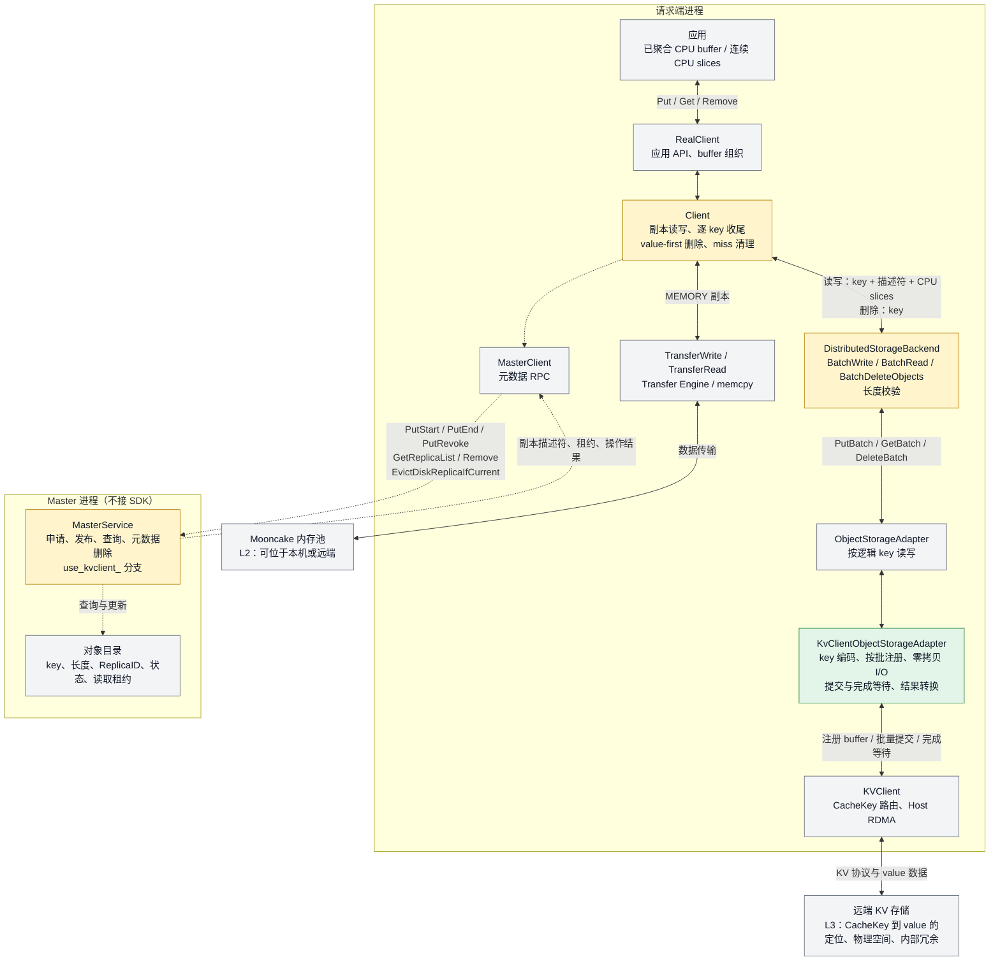

**分层职责**：

| 层 | 职责 | 本方案改动 |
| --- | --- | --- |
| `Client` | 副本编排、逐 key 收尾、删除路由、miss 清理 | 删除顺序改 value-first；miss 清理门控放宽 |
| `DistributedStorageBackend` | slices → 对象请求转换、长度校验 | 新增 `UsesKvClient()` 判断；**仅 KVClient 子分支**的读路径不做多切片 staging，校验补齐容量后把调用方 buffer 直传适配器（oss / s3 / kvcs-lowlevel 共用分支保持原样） |
| `ObjectStorageAdapter` | 对象存储统一契约 | **零改动**（接口不变） |
| `KvClientObjectStorageAdapter` | KVClient 后端实现：key 编码、按批注册、零拷贝 I/O、提交与完成等待 | **新增**；注册与 I/O 都在适配器内完成，每 batch 注册一次（§3.2.2） |

### 2.1.2 Client 侧类图

黄色表示修改现有类，绿色表示新增类，灰色表示复用接口或数据结构。类图列出相关成员，参数和返回类型作了简化；新增方法使用设计名称。

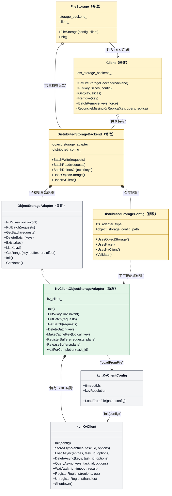

| 类或函数 | 接口与改动说明 |
| --- | --- |
| `DistributedStorageConfig` | `UsesObjectStorage()` 列表加入 `"kvclient"`；新增 `UsesKvClient()`，与 `UsesKvcs()` 平级；`Validate()` 增加 KVClient 专属分支 |
| `CreateStorageBackend(config)` | 修改现有工厂函数，在 distributed 分支新增 `UsesKvClient()` case，转调厂商无关的 `CreateKvClientObjectStorageAdapter()` |
| `FileStorage` | 修改构造时的 DFS 启用判断，将 KVClient 后端注入 Client；沿用现有初始化入口 |
| `Client` | `ReconcileMissingKvcsReplica()` 推广为图中的 `ReconcileMissingKvReplica()`；**内存注册不经过 Client** |
| `DistributedStorageBackend` | 新增 `UsesKvClient()` 判断；**读写分支透传调用方 buffer**（仅 KVClient 子分支的读路径去掉多切片 staging，校验 `capacity >= AlignUp(N,512)`；oss / s3 / kvcs-lowlevel 分支不变）；注册在适配器内按批完成，不经后端 |
| `ObjectStorageAdapter` | **零改动**。同步契约（payload 须在返回前保持有效）是零拷贝路径成立的前提 |
| `KvClientObjectStorageAdapter` | **新增**。实现 `ObjectStorageAdapter`：`MakeCacheKey`、`RegisterBuffers` / `ReleaseBuffers`、`waitForCompletion`；数据面见 §3.2.3 |
| `kv::KvClient` | **SDK 不改**。提交面只用 `StoreAsync` / `LoadAsync` / `DeleteAsync` / `QueryAsync`，另用 `Wait` / `RegisterRegions` / `UnregisterRegions` 完成等待与注册——SDK 不暴露 `Batch*Async`；`StoreAsync` / `LoadAsync` 按 `entries.size() > 1 \|\| useBatchIoForSingleKey`（默认 true，故单条也走 `BATCH_*`）内部选择 opcode，适配器无需关心。四个方法均带 `const kv::IoOptions& options = {}`；本方案不填 `kvns`、不用 `prerequisite`（见 §3.2.3、§5） |

### 2.1.3 Master 侧类图

Master 在现有 `ObjectMetadata` 和 `Replica` 上管理 KVClient 的逻辑 DFS 副本。`PutStart` 创建描述符，`PutEnd` 发布副本，查询返回可读副本，Remove 和明确 miss 清理更新对象目录。Master **不接 SDK**，不创建 driver，也不建 capacity provider。

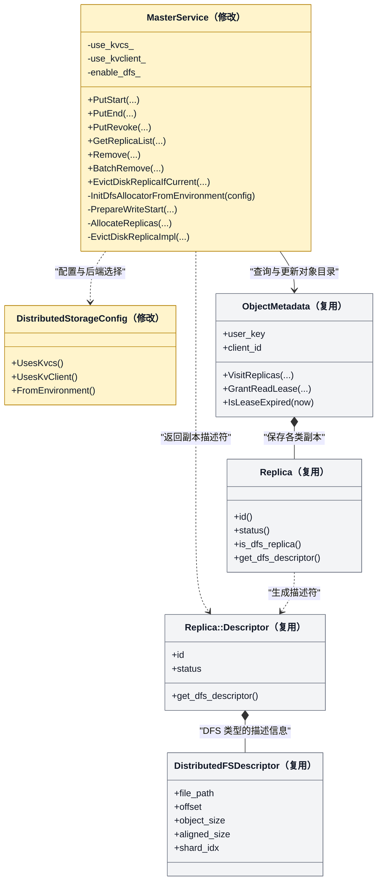

Master 查询自身对象目录，Client 根据返回的描述符经 `DistributedStorageBackend` / `KvClientObjectStorageAdapter` 访问后端。存储返回明确 miss 时，由 Client 请求 `EvictDiskReplicaIfCurrent` 条件清理。

| 类 | 改动与职责 |
| --- | --- |
| `MasterService` | 新增私有 `use_kvclient_`（与 `use_kvcs_` 平级）。改动 ：`enable_dfs_` 判定、初始化新增分支、descriptor 铸造、`PrepareWriteStart` 门与 N 上限校验 |
| `DistributedStorageConfig` | 解析 KVClient 配置，提供与 `UsesKvcs()` 平级的能力判断 |
| `ObjectMetadata` / `Replica` | 保存 key、写入 Client、副本身份、状态和读取租约，沿用既有元数据持久化方式 |
| `Replica::Descriptor` / `DistributedFSDescriptor` | 向 Client 返回对象长度、ReplicaID 和状态。KVClient 模式下 `file_path` 为空、`offset` 为 0、`shard_idx` 为 -1，`object_size = N`、`aligned_size = AlignUp(N, 512)` |


## 2.2 业务交互流程

### 2.2.1 写入流程

下图以新 key 的 Put 为例，按申请、数据写入和提交顺序展开。Master 的申请与收尾分别绘制，元数据 RPC 经 `MasterClient` 发送，数据由请求端访问内存池和远端存储。

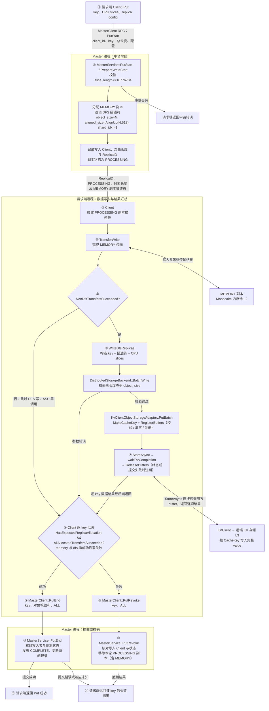

**关键判定**（两副本硬逻辑裁决，零代码改动）：`DetermineReplicaWriteMode` 在 `dfs > 0` 时返回 `RELIABLE_MULTI_REPLICA`，故 `DetermineFinalizeDecision` 要求 `HasExpectedReplicaAllocation` 与 `AllAllocatedTransfersSucceeded` 同时成立——memory 与 dfs **全部成功、零失败且分配数量符合配置**，否则 `PutRevoke(ALL)`。

PutEnd 响应未知时，Client 返回提交错误；后续通过 Master 查询或符合条件的重复提交确认发布状态。

### 2.2.2 读取流程（S1 / S5）

下图展开完整对象 Get 选中 DFS 副本后的数据路径，Master 按查询阶段和 miss 清理阶段分别绘制。内存副本淘汰后，Master 仍保留已发布的 DFS 记录，读取 Client 按相同流程访问 L3。

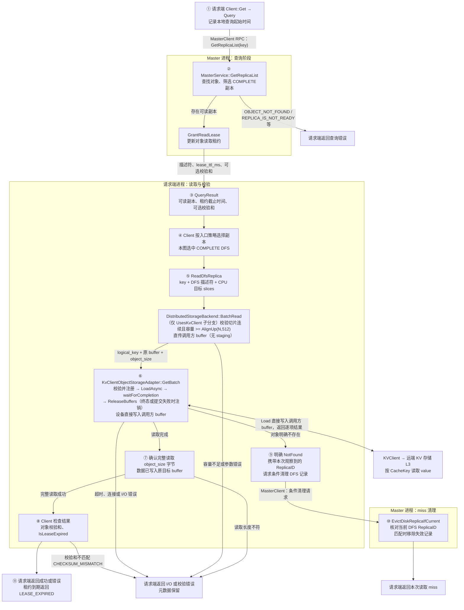


普通 `Client::Query` 使用本地查询起始时间加 `lease_ttl_ms` 计算租约截止时间，完整对象 Get 在读取结束后检查有效期。

### 2.2.3 删除流程（S3，value-first）

删除顺序与 KVCS 相反：Client 先调用 KVClient 删除 value，再对删除成功的 key 请求 Master 移除对象元数据。


**顺序理由**：KVClient 的三条孤儿回收通道全断，metadata-first 的孤儿是**永久且无界**的。

**中间态自愈**：value 已删、元数据尚在 → 读取返回 `NOT_FOUND` → `ReconcileMissingKvReplica` → `EvictDiskReplicaIfCurrent` 按 ReplicaID 条件清理。**value-first 删除依赖 miss 清理同时落地**，否则中间态无人清理。

**失败态可安全重试**：value 删除失败的 key **不进入**元数据删除集合，故 value 与元数据同时保留。这是 value-first 相对 metadata-first 的核心优势。

### 2.2.4 Upsert 流程（S4）

Upsert 使用 `UpsertStart / UpsertEnd / UpsertRevoke` 管理本次更新。Master 按现有状态机处理对象可见性，Client 通过同一适配器写入新 value；内存与 DFS 的结果按 key 汇总，处理方式与 Put 一致。

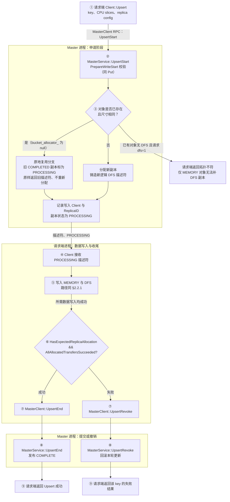

 **仅 MEMORY 的对象无法经 Upsert 补 DFS 副本**，需先 Remove 再 Put。

## 2.3 运行设计

本节按阶段展开适配器内部的时序。各阶段的判定依据与代码位置见 §3 的 shard 设计。

### 2.3.1 初始化阶段

初始化在 `CreateStorageBackend` 工厂内创建适配器，随后由后端 `Init()` 触发 SDK 连接。**`Init` 不注册内存**：buffer 在每个 batch 内由适配器注册。

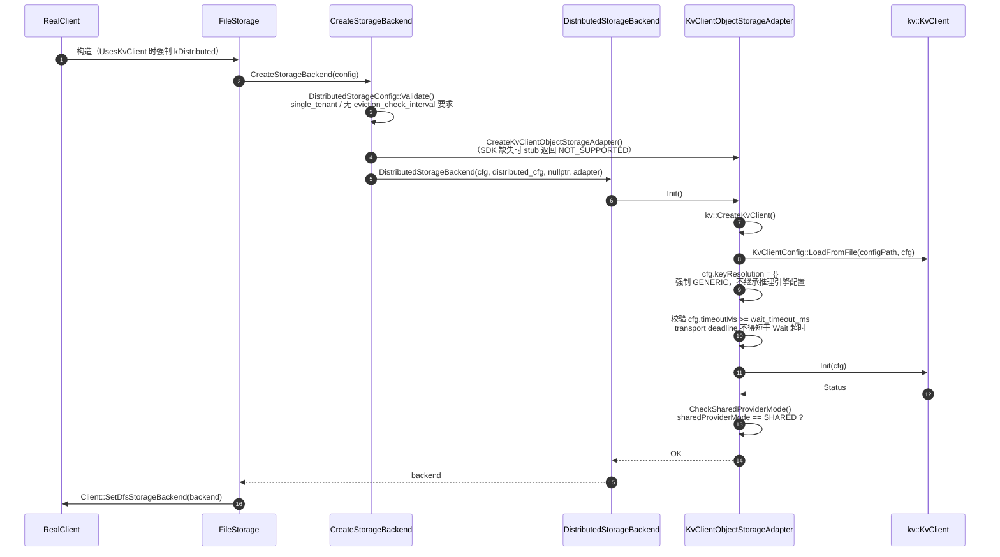

**注册按批进行**：`PutBatch` / `GetBatch` 先把本批涉及的 buffer 去重，再一次 `RegisterRegions`；`Wait` 返回终态（或提交被拒）后一次 `UnregisterRegions`。没有跨批注册表，也不要求应用调用额外的注册 API（§3.2.2）。

### 2.3.2 写入阶段

写路径只有一条：`RegisterBuffers` 校验长度、连续性与 512B 对齐、清零尾部 `[N, wire_len)`，并一次注册本批 buffer、回填 handle，一次 `StoreAsync` 提交整批（SDK 内部按 `batchStoreIoNum`（默认 110）在对象边界切分 transport 子批），再用 `waitForCompletion` 映射逐条结果，终态后注销本批注册。不满足契约的请求直接返回错误，不回退。

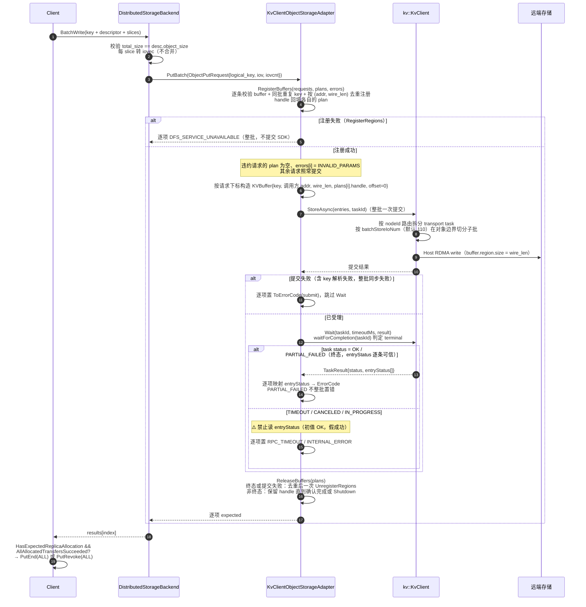

### 2.3.3 读取阶段

读路径与写路径对称：`RegisterBuffers` 校验并注册调用方 buffer 后，设备直接把 `wire_len` 字节写入其中；调用方只消费前 N 字节。明确 `NOT_FOUND` 触发 miss 清理，超时**不**触发清理。

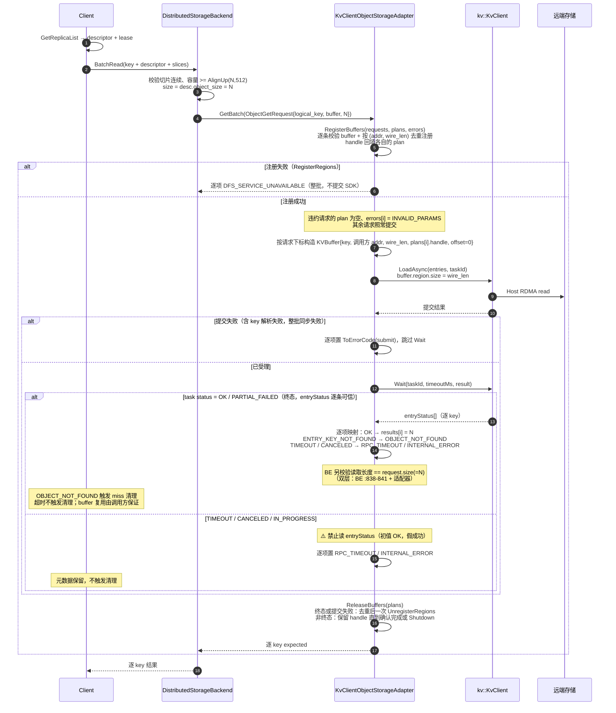

### 2.3.4 删除阶段

删除只传 key、不传 buffer，因此不涉及注册与 buffer 处置。value 删除成功（含幂等 `NOT_FOUND`）的 key 才进入元数据删除集合；失败项两者同时保留，可安全重试。

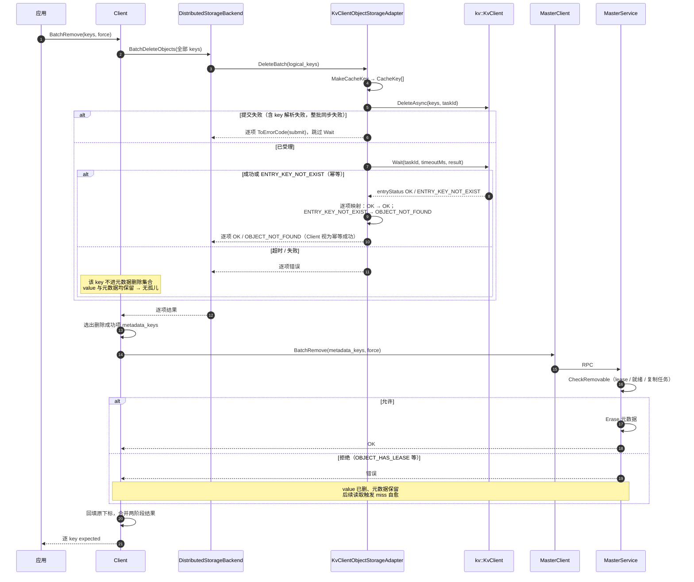

### 2.3.5 miss 清理阶段

清理是条件性的：Client 携带本次读取**观察到**的 ReplicaID，Master 在 key 锁内核对，只有仍为当前记录时才移除。读到 R1 而目录已是 R2 时返回不匹配，R2 原样保留。


### 2.3.6 关闭阶段

关闭逻辑在析构函数内完成，没有独立的 `Shutdown()` 方法：适配器停止接受新提交后调用 SDK 的 `Shutdown()`，由 SDK 停止受理请求并排空 pending task。终态或提交失败的 batch 已在 `Wait` 后注销；非终态保留的 handle 随 `Shutdown()` 一并释放。

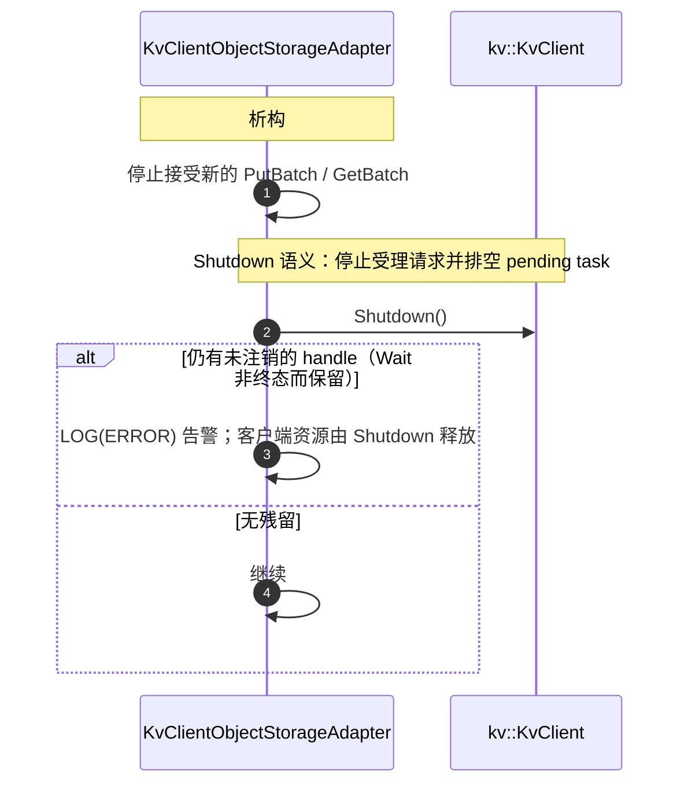

**说明**：终态或提交失败的 batch 在 `Wait` 后已注销；非终态的 handle 保留到 `Shutdown()`，适配器不做跨批登记。

## 2.4 SFMEA 分析

只列会改变设计或需要专门用例的失效模式；等价分支合并为一条，纯既有语义、范围外与不可达项已删除。每条只占一个编号。

| 编号 | 故障模式 | 故障影响 | 容错措施 | 故障注入 / 备注 |
| --- | --- | --- | --- | --- |
| SFMEA-01 | logical key XXH64 碰撞：两个不同 key 映射到同一 CacheKey | **数据损坏**：后写覆盖先写，读到错 value。默认（`MOONCAKE_STORE_CHECKSUM` 关闭）无从发现；开启后 Get 端以 `CHECKSUM_MISMATCH` 暴露，但 Put 侧仍是覆盖写 | 不做 fingerprint（默许碰撞）；可复用既有 object checksum 作为检测手段；部署须限定 key 数量级 | 概率 ≈ n²/2^65：10^8 key → 2.7e-4 |
| SFMEA-02 | 非法 key / 长度：空 key、同批重复、N == 0、N > 16,776,704、全零 CacheKey | 编码失败；协议层拒绝，预发送失败会 **abort 整个 transport task** | `MakeCacheKey` 拒空并把全零映射为非零常量；写侧拒绝同批重复；逐请求预检 `n > 0` 且 `wire_len <= max_object_bytes`；Master `PrepareWriteStart` 第一道校验 | 不能指望「只失败越界那条」 |
| SFMEA-03 | 写路径未按 `AlignUp(N,512)` 补零或未清零尾部 | 提交被拒；调用方 buffer 尾部的残留字节被当成 padding 发到存储侧 | `wire_len = AlignUp(N,512)`；`RegisterBuffers` 清零尾部 `[N, wire_len)` | 写 513 字节对象，断言尾部全 0 |
| SFMEA-04 | 初始化门禁失败：`sharedProviderMode != SHARED`、SDK `Init` 失败、transport deadline < `Wait` 超时 | 适配器不可用；或健康但较慢的写被判 `PARTIAL_FAILED` + `TIMEOUT` | `CheckSharedProviderMode` 硬门禁；`Init` 失败即失败；校验 `cfg.timeoutMs >= wait_timeout_ms` | 全部在 `Init` 阶段失败 |
| SFMEA-05 | 提交的 handle 未被本批注册覆盖（取自他批、已注销或拼错） | 到 `Wait` 才以 `BUFFER_NOT_REGISTERED` 暴露且**连坐整 task** | handle 由本批 `RegisterBuffers` 直接回填进 `BufferPlan`，构造 `KVBuffer` 时按下标取；`mrKey` 由 SDK 按 handle 解析，适配器留 `std::nullopt` | 注册只在批内产生，生命周期与 batch 相同 |
| SFMEA-06 | `Wait` 超时 / 取消：调用方 buffer 可能被迟到写覆盖，且 `entryStatus` 仍停留在初值 `OK` | 读到错数据；或把未落盘的数据报成功 | 非终态**不读** `entryStatus`，整批置错；**不注销**本批 handle（保留到 `Shutdown()`）；**buffer 复用由调用方保证**（依赖 T-19） | SDK 无面向业务的中止能力 |
| SFMEA-07 | task 级 `PARTIAL_FAILED`、派发后 `CANCELED`、或路由失败 | 部分 key 成功、部分失败；`CANCELED` 时设备可能已访问调用方 buffer | 逐项映射 `entryStatus` 并按 `originalIndices` 回填；适配器不持有 buffer，无需处置 | entryStatus 与输入严格一一对应 |
| SFMEA-08 | 设备侧资源 / 连接错误：`CQE_OUT_OF_CREATE_SIZE`、`CONNECTION_ERROR`、存储空间耗尽 | 写或读失败；无容量查询与自动回收 | 分别映射为 `NO_AVAILABLE_HANDLE` / `DFS_SERVICE_UNAVAILABLE`；Master 不建 capacity provider | 容量管理留待 SDK |
| SFMEA-09 | `CQE_KEY_NOT_EXIST` / `ENTRY_KEY_NOT_FOUND`（读时） | 对象在存储侧不存在 | 映射为 `OBJECT_NOT_FOUND` → 触发 `ReconcileMissingKvReplica` 条件清理 | **必须与超时严格区分**：超时**不**触发清理 |
| SFMEA-10 | 删除中间态：value 已删而元数据残留（`BatchRemove` 失败 / `CheckRemovable` 拒绝 / Client 崩溃），或 value 删除失败 | 已发布对象不可读；或两者同时保留 | 失败项不进元数据删除集合 → 可安全重试；残留由读取 miss 自愈 | value-first 依赖 miss 清理，二者必须同时落地 |
| SFMEA-11 | 迟到 Delete 误删新 value（同 key 重写） | 旧删除请求命中新写入的 value | 无专门机制；调用方须串行组织同 key 的删除 / 重建 / 更新 | 调用方契约，非本方案引入 |
| SFMEA-12 | `RemoveAll` / `RemoveByRegex` 被调用 | 若只删元数据不删 value → **一次性泄漏整个 L3** | 门控放宽到 KVClient，返回 `NOT_SUPPORTED` 且**不删元数据** | value-first 删除的连带必改项 |
| SFMEA-13 | 不支持的配置：Master 重启无恢复、误配 `enable_oplog=true`、三副本 `memory + nof + ASU` | 目录全丢且不可恢复；或 nof 变为必需导致整 Put 失败 | 恢复门保持 `use_kvcs_` only，误配即启动期 `LOG(FATAL)`；`PrepareWriteStart` 拒绝 `nof_replica_num > 0` | 把运行期失效提前到启动期 |
| SFMEA-14 | miss 清理 CAS 不匹配（读到 R1，目录已是 R2） | 无 | `EvictDiskReplicaIfCurrent` 返回 false，R2 原样保留 | 既有 CAS 语义，仅需放宽白名单 |
| SFMEA-15 | 析构时仍有 in-flight batch 或非终态保留的 handle | 注销注册会让设备访问已注销内存 | 非终态不注销，保留 handle；析构只调用 SDK `Shutdown()`（停止受理并排空 pending task），由它释放客户端资源 | 终态 batch 已在 `Wait` 后注销 |
| SFMEA-16 | 读回长度 != `object_size` | 数据不完整 | 双层校验：适配器内 + `DistributedStorageBackend:838-841`，返回 `FILE_READ_FAIL` | `GetBatch` 必须返回 **N** 而非 `wire_len` |
| SFMEA-17 | 启用 string key 路径的连带风险：`Resolve()` 提交阶段失败，或配置写了 `inference.engine=vllm_ascend` | 整批同步失败；或 `@...@<数字>` key 被重解释为分层 key，读写落到错误的 key/offset | 本方案只传 `FromBytes`，并在 `Init` 前把 `keyResolution` 复位为 `GENERIC` | 换用 `FromEngineKey` 前必须保留这两道 |
| SFMEA-18 | 批注册失败、`wire_len` 超上限、iov 不连续或未对齐 | 整批请求失败（注册失败时未触达设备） | `RegisterBuffers` 失败 → 全部 `DFS_SERVICE_UNAVAILABLE`；单条越界/不对齐只拒绝该条 | 调用方需保证单段连续、512B 对齐与补齐容量 |

## 2.5 可定位设计

### 2.5.1 统一关联字段

所有 driver 与适配器日志必须携带以下字段，使一次 I/O 可跨层串联：

| 字段 | 来源 | 用途 |
| --- | --- | --- |
| `logical_key` | 应用 | 业务侧关联（可能含敏感信息，按日志级别裁剪） |
| `cache_key` | `MakeCacheKey` 结果（内部调用 `EncodeBinaryKey`）的 16 位 hex | 碰撞排查的**主要**手段（默认配置下唯一；开启 object checksum 后可被 `CHECKSUM_MISMATCH` 直接发现）：两个不同 logical_key 出现同一 cache_key 即为碰撞 |
| `object_size` | descriptor | 对齐/上限问题定位 |
| `task_id` | SDK | 跨 client/transport 层关联 SDK 内部日志 |
| `replica_id` | descriptor | miss 清理 CAS 排查 |
| `buffer_addr` | 适配器 | 定位使用的调用方 buffer |
| `wire_len` | 适配器 | 线格式长度；与 `object_size` 的差值即补零量 |
| `batch_index` / `original_index` | 适配器 | 批量结果错位排查 |

### 2.5.2 日志与指标

| 级别 | 内容 |
| --- | --- |
| `ERROR` | Wait 超时（含 `task_id`、`op`、`task_status`、`buffer_addr`、**本批 buffer 数**）；`RegisterRegions` / `UnregisterRegions` 失败；非终态保留 handle（`kvclient_batch_release_skipped`）；析构时仍有在途 batch；entryStatus 映射到未知 SDK 码 |
| `WARNING` | `CheckSharedProviderMode` 通过但 provider 类型非预期；单项 entryStatus 失败（非整 task）；请求因 `N == 0` 或 `wire_len` 超上限被拒 |
| `INFO` | `Init` 成功（含 SDK 版本、`sharedProviderMode`、适配器上限 `max_object_bytes`，默认 `kKvClientMaxValueBytes`）；析构完成 |
| `VLOG(1)` | 每次 `PutBatch` / `GetBatch` / `DeleteBatch` 的 key 数、总字节、注册 buffer 数、耗时分解 |
| `VLOG(2)` | 逐 entry 的 `logical_key` → `cache_key`、`buffer_addr`、handle |

| 指标 | 类型 | 说明 |
| --- | --- | --- |
| `kvclient_batch_registrations_total` | counter | 按批 `RegisterRegions` 次数 |
| `kvclient_batch_registered_bytes_total` | counter | 按批注册的累计字节数 |

### 2.5.3 定位手册

| 症状 | 排查路径 |
| --- | --- |
| Init 失败 `DFS_SERVICE_UNAVAILABLE` | 查 `sharedProviderMode` 是否为 SHARED（SFMEA-04）；查 view service 可达性 |
| Init 失败 `PARTIAL_FAILED` | 查 SDK `Init` 日志；AICPU provider 下确认 SHARED 模式 |
| Put 全部失败但 SDK 日志无异常 | 查是否读了超时后的 `entryStatus`（SFMEA-06）；查 `Wait` 超时日志里的 `task_id` 与 `task_status`（§2.5.2） |
| 读到错误数据，无报错 | **优先怀疑 key 碰撞**（SFMEA-01）：grep VLOG(2) 日志，比对两个 logical_key 是否得到同一 `cache_key` |
| 读取恒返回 `FILE_READ_FAIL`，但数据其实写对了 | 查 `GetBatch` 是否误返回 `aligned_size` 而非 N（§3.4）——后端比对的是 `desc.object_size` |
| 读到的对象尾部有脏数据 | 查写路径是否漏了 `memset` 补零，或 `GetBatch` 是否误返回了 `wire_len` |
| 请求返回 `NO_AVAILABLE_HANDLE` | 设备侧空间不足（`CQE_OUT_OF_CREATE_SIZE`）或资源忙，见 SFMEA-08 |
| 请求返回 `INVALID_PARAMS` | `n == 0`、`AlignUp(N,512) > max_object_bytes`、iov 不连续、起点未 512B 对齐，或写侧同批重复 key（§3.2.3） |
| 请求返回 `DFS_SERVICE_UNAVAILABLE` | 本批 `RegisterRegions` 失败；查 SDK 日志与 provider 状态 |
| 每批延迟偏高 | 批内 buffer 越分散，每批注册开销越大；查批大小与 buffer 连续性 |
| Remove 返回成功但存储侧仍有 value | 不可能——value-first 下成功即已删。若出现，查是否走了 `RemoveAll`/`RemoveByRegex`（SFMEA-12） |
| Remove 返回错误且对象变为不可读 | 已知窗口（SFMEA-10）：value 已删但 `CheckRemovable` 拒绝。等待后续读取触发 miss 自愈 |
| Get 持续 `OBJECT_NOT_FOUND` 但目录有记录 | 查 `EvictDiskReplicaIfCurrent` 是否返回 `INVALID_PARAMS`——说明 `use_kvclient_` 白名单漏改（§3.5） |
| 对象大于 4 MiB 写入失败 | 查 `kKvClientMaxValueBytes` 是否被误配；KVClient 上限是 16,776,704 而非 KVCS 的 4 MiB |
| N 在 16,776,705 ~ 16,777,200 之间的对象写入失败 | 预期行为。该区间能通过 Mooncake 的 `kMaxSliceSize` 但超 SDK 线格式上限，由 `PrepareWriteStart` 拒绝（§3.5） |
| Master 重启后 L3 全部读不到 | 预期行为（不支持恢复裁决，SFMEA-13）。目录不可恢复，value 不可枚举 |

---

# 3 shard 设计描述

## 3.1 shard-1：key 编码（`kvclient_key_codec`）

**职责**：logical key → 8 字节 `kv::BinaryKey` 的确定性映射，并包装成 SDK 的 `kv::CacheKey`。

**文件**：`mooncake-store/include/storage/distributed/kvclient/kvclient_key_codec.h`（header-only）

```cpp
#pragma once

#include <cstdint>
#include <cstring>
#include <string>
#include <string_view>

#include <xxhash.h>

#include "kv_types.h"

namespace mooncake::kvclient {

// Fixed seed. The mapping must be a pure function of the logical key so that
// any client, at any time, derives the same CacheKey. Do not mix in epoch,
// process id, or random salt: that would break cross-client reads.
// Deliberately the same value as the SDK's HASH_SEED_VALUE
// (kv_semantics/src/client/key_resolver.h). We never hand the SDK a string key,
// so this does not change the wire identity today; sharing one constant keeps a
// future switch to FromEngineKey a no-op and makes cache_key directly
// comparable with the UCM/ASUStore side.
inline constexpr XXH64_hash_t kCacheKeySeed = 5381ULL;

// Collisions are accepted by design (no fingerprint validation). Two distinct
// logical keys mapping to the same CacheKey silently overwrite each other.
// Probability is ~n^2/2^65; see SFMEA-01 for the deployment key-count bound.
inline kv::BinaryKey EncodeBinaryKey(std::string_view logical_key) {
    XXH64_hash_t hash =
        XXH64(logical_key.data(), logical_key.size(), kCacheKeySeed);
    // The protocol rejects an all-zero key (kv_protocol.cc IsCacheKeyAllZero)
    // and that rejection aborts the whole transport task, so the 2^-64 case
    // is mapped away instead of being left as a latent batch poisoner.
    if (hash == 0) hash = kCacheKeySeed;
    kv::BinaryKey raw{};
    std::memcpy(raw.data(), &hash, sizeof(hash));
    return raw;
}

// 16 hex chars. This is the only observable handle for collision diagnosis,
// so it must be logged unconditionally at VLOG(2). It takes BinaryKey rather
// than CacheKey because CacheKeyView/CacheKeyToHex live in the SDK's private
// src/trans/trans_types.h and are not available to external consumers.
inline std::string CacheKeyToLogString(const kv::BinaryKey& key) {
    static constexpr char kHex[] = "0123456789abcdef";
    std::string text;
    text.reserve(key.size() * 2);
    for (auto byte : key) {
        const auto value =
            static_cast<unsigned char>(std::to_integer<unsigned char>(byte));
        text.push_back(kHex[value >> 4]);
        text.push_back(kHex[value & 0x0F]);
    }
    return text;
}

}  // namespace mooncake::kvclient
```

**设计说明**：

- **seed 选择**：取 `5381`，与 SDK 的 `HASH_SEED_VALUE`（`kv_semantics/src/client/key_resolver.h`）同值。本方案不使用 SDK 的 string key 解析，故 seed 不影响今天的 wire 身份；对齐它只是为了 (a) 将来若改用 `FromEngineKey`，wire key 逐字节不变，(b) 与 UCM/ASUStore 侧用同一函数校验时 `cache_key` 可直接比对。借鉴 `nvme_kv/key_codec.cpp:44-45` 的 XXH64 用法，但那里用双 seed 产出 16 字节（`low`/`high`）；本方案只需 8 字节，单 seed 即可。
- **纯函数约束**：映射不得混入 epoch / 进程 id / 随机种子。这既是跨 Client 读取的前提，也是不支持恢复裁决下唯一需要保证的稳定性。
- **SDK 侧 string key 哈希为预留能力，本方案不使用**（KVClient `#1641` 起 `kv::CacheKey::FromEngineKey(std::string)` 会在 `SubmitAsync` 内用 XXH64(seed=5381) 自行哈希）。
- **全零 key 必须映射掉**：协议层对全零 key 直接 `INVALID_ARGUMENT`，而预发送失败会 abort 整个 transport task（SFMEA-02 同一机制）。XXH64 输出全零的概率是 2^-64，但代价是一整批被毒化，不值得留窗口。

## 3.2 shard-2：适配器（`kvclient_object_storage_adapter`）

**职责**：实现 `ObjectStorageAdapter`，承载 key 编码、按批注册调用方 buffer、零拷贝 I/O、提交/等待与结果映射。与 `KvcsObjectStorageAdapter` 平级，互不依赖。

**文件**：`mooncake-store/include/storage/distributed/kvclient/kvclient_object_storage_adapter.h`、`src/storage/distributed/kvclient/kvclient_object_storage_adapter.cpp`

**按批注册**：每个 batch 开始时，把该批涉及的调用方 buffer 一次性 `RegisterRegions`；`Wait` 返回终态（或提交被拒）后一次性 `UnregisterRegions`，非终态保留 handle 至 `Shutdown()`。注册只在批内有效，不跨批保留，适配器不持有常驻注册表。

### 3.2.1 类定义

```cpp
#pragma once

#include <cstdint>
#include <memory>
#include <optional>
#include <span>
#include <string>
#include <vector>

#include "kv_client.h"
#include "kv_types.h"
#include "storage/distributed/object_storage_adapter.h"

namespace mooncake {

inline constexpr char kKvClientAdapterName[] = "kvclient";

// Single-entry wire limit: SQE length is 24-bit and must be 512-aligned.
inline constexpr uint64_t kKvClientMaxValueBytes = 16'776'704;

struct KvClientAdapterConfig {
    std::string config_path;                            // SDK client config
    uint64_t max_object_bytes = kKvClientMaxValueBytes; // per-object cap
    uint64_t wait_timeout_ms = 30'000;
};

class KvClientObjectStorageAdapter final : public ObjectStorageAdapter {
   public:
    explicit KvClientObjectStorageAdapter(KvClientAdapterConfig config = {});
    // Test seam: inject an SDK client (real or fake) instead of creating one in
    // Init(). Mirrors KvcsObjectStorageAdapter(std::unique_ptr<KvcsDriver>).
    KvClientObjectStorageAdapter(KvClientAdapterConfig config,
                                 std::unique_ptr<kv::KvClient> client);
    ~KvClientObjectStorageAdapter() override;

    tl::expected<void, ErrorCode> Put(const std::string& logical_key,
                                      std::span<const char> data) override;
    tl::expected<void, ErrorCode> PutV(const std::string& logical_key,
                                       const iovec* iov, int iovcnt) override;
    std::vector<tl::expected<void, ErrorCode>> PutBatch(
        const std::vector<ObjectPutRequest>& requests) override;
    tl::expected<size_t, ErrorCode> Get(const std::string& logical_key,
                                        void* buf, size_t len) override;
    std::vector<tl::expected<size_t, ErrorCode>> GetBatch(
        const std::vector<ObjectGetRequest>& requests) override;
    tl::expected<bool, ErrorCode> Exists(
        const std::string& logical_key) override;
    tl::expected<void, ErrorCode> Delete(const std::string& logical_key) override;
    ObjectStorageIoResults DeleteBatch(
        std::span<const std::string> logical_keys) override;
    tl::expected<std::vector<KeyInfo>, ErrorCode> ListKeys() override;

    tl::expected<void, ErrorCode> Init() override;
    const char* GetName() const override { return kKvClientAdapterName; }

   private:
    // One request's geometry, computed before any registration happens.
    struct BufferPlan {
        uintptr_t addr = 0;
        size_t n = 0;
        size_t wire_len = 0;
        // Filled by RegisterBuffers; buffers sharing (addr, wire_len) share it.
        kv::MRHandle handle = kv::kInvalidMRHandle;
    };

    // Delegates to kvclient_key_codec.h's EncodeBinaryKey.
    kv::BinaryKey MakeCacheKey(std::string_view logical_key) const;
    // Validates each request's buffer (length, contiguity, 512B alignment,
    // write-tail zeroing), registers the distinct (addr, wire_len) regions with
    // one RegisterRegions call, and returns one plan per request. A rejected
    // request leaves plans[i] empty and its reason in errors[i]; only a
    // registration failure makes the call itself fail. The two overloads share
    // one implementation and differ only in how the buffer is extracted.
    tl::expected<void, ErrorCode> RegisterBuffers(
        std::span<const ObjectPutRequest> requests,
        std::vector<std::optional<BufferPlan>>& plans,
        std::span<ErrorCode> errors);
    tl::expected<void, ErrorCode> RegisterBuffers(
        std::span<const ObjectGetRequest> requests,
        std::vector<std::optional<BufferPlan>>& plans,
        std::span<ErrorCode> errors);
    // Unregisters the distinct handles carried by this batch's plans.
    void ReleaseBuffers(std::span<const std::optional<BufferPlan>> plans);

    // Waits for a submitted task. When the task is terminal, `entryStatus` has
    // one Status per input entry. When it is not (TIMEOUT / CANCELED /
    // IN_PROGRESS), `terminal` is false and `entryStatus` is filled with the
    // task-level Status for every entry; callers must not treat it as real
    // per-entry data.
    struct Completion {
        bool terminal = false;
        std::vector<kv::Status> entryStatus;
    };
    Completion waitForCompletion(kv::TaskId task_id);
    static ErrorCode ToErrorCode(const kv::Status& status);
    bool CheckSharedProviderMode(const kv::KvClientConfig& sdk_config) const;

    KvClientAdapterConfig config_;
    std::unique_ptr<kv::KvClient> kv_client_;
    bool initialized_ = false;
};

}  // namespace mooncake
```

### 3.2.2 按批校验、注册与释放

`RegisterBuffers` 是唯一的批级入口：校验每个请求的 buffer、清零写尾部、按 `(addr, wire_len)` 去重注册、回填 handle。校验不通过的请求只影响自己（`plans[i]` 为空、`errors[i]` 给出原因），不进入本批注册与提交。

```cpp
namespace {
// 单请求几何校验 + 写侧补零；文件内辅助，不属于适配器接口。
std::optional<BufferPlan> MakePlan(const iovec* iov, int iovcnt,
                                   size_t object_size, bool is_store,
                                   uint64_t max_object_bytes,
                                   ErrorCode& error) {
    if (iov == nullptr || iovcnt <= 0) {
        error = ErrorCode::INVALID_PARAMS;
        return std::nullopt;
    }
    const size_t n = is_store ? SumIov(iov, iovcnt) : object_size;
    if (n == 0) { error = ErrorCode::INVALID_PARAMS; return std::nullopt; }
    const size_t wire_len = AlignUp(n, kv::kAlignmentBytes);
    if (wire_len > max_object_bytes) {
        error = ErrorCode::INVALID_PARAMS;
        return std::nullopt;
    }
    if (!IsContiguous(iov, iovcnt)) {
        error = ErrorCode::INVALID_PARAMS;
        return std::nullopt;
    }
    const auto addr = reinterpret_cast<uintptr_t>(iov[0].iov_base);
    if (addr % kv::kAlignmentBytes != 0) {
        error = ErrorCode::INVALID_PARAMS;
        return std::nullopt;
    }
    if (is_store && wire_len > n) {
        std::memset(reinterpret_cast<char*>(addr) + n, 0, wire_len - n);
    }
    return BufferPlan{addr, n, wire_len};
}
}  // namespace

tl::expected<void, ErrorCode> KvClientObjectStorageAdapter::RegisterBuffers(
    std::span<const ObjectPutRequest> requests,
    std::vector<std::optional<BufferPlan>>& plans,
    std::span<ErrorCode> errors) {
    plans.assign(requests.size(), std::nullopt);
    std::set<kv::BinaryKey> seen_keys;          // 同批重复 key 只受理第一条

    std::vector<kv::MemoryRegion> regions;
    std::vector<size_t> plan_to_region(requests.size(), SIZE_MAX);
    for (size_t i = 0; i < requests.size(); ++i) {
        if (!seen_keys.insert(MakeCacheKey(requests[i].logical_key)).second) {
            errors[i] = ErrorCode::INVALID_PARAMS;
            continue;
        }
        auto plan = MakePlan(requests[i].iov, requests[i].iovcnt,
                             /*object_size=*/0, /*is_store=*/true,
                             config_.max_object_bytes, errors[i]);
        if (!plan) continue;

        size_t region_index = regions.size();
        for (size_t j = 0; j < regions.size(); ++j) {
            if (regions[j].addr == plan->addr &&
                regions[j].size == plan->wire_len) {
                region_index = j;
                break;
            }
        }
        if (region_index == regions.size()) {
            regions.push_back({kv::MemoryType::HOST, plan->addr,
                               plan->wire_len, /*deviceId=*/-1,
                               /*numaNode=*/-1});
        }
        plans[i] = *plan;
        plan_to_region[i] = region_index;
    }
    if (regions.empty()) return {};

    std::vector<kv::RegisteredMemory> out;
    if (!kv_client_->RegisterRegions(regions, out).ok() ||
        out.size() != regions.size()) {
        // The SDK rolls back partial registrations itself.
        return tl::make_unexpected(ErrorCode::DFS_SERVICE_UNAVAILABLE);
    }
    for (size_t i = 0; i < plans.size(); ++i) {
        if (plans[i]) plans[i]->handle = out[plan_to_region[i]].handle;
    }
    return {};
}
```

读重载与写重载同构：把每个 `ObjectGetRequest` 视作单段 `iovec{request.buffer, request.size}`，`object_size = request.size`、`is_store = false`，不做同批重复 key 拒绝（同一 key 可以读多次），其余去重、一次注册、回填 handle 完全相同；实现上抽成同一个文件内模板。

```cpp
void KvClientObjectStorageAdapter::ReleaseBuffers(
    std::span<const std::optional<BufferPlan>> plans) {
    std::vector<kv::MRHandle> unique;
    for (const auto& plan : plans) {
        if (!plan || plan->handle == kv::kInvalidMRHandle) continue;
        if (std::find(unique.begin(), unique.end(), plan->handle) ==
            unique.end()) {
            unique.push_back(plan->handle);
        }
    }
    if (unique.empty()) return;
    if (!kv_client_->UnregisterRegions(unique).ok()) {
        LOG(ERROR) << "action=kvclient_batch_unregister_failed"
                   << ", handles=" << unique.size();
    }
}
```

- **校验与注册同源**：`wire_len` 由同一处计算，注册区间与提交区间不可能不一致；单条违约只拒绝该条，不连坐整批。
- **一次注册**：同一批内相同 `(addr, wire_len)` 只注册一次；handle 回填进各自的 `BufferPlan`，重复 buffer 拿到同一个 handle，构造 `KVBuffer` 时按请求下标取，无需查表。
- **按终态注销**：`Wait` 返回终态（`OK` / `PARTIAL_FAILED`）或提交被拒时，对 plan 中出现的 handle 去重后一次注销。**`TIMEOUT` / `CANCELED` / `IN_PROGRESS` 不注销**：SDK 要求 queued / in-flight task 引用的 handle 保持注册（`kv_client.h:65-68`），此时保留 handle，记 `ERROR`，由后续确认完成或 `Shutdown()` 释放。
- **不跨批保留**：适配器没有常驻注册表；下一批重新注册。代价是每批一次注册开销；非终态残留是唯一例外，且只保留到进程退出。
- **注册失败**：整批请求失败（`DFS_SERVICE_UNAVAILABLE`），不提交 SDK。

### 3.2.3 数据路径

**Batch 流程**（`PutBatch` / `GetBatch` 相同，仅方向不同）。读路径把 requests（`ObjectGetRequest`）交给 `RegisterBuffers` 的读重载；其余步骤相同。

```cpp
// 1) 校验 + 注册：每个请求的 buffer 在这里校验、清零写尾部、去重注册
std::vector<std::optional<BufferPlan>> plans;
std::vector<ErrorCode> errors(requests.size(), ErrorCode::INVALID_PARAMS);
auto registered = RegisterBuffers(requests, plans, errors);  // 读：GetRequest 重载
if (!registered) {
    FillError(results, registered.error());      // 整批注册失败
    return results;
}
for (size_t i = 0; i < plans.size(); ++i) {
    if (!plans[i]) results[i] = tl::make_unexpected(errors[i]);
}
if (std::none_of(plans.begin(), plans.end(),
                 [](const auto& plan) { return plan.has_value(); })) {
    return results;                              // 没有可提交的请求
}

// 2) 按请求下标取 plan 中的 handle，构造 KVBuffer
for (size_t i = 0; i < requests.size(); ++i) {
    if (!plans[i]) continue;
    kv::KVBuffer entry;
    entry.key = kv::CacheKey::FromBytes(MakeCacheKey(requests[i].logical_key));
    entry.buffer.region = {kv::MemoryType::HOST, plans[i]->addr,
                           plans[i]->wire_len, /*deviceId=*/-1, /*numaNode=*/-1};
    entry.buffer.handle = plans[i]->handle;
    entry.offset = 0;
    entry.mrKey = std::nullopt;
    entries.push_back(std::move(entry));
    original_indices.push_back(i);
}

// 3) 提交 + 等待；terminal 表示本批注册可以安全注销
kv::TaskId task_id = kv::kInvalidTaskId;
const auto status = is_store ? kv_client_->StoreAsync(entries, task_id)
                             : kv_client_->LoadAsync(entries, task_id);
bool terminal = !status.ok();          // 提交被拒：未触达设备
if (status.ok()) {
    const auto completion = waitForCompletion(task_id);
    terminal = completion.terminal;
    for (size_t j = 0; j < completion.entryStatus.size(); ++j) {
        const size_t index = original_indices[j];
        const auto& entry_status = completion.entryStatus[j];
        if (!entry_status.ok()) {
            results[index] = tl::make_unexpected(ToErrorCode(entry_status));
        } else if (!terminal) {
            // 非终态时 entryStatus 是 task 级状态填充，绝不当成功采信
            results[index] = tl::make_unexpected(ErrorCode::RPC_TIMEOUT);
        } else if (is_store) {
            results[index] = {};                       // 写成功
        } else {
            results[index] = requests[index].size;     // 读成功返回 N
        }
    }
} else {
    FillError(results, ToErrorCode(status));
}

// 4) 终态或提交被拒才注销；非终态保留 handle（SDK 要求 in-flight task
//    引用的 handle 保持注册，见 kv_client.h）
if (terminal) {
    ReleaseBuffers(plans);
} else {
    LOG(ERROR) << "action=kvclient_batch_release_skipped, task_id=" << task_id;
}
return results;
```

`SumIov` 与 `IsContiguous` 是文件内静态辅助：前者累加 `iov_len`，后者校验 `iov[j].iov_base + iov[j].iov_len == iov[j+1].iov_base`。

**结果处置**：适配器不持有 buffer，也没有跨批状态。所有 entry 状态只做错误映射；超时/取消后 **buffer 是否可复用由调用方保证**（T-19）。注册的释放跟随 task 状态：终态或提交被拒时注销本批 handle；非终态保留 handle，记 `action=kvclient_batch_release_skipped`，由 `Shutdown()` 兜底。

| task / entry 状态 | 动作 |
| --- | --- |
| 提交失败 | 全部置 `ToErrorCode(submit)`，跳过 Wait |
| 终态（`OK` / `PARTIAL_FAILED`） | 逐条映射 `entryStatus`；成功项写 `OK` / 读 `N` |
| `TIMEOUT` / `CANCELED` / `IN_PROGRESS`（task 未终态） | 不读 `entryStatus`，逐条置 `RPC_TIMEOUT` / `INTERNAL_ERROR` |

## 3.3 shard-3：配置（`kvclient_config`）

**环境变量**（沿用 `Environ::ReadOr` 模式，`kvcs_capi_driver.cpp:39-75`）：

| 变量 | 默认 | 说明 |
| --- | --- | --- |
| `MOONCAKE_KVCLIENT_CONFIG` | 无（必填） | SDK client 配置路径 |
| `MOONCAKE_KVCLIENT_MAX_OBJECT_BYTES` | 16,776,704 | 单对象上限，须 512 对齐 |
| `MOONCAKE_KVCLIENT_WAIT_TIMEOUT_MS` | 30000 | `Wait` 超时 |

**校验**（`ReadConfig`）：`config_path` 非空；`max_object_bytes % 512 == 0 && <= 16776704`；`wait_timeout_ms > 0`。

**跨配置校验**（`Init` 内，需先 `LoadFromFile` 才能拿到值）：`sdk_config.timeoutMs >= wait_timeout_ms`。SDK 的 `waitTimeoutMs` 配置键同时写 `defaultWaitTimeoutMs` 与 `timeoutMs`（`config_utils.cc:183-186`），后者成为 transport task 的 deadline（`:273`）；若它小于适配器自己的 `Wait` 超时，健康但较慢的写会在 `Wait` 到期前就被判成 `PARTIAL_FAILED` + 逐条 `TIMEOUT`，故障现象从「超时」变成「设备报错」。不满足即拒绝启动（`INVALID_PARAMS`）。

**不设 `MAX_KEY_SIZE`**：hash 编码后 key 恒为 8 字节，与 logical key 长度无关，该配置无意义（这正是 `KvcsDriver::MaxKeySize()` 不适配 KVClient 的表现之一）。

`DistributedStorageConfig::Validate()` 新增分支（`distributed_storage_config.cpp:63-77` 旁）：

```cpp
if (UsesKvClient()) {
    if (!single_tenant) {
        LOG(ERROR) << "DistributedStorageConfig: KVClient requires "
                      "single_tenant=true";
        return false;
    }
    // No capacity API -> no watermark eviction -> eviction_check_interval is
    // meaningless. Deliberately not required, unlike the KVCS branch.
    return true;
}
```

`UsesObjectStorage()` 与新增谓词（`distributed_storage_config.h:27-31`）：

```cpp
bool UsesObjectStorage() const {
    return fs_adapter_type == "oss" || fs_adapter_type == "s3" ||
           fs_adapter_type == "kvcs-lowlevel" || fs_adapter_type == "kvclient";
}
bool UsesKvcs() const { return fs_adapter_type == "kvcs-lowlevel"; }
bool UsesKvClient() const { return fs_adapter_type == "kvclient"; }
```

## 3.4 shard-4：padding 与长度语义

`object_size = N`，`wire_len = AlignUp(N, 512)` 是唯一的线格式长度（SDK 没有独立的 KV 长度字段，§3.2.3）。**512B 对齐是调用方契约**：对象在调用方 buffer 中占 `wire_len` 字节、起点 512B 对齐。

- **写路径**：适配器清零尾部 `[N, wire_len)`（≤511 字节），设备读满 `wire_len`。
- **读路径**：设备写满 `wire_len` 到调用方 buffer，调用方只消费前 N 字节。
- buffer 在每个 batch 内由适配器注册，`[addr, addr + wire_len)` 必须被本批注册覆盖。

**写路径**：

```cpp
// PutBatch: iov 必须连续、addr 512B 对齐。RegisterBuffers 负责计算
// wire_len、把尾部 [n, wire_len) 清零，并在本批注册该区间。
// 违约时该请求的 plan 为空、errors[i] = INVALID_PARAMS，其余请求照常提交。
```

**读路径**：

```cpp
// GetBatch: ObjectGetRequest{logical_key, buffer, size} 只有一个目标区间。
// RegisterBuffers 把 buffer 视作单段 iovec，wire_len = AlignUp(size,512)，
// 设备直接写入调用方 buffer；成功后 results[i] = request.size。
```

⚠️ **返回值必须是 `n` 而非 `wire_len`**。`DistributedStorageBackend::BatchRead` 会比对 `*object_results[i] != object_requests[i].size`（`:838-841`），而 `request.size` 是 `desc.object_size` = N。返回 `wire_len` 会让每次读取都误报 `FILE_READ_FAIL`。

**`aligned_size` 在读路径不直接使用**：后端传给 `GetBatch` 的 `size` 取 `desc.object_size`（`:817-818`），不取 `aligned_size`。故 `aligned_size` 目前只是元数据记录（供诊断与未来扩展），适配器自行用 `AlignUp(object_size, 512)` 重算线格式长度。

**注册粒度**：每批一次。适配器把该批所有 `(addr, wire_len)` 去重后一次 `RegisterRegions`；同一 buffer 内的多个对象共用一次注册。`wire_len` 超过 `max_object_bytes` 直接拒绝。

**长度校验清单**（三道）：

| 层 | 校验 | 位置 |
| --- | --- | --- |
| Master | `value_length <= 16,776,704` | `PrepareWriteStart`（§3.5） |
| 适配器写 / 读 | `AlignUp(N,512) <= max_object_bytes` | `RegisterBuffers` |
| 适配器读 | 返回长度 == `request.size`（N） | `GetBatch` |

Master 那道必需，因为 `kMaxSliceSize`（16,777,200）比 SDK 上限宽 496 字节，且只在 CACHELIB 分配器下生效（`master_service.cpp:5312-5318`）。

## 3.5 shard-5：Master 集成

**文件**：`master_service.{h,cpp}`

**新增成员**：`bool use_kvclient_ = false;`（与 `use_kvcs_` 平级。谓词平级裁决要求 `UsesKvClient()` 与 `UsesKvcs()` 独立，不支持恢复裁决要求恢复门保持 KVCS-only，故不能合并为一个 flag）。

**改动点**：

| 位置 | 改动 |
| --- | --- |
| `master_service.cpp:847` | `enable_dfs_ = DfsEnablementConfig::FromEnvironment().enabled \|\| dfs_config.UsesKvcs() \|\| dfs_config.UsesKvClient();` |
| `:872` 之前 | 新增 `if (dfs_config.UsesKvClient()) { ... return; }` 分支 |
| `:5114` | `if (use_kvcs_ \|\| use_kvclient_) {` — descriptor 铸造。**KVClient 分支公式与 KVCS 不同**：`object_size = value_length`、`aligned_size = AlignUp(value_length, 512)`、`shard_idx = -1`（KVCS 分支 `:5117-5118` 两者都取 `value_length`，不改） |
| `:5274` | `(!use_kvcs_ && !use_kvclient_ && (!dfs_allocator_ \|\| ...))` |
| `:5248` 旁 | 新增 N 上限校验与三副本拒绝（见下）。**不校验 512 整除**——N 任意是合法输入，对齐由适配器补零承担 |
| `:6462` | `use_kvcs_ \|\| use_kvclient_` |
| `:6481` | `(use_kvcs_ \|\| use_kvclient_) && expected_replica_id != nullptr && ...` |
| **不改** `:3550`、`:3842`、`:4135` | 恢复门保持 `use_kvcs_` only（不支持恢复裁决） |

**`InitDfsAllocatorFromEnvironment` 新增分支**：

```cpp
if (dfs_config.UsesKvClient()) {
    if (enable_oplog_) {
        // SFMEA-13 / §3.5: no metadata recovery for the KVClient backend. The
        // restore gates at :3550/:3842/:4135 stay KVCS-only, so an HA
        // failover would reject every DFS descriptor. Fail at startup with a
        // clear message instead of at recovery time.
        LOG(FATAL) << "KVClient backend does not support metadata recovery; "
                      "enable_oplog must be false";
    }
    use_kvclient_ = true;
    // No EFC target, no capacity provider, no watermark eviction: the SDK has
    // no capacity query API. Master keeps the object directory only.
    LOG(INFO) << "KVClient distributed object storage initialized without DFS "
                 "extent allocator and without capacity provider, config={"
              << dfs_config.FormatStr() << "}";
    return;
}
```

**`PrepareWriteStart` 新增校验**（512 对齐裁决 + 两副本硬逻辑裁决）：

```cpp
// In PrepareWriteStart the length parameter is named slice_length
// (master_service.cpp:5250), not value_length.
if (config.dfs_replica_num > 0 && use_kvclient_) {
    // 512-alignment ruling: the wire format needs a 512B-aligned length, but N
    // itself may be arbitrary -- the adapter zeroes the tail in the caller buffer, it does not
    // reject the object. The bound is on the padded length:
    //     AlignUp(slice_length, 512) <= 16'776'704
    // which is equivalent to slice_length <= 16'776'704 (the limit is itself a
    // multiple of 512). Mooncake's own kMaxSliceSize is 16'777'200, i.e. 496
    // bytes wider, and it is only enforced under the CACHELIB allocator
    // (master_service.cpp:5312-5318), so it will happily admit values that
    // cannot go on the wire.
    if (slice_length > 16'776'704) {
        LOG(ERROR) << "key=" << key << ", slice_length=" << slice_length
                   << ", error=kvclient_value_too_large";
        return tl::make_unexpected(ErrorCode::INVALID_PARAMS);
    }
    // Two-replica ruling: only (memory + ASU) and DFS-only are supported.
    // With dfs > 0 the write mode is RELIABLE_MULTI_REPLICA, which would make
    // a NoF replica silently mandatory as well.
    if (config.nof_replica_num > 0) {
        LOG(ERROR) << "key=" << key << ", error=kvclient_rejects_nof_with_dfs";
        return tl::make_unexpected(ErrorCode::INVALID_PARAMS);
    }
}
```

放在 `PrepareWriteStart` 而非 `AllocateReplicas`，因为 Put 与 Upsert 都过这道门。

⚠️ **上限校验是必需的，不能省略**。`AlignUp(N,512) <= 16776704` 等价于 `N <= 16776704`（上限本身是 512 的倍数），但 Mooncake 自己的 `kMaxSliceSize = 16,777,200` 比它宽 496 字节：

⚠️ **Master 的 slice 校验还只在 CACHELIB 分配器下生效**（`master_service.cpp:5312-5318`），DFS-only 写 + 非 CACHELIB 时那道门根本不开。适配器侧须独立再校验一次。

**descriptor 铸造**：

```cpp
if (use_kvclient_) {
    DistributedFSDescriptor descriptor;
    descriptor.object_size = value_length;                    // N，原始长度
    descriptor.aligned_size = AlignUp(value_length, 512);     // 线格式长度
    descriptor.shard_idx = -1;
    replicas.emplace_back(std::move(descriptor), ReplicaStatus::PROCESSING);
}
```

与 KVCS 分支（`:5117-5118` 两者都取 `value_length`）的差异是本方案唯一需要改公式的地方，且落在 KVClient 专属分支内，**不影响 KVCS**。

`aligned_size` 只需满足 `>= object_size`（`IsDfsDescriptorRangeValid` 的 `:62`），不要求是 `config.alignment`（默认 4096）的倍数——因为对象存储分支在 `:664`/`:790` 提前 return，**完全跳过** `IsDfsDescriptorRangeValid`。故 512 对齐的 `aligned_size` 不会被该校验拒绝。

**Upsert 的门同样要放宽**：逻辑描述符分配只在 `use_kvcs_` 下（`:5090-5100`），`PrepareWriteStart` 同样要求（`:5248-5255`）。漏改则 KVClient 的 Upsert 直接 `DFS_SERVICE_UNAVAILABLE`。

## 3.6 shard-6：Client 集成

**文件**：`client_service.{h,cpp}`

**改动 1：`ReconcileMissingKvcsReplica` → `ReconcileMissingKvReplica`**（miss 清理裁决）

```cpp
void Client::ReconcileMissingKvReplica(
    const std::string& key, const QueryResult& query_result,
    const Replica::Descriptor& replica_descriptor) {
    if (!dfs_storage_backend_ ||
        !(dfs_storage_backend_->UsesKvcs() ||
          dfs_storage_backend_->UsesKvClient()) ||
        !replica_descriptor.is_dfs_replica()) {
        return;
    }
    // ... 其余不变（tenant 校验、EvictDiskReplicaIfCurrent、日志）
}
```

调用点 `:1626`、`:1936` 同步改名，声明 `client_service.h:1069` 同步。触发条件不变：仅 `OBJECT_NOT_FOUND`。

**改动 2：`BatchRemove` 的 KVClient 分支改 value-first**（value-first 删除裁决）

```cpp
std::vector<tl::expected<void, ErrorCode>> Client::BatchRemove(
    const std::vector<ObjectKey>& keys, bool force) {
    if (hot_cache_) hot_cache_->BumpKeyGenerations(keys);

    std::vector<tl::expected<void, ErrorCode>> results(keys.size());
    const bool kvclient =
        dfs_storage_backend_ && dfs_storage_backend_->UsesKvClient();

    std::vector<std::string> metadata_keys;
    std::vector<size_t> metadata_indices;
    metadata_keys.reserve(keys.size());
    metadata_indices.reserve(keys.size());

    if (kvclient) {
        // Value first. The KVClient backend has no orphan reclamation path at
        // all: no capacity API (so no watermark eviction), no key listing, and
        // the Master holds no driver. Deleting metadata first would leak the
        // value permanently, and a retry could never fix it because Remove on
        // a gone object returns OBJECT_NOT_FOUND and is skipped.
        const auto deleted = dfs_storage_backend_->BatchDeleteObjects(keys);
        if (deleted.size() != keys.size()) {
            for (size_t i = 0; i < keys.size(); ++i)
                results[i] = tl::make_unexpected(ErrorCode::INTERNAL_ERROR);
            return results;
        }
        for (size_t i = 0; i < keys.size(); ++i) {
            // OBJECT_NOT_FOUND is idempotent success: the value is already
            // gone, which is the intended end state.
            if (deleted[i] ||
                deleted[i].error() == ErrorCode::OBJECT_NOT_FOUND) {
                metadata_keys.push_back(keys[i]);
                metadata_indices.push_back(i);
            } else {
                // Value and metadata both survive -> safe to retry.
                results[i] = tl::make_unexpected(deleted[i].error());
            }
        }
    } else {
        metadata_keys.assign(keys.begin(), keys.end());
        for (size_t i = 0; i < keys.size(); ++i) metadata_indices.push_back(i);
    }

    if (!metadata_keys.empty()) {
        const auto master_results =
            master_client_.BatchRemove(metadata_keys, force);
        for (size_t j = 0; j < metadata_indices.size(); ++j) {
            const size_t i = metadata_indices[j];
            results[i] = (j < master_results.size())
                             ? master_results[j]
                             : tl::make_unexpected(ErrorCode::RPC_FAIL);
        }
    }

    // Non-KVClient path keeps the existing behavior: KVCS deletes the values
    // of the keys whose metadata removal succeeded.
    if (!kvclient && dfs_storage_backend_ &&
        dfs_storage_backend_->UsesKvcs()) {
        std::vector<std::string> removed_keys;
        std::vector<size_t> removed_indices;
        for (size_t i = 0; i < keys.size(); ++i) {
            if (results[i]) {
                removed_keys.push_back(keys[i]);
                removed_indices.push_back(i);
            }
        }
        if (!removed_keys.empty()) {
            const auto deleted =
                dfs_storage_backend_->BatchDeleteObjects(removed_keys);
            for (size_t j = 0; j < removed_indices.size(); ++j) {
                if (j >= deleted.size()) {
                    results[removed_indices[j]] =
                        tl::make_unexpected(ErrorCode::INTERNAL_ERROR);
                } else if (!deleted[j]) {
                    results[removed_indices[j]] = deleted[j];
                }
            }
        }
    }

    if (hot_cache_ && !metadata_keys.empty())
        hot_cache_->RemoveHotKeys(metadata_keys);
    return results;
}
```

`Remove` 单 key 门控放宽（`:3805`）：`UsesKvcs() || UsesKvClient()`。

**改动 3：`RemoveAll` / `RemoveByRegex` 门控放宽**（SFMEA-12，value-first 删除裁决 连带必改）

```cpp
// :3832 与 :3853
if (dfs_storage_backend_ &&
    (dfs_storage_backend_->UsesKvcs() ||
     dfs_storage_backend_->UsesKvClient()))
    return tl::unexpected(ErrorCode::NOT_SUPPORTED);
```

**必须在删元数据之前返回**，否则一次性泄漏整个 L3。

**改动 4：其余放宽点**

| 位置 | 改动 |
| --- | --- |
| `client_service.cpp:584` | `AttachHostId` 强制 `dfs_replica_num = 1`：`UsesKvcs() \|\| UsesKvClient()` |
| `real_client.cpp:1619-1629` | 创建 `FileStorage` 并强制 `kDistributed` |
| `file_storage.cpp:126` | `enable_dfs` 判断与后端注入 |
| `file_storage_config.cpp:240` | 跳过本地目录校验 |
| `distributed_storage_backend.h:70-71` | 新增 `bool UsesKvClient() const { return UsesObjectStorage() && distributed_config_.UsesKvClient(); }`；**注册在适配器内按批完成，不经后端** |
| `client_service.{h,cpp}`、`real_client.cpp` 的 buffer 注册与读写路径 | **零改动**：buffer 注册与读写都在 `KvClientObjectStorageAdapter` 内按批完成（其余位置见本节改动 1~3 与本表上一行） |
| `storage_backend.cpp:6506` 旁 | 工厂新增 `UsesKvClient()` 分支 |

**不改**：`DetermineFinalizeDecision`、`DetermineReplicaWriteMode`、`AllAllocatedTransfersSucceeded`、`HasExpectedReplicaAllocation`、`FinalizeBatchUpsert`——两副本硬逻辑的现有代码已完全实现。

## 3.7 shard-7：构建与可选依赖

沿用 KVCS 的可选依赖模式（`src/CMakeLists.txt:179-197`）：

```cmake
set(MOONCAKE_KVCLIENT_SDK_FOUND OFF)
find_package(PkgConfig QUIET)
if(PkgConfig_FOUND)
  pkg_check_modules(KVCLIENT QUIET IMPORTED_TARGET "kvclient>=0.1.0")
endif()
if(TARGET PkgConfig::KVCLIENT)
  set(MOONCAKE_KVCLIENT_SDK_FOUND ON)
  message(STATUS "KVClient SDK found: kvclient backend enabled")
else()
  message(STATUS "KVClient SDK not found: kvclient backend builds with "
                 "unsupported stub")
endif()
set(MOONCAKE_KVCLIENT_SDK_FOUND ${MOONCAKE_KVCLIENT_SDK_FOUND} PARENT_SCOPE)
```

新增源文件（`MOONCAKE_STORE_CLIENT_SOURCES`，供 `mooncake_store` / `mooncake_store_shared_objects` 使用）。适配器 TU 包含 SDK 头，必须按 SDK 是否找到二选一，stub 始终参与编译：

```cmake
if(MOONCAKE_KVCLIENT_SDK_FOUND)
  list(APPEND MOONCAKE_STORE_CLIENT_SOURCES
       storage/distributed/kvclient/kvclient_object_storage_adapter.cpp)
else()
  list(APPEND MOONCAKE_STORE_CLIENT_SOURCES
       storage/distributed/kvclient/kvclient_backend_stub.cpp)
endif()
```

条件编译与链接：

```cmake
if(MOONCAKE_KVCLIENT_SDK_FOUND)
  target_compile_definitions(mooncake_store_shared_objects
                             PRIVATE MOONCAKE_HAVE_KVCLIENT_SDK=1)
  target_link_libraries(mooncake_store_shared_objects
                        PRIVATE PkgConfig::KVCLIENT)
endif()
```

**厂商类型隔离**：适配器头文件直接 `#include "kv_client.h"` / `kv_types.h`，所以只有适配器 TU 与工厂需要看到 SDK。`storage_backend.cpp` 只包含厂商无关的 `storage/distributed/kvclient/kvclient_backend.h`：

```cpp
tl::expected<std::unique_ptr<ObjectStorageAdapter>, ErrorCode>
CreateKvClientObjectStorageAdapter();
```

SDK 存在时由适配器 TU 实现（读取 `KvClientAdapterConfig`、`make_unique`）；缺失时由 `kvclient_backend_stub.cpp` 返回 `NOT_SUPPORTED`，与 `kvcs_capi_driver.cpp:392-406` 同型。这样社区构建既不需要 SDK 头，工厂处也不出现厂商类型。

**打包前提**：UCM 的 `kv_semantics` 目前只 `install(TARGETS kv_client kv_transport LIBRARY DESTINATION ...)`，不安装头文件、也不生成 `kvclient.pc`；后续会单独打包 `KvClient`。打包落地前 `pkg_check_modules(KVCLIENT ...)` 找不到，后端按 stub 构建；打包后本节的 CMake 与代码无需改动。

**`mooncake_store_master` 不链接 KVClient SDK**——不支持恢复裁决下 Master 无适配器实例、无 capacity provider，与 KVCS 需要链接（`:719-721`）不同。

SDK 缺失时工厂的 `UsesKvClient()` 分支返回 `NOT_SUPPORTED`（经 `CreateKvClientObjectStorageAdapter()` 的 stub 实现），其他后端照常构建。

测试目标（`tests/CMakeLists.txt:416-424` 模式）：

```cmake
add_store_test(kvclient_object_storage_adapter_test
               kvclient_object_storage_adapter_test.cpp)
if(NOT MOONCAKE_KVCLIENT_SDK_FOUND)
  target_compile_definitions(kvclient_object_storage_adapter_test
                             PRIVATE MOONCAKE_KVCLIENT_TEST_NO_SDK=1)
endif()
```

---

# 4 开发自验证用例

层级：**单元** = fake driver / fake SDK，无需真机；**集成** = Mooncake 端到端（fake SDK）；**真机** = fake 无法覆盖的确认项。只保留能区分设计正确性的用例，等价分支合并为一条。每条只占一个编号。

| 编号 | 层级 | 用例 | 预期结果 | 覆盖 |
| --- | --- | --- | --- | --- |
| T-01 | 单元 | key codec：幂等、单射、强制碰撞、全零 hash | 同 key 逐字节一致；不同 key 不碰撞；碰撞时后写覆盖；全零被映射为非零 | SFMEA-01/02 |
| T-02 | 单元 | 空 logical key、同批重复 key、N=0 | 均 `INVALID_PARAMS` | SFMEA-02 |
| T-03 | 单元 | N=513 写读；两个对象共用同一注册区间；`wire_len` 超 `max_object_bytes` | 尾部补零且无残留；越界 / 不连续 / 未 512B 对齐时拒绝且不提交 SDK | SFMEA-03/18 |
| T-04 | 单元 | N = 16,776,704 与越界值（16,777,000 / 16,777,216） | 上限成功；越界由 Master 与适配器双层拒绝 | SFMEA-02 |
| T-05 | 单元 | `GetBatch` 对 N=513 的返回值；构造读回长度不符 | 返回 **513** 而非 1024；长度不符 → `FILE_READ_FAIL` | SFMEA-16 |
| T-06 | 单元 | `sharedProvider=0`；`timeoutMs < wait_timeout_ms` | 前者 `Init` 失败；后者 `INVALID_PARAMS` 且不调用 SDK `Init` | SFMEA-04 |
| T-07 | 单元 | fake SDK 让 `Wait` 返回 `BUFFER_NOT_REGISTERED` | 该 task / sub-batch 内 key 全部映射为 `INVALID_PARAMS`；其他 sub-batch 不受影响 | SFMEA-05 |
| T-08 | 单元 | fake SDK 让 `Wait` 超时且 task 保持 in-flight；`entryStatus` 初值 `OK` | 逐项 `RPC_TIMEOUT`；**绝不为 OK**；适配器不动调用方 buffer，且**不注销**本批 handle（`kvclient_batch_release_skipped`） | SFMEA-06 |
| T-09 | 单元 | task 级 `PARTIAL_FAILED`（第 2 项业务错误）；整个 task `CANCELED` | 按原下标回填、其余成功；只做错误映射 | SFMEA-07 |
| T-10 | 单元 | 读时返回 `ENTRY_KEY_NOT_FOUND`；读时返回 `TIMEOUT` | 前者 `OBJECT_NOT_FOUND` 并触发清理；后者 `RPC_TIMEOUT` **不**触发 | SFMEA-09 |
| T-11 | 单元 | 跨对象合批：3 对象 250 entry，SDK 子批上限 110 | 适配器一次 `StoreAsync` 提交全部 entry；SDK 内部切 3 个 transport 子批（110/110/30），不切开对象；结果按原下标回填 | §3.2.3 |
| T-12 | 单元 | 析构时仍有 in-flight task 或非终态保留的 handle | 只调用 SDK `Shutdown()`（停止受理并排空 pending task）；非终态 handle 不注销 | SFMEA-15 |
| T-13 | 单元 / 集成 | `Exists` / `ListKeys` / `GetRange` / 范围读 | 均 `NOT_SUPPORTED` / `INVALID_PARAMS` | §1.2.2、§3.2 |
| T-14 | 集成 | 两副本 Put → 淘汰 memory → 另一 Client Get；DFS-only 全流程 | 数据逐字节一致；DFS-only 成功 | S1 / S2 |
| T-15 | 集成 | 注入 ASU 写失败；注入 memory 写失败 | 前者整 Put 失败且 memory 一起 revoke；后者 ASU 零调用 | 两副本硬逻辑 |
| T-16 | 集成 | 同尺寸 Upsert；仅 MEMORY 对象请求 dfs=1 | 原地复用并读到新值；后者拓扑不符失败 | §2.2.4 |
| T-17 | 集成 | 删除：元数据失败 / lease 保护 / value 删除失败 / 部分成功；删除幂等 | 失败项两者保留可重试；成功项元数据删除；miss 自愈 | SFMEA-10 |
| T-18 | 集成 | `RemoveAll()` / `RemoveByRegex()` | `NOT_SUPPORTED`，**且 Master 侧元数据完全未变** | SFMEA-12 |
| T-19 | 真机 | 覆盖写；超时后设备是否仍写 buffer；设备侧上限；跨节点合批路由 | 分别确认 | **阻塞**：前两项决定 Put 语义与超时后 buffer 复用结论 |
| T-20 | 单元 | 批内两个对象共用同一 buffer；批注册失败；批结束后再次 I/O | 同 buffer 只注册一次；注册失败整批报错；下一批重新注册后成功 | SFMEA-18 |

## 4.1 验收标准

- 上表全部「单元」「集成」用例通过（fake SDK / 集成环境）。
- T-19 真机验证通过后方可进入生产部署。
- 既有 KVCS / oss / s3 / hf3fs / posix 后端回归全部通过（CI 回归）。

---

# 5 已知限制

| 限制 | 说明 | 缓解 |
| --- | --- | --- |
| **key 碰撞静默损坏** | XXH64 单 hash，无 fingerprint（key 碰撞裁决）。碰撞概率 ≈ n²/2^65：10^7 key → 2.7e-6，10^9 → 2.7% | 默认仅能靠 §2.5.1 的 `cache_key` 日志事后排查；可开启 `MOONCAKE_STORE_CHECKSUM` 让 Get 端以 `CHECKSUM_MISMATCH` 发现（Put 仍会覆盖，不报错）。**部署须限定 key 数量级** |
| 删除孤儿窗口 | value-first 下 `CheckRemovable` 拒绝会留下不可读的已发布对象 | 语义安全（不返回错数据）；靠读取 miss 自愈 |
| 无容量管理 | SDK 无容量查询 API → Master 水位淘汰不生效 | 沿用 `:883-889` 降级；容量控制留待 SDK 提供接口 |
| 不支持元数据恢复 | Master 重启即目录全丢，L3 数据不可发现 | 启动期显式拒绝 `enable_oplog`；运维需知晓 |
| 不支持 key 枚举 | `ListKeys` / `RemoveAll` / `RemoveByRegex` 返回 `NOT_SUPPORTED` | 同 key 重写时覆盖 |
| 不支持范围读 | `BatchRead` 对象分支忽略 `range_read`（`:802-818`） | 上层回退整对象读后截取 |
| **调用方必须提供 512B 对齐且补齐容量的 buffer** | 对象在 buffer 中占 `AlignUp(N,512)`、起点 512B 对齐；注册由适配器按批完成 | 由上层分配保证；未满足时 `RegisterBuffers` 直接拒绝 |
| **超时后 buffer 可能被迟到写** | 适配器返回错误后不再跟踪设备；若设备在 deadline 后仍写，会覆盖调用方 buffer | 无运行时缓解，**部署前必须完成 T-19**；调用方在确认设备停手前不得复用该 buffer |
| **每批一次注册开销** | 同一批内 buffer 越分散，注册/注销往返越多 | 上层尽量让一批对象落在相邻 buffer；用批大小与 buffer 连续性评估 |
| **小对象补零放大** | N < 512 时线格式长度仍是 512，放大最高 512 倍（N=1）；带宽与存储双浪费 | 上层聚合小对象；补零开销可由 §2.5.1 的 `object_size` 与实际线格式长度对比估算 |
| 单对象上限 16,776,704 B | SDK 线格式 24-bit length + 512 对齐。比 Mooncake 的 `kMaxSliceSize`（16,777,200）窄 496 字节 | `PrepareWriteStart` 显式校验（§3.5）；无其他缓解 |
| Upsert 无法为仅 MEMORY 对象补 DFS 副本 | `master_service.cpp:6170-6199` 拓扑不符 | 先 Remove 再 Put |
| **namespace 为预留能力，当前不上线格式** | `IoOptions.kvns` 在 SDK 内被哈希成 GNSID 并挂在 `ClientTask` / `TransportTask` 上，但**没有消费方**：SQE 的 `kv_ns_id` 仍取 `transport.kv_ns_id` 配置。且默认 `IoOptions{}` 得到的是 `XXH32("")` 而非「回退配置值」 | 本方案不填 `kvns`，租户隔离仍靠 `single_tenant=true` + logical key。SDK 升级时须确认 GNSID 是否开始影响 `kv_ns_id`——那会是一次数据可见性迁移 |
| 推理引擎配置可污染 key 解析 | `KvClientConfig::LoadFromFile` 会解析 `inference.engine` / `aggregation.*`；`vllm_ascend` 下以 `@...@<数字>` 结尾的 key 会被重解释为分层 key | 适配器只传 `FromBytes`，并在 `Init` 前复位 `keyResolution`（§2.3.1、SFMEA-17） |