# Mooncake + KVClient L3 接入设计方案

版本：v3.0　更新日期：2026-11-10

代码核对基线：Mooncake `77689203`；KVClient SDK `e6717d04`。

本文取代 `Mooncake + KVClient L3 接入（Kvcs）.md`（v1）与 `…- v2.md`（v2 修订稿）。v1 的「string key 贯通」「按次注册按次释放」「先删元数据」「snapshot/OpLog 恢复」四项口径全部作废。

---

# 1 概述

## 1.1 需求分析

### 1.1.1 背景

Mooncake Store 的存储分层为 L1（本机/远端内存池）、L2（本地盘 LOCAL_DISK）、L3（DFS 共享存储）。L3 当前由 `DistributedStorageBackend` 承载，已支持 `hf3fs` / `posix` / `oss` / `s3` / `kvcs-lowlevel` 五种 `fs_adapter_type`。其中对象存储类后端（oss / s3 / kvcs-lowlevel）已完全适配器抽象化：数据面只依赖 `UsesObjectStorage()`，通过 `ObjectStorageAdapter` 接口按逻辑 key 读写，Master 只维护「key → 逻辑 DFS 副本」的目录，不做字节级 offset 分配。

现需将**远端 KV 存储**（经 KVClient SDK，Host RDMA 直连）接入为共享 L3。

### 1.1.2 为什么需要

| 需求 | 说明 |
| --- | --- |
| 跨 Client 共享 L3 | 内存副本淘汰后，其他 Client 通过 Master 查询目录并直接从远端 KV 存储读取，无需回源 |
| 请求内完成写入 | Put 返回即数据落 L3，不依赖后台 offload 周期，避免「Put 成功但 L3 尚无数据」的窗口 |
| 高带宽数据面 | Host RDMA 直连存储节点，不经本机代理进程 |
| 复用既有分层语义 | 沿用 Mooncake 副本状态机、读取租约、miss 清理，不引入第二套元数据 |

### 1.1.3 与既有 KVCS 后端的差异

KVClient 与 KVCS 同为「网络可寻址 KV」，但底层能力差异决定了不能直接照搬：

| 维度 | KVCS（`kvcs-lowlevel`） | KVClient |
| --- | --- | --- |
| 传输 | gRPC over unix socket → 本机 EFC 代理 | Host RDMA 直连远端存储 |
| key | string，hex 编码 ≤256B，**单射无碰撞** | **8 字节定长** `CacheKey`，必须 hash |
| 内存注册 | 无此概念 | 每次 I/O 需已注册 region + `MRHandle` |
| 多段数据 | `value_segs` 原生 scatter-gather | 单连续 region，需 driver 内合并 |
| 同步性 | `kvcs_ll_batch_put` 本身同步 + deadline | 异步提交 + `Wait`，**超时不取消设备操作** |
| 写语义 | insert-only → 需 Delete-before-Put | 覆盖写（**待真机验证**） |
| 对象上限 | 4 MiB 可配 | **16,776,704 B** 硬限（24-bit length + 512 对齐） |
| 对齐 | 无要求 | **512 B** |
| 批量上限 | 8，可配 | 写/读 110、删 254、查 256（硬） |
| 容量查询 | `kvcs_ll_mp_stat` → 驱动水位淘汰 | **无接口** |
| key 枚举 | 不支持 | 不支持 |

### 1.1.4 边界条件

- **SDK 不可改**。v1 曾把「string key 贯通」列为 SDK 配合项，实测该改动需修改线格式（`kv_protocol.h/.cc`、`sqe_request.cc` 增加长度字段与变长布局）、同步设备固件/驱动、扩位能力协商字段，再改 `kv_types.h`/`kv_client.h`/router/task_manager/fake provider 与全部测试——属协议+固件级改动，且与 SDK 团队 commit `64a22ad6`（主动从 `std::string` 改为 8 字节定长）的方向相反。**本方案不改 SDK，key 映射在 Mooncake 侧完成。**
- **Mooncake 核心副本状态机不改**。写入成功判定、Put/PutEnd/PutRevoke 状态机、读取租约全部沿用。
- **Master 进程不接 SDK**。Master 无 RDMA 设备与 view service，不创建 `KvClient` 实例。

### 1.1.5 已裁决事项

| # | 裁决 | 落地章节 |
| --- | --- | --- |
| 1 | 只增加 `UsesKvClient()`，与 `UsesKvcs()` **平级**；不引入 `UsesManagedKvStorage()` | §3.6 |
| 2 | `ReconcileMissingKvcsReplica()` 推广为 `ReconcileMissingKvReplica()` | §3.7 |
| 3 | 512 B 对齐：`object_size = aligned_size = N`，**N 必须是 512 的倍数**；value 就是应用提供的 N 字节原始数据 | §3.1、§3.6 |
| 4 | 两副本（memory + ASU）硬逻辑：ASU 写失败 → 整个 Put 失败 + memory 副本一起 revoke | §3.6（零改动） |
| 5 | 删除顺序：**先删 value，再删元数据** | §3.7 |
| 6 | **不支持**从 snapshot / OpLog 恢复对象目录 | §3.6 |
| 7 | key 映射**默许碰撞，不做 fingerprint 校验** | §3.1 |

## 1.2 用户使用场景分析

### 1.2.1 支持的场景

| 编号 | 场景 | 副本配置 | 说明 |
| --- | --- | --- | --- |
| S1 | 两副本写 + 跨 Client 读 L3 | `replica_num=1, nof=0, dfs=1` | 主场景。Put 同步写 memory + L3；memory 副本淘汰后，其他 Client 经 Master 目录读 L3 |
| S2 | DFS-only 写读 | `replica_num=0, nof=0, dfs=1` | 纯 L3 存储，不占内存池 |
| S3 | 显式删除 | — | `Remove` / `BatchRemove`，先删 value 再删元数据 |
| S4 | 整值替换 | — | `Upsert`，复用 Master 现有状态机；同尺寸走原地复用分支 |
| S5 | 读 miss 自愈 | — | 存储侧返回明确 `NOT_FOUND` 时，按 ReplicaID 条件清理失效的 DFS 记录 |
| S6 | 批量读写删 | — | `BatchPut` / `BatchGet` / `BatchRemove`，逐 key 结果与原下标严格对应 |

### 1.2.2 明确不支持的场景

以下能力在 KVClient 后端下返回 `NOT_SUPPORTED` 或启动期拒绝，**不在本方案范围内**：

| 场景 | 原因 | 行为 |
| --- | --- | --- |
| 范围读 / 前缀读 | `BatchRead` 对象分支忽略 `range_read`，slice 容量 < object_size 即拒绝 | `INVALID_PARAMS`；上层需回退整对象读后截取 |
| key 枚举 | SDK 无 List 接口，`QueryResult` 只有 `exists` 位图 | `ListKeys` → `NOT_SUPPORTED` |
| `RemoveAll` / `RemoveByRegex` | 依赖 key 枚举；只删元数据会泄漏全部 L3 value | `NOT_SUPPORTED`，**元数据不删** |
| 元数据恢复 | 决策 6 | `enable_oplog=true` 时 Master 启动 `LOG(FATAL)` |
| 容量水位淘汰 | SDK 无容量查询接口 | Master 侧降级：仅 WARNING，禁用淘汰 |
| 三副本 `memory + nof + ASU` | `dfs > 0` 时 `FLEXIBLE_DUAL_REPLICA` 不可达，nof 会静默变为必需 | `INVALID_PARAMS`（§3.6 显式拒绝） |
| N 非 512 倍数 / N > 16,776,704 | 决策 3 + SDK 线格式 | `INVALID_PARAMS`，不触达 driver |

### 1.2.3 部署前提

- 单机 Master，`enable_ha=false`、`enable_oplog=false`、`enable_oplog_snapshot=false`（均为默认值）。
- `single_tenant=true`（DFS 后端现有限制，`master_service.cpp:861-870`）。
- Client 进程具备 RDMA 设备与 KVClient view service 可达性。
- KVClient client 配置需 `sharedProviderMode=SHARED`（见 §2.4 SFMEA-07）。

---

# 2 设计描述

## 2.1 设计

### 2.1.1 逻辑模型

KVClient 后端位于 Mooncake 数据面的最南端，替换 KVCS 的 EFC 通道，**不改变其上方任何一层的职责**。

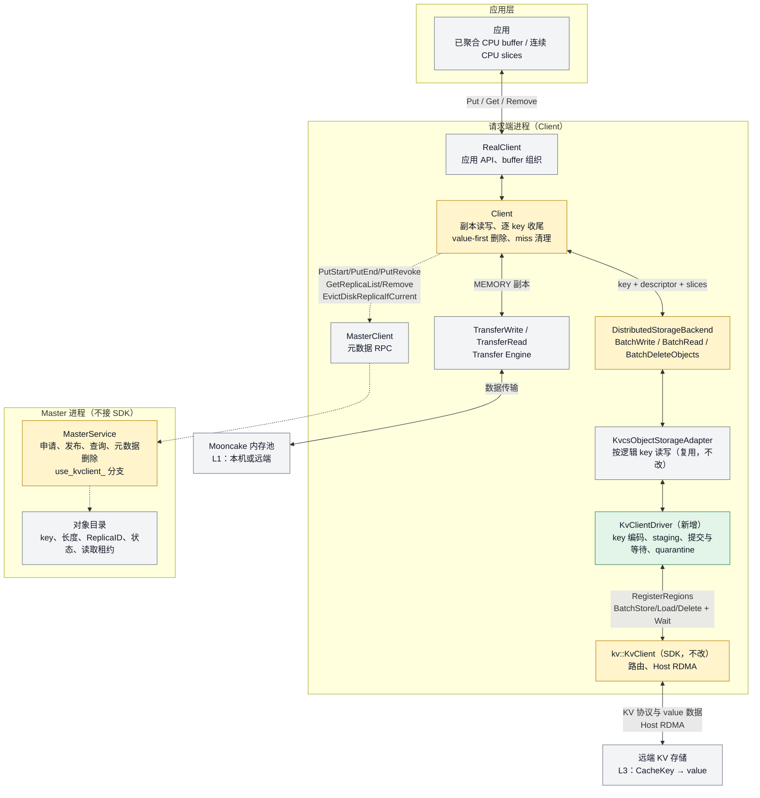

**分层职责**：

| 层 | 职责 | 本方案改动 |
| --- | --- | --- |
| `Client` | 副本编排、逐 key 收尾、删除路由、miss 清理 | 删除顺序改 value-first；miss 清理门控放宽 |
| `DistributedStorageBackend` | slices → 对象请求转换、长度校验 | **零改动**（`UsesObjectStorage()` 已抽象化） |
| `KvcsObjectStorageAdapter` | 逻辑 key ↔ 物理 key、批量结果映射 | 2 处 KVCS 专属逻辑下推到 driver |
| `KvcsDriver`（接口） | SDK 边界抽象 | 新增 `EncodeKey` 虚函数，其余零改动 |
| `KvClientDriver` | key 编码、staging、提交/等待/quarantine | **新增** |

### 2.1.2 类图

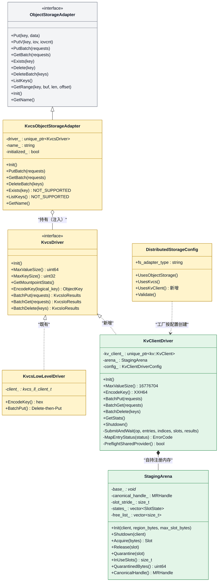

**设计要点**：

1. **不新建适配器类**。`KvcsObjectStorageAdapter` 已有注入构造函数 `KvcsObjectStorageAdapter(std::unique_ptr<KvcsDriver>)`（`kvcs_object_storage_adapter.h:19`），注入后 `Init()` 跳过 `LoadKvcsEfcTarget` / `CreateKvcsLowLevelDriver`（`:71-79`）。KVClient 只是该接口的第二个实现。

2. **`KvcsDriver` 天然匹配 KVClient 的能力缺口**。`GetMountpointStats()` 基类默认返回 `NOT_SUPPORTED`（`kvcs_driver.h:69-72`），而 Master 侧对 provider 返回 `NOT_SUPPORTED` **已有优雅降级**（`master_service.cpp:883-889`）：只打 WARNING、禁用水位淘汰、`enable_dfs_` 保持 true。KVClient 无容量接口的缺口被既有代码吸收，无需新设计。

3. **`KvcsIoRequest{logical_key, slices, size}` 已表达多段数据**（`kvcs_driver.h:42-46`），因此 `DistributedStorageBackend` 的读写路径**零改动**——v1 需要的「连续 slices 整理」分支不再存在，合并或 staging 全部关在 driver 内。

4. **2 处 KVCS 专属逻辑下推为 driver 职责**（约 20 行移动，非新增）：
   - `EncodeKey`（hex 编码，`kvcs_object_storage_adapter.cpp:57-65`）→ 提为 `KvcsDriver` 虚函数。KVCS 保持 hex，KVClient 用 XXH64。
   - Delete-before-Put（`:155-170`）→ 移进 `KvcsLowLevelDriver::BatchPut`。该逻辑源于 KVCS Put 是 insert-only；KVClient 覆盖写不需要。

5. **`StagingArena` 是承重组件，不可裁剪**。原因见 §2.3.2 与 SFMEA-12/13：SDK 超时后不取消设备操作，driver 必须自持内存才能安全 quarantine。

## 2.2 业务交互流程

### 2.2.1 写入流程（S1 两副本）

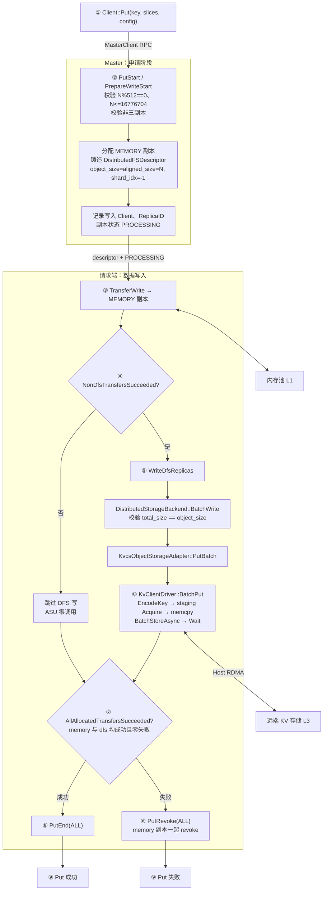

**关键判定**（决策 4，零代码改动）：`DetermineReplicaWriteMode` 在 `dfs > 0` 时返回 `RELIABLE_MULTI_REPLICA`（`replica.h:315-322`），故 `AllAllocatedTransfersSucceeded` 要求 memory 与 dfs **全部成功且零失败**（`client_service.cpp:329-333`），否则 `PutRevoke(ALL)`（`:384-401`）。短路顺序由 `:2160-2161` 保证：memory 失败时 ASU 零调用。

### 2.2.2 读取流程（S1 / S5）

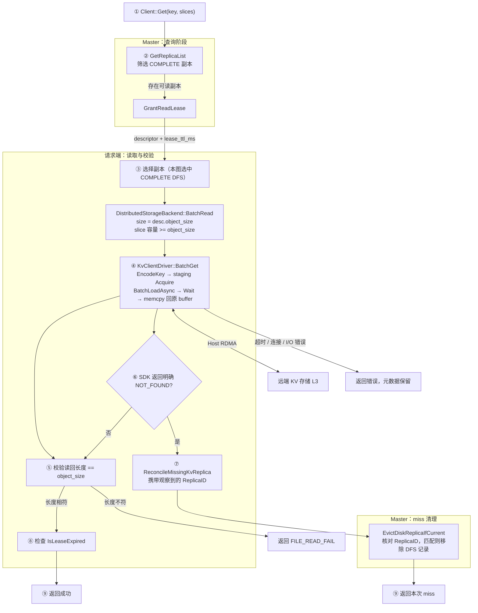

**要点**：超时、连接失败、长度不符**保留副本记录**（供后续读取或诊断）；只有明确 `NOT_FOUND` 才触发条件清理。这与 KVCS 现有行为一致（`client_service.cpp:1624-1627`、`:1935-1939`）。

### 2.2.3 删除流程（S3，决策 5：value-first）

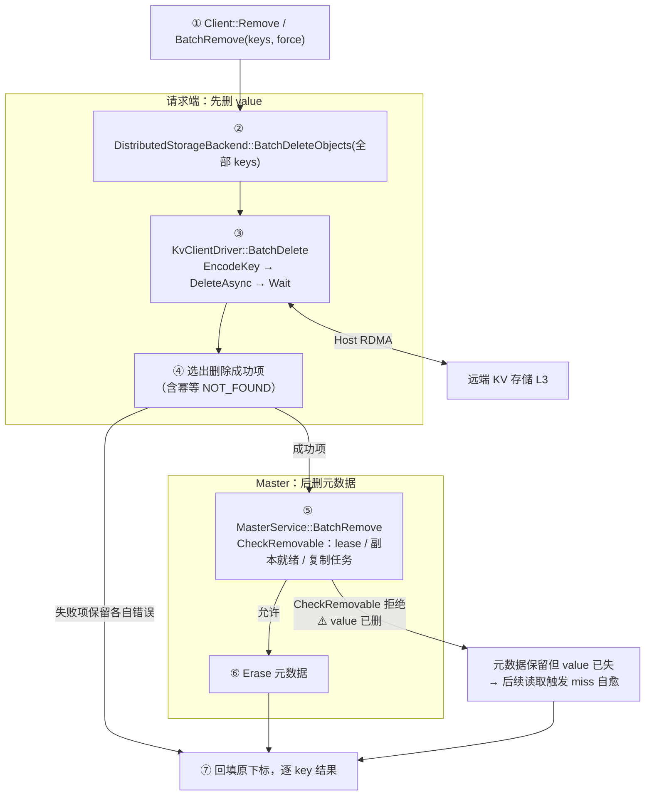

**顺序理由**：KVClient 的三条孤儿回收通道全断，metadata-first 的孤儿是**永久且无界**的。

| 回收通道 | KVCS | KVClient |
| --- | --- | --- |
| 水位淘汰（`master_service.cpp:423-434`） | ✅ 先删 value 后改元数据，失败则元数据保留待下轮重试 | ❌ 依赖容量查询，`usage.enabled=false` → 永不触发（`:7999-8004`） |
| Master 侧自持 driver | ✅ `kvcs_capacity_provider.cpp:61-67` | ❌ Master 无 RDMA 设备 |
| key 枚举扫描 | ❌ | ❌ `ListKeys` → NOT_SUPPORTED |
| 同 key 重写 pre-delete | ✅ 偶然 | ✅ 偶然（唯一残存通道） |

**中间态自愈**：value 已删、元数据尚在 → 读取返回 `NOT_FOUND` → `ReconcileMissingKvReplica` → `EvictDiskReplicaIfCurrent` 按 ReplicaID 条件清理。**决策 5 依赖决策 2 同时落地**，否则中间态无人清理。

**已知窗口**：`CheckRemovable` 以 `OBJECT_HAS_LEASE` / `REPLICA_IS_NOT_READY` / `OBJECT_HAS_REPLICATION_TASK` 拒绝时（`master_service.cpp:7401-7406`、`:7445-7463`），value 已删但元数据保留 → 一个仍在租约保护中的已发布对象变为不可读。对 KV cache 是「命中变未命中」，**不返回错数据**，语义安全；但确实丢了已成功 Put 的数据。此取舍成立的前提是 metadata-first 的孤儿为永久无界泄漏。

### 2.2.4 Upsert 流程（S4）

复用 `UpsertStart / UpsertEnd / UpsertRevoke` 三 RPC（`master_service.cpp:5943/6346/6362`、`master_client.cpp:871-948`、`client_service.cpp:2288/2368-2388`），写入路径与 §2.2.1 相同。

⚠️ **原地复用分支**：`bucket_allocator_` 在 KVCS/KVClient 下恒为 null（`master_service.h:2084`、`:906` 提前 return），故同尺寸 Upsert 走 `:6196-6235`——把含 DFS 的旧 COMPLETED 副本标为 PROCESSING 并**原样返回旧描述符、不重新分配**。对 KVClient 的实际影响：ReplicaID 不变，而 CacheKey 由 logical key 派生（与 ReplicaID 无关）→ 同一 CacheKey 覆盖写，符合整值替换语义。但已存在**仅 MEMORY** 的对象无法经 Upsert 补 DFS 副本（`:6146-6181` 拓扑不符），需先 Remove 再 Put。

收尾判定：`FinalizeBatchUpsert` 不走 `DetermineFinalizeDecision`，但判据是 `HasExpectedReplicaAllocation && AllAllocatedTransfersSucceeded`（`client_service.cpp:3497-3500`），与 Put 等价严格。

## 2.3 运行设计

### 2.3.1 初始化阶段

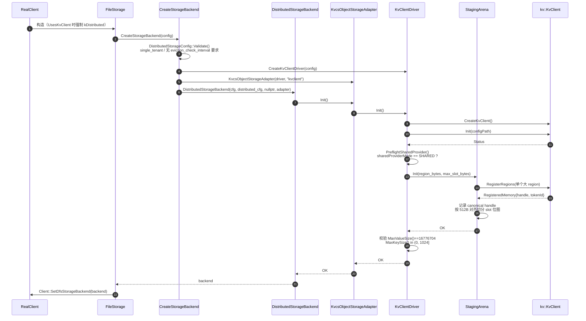

**说明**：

- **一次性注册，非按次注册**。v1 的「按次注册、按次释放」不可行（§2.3.2）。整个 driver 生命周期只注册一个大 region，所有 I/O 从中做 512B 对齐变长子分配。
- **`PreflightSharedProvider` 是硬门禁**。默认 `INDEPENDENT` 模式下 SDK 为每个 ASU 节点新建 provider 并 `BindMemory` 全部已注册区域（`kv_client_impl.cc:687-702`、`:719-731`），而 AICPU provider 的 `BindMemory` **只接受 `MEM_DEVICE`**（`aicpu_trans_provider.cc:1691-1699`）→ 非空 view 下注册必然 `PARTIAL_FAILED`。故要求 `sharedProviderMode=SHARED`，缺省或为 0 直接返回 `DFS_SERVICE_UNAVAILABLE`。（AIV provider 无此限制，`aiv_trans_provider.h:80-90` 透传 memoryType；按 provider 类型放宽门禁可作后续优化。）
- **Master 侧初始化**（`master_service.cpp:872-907` 新增分支）：置 `enable_dfs_=true`、`use_kvclient_=true`，**不**加载 EFC target、**不**建 capacity provider、**不**调 `InitKvcsDfsEviction`，然后 return。若 `enable_oplog_` 为真则 `LOG(FATAL)`（决策 6）。

### 2.3.2 写入阶段

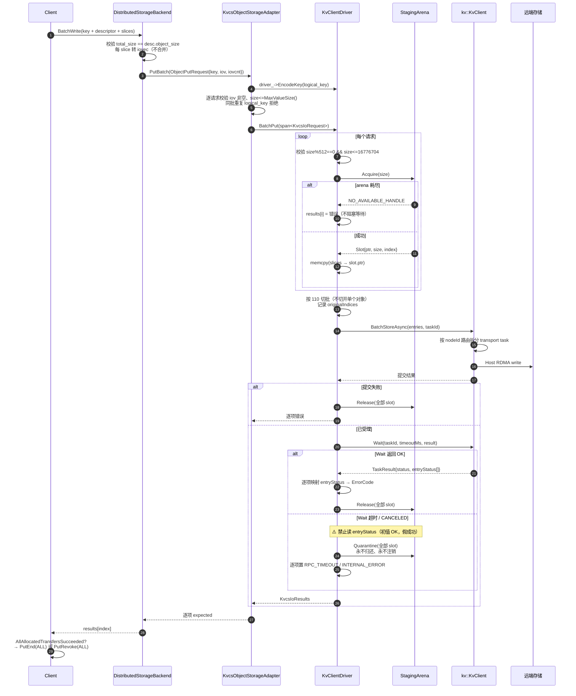

**说明**：

- **为什么必须 staging**：`ObjectStorageAdapter` 契约要求「Iovecs and payloads must remain valid and unchanged **until return**」（`object_storage_adapter.h:51-52`、`:71-72`），即返回后调用者可立即释放 buffer。而 SDK 在 `Wait` 超时后**不取消任何在途操作**：
  ```
  KvClientImpl::Wait → ClientTaskManager::Wait
                         ├─ WaitContext: cv.wait_for 超时 → result.status = TIMEOUT
                         └─ (void)Remove(taskId)   ← 只摘除 client 侧映射，不通知 transport
  ```
  （`task_manager.cc:108-116`、`:366-384`）。`AsuTransportImpl::Cancel` **无任何生产调用者**；transport 层 deadline 超时（`trans_task_executor.cc:391-405`）只在主机侧标记 COMPLETED，已 post 到设备的 RDMA 不会被中止；`ReportFailure` 只累加错误计数并标记 channel DRAINING（`connection_manager.cc:151-182`）。`UnregisterRegions` 也不检查 handle 是否仍被 in-flight task 引用（`kv_client_impl.cc:575-625`），尽管 SDK 头文件明确要求「Handles referenced by queued or in-flight tasks must remain registered until those tasks complete」（`kv_client.h:58-59`）。

  因此若直接提交调用者 buffer：超时 → 返回 → 调用者释放 → 设备稍后写入已易主内存 = **use-after-free 级数据损坏**。driver 必须自持内存，才能在超时后安全 quarantine。

- **为什么禁止读超时后的 `entryStatus`**：其初值是 `Status::OK()`（`kv_client_impl.cc:460`、`:514`），`BuildResult` 在 `!Done()` 时原样返回（`task_manager.cc:354-357`）→ 会读到假成功。

- **API 选择**：只用 `BatchStoreAsync` / `BatchLoadAsync` / `DeleteAsync` / `QueryAsync`，**不用**单条 `StoreAsync` / `LoadAsync`——`GetSqeIoNum` 对 LOAD/STORE **强制返回 1**（`io_scheduler.cc:82`），单条 API 在线格式层无批量能力，N 个 entry 就是 N 个 SQE。

- **跨对象合批安全**：SDK 自动按 nodeId 拆分 transport task 并用 `originalIndices` 回填（`task_manager.cc:266-302`、`:196-200`），`entryStatus` 与输入严格一一对应。切批按对象边界，绝不切开单个对象。

### 2.3.3 读取阶段

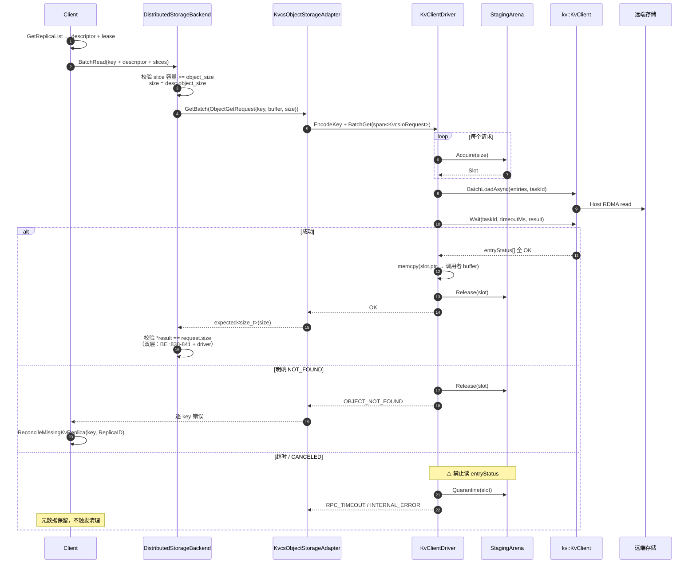

**说明**：读路径多一次 memcpy（staging → 调用者 buffer），这是同步契约的代价。读回长度校验为双层：`DistributedStorageBackend` 比对 `*object_results[i] != object_requests[i].size`（`:838-841`），driver 内再校验一次。

### 2.3.4 删除阶段

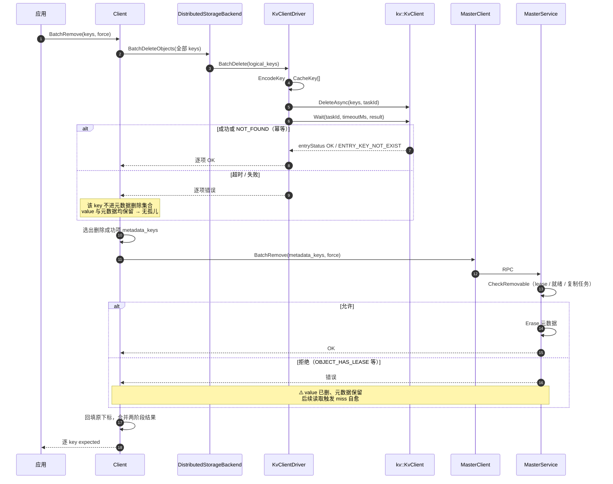

**说明**：删除失败项**不进入**元数据删除集合，故 value 与元数据同时保留，无孤儿。这是 value-first 相对 metadata-first 的核心优势——metadata-first 下失败项元数据已毁、value 残留，且重试遇 `OBJECT_NOT_FOUND`（`master_service.cpp:7391-7393`）→ 不进 `removed_keys` → **永不再删，孤儿被焊死**。

删除路径**不使用 staging**（`DeleteAsync` 只传 key，无 buffer），故无 quarantine 风险。

`Remove` 单 key 路由到 `BatchRemove`（`client_service.cpp:3816-3820` 门控放宽）。`RemoveAll` / `RemoveByRegex` 必须同样返回 `NOT_SUPPORTED` 且**不删元数据**（`:3843`、`:3864`），否则一次性泄漏整个 L3。

### 2.3.5 miss 清理阶段

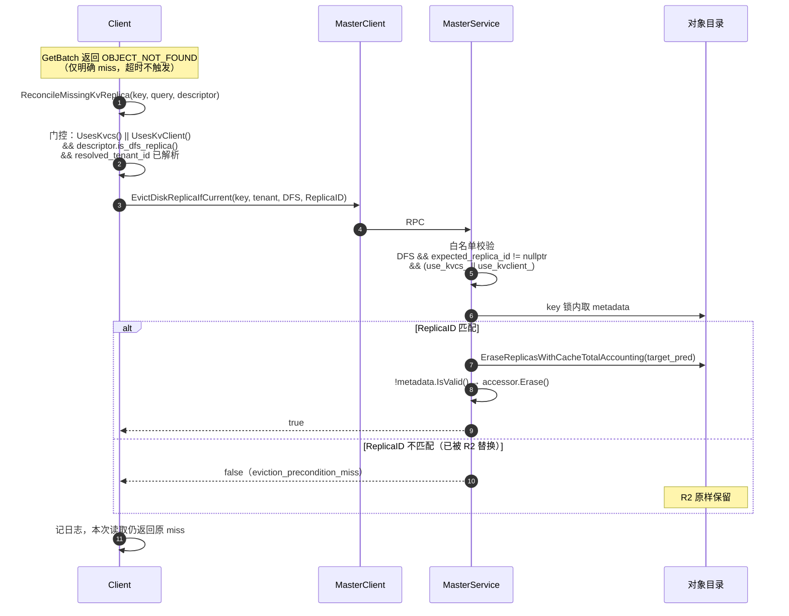

**说明**：DFS 在 `EvictDiskReplicaImpl` 中是**条件性**白名单（`master_service.cpp:6438-6446`）：

```cpp
const bool supports_dfs_condition = replica_type == ReplicaType::DFS &&
                                    expected_replica_id != nullptr &&
                                    use_kvcs_;                    // ← 必须放宽
```

非条件版传 nullptr（`:6553`），DFS 必然 `INVALID_PARAMS`。不改 `:6440` 与 `:6457` 则每次 miss 清理都失败，坏记录永久残留、读取持续失败。

### 2.3.6 关闭阶段

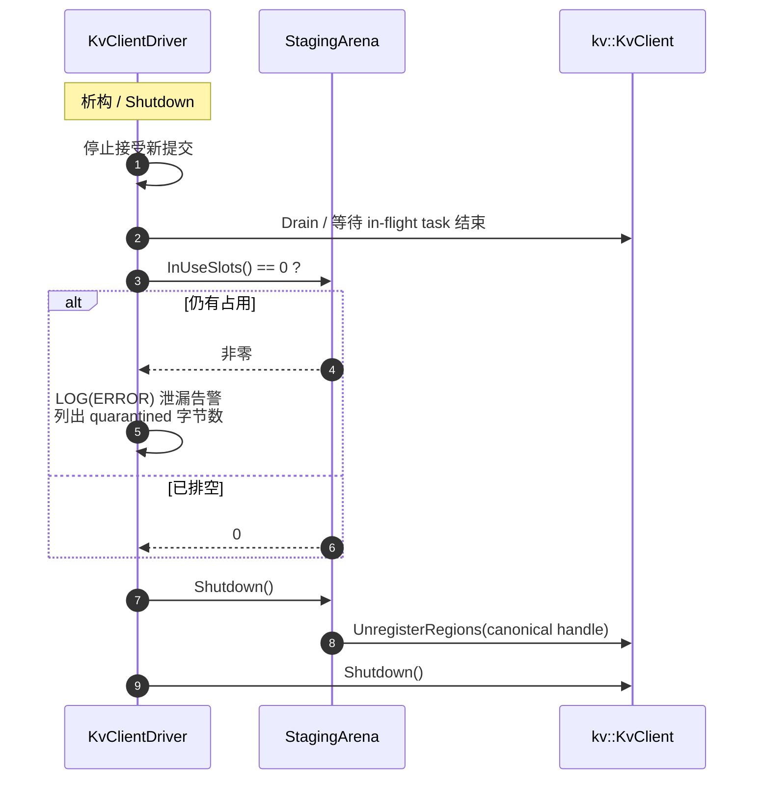

**说明**：不显式逐个 `UnregisterRegions`；quarantine 的 slot 永不归还，`Shutdown` 时统一随 region 注销。`QuarantinedBytes()` 非零是**内存泄漏指标**，需在关闭日志中显式输出。

## 2.4 SFMEA 分析

| 用例编号 | 故障模式 | 是否涉及 | 故障影响 | 容错措施 | 故障注入方法 | 备注 |
| --- | --- | --- | --- | --- | --- | --- |
| SFMEA-01 | logical key XXH64 碰撞：两个不同 key 映射到同一 CacheKey | 是 | **静默数据损坏**：后写覆盖先写，读到错 value，无校验可发现 | 无（裁决 7：默许碰撞、不做 fingerprint） | 构造两个 XXH64 相同的 key（或临时把 seed 空间缩到 8-bit 强制碰撞） | 概率 ≈ n²/2^65：10^7 key → 2.7e-6；10^8 → 2.7e-4；10^9 → 2.7%。须在部署文档写明 key 数量级上限 |
| SFMEA-02 | logical key 为空 | 是 | 无法编码 | driver 入口返回 `INVALID_PARAMS` | 传空 key | 与 `IsKvcsKeyStringSafe` 一致 |
| SFMEA-03 | 同批重复 logical key | 是 | 同 CacheKey 在一个 task 内冲突，SDK 行为未定义 | 适配器写侧直接拒绝（`kvcs_object_storage_adapter.cpp:144-147` 既有）；读/查/删去重后 fan-out | 同批传两个相同 key | 写侧拒绝是既有行为，不改 |
| SFMEA-04 | N 非 512 倍数 | 是 | SDK 协议层 length 须 512 对齐，提交被拒或行为未定义 | Master `PrepareWriteStart` 拒绝（第一道）+ driver 校验（第二道） | Put 一个 513 字节对象 | 决策 3。两道门都要有，Master 侧 slice 校验只在 CACHELIB 下生效 |
| SFMEA-05 | N > 16,776,704 | 是 | 超 24-bit length 上限，`PackSqe` 本地拒绝；但预发送失败会 **abort 整个 transport task**，把所有 entryStatus 置 CANCELED（`trans_task_executor.cc:227-232`） | driver `MaxValueSize()` 返回 16776704，适配器逐请求预检（`:133`、`:197` 既有） | Put 一个 16,777,216 字节对象 | 不能指望「只失败超限那一条」，必须逐 entry 预检 |
| SFMEA-06 | N == 0 | 是 | SDK 不接受空 value | 适配器既有校验 `size == 0 → INVALID_PARAMS`（`:140`、`:196`） | Put 空对象 | 既有行为 |
| SFMEA-07 | `sharedProviderMode != SHARED` | 是 | INDEPENDENT 模式下 SDK 为每个 ASU 节点新建 provider 并 `BindMemory` 全部已注册区域（`kv_client_impl.cc:687-702`、`:719-731`），AICPU 的 `BindMemory` 只接受 `MEM_DEVICE`（`aicpu_trans_provider.cc:1691-1699`）→ **非空 view 下注册必然 PARTIAL_FAILED** | `Init()` 中 `PreflightSharedProvider` 硬门禁，缺省或为 0 直接 `DFS_SERVICE_UNAVAILABLE` | 配置文件设 `sharedProviderMode=0` 后 Init | 部署硬门禁，必须在 Init 阶段失败而非运行期 |
| SFMEA-08 | `RegisterRegions` 失败 | 是 | 无 staging 内存，所有 I/O 不可用 | `Init()` 失败 → 后端初始化失败 → `FileStorage::Init` 明确失败 | fake SDK 让 RegisterRegions 返回 PARTIAL_FAILED | 部分成功时 SDK 已自行回滚（`kv_client_impl.cc:359-373`） |
| SFMEA-09 | Staging arena 耗尽 | 是 | 新 I/O 无法分配 slot | 逐项返回 `NO_AVAILABLE_HANDLE`，**不阻塞等待**；计入 metric | 把 arena 配到 1 slot 后并发 2 个请求 | 不可 fail-silent：读路径静默失败会永久不可诊断 |
| SFMEA-10 | 提交时 `buffer.handle` 非 canonical | 是 | 非 0 但未注册的 handle 在提交阶段**不报错**，要到 Wait 才以 `BUFFER_NOT_REGISTERED` 暴露且**连坐整 task** | 提交前预检 handle **精确等于** canonical handle（不是 `!= kInvalidMRHandle`） | 手工篡改 entry 的 handle | 预检必须精确相等 |
| SFMEA-11 | `mrKey` 被调用方填入 | 否 | 无影响 | `SubmitAsync` 无条件重置并按 `buffer.handle` 回填（`kv_client_impl.cc:452-458`） | — | driver 侧一律留 `std::nullopt` |
| SFMEA-12 | `Wait` 超时，设备仍在访问 staging | 是 | 若归还 slot 并被复用 → 设备写入他人数据 = **数据损坏** | slot **quarantine**：永不归还、永不注销，直到排空；`Wait` 超时后不再触碰该 slot | fake SDK 让 Wait 返回 TIMEOUT 但保持 task in-flight | **承重组件，不可裁剪**。SDK 无取消能力（`Cancel` 无生产调用者） |
| SFMEA-13 | 超时后读 `entryStatus` | 是 | 初值是 `Status::OK()`（`kv_client_impl.cc:460`、`:514`），`BuildResult` 在 `!Done()` 时原样返回（`task_manager.cc:354-357`）→ **假成功**，数据未落盘却报成功 | 代码层禁止：`Wait` 非 OK 时**不读** `entryStatus`，直接逐项置错误 | fake SDK 让 Wait 超时且 entryStatus 保持初值 | 必须有专门用例覆盖，否则极易回归 |
| SFMEA-14 | task 级 `PARTIAL_FAILED`，逐项 entryStatus 部分失败 | 是 | 部分 key 成功部分失败 | 逐项映射 entryStatus → ErrorCode，按 `originalIndices` 回填原下标 | fake SDK 让第 2 项返回 ENTRY_NO_RETRY_ADVISED | `entryStatus` 与输入严格一一对应 |
| SFMEA-15 | dispatch 失败导致整 task CANCELED | 是 | 所有 entry 被置 CANCELED（`task_manager.cc:216-223`） | CANCELED 一律 quarantine slot，逐项返回 `INTERNAL_ERROR` | fake SDK 让 transport Submit 失败 | 与 TIMEOUT 同等处理 |
| SFMEA-16 | 路由失败：`routed asu transport not found` | 是 | 整个 task 提交失败（`task_manager.cc:276-282`） | 提交阶段即返回错误，slot 全部 Release（未进入设备） | view 中加入一个无 transport 的 nodeId | 提交失败与超时区分：前者 slot 可安全归还 |
| SFMEA-17 | `CQE_OUT_OF_CREATE_SIZE`（设备侧空间不足） | 是 | 该 key 写入失败 | 映射为 `NO_AVAILABLE_HANDLE`；决策 4 下触发 `PutRevoke(ALL)`，整个 Put 失败 | fake SDK 返回该 CQE 码 | 无容量查询接口 → 无法预判，只能事后失败 |
| SFMEA-18 | `CQE_KEY_NOT_EXIST` / `ENTRY_KEY_NOT_FOUND`（读时） | 是 | 对象在存储侧不存在 | 映射为 `OBJECT_NOT_FOUND` → 触发 `ReconcileMissingKvReplica` 条件清理 | fake SDK 返回该码 | 必须与超时严格区分：超时**不**触发清理 |
| SFMEA-19 | 连接失败 / `CONNECTION_ERROR` | 是 | I/O 失败 | 映射为 `DFS_SERVICE_UNAVAILABLE`；元数据保留 | 断开存储网络 | 与 KVCS `CallError` 映射对齐（`kvcs_capi_driver.cpp:77-100`） |
| SFMEA-20 | 删除阶段：value 删除成功但 Master `BatchRemove` 失败 | 是 | value 已失、元数据保留 → 已发布对象不可读 | 后续读取返回 `NOT_FOUND` → miss 自愈清理 DFS 记录（决策 2） | fake MasterClient 让 BatchRemove 返回 RPC_FAIL | 决策 5 依赖决策 2，二者必须同时落地 |
| SFMEA-21 | 删除阶段：`CheckRemovable` 拒绝（lease / 未就绪 / 复制任务） | 是 | 同 SFMEA-20，但**无自愈**——对象仍受租约保护，元数据不会被判为失效 | 返回该 key 错误；元数据保留；靠后续读取 miss 自愈 | 对处于 lease 中的对象调 Remove | 已知窗口。语义安全（不返回错数据），但丢已成功 Put 的数据 |
| SFMEA-22 | 删除阶段：value 删除失败（超时 / 不可达） | 是 | value 与元数据**同时保留** | 该 key 不进元数据删除集合 → **无孤儿**；返回错误供上层重试 | fake SDK 让 DeleteAsync 超时 | value-first 的核心收益：失败态可安全重试 |
| SFMEA-23 | 迟到 Delete 误删新 value（同 key 重写） | 是 | 旧删除请求命中新写入的 value | 无专门机制。XXH64 下新旧 value 同 CacheKey | 并发 Remove + Put 同 key | 调用方须串行组织同 key 的删除/重建/更新（v1 §1.2 约定保留） |
| SFMEA-24 | 删除后 Client 崩溃（value 已删、元数据未删） | 是 | 同 SFMEA-20 | 重启后由读取 miss 自愈 | 在两阶段之间 kill 进程 | 无 pending-delete 持久化队列，依赖自愈 |
| SFMEA-25 | `RemoveAll` / `RemoveByRegex` 被调用 | 是 | 若只删元数据不删 value → **一次性泄漏整个 L3** | 门控放宽到 KVClient，返回 `NOT_SUPPORTED` 且**不删元数据** | 直接调用两个 API | `client_service.cpp:3843`、`:3864`，决策 5 连带必改项 |
| SFMEA-26 | Master 重启（默认无 HA） | 是 | 对象目录全丢；L3 value 仍在但**不可发现**（无枚举能力）→ 等同丢失且永久占用空间 | 无恢复能力（决策 6）。运维需知晓；残留由存储侧或人工处理 | 重启 Master 进程 | 默认 `enable_ha=false`、`enable_oplog=false` |
| SFMEA-27 | 误配 `enable_oplog=true` | 是 | 恢复门 3825 会在 HA 切换时返回 `DFS_SERVICE_UNAVAILABLE`（响亮失败，非静默丢数据） | `InitDfsAllocatorFromEnvironment` 启动期 `LOG(FATAL)`，把失败点提前到启动时 | 配置 `enable_oplog=true` 启动 Master | 恢复门 3533/3825/4118 保持 `use_kvcs_` only，**不改** |
| SFMEA-28 | 三副本 `memory + nof + ASU` | 是 | `dfs > 0` 时 `FLEXIBLE_DUAL_REPLICA` 不可达（`replica.h:315-318`）→ 静默落入 RELIABLE，**nof 变为必需**，nof 抖动导致整 Put 失败 | `PrepareWriteStart` 显式拒绝 `INVALID_PARAMS` | 配置三副本后 Put | 有意与 KVCS 不对称，把运行期惊喜变成启动期可发现约束 |
| SFMEA-29 | `PutEnd` 响应未知 | 是 | 数据已落 L3，但发布状态不明 | Client 返回提交错误；后续经查询或符合条件的重复提交确认（既有行为） | fake MasterClient 让 PutEnd 超时 | 沿用 Mooncake 现有语义，不新增机制 |
| SFMEA-30 | miss 清理 CAS 不匹配（读到 R1，目录已是 R2） | 是 | 无 | `EvictDiskReplicaIfCurrent` 返回 false，R2 原样保留（`master_service.cpp:6463-6473`） | 构造 R1→R2 替换后发 R1 的清理请求 | 既有 CAS 语义，仅需放宽白名单 |
| SFMEA-31 | 存储侧空间满，无水位淘汰 | 是 | 写入持续失败，无自动回收 | `GetMountpointStats()` 返回 `NOT_SUPPORTED` → Master 既有降级（`:883-889`）仅 WARNING、禁用淘汰；写入按 SFMEA-17 失败 | 填满存储 | 容量管理留待 SDK 提供接口 |
| SFMEA-32 | `Shutdown` 时仍有 in-flight task | 是 | 注销 region 会导致设备访问已注销内存 | 先 `Drain` 排空，再断言 `InUseSlots()==0`，非零则 `LOG(ERROR)` 泄漏告警并输出 `QuarantinedBytes()` | 在 I/O 进行中析构 driver | quarantine 的 slot 永不归还，关闭时随 region 统一注销 |
| SFMEA-33 | 读回长度 != `object_size` | 是 | 数据不完整 | 双层校验：driver 内 + `DistributedStorageBackend:838-841`，返回 `FILE_READ_FAIL` | fake SDK 返回短读 | 决策 3 下 N 已 512 对齐，长度必然精确 |
| SFMEA-34 | 范围读请求 | 是 | `BatchRead` 对象分支忽略 `range_read`/`value_offset`，slice 容量 < object_size → `INVALID_PARAMS`（`:802-818`） | 不支持。上层需回退整对象读后截取 | 发一个窗口小于 object_size 的范围读 | RealClient 的 DFS 范围读只分配窗口大小 staging（`real_client.cpp:7610-7617`），故 KVCS 下今天也会失败 |
| SFMEA-35 | 租约到期 | 是 | 读取结果可能已失效 | `IsLeaseExpired` 检查后返回 `LEASE_EXPIRED`（既有） | 把 `lease_ttl_ms` 配到极小 | 沿用 Mooncake 现有语义 |
| SFMEA-36 | 设备地址直达 / 设备 buffer | 否 | — | 不支持。`MemoryType` 保持 `HOST_PINNED`；SDK 把 HOST/HOST_PINNED 都折叠为 `MEM_HOST`（`kv_client_impl.cc:350-354`） | — | 范围外 |

## 2.5 可定位设计

### 2.5.1 统一关联字段

所有 driver 与适配器日志必须携带以下字段，使一次 I/O 可跨层串联：

| 字段 | 来源 | 用途 |
| --- | --- | --- |
| `logical_key` | 应用 | 业务侧关联（可能含敏感信息，按日志级别裁剪） |
| `cache_key` | XXH64 结果的 16 位 hex | **碰撞排查的唯一手段**：两个不同 logical_key 出现同一 cache_key 即为碰撞 |
| `object_size` | descriptor | 对齐/上限问题定位 |
| `task_id` | SDK | 跨 client/transport 层关联 SDK 内部日志 |
| `replica_id` | descriptor | miss 清理 CAS 排查 |
| `slot_index` | StagingArena | 泄漏与 quarantine 追踪 |
| `batch_index` / `original_index` | driver | 批量结果错位排查 |

`cache_key` 是裁决 7（不做 fingerprint）下**唯一**的碰撞可观测点，必须在 VLOG(2) 无条件输出。

### 2.5.2 日志分级

| 级别 | 内容 |
| --- | --- |
| `ERROR` | Wait 超时（含 `task_id`、`op`、涉及 slot 数、**quarantine 字节数**）；`RegisterRegions` 失败；`Shutdown` 时 `InUseSlots() != 0`；entryStatus 映射到未知 SDK 码 |
| `WARNING` | arena 占用率 > 90%；`PreflightSharedProvider` 通过但 provider 类型非预期；单项 entryStatus 失败（非整 task） |
| `INFO` | `Init` 成功（含 SDK 版本、`sharedProviderMode`、region 大小、slot 数、`MaxValueSize`）；`Shutdown` 完成（含累计 quarantine 字节） |
| `VLOG(1)` | 每次 `BatchPut`/`BatchGet`/`BatchDelete` 的 key 数、总字节、切批数、耗时分解 |
| `VLOG(2)` | 逐 entry 的 `logical_key` → `cache_key` 映射、slot 分配/归还 |

**耗时分解**（`VLOG(1)`，对应用例 T-52）：`encode_us` / `acquire_us` / `memcpy_us` / `submit_us` / `wait_us` / `release_us`，用于确定推荐 I/O 粒度与定位 staging 拷贝占比。

### 2.5.3 指标

| 指标 | 类型 | 说明 |
| --- | --- | --- |
| `kvclient_driver_ops_total{op,result}` | counter | op ∈ {put,get,delete,query}，result ∈ {ok,error,timeout,canceled} |
| `kvclient_driver_bytes_total{op}` | counter | 提交字节数 |
| `kvclient_driver_latency_us{op,phase}` | histogram | phase ∈ {encode,acquire,memcpy,submit,wait,release} |
| `kvclient_staging_slots_in_use` | gauge | 当前占用 slot 数 |
| `kvclient_staging_quarantined_bytes` | gauge | **泄漏指标**：单调不减，非零即有未排空的超时 slot |
| `kvclient_staging_exhausted_total` | counter | arena 耗尽次数 |
| `kvclient_entry_status_total{code}` | counter | 按 SDK StatusCode 分布，用于识别设备侧错误模式 |

`kvclient_staging_quarantined_bytes` 持续增长是**内存泄漏的确定信号**，应配告警。

### 2.5.4 定位手册

| 症状 | 排查路径 |
| --- | --- |
| Init 失败 `DFS_SERVICE_UNAVAILABLE` | 查 `sharedProviderMode` 是否为 SHARED（SFMEA-07）；查 view service 可达性 |
| Init 失败 `PARTIAL_FAILED` | 查 `RegisterRegions` 日志；AICPU provider 下确认 SHARED 模式 |
| Put 全部失败但 SDK 日志无异常 | 查是否读了超时后的 `entryStatus`（SFMEA-13）；查 `kvclient_driver_ops_total{result="timeout"}` |
| 读到错误数据，无报错 | **优先怀疑 key 碰撞**（SFMEA-01）：grep VLOG(2) 日志，比对两个 logical_key 是否得到同一 `cache_key` |
| 内存持续增长不释放 | 查 `kvclient_staging_quarantined_bytes`；非零说明有超时 slot 未排空（SFMEA-12） |
| Remove 返回成功但存储侧仍有 value | 不可能——value-first 下成功即已删。若出现，查是否走了 `RemoveAll`/`RemoveByRegex`（SFMEA-25） |
| Remove 返回错误且对象变为不可读 | 已知窗口（SFMEA-21）：value 已删但 `CheckRemovable` 拒绝。等待后续读取触发 miss 自愈 |
| Get 持续 `OBJECT_NOT_FOUND` 但目录有记录 | 查 `EvictDiskReplicaIfCurrent` 是否返回 `INVALID_PARAMS`——说明 `use_kvclient_` 白名单漏改（§3.6） |
| 对象大于 4 MiB 写入失败 | 查 `MaxValueSize()` 是否被误配；KVClient 上限是 16,776,704 而非 KVCS 的 4 MiB |
| Master 重启后 L3 全部读不到 | 预期行为（决策 6，SFMEA-26）。目录不可恢复，value 不可枚举 |

### 2.5.5 诊断辅助接口

driver 暴露只读诊断方法（不进 `KvcsDriver` 接口，通过 `dynamic_cast` 或独立头文件提供）：

```cpp
struct KvClientDriverStats {
    size_t slots_total;
    size_t slots_in_use;
    size_t slots_quarantined;
    uint64_t quarantined_bytes;
    uint64_t submits_total;
    uint64_t timeouts_total;
    uint64_t canceled_total;
};
KvClientDriverStats KvClientDriver::GetStats() const;
```

配合 driver 内部用 `QueryAsync` 实现的存在性核查供运维手工使用。注意：适配器层 `Exists` 仍返回 `NOT_SUPPORTED`（沿用 KVCS 既有行为）；且**物理存在性只能观测、不能当权威**——`QueryResult` 只有 `exists` 位图（`kv_types.h:98-101`），无长度信息，长度权威始终是 Master 元数据。

---

# 3 shard 设计描述

## 3.1 shard-1：key 编码（`kvclient_key_codec`）

**职责**：logical key → 8 字节 `CacheKey` 的确定性映射。

**文件**：`mooncake-store/include/storage/distributed/kvclient/kvclient_key_codec.h`（header-only）

```cpp
#pragma once

#include <cstdint>
#include <cstring>
#include <string>
#include <string_view>

#include <xxhash.h>

#include "kv_types.h"

namespace mooncake::kvclient {

// Fixed seed. The mapping must be a pure function of the logical key so that
// any client, at any time, derives the same CacheKey. Do not mix in epoch,
// process id, or random salt: that would break cross-client reads.
inline constexpr XXH64_hash_t kCacheKeySeed = 0x4D434B5643310001ULL;

// Collisions are accepted by design (no fingerprint validation). Two distinct
// logical keys mapping to the same CacheKey silently overwrite each other.
// Probability is ~n^2/2^65; see SFMEA-01 for the deployment key-count bound.
inline kv::CacheKey EncodeCacheKey(std::string_view logical_key) {
    const XXH64_hash_t hash =
        XXH64(logical_key.data(), logical_key.size(), kCacheKeySeed);
    kv::CacheKey key{};
    std::memcpy(key.data(), &hash, sizeof(hash));
    return key;
}

// 16 hex chars. This is the only observable handle for collision diagnosis,
// so it must be logged unconditionally at VLOG(2).
inline std::string CacheKeyToLogString(const kv::CacheKey& key) {
    static constexpr char kHex[] = "0123456789abcdef";
    std::string text;
    text.reserve(key.size() * 2);
    for (auto byte : key) {
        const auto value =
            static_cast<unsigned char>(std::to_integer<unsigned char>(byte));
        text.push_back(kHex[value >> 4]);
        text.push_back(kHex[value & 0x0F]);
    }
    return text;
}

}  // namespace mooncake::kvclient
```

**设计说明**：

- **seed 选择**：借鉴 `nvme_kv/key_codec.cpp:44-45` 的 XXH64 用法，但那里用双 seed 产出 16 字节（`low`/`high`）；本方案只需 8 字节，单 seed 即可。
- **不做 fingerprint**（裁决 7）：value 就是原始 N 字节，I/O 长度恒等于 `object_size`，零拷贝语义与 §2.3.3 的双层长度校验得以保留。代价是碰撞不可检测，只能靠 §2.5.1 的 `cache_key` 日志事后排查。
- **纯函数约束**：映射不得混入 epoch / 进程 id / 随机种子。这既是跨 Client 读取的前提，也是决策 6（不支持恢复）下唯一需要保证的稳定性。

## 3.2 shard-2：staging arena（`kvclient_staging_arena`）

**职责**：一个已注册 region + 512B 对齐变长子分配 + quarantine。

**文件**：`mooncake-store/include/storage/distributed/kvclient/kvclient_staging_arena.h`、`src/storage/distributed/kvclient/kvclient_staging_arena.cpp`

```cpp
#pragma once

#include <cstddef>
#include <cstdint>
#include <mutex>
#include <vector>

#include <ylt/util/tl/expected.hpp>

#include "kv_types.h"
#include "types.h"

namespace mooncake {
namespace kv {
class KvClient;
}

namespace kvclient {

// Owns the only memory the SDK is allowed to touch. The SDK never cancels an
// in-flight operation on Wait timeout (AsuTransportImpl::Cancel has no
// production caller), so a slot handed to a timed-out task can never be safely
// reused: Quarantine() retires it for the lifetime of the arena.
class StagingArena {
   public:
    struct Slot {
        void* ptr = nullptr;
        size_t size = 0;
        size_t index = 0;
    };

    StagingArena() = default;
    ~StagingArena();

    StagingArena(const StagingArena&) = delete;
    StagingArena& operator=(const StagingArena&) = delete;

    // Registers one contiguous HOST_PINNED region and records its handle as
    // the canonical handle every submitted entry must carry.
    tl::expected<void, ErrorCode> Init(kv::KvClient& client,
                                       size_t region_bytes,
                                       size_t max_slot_bytes);
    // Caller drains in-flight work first; logs an error if InUseSlots() != 0.
    void Shutdown(kv::KvClient& client);

    // bytes must be a multiple of 512. Returns NO_AVAILABLE_HANDLE when the
    // arena is exhausted; never blocks.
    tl::expected<Slot, ErrorCode> Acquire(size_t bytes);
    void Release(const Slot& slot);
    // Retires the slot permanently. Counted in QuarantinedBytes().
    void Quarantine(const Slot& slot);

    size_t InUseSlots() const;
    size_t QuarantinedSlots() const;
    uint64_t QuarantinedBytes() const;
    kv::MRHandle CanonicalHandle() const { return canonical_handle_; }

   private:
    enum class SlotState : uint8_t { kFree, kInUse, kQuarantined };

    mutable std::mutex mu_;
    void* base_ = nullptr;
    size_t region_bytes_ = 0;
    size_t slot_stride_ = 0;  // max_slot_bytes, already 512-aligned
    kv::MRHandle canonical_handle_ = kv::kInvalidMRHandle;
    std::vector<SlotState> states_;
    std::vector<size_t> free_list_;
    size_t quarantined_slots_ = 0;
    uint64_t quarantined_bytes_ = 0;
};

}  // namespace kvclient
}  // namespace mooncake
```

**关键实现**：

```cpp
tl::expected<StagingArena::Slot, ErrorCode> StagingArena::Acquire(size_t bytes) {
    if (bytes == 0 || bytes % kv::kAlignmentBytes != 0 || bytes > slot_stride_) {
        return tl::make_unexpected(ErrorCode::INVALID_PARAMS);
    }
    std::lock_guard<std::mutex> lock{mu_};
    if (free_list_.empty()) {
        return tl::make_unexpected(ErrorCode::NO_AVAILABLE_HANDLE);
    }
    const size_t index = free_list_.back();
    free_list_.pop_back();
    states_[index] = SlotState::kInUse;
    return Slot{static_cast<char*>(base_) + index * slot_stride_, bytes, index};
}

void StagingArena::Quarantine(const Slot& slot) {
    std::lock_guard<std::mutex> lock{mu_};
    if (slot.index >= states_.size() || states_[slot.index] != SlotState::kInUse) {
        return;
    }
    states_[slot.index] = SlotState::kQuarantined;
    ++quarantined_slots_;
    quarantined_bytes_ += slot.size;
    // Deliberately not pushed back to free_list_: the device may still write
    // into this slot after Wait returned TIMEOUT.
}
```

**设计说明**：

- **为什么是变长子分配而非固定 16,776,704B slot**：固定 slot 下 128 MiB region 只能开 8 个，批深度不足以兑现跨对象合批。变长子分配以 `max_slot_bytes` 为 stride，`Acquire(bytes)` 只要求 `bytes <= slot_stride_`，小对象不浪费批深度。
- **`slot_stride_` 必须 512 对齐**：SDK 只约束 `length`/`offset` 的 512 对齐，**不校验 `buffer_addr`**；但 region 起始地址与 stride 都对齐可让每个 slot 天然满足地址对齐，避免依赖 SDK 的未校验行为。
- **quarantine 不注销**：quarantine 的 slot 仍属已注册 region，`Shutdown` 时随 region 统一注销。逐个注销会与 in-flight 设备操作竞争。
- **`HOST_PINNED`**：SDK 把 `HOST` / `HOST_PINNED` 都折叠为 `MEM_HOST`（`kv_client_impl.cc:350-354`），pinned 不由 SDK 分配兑现。若需要真正的 pinned 内存，arena 需自行分配（后续优化项，V1 用普通 host 内存）。
- **`tokenId` 只作诊断**：`RegisteredMemory.tokenId` 不入 `KVBuffer`、不当 handle 用；`mrKey` 必须留 `std::nullopt`（SDK 会按 `buffer.handle` 回填，见 SFMEA-11）。

## 3.3 shard-3：driver（`kvclient_driver`）

**职责**：实现 `KvcsDriver`，承载 key 编码、staging、提交/等待、结果映射。

**文件**：`mooncake-store/include/storage/distributed/kvclient/kvclient_driver.h`、`src/storage/distributed/kvclient/kvclient_driver.cpp`

```cpp
#pragma once

#include <memory>
#include <string>

#include <ylt/util/tl/expected.hpp>

#include "storage/distributed/kvcs/kvcs_driver.h"

namespace mooncake::kvclient {

// Single-entry wire limit: SQE length is 24-bit and must be 512-aligned, so
// 0xFFFFFF & ~511 == 0xFFFE00. Not "about 16 MiB" -- the exact bound matters
// because Mooncake's kMaxSliceSize (16,777,200) is 496 bytes larger, and the
// 512-alignment requirement is what keeps that gap unreachable.
inline constexpr uint64_t kMaxValueBytes = 16'776'704;

struct KvClientDriverConfig {
    std::string config_path;  // SDK client config
    size_t staging_region_bytes = 128ULL * 1024 * 1024;
    size_t max_slot_bytes = kMaxValueBytes;
    uint64_t wait_timeout_ms = 30'000;
    uint32_t max_key_size = kKvcsMaxKeySize;  // adapter Init sanity check only
};

tl::expected<std::unique_ptr<KvcsDriver>, ErrorCode> CreateKvClientDriver(
    const KvClientDriverConfig& config);

}  // namespace mooncake::kvclient
```

```cpp
namespace {

class KvClientDriver final : public KvcsDriver {
   public:
    explicit KvClientDriver(KvClientDriverConfig config)
        : config_(std::move(config)) {}
    ~KvClientDriver() override { Shutdown(); }

    tl::expected<void, ErrorCode> Init() override {
        if (initialized_) return {};
        kv_client_ = kv::CreateKvClient();
        if (!kv_client_) return tl::make_unexpected(ErrorCode::INTERNAL_ERROR);

        const auto status = kv_client_->Init(config_.config_path);
        if (!status.ok()) return tl::make_unexpected(MapStatus(status));

        // INDEPENDENT mode makes the SDK BindMemory every registered region on
        // each per-node provider, and AICPU's BindMemory rejects non-device
        // memory -> registration always fails PARTIAL_FAILED once the view is
        // non-empty. Fail here rather than at first I/O.
        if (!PreflightSharedProvider()) {
            return tl::make_unexpected(ErrorCode::DFS_SERVICE_UNAVAILABLE);
        }

        auto arena_init = arena_.Init(*kv_client_, config_.staging_region_bytes,
                                      config_.max_slot_bytes);
        if (!arena_init) return tl::make_unexpected(arena_init.error());

        initialized_ = true;
        LOG(INFO) << "action=kvclient_driver_init"
                  << ", staging_region_bytes=" << config_.staging_region_bytes
                  << ", slot_stride=" << config_.max_slot_bytes
                  << ", max_value_bytes=" << kMaxValueBytes
                  << ", wait_timeout_ms=" << config_.wait_timeout_ms;
        return {};
    }

    uint64_t MaxValueSize() const override { return kMaxValueBytes; }

    // Hash encoding accepts any logical key length; this bound exists only to
    // satisfy KvcsObjectStorageAdapter::Init's sanity check
    // (kvcs_object_storage_adapter.cpp:84-86). It is not enforced on keys.
    uint32_t MaxKeySize() const override { return config_.max_key_size; }

    // GetMountpointStats is deliberately NOT overridden: the base class
    // returns NOT_SUPPORTED, which Master handles gracefully
    // (master_service.cpp:883-889) by disabling watermark eviction.

    tl::expected<ObjectKey, ErrorCode> EncodeKey(
        std::string_view logical_key) const override {
        if (logical_key.empty()) {
            return tl::make_unexpected(ErrorCode::INVALID_PARAMS);
        }
        const auto cache_key = EncodeCacheKey(logical_key);
        // ObjectKey is std::string; carry all 8 bytes including any NUL.
        return ObjectKey(reinterpret_cast<const char*>(cache_key.data()),
                         cache_key.size());
    }

    KvcsIoResults BatchPut(std::span<const KvcsIoRequest> requests) override {
        return RunBatch(requests, kv::AsuOpType::BATCH_STORE, kBatchStoreIoNum);
    }
    KvcsIoResults BatchGet(std::span<const KvcsIoRequest> requests) override {
        return RunBatch(requests, kv::AsuOpType::BATCH_LOAD, kBatchLoadIoNum);
    }
    KvcsIoResults BatchDelete(std::span<const ObjectKey> keys) override;

    KvClientDriverStats GetStats() const;

   private:
    void Shutdown();
    // ...
    KvClientDriverConfig config_;
    std::unique_ptr<kv::KvClient> kv_client_;
    StagingArena arena_;
    bool initialized_ = false;
};

}  // namespace
```

**批量提交与超时处理骨架**（承重逻辑）：

```cpp
// Submits one sub-batch and maps results back through original_indices.
// On Wait failure the slots are quarantined, never released, and entryStatus
// is never read.
void KvClientDriver::SubmitAndWait(kv::AsuOpType op,
                                   std::vector<kv::KVBuffer>& entries,
                                   const std::vector<size_t>& original_indices,
                                   const std::vector<StagingArena::Slot>& slots,
                                   KvcsIoResults& results) {
    // Every entry must carry the canonical handle exactly. A non-zero but
    // unregistered handle is not rejected at submit time; it surfaces only at
    // Wait as BUFFER_NOT_REGISTERED and poisons the whole task.
    const auto canonical = arena_.CanonicalHandle();
    for (const auto& entry : entries) {
        if (entry.buffer.handle != canonical) {
            for (const auto& slot : slots) arena_.Release(slot);
            FillError(results, original_indices, ErrorCode::INTERNAL_ERROR);
            return;
        }
    }

    kv::TaskId task_id = kv::kInvalidTaskId;
    const auto submit = (op == kv::AsuOpType::BATCH_STORE)
                            ? kv_client_->BatchStoreAsync(entries, task_id)
                            : kv_client_->BatchLoadAsync(entries, task_id);
    if (!submit.ok()) {
        // Rejected before reaching the device: slots are safe to release.
        for (const auto& slot : slots) arena_.Release(slot);
        FillError(results, original_indices, MapStatus(submit));
        return;
    }

    kv::TaskResult task_result;
    const auto wait =
        kv_client_->Wait(task_id, config_.wait_timeout_ms, task_result);

    if (!wait.ok() || !task_result.status.ok()) {
        // TIMEOUT / CANCELED / PARTIAL_FAILED at task level.
        // entryStatus may still hold its Status::OK() initial value
        // (kv_client_impl.cc:460), so reading it here would report success
        // for data that never landed. Quarantine and fail every entry.
        for (const auto& slot : slots) arena_.Quarantine(slot);
        const auto code =
            (wait.code == kv::StatusCode::TIMEOUT ||
             task_result.status.code == kv::StatusCode::TIMEOUT)
                ? ErrorCode::RPC_TIMEOUT
                : ErrorCode::INTERNAL_ERROR;
        LOG(ERROR) << "action=kvclient_task_failed, op=" << AsuOpName(op)
                   << ", task_id=" << task_id
                   << ", entries=" << entries.size()
                   << ", quarantined_slots=" << slots.size()
                   << ", quarantined_bytes_total=" << arena_.QuarantinedBytes()
                   << ", code=" << toString(code);
        FillError(results, original_indices, code);
        return;
    }

    if (task_result.entryStatus.size() != entries.size()) {
        for (const auto& slot : slots) arena_.Quarantine(slot);
        FillError(results, original_indices, ErrorCode::INTERNAL_ERROR);
        return;
    }

    for (size_t i = 0; i < entries.size(); ++i) {
        results[original_indices[i]] = MapEntryStatus(task_result.entryStatus[i]);
        arena_.Release(slots[i]);
    }
}
```

**错误码映射**（对齐 KVCS 的 `CallError` / `ItemError`，`kvcs_capi_driver.cpp:77-123`）：

```cpp
ErrorCode KvClientDriver::MapEntryStatus(const kv::Status& status) {
    using SC = kv::StatusCode;
    switch (status.code) {
        case SC::OK:
            return ErrorCode::OK;
        case SC::ENTRY_KEY_NOT_FOUND:
        case SC::ENTRY_DATA_NOT_EXIST:
        case SC::CQE_KEY_NOT_EXIST:
        case SC::NOT_FOUND:
            return ErrorCode::OBJECT_NOT_FOUND;
        case SC::CQE_OUT_OF_CREATE_SIZE:
        case SC::RESOURCE_BUSY:
            return ErrorCode::NO_AVAILABLE_HANDLE;
        case SC::TIMEOUT:
        case SC::CQE_IO_TIMEOUT:
            return ErrorCode::RPC_TIMEOUT;
        case SC::CONNECTION_ERROR:
            return ErrorCode::DFS_SERVICE_UNAVAILABLE;
        case SC::BUFFER_NOT_REGISTERED:
        case SC::BUFFER_NOT_SUPPORTED:
        case SC::INVALID_ARGUMENT:
            return ErrorCode::INVALID_PARAMS;
        case SC::CANCELED:
            return ErrorCode::INTERNAL_ERROR;
        default:
            LOG(ERROR) << "action=kvclient_unmapped_status, code="
                       << static_cast<int>(status.code);
            return ErrorCode::INTERNAL_ERROR;
    }
}
```

⚠️ `OBJECT_NOT_FOUND` 与 `RPC_TIMEOUT` 的区分是**承重**的：只有前者触发 `ReconcileMissingKvReplica` 清理元数据，后者必须保留元数据（SFMEA-18）。

**`BatchDelete` 的幂等处理**：

```cpp
// ENTRY_KEY_NOT_EXIST is idempotent success, matching the KVCS driver
// (kvcs_capi_driver.cpp:358-366).
const auto code = MapEntryStatus(task_result.entryStatus[i]);
results[original_indices[i]] =
    (code == ErrorCode::OK || code == ErrorCode::OBJECT_NOT_FOUND)
        ? tl::expected<void, ErrorCode>()
        : tl::make_unexpected(code);
```

删除路径**不使用 staging**（`DeleteAsync` 只传 key，无 buffer），故无 quarantine 风险。

**切批常量**（`kv_types.h:196-199`）：`kBatchStoreIoNum = 110`、`kBatchLoadIoNum = 110`、`kDeleteIoNum = 254`、`kQueryIoNum = 256`。三者不可统一成 110——那会让 Delete/Query 无谓降批；也不可放大，可能触发协议错误。

## 3.4 shard-4：配置（`kvclient_config`）

**环境变量**（沿用 `Environ::ReadOr` 模式，`kvcs_capi_driver.cpp:39-75`）：

| 变量 | 默认 | 说明 |
| --- | --- | --- |
| `MOONCAKE_KVCLIENT_CONFIG` | 无（必填） | SDK client 配置路径 |
| `MOONCAKE_KVCLIENT_STAGING_BYTES` | 128 MiB | arena region 大小 |
| `MOONCAKE_KVCLIENT_MAX_SLOT_BYTES` | 16,776,704 | 单 slot 上限，须 512 对齐 |
| `MOONCAKE_KVCLIENT_WAIT_TIMEOUT_MS` | 30000 | `Wait` 超时 |
| `MOONCAKE_KVCLIENT_MAX_KEY_SIZE` | 1024 | 仅供适配器 Init 合理性检查 |

**校验**（`ReadConfig`）：`config_path` 非空；`staging_bytes >= max_slot_bytes`；`max_slot_bytes % 512 == 0 && <= 16776704`；`wait_timeout_ms > 0`；`max_key_size in (0, 1024]`。

`DistributedStorageConfig::Validate()` 新增分支（`distributed_storage_config.cpp:63-77` 旁）：

```cpp
if (UsesKvClient()) {
    if (!single_tenant) {
        LOG(ERROR) << "DistributedStorageConfig: KVClient requires "
                      "single_tenant=true";
        return false;
    }
    // No capacity API -> no watermark eviction -> eviction_check_interval is
    // meaningless. Deliberately not required, unlike the KVCS branch.
    return true;
}
```

`UsesObjectStorage()` 与新增谓词（`distributed_storage_config.h:27-31`）：

```cpp
bool UsesObjectStorage() const {
    return fs_adapter_type == "oss" || fs_adapter_type == "s3" ||
           fs_adapter_type == "kvcs-lowlevel" || fs_adapter_type == "kvclient";
}
bool UsesKvcs() const { return fs_adapter_type == "kvcs-lowlevel"; }
bool UsesKvClient() const { return fs_adapter_type == "kvclient"; }
```

## 3.5 shard-5：适配器下推改造

**文件**：`kvcs_object_storage_adapter.{h,cpp}`、`kvcs_driver.h`、`kvcs_capi_driver.cpp`

**改造 1：`EncodeKey` 提为 driver 职责**

```cpp
// kvcs_driver.h，KvcsDriver 内新增
// Maps a Mooncake logical key into the provider's physical key namespace.
// Each driver owns its injectivity guarantee: KVCS uses reversible hex,
// KVClient uses a 64-bit hash that accepts collisions.
virtual tl::expected<ObjectKey, ErrorCode> EncodeKey(
    std::string_view logical_key) const = 0;
```

- `KvcsLowLevelDriver::EncodeKey` = 现有 `EncodeKvcsKey`（hex）+ `IsKvcsKeyStringSafe(key, MaxKeySize())` 校验（原 `kvcs_object_storage_adapter.cpp:57-65`）。
- `KvClientDriver::EncodeKey` = `EncodeCacheKey` 的 8 字节结果。

⚠️ **二进制安全性**：`ObjectKey` 是 `std::string`（`types.h:201`），8 字节 hash 含任意字节（可能有 NUL）。KVCS driver 用 `.c_str()` 传给 SDK（`kvcs_capi_driver.cpp:245`），KVClient driver 不走该路径；但 `BatchDelete(span<const ObjectKey>)` 的签名要求 string 二进制安全传递，driver 内需按 `size()` 而非 `strlen` 解读。适配器的重复 key 检测（`:144-147`）用 `std::unordered_set<std::string>`，二进制安全，无需改动。

**改造 2：Delete-before-Put 移入 `KvcsLowLevelDriver::BatchPut`**

将 `kvcs_object_storage_adapter.cpp:155-170` 的「先 `BatchDelete` 全部 key，成功的再 `BatchPut`」逻辑整体移入 `KvcsLowLevelDriver::BatchPut` 内部。理由：该行为源于 KVCS Put 是 insert-only，是 KVCS provider 的属性，不是适配器的属性。KVClient 覆盖写不需要这一步（**待 T-47 真机验证**）。

移动后适配器的 `PutBatch` 简化为：校验 → `driver_->EncodeKey` → 构造 `KvcsIoRequest` → `driver_->BatchPut` → 回填。

**改造 3：`GetName()` 需可配置**

现有 `GetName()` 硬编码返回 `kKvcsLowLevelAdapterName`（`kvcs_object_storage_adapter.h:42`）。注入 KVClient driver 后日志与指标会误标为 `kvcs-lowlevel`，直接影响 §2.5 的可定位性。改为：

```cpp
explicit KvcsObjectStorageAdapter(
    std::unique_ptr<KvcsDriver> driver,
    std::string name = kKvcsLowLevelAdapterName);
const char* GetName() const override { return name_.c_str(); }
```

工厂传入 `"kvclient"`。

## 3.6 shard-6：Master 集成

**文件**：`master_service.{h,cpp}`

**新增成员**：`bool use_kvclient_ = false;`（与 `use_kvcs_` 平级。决策 1 要求谓词平级，决策 6 要求恢复门保持 KVCS-only，故不能合并为一个 flag）。

**改动点**：

| 位置 | 改动 |
| --- | --- |
| `master_service.cpp:847` | `enable_dfs_ = DfsEnablementConfig::FromEnvironment().enabled \|\| dfs_config.UsesKvcs() \|\| dfs_config.UsesKvClient();` |
| `:872` 之前 | 新增 `if (dfs_config.UsesKvClient()) { ... return; }` 分支 |
| `:5090` | `if (use_kvcs_ \|\| use_kvclient_) {` — descriptor 铸造，公式不变（`object_size = aligned_size = value_length`、`shard_idx = -1`） |
| `:5249` | `(!use_kvcs_ && !use_kvclient_ && (!dfs_allocator_ \|\| ...))` |
| `:5248` 旁 | 新增 512 对齐校验与三副本拒绝（见下） |
| `:6440` | `use_kvcs_ \|\| use_kvclient_` |
| `:6457` | `(use_kvcs_ \|\| use_kvclient_) && expected_replica_id != nullptr && ...` |
| **不改** `:3533`、`:3825`、`:4118` | 恢复门保持 `use_kvcs_` only（决策 6） |

**`InitDfsAllocatorFromEnvironment` 新增分支**：

```cpp
if (dfs_config.UsesKvClient()) {
    if (enable_oplog_) {
        // Decision 6: no metadata recovery for the KVClient backend. The
        // restore gates at :3533/:3825/:4118 stay KVCS-only, so an HA
        // failover would reject every DFS descriptor. Fail at startup with a
        // clear message instead of at recovery time.
        LOG(FATAL) << "KVClient backend does not support metadata recovery; "
                      "enable_oplog must be false";
    }
    use_kvclient_ = true;
    // No EFC target, no capacity provider, no watermark eviction: the SDK has
    // no capacity query API. Master keeps the object directory only.
    LOG(INFO) << "KVClient distributed object storage initialized without DFS "
                 "extent allocator and without capacity provider, config={"
              << dfs_config.FormatStr() << "}";
    return;
}
```

**`PrepareWriteStart` 新增校验**（决策 3 + 决策 4）：

```cpp
if (config.dfs_replica_num > 0 && use_kvclient_) {
    // Decision 3: the SDK wire format requires 512B-aligned lengths. The
    // constraint is on N itself, not on padding -- the stored value stays the
    // caller's raw N bytes, so object_size == aligned_size == N is unchanged.
    if (value_length % 512 != 0) {
        LOG(ERROR) << "key=" << key << ", value_length=" << value_length
                   << ", error=kvclient_requires_512_aligned_size";
        return tl::make_unexpected(ErrorCode::INVALID_PARAMS);
    }
    // Decision 4: only two-replica (memory + ASU) and DFS-only are supported.
    // With dfs > 0 the write mode is RELIABLE_MULTI_REPLICA, which would make
    // a NoF replica silently mandatory as well.
    if (config.nof_replica_num > 0) {
        LOG(ERROR) << "key=" << key << ", error=kvclient_rejects_nof_with_dfs";
        return tl::make_unexpected(ErrorCode::INVALID_PARAMS);
    }
}
```

放在 `PrepareWriteStart` 而非 `AllocateReplicas`，因为 Put 与 Upsert 都过这道门。

**512 对齐的连带收益**（无需额外代码）：

```
16,776,704 = 512 × 32767   ← ASU 上限，本身 512 对齐
16,777,216 = 512 × 32768   ← 下一个 512 倍数
16,777,200 = kMaxSliceSize ← Mooncake 上限（types.h:469 + Slab.h:82,88）
```

窗口 `(16776704, 16777200]` 内不存在任何 512 的倍数，故通过 512 对齐校验的 N 必然 ≤ 16,776,704。**v1 遗漏的大小窗口冲突被决策 3 自动消解。**

⚠️ 但 driver 侧仍须独立设 `MaxValueSize() = 16776704`：Master 的 slice 校验只在 CACHELIB 分配器下生效（`master_service.cpp:5287-5293`），DFS-only 写 + 非 CACHELIB 时这道门不开。

**Upsert 的门同样要放宽**：逻辑描述符分配只在 `use_kvcs_` 下（`:5090-5100`），`PrepareWriteStart` 同样要求（`:5248-5255`）。漏改则 KVClient 的 Upsert 直接 `DFS_SERVICE_UNAVAILABLE`。

## 3.7 shard-7：Client 集成

**文件**：`client_service.{h,cpp}`

**改动 1：`ReconcileMissingKvcsReplica` → `ReconcileMissingKvReplica`**（决策 2）

```cpp
void Client::ReconcileMissingKvReplica(
    const std::string& key, const QueryResult& query_result,
    const Replica::Descriptor& replica_descriptor) {
    if (!dfs_storage_backend_ ||
        !(dfs_storage_backend_->UsesKvcs() ||
          dfs_storage_backend_->UsesKvClient()) ||
        !replica_descriptor.is_dfs_replica()) {
        return;
    }
    // ... 其余不变（tenant 校验、EvictDiskReplicaIfCurrent、日志）
}
```

调用点 `:1626`、`:1936` 同步改名，声明 `client_service.h:1057` 同步。触发条件不变：仅 `OBJECT_NOT_FOUND`。

**改动 2：`BatchRemove` 的 KVClient 分支改 value-first**（决策 5）

```cpp
std::vector<tl::expected<void, ErrorCode>> Client::BatchRemove(
    const std::vector<ObjectKey>& keys, bool force) {
    if (hot_cache_) hot_cache_->BumpKeyGenerations(keys);

    std::vector<tl::expected<void, ErrorCode>> results(keys.size());
    const bool kvclient =
        dfs_storage_backend_ && dfs_storage_backend_->UsesKvClient();

    std::vector<std::string> metadata_keys;
    std::vector<size_t> metadata_indices;
    metadata_keys.reserve(keys.size());
    metadata_indices.reserve(keys.size());

    if (kvclient) {
        // Value first. The KVClient backend has no orphan reclamation path at
        // all: no capacity API (so no watermark eviction), no key listing, and
        // the Master holds no driver. Deleting metadata first would leak the
        // value permanently, and a retry could never fix it because Remove on
        // a gone object returns OBJECT_NOT_FOUND and is skipped.
        const auto deleted = dfs_storage_backend_->BatchDeleteObjects(keys);
        if (deleted.size() != keys.size()) {
            for (size_t i = 0; i < keys.size(); ++i)
                results[i] = tl::make_unexpected(ErrorCode::INTERNAL_ERROR);
            return results;
        }
        for (size_t i = 0; i < keys.size(); ++i) {
            // OBJECT_NOT_FOUND is idempotent success: the value is already
            // gone, which is the intended end state.
            if (deleted[i] ||
                deleted[i].error() == ErrorCode::OBJECT_NOT_FOUND) {
                metadata_keys.push_back(keys[i]);
                metadata_indices.push_back(i);
            } else {
                // Value and metadata both survive -> safe to retry.
                results[i] = tl::make_unexpected(deleted[i].error());
            }
        }
    } else {
        metadata_keys.assign(keys.begin(), keys.end());
        for (size_t i = 0; i < keys.size(); ++i) metadata_indices.push_back(i);
    }

    if (!metadata_keys.empty()) {
        const auto master_results =
            master_client_.BatchRemove(metadata_keys, force);
        for (size_t j = 0; j < metadata_indices.size(); ++j) {
            const size_t i = metadata_indices[j];
            results[i] = (j < master_results.size())
                             ? master_results[j]
                             : tl::make_unexpected(ErrorCode::RPC_FAIL);
        }
    }

    if (hot_cache_ && !metadata_keys.empty())
        hot_cache_->RemoveHotKeys(metadata_keys);
    return results;
}
```

`Remove` 单 key 门控放宽（`:3816`）：`UsesKvcs() || UsesKvClient()`。

**改动 3：`RemoveAll` / `RemoveByRegex` 门控放宽**（SFMEA-25，决策 5 连带必改）

```cpp
// :3843 与 :3864
if (dfs_storage_backend_ &&
    (dfs_storage_backend_->UsesKvcs() ||
     dfs_storage_backend_->UsesKvClient()))
    return tl::unexpected(ErrorCode::NOT_SUPPORTED);
```

**必须在删元数据之前返回**，否则一次性泄漏整个 L3。

**改动 4：其余放宽点**

| 位置 | 改动 |
| --- | --- |
| `client_service.cpp:584` | `AttachHostId` 强制 `dfs_replica_num = 1`：`UsesKvcs() \|\| UsesKvClient()` |
| `real_client.cpp:1608` | 创建 `FileStorage` 并强制 `kDistributed` |
| `file_storage.cpp:126` | `enable_dfs` 判断与后端注入 |
| `file_storage_config.cpp:240` | 跳过本地目录校验 |
| `distributed_storage_backend.h:70-71` | 新增 `bool UsesKvClient() const { return UsesObjectStorage() && distributed_config_.UsesKvClient(); }` |
| `storage_backend.cpp:6506` 旁 | 工厂新增 `UsesKvClient()` 分支 |

**不改**：`DetermineFinalizeDecision`、`DetermineReplicaWriteMode`、`AllAllocatedTransfersSucceeded`、`HasExpectedReplicaAllocation`、`FinalizeBatchUpsert`——决策 4 的两副本硬逻辑现有代码已完全实现。

## 3.8 shard-8：构建与可选依赖

沿用 KVCS 的可选依赖模式（`src/CMakeLists.txt:179-197`）：

```cmake
set(MOONCAKE_KVCLIENT_SDK_FOUND OFF)
find_package(PkgConfig QUIET)
if(PkgConfig_FOUND)
  pkg_check_modules(KVCLIENT QUIET IMPORTED_TARGET "kvclient>=0.1.0")
endif()
if(TARGET PkgConfig::KVCLIENT)
  set(MOONCAKE_KVCLIENT_SDK_FOUND ON)
  message(STATUS "KVClient SDK found: kvclient backend enabled")
else()
  message(STATUS "KVClient SDK not found: kvclient backend builds with "
                 "unsupported stub")
endif()
set(MOONCAKE_KVCLIENT_SDK_FOUND ${MOONCAKE_KVCLIENT_SDK_FOUND} PARENT_SCOPE)
```

新增源文件（`MOONCAKE_STORE_SHARED_OBJECTS` / `mooncake_store`）：

```cmake
storage/distributed/kvclient/kvclient_driver.cpp
storage/distributed/kvclient/kvclient_staging_arena.cpp
```

条件编译与链接：

```cmake
if(MOONCAKE_KVCLIENT_SDK_FOUND)
  target_compile_definitions(mooncake_store_shared_objects
                             PRIVATE MOONCAKE_HAVE_KVCLIENT_SDK=1)
  target_link_libraries(mooncake_store_shared_objects
                        PRIVATE PkgConfig::KVCLIENT)
endif()
```

**`mooncake_store_master` 不链接 KVClient SDK**——决策 6 下 Master 无 driver、无 capacity provider，与 KVCS 需要链接（`:719-721`）不同。

SDK 缺失时 `CreateKvClientDriver` 返回 `NOT_SUPPORTED`（对照 `kvcs_capi_driver.cpp:404-407`），其他后端照常构建。

测试目标（`tests/CMakeLists.txt:416-424` 模式）：

```cmake
add_store_test(kvclient_driver_test kvclient_driver_test.cpp)
if(NOT MOONCAKE_KVCLIENT_SDK_FOUND)
  target_compile_definitions(kvclient_driver_test
                             PRIVATE MOONCAKE_KVCLIENT_TEST_NO_SDK=1)
endif()
```

---

# 4 开发自验证用例

## 4.1 单元测试（fake driver / fake SDK，无需真机）

| 编号 | 用例 | 预期 | 覆盖 |
| --- | --- | --- | --- |
| T-01 | `EncodeCacheKey` 对同一 logical key 多次调用 | 结果逐字节相同 | §3.1 纯函数约束 |
| T-02 | `EncodeCacheKey` 对不同 logical key（抽样 10^5 个） | 结果互不相同 | §3.1 |
| T-03 | 缩小 seed 空间强制构造碰撞，写入 k1 后写入 k2 | k2 覆盖 k1，读 k1 得到 k2 的数据，**无错误返回** | SFMEA-01（验证碰撞后果符合「默许」定义） |
| T-04 | 空 logical key | `INVALID_PARAMS` | SFMEA-02 |
| T-05 | 同批两个相同 logical key 写入 | 后者 `INVALID_PARAMS` | SFMEA-03 |
| T-06 | N = 513（非 512 倍数） | Master `PrepareWriteStart` 返回 `INVALID_PARAMS`，driver 未被调用 | SFMEA-04、决策 3 |
| T-07 | N = 16,776,704 | 成功 | §2.3 上限 |
| T-08 | N = 16,777,216 | driver `MaxValueSize` 预检拒绝，**不提交 SDK** | SFMEA-05 |
| T-09 | N = 0 | `INVALID_PARAMS` | SFMEA-06 |
| T-10 | `sharedProviderMode = 0` 时 `Init()` | `DFS_SERVICE_UNAVAILABLE`，不进入 `RegisterRegions` | SFMEA-07 |
| T-11 | `RegisterRegions` 返回 `PARTIAL_FAILED` | `Init()` 失败，`FileStorage::Init` 明确失败 | SFMEA-08 |
| T-12 | arena 配 1 slot，并发 2 个请求 | 第 2 个立即 `NO_AVAILABLE_HANDLE`，**不阻塞** | SFMEA-09 |
| T-13 | 篡改 entry 的 `buffer.handle` 为非 canonical 的非 0 值 | 提交前预检拒绝，不到 Wait | SFMEA-10 |
| T-14 | fake SDK 让 `Wait` 返回 TIMEOUT 且 task 保持 in-flight | ① slot 进 quarantine，`InUseSlots()` 归零但 `QuarantinedSlots()` 为 1 ② `QuarantinedBytes()` 增加 ③ 后续 `Acquire` 拿不到该 slot | SFMEA-12 |
| T-15 | fake SDK 让 `Wait` 超时且 `entryStatus` 保持初值 `OK` | 逐项结果为 `RPC_TIMEOUT`，**绝不为 OK** | SFMEA-13（回归防护，必须有） |
| T-16 | fake SDK 让第 2 项 entryStatus 失败 | 结果按 `originalIndices` 回填到原下标 2，其余成功 | SFMEA-14 |
| T-17 | fake SDK 让整个 task 返回 CANCELED | 全部 slot quarantine，逐项 `INTERNAL_ERROR` | SFMEA-15 |
| T-18 | fake SDK 让 `BatchStoreAsync` 提交阶段失败 | slot 全部 **Release**（非 quarantine），`InUseSlots()` 归零 | SFMEA-16 |
| T-19 | fake SDK 返回 `CQE_OUT_OF_CREATE_SIZE` | 映射 `NO_AVAILABLE_HANDLE` | SFMEA-17 |
| T-20 | fake SDK 返回 `ENTRY_KEY_NOT_FOUND`（读） | 映射 `OBJECT_NOT_FOUND` | SFMEA-18 |
| T-21 | fake SDK 返回 `TIMEOUT`（读） | 映射 `RPC_TIMEOUT`，**不触发** `ReconcileMissingKvReplica` | SFMEA-18 反向 |
| T-22 | 跨对象合批：3 个对象共 250 entry，批上限 110 | 切成 3 批（110/110/30），无对象被切开，结果下标正确 | §2.3.2 |
| T-23 | `BatchDelete` 遇 `ENTRY_KEY_NOT_EXIST` | 视为幂等成功 | §3.3 |
| T-24 | `Shutdown` 时仍有 in-flight | 先 Drain；若 `InUseSlots() != 0` 则 `LOG(ERROR)` 且输出 `QuarantinedBytes()` | SFMEA-32 |
| T-25 | `GetMountpointStats()` | 返回 `NOT_SUPPORTED`（基类默认，未覆写） | §3.3、SFMEA-31 |
| T-26 | `Exists()` / `ListKeys()` / `GetRange()` | 均 `NOT_SUPPORTED` | §1.2.2 |
| T-27 | driver 读回长度 != 请求长度 | `FILE_READ_FAIL` | SFMEA-33 |
| T-28 | `EncodeKey` 返回含 NUL 的 8 字节 string，经 `BatchDelete` 传递 | driver 按 `size()` 解读，key 未被截断 | §3.5 改造 1 二进制安全 |

## 4.2 集成测试（Mooncake 端到端，fake SDK）

| 编号 | 用例 | 预期 | 覆盖 |
| --- | --- | --- | --- |
| T-29 | 两副本 Put 成功 → 淘汰 memory → 另一 Client Get | 读到原始数据，逐字节相同 | S1 |
| T-30 | DFS-only Put / Get / Remove | 全流程成功 | S2 |
| T-31 | 注入 ASU 写失败 | Put 失败，且 Master 侧查不到该对象（memory 副本被一起 revoke） | 决策 4 |
| T-32 | 注入 memory 写失败 | driver 侧提交计数器为 0（ASU 零调用），Put 失败 | 决策 4 短路 |
| T-33 | 配置 `memory + nof + ASU` 后 Put | `PrepareWriteStart` 返回 `INVALID_PARAMS` | SFMEA-28 |
| T-34 | Upsert 同尺寸对象 | 原地复用分支，ReplicaID 不变，同 CacheKey 覆盖写，读到新值 | §2.2.4 |
| T-35 | 仅 MEMORY 的对象做 Upsert 请求 dfs=1 | 失败（拓扑不符），需先 Remove 再 Put | §2.2.4 限制 |
| T-36 | Remove：value 删除成功 + Master `BatchRemove` 失败 | 元数据保留 → 后续 Get 返回 `NOT_FOUND` → 触发 `ReconcileMissingKvReplica` → DFS 记录被清理 | SFMEA-20、决策 5 + 决策 2 联动 |
| T-37 | Remove：对象处于 lease 中 | `CheckRemovable` 拒绝，value 已删；Get 返回 `NOT_FOUND` 而非错数据；最终经 miss 自愈清理 | SFMEA-21 |
| T-38 | Remove：value 删除失败 | 元数据**保留**，重试 Remove 可成功 | SFMEA-22 |
| T-39 | `BatchRemove` 部分 key 删除失败 | 成功项元数据被删，失败项两者均保留，结果与原下标对应 | S6、SFMEA-22 |
| T-40 | `RemoveAll()` / `RemoveByRegex()` | 返回 `NOT_SUPPORTED`，**且 Master 侧元数据完全未变** | SFMEA-25（关键：不能只删元数据） |
| T-41 | Client 观察到 R1 miss，Master 已发布 R2 | 条件清理返回 false，R2 原样保留且可读 | SFMEA-30 |
| T-42 | `enable_oplog=true` + KVClient 启动 Master | `LOG(FATAL)`，启动失败，错误信息明确指出不支持恢复 | SFMEA-27、决策 6 |
| T-43 | 默认配置（无 HA）重启 Master | 目录全丢，Get 返回 `OBJECT_NOT_FOUND`，无崩溃、无脏数据 | SFMEA-26、决策 6 |
| T-44 | 范围读（窗口 < object_size） | `INVALID_PARAMS`，不触达 driver | SFMEA-34 |
| T-45 | `PutEnd` 响应未知 | Client 返回提交错误；重复 Put 或查询可确认状态 | SFMEA-29 |
| T-46 | 无 KVClient SDK 时构建 | 全部目标构建成功；显式初始化 KVClient 后端返回 `NOT_SUPPORTED`；KVCS/oss/s3 后端功能不受影响 | §3.8 |
| T-47 | 既有 KVCS 回归 | `kvcs_object_storage_adapter_test` 全部通过（`EncodeKey` 与 Delete-before-Put 下推后行为不变，`GetName()` 默认值不变） | §3.5 改造不回归 |

## 4.3 真机验证项（无法用 fake 覆盖）

| 编号 | 验证项 | 方法 | 阻塞级别 |
| --- | --- | --- | --- |
| T-48 | ASU `Store` 是否支持**覆盖写** | 同 CacheKey 连续两次 Store 不同 value，读回应为第二次 | **阻塞**：决定 `KvClientDriver::BatchPut` 是否需要 Delete-before-Put |
| T-49 | `Wait` 超时后设备是否仍访问 buffer | 超时后立即用哨兵值覆写 staging slot，检查是否被设备改写 | **阻塞**：验证 quarantine 的必要性边界 |
| T-50 | 设备侧 `singleValueMaxBytes` 实际值 | 读 SDK `Init` 日志（该值只打日志、不 clamp entry 长度） | 高：若 < 16,776,704 则实际上限更低 |
| T-51 | 跨节点合批的路由正确性 | 多 ASU 节点部署下提交跨节点批次，验证 `originalIndices` 回填 | 高：SDK 自动拆分（`task_manager.cc:266-302`）未在真机验证 |
| T-52 | 512 对齐是否为设备硬要求 | 提交 N = 512k+1 的 Store，观察是本地拒绝还是设备拒绝 | 中：决策 3 已在上层拒绝，此项用于确认无遗漏路径 |
| T-53 | 非 512 对齐的 `buffer_addr` 行为 | SDK 不校验地址对齐，需确认设备是否容忍 | 中：arena 已保证对齐，此项为防御性确认 |
| T-54 | 推荐 I/O 粒度 | 分层测量 `encode/acquire/memcpy/submit/wait/release` 耗时（§2.5.2），扫描对象大小 | 低：性能调优，不阻塞功能 |

## 4.4 验收标准

- T-01 ~ T-47 全部通过（fake SDK / 集成环境）。
- T-48、T-49、T-50、T-51 真机验证通过后方可进入生产部署。
- `kvclient_staging_quarantined_bytes` 在 24 小时压测后为 0（无超时泄漏）。
- 既有 KVCS / oss / s3 / hf3fs / posix 后端回归全部通过（T-47）。

---

# 5 已知限制

| 限制 | 说明 | 缓解 |
| --- | --- | --- |
| **key 碰撞静默损坏** | XXH64 单 hash，无 fingerprint（裁决 7）。碰撞概率 ≈ n²/2^65：10^7 key → 2.7e-6，10^9 → 2.7% | 仅能靠 §2.5.1 的 `cache_key` 日志事后排查。**部署须限定 key 数量级** |
| 删除孤儿窗口 | value-first 下 `CheckRemovable` 拒绝会留下不可读的已发布对象 | 语义安全（不返回错数据）；靠读取 miss 自愈 |
| 无容量管理 | SDK 无容量查询 API → Master 水位淘汰不生效 | 沿用 `:883-889` 降级；容量控制留待 SDK 提供接口 |
| 不支持元数据恢复 | Master 重启即目录全丢，L3 数据不可发现 | 启动期显式拒绝 `enable_oplog`；运维需知晓 |
| 不支持 key 枚举 | `ListKeys` / `RemoveAll` / `RemoveByRegex` 返回 `NOT_SUPPORTED` | 同 key 重写时覆盖 |
| 不支持范围读 | `BatchRead` 对象分支忽略 `range_read`（`:802-818`） | 上层回退整对象读后截取 |
| driver 内一次 memcpy | §2.3.2 的同步契约强制 staging | 零拷贝需 SDK 提供真正的设备级中止能力 |
| 单对象上限 16,776,704 B | SDK 线格式 24-bit length + 512 对齐 | 无 |
| Upsert 无法为仅 MEMORY 对象补 DFS 副本 | `master_service.cpp:6146-6181` 拓扑不符 | 先 Remove 再 Put |

---

# 6 代码依据

Mooncake `77689203`；KVClient SDK `e6717d04`。

| 引用 | 路径 |
| --- | --- |
| 适配器接口 | `mooncake-store/include/storage/distributed/object_storage_adapter.h` |
| KVCS 适配器 | `mooncake-store/src/storage/distributed/kvcs/kvcs_object_storage_adapter.cpp` |
| driver 抽象 | `mooncake-store/include/storage/distributed/kvcs/kvcs_driver.h` |
| KVCS driver 实现 | `mooncake-store/src/storage/distributed/kvcs/kvcs_capi_driver.cpp` |
| KVCS 容量 provider | `mooncake-store/src/storage/distributed/kvcs/kvcs_capacity_provider.cpp` |
| 后端 | `mooncake-store/src/storage/distributed/distributed_storage_backend.cpp` |
| 后端配置 | `mooncake-store/include/config/distributed_storage_config.h`、`src/config/distributed_storage_config.cpp` |
| Client | `mooncake-store/src/client_service.cpp` |
| Master | `mooncake-store/src/master_service.cpp`、`src/master.cpp` |
| 副本与写模式 | `mooncake-store/include/replica.h` |
| Master 配置 | `mooncake-store/include/master_config.h` |
| 构建 | `mooncake-store/src/CMakeLists.txt`、`tests/CMakeLists.txt` |
| SDK 接口 / 类型 | `kv_semantics/include/kv_client.h`、`kv_types.h` |
| SDK 客户端实现 | `kv_semantics/src/client/kv_client_impl.cc` |
| SDK 任务管理 | `kv_semantics/src/client/task/task_manager.cc` |
| SDK 传输 | `kv_semantics/src/trans/task/trans_task_executor.cc`、`src/trans/task/io_scheduler.cc`、`src/trans/kv_transport_impl.cc`、`src/trans/conn/connection_manager.cc` |
| SDK provider | `kv_semantics/src/trans_provider/aicpu/aicpu_trans_provider.cc`、`src/trans_provider/aiv/aiv_trans_provider.h` |
