# Mooncake + KVClient L3 接入设计方案

版本：v3.2　更新日期：2026-11-12

---

# 1 概述

## 1.1 需求分析

### 1.1.1 背景

L3 当前的 `DistributedStorageBackend` 已支持 `hf3fs` / `posix` / `oss` / `s3` / `kvcs-lowlevel` 五种 `fs_adapter_type`。其中对象存储类后端（oss / s3 / kvcs-lowlevel）已完全适配器抽象化：数据面只依赖 `UsesObjectStorage()`，通过 `ObjectStorageAdapter` 接口按逻辑 key 读写，Master 只维护「key → 逻辑 DFS 副本」的目录，不做字节级 offset 分配。

现需将**远端 KV 存储**（经 KVClient SDK，Host RDMA 直连）接入为共享 L3。

### 1.1.2 注意事项

| 内容 | 落地位置 |
| --- | --- |
| key 映射：XXH64 单 seed → 8B `kv::BinaryKey`，再包成 `kv::CacheKey::FromBytes(...)`；value 就是原始 N 字节。`EncodeKey` 作为 `KvClientObjectStorageAdapter` 的私有方法 | §3.1（§3.4） |
| 数据面为**双路径**：调用方经 `register_buffer` 显式注册、且 `N % 512 == 0`、单段连续、地址对齐时零拷贝直读直写；其余情况回退 staging，行为与 v3.0 一致 | §3.2.3（§3.4、§3.6） |
| SDK 侧 string key 哈希（`CacheKey::FromEngineKey`）**为预留能力，本方案不使用**。key 一律由 Mooncake 侧 XXH64 算好后以 `FromBytes` 传入。 | §3.1（SFMEA-26、SFMEA-39） |
| 只增加 `UsesKvClient()`，与 `UsesKvcs()` **平级**；不引入 `UsesManagedKvStorage()`。Master 侧因此需要 `use_kvcs_` / `use_kvclient_` 两个独立 flag | §3.3（§3.5、§3.6） |
| 512 B 对齐发生在**传入 KvClient 时**：`object_size = N`，`aligned_size = AlignUp(N, 512)`，适配器在 staging slot 内把尾部 `[N, aligned_size)` 补零后提交。读回 `aligned_size` 字节，只把前 N 字节交还调用者，`GetBatch` 返回 **N 而非 `aligned_size`**。| §3.4（§3.2、§3.5） |
| 两副本（memory + ASU）硬逻辑：ASU 写失败 → 整个 Put 失败 + memory 副本一起 revoke。**零代码改动**，`dfs > 0` 时现有 `RELIABLE_MULTI_REPLICA` 即是该语义； | §3.5 |
| **不支持**从 snapshot / OpLog 恢复对象目录。| §3.5 |
| `ReconcileMissingKvcsReplica()` 推广为 `ReconcileMissingKvReplica()`； | §3.6（§3.5） |
| 删除顺序：**先删 value，再删元数据**。连带必改 `RemoveAll` / `RemoveByRegex` 门控，且依赖 miss 自愈兜底中间态 | §3.6 |

## 1.2 用户使用场景分析

### 1.2.1 支持的场景

| 编号 | 场景 | 副本配置 | 说明 |
| --- | --- | --- | --- |
| S1 | 两副本写 + 跨 Client 读 L3 | `replica_num=1, nof=0, dfs=1` | 主场景。Put 同步写 memory + L3；memory 副本淘汰后，其他 Client 经 Master 目录读 L3 |
| S2 | DFS-only 写读 | `replica_num=0, nof=0, dfs=1` | 纯 L3 存储，不占内存池 |
| S3 | 显式删除 | — | `Remove` / `BatchRemove`，先删 value 再删元数据 |
| S4 | 整值替换 | — | `Upsert`，复用 Master 现有状态机；同尺寸走原地复用分支 |
| S5 | 读 miss 自愈 | — | 存储侧返回明确 `NOT_FOUND` 时，按 ReplicaID 条件清理失效的 DFS 记录 |
| S6 | 批量读写删 | — | `BatchPut` / `BatchGet` / `BatchRemove`，逐 key 结果与原下标严格对应 |

### 1.2.2 明确不支持的场景

以下能力在 KVClient 后端下返回 `NOT_SUPPORTED` 或启动期拒绝：

| 场景 | 原因 | 行为 |
| --- | --- | --- |
| 范围读 / 前缀读 | `BatchRead` 对象分支忽略 `range_read`，slice 容量 < object_size 即拒绝 | `INVALID_PARAMS`；上层需回退整对象读后截取 |
| key 枚举 | SDK 无 List 接口，`QueryResult` 只有 `exists` 位图 | `ListKeys` → `NOT_SUPPORTED` |
| `RemoveAll` / `RemoveByRegex` | 依赖 key 枚举；只删元数据会泄漏全部 L3 value | `NOT_SUPPORTED`，**元数据不删** |
| 元数据恢复 | 不支持恢复裁决 | `enable_oplog=true` 时 Master 启动 `LOG(FATAL)` |
| 容量水位淘汰 | SDK 无容量查询接口 | Master 侧降级：仅 WARNING，禁用淘汰 |
| N > 16,776,704 | SDK 线格式 24-bit length + 512 对齐；Master 的 `kMaxSliceSize`（16,777,200）更宽，会放行越界值 | `PrepareWriteStart` 返回 `INVALID_PARAMS`，不触达适配器 |

---

# 2 设计描述

## 2.1 设计

### 2.1.1 逻辑模型

KVClient 后端位于 Mooncake 数据面的最南端。新增的 `KvClientObjectStorageAdapter` 与既有 `KvcsObjectStorageAdapter` **平级**，同实现 `ObjectStorageAdapter` 接口，由工厂按 `fs_adapter_type` 二选一创建。

实线表示应用调用与存储 I/O，虚线表示元数据交互。灰色模块沿用现有职责，黄色模块需要调整，绿色模块为新增。

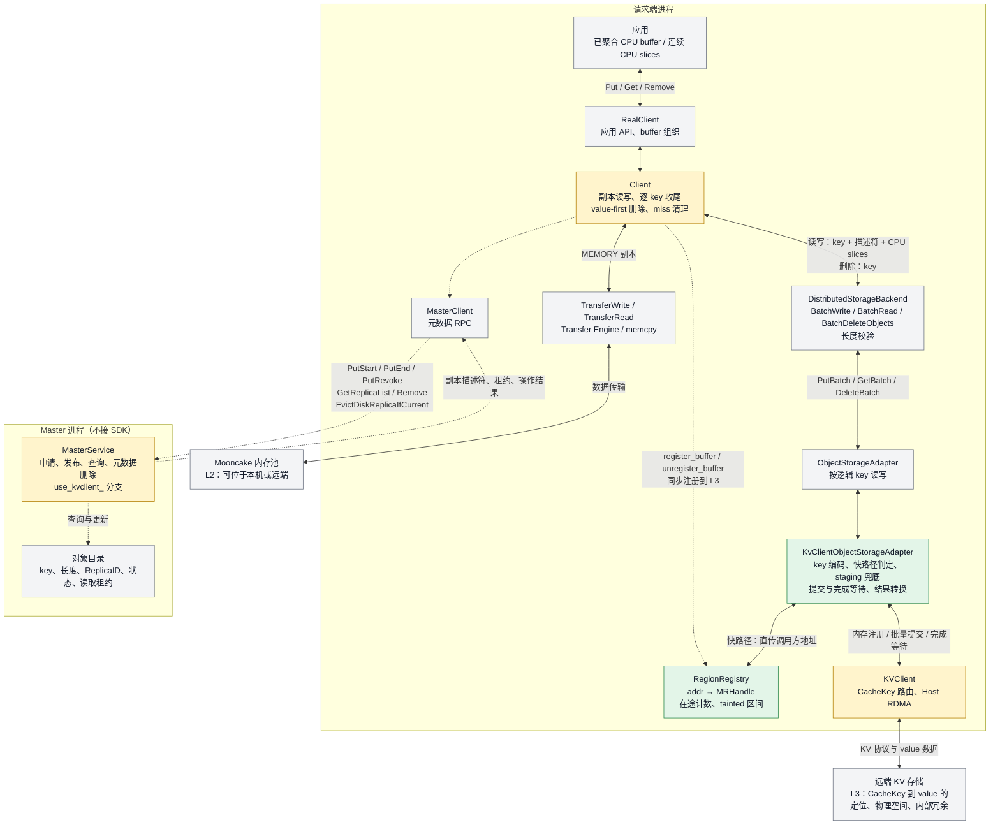

**分层职责**：

| 层 | 职责 | 本方案改动 |
| --- | --- | --- |
| `Client` | 副本编排、逐 key 收尾、删除路由、miss 清理 | 删除顺序改 value-first；miss 清理门控放宽；本地内存注册同步转发到 L3 |
| `DistributedStorageBackend` | slices → 对象请求转换、长度校验 | 仅新增 `UsesKvClient()` 组合判断与注册转发 |
| `ObjectStorageAdapter` | 对象存储统一契约 | **零改动**（接口不变） |
| `KvcsObjectStorageAdapter` | KVCS 后端实现 | **零改动**（与 KVClient 平级，互不影响） |
| `KvClientObjectStorageAdapter` | KVClient 后端实现：key 编码、快路径判定、staging 兜底、提交与完成等待、结果转换 | **新增**；数据面分快/慢两条路径（§3.2.3） |
| `RegionRegistry` | 已注册区间的 `addr → MRHandle` 查找、在途计数、tainted 区间 | **新增** |

### 2.1.2 Client 侧类图

黄色表示修改现有类，绿色表示新增类，灰色表示复用接口或数据结构。类图列出相关成员，参数和返回类型作了简化；新增方法使用设计名称。

```mermaid
classDiagram
    direction TB

    class DistributedStorageConfig["DistributedStorageConfig（修改）"] {
        +fs_adapter_type
        +object_storage_config_path
        +UsesObjectStorage()
        +UsesKvcs()
        +UsesKvClient()
        +Validate()
    }
    class FileStorage["FileStorage（修改）"] {
        -storage_backend_
        -client_
        +FileStorage(config, client)
        +Init()
    }
    class Client["Client（修改）"] {
        -dfs_storage_backend_
        +SetDfsStorageBackend(backend)
        +RegisterLocalMemory(addr, len, ...)
        +unregisterLocalMemory(addr)
        +Put(key, slices, config)
        +Get(key, slices)
        +Remove(key)
        +BatchRemove(keys, force)
        -ReconcileMissingKvReplica(key, query, replica)
    }
    class DistributedStorageBackend["DistributedStorageBackend（复用）"] {
        -object_storage_adapter_
        -distributed_config_
        +BatchWrite(requests)
        +BatchRead(requests)
        +BatchDeleteObjects(keys)
        +UsesObjectStorage()
        +UsesKvClient()
    }
    class ObjectStorageAdapter["ObjectStorageAdapter（复用）"] {
        +PutV(key, iov, iovcnt)
        +PutBatch(requests)
        +GetBatch(requests)
        +DeleteBatch(keys)
        +Exists(key)
        +ListKeys()
        +GetRange(key, buffer, len, offset)
        +Init()
        +GetName()
    }
   
    class KvClientObjectStorageAdapter["KvClientObjectStorageAdapter（新增）"] {
        -kv_client_
        -region_registry_
        -staging_region_
        -staging_slot_stride_
        -staging_states_
        -canonical_handle_
        +Init()
        +RegisterKvRange(addr, len)
        +UnregisterKvRange(addr, drain_timeout)
        +PutV(key, iov, iovcnt)
        +PutBatch(requests)
        +GetBatch(requests)
        +DeleteBatch(keys)
        -EncodeKey(logical_key)
        -TryPlanFastPath(iov, object_size, is_store)
        -RegisterStagingRegion()
        -AcquireSlot(wire_len)
        -ReleaseSlot(slot)
        -QuarantineSlot(slot)
        -Taint(region, addr, wire_len)
        -SubmitAndWait(is_store, entries, owners, results)
    }

    class RegionRegistry["RegionRegistry（新增）"] {
        -regions_
        +Add(addr, len, handle)
        +Remove(addr, drain_timeout)
        +Find(addr, len)
        +IsTainted(region, addr, len)
        +Taint(region, addr, len)
    }

    class SdkKvClient["kv::KvClient"] {
        +LoadFromFile(path, config)$
        +Init(config)
        +StoreAsync(entries, task_id, options)
        +LoadAsync(entries, task_id, options)
        +DeleteAsync(keys, task_id, options)
        +QueryAsync(keys, task_id, options)
        +Wait(task_id, timeout, result)
    }

    FileStorage o-- DistributedStorageBackend : "共享持有后端"
    FileStorage --> Client : "注入 DFS 后端"
    Client o-- DistributedStorageBackend : "共享持有"
    DistributedStorageBackend *-- DistributedStorageConfig : "保存配置"
    DistributedStorageBackend *-- ObjectStorageAdapter : "持有对象适配器"
    ObjectStorageAdapter <|-- KvClientObjectStorageAdapter
    KvClientObjectStorageAdapter *-- SdkKvClient : "持有 SDK 实例"
    KvClientObjectStorageAdapter *-- RegionRegistry : "持有注册表"
    DistributedStorageConfig ..> KvClientObjectStorageAdapter : "工厂按配置创建"

    style DistributedStorageConfig fill:#fff4cc,stroke:#b58105,color:#111827
    style FileStorage fill:#fff4cc,stroke:#b58105,color:#111827
    style Client fill:#fff4cc,stroke:#b58105,color:#111827
    style KvClientObjectStorageAdapter fill:#e3f5e8,stroke:#28864b,color:#111827
    style RegionRegistry fill:#e3f5e8,stroke:#28864b,color:#111827
    style DistributedStorageBackend fill:#f3f4f6,stroke:#6b7280,color:#111827
    style ObjectStorageAdapter fill:#f3f4f6,stroke:#6b7280,color:#111827
    style SdkKvClient fill:#f3f4f6,stroke:#6b7280,color:#111827
```

| 类或函数 | 接口与改动说明 |
| --- | --- |
| `DistributedStorageConfig` | `UsesObjectStorage()` 列表加入 `"kvclient"`；新增 `UsesKvClient()`，与 `UsesKvcs()` 平级；`Validate()` 增加 KVClient 专属分支 |
| `CreateStorageBackend(config)` | 修改现有工厂函数，在 distributed 分支新增 `UsesKvClient()` case 创建新适配器 |
| `FileStorage` | 修改构造时的 DFS 启用判断，将 KVClient 后端注入 Client；沿用现有初始化入口 |
| `Client` | `ReconcileMissingKvcsReplica()` 推广为图中的 `ReconcileMissingKvReplica()`；`RegisterLocalMemory` / `unregisterLocalMemory` 在 TE 成功后被转发到 L3（注册 best-effort，注销需排空，见 §3.6） |
| `DistributedStorageBackend` | 读写路径已由 `UsesObjectStorage()` 抽象化；新增 `UsesKvClient()` 组合判断与 `RegisterKvRange` / `UnregisterKvRange` 转发 |
| `ObjectStorageAdapter` | **零改动**。同步契约（payload 须在返回前保持有效）是 staging 兜底与零拷贝快路径共同的前提 |
| `RegionRegistry` | **新增**。`addr → MRHandle` 的包含关系查找、在途计数、tainted 区间；不对外暴露，仅适配器持有（§3.2.3） |
| `kv::KvClient` | **SDK 不改**。只用 `StoreAsync` / `LoadAsync` / `DeleteAsync` / `QueryAsync` 四个公共方法——SDK 不暴露 `Batch*Async`；`StoreAsync` / `LoadAsync` 按 `entries.size() > 1 \|\| useBatchIoForSingleKey`（默认 true，故单条也走 `BATCH_*`）内部选择 opcode，适配器无需关心。四个方法均带 `const kv::IoOptions& options = {}`；本方案不填 `kvns`、不用 `prerequisite`（见 §3.2.1） |

### 2.1.3 Master 侧类图

Master 在现有 `ObjectMetadata` 和 `Replica` 上管理 KVClient 的逻辑 DFS 副本。`PutStart` 创建描述符，`PutEnd` 发布副本，查询返回可读副本，Remove 和明确 miss 清理更新对象目录。Master **不接 SDK**，不创建 driver，也不建 capacity provider。

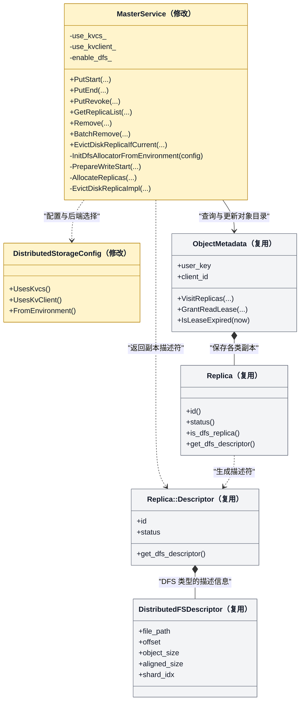

Master 查询自身对象目录，Client 根据返回的描述符调用 driver。存储返回明确 miss 时，由 Client 请求 `EvictDiskReplicaIfCurrent` 条件清理。

| 类 | 改动与职责 |
| --- | --- |
| `MasterService` | 新增私有 `use_kvclient_`（与 `use_kvcs_` 平级）。改动 ：`enable_dfs_` 判定、初始化新增分支、descriptor 铸造、`PrepareWriteStart` 门与 N 上限校验 |
| `DistributedStorageConfig` | 解析 KVClient 配置，提供与 `UsesKvcs()` 平级的能力判断 |
| `ObjectMetadata` / `Replica` | 保存 key、写入 Client、副本身份、状态和读取租约，沿用既有元数据持久化方式 |
| `Replica::Descriptor` / `DistributedFSDescriptor` | 向 Client 返回对象长度、ReplicaID 和状态。KVClient 模式下 `file_path` 为空、`offset` 为 0、`shard_idx` 为 -1，`object_size = N`、`aligned_size = AlignUp(N, 512)` |


## 2.2 业务交互流程

### 2.2.1 写入流程

下图以新 key 的 Put 为例，按申请、数据写入和提交顺序展开。Master 的申请与收尾分别绘制，元数据 RPC 经 `MasterClient` 发送，数据由请求端访问内存池和远端存储。

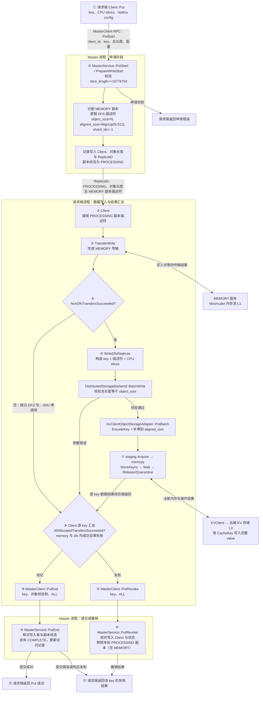

**关键判定**（两副本硬逻辑裁决，零代码改动）：`DetermineReplicaWriteMode` 在 `dfs > 0` 时返回 `RELIABLE_MULTI_REPLICA`，故 `AllAllocatedTransfersSucceeded` 要求 memory 与 dfs **全部成功且零失败**，否则 `PutRevoke(ALL)`。

PutEnd 响应未知时，Client 返回提交错误；后续通过 Master 查询或符合条件的重复提交确认发布状态。

### 2.2.2 读取流程（S1 / S5）

下图展开完整对象 Get 选中 DFS 副本后的数据路径，Master 按查询阶段和 miss 清理阶段分别绘制。内存副本淘汰后，Master 仍保留已发布的 DFS 记录，读取 Client 按相同流程访问 L3。

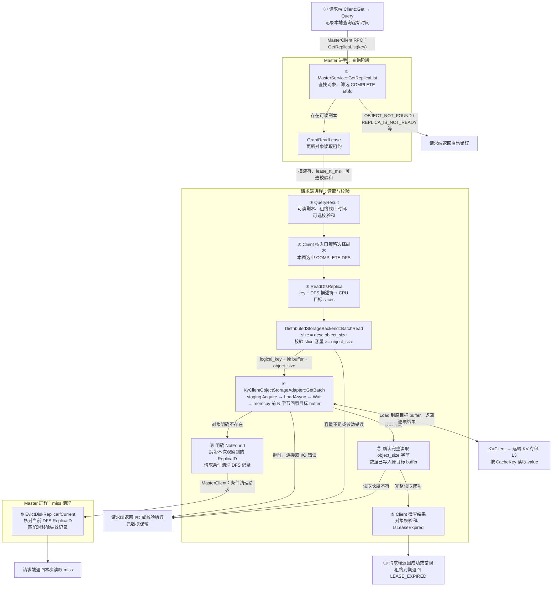


普通 `Client::Query` 使用本地查询起始时间加 `lease_ttl_ms` 计算租约截止时间，完整对象 Get 在读取结束后检查有效期。

### 2.2.3 删除流程（S3，value-first）

删除顺序与 KVCS 相反：Client 先调用 KVClient 删除 value，再对删除成功的 key 请求 Master 移除对象元数据。

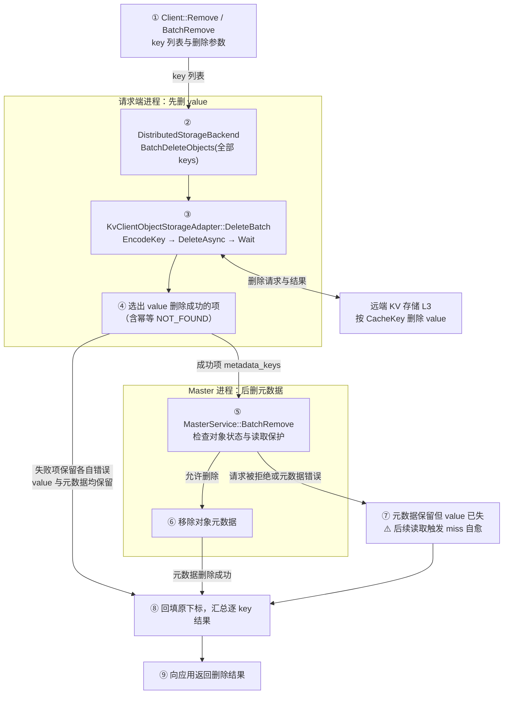

**顺序理由**：KVClient 的三条孤儿回收通道全断，metadata-first 的孤儿是**永久且无界**的。

**中间态自愈**：value 已删、元数据尚在 → 读取返回 `NOT_FOUND` → `ReconcileMissingKvReplica` → `EvictDiskReplicaIfCurrent` 按 ReplicaID 条件清理。**value-first 删除依赖 miss 清理同时落地**，否则中间态无人清理。

**失败态可安全重试**：value 删除失败的 key **不进入**元数据删除集合，故 value 与元数据同时保留。这是 value-first 相对 metadata-first 的核心优势。

### 2.2.4 Upsert 流程（S4）

Upsert 使用 `UpsertStart / UpsertEnd / UpsertRevoke` 管理本次更新。Master 按现有状态机处理对象可见性，Client 通过同一适配器写入新 value；内存与 DFS 的结果按 key 汇总，处理方式与 Put 一致。

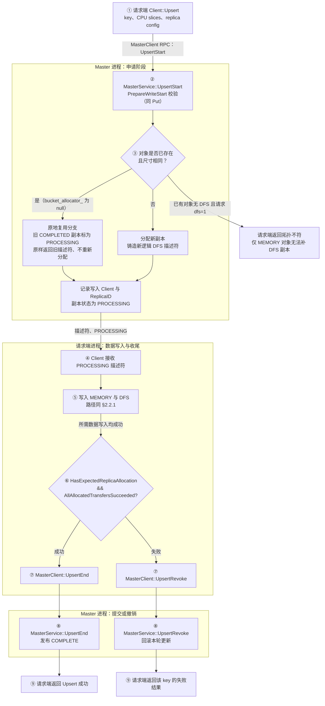

 **仅 MEMORY 的对象无法经 Upsert 补 DFS 副本**，需先 Remove 再 Put。

## 2.3 运行设计

本节按阶段展开适配器内部的时序。各阶段的判定依据与代码位置见 §3 的 shard 设计。

### 2.3.1 初始化阶段

初始化在 `CreateStorageBackend` 工厂内创建适配器，随后由后端 `Init()` 触发 SDK 连接与 staging region 注册。**注册是一次性的**，整个适配器生命周期只注册一个大 region。

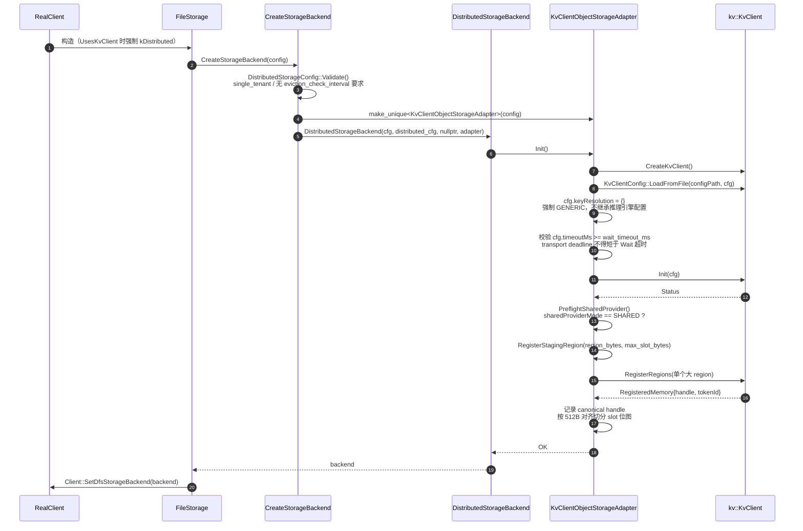

**注册表初始为空**：`RegionRegistry` 不参与 `Init`，只由 `Client::RegisterLocalMemory` 在应用调用 `register_buffer` 时逐步填充。未注册期间所有请求走 staging，功能不受影响（§3.2.3、§3.6）。

### 2.3.2 写入阶段

写路径分两条：命中**快路径**（已注册、`N % 512 == 0`、单段连续、地址对齐、未 tainted）时直接把调用方地址填进 `KVBuffer`，不拷贝；否则回退 **staging**（拷入 slot 并补零到 `wire_len`）。两条路径随后共用同一套提交与结果处理：按对象边界切批后一次性提交 `StoreAsync`，再 `Wait` 完成；task 终态为 `OK` / `PARTIAL_FAILED` 时逐条映射 `entryStatus`，并**按每条 entry 的状态**处置其 buffer（快路径 taint 区间、兜底路径 quarantine slot）；task 本身为非终态时整批置错并处置全部 buffer。

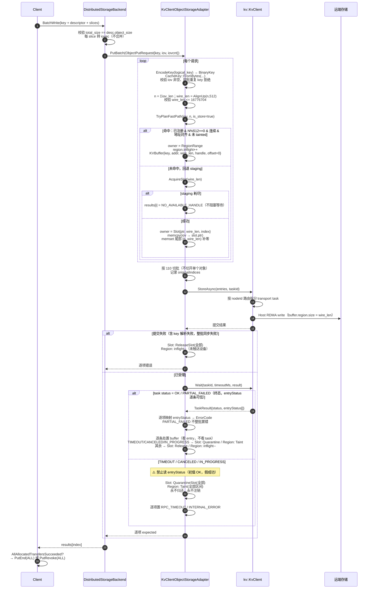

### 2.3.3 读取阶段

读路径与写路径对称：命中快路径时设备直接写入调用方 buffer（`N % 512 == 0` 保证不会写到声明范围之外）；否则取 staging slot 承接设备写入，`Wait` 完成后只把前 N 字节 memcpy 回调用者 buffer。明确 `NOT_FOUND` 触发 miss 清理；超时则处置 buffer（slot quarantine / 区间 taint）且**不**触发清理。

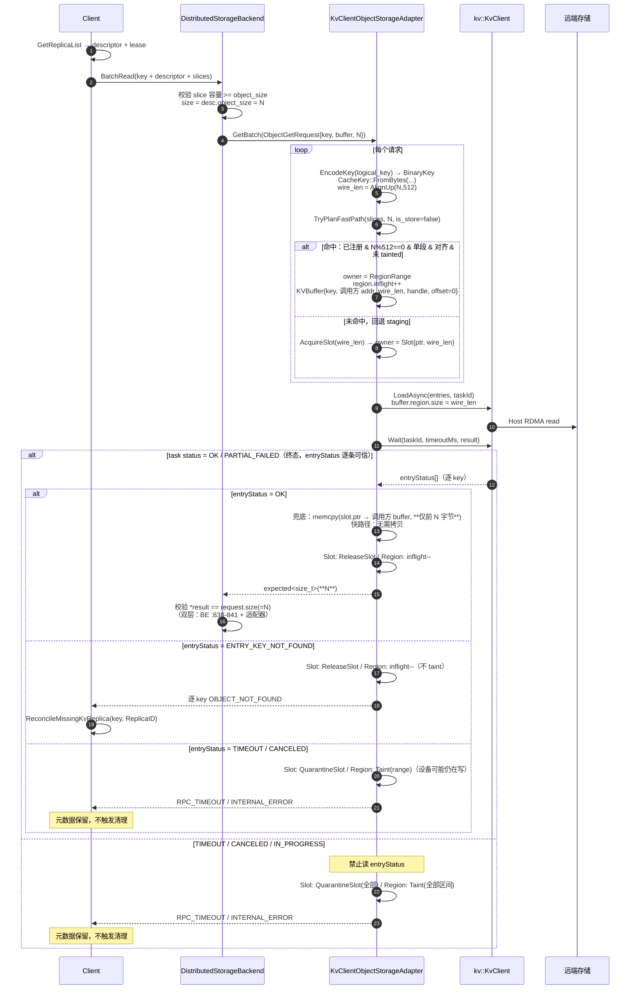

### 2.3.4 删除阶段

删除只传 key、不传 buffer，因此不涉及 staging，也没有 quarantine 风险。value 删除成功（含幂等 `NOT_FOUND`）的 key 才进入元数据删除集合；失败项两者同时保留，可安全重试。

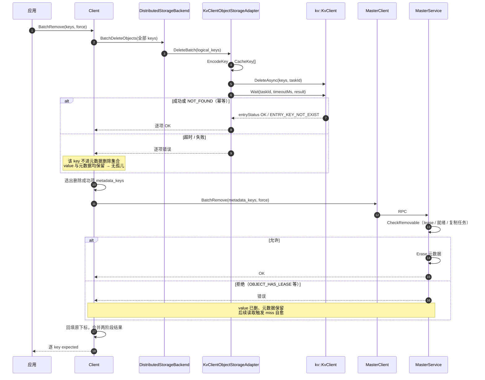

### 2.3.5 miss 清理阶段

清理是条件性的：Client 携带本次读取**观察到**的 ReplicaID，Master 在 key 锁内核对，只有仍为当前记录时才移除。读到 R1 而目录已是 R2 时返回不匹配，R2 原样保留。

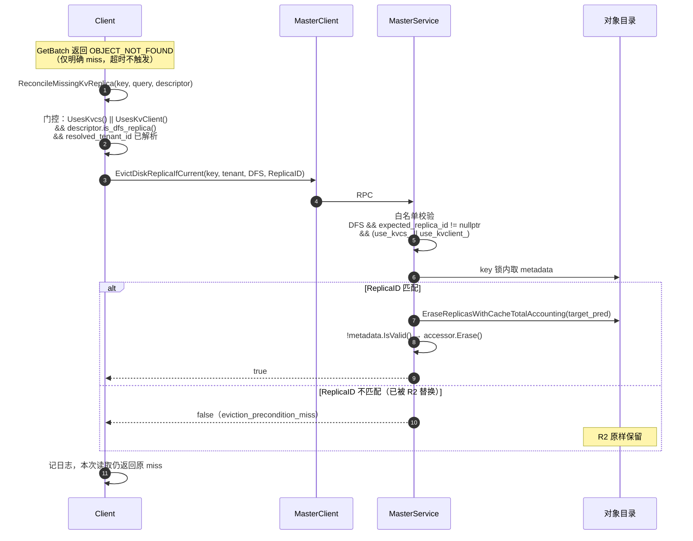

### 2.3.6 关闭阶段

关闭必须先排空在途操作再注销全部 region：staging region 与 `RegionRegistry` 里由 `register_buffer` 注册的区间都要注销。quarantine 的 slot 与 tainted 区间都表示「设备可能仍可访问」，`InUseSlots()` 或区间在途计数非零即为泄漏信号，需显式告警。

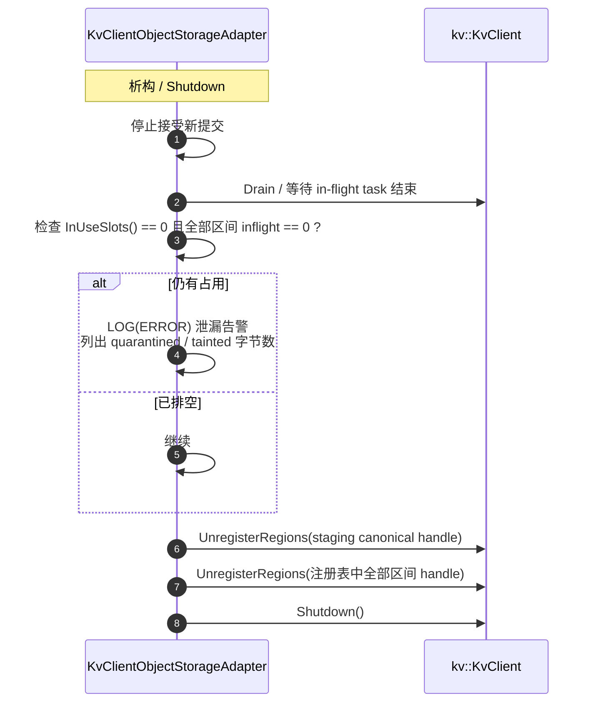

**说明**：staging region 不逐个注销，随 canonical handle 统一释放；`RegionRegistry` 中的区间按 handle 逐个注销。正常路径下调用方应先 `unregister_buffer`，关闭时仍残留的记录属于调用方违约，只做尽力清理并告警。`QuarantinedBytes()` / `TaintedBytes()` 非零是**泄漏或降级指标**，需在关闭日志中显式输出。

## 2.4 SFMEA 分析

只列会改变设计或需要专门用例的失效模式；等价分支合并到同一编号行，纯既有语义、范围外与不可达项已并入相关条目或删除。

| 编号 | 故障模式 | 故障影响 | 容错措施 | 故障注入 / 备注 |
| --- | --- | --- | --- | --- |
| SFMEA-01 | logical key XXH64 碰撞：两个不同 key 映射到同一 CacheKey | **数据损坏**：后写覆盖先写，读到错 value。默认（`MOONCAKE_STORE_CHECKSUM` 关闭）无从发现；开启后 Get 端以 `CHECKSUM_MISMATCH` 暴露，但 Put 侧仍是覆盖写、不报错 | 不做 fingerprint（默许碰撞）；可复用既有 object checksum 作为检测手段；部署文档须写明 key 数量级上限 | 缩小 seed 空间强制构造碰撞。概率 ≈ n²/2^65：10^8 key → 2.7e-4，10^9 → 2.7% |
| SFMEA-02/03 | 非法 logical key：为空，或同批内重复 | 空 key 无法编码；同批重复会让同一 CacheKey 在一个 task 内冲突，SDK 行为未定义 | `EncodeKey` 拒空（`INVALID_PARAMS`）；写侧拒绝同批重复，读/查/删去重后 fan-out | 去重需在新适配器内自行实现（可参照 `kvcs_object_storage_adapter.cpp:144-147`） |
| SFMEA-04 | 未按 `AlignUp(N,512)` 补零，直接把 N 当作线格式长度（`buffer.region.size`） | 提交被拒或行为未定义；slot 复用时把上次 I/O 的残留数据发到存储侧 | `wire_len = AlignUp(n, 512)`，`Acquire(wire_len)`，尾部 `[n, wire_len)` 显式 `memset` 补零 | 写 513 字节对象，断言 `buffer.region.size == 1024` 且尾部全 0。N 非 512 倍数是**合法输入**，故障在补零遗漏 |
| SFMEA-05/06 | 长度非法：N > 16,776,704，或 N == 0 | 超限会被 `PackSqe` 本地拒绝，预发送失败 **abort 整个 transport task**（`trans_task_executor.cc:227-232`）；N == 0 不被 SDK 接受 | 适配器逐请求预检 `wire_len <= kKvClientMaxValueBytes` 且 `n > 0`；Master `PrepareWriteStart` 第一道校验 | 不能指望「只失败超限那条」。Master 那道必需：`kMaxSliceSize`（16,777,200）更宽且只在 CACHELIB 下生效 |
| SFMEA-07/08 | 初始化门禁失败：`sharedProviderMode != SHARED`，或 `RegisterRegions` 失败 | 前者在 INDEPENDENT 下 SDK 会为每个 ASU 节点 `BindMemory` 全部已注册区域，而 AICPU 的 `BindMemory` 只接受 `MEM_DEVICE` → **非空 view 下注册必然 PARTIAL_FAILED**；后者无 staging 内存，所有 I/O 不可用 | `Init()` 中 `PreflightSharedProvider` 硬门禁（缺省或为 0 直接 `DFS_SERVICE_UNAVAILABLE`）；注册失败则 `Init()` → `FileStorage::Init` 明确失败 | 必须在 Init 阶段失败而非运行期；注册部分成功时 SDK 已自行回滚 |
| SFMEA-09 | staging slot 耗尽 | 新 I/O 无法分配 slot | 逐项返回 `NO_AVAILABLE_HANDLE`，**不阻塞等待**；在日志中记录 | 不可 fail-silent：读路径静默失败会永久不可诊断 |
| SFMEA-10/11 | 提交前 buffer 元数据不合法：`buffer.handle` 与预期不符，或调用方自填 `mrKey` | 非 0 但未注册的 handle 在提交阶段**不报错**，到 Wait 才以 `BUFFER_NOT_REGISTERED` 暴露且**连坐整 task**；`mrKey` 由 SDK 回填，自填值无效 | 提交前按 owner 预检：staging 条目**精确等于** canonical handle，快路径条目精确等于注册表 handle（都不接受「非 0 即可」）；`mrKey` 一律留 `std::nullopt` | 两套注册（TE / SDK）并存，不能用「非 0」近似 |
| SFMEA-12 | `Wait` 超时，设备仍在访问 staging | 若归还 slot 并被复用 → 设备写入他人数据 = **数据损坏** | slot **quarantine**：永不归还、永不注销，直到排空；超时后不再触碰该 slot | **承重组件，不可裁剪**。SDK 无面向业务的中止能力：`Cancel` 只由 `Shutdown` 调用，且只放弃任务、不停设备（`kv_transport_impl.cc:196-201`） |
| SFMEA-13 | 超时后读 `entryStatus` | 初值是 `Status::OK()`，`BuildResult` 在 `!Done()` 时原样返回 → **假成功**，数据未落盘却报成功 | 仅 `OK` / `PARTIAL_FAILED` 两个可信终态下映射 `entryStatus`；`TIMEOUT` / `CANCELED` / `IN_PROGRESS` 或本地 `Wait` 非 OK 时**不读**，整批置错 | 必须有专门用例覆盖，否则极易回归 |
| SFMEA-14 | task 级 `PARTIAL_FAILED`，逐项 entryStatus 部分失败 | 部分 key 成功部分失败 | 逐项映射 entryStatus → ErrorCode 并按 `originalIndices` 回填；slot 按 **entry status** 处置：业务错误 → Release，`TIMEOUT` / `CANCELED` / `IN_PROGRESS` → Quarantine | entryStatus 与输入严格一一对应；task 终态**不等于**可安全归还（SFMEA-40） |
| SFMEA-15/16 | 派发阶段失败：已派发后 `CANCELED`，或路由失败（`routed asu transport not found`） | `CANCELED` 时设备可能已接触 buffer；路由失败时未触达设备 | `CANCELED` → quarantine slot / taint 区间；路由失败 → Release / `inflight--` | 两者都发生在提交阶段，但 buffer 安全性相反，**不能合并处置** |
| SFMEA-17/19/31 | 设备侧资源/连接错误：`CQE_OUT_OF_CREATE_SIZE`、`CONNECTION_ERROR`、存储空间耗尽 | 写入或读取失败；无容量查询与自动回收 | 分别映射为 `NO_AVAILABLE_HANDLE` / `DFS_SERVICE_UNAVAILABLE`；Master 不建 capacity provider | 无容量接口 → 只能事后失败；容量管理留待 SDK |
| SFMEA-18 | `CQE_KEY_NOT_EXIST` / `ENTRY_KEY_NOT_FOUND`（读时） | 对象在存储侧不存在 | 映射为 `OBJECT_NOT_FOUND` → 触发 `ReconcileMissingKvReplica` 条件清理 | **必须与超时严格区分**：超时**不**触发清理 |
| SFMEA-20/21/24 | 删除中间态：value 已删而元数据残留（Master `BatchRemove` 失败 / `CheckRemovable` 拒绝 / Client 崩溃） | 已发布对象不可读；`CheckRemovable` 拒绝时对象仍受租约保护，元数据不会被判为失效 | 后续读取返回 `NOT_FOUND` → miss 自愈清理 DFS 记录；无 pending-delete 持久化队列 | 已知窗口：语义安全（不返回错数据），但会丢已成功 Put 的数据。value-first 依赖 miss 清理，二者必须同时落地 |
| SFMEA-22 | 删除阶段：value 删除失败（超时 / 不可达） | value 与元数据**同时保留** | 该 key 不进元数据删除集合 → **无孤儿**；返回错误供上层重试 | value-first 的核心收益：失败态可安全重试 |
| SFMEA-23 | 迟到 Delete 误删新 value（同 key 重写） | 旧删除请求命中新写入的 value | 无专门机制（XXH64 下新旧 value 同 CacheKey）；调用方须串行组织同 key 的删除/重建/更新 | 调用方契约，非本方案引入 |
| SFMEA-25 | `RemoveAll` / `RemoveByRegex` 被调用 | 若只删元数据不删 value → **一次性泄漏整个 L3** | 门控放宽到 KVClient，返回 `NOT_SUPPORTED` 且**不删元数据** | `client_service.cpp:3843`、`:3864`，value-first 删除的连带必改项 |
| SFMEA-26/27 | 不支持元数据恢复：Master 重启（默认无 HA），或误配 `enable_oplog=true` | 重启后目录全丢、L3 value 不可发现；误配时恢复门会在 HA 切换时拒绝所有 DFS 描述符 | 检测到 `enable_oplog` 即启动期 `LOG(FATAL)`；恢复门保持 `use_kvcs_` only，**不改** | 把运行期失效提前到启动期；运维须知晓无恢复能力 |
| SFMEA-28 | 三副本 `memory + nof + ASU` | `dfs > 0` 时 `FLEXIBLE_DUAL_REPLICA` 不可达（`replica.h:315-318`）→ 静默落入 RELIABLE，**nof 变为必需**，nof 抖动导致整 Put 失败 | `PrepareWriteStart` 显式拒绝 `INVALID_PARAMS` | 有意与 KVCS 不对称：把运行期惊喜变成启动期可发现约束 |
| SFMEA-30 | miss 清理 CAS 不匹配（读到 R1，目录已是 R2） | 无 | `EvictDiskReplicaIfCurrent` 返回 false，R2 原样保留（`master_service.cpp:6463-6473`） | 既有 CAS 语义，仅需放宽白名单 |
| SFMEA-32 | `Shutdown` 时仍有 in-flight task | 注销 region 会导致设备访问已注销内存 | 先 `Drain` 排空，再断言 `InUseSlots()==0` 且各区间 `inflight==0`，非零则 `LOG(ERROR)` 并输出 `QuarantinedBytes()` / `TaintedBytes()` | staging region 与注册区间分别注销 |
| SFMEA-33 | 读回长度 != `object_size` | 数据不完整 | 双层校验：适配器内 + `DistributedStorageBackend:838-841`，返回 `FILE_READ_FAIL` | `GetBatch` 必须返回 **N**（= `object_size`）而非 `wire_len`，否则每次读取都误报 |
| SFMEA-37/39 | 启用 string key 路径的连带风险：`Resolve()` 提交阶段失败，或共用配置写了 `inference.engine=vllm_ascend` | 前者让整批同步失败（`taskId` 无效、返回 `INVALID_ARGUMENT`）；后者把 `@...@<数字>` 结尾的 key 静默重解释为分层 key（identity 截断 + `baseOffset`），**读写落到错误的 key/offset 且不报错** | 本方案只传 `FromBytes`（解析直接返回原值、恒成功），并在 `Init` 前把 `keyResolution` 复位为 `GENERIC`；提交阶段同步失败统一 Release 全部 slot（与 SFMEA-16 同路） | 换用 `FromEngineKey` 前这两道必须保留，并补解析失败用例 |
| SFMEA-38 | 全零 `CacheKey` | 协议层 `INVALID_ARGUMENT`（`kv_protocol.cc` 的 `IsCacheKeyAllZero`），预发送失败会 abort 整个 transport task | `EncodeBinaryKey` 内把全零结果替换为非零常量（概率 2^-64，但不值得留窗口） | 与 SFMEA-05 同一 abort 机制 |
| SFMEA-40 | 传输层 deadline 到期，以 **`PARTIAL_FAILED` + 逐条 `TIMEOUT`** 的形式返回（`trans_task_executor.cc:390-401` → `trans_task_manager.cc:35-41`）；`TransportTaskExecutor::Cancel` 同样只放弃任务、不停设备（`:258-275`） | 若按 **task status** 处置 slot（把 `PARTIAL_FAILED` 当「可安全归还」）→ 设备仍在写的内存被放回 free list → **静默数据损坏** | slot 处置只看 **entry status**：`TIMEOUT` / `CANCELED` / `IN_PROGRESS` → quarantine，其余 → release（§3.2.2 裁决表） | **承重**：`PARTIAL_FAILED` 既可能来自设备逐条报错（可归还），也可能来自 deadline（不可归还），二者在 task status 上无法区分。用例 T-57 |
| SFMEA-41 | SDK 配置的 transport deadline 小于适配器 `Wait` 超时：`waitTimeoutMs` 同时写 `defaultWaitTimeoutMs` 与 `timeoutMs`（`config_utils.cc:183-186`），后者进 `transportConfig.timeoutMs`（`:273`）；默认 `timeoutMs` 仅 100 ms | 健康但较慢的写（尤其 16 MiB 大对象）在 `Wait` 到期前被判 `PARTIAL_FAILED` + `TIMEOUT`，故障现象由「超时」伪装成「设备错误」；叠加 SFMEA-40 时还会污染 slot | `Init` 内校验 `sdk_config.timeoutMs >= wait_timeout_ms`，不满足拒绝启动（§3.3）；生产配置须显式设置 `waitTimeoutMs` | 用例 T-58 |
| SFMEA-42 | 快路径边界判定错误：`N % 512 != 0`、`addr` 未对齐、跨注册区间、或区间未注册 | 读会越界写调用方内存；写会把相邻内存发到 L3；或访问未注册内存 | 门槛 `wire_len == n` + `addr % 512 == 0` + 整体包含于单一区间 + 未 tainted，任一不满足回退 staging；逐原因计数 | 用例 B-T01 / B-T02 |
| SFMEA-43 | 注销与在途 I/O 竞争：`unregister_buffer` 时仍有请求在用该区间 | 注销设备仍在写的内存 → **数据损坏** | 区间 `inflight` 计数 + drain（≤5 s）；超时返回错误且**不**注销 SDK handle | 用例 B-T04 |
| SFMEA-44 | tainted 区间被复用 | 设备迟到写入 → **静默数据损坏** | `Find` 拒绝与 tainted 重叠的请求；tainted 只能由 `unregister_buffer` 清除；`TaintedBytes()` 告警 | 用例 B-T03 |
| SFMEA-45 | 注册状态不一致：L3 注册失败、重复注册、或 handle 不属于 SDK | 快路径失效；或提交时 `BUFFER_NOT_REGISTERED` 连坐整 batch | 注册 best-effort 只降级不报错；重复 `base` 拒绝；快路径只用注册表内的 handle，不由指针推导 | 用例 B-T05 |

## 2.5 可定位设计

### 2.5.1 统一关联字段

所有 driver 与适配器日志必须携带以下字段，使一次 I/O 可跨层串联：

| 字段 | 来源 | 用途 |
| --- | --- | --- |
| `logical_key` | 应用 | 业务侧关联（可能含敏感信息，按日志级别裁剪） |
| `cache_key` | `EncodeBinaryKey` 结果的 16 位 hex（`kv::BinaryKey`，不经 SDK 解析） | 碰撞排查的**主要**手段（默认配置下唯一；开启 object checksum 后可被 `CHECKSUM_MISMATCH` 直接发现）：两个不同 logical_key 出现同一 cache_key 即为碰撞 |
| `object_size` | descriptor | 对齐/上限问题定位 |
| `task_id` | SDK | 跨 client/transport 层关联 SDK 内部日志 |
| `replica_id` | descriptor | miss 清理 CAS 排查 |
| `io_path` | 适配器 | `zero_copy` / `staging`，定位拷贝与降级 |
| `region_id` | `RegionRegistry` | 快路径区间关联（注册、taint、inflight） |
| `wire_len` | 适配器 | 线格式长度；与 `object_size` 的差值即补零量 |
| `fallback_reason` | 适配器 | `unaligned_n` / `noncontiguous` / `unaligned_addr` / `unregistered` / `tainted` / `disabled` |
| `slot_index` | 适配器 staging 分配 | 泄漏与 quarantine 追踪 |
| `batch_index` / `original_index` | 适配器 | 批量结果错位排查 |

### 2.5.2 日志与指标

| 级别 | 内容 |
| --- | --- |
| `ERROR` | Wait 超时（含 `task_id`、`op`、涉及 slot 数、**quarantine / tainted 字节数**）；`RegisterRegions` 失败；`Shutdown` 时 `InUseSlots() != 0` 或区间 `inflight != 0`；entryStatus 映射到未知 SDK 码；`unregister_buffer` 排空超时 |
| `WARNING` | staging 占用率 > 90%；`PreflightSharedProvider` 通过但 provider 类型非预期；单项 entryStatus 失败（非整 task）；L3 注册失败（快路径降级） |
| `INFO` | `Init` 成功（含 SDK 版本、`sharedProviderMode`、region 大小、slot 数、`MaxValueSize`）；`Shutdown` 完成（含累计 quarantine / tainted 字节） |
| `VLOG(1)` | 每次 `PutBatch` / `GetBatch` / `DeleteBatch` 的 key 数、总字节、切批数、`io_path` 分布、耗时分解 |
| `VLOG(2)` | 逐 entry 的 `logical_key` → `cache_key` 映射、`io_path` 与 `region_id`、slot 分配 / 归还 / quarantine、区间 taint |

| 指标 | 类型 | 说明 |
| --- | --- | --- |
| `kvclient_io_path_total{path,op,result}` | counter | 快/慢路径占比 |
| `kvclient_zerocopy_fallback_total{reason}` | counter | 降级原因分布 |
| `kvclient_registered_bytes` | gauge | 当前注册区间总量 |
| `kvclient_tainted_bytes` | gauge | **单调不减**，仅 `unregister_buffer` 清除；非零即降级信号 |
| `kvclient_staging_quarantined_bytes` | gauge | staging 侧泄漏指标 |

### 2.5.3 定位手册

| 症状 | 排查路径 |
| --- | --- |
| Init 失败 `DFS_SERVICE_UNAVAILABLE` | 查 `sharedProviderMode` 是否为 SHARED（SFMEA-07）；查 view service 可达性 |
| Init 失败 `PARTIAL_FAILED` | 查 `RegisterRegions` 日志；AICPU provider 下确认 SHARED 模式 |
| Put 全部失败但 SDK 日志无异常 | 查是否读了超时后的 `entryStatus`（SFMEA-13）；查 `Wait` 超时日志里的 `task_id` 与 `task_status`（§2.5.2） |
| 读到错误数据，无报错 | **优先怀疑 key 碰撞**（SFMEA-01）：grep VLOG(2) 日志，比对两个 logical_key 是否得到同一 `cache_key` |
| 读取恒返回 `FILE_READ_FAIL`，但数据其实写对了 | 查 `GetBatch` 是否误返回 `aligned_size` 而非 N（§3.4）——后端比对的是 `desc.object_size` |
| 读到的对象尾部有脏数据 | 查写路径是否漏了 `memset` 补零，或读路径 memcpy 是否误用了 `wire_len` 而非 N |
| 内存持续增长不释放 | 查关闭日志输出的 `QuarantinedBytes()` / `TaintedBytes()`（§2.5.2）；非零说明有超时 slot 未排空或区间被降级（SFMEA-12/44） |
| 零拷贝命中率低 | 查 `kvclient_zerocopy_fallback_total{reason}`：`unaligned_n` 说明对象长度不是 512 倍数；`unregistered` 说明未调 `register_buffer`；`tainted` 说明此前超时把区间降级了（§3.2.3） |
| `unregister_buffer` 返回错误 | 该区间仍有在途 I/O，drain 超时；等待请求结束重试（SFMEA-43） |
| Remove 返回成功但存储侧仍有 value | 不可能——value-first 下成功即已删。若出现，查是否走了 `RemoveAll`/`RemoveByRegex`（SFMEA-25） |
| Remove 返回错误且对象变为不可读 | 已知窗口（SFMEA-21）：value 已删但 `CheckRemovable` 拒绝。等待后续读取触发 miss 自愈 |
| Get 持续 `OBJECT_NOT_FOUND` 但目录有记录 | 查 `EvictDiskReplicaIfCurrent` 是否返回 `INVALID_PARAMS`——说明 `use_kvclient_` 白名单漏改（§3.5） |
| 对象大于 4 MiB 写入失败 | 查 `kKvClientMaxValueBytes` 是否被误配；KVClient 上限是 16,776,704 而非 KVCS 的 4 MiB |
| N 在 16,776,705 ~ 16,777,200 之间的对象写入失败 | 预期行为。该区间能通过 Mooncake 的 `kMaxSliceSize` 但超 SDK 线格式上限，由 `PrepareWriteStart` 拒绝（§3.5） |
| Master 重启后 L3 全部读不到 | 预期行为（不支持恢复裁决，SFMEA-26）。目录不可恢复，value 不可枚举 |

---

# 3 shard 设计描述

## 3.1 shard-1：key 编码（`kvclient_key_codec`）

**职责**：logical key → 8 字节 `kv::BinaryKey` 的确定性映射，并包装成 SDK 的 `kv::CacheKey`。

**文件**：`mooncake-store/include/storage/distributed/kvclient/kvclient_key_codec.h`（header-only）

> **SDK 类型约束**：SDK 的 `kv::CacheKey` 已不是裸的 `std::array<std::byte,8>`，而是一个持有 `std::variant<BinaryKey, std::string>` 的类，只能通过 `kv::CacheKey::FromBytes(BinaryKey)` / `kv::CacheKey::FromEngineKey(std::string)` 构造，对外只暴露 `TryGetBinaryKey()` / `TryGetEngineKey()`。它没有 `data()` / `size()` / 迭代器，也不是聚合体。本 shard 因此把 **8 字节身份**收敛在 `kv::BinaryKey` 上，只在最后一步包成 `CacheKey`。

```cpp
#pragma once

#include <cstdint>
#include <cstring>
#include <string>
#include <string_view>

#include <xxhash.h>

#include "kv_types.h"

namespace mooncake::kvclient {

// Fixed seed. The mapping must be a pure function of the logical key so that
// any client, at any time, derives the same CacheKey. Do not mix in epoch,
// process id, or random salt: that would break cross-client reads.
// Deliberately the same value as the SDK's HASH_SEED_VALUE
// (kv_semantics/src/client/key_resolver.h). We never hand the SDK a string key,
// so this does not change the wire identity today; sharing one constant keeps a
// future switch to FromEngineKey a no-op and makes cache_key directly
// comparable with the UCM/ASUStore side.
inline constexpr XXH64_hash_t kCacheKeySeed = 5381ULL;

// Collisions are accepted by design (no fingerprint validation). Two distinct
// logical keys mapping to the same CacheKey silently overwrite each other.
// Probability is ~n^2/2^65; see SFMEA-01 for the deployment key-count bound.
inline kv::BinaryKey EncodeBinaryKey(std::string_view logical_key) {
    XXH64_hash_t hash =
        XXH64(logical_key.data(), logical_key.size(), kCacheKeySeed);
    // The protocol rejects an all-zero key (kv_protocol.cc IsCacheKeyAllZero)
    // and that rejection aborts the whole transport task, so the 2^-64 case
    // is mapped away instead of being left as a latent batch poisoner.
    if (hash == 0) hash = kCacheKeySeed;
    kv::BinaryKey raw{};
    std::memcpy(raw.data(), &hash, sizeof(hash));
    return raw;
}

// The only form handed to the SDK. Binary keys are passed through unchanged
// by the SDK's key resolver, so the wire identity is exactly what we hashed.
inline kv::CacheKey EncodeCacheKey(std::string_view logical_key) {
    return kv::CacheKey::FromBytes(EncodeBinaryKey(logical_key));
}

// 16 hex chars. This is the only observable handle for collision diagnosis,
// so it must be logged unconditionally at VLOG(2). It takes BinaryKey rather
// than CacheKey because CacheKeyView/CacheKeyToHex live in the SDK's private
// src/trans/trans_types.h and are not available to external consumers.
inline std::string CacheKeyToLogString(const kv::BinaryKey& key) {
    static constexpr char kHex[] = "0123456789abcdef";
    std::string text;
    text.reserve(key.size() * 2);
    for (auto byte : key) {
        const auto value =
            static_cast<unsigned char>(std::to_integer<unsigned char>(byte));
        text.push_back(kHex[value >> 4]);
        text.push_back(kHex[value & 0x0F]);
    }
    return text;
}

}  // namespace mooncake::kvclient
```

**设计说明**：

- **seed 选择**：取 `5381`，与 SDK 的 `HASH_SEED_VALUE`（`kv_semantics/src/client/key_resolver.h`）同值。本方案不使用 SDK 的 string key 解析，故 seed 不影响今天的 wire 身份；对齐它只是为了 (a) 将来若改用 `FromEngineKey`，wire key 逐字节不变，(b) 与 UCM/ASUStore 侧用同一函数校验时 `cache_key` 可直接比对。借鉴 `nvme_kv/key_codec.cpp:44-45` 的 XXH64 用法，但那里用双 seed 产出 16 字节（`low`/`high`）；本方案只需 8 字节，单 seed 即可。
- **不做 fingerprint**（key 碰撞裁决）：value 前 N 字节就是应用原始数据（尾部 `[N, aligned_size)` 是补零，读回时丢弃），故无需 value 内嵌校验头，§2.3.3 的双层长度校验得以保留。本层不引入任何指纹，碰撞默认不可检测；可复用既有 object checksum（`MOONCAKE_STORE_CHECKSUM`，默认关闭）在 Get 端暴露为 `CHECKSUM_MISMATCH`，或用 §2.5.1 的 `cache_key` 日志事后排查。
- **纯函数约束**：映射不得混入 epoch / 进程 id / 随机种子。这既是跨 Client 读取的前提，也是不支持恢复裁决下唯一需要保证的稳定性。
- **SDK 侧 string key 哈希为预留能力，本方案不使用**（KVClient `#1641` 起 `kv::CacheKey::FromEngineKey(std::string)` 会在 `SubmitAsync` 内用 XXH64(seed=5381) 自行哈希）。理由按权重排序：
  1. **数据身份的归属**（主因）。8 字节 wire key 是 L3 侧持久身份，seed 属于 Mooncake 的部署约束。seed 现已与 SDK 对齐（`5381`，见上一条），但 `HASH_SEED_VALUE` 仍定义在私有头 `src/client/key_resolver.h`，SDK 不承诺跨版本稳定；一旦随版本变化，存量 L3 数据会**静默全量失效**——而没有 List 接口也没有恢复能力，泄漏的空间无法回收（SFMEA-26）。
  2. **隔离推理引擎语义**。`FromEngineKey` 的解析结果受配置文件 `inference.engine` 影响，`vllm_ascend` 下会把以 `@...@<数字>` 结尾的 key 重解释为分层 key 并改写 `entry.offset`（SFMEA-39）。传 `FromBytes` 时解析器直接返回原值，这条路径根本不可达。
  3. **碰撞可观测性**（次要，不单独支撑裁决）。碰撞概率本身很低（10^8 key → 2.7e-4），不足以成为主要理由；但 `FromEngineKey` 下解析发生在 SDK 内部且不回传（`TaskResult` 只有 `status` / `entryStatus` / `queryResult`；`CacheKeyToHex` 在私有传输头，键解析路径不调用），`cache_key` 这个**唯一**能把「两个 logical key 撞到同一 CacheKey」串起来的诊断字段会彻底消失。保留它代价为零。
  另外两点只在 `FromBytes` 路径成立：全零结果被映掉（SFMEA-38，SDK 的 `DefaultKeyResolver::Resolve` **没有**全零保护）；字节序由我们控制（`memcpy` 小端，与 SDK 的 `hash & 0xff` 循环在 LE 平台等价）。

  启用条件（三者同时满足前保持预留）：SDK 公开 seed 并承诺跨版本稳定；SDK 暴露解析后的 wire key 供调用方取用；`inference.engine` 与 L3 的 key 语义解耦。
- **全零 key 必须映射掉**：协议层对全零 key 直接 `INVALID_ARGUMENT`，而预发送失败会 abort 整个 transport task（SFMEA-05 同一机制）。XXH64 输出全零的概率是 2^-64，但代价是一整批被毒化，不值得留窗口。

## 3.2 shard-2：适配器（`kvclient_object_storage_adapter`）

**职责**：实现 `ObjectStorageAdapter`，承载 key 编码、staging（region 注册 + slot 分配 + quarantine）、提交/等待、结果映射。与 `KvcsObjectStorageAdapter` 平级，互不依赖。

**文件**：`mooncake-store/include/storage/distributed/kvclient/kvclient_object_storage_adapter.h`、`src/storage/distributed/kvclient/kvclient_object_storage_adapter.cpp`

**为什么 staging 不单独成类**：它只有一个消费者；注册与注销本就依赖 `kv::KvClient`，独立成类并不能隔离依赖，只是多一层转发和一个需要同步维护的头文件。故 region、slot 位图、canonical handle 直接作为适配器私有成员持有。

### 3.2.1 类定义

```cpp
#pragma once

#include <atomic>
#include <memory>
#include <mutex>
#include <optional>
#include <shared_mutex>
#include <span>
#include <string>
#include <unordered_map>
#include <vector>

#include "storage/distributed/object_storage_adapter.h"

namespace mooncake {

inline constexpr char kKvClientAdapterName[] = "kvclient";

// Single-entry wire limit: SQE length is 24-bit and must be 512-aligned, so
// 0xFFFFFF & ~511 == 0xFFFE00. Not "about 16 MiB" -- the exact bound matters
// because Mooncake's kMaxSliceSize (16,777,200) is 496 bytes wider and will
// admit values that cannot go on the wire.
inline constexpr uint64_t kKvClientMaxValueBytes = 16'776'704;

struct KvClientAdapterConfig {
    std::string config_path;  // SDK client config
    size_t staging_region_bytes = 128ULL * 1024 * 1024;
    size_t max_slot_bytes = kKvClientMaxValueBytes;
    uint64_t wait_timeout_ms = 30'000;
    // Zero-copy fast path. Disabling it restores exactly the v3.0 behaviour.
    bool zero_copy_enabled = true;
    // How long unregister_buffer waits for in-flight I/O before failing.
    uint64_t unregister_drain_ms = 5'000;
};

struct RegisteredRegion;  // §3.2.3

class RegionRegistry;     // §3.2.3

class KvClientObjectStorageAdapter final : public ObjectStorageAdapter {
   public:
    explicit KvClientObjectStorageAdapter(KvClientAdapterConfig config = {});
    ~KvClientObjectStorageAdapter() override;

    tl::expected<void, ErrorCode> Put(const std::string& logical_key,
                                      std::span<const char> data) override;
    tl::expected<void, ErrorCode> PutV(const std::string& logical_key,
                                       const iovec* iov, int iovcnt) override;
    std::vector<tl::expected<void, ErrorCode>> PutBatch(
        const std::vector<ObjectPutRequest>& requests) override;
    tl::expected<size_t, ErrorCode> Get(const std::string& logical_key,
                                        void* buf, size_t len) override;
    std::vector<tl::expected<size_t, ErrorCode>> GetBatch(
        const std::vector<ObjectGetRequest>& requests) override;
    tl::expected<bool, ErrorCode> Exists(
        const std::string& logical_key) override;
    tl::expected<void, ErrorCode> Delete(const std::string& logical_key) override;
    ObjectStorageIoResults DeleteBatch(
        std::span<const std::string> logical_keys) override;
    tl::expected<std::vector<KeyInfo>, ErrorCode> ListKeys() override;

    tl::expected<void, ErrorCode> Init() override;
    const char* GetName() const override { return kKvClientAdapterName; }

    // Called from Client::RegisterLocalMemory / unregisterLocalMemory. Both are
    // best-effort for registration (a failure only disables the fast path) but
    // unregistration must drain first and may fail (SFMEA-43).
    tl::expected<void, ErrorCode> RegisterKvRange(void* addr, size_t len);
    tl::expected<void, ErrorCode> UnregisterKvRange(void* addr,
                                                    uint64_t drain_ms);

   private:
    // One slot of the registered staging region; the SDK touches nothing else.
    struct StagingSlot {
        void* ptr = nullptr;
        size_t size = 0;
        size_t index = 0;
    };
    enum class SlotState : uint8_t { kFree, kInUse, kQuarantined };

    // Delegates to kvclient_key_codec.h's EncodeBinaryKey and returns the
    // 8-byte wire identity. Wrap with kv::CacheKey::FromBytes at the call site
    // so the same value stays available for cache_key logging (§3.1).
    kv::BinaryKey EncodeKey(std::string_view logical_key) const;
    // Registers the single contiguous HOST_PINNED region and records its handle
    // as the canonical handle every submitted entry must carry.
    tl::expected<void, ErrorCode> RegisterStagingRegion();
    // bytes must be a multiple of 512. NO_AVAILABLE_HANDLE when exhausted;
    // never blocks.
    tl::expected<StagingSlot, ErrorCode> AcquireSlot(size_t bytes);
    void ReleaseSlot(const StagingSlot& slot);
    // Retires the slot permanently: the SDK cannot stop an in-flight device
    // operation (TransportTaskExecutor::Cancel only abandons the task), so a
    // timed-out slot can never be safely reused.
    void QuarantineSlot(const StagingSlot& slot);
    size_t InUseSlots() const;
    size_t QuarantinedSlots() const;
    uint64_t QuarantinedBytes() const;
    uint64_t TaintedBytes() const;
    // Retires one payload after the task reached (or failed to reach) a
    // terminal state. taint=true for statuses where the device may still
    // touch the memory.
    void DisposeOwner(IoOwner& owner, bool taint);

    // Where one submitted payload lives. Determines how to dispose of it after
    // the task reaches a terminal state (§3.2.3).
    struct IoOwner {
        std::optional<StagingSlot> slot;             // staging fallback
        std::shared_ptr<RegisteredRegion> region;    // zero-copy fast path
        uintptr_t addr = 0;
        size_t wire_len = 0;
    };
    struct FastPathPlan {
        std::shared_ptr<RegisteredRegion> region;
        uintptr_t addr = 0;
        size_t wire_len = 0;
    };
    // Returns nullopt when any fast-path condition fails; every rejection is
    // counted by reason so a falling hit rate stays diagnosable (§3.2.3).
    std::optional<FastPathPlan> TryPlanFastPath(const iovec* iov, int iovcnt,
                                                size_t object_size,
                                                bool is_store);
    // Retires [addr, addr + wire_len): the device may still write it, and only
    // unregister_buffer may clear it (SFMEA-44).
    void Taint(const std::shared_ptr<RegisteredRegion>& region, uintptr_t addr,
               size_t wire_len);

    // Kept as a bool because kv::AsuOpType lives in the SDK's private
    // src/common/utils/task_context.h; the public API exposes only
    // StoreAsync / LoadAsync and picks the batch flavour itself.
    // Owners are parallel to entries; on a terminal state each is released,
    // quarantined or tainted according to its own entry status.
    void SubmitAndWait(bool is_store, std::vector<kv::KVBuffer>& entries,
                       const std::vector<size_t>& original_indices,
                       std::vector<IoOwner>& owners, BatchResults& results);
    static ErrorCode MapEntryStatus(const kv::Status& status);
    bool PreflightSharedProvider(const kv::KvClientConfig& sdk_config) const;
    void Shutdown();

    KvClientAdapterConfig config_;
    std::unique_ptr<kv::KvClient> kv_client_;
    std::unique_ptr<RegionRegistry> region_registry_;
    bool initialized_ = false;

    // Staging: the only memory the SDK is allowed to touch.
    mutable std::mutex staging_mu_;
    void* staging_base_ = nullptr;
    size_t staging_region_bytes_ = 0;
    size_t staging_slot_stride_ = 0;  // max_slot_bytes, already 512-aligned
    kv::MRHandle canonical_handle_ = kv::kInvalidMRHandle;
    std::vector<SlotState> staging_states_;
    std::vector<size_t> staging_free_list_;
    size_t quarantined_slots_ = 0;
    uint64_t quarantined_bytes_ = 0;
};

}  // namespace mooncake
```

### 3.2.2 staging 兜底路径

staging 是适配器内唯一带状态机的部分：一个已注册 region + 512B 对齐变长子分配 + quarantine。

```cpp
tl::expected<KvClientObjectStorageAdapter::StagingSlot, ErrorCode>
KvClientObjectStorageAdapter::AcquireSlot(size_t bytes) {
    if (bytes == 0 || bytes % kv::kAlignmentBytes != 0 ||
        bytes > staging_slot_stride_) {
        return tl::make_unexpected(ErrorCode::INVALID_PARAMS);
    }
    std::lock_guard<std::mutex> lock{staging_mu_};
    if (staging_free_list_.empty()) {
        return tl::make_unexpected(ErrorCode::NO_AVAILABLE_HANDLE);
    }
    const size_t index = staging_free_list_.back();
    staging_free_list_.pop_back();
    staging_states_[index] = SlotState::kInUse;
    return StagingSlot{static_cast<char*>(staging_base_) +
                           index * staging_slot_stride_,
                       bytes, index};
}

void KvClientObjectStorageAdapter::QuarantineSlot(const StagingSlot& slot) {
    std::lock_guard<std::mutex> lock{staging_mu_};
    if (slot.index >= staging_states_.size() ||
        staging_states_[slot.index] != SlotState::kInUse) {
        return;
    }
    staging_states_[slot.index] = SlotState::kQuarantined;
    ++quarantined_slots_;
    quarantined_bytes_ += slot.size;
    // Deliberately not pushed back to staging_free_list_: the device may still
    // write into this slot after Wait returned TIMEOUT.
}
```

**设计说明**：

- **为什么是变长子分配而非固定 16,776,704B slot**：固定 slot 下 128 MiB region 只能开 8 个，批深度不足以兑现跨对象合批。变长子分配以 `max_slot_bytes` 为 stride，`AcquireSlot(bytes)` 只要求 `bytes <= staging_slot_stride_`，小对象不浪费批深度。
- **`staging_slot_stride_` 必须 512 对齐**：SDK 只约束 `length`/`offset` 的 512 对齐，**不校验 `buffer_addr`**；region 起始地址与 stride 都对齐可让每个 slot 天然满足地址对齐，避免依赖 SDK 的未校验行为。
- **quarantine 不注销**：quarantine 的 slot 仍属已注册 region，`Shutdown` 时随 region 统一注销。逐个注销会与 in-flight 设备操作竞争。
- **`HOST_PINNED`**：SDK 把 `HOST` / `HOST_PINNED` 都折叠为 `MEM_HOST`（`kv_client_impl.cc:340-345`），pinned 不由 SDK 分配兑现。若需要真正的 pinned 内存，适配器需自行分配（后续优化项，V1 用普通 host 内存）。
- **`tokenId` 只作诊断**：`RegisteredMemory.tokenId` 不入 `KVBuffer`、不当 handle 用；`mrKey` 必须留 `std::nullopt`（SDK 会按 `buffer.handle` 回填，见 SFMEA-11）。
- **`SlotState` 三态**：`kFree` / `kInUse` / `kQuarantined`。`AcquireSlot` 只从 free list 取；`QuarantineSlot` 就地把状态改成 `kQuarantined` 且不回 free list——这是 SFMEA-12 的落点，不可裁剪。
- **注册在适配器内部一次性完成**：`Init()` → `RegisterStagingRegion()` → `RegisterRegions(单个大 region)` → 记录 `canonical_handle_` → 按 `staging_slot_stride_` 初始化 slot 位图。slot 分配面不外露（不是 `ObjectStorageAdapter` 接口的一部分），外部只能通过 `Put*` / `Get*` 间接触发。
- **注销只在 `Shutdown`**：见 §2.3.6；staging region 不逐个 `UnregisterRegions`，随 canonical handle 统一释放；`RegionRegistry` 中的区间由 `unregister_buffer` 逐个注销。

**未覆写的接口**（沿用 `ObjectStorageAdapter` 基类默认）：

| 方法 | 基类默认 | 说明 |
| --- | --- | --- |
| `GetRange` | `NOT_SUPPORTED` | 范围读不支持（§1.2.2） |
| `CheckHealth` | `NOT_SUPPORTED` | 需要真机连通性探测，V1 不做 |
| `SupportsSinglePutAttempt` / `PutOnce` / `PutVOnce` | `false` / `NOT_SUPPORTED` | 仅 immutable-object backend 使用，KVClient 不走该路径 |

`Exists` 与 `ListKeys` 显式覆写为 `NOT_SUPPORTED`（与 KVCS 一致，理由见 §2.1.2 设计要点 4）。

**`Init` 实现**：

```cpp
tl::expected<void, ErrorCode> KvClientObjectStorageAdapter::Init() {
    if (initialized_) return {};
    kv_client_ = kv::CreateKvClient();
    if (!kv_client_) return tl::make_unexpected(ErrorCode::INTERNAL_ERROR);

    // Init takes the config struct, not a path. LoadFromFile also parses the
    // inference-engine keys; keyResolution is reset so that a shared or
    // misconfigured SDK config file cannot change how our keys are resolved.
    kv::KvClientConfig sdk_config;
    auto status = kv::KvClientConfig::LoadFromFile(config_.config_path, sdk_config);
    if (!status.ok()) return tl::make_unexpected(MapStatus(status));
    sdk_config.keyResolution = {};

    // The SDK derives the transport-task deadline from the same config value:
    // waitTimeoutMs sets both defaultWaitTimeoutMs and timeoutMs
    // (config_utils.cc:183-186), and transportConfig.timeoutMs follows
    // (config_utils.cc:273). If that deadline is shorter than our own Wait
    // timeout, a healthy-but-slow write is reported as PARTIAL_FAILED with
    // per-entry TIMEOUT long before Wait expires -- the failure looks like a
    // device error instead of a timeout. Reject the mismatch at startup.
    if (sdk_config.timeoutMs < config_.wait_timeout_ms) {
        LOG(ERROR) << "action=kvclient_config_timeout_too_small"
                   << ", sdk_timeout_ms=" << sdk_config.timeoutMs
                   << ", wait_timeout_ms=" << config_.wait_timeout_ms;
        return tl::make_unexpected(ErrorCode::INVALID_PARAMS);
    }

    status = kv_client_->Init(sdk_config);
    if (!status.ok()) return tl::make_unexpected(MapStatus(status));

    // INDEPENDENT mode makes the SDK BindMemory every registered region on
    // each per-node provider, and AICPU's BindMemory rejects non-device
    // memory -> registration always fails PARTIAL_FAILED once the view is
    // non-empty. Fail here rather than at first I/O.
    if (!PreflightSharedProvider(sdk_config)) {
        return tl::make_unexpected(ErrorCode::DFS_SERVICE_UNAVAILABLE);
    }

    const auto staging_init = RegisterStagingRegion();
    if (!staging_init) return tl::make_unexpected(staging_init.error());

    initialized_ = true;
    LOG(INFO) << "action=kvclient_adapter_init"
              << ", shared_provider_mode=" << static_cast<int>(sdk_config.sharedProviderMode)
              << ", staging_region_bytes=" << config_.staging_region_bytes
              << ", slot_stride=" << config_.max_slot_bytes
              << ", max_value_bytes=" << kKvClientMaxValueBytes
              << ", wait_timeout_ms=" << config_.wait_timeout_ms;
    return {};
}
```

> `PreflightSharedProvider` 读 `KvClientConfig::sharedProviderMode`（`kv_types.h:263`），因此必须接收**已加载的**配置而非重新解析路径。

**批量提交与超时处理骨架**（承重逻辑）：

```cpp
// True when the device may still be reading or writing the staging slot, so
// the slot must be retired instead of recycled. TIMEOUT comes from the
// transport-layer deadline (trans_task_executor.cc:390-401); CANCELED is
// produced both by the pre-send abort (never sent, actually safe) and by
// TransportTaskExecutor::Cancel (abandoned in-flight, unsafe) -- the two are
// indistinguishable here, so treat CANCELED conservatively. IN_PROGRESS means
// the task never reached a terminal state at all.
static bool EntryMayStillTouchMemory(kv::StatusCode code) {
    return code == kv::StatusCode::TIMEOUT ||
           code == kv::StatusCode::CANCELED ||
           code == kv::StatusCode::IN_PROGRESS;
}

// Submits one sub-batch and maps results back through original_indices.
// entryStatus is only consulted when the task reached a trustworthy terminal
// state (OK / PARTIAL_FAILED); anything else retires every buffer, because
// entryStatus still holds its initial OK. Trustworthy is not the same as
// clean: PARTIAL_FAILED routinely carries per-entry TIMEOUT, so buffer
// disposition follows the entry status, never the task status.
// Retires one payload without asking the device again. taint=true means the
// device may still touch it: staging slots are quarantined, registered ranges
// are marked so later requests fall back (SFMEA-44).
void KvClientObjectStorageAdapter::DisposeOwner(IoOwner& owner, bool taint) {
    if (owner.slot) {
        taint ? QuarantineSlot(*owner.slot) : ReleaseSlot(*owner.slot);
        return;
    }
    if (owner.region) {
        if (taint) Taint(owner.region, owner.addr, owner.wire_len);
        owner.region->inflight.fetch_sub(1, std::memory_order_acq_rel);
    }
}

void KvClientObjectStorageAdapter::SubmitAndWait(
    bool is_store, std::vector<kv::KVBuffer>& entries,
    const std::vector<size_t>& original_indices,
    std::vector<IoOwner>& owners, BatchResults& results) {
    // Every entry must carry the exact handle we assigned. A non-zero but
    // unregistered handle is not rejected at submit time; it surfaces only at
    // Wait as BUFFER_NOT_REGISTERED and poisons the whole task (SFMEA-10).
    for (size_t i = 0; i < entries.size(); ++i) {
        const auto expected =
            owners[i].slot ? canonical_handle_ : owners[i].region->handle;
        if (entries[i].buffer.handle != expected) {
            for (auto& owner : owners) DisposeOwner(owner, /*taint=*/false);
            FillError(results, original_indices, ErrorCode::INTERNAL_ERROR);
            return;
        }
    }

    kv::TaskId task_id = kv::kInvalidTaskId;
    // Default IoOptions: no namespace (the SDK does not put gnsid on the wire
    // yet) and no prerequisite (entries are plain host memory). The SDK picks
    // BATCH_STORE / BATCH_LOAD internally from the entry count.
    const auto submit = is_store ? kv_client_->StoreAsync(entries, task_id)
                                 : kv_client_->LoadAsync(entries, task_id);
    if (!submit.ok()) {
        // Rejected before reaching the device: every payload is safe to reuse.
        // This includes key-resolution failures, which fail the whole sub-batch
        // synchronously with an invalid task id (SFMEA-37).
        for (auto& owner : owners) DisposeOwner(owner, /*taint=*/false);
        FillError(results, original_indices, MapStatus(submit));
        return;
    }

    kv::TaskResult task_result;
    const auto wait =
        kv_client_->Wait(task_id, config_.wait_timeout_ms, task_result);

    auto quarantine_and_fail = [&](kv::StatusCode code) {
        // The device may still touch these buffers: retire, never release.
        for (auto& owner : owners) DisposeOwner(owner, /*taint=*/true);
        const auto err = (code == kv::StatusCode::TIMEOUT)
                             ? ErrorCode::RPC_TIMEOUT
                             : ErrorCode::INTERNAL_ERROR;
        LOG(ERROR) << "action=kvclient_task_failed, op="
                   << (is_store ? "store" : "load")
                   << ", task_id=" << task_id
                   << ", task_status=" << toString(code)
                   << ", entries=" << entries.size()
                   << ", retired_buffers=" << owners.size()
                   << ", quarantined_bytes_total=" << QuarantinedBytes()
                   << ", tainted_bytes_total=" << TaintedBytes()
                   << ", code=" << toString(err);
        FillError(results, original_indices, err);
    };

    // Local Wait timeout: the task never reached a terminal state, so
    // entryStatus still holds its Status::OK() initial value
    // (kv_client_impl.cc:476). Reading it would report success for data that
    // never landed.
    if (!wait.ok()) {
        quarantine_and_fail(kv::StatusCode::TIMEOUT);
        return;
    }

    // Only OK / PARTIAL_FAILED are trustworthy terminal states; only there is
    // entryStatus guaranteed to map one-to-one onto the submitted entries.
    const auto task_code = task_result.status.code;
    if (task_code != kv::StatusCode::OK &&
        task_code != kv::StatusCode::PARTIAL_FAILED) {
        quarantine_and_fail(task_code);
        return;
    }

    if (task_result.entryStatus.size() != entries.size()) {
        // Protocol inconsistency: per-entry mapping is impossible.
        quarantine_and_fail(task_code);
        return;
    }

    // OK and PARTIAL_FAILED both mean the task is Done() and entryStatus maps
    // one-to-one onto the submitted entries, so every entry is mapped. Buffer
    // disposition is per entry: PARTIAL_FAILED is not "everything is fine" --
    // when the transport-layer deadline expires it fills every unfinished
    // sub-batch with TIMEOUT and only then reports PARTIAL_FAILED
    // (trans_task_executor.cc:390-401 -> trans_task_manager.cc:35-41), and
    // Cancel abandons in-flight work without stopping the device
    // (trans_task_executor.cc:258-275). Reusing those buffers would let the
    // device write into memory already handed to another I/O.
    for (size_t i = 0; i < entries.size(); ++i) {
        const auto& entry_status = task_result.entryStatus[i];
        results.Set(original_indices[i], MapEntryStatus(entry_status));
        DisposeOwner(owners[i], EntryMayStillTouchMemory(entry_status.code));
    }
}
```

**`task_result.status` 裁决**：

| task status | 处理 | buffer |
| --- | --- | --- |
| `OK` | 逐条映射 `entryStatus` | **按 entry status 逐条处置**（下表） |
| `PARTIAL_FAILED` | 逐条映射 `entryStatus`（**不要整批置错**） | **按 entry status 逐条处置**（下表） |
| `TIMEOUT` / `CANCELED` / `IN_PROGRESS` | 整批置错，此时 `entryStatus` 不可信 | 全部 Quarantine / Taint |
| 本地 `Wait` 返回非 OK | 整批置 `RPC_TIMEOUT` | 全部 Quarantine / Taint |

**buffer 处置只看 entry status，不看 task status**：

| entry status | staging slot | 快路径区间 | 理由 |
| --- | --- | --- | --- |
| `TIMEOUT` | Quarantine | Taint | 传输层 deadline 到期，设备可能仍在 DMA |
| `CANCELED` | Quarantine | Taint | `Cancel` 只放弃任务、不停设备；与「预发送 abort」无法区分，保守处理 |
| `IN_PROGRESS` | Quarantine | Taint | 任务未到终态 |
| 其他（`OK` / 各类业务错误） | Release | `inflight--` | 设备已完成对这段内存的访问 |

这是 `PARTIAL_FAILED` 最容易踩的坑：它既可能是「设备逐条报错」（可安全归还），也可能是「传输层 deadline 到期」（**不可**归还），两者在 task status 上一模一样。按 task status 处置，会在正常超时下把仍在被写入的 buffer 放回可用状态 —— 静默数据损坏（SFMEA-40）。

`Wait` 返回 OK 但 task 仍是 `IN_PROGRESS` 属 SDK 协议异常，按非终态处理（quarantine + `INTERNAL_ERROR`），不读 `entryStatus`。

**错误码映射**（对齐 KVCS 的 `CallError` / `ItemError`，`kvcs_capi_driver.cpp:77-123`）：

```cpp
ErrorCode KvClientObjectStorageAdapter::MapEntryStatus(const kv::Status& status) {
    using SC = kv::StatusCode;
    switch (status.code) {
        case SC::OK:
            return ErrorCode::OK;
        case SC::ENTRY_KEY_NOT_FOUND:
        case SC::ENTRY_DATA_NOT_EXIST:
        case SC::CQE_KEY_NOT_EXIST:
        case SC::NOT_FOUND:
            return ErrorCode::OBJECT_NOT_FOUND;
        case SC::CQE_OUT_OF_CREATE_SIZE:
        case SC::RESOURCE_BUSY:
            return ErrorCode::NO_AVAILABLE_HANDLE;
        case SC::TIMEOUT:
        case SC::CQE_IO_TIMEOUT:
            return ErrorCode::RPC_TIMEOUT;
        case SC::CONNECTION_ERROR:
            return ErrorCode::DFS_SERVICE_UNAVAILABLE;
        case SC::BUFFER_NOT_REGISTERED:
        case SC::BUFFER_NOT_SUPPORTED:
        case SC::INVALID_ARGUMENT:
            return ErrorCode::INVALID_PARAMS;
        case SC::CANCELED:
            return ErrorCode::INTERNAL_ERROR;
        default:
            LOG(ERROR) << "action=kvclient_unmapped_status, code="
                       << static_cast<int>(status.code);
            return ErrorCode::INTERNAL_ERROR;
    }
}
```

⚠️ `OBJECT_NOT_FOUND` 与 `RPC_TIMEOUT` 的区分是**承重**的：只有前者触发 `ReconcileMissingKvReplica` 清理元数据，后者必须保留元数据（SFMEA-18）。

**`DeleteBatch` 的幂等处理**：

```cpp
// ENTRY_KEY_NOT_EXIST is idempotent success, matching the KVCS adapter
// (kvcs_capi_driver.cpp:358-366).
const auto code = MapEntryStatus(task_result.entryStatus[i]);
results[original_indices[i]] =
    (code == ErrorCode::OK || code == ErrorCode::OBJECT_NOT_FOUND)
        ? tl::expected<void, ErrorCode>()
        : tl::make_unexpected(code);
```

删除路径**不使用 staging**（`DeleteAsync` 只传 key，无 buffer），故无 quarantine 风险。

**切批上限**：`TransportConfig` 的 `batchLoadIoNum` / `batchStoreIoNum` = 110、`deleteIoNum` = 254、`queryIoNum` = 256（`kv_types.h:227-230`，均为**结构体成员字段**而非编译期常量，可被配置文件覆盖）。适配器不应硬编码这些值，而应：

- 优先从 SDK 的 `TransportConfig` 读取实际生效值；若 SDK 不暴露读取入口，则用同值作为适配器侧的保守默认，并在 `Init` 日志中打印所用批上限，便于与 SDK 配置不一致时排查。
- 三个上限不可统一成 110——那会让 Delete/Query 无谓降批；也不可放大，可能触发协议错误。
- 切批按对象边界，绝不切开单个对象（§2.3.2）。

## 3.2.3 零拷贝快路径

**职责**：把调用方已注册的连续 CPU 内存直接交给设备，跳过 staging 的两次拷贝。未命中任何条件时回退 §3.2.2。

### 注册表

```cpp
struct TaintedRange {
    uintptr_t begin;
    uintptr_t end;
};

struct RegisteredRegion {
    uintptr_t base{0};
    size_t size{0};
    kv::MRHandle handle{kv::kInvalidMRHandle};
    uint64_t id{0};                      // 日志 / 指标关联
    std::atomic<uint32_t> inflight{0};   // 在途 I/O 数
    bool retiring{false};
    std::vector<TaintedRange> tainted;   // 保序、合并
};

class RegionRegistry {
   public:
    tl::expected<uint64_t, ErrorCode> Add(uintptr_t base, size_t size,
                                          kv::MRHandle handle);
    tl::expected<kv::MRHandle, ErrorCode> Remove(uintptr_t base,
                                                 uint64_t drain_ms);
    std::shared_ptr<RegisteredRegion> Find(uintptr_t addr, size_t len) const;
    bool IsTainted(const RegisteredRegion& r, uintptr_t addr, size_t len) const;
    void Taint(const std::shared_ptr<RegisteredRegion>& r, uintptr_t addr,
               size_t len);
    size_t Inflight() const;
    uint64_t TaintedBytes() const;

   private:
    mutable std::shared_mutex mu_;
    std::unordered_map<uintptr_t, std::shared_ptr<RegisteredRegion>> regions_;
};
```

- **查找语义**：`Find` 返回第一个满足 `addr >= base && addr - base <= size - len` 的区间，即 `[addr, addr+len)` 整体落在同一区间内；跨区间一律回退。
- **重复注册**：同一 `base` 拒绝；部分重叠允许，按包含语义解析。
- **注销**：`Remove` 先把 `retiring` 置位并从查找表摘除（新请求立即回退），再等 `inflight == 0` 最长 `drain_ms`；超时返回 `RPC_TIMEOUT` 且**不**注销 SDK handle（SFMEA-43）。

### 快路径判定

```cpp
// Fallback(reason) counts kvclient_zerocopy_fallback_total{reason} and returns
// nullopt so the caller takes the staging path.
std::optional<FastPathPlan> KvClientObjectStorageAdapter::TryPlanFastPath(
    const iovec* iov, int iovcnt, size_t object_size, bool is_store) {
    if (!config_.zero_copy_enabled) return Fallback("disabled");

    const size_t n = is_store ? SumIov(iov, iovcnt) : object_size;
    const size_t wire_len = AlignUp(n, kv::kAlignmentBytes);
    if (n == 0) return std::nullopt;                     // 交由参数校验拒绝
    if (wire_len > kKvClientMaxValueBytes) return std::nullopt;
    // 核心门槛：线格式长度必须等于对象长度。否则读会越界写调用方内存，
    // 写会把相邻内存发到 L3（SFMEA-42）。
    if (wire_len != n) return Fallback("unaligned_n");
    if (!IsContiguous(iov, iovcnt)) return Fallback("noncontiguous");

    const auto addr = reinterpret_cast<uintptr_t>(iov[0].iov_base);
    if (addr % kv::kAlignmentBytes != 0) return Fallback("unaligned_addr");

    auto region = region_registry_->Find(addr, wire_len);
    if (!region) return Fallback("unregistered");
    if (region_registry_->IsTainted(*region, addr, wire_len))
        return Fallback("tainted");

    return FastPathPlan{std::move(region), addr, wire_len};
}
```

每次回退按 `reason` 计数（`kvclient_zerocopy_fallback_total`），否则命中率下滑无法定位。

### 构造与提交

```cpp
// 快路径：地址直接来自调用方，注册表提供 handle。
kv::KVBuffer entry;
entry.key = kv::CacheKey::FromBytes(EncodeKey(logical_key));
entry.buffer.region = {kv::MemoryType::HOST, plan.addr,
                       static_cast<uint64_t>(plan.wire_len), /*deviceId=*/-1,
                       /*numaNode=*/-1};
entry.buffer.handle = plan.region->handle;
entry.offset = 0;            // 512 对齐；本方案不做分层聚合
entry.mrKey = std::nullopt;  // SDK 按 handle 回填

region->inflight.fetch_add(1);
owners.push_back(IoOwner{std::nullopt, plan.region, plan.addr, plan.wire_len});
```

**`entry.buffer.region.size` 必须等于 `wire_len`**：SDK 没有独立的 KV 长度字段，线格式长度就是它（§3.4）。

### 结果处置

`SubmitAndWait` 对每条 entry 按 `entryStatus` 处置对应的 `IoOwner`：

| entry 状态 | `slot`（兜底） | `region`（快路径） |
| --- | --- | --- |
| `OK` / 业务错误 | `ReleaseSlot` | `inflight--` |
| `TIMEOUT` / `CANCELED` / `IN_PROGRESS` | `QuarantineSlot` | `Taint(range)` + `inflight--` |
| task 非终态 / 提交失败 | 全部 `QuarantineSlot` / `ReleaseSlot` | 全部 `Taint` / 全部 `inflight--` |

`Taint` 把 `[addr, addr + wire_len)` 并入区间的 tainted 列表；之后重叠请求回退 staging，区间其余部分仍可走快路径。tainted 只能由 `UnregisterKvRange` 清除（SFMEA-44）。

## 3.3 shard-3：配置（`kvclient_config`）

**环境变量**（沿用 `Environ::ReadOr` 模式，`kvcs_capi_driver.cpp:39-75`）：

| 变量 | 默认 | 说明 |
| --- | --- | --- |
| `MOONCAKE_KVCLIENT_CONFIG` | 无（必填） | SDK client 配置路径 |
| `MOONCAKE_KVCLIENT_STAGING_BYTES` | 128 MiB | staging region 大小 |
| `MOONCAKE_KVCLIENT_MAX_SLOT_BYTES` | 16,776,704 | 单 slot 上限，须 512 对齐 |
| `MOONCAKE_KVCLIENT_WAIT_TIMEOUT_MS` | 30000 | `Wait` 超时 |
| `MOONCAKE_KVCLIENT_ZERO_COPY` | true | 是否启用零拷贝快路径；关闭后行为与 v3.0 完全一致 |
| `MOONCAKE_KVCLIENT_UNREGISTER_DRAIN_MS` | 5000 | `unregister_buffer` 等待在途 I/O 的上限 |

**校验**（`ReadConfig`）：`config_path` 非空；`staging_bytes >= max_slot_bytes`；`max_slot_bytes % 512 == 0 && <= 16776704`；`wait_timeout_ms > 0`；`unregister_drain_ms > 0`。

**跨配置校验**（`Init` 内，需先 `LoadFromFile` 才能拿到值）：`sdk_config.timeoutMs >= wait_timeout_ms`。SDK 的 `waitTimeoutMs` 配置键同时写 `defaultWaitTimeoutMs` 与 `timeoutMs`（`config_utils.cc:183-186`），后者成为 transport task 的 deadline（`:273`）；若它小于适配器自己的 `Wait` 超时，健康但较慢的写会在 `Wait` 到期前就被判成 `PARTIAL_FAILED` + 逐条 `TIMEOUT`，故障现象从「超时」变成「设备报错」。不满足即拒绝启动（`INVALID_PARAMS`）。

**不设 `MAX_KEY_SIZE`**：hash 编码后 key 恒为 8 字节，与 logical key 长度无关，该配置无意义（这正是 `KvcsDriver::MaxKeySize()` 不适配 KVClient 的表现之一）。

`DistributedStorageConfig::Validate()` 新增分支（`distributed_storage_config.cpp:63-77` 旁）：

```cpp
if (UsesKvClient()) {
    if (!single_tenant) {
        LOG(ERROR) << "DistributedStorageConfig: KVClient requires "
                      "single_tenant=true";
        return false;
    }
    // No capacity API -> no watermark eviction -> eviction_check_interval is
    // meaningless. Deliberately not required, unlike the KVCS branch.
    return true;
}
```

`UsesObjectStorage()` 与新增谓词（`distributed_storage_config.h:27-31`）：

```cpp
bool UsesObjectStorage() const {
    return fs_adapter_type == "oss" || fs_adapter_type == "s3" ||
           fs_adapter_type == "kvcs-lowlevel" || fs_adapter_type == "kvclient";
}
bool UsesKvcs() const { return fs_adapter_type == "kvcs-lowlevel"; }
bool UsesKvClient() const { return fs_adapter_type == "kvclient"; }
```

## 3.4 shard-4：padding 与长度语义

512 对齐裁决下 `object_size = N`，`wire_len = AlignUp(N, 512)` 是唯一的线格式长度（SDK 没有独立的 KV 长度字段，§3.2.3）。

- **快路径**：仅当 `wire_len == N`（即 N 本身 512 对齐）且其余条件满足时成立；此时无需补零，设备读写的就是调用方声明的范围。
- **兜底路径**：`wire_len > N` 时在 staging slot 内补零，读回只取前 N 字节，差值**上层不可见**。

这条门槛是硬性的：读路径若让设备多写 `wire_len - N` 字节，会覆盖调用方 buffer 之后的内存；写路径则会把这些相邻字节发到共享 L3（SFMEA-42）。

**写路径（兜底分支）**：

```cpp
// PutBatch: 后端传来的 ObjectPutRequest{logical_key, iov, iovcnt}
// 仅当 TryPlanFastPath 未命中时走到这里；快路径直接使用调用方地址（§3.2.3）。
const size_t n = SumIovecBytes(request.iov, request.iovcnt);
const size_t wire_len = AlignUp(n, kv::kAlignmentBytes);   // 512
if (wire_len > kKvClientMaxValueBytes) {
    results[i] = tl::make_unexpected(ErrorCode::INVALID_PARAMS);
    continue;
}
auto slot = AcquireSlot(wire_len);             // 按补零后的长度分配
if (!slot) { results[i] = tl::make_unexpected(slot.error()); continue; }

// 多段 iov 依次拷入连续 slot；尾部 [n, wire_len) 补零
size_t written = 0;
for (int j = 0; j < request.iovcnt; ++j) {
    std::memcpy(static_cast<char*>(slot->ptr) + written,
                request.iov[j].iov_base, request.iov[j].iov_len);
    written += request.iov[j].iov_len;
}
std::memset(static_cast<char*>(slot->ptr) + written, 0, wire_len - written);

// kv::KVBuffer has no standalone length field. The SDK derives the wire length
// from buffer.region.size (sqe_request.cc:190 / :251) and applies the 24-bit
// check to it, so every field below is load-bearing -- an unset region.size
// makes the SQE length 0 and the failure only surfaces on the device.
kv::KVBuffer entry;
entry.key = kv::CacheKey::FromBytes(cache_key);
entry.buffer.region = kv::MemoryRegion{
    kv::MemoryType::HOST_PINNED,                   // folded to MEM_HOST by the SDK
    reinterpret_cast<std::uint64_t>(slot->ptr),    // staging address
    static_cast<std::uint64_t>(wire_len),          // ← 线格式长度就在这里
    /*deviceId=*/-1,
    /*numaNode=*/-1,
};
entry.buffer.handle = canonical_handle_;           // 提交前预检精确相等（SFMEA-10）
entry.offset = 0;                                  // 512 对齐；本方案不做分层聚合
entry.mrKey = std::nullopt;                        // SDK 按 handle 回填（SFMEA-11）
entries.push_back(std::move(entry));
```

**`KVBuffer` 的四个必填项**（漏任何一个都会让失败点漂到设备侧）：

| 字段 | 取值 | 作用 |
| --- | --- | --- |
| `buffer.region.{memoryType,addr,size}` | `HOST_PINNED` / slot 指针 / `wire_len` | `size` 是**唯一**的线格式长度来源，24-bit 上限校验也读它 |
| `buffer.handle` | `canonical_handle_` | SDK 精确查表得 `tokenId`；非 canonical 非零值只会在 `ValidateSqeMrKeys` 暴露，并 abort 整个 transport task |
| `offset` | `0` | 协议要求 512 对齐；本方案一个对象一段，不做层聚合 |
| `mrKey` | `std::nullopt` | SDK 无条件 `reset()` 后按 handle 回填，调用方填了也会被覆盖 |

补零是**必需的**，不是可选优化：slot 复用时残留上一次 I/O 的数据，若不显式清零，尾部会把旧数据发到设备。同一 key 的后续读取只取前 N 字节，故残留不影响正确性，但会泄漏无关数据到存储侧——清零同时解决这两点。

**读路径（兜底分支）**：

```cpp
// GetBatch: 后端传来的 ObjectGetRequest{logical_key, buffer, size = object_size}
// 快路径命中时设备直接写调用方 buffer，无需下面的 memcpy（§3.2.3）。
const size_t n = request.size;                  // == desc.object_size
const size_t wire_len = AlignUp(n, kv::kAlignmentBytes);
auto slot = AcquireSlot(wire_len);
// 按上文「四个必填项」填 KVBuffer：buffer.region.size = wire_len，设备写入 wire_len 字节。
// buffer 的归还 / quarantine / taint 由 SubmitAndWait 按 entry status 逐条处置（§3.2.2）。
...
// Wait 成功后逐条：只把前 n 字节 memcpy 回调用者 buffer，尾部 padding 丢弃
std::memcpy(request.buffer, slot->ptr, n);
return n;                                        // 返回 n，不是 wire_len
```

⚠️ **返回值必须是 `n` 而非 `wire_len`**。`DistributedStorageBackend::BatchRead` 会比对 `*object_results[i] != object_requests[i].size`（`:838-841`），而 `request.size` 是 `desc.object_size` = N。返回 `wire_len` 会让每次读取都误报 `FILE_READ_FAIL`。

**`aligned_size` 在读路径不直接使用**：后端传给 `GetBatch` 的 `size` 取 `desc.object_size`（`:817-818`），不取 `aligned_size`。故 `aligned_size` 目前只是元数据记录（供诊断与未来扩展），适配器自行用 `AlignUp(object_size, 512)` 重算线格式长度。这样即使 `aligned_size` 字段缺失或为 0（旧记录），读路径仍能工作。

**长度校验清单**（三道，缺一不可）：

| 层 | 校验 | 位置 |
| --- | --- | --- |
| Master | `value_length <= 16,776,704` | `PrepareWriteStart`（§3.5） |
| 适配器写 | `AlignUp(n,512) <= kKvClientMaxValueBytes` | `PutBatch` 逐请求 |
| 适配器读 | slot 容量 >= `AlignUp(n,512)`，返回长度 == n | `GetBatch` 逐请求 |

Master 那道必需，因为 `kMaxSliceSize`（16,777,200）比 SDK 上限宽 496 字节，且只在 CACHELIB 分配器下生效（`master_service.cpp:5287-5293`）。

## 3.5 shard-5：Master 集成

**文件**：`master_service.{h,cpp}`

**新增成员**：`bool use_kvclient_ = false;`（与 `use_kvcs_` 平级。谓词平级裁决要求 `UsesKvClient()` 与 `UsesKvcs()` 独立，不支持恢复裁决要求恢复门保持 KVCS-only，故不能合并为一个 flag）。

**改动点**：

| 位置 | 改动 |
| --- | --- |
| `master_service.cpp:847` | `enable_dfs_ = DfsEnablementConfig::FromEnvironment().enabled \|\| dfs_config.UsesKvcs() \|\| dfs_config.UsesKvClient();` |
| `:872` 之前 | 新增 `if (dfs_config.UsesKvClient()) { ... return; }` 分支 |
| `:5090` | `if (use_kvcs_ \|\| use_kvclient_) {` — descriptor 铸造。**KVClient 分支公式与 KVCS 不同**：`object_size = value_length`、`aligned_size = AlignUp(value_length, 512)`、`shard_idx = -1`（KVCS 分支 `:5092-5093` 两者都取 `value_length`，不改） |
| `:5249` | `(!use_kvcs_ && !use_kvclient_ && (!dfs_allocator_ \|\| ...))` |
| `:5248` 旁 | 新增 N 上限校验与三副本拒绝（见下）。**不校验 512 整除**——N 任意是合法输入，对齐由适配器补零承担 |
| `:6440` | `use_kvcs_ \|\| use_kvclient_` |
| `:6457` | `(use_kvcs_ \|\| use_kvclient_) && expected_replica_id != nullptr && ...` |
| **不改** `:3533`、`:3825`、`:4118` | 恢复门保持 `use_kvcs_` only（不支持恢复裁决） |

**`InitDfsAllocatorFromEnvironment` 新增分支**：

```cpp
if (dfs_config.UsesKvClient()) {
    if (enable_oplog_) {
        // Decision 6: no metadata recovery for the KVClient backend. The
        // restore gates at :3533/:3825/:4118 stay KVCS-only, so an HA
        // failover would reject every DFS descriptor. Fail at startup with a
        // clear message instead of at recovery time.
        LOG(FATAL) << "KVClient backend does not support metadata recovery; "
                      "enable_oplog must be false";
    }
    use_kvclient_ = true;
    // No EFC target, no capacity provider, no watermark eviction: the SDK has
    // no capacity query API. Master keeps the object directory only.
    LOG(INFO) << "KVClient distributed object storage initialized without DFS "
                 "extent allocator and without capacity provider, config={"
              << dfs_config.FormatStr() << "}";
    return;
}
```

**`PrepareWriteStart` 新增校验**（512 对齐裁决 + 两副本硬逻辑裁决）：

```cpp
// In PrepareWriteStart the length parameter is named slice_length
// (master_service.cpp:5225), not value_length.
if (config.dfs_replica_num > 0 && use_kvclient_) {
    // 512-alignment ruling: the wire format needs a 512B-aligned length, but N
    // itself may be arbitrary -- the adapter pads the staging slot, it does not
    // reject the object. The bound is on the padded length:
    //     AlignUp(slice_length, 512) <= 16'776'704
    // which is equivalent to slice_length <= 16'776'704 (the limit is itself a
    // multiple of 512). Mooncake's own kMaxSliceSize is 16'777'200, i.e. 496
    // bytes wider, and it is only enforced under the CACHELIB allocator
    // (master_service.cpp:5287-5293), so it will happily admit values that
    // cannot go on the wire.
    if (slice_length > 16'776'704) {
        LOG(ERROR) << "key=" << key << ", slice_length=" << slice_length
                   << ", error=kvclient_value_too_large";
        return tl::make_unexpected(ErrorCode::INVALID_PARAMS);
    }
    // Two-replica ruling: only (memory + ASU) and DFS-only are supported.
    // With dfs > 0 the write mode is RELIABLE_MULTI_REPLICA, which would make
    // a NoF replica silently mandatory as well.
    if (config.nof_replica_num > 0) {
        LOG(ERROR) << "key=" << key << ", error=kvclient_rejects_nof_with_dfs";
        return tl::make_unexpected(ErrorCode::INVALID_PARAMS);
    }
}
```

放在 `PrepareWriteStart` 而非 `AllocateReplicas`，因为 Put 与 Upsert 都过这道门。

⚠️ **上限校验是必需的，不能省略**。`AlignUp(N,512) <= 16776704` 等价于 `N <= 16776704`（上限本身是 512 的倍数），但 Mooncake 自己的 `kMaxSliceSize = 16,777,200` 比它宽 496 字节：

```
16,776,704 = 512 × 32767   ← SDK 单 entry 上限
16,777,200 = kMaxSliceSize ← Mooncake 上限（types.h:469 + Slab.h:82,88）
16,777,216 = 512 × 32768   ← N = 16,777,000 补零后的线格式长度
```

N = 16,777,000 能通过 Master 的 slice 校验，补零后却是 16,777,216，超 SDK 上限。超限 entry 在 `PackSqe` 本地被拒，但预发送失败会 **abort 整个 transport task**，把所有 entryStatus 置 CANCELED（`trans_task_executor.cc:227-232`）——即一个越界对象会毒化整批。

⚠️ **Master 的 slice 校验还只在 CACHELIB 分配器下生效**（`master_service.cpp:5287-5293`），DFS-only 写 + 非 CACHELIB 时那道门根本不开。适配器侧须独立再校验一次。

**descriptor 铸造**（`:5090` 分支，KVClient 专属）：

```cpp
if (use_kvclient_) {
    DistributedFSDescriptor descriptor;
    descriptor.object_size = value_length;                    // N，原始长度
    descriptor.aligned_size = AlignUp(value_length, 512);     // 线格式长度
    descriptor.shard_idx = -1;
    replicas.emplace_back(std::move(descriptor), ReplicaStatus::PROCESSING);
}
```

与 KVCS 分支（`:5092-5093` 两者都取 `value_length`）的差异是本方案唯一需要改公式的地方，且落在 KVClient 专属分支内，**不影响 KVCS**。

`aligned_size` 只需满足 `>= object_size`（`IsDfsDescriptorRangeValid` 的 `:62`），不要求是 `config.alignment`（默认 4096）的倍数——因为对象存储分支在 `:664`/`:790` 提前 return，**完全跳过** `IsDfsDescriptorRangeValid`。故 512 对齐的 `aligned_size` 不会被该校验拒绝。

**Upsert 的门同样要放宽**：逻辑描述符分配只在 `use_kvcs_` 下（`:5090-5100`），`PrepareWriteStart` 同样要求（`:5248-5255`）。漏改则 KVClient 的 Upsert 直接 `DFS_SERVICE_UNAVAILABLE`。

## 3.6 shard-6：Client 集成

**文件**：`client_service.{h,cpp}`

**改动 1：`ReconcileMissingKvcsReplica` → `ReconcileMissingKvReplica`**（miss 清理裁决）

```cpp
void Client::ReconcileMissingKvReplica(
    const std::string& key, const QueryResult& query_result,
    const Replica::Descriptor& replica_descriptor) {
    if (!dfs_storage_backend_ ||
        !(dfs_storage_backend_->UsesKvcs() ||
          dfs_storage_backend_->UsesKvClient()) ||
        !replica_descriptor.is_dfs_replica()) {
        return;
    }
    // ... 其余不变（tenant 校验、EvictDiskReplicaIfCurrent、日志）
}
```

调用点 `:1626`、`:1936` 同步改名，声明 `client_service.h:1057` 同步。触发条件不变：仅 `OBJECT_NOT_FOUND`。

**改动 2：`BatchRemove` 的 KVClient 分支改 value-first**（value-first 删除裁决）

```cpp
std::vector<tl::expected<void, ErrorCode>> Client::BatchRemove(
    const std::vector<ObjectKey>& keys, bool force) {
    if (hot_cache_) hot_cache_->BumpKeyGenerations(keys);

    std::vector<tl::expected<void, ErrorCode>> results(keys.size());
    const bool kvclient =
        dfs_storage_backend_ && dfs_storage_backend_->UsesKvClient();

    std::vector<std::string> metadata_keys;
    std::vector<size_t> metadata_indices;
    metadata_keys.reserve(keys.size());
    metadata_indices.reserve(keys.size());

    if (kvclient) {
        // Value first. The KVClient backend has no orphan reclamation path at
        // all: no capacity API (so no watermark eviction), no key listing, and
        // the Master holds no driver. Deleting metadata first would leak the
        // value permanently, and a retry could never fix it because Remove on
        // a gone object returns OBJECT_NOT_FOUND and is skipped.
        const auto deleted = dfs_storage_backend_->BatchDeleteObjects(keys);
        if (deleted.size() != keys.size()) {
            for (size_t i = 0; i < keys.size(); ++i)
                results[i] = tl::make_unexpected(ErrorCode::INTERNAL_ERROR);
            return results;
        }
        for (size_t i = 0; i < keys.size(); ++i) {
            // OBJECT_NOT_FOUND is idempotent success: the value is already
            // gone, which is the intended end state.
            if (deleted[i] ||
                deleted[i].error() == ErrorCode::OBJECT_NOT_FOUND) {
                metadata_keys.push_back(keys[i]);
                metadata_indices.push_back(i);
            } else {
                // Value and metadata both survive -> safe to retry.
                results[i] = tl::make_unexpected(deleted[i].error());
            }
        }
    } else {
        metadata_keys.assign(keys.begin(), keys.end());
        for (size_t i = 0; i < keys.size(); ++i) metadata_indices.push_back(i);
    }

    if (!metadata_keys.empty()) {
        const auto master_results =
            master_client_.BatchRemove(metadata_keys, force);
        for (size_t j = 0; j < metadata_indices.size(); ++j) {
            const size_t i = metadata_indices[j];
            results[i] = (j < master_results.size())
                             ? master_results[j]
                             : tl::make_unexpected(ErrorCode::RPC_FAIL);
        }
    }

    if (hot_cache_ && !metadata_keys.empty())
        hot_cache_->RemoveHotKeys(metadata_keys);
    return results;
}
```

`Remove` 单 key 门控放宽（`:3816`）：`UsesKvcs() || UsesKvClient()`。

**改动 3：`RemoveAll` / `RemoveByRegex` 门控放宽**（SFMEA-25，value-first 删除裁决 连带必改）

```cpp
// :3843 与 :3864
if (dfs_storage_backend_ &&
    (dfs_storage_backend_->UsesKvcs() ||
     dfs_storage_backend_->UsesKvClient()))
    return tl::unexpected(ErrorCode::NOT_SUPPORTED);
```

**必须在删元数据之前返回**，否则一次性泄漏整个 L3。

**改动 4：其余放宽点**

| 位置 | 改动 |
| --- | --- |
| `client_service.cpp:584` | `AttachHostId` 强制 `dfs_replica_num = 1`：`UsesKvcs() \|\| UsesKvClient()` |
| `real_client.cpp:1608` | 创建 `FileStorage` 并强制 `kDistributed` |
| `file_storage.cpp:126` | `enable_dfs` 判断与后端注入 |
| `file_storage_config.cpp:240` | 跳过本地目录校验 |
| `distributed_storage_backend.h:70-71` | 新增 `bool UsesKvClient() const { return UsesObjectStorage() && distributed_config_.UsesKvClient(); }`；新增 `RegisterKvRange` / `UnregisterKvRange` 转发 |
| `client_service.cpp:4199` | `RegisterLocalMemory` 在 TE 注册成功后同步 `RegisterKvRange`；**失败只打 WARNING**，不改变返回 |
| `client_service.cpp:4213` | `unregisterLocalMemory` 先 `UnregisterKvRange`（排空 + 注销），失败即返回错误，**不动 TE** |
| `storage_backend.cpp:6506` 旁 | 工厂新增 `UsesKvClient()` 分支 |

**不改**：`DetermineFinalizeDecision`、`DetermineReplicaWriteMode`、`AllAllocatedTransfersSucceeded`、`HasExpectedReplicaAllocation`、`FinalizeBatchUpsert`——两副本硬逻辑裁决 的两副本硬逻辑现有代码已完全实现。

## 3.7 shard-7：构建与可选依赖

沿用 KVCS 的可选依赖模式（`src/CMakeLists.txt:179-197`）：

```cmake
set(MOONCAKE_KVCLIENT_SDK_FOUND OFF)
find_package(PkgConfig QUIET)
if(PkgConfig_FOUND)
  pkg_check_modules(KVCLIENT QUIET IMPORTED_TARGET "kvclient>=0.1.0")
endif()
if(TARGET PkgConfig::KVCLIENT)
  set(MOONCAKE_KVCLIENT_SDK_FOUND ON)
  message(STATUS "KVClient SDK found: kvclient backend enabled")
else()
  message(STATUS "KVClient SDK not found: kvclient backend builds with "
                 "unsupported stub")
endif()
set(MOONCAKE_KVCLIENT_SDK_FOUND ${MOONCAKE_KVCLIENT_SDK_FOUND} PARENT_SCOPE)
```

新增源文件（`MOONCAKE_STORE_SHARED_OBJECTS` / `mooncake_store`）：

```cmake
storage/distributed/kvclient/kvclient_object_storage_adapter.cpp
```

条件编译与链接：

```cmake
if(MOONCAKE_KVCLIENT_SDK_FOUND)
  target_compile_definitions(mooncake_store_shared_objects
                             PRIVATE MOONCAKE_HAVE_KVCLIENT_SDK=1)
  target_link_libraries(mooncake_store_shared_objects
                        PRIVATE PkgConfig::KVCLIENT)
endif()
```

**`mooncake_store_master` 不链接 KVClient SDK**——不支持恢复裁决下 Master 无适配器实例、无 capacity provider，与 KVCS 需要链接（`:719-721`）不同。

SDK 缺失时工厂的 `UsesKvClient()` 分支返回 `NOT_SUPPORTED`（对照 `kvcs_capi_driver.cpp:404-407` 的 stub 模式），其他后端照常构建。

测试目标（`tests/CMakeLists.txt:416-424` 模式）：

```cmake
add_store_test(kvclient_object_storage_adapter_test
               kvclient_object_storage_adapter_test.cpp)
if(NOT MOONCAKE_KVCLIENT_SDK_FOUND)
  target_compile_definitions(kvclient_object_storage_adapter_test
                             PRIVATE MOONCAKE_KVCLIENT_TEST_NO_SDK=1)
endif()
```

---

# 4 开发自验证用例

层级：**单元** = fake driver / fake SDK，无需真机；**集成** = Mooncake 端到端（fake SDK）；**真机** = fake 无法覆盖的确认项。只保留能区分设计正确性的用例，等价分支合并到同一编号行。

| 编号 | 层级 | 用例 | 预期结果 | 覆盖 |
| --- | --- | --- | --- | --- |
| T-01 / T-02 | 单元 | `EncodeBinaryKey` 幂等与单射：同 key 多次调用、10^5 个不同 key 抽样 | 逐字节相同 / 互不相同 | §3.1 纯函数约束 |
| T-03 | 单元 | 缩小 seed 空间强制构造碰撞，先写 k1 再写 k2 | k2 覆盖 k1，读 k1 得到 k2 的数据；默认配置（checksum 关闭）下**无错误返回**，开启 `MOONCAKE_STORE_CHECKSUM` 时返回 `CHECKSUM_MISMATCH` | SFMEA-01（验证碰撞后果与检测边界） |
| T-04 / T-05 | 单元 | 空 logical key；同批两个相同 logical key | 前者 `INVALID_PARAMS`；后者第二个 `INVALID_PARAMS` | SFMEA-02/03 |
| T-06 / T-25 / T-25b / T-09b | 单元 | N=513 写读；A(513)→B(1024) 复用同一 slot 后再读 A | 成功，`buffer.region.size == 1024`，`[0,513)` 为原始数据、`[513,1024)` 全 0；复用后 A 不含 B 残留 | SFMEA-04、512 对齐裁决（N 任意是合法输入，不是拒绝条件） |
| T-07 | 单元 | N = 16,776,704（上限，本身 512 对齐） | 成功，`buffer.region.size == 16776704`，无补零 | §3.5 上限 |
| T-08 / T-08b | 单元 | N = 16,777,000（能过 `kMaxSliceSize`=16,777,200，但 `AlignUp` 后为 16,777,216 超上限）；N = 16,777,216 | Master `PrepareWriteStart` → `INVALID_PARAMS` 且适配器未被调用；绕过 Master 时适配器预检拒绝且**不提交 SDK** | SFMEA-05 双层防护（**关键**：Master 那道校验存在的理由） |
| T-09 | 单元 | N = 0 | `INVALID_PARAMS` | SFMEA-05/06 |
| T-09c / T-25c / T-27 | 单元 | `GetBatch` 对 N=513 对象的返回值；构造读回长度 != 请求长度 | 返回 **513**（不是 1024）；长度不符 → `FILE_READ_FAIL` | §3.4、SFMEA-33（返回 wire_len 会让每次读都误报） |
| T-10 / T-11 | 单元 | `sharedProviderMode = 0` 时 `Init()`；`RegisterRegions` 返回 PARTIAL_FAILED | 前者 `DFS_SERVICE_UNAVAILABLE` 且不进入 `RegisterRegions`；后者 `Init()` / `FileStorage::Init` 明确失败 | SFMEA-07/08 |
| T-12 | 单元 | staging region 配 1 slot，并发 2 个请求 | 第 2 个立即 `NO_AVAILABLE_HANDLE`，**不阻塞** | SFMEA-09 |
| T-13 | 单元 | 篡改 entry 的 `buffer.handle` 为非 canonical 的非 0 值 | 提交前预检拒绝，不到 Wait | SFMEA-10 |
| T-14 | 单元 | fake SDK 让 `Wait` 返回 TIMEOUT 且 task 保持 in-flight | slot 进 quarantine：`InUseSlots()` 归零、`QuarantinedSlots()==1`、`QuarantinedBytes()` 增加、后续 `Acquire` 拿不到该 slot | SFMEA-12 |
| T-15 | 单元 | fake SDK 让 `Wait` 超时且 `entryStatus` 保持初值 `OK` | 逐项结果为 `RPC_TIMEOUT`，**绝不为 OK** | SFMEA-13（回归防护，必须有） |
| T-16 | 单元 | fake SDK 返回 task status=`PARTIAL_FAILED`，第 2 项 entryStatus 为业务错误，其余 OK | 按 `originalIndices` 回填原下标 2、其余成功；slot 按 entry status 处置（本例全为业务错误 → 全部 Release），`InUseSlots()` 归零 | SFMEA-14（终态：逐条映射 + 按 entry 处置） |
| T-17 | 单元 | fake SDK 让整个 task 返回 `CANCELED`；另跑 `TIMEOUT` / `IN_PROGRESS` | 全部 slot quarantine，逐项 `INTERNAL_ERROR`（`TIMEOUT` 为 `RPC_TIMEOUT`） | SFMEA-15/13 |
| T-18 | 单元 | fake SDK 让 `StoreAsync` 提交阶段失败 | slot 全部 **Release**（非 quarantine），`InUseSlots()` 归零 | SFMEA-16 |
| T-19 | 单元 | fake SDK 返回 `CQE_OUT_OF_CREATE_SIZE` | 映射 `NO_AVAILABLE_HANDLE` | SFMEA-17 |
| T-20 / T-21 | 单元 | fake SDK 读时返回 `ENTRY_KEY_NOT_FOUND`；读时返回 `TIMEOUT` | 前者 `OBJECT_NOT_FOUND`；后者 `RPC_TIMEOUT` 且**不触发** `ReconcileMissingKvReplica` | SFMEA-18 正向 / 反向 |
| T-22 | 单元 | 跨对象合批：3 个对象共 250 entry，批上限 110 | 切成 3 批（110/110/30），无对象被切开，结果下标正确 | §2.3.2 |
| T-23 | 单元 | `DeleteBatch` 遇 `ENTRY_KEY_NOT_EXIST` | 视为幂等成功 | §3.2 |
| T-24 | 单元 | `Shutdown` 时仍有 in-flight | 先 Drain；若 `InUseSlots() != 0` 则 `LOG(ERROR)` 且输出 `QuarantinedBytes()` | SFMEA-32 |
| T-26 | 单元 | `Exists()` / `ListKeys()` / `GetRange()` | 均 `NOT_SUPPORTED` | §1.2.2 |
| T-29 | 集成 | 两副本 Put 成功 → 淘汰 memory → 另一 Client Get | 读到原始数据，逐字节相同 | S1 |
| T-30 | 集成 | DFS-only Put / Get / Remove | 全流程成功 | S2 |
| T-31 / T-32 | 集成 | 注入 ASU 写失败；注入 memory 写失败 | 前者 Put 失败且 Master 侧查不到该对象（memory 副本被一起 revoke）；后者适配器侧提交计数为 0（ASU 零调用）、Put 失败 | 两副本硬逻辑裁决（含短路行为） |
| T-33 | 集成 | 配置 `memory + nof + ASU` 后 Put | `PrepareWriteStart` 返回 `INVALID_PARAMS` | SFMEA-28 |
| T-34 / T-35 | 集成 | 同尺寸对象 Upsert；仅 MEMORY 的对象做 Upsert 请求 dfs=1 | 前者原地复用、ReplicaID 不变、同 CacheKey 覆盖写并读到新值；后者失败（拓扑不符），需先 Remove 再 Put | §2.2.4 |
| T-36 / T-37 | 集成 | Remove：value 删除成功 + Master `BatchRemove` 失败；对象处于 lease 中 | 前者元数据保留 → 后续 Get `NOT_FOUND` → `ReconcileMissingKvReplica` 清理 DFS 记录；后者 `CheckRemovable` 拒绝且 Get 返回 `NOT_FOUND` 而非错数据，最终经 miss 自愈清理 | SFMEA-20/21/24（value-first + miss 清理联动） |
| T-38 / T-39 | 集成 | Remove：value 删除失败；`BatchRemove` 部分 key 失败 | 前者元数据**保留**、重试 Remove 可成功；后者成功项元数据被删、失败项两者均保留、结果与原下标对应 | SFMEA-22、S6 |
| T-40 | 集成 | `RemoveAll()` / `RemoveByRegex()` | 返回 `NOT_SUPPORTED`，**且 Master 侧元数据完全未变** | SFMEA-25（关键：不能只删元数据） |
| T-41 | 集成 | Client 观察到 R1 miss，Master 已发布 R2 | 条件清理返回 false，R2 原样保留且可读 | SFMEA-30 |
| T-42 / T-43 | 集成 | `enable_oplog=true` + KVClient 启动 Master；默认配置（无 HA）重启 Master | 前者 `LOG(FATAL)`，启动失败且错误信息明确不支持恢复；后者目录全丢、Get `OBJECT_NOT_FOUND`、无崩溃无脏数据 | SFMEA-27/26、不支持恢复裁决 |
| T-44 | 集成 | 范围读（窗口 < object_size） | `INVALID_PARAMS`，不触达适配器 | §1.2.2 |
| T-45 | 集成 | `PutEnd` 响应未知 | Client 返回提交错误；重复 Put 或查询可确认状态 | 既有时序（§2.2.1） |
| T-46 | 集成 | 无 KVClient SDK 时构建 | 全部目标构建成功；显式初始化 KVClient 后端返回 `NOT_SUPPORTED`；KVCS/oss/s3 后端功能不受影响 | §3.7 |
| T-47 | 集成 | 既有 KVCS 回归 | `kvcs_object_storage_adapter_test`、`object_storage_adapter_test`、`distributed_storage_config_test` 全部通过 | 平级架构下 **KVCS 代码零改动**；失败即说明改动越界 |
| T-48 | 真机 | ASU `Store` 是否支持**覆盖写**：同 CacheKey 连续两次 Store 不同 value | 读回应为第二次 | **阻塞**：决定 `PutBatch` 是否需先 Delete（KVCS 因 insert-only 必须这么做）。不支持则 Upsert 与同 key 重写都会失败 |
| T-49 | 真机 | `Wait` 超时后设备是否仍访问 buffer | 超时后立即用哨兵值覆写 staging slot，检查是否被设备改写 | **阻塞**：验证 quarantine 的必要性边界 |
| T-50 / T-51 | 真机 | 设备侧 `singleValueMaxBytes` 实际值；多节点部署下跨节点合批路由 | 读 SDK `Init` 日志（只打日志、不 clamp entry 长度）；`originalIndices` 回填正确 | 高：若上限 < 16,776,704 则实际上限更低；SDK 自动拆分未经真机验证 |
| T-55 | 单元 | 配置文件写入 `inference.engine=vllm_ascend` + `aggregation.layer_count/layer_slot_bytes`，Init 后对逻辑 key `model@hash@3` 做 Put | 写入的 entry `offset == 0`，`cache_key` 等于 `EncodeBinaryKey(logical_key)`——未被重解释为分层 key | §2.3.1 `keyResolution` 复位、SFMEA-39 |
| T-56 | 单元 | 注入返回 0 的 hasher 调 `EncodeBinaryKey` | 输出 `BinaryKey` 非全零（不触发协议层 all-zero 拒绝） | SFMEA-38 |
| T-57 | 单元 | fake SDK 让 transport task 到 deadline：`Wait` 返回 OK、`task_result.status == PARTIAL_FAILED`、部分 `entryStatus == TIMEOUT`，其余为 OK | 只有 TIMEOUT 那几条的 slot 进 quarantine；OK 那几条正常 Release；**不得**因 task status 是 PARTIAL_FAILED 就整批 Release | SFMEA-40（**关键**：PARTIAL_FAILED 不等于可安全归还） |
| T-58 | 单元 | SDK 配置 `waitTimeoutMs=100`（或任意 < `MOONCAKE_KVCLIENT_WAIT_TIMEOUT_MS`），调 `Init` | `Init` 返回 `INVALID_PARAMS`，不进入 `RegisterRegions`；错误日志同时打印两个超时值 | SFMEA-41 |
| T-59 | 单元 | 已注册、单段连续、`N % 512 == 0`、地址对齐，Put/Get | 走快路径：`io_path=zero_copy`，不占 staging slot、无 memcpy，数据正确 | SFMEA-42 |
| T-60 | 单元 | 回退矩阵：`N % 512 != 0`、多段不连续、未注册、`addr` 未对齐、跨注册区间 | 均回退 staging，数据正确，`zerocopy_fallback_total{reason}` 对应递增 | SFMEA-42 |
| T-61 | 单元 | 快路径 `Wait` 超时 | 区间进入 tainted；同区间后续请求回退；`tainted_bytes` 增加，`unregister_buffer` 后恢复 | SFMEA-44 |
| T-62 | 单元 | 在途 I/O 时调 `unregister_buffer` | 返回错误，SDK 未注销；在途结束后重试成功 | SFMEA-43 |
| T-63 | 单元 | `RegisterRegions` 失败后 Put/Get | 功能正确，仅快路径禁用（`fallback_reason=disabled/unregistered`） | SFMEA-45 |

## 4.1 验收标准

- 上表全部「单元」「集成」用例通过（fake SDK / 集成环境）。
- T-48 ~ T-51 真机验证通过后方可进入生产部署。
- 24 小时压测后 `QuarantinedBytes()` 与 `TaintedBytes()` 均为 0（无超时泄漏或区间降级）。
- 关闭 `MOONCAKE_KVCLIENT_ZERO_COPY` 时全部用例同样通过：兜底路径不依赖快路径的可用性。
- 既有 KVCS / oss / s3 / hf3fs / posix 后端回归全部通过（T-47）。

---

# 5 已知限制

| 限制 | 说明 | 缓解 |
| --- | --- | --- |
| **key 碰撞静默损坏** | XXH64 单 hash，无 fingerprint（key 碰撞裁决）。碰撞概率 ≈ n²/2^65：10^7 key → 2.7e-6，10^9 → 2.7% | 默认仅能靠 §2.5.1 的 `cache_key` 日志事后排查；可开启 `MOONCAKE_STORE_CHECKSUM` 让 Get 端以 `CHECKSUM_MISMATCH` 发现（Put 仍会覆盖，不报错）。**部署须限定 key 数量级** |
| 删除孤儿窗口 | value-first 下 `CheckRemovable` 拒绝会留下不可读的已发布对象 | 语义安全（不返回错数据）；靠读取 miss 自愈 |
| 无容量管理 | SDK 无容量查询 API → Master 水位淘汰不生效 | 沿用 `:883-889` 降级；容量控制留待 SDK 提供接口 |
| 不支持元数据恢复 | Master 重启即目录全丢，L3 数据不可发现 | 启动期显式拒绝 `enable_oplog`；运维需知晓 |
| 不支持 key 枚举 | `ListKeys` / `RemoveAll` / `RemoveByRegex` 返回 `NOT_SUPPORTED` | 同 key 重写时覆盖 |
| 不支持范围读 | `BatchRead` 对象分支忽略 `range_read`（`:802-818`） | 上层回退整对象读后截取 |
| 适配器内 memcpy + 补零 | 仅**兜底路径**：§2.3.2 的同步契约 + 512 对齐要求尾部补零 | 零拷贝快路径已消掉这两次拷贝；残余成本只落在未注册或非对齐对象上 |
| **零拷贝快路径有条件命中** | 要求 `N % 512 == 0`、单段连续、`addr` 512 对齐、区间已注册且未 tainted；任一不满足即回退 staging | 用 `kvclient_io_path_total` / `zerocopy_fallback_total` 观察命中率 |
| **`unregister_buffer` 可能失败** | 区间仍有在途 I/O 时排空超时，返回错误且不注销 | 调用方等待后重试；不得提前释放内存（SFMEA-43） |
| **tainted 区间只能靠重新注册清除** | 一次超时会把该区间降级，直到 `unregister_buffer` + 重新注册 | 已知窗口：安全优先；`TaintedBytes()` 告警提示 |
| **小对象补零放大** | N < 512 时线格式长度仍是 512，放大最高 512 倍（N=1）；带宽与存储双浪费 | 上层聚合小对象；补零开销可由 §2.5.1 的 `object_size` 与实际线格式长度对比估算 |
| 单对象上限 16,776,704 B | SDK 线格式 24-bit length + 512 对齐。比 Mooncake 的 `kMaxSliceSize`（16,777,200）窄 496 字节 | `PrepareWriteStart` 显式校验（§3.5）；无其他缓解 |
| Upsert 无法为仅 MEMORY 对象补 DFS 副本 | `master_service.cpp:6146-6181` 拓扑不符 | 先 Remove 再 Put |
| **namespace 为预留能力，当前不上线格式** | `IoOptions.kvns` 在 SDK 内被哈希成 GNSID 并挂在 `ClientTask` / `TransportTask` 上，但**没有消费方**：SQE 的 `kv_ns_id` 仍取 `transport.kv_ns_id` 配置。且默认 `IoOptions{}` 得到的是 `XXH32("")` 而非「回退配置值」 | 本方案不填 `kvns`，租户隔离仍靠 `single_tenant=true` + logical key。SDK 升级时须确认 GNSID 是否开始影响 `kv_ns_id`——那会是一次数据可见性迁移 |
| 推理引擎配置可污染 key 解析 | `KvClientConfig::LoadFromFile` 会解析 `inference.engine` / `aggregation.*`；`vllm_ascend` 下以 `@...@<数字>` 结尾的 key 会被重解释为分层 key | 适配器只传 `FromBytes`，并在 `Init` 前复位 `keyResolution`（§2.3.1、SFMEA-39） |