# Mooncake + KVClient L3 接入设计方案

版本：v5.0（文件名沿用 v3）　更新日期：2026-11-23

代码核对基线：分支 `Mooncake_l3_pr2` @ `a2841229`（已合并 upstream main）+ **工作区未提交改动**（PR2 的数据面与 Master 门控）。全文行号与代码块均以该状态为准；升级基线后需重新锚定。

本版按 **PR1（4 个提交，已落地）与 PR2（工作区改动，已落地）的实际实现**重整，替代 v4.10 的设计期描述。§0 给出实现状态总览、「文档 vs 代码」差异台账与已裁决事项。正文标注约定：

- **【PR3】** = 设计已定、代码未落地，属下一个 PR 的范围
- **【未实现】** = 设计意图与当前代码存在落差，需注意
- **裁决 D-n** = 曾悬置、现已拍板且**代码保持现状**的决定，汇总见 §0.3。D-1（512B 对齐归调用方契约）与 D-2（不 override `CheckHealth`）的契约内容与部署约束见 §6.1 / §6.2

---

# 0 实现状态总览

## 0.1 三个 PR 的边界与当前进度

| PR | 范围 | 状态 | 代码落点 |
| --- | --- | --- | --- |
| **PR1** | 配置与构建接线 + 适配器**控制面**（`Init` / `Delete` / `DeleteBatch` / `MakeCacheKey` / `ToErrorCode` / `waitForCompletion`） | ✅ 已提交 | `93ec9401`、`757edd7c`、`f3c8ffd5`、`95f88152`（另有 `8af2fc10` 仅在 `Mooncake_l3_pr1` 分支上） |
| **PR2** | 适配器**数据面**（`PutBatch` / `GetBatch` / `Exists` + 内部 buffer 注册）+ **Master 门控** + 单元测试 | ✅ 工作区已实现，未提交 | 工作区改动 5 文件 + 新增测试 1 文件 |
| **PR3** | Client 侧 value-first 删除、miss 自愈门控放宽、集成测试 | ❌ **未开始** | `client_service.cpp` 中所有 kvclient 分支尚不存在 |

**PR1 的数据面是 stub**：提交版 `PutBatch` / `GetBatch` / `Exists` / `Put` / `PutV` / `Get` / `ListKeys` 一律返回 `NOT_SUPPORTED`（295 行），PR2 才把它们实现（现 585 行）。因此**读 PR1 的提交内容不能了解数据面行为**，必须看工作区。

**PR3 未开始的具体后果**（当前代码实测）：

| 位置 | 现状 | 影响 |
| --- | --- | --- |
| `client_service.cpp:5488-5491` `ReconcileMissingKvcsReplica` | 门控仍为 `UsesKvcs()` only，未改名 | kvclient 读 miss **不触发**条件清理 |
| `client_service.cpp:3947` `BatchRemove` | 仍是 KVCS 的 metadata-first + 后置删 value | kvclient 走 metadata-first → **value 永久泄漏** |
| `client_service.cpp:3891 / 3912` `RemoveByRegex` / `RemoveAll` | 仍为 `UsesKvcs()` only | kvclient 下不返回 `NOT_SUPPORTED` → 只删元数据、泄漏整个 L3 |
| `client_service.cpp:3864` `Remove` 单 key | 仍为 `UsesKvcs()` only | 不走 `BatchRemove` 聚合路径 |
| `client_service.cpp:599-601` `AttachHostId` | 仍为 `UsesKvcs()` only，未夹 `dfs_replica_num = 1` | `dfs_replica_num > 1` 由 Master `PrepareWriteStart`（`:5135-5140`）拒绝，错误暴露点后移；不产生数据损坏 |

> **PR2 单独合入是安全的**：Master 侧已允许铸 kvclient descriptor，但 Client 侧删除路径未接，所以 kvclient 后端在 PR3 落地前**不具备可用的删除语义**。部署须等 PR3。

## 0.2 文档 vs 代码：本版修正的差异台账

v4.10 是设计期文档，以下条目在实现时发生了变更，本版已按代码改正：

| # | v4.10 的描述 | 实际实现 | 影响章节 |
| --- | --- | --- | --- |
| 1 | **基类新增 `RegisterBuffer` / `UnregisterBuffer` / `RequiresBufferHandle`，请求结构新增 `buffer_handle`，由后端预注册并透传** | **完全废弃**。基类与 `ObjectPutRequest` / `ObjectGetRequest` **未改动**；注册在**适配器内部**完成（私有 `RegisterBuffers` / `UnregisterBuffers`） | §2.1、§2.2、§2.3、§3.2、§3.4、§3.6、SFMEA-05/18/19/20 |
| 2 | 伪代码用 `SumIov()` 求和，无连续性检查 | 新增**逐段物理连续性校验**（`uintptr_t` 比较），不连续即 `INVALID_PARAMS` 且**不注册** | §3.2.3 |
| 3 | 同批重复 key 用 `seen.insert(...).second` 一步判重占位 | 查重在注册**前**，占位（`seen.insert`）在注册**成功后**；注册失败不占用 key 槽 | §3.2.3 |
| 4 | 写路径用 `ToErrorCode` | 新增 `ToWriteErrorCode`，把 `ENTRY_KEY_NOT_FOUND` / `ENTRY_DATA_NOT_EXIST` 映射为 `FILE_WRITE_FAIL` | §3.2.3 |
| 5 | `Get` 单 key 包成 batch | `Get` **仍是 `NOT_SUPPORTED`**，只有 `Put` / `PutV` / `Delete` 包成 batch | §3.2.3 |
| 6 | `waitForCompletion` 只分「OK/PARTIAL_FAILED」与「TIMEOUT/CANCELED/IN_PROGRESS」两支 | 新增 `TASK_NOT_FOUND` 分支（非终态）；default 分支为**终态**并扇出 task 状态；额外校验 `entryStatus.size() == entry_count` | §2.3.2、§2.3.3 |
| 7 | `Exists` 手工 `Wait` 并校验 `queryResult->exists` | 复用 `waitForCompletion`，**不检查** `queryResult` | §3.2.3 |
| 8 | `enable_oplog=true` 时 Master `LOG(FATAL)` | 改为 `LOG(ERROR)` + `throw std::invalid_argument`，与相邻 filesystem DFS 分支风格一致 | §1.2.2、§3.5、SFMEA-13 |
| 9 | nof 拒绝写成嵌套 if，error=`kvclient_rejects_nof_with_dfs` | 合并为单个 if，error=`nof_not_supported_with_kvclient` | §3.5 |
| 10 | 两个 metric + ERROR/VLOG 分级日志 + `cache_key`/`task_id`/`buffer_addr` 关联字段 | **均未实现**，当前只有 1 条 INFO + 1 条 WARNING | §2.5 |
| 11 | 同一 `(ptr,size)` 只注册一次、多请求复用同一 handle | **每个请求各注册一次**，批末一次批量注销 | §3.4、§5 |
| 12 | 全文行号锚定 main `46c5eca8` | 已重锚到 `a2841229` + 工作区 | 全文 |

## 0.3 已裁决事项（2026-11-23）

两项此前悬置的问题已拍板，**代码保持现状，不需要改动**：

| # | 议题 | 裁决 | 落地含义 |
| --- | --- | --- | --- |
| D-1 | SDK 协议逐 entry 要求 `length % 512 == 0`，而适配器直接传 N | **默认所有请求都是 512B 对齐的；成功与否由 KvClient 判定** | 适配器**不加**对齐守卫、不做 staging 补零、Master 不对齐 descriptor。512B 对齐是**调用方契约**（与「buffer 在同步调用返回前保持有效」同级的使用前提）。违约时由 SDK 返回错误，Mooncake 不预判、不代偿。详见 §6.1 |
| D-2 | 适配器未 override `CheckHealth()`，基类返回 `NOT_SUPPORTED`，`enable_health_check=true` 会让后端 `Init` 失败 | **不 override `CheckHealth()`** | 保持基类默认。**部署约束**：kvclient 后端下 `MOONCAKE_DISTRIBUTED_HEALTH_CHECK` 必须为 false（这也是它的默认值）。详见 §6.2 |

两项裁决共同的取向是：**适配器不承担 SDK 的职责**。D-1 把对齐归给调用方与 SDK，D-2 把健康检查语义归给 SDK——适配器没有可上报的健康信息，伪造一个「永远健康」的 `CheckHealth` 只会让 `enable_health_check` 变成假开关，比启动即失败更危险。

---

# 1 概述

## 1.1 需求分析

### 1.1.1 背景

L3 当前的 `DistributedStorageBackend` 已支持 `hf3fs` / `posix` / `oss` / `s3` / `kvcs-lowlevel` 五种 `fs_adapter_type`。其中对象存储类后端（oss / s3 / kvcs-lowlevel）已完全适配器抽象化：数据面只依赖 `UsesObjectStorage()`，通过 `ObjectStorageAdapter` 接口按逻辑 key 读写，Master 只维护「key → 逻辑 DFS 副本」的目录，不做字节级 offset 分配。

现需将**远端 KV 存储**（经 KVClient SDK，Host RDMA 直连）接入为共享 L3。

### 1.1.2 注意事项

| 内容 | 落地位置 |
| --- | --- |
| key 映射：XXH64 单 seed（5381）→ 8B `kv::BinaryKey`，再包成 `kv::CacheKey::FromBytes(...)`；L3 对象长度就是 N。`MakeCacheKey` 作为 `KvClientObjectStorageAdapter` 的私有方法 | §3.1（§3.4） |
| 数据面：**读写都零拷贝**。**buffer 注册在适配器内部完成**（私有 `RegisterBuffers` / `UnregisterBuffers`）：`PutBatch` / `GetBatch` 逐请求注册调用方 buffer，批末一次批量注销。**基类与请求结构未改动**，不存在 `buffer_handle` 透传 | §3.2.2（§3.4） |
| 写路径 iov 段必须**物理连续**：适配器逐段用 `uintptr_t` 比较校验，不连续即 `INVALID_PARAMS` 且不注册（SDK 每 entry 只接受一段连续 `region`） | §3.2.3 |
| SDK 侧 string key 哈希**为预留能力，本方案不使用**。key 由 Mooncake 侧 XXH64 算好后以 `FromBytes` 传入；`Init` 前 `cfg.keyResolution = {}` 复位为 GENERIC | §3.1（SFMEA-17） |
| 单 key 也走 batch 协议：`cfg.useBatchIoForSingleKey = true`（SDK 默认已为 true，此处显式固定）。非 batch 的 LOAD/STORE 只回 CQE 状态、无逐项结果缓冲，读 miss 会变成 `CQE_CHECK_RESULT_BUFFER` 而非 entry 级 not-found | §2.3.1 |
| 只增加 `UsesKvClient()`，与 `UsesKvcs()` **平级**；不引入 `UsesManagedKvStorage()`。Master 侧同样只增加平级的 `use_kvclient_` | §3.3（§3.5、§3.6） |
| 双副本（memory + ASU）硬逻辑：ASU 写失败 → 整个 Put 失败 + memory 副本一起 revoke。**零代码改动**，现有裁决已实现 | §3.5 |
| **不支持**从 snapshot / OpLog 恢复对象目录：`enable_oplog=true` + kvclient 时 Master 启动期 `LOG(ERROR)` + `throw std::invalid_argument` | §3.5 |
| `ReconcileMissingKvcsReplica()` 推广为 `ReconcileMissingKvReplica()` **【PR3】** | §3.6（§3.5） |
| 删除顺序：**先删 value，再删元数据**，依赖 miss 自愈兜底中间态 **【PR3】** | §3.6 |
| **调用方契约：请求的 value 长度必须 512B 对齐**（SDK 协议逐 entry 要求 `length % 512 == 0`、`length != 0`、`length <= 0xFFFFFF`，而 `length` 取自 `buffer.region.size`）。适配器**不校验、不补齐**，违约由 SDK 判定失败 | §6.1（裁决 D-1） |
| **部署约束：`MOONCAKE_DISTRIBUTED_HEALTH_CHECK` 必须为 false**。适配器不 override `CheckHealth()`，基类返回 `NOT_SUPPORTED`，开启该项会让后端 `Init` 失败 | §6.2（裁决 D-2） |

## 1.2 用户使用场景分析

### 1.2.1 支持的场景

| 编号 | 场景 | 副本配置 | 说明 | 状态 |
| --- | --- | --- | --- | --- |
| S1 | 两副本写 + 跨 Client 读 L3 | `replica_num=1, nof=0, dfs=1` | 主场景。Put 同步写 memory + L3；memory 副本淘汰后，其他 Client 经 Master 目录读 L3 | 数据面 ✅（PR2） |
| S2 | DFS-only 写读 | `replica_num=0, nof=0, dfs=1` | 纯 L3 存储，不占内存池 | 数据面 ✅（PR2） |
| S3 | 显式删除 | — | `Remove` / `BatchRemove`，先删 value 再删元数据 | 适配器 `DeleteBatch` ✅（PR1）；Client value-first 接线 **【PR3】** |
| S4 | 整值替换 | — | `Upsert`，复用 Master 现有状态机；同尺寸走原地复用分支 | Master 门控 ✅（PR2） |
| S5 | 读 miss 自愈 | — | 存储侧返回 entry 级 key-not-found（映射为 `OBJECT_NOT_FOUND`）时，按 ReplicaID 条件清理失效的 DFS 记录；task 级 `NOT_FOUND` 不触发清理 | 适配器映射 ✅（PR2）；Master 白名单 ✅（PR2）；Client 触发 **【PR3】** |
| S6 | 批量读写删 | — | `BatchPut` / `BatchGet` / `BatchRemove`，逐 key 结果与原下标严格对应 | 适配器层 ✅（PR2） |
| S7 | 存在性查询 | — | `Exists`：SDK `QueryAsync` + `Wait`，读 entry 级 `ENTRY_KEY_EXIST` / `ENTRY_KEY_NOT_EXIST`；不注册 buffer | ✅（PR2） |

### 1.2.2 明确不支持的场景

以下能力在 KVClient 后端下返回 `NOT_SUPPORTED` 或启动期拒绝：

| 场景 | 原因 | 行为 | 状态 |
| --- | --- | --- | --- |
| 范围读 / 前缀读 | `BatchRead` 对象分支忽略 `range_read`（`ValidateReadRequest:897-903` 在 `UsesObjectStorage()` 下走 capacity 分支，不读 `value_offset`），不实现范围语义 | 对象路径按 `object_size` 整读 | ✅ |
| `GetRange` | 设计不做范围读 | 沿用基类默认 `NOT_SUPPORTED`（适配器未 override） | ✅ |
| `Get` 单 key | 未包装成 batch | **`NOT_SUPPORTED`**；单 key 读须走 `GetBatch`（与 `Put` / `PutV` / `Delete` 不同，后三者已包装） | ✅ |
| key 枚举 | SDK 无 List 接口，`QueryResult` 只有 `exists` 位图，不能枚举 key | `ListKeys` → `NOT_SUPPORTED` | ✅ |
| `RemoveAll` / `RemoveByRegex` | 依赖 key 枚举；只删元数据会泄漏全部 L3 value | 应返回 `NOT_SUPPORTED` 且**元数据不删** | **【PR3】** 当前仍为 `UsesKvcs()` only（`client_service.cpp:3891/3912`） |
| 元数据恢复 | 不支持恢复裁决 | `recovery_enabled`（= `enable_oplog_`）为真时 Master 启动期 `LOG(ERROR)` + `throw std::invalid_argument`（`master_service.cpp:896-908`） | ✅（PR2） |
| 容量水位淘汰 | SDK 无容量查询接口 | Master 侧不创建 capacity provider、不启用淘汰（分支直接 `return`） | ✅（PR2） |
| NOF 副本与 kvclient 共存 | 对象存储后端无 NOF 通路 | `PrepareWriteStart` 拒绝 `dfs_replica_num > 0 && nof_replica_num > 0`，返回 `INVALID_PARAMS`（`master_service.cpp:5155-5164`） | ✅（PR2） |
| 多租户 | raw key 不加租户前缀会跨租户碰撞（见 §5） | `DistributedStorageConfig::Validate()` 要求 `single_tenant=true`（`:78-92`） | ✅（PR1） |

---

# 2 设计描述

## 2.1 设计

### 2.1.1 逻辑模型

KVClient 后端位于 Mooncake 数据面的最南端。新增的 `KvClientObjectStorageAdapter` 与既有 `KvcsObjectStorageAdapter` **平级**，同实现 `ObjectStorageAdapter` 接口，由工厂按 `fs_adapter_type` 二选一创建。

实线表示应用调用与存储 I/O，虚线表示元数据交互。灰色模块沿用现有职责，黄色模块需要调整，绿色模块为新增。

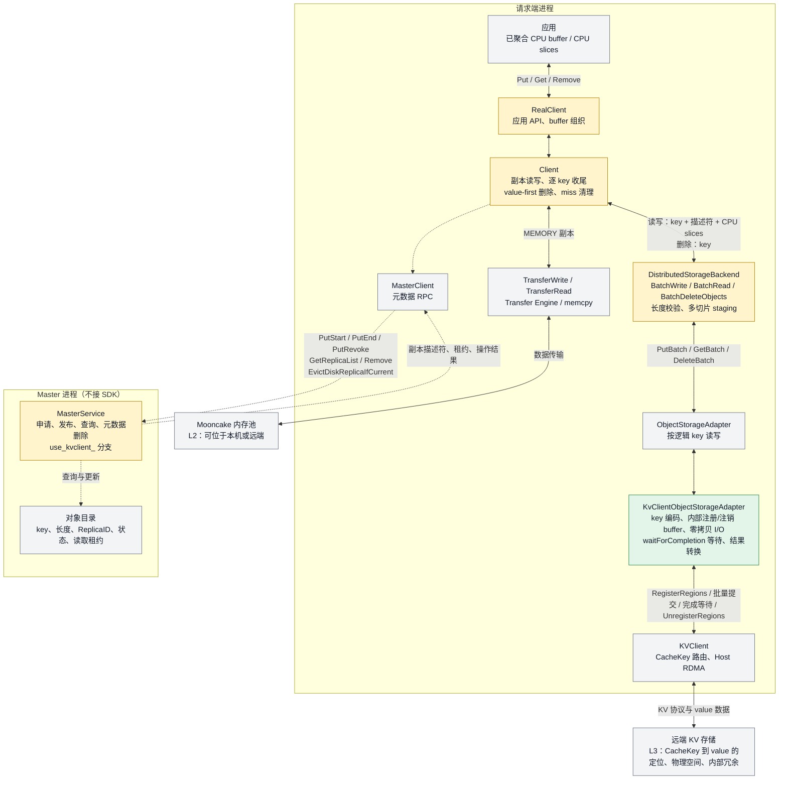

**分层职责**（本列已按实际实现修正——注册职责在适配器内，不在后端）：

| 层 | 职责 | 本方案改动 | 状态 |
| --- | --- | --- | --- |
| `Client` | 副本编排、逐 key 收尾、删除路由、miss 清理 | 删除顺序改 value-first；miss 清理与 `Remove*` 门控放宽 | **【PR3】** 未落地 |
| `DistributedStorageBackend` | slices → 对象请求转换、长度校验、多切片 staging | 仅新增 `UsesKvClient()` 谓词（`distributed_storage_backend.h:78-80`）；`BatchWrite` / `BatchReadOnce` / `BatchDeleteObjects` 的对象分支**与 KVCS/OSS/S3 完全共用，未加 kvclient 子分支** | ✅ PR1 |
| `ObjectStorageAdapter` | 对象存储统一契约 | **未改动**。基类没有 `RegisterBuffer` / `UnregisterBuffer` / `RequiresBufferHandle`；`ObjectPutRequest{logical_key, iov, iovcnt}`、`ObjectGetRequest{logical_key, buffer, size}` 保持原样 | ✅ 零改动 |
| `KvClientObjectStorageAdapter` | KVClient 后端实现：key 编码、**内部 buffer 注册/注销**、零拷贝 I/O、`waitForCompletion` 等待与映射 | **新增**（PR1 控制面 + PR2 数据面） | ✅ PR1+PR2 |
| `MasterService` | 申请、发布、查询、元数据删除 | 新增平级 `use_kvclient_`，6 处门控放宽 + 启动期拒绝恢复 | ✅ PR2 |

### 2.1.2 Client 侧类图

黄色表示修改现有类，绿色表示新增类，灰色表示复用接口或数据结构。类图列出相关成员，参数和返回类型作了简化。**注**：`ObjectStorageAdapter` 基类在本方案中**未被修改**，图中不列 `RegisterBuffer` 等方法；注册是适配器的私有能力。

```mermaid
classDiagram
    direction TB

    class DistributedStorageConfig["DistributedStorageConfig（修改）"] {
        +fs_adapter_type
        +object_storage_config_path
        +UsesObjectStorage()
        +UsesKvcs()
        +UsesKvClient()
        +Validate()
    }
    class KvClientAdapterConfig["KvClientAdapterConfig（新增，header-only）"] {
        +config_path
        +FromEnvironment()$
        +Validate()
    }
    class FileStorage["FileStorage（修改）"] {
        -storage_backend_
        -client_
        +FileStorage(config, client)
        +Init()
    }
    class Client["Client（PR3 修改）"] {
        -dfs_storage_backend_
        +SetDfsStorageBackend(backend)
        +Put(key, slices, config)
        +Get(key, slices)
        +Remove(key)
        +BatchRemove(keys, force)
        -ReconcileMissingKvReplica(key, query, replica)
    }
    class DistributedStorageBackend["DistributedStorageBackend（修改）"] {
        -object_storage_adapter_
        -distributed_config_
        +BatchWrite(requests)
        +BatchRead(requests)
        +BatchDeleteObjects(keys)
        +UsesObjectStorage()
        +UsesKvClient()
    }
    class ObjectStorageAdapter["ObjectStorageAdapter（复用，未改动）"] {
        +PutV(key, iov, iovcnt)
        +PutBatch(requests)
        +GetBatch(requests)
        +DeleteBatch(keys)
        +Exists(key)
        +ListKeys()
        +GetRange(key, buffer, len, offset)
        +CheckHealth()
        +Init()
        +GetName()
    }

    class KvClientObjectStorageAdapter["KvClientObjectStorageAdapter（新增）"] {
        -kv_client_
        -config_
        -initialized_
        +Init()
        +PutBatch(requests)
        +GetBatch(requests)
        +Exists(key)
        +DeleteBatch(keys)
        -MakeCacheKey(logical_key)
        -waitForCompletion(task_id, entry_count)
        -ToErrorCode(status)$
        -ToWriteErrorCode(status)$
        -RegisterBuffers(ptr, size)
        -UnregisterBuffers(handles)
    }

    class SdkKvClient["kv::KvClient"] {
        +Init(config)
        +StoreAsync(entries, task_id, options)
        +LoadAsync(entries, task_id, options)
        +DeleteAsync(keys, task_id, options)
        +QueryAsync(keys, task_id, options)
        +Wait(task_id, timeout, result)
        +RegisterRegions(regions, out)
        +UnregisterRegions(handles)
        +Shutdown()
    }

    class SdkKvClientConfig["kv::KvClientConfig"] {
        +LoadFromFile(path, config)$
        +keyResolution
        +useBatchIoForSingleKey
    }

    FileStorage o-- DistributedStorageBackend : "共享持有后端"
    FileStorage --> Client : "注入 DFS 后端"
    Client o-- DistributedStorageBackend : "共享持有"
    DistributedStorageBackend *-- DistributedStorageConfig : "保存配置"
    DistributedStorageBackend *-- ObjectStorageAdapter : "持有对象适配器"
    ObjectStorageAdapter <|-- KvClientObjectStorageAdapter
    KvClientObjectStorageAdapter *-- KvClientAdapterConfig : "保存配置"
    KvClientObjectStorageAdapter *-- SdkKvClient : "持有 SDK 实例"
    KvClientObjectStorageAdapter ..> SdkKvClientConfig : "LoadFromFile"
    SdkKvClientConfig ..> SdkKvClient : "Init(config)"
    DistributedStorageConfig ..> KvClientObjectStorageAdapter : "工厂按配置创建"

    style DistributedStorageConfig fill:#fff4cc,stroke:#b58105,color:#111827
    style FileStorage fill:#fff4cc,stroke:#b58105,color:#111827
    style Client fill:#fff4cc,stroke:#b58105,color:#111827
    style KvClientObjectStorageAdapter fill:#e3f5e8,stroke:#28864b,color:#111827
    style KvClientAdapterConfig fill:#e3f5e8,stroke:#28864b,color:#111827
    style DistributedStorageBackend fill:#fff4cc,stroke:#b58105,color:#111827
    style ObjectStorageAdapter fill:#f3f4f6,stroke:#6b7280,color:#111827
    style SdkKvClient fill:#f3f4f6,stroke:#6b7280,color:#111827
    style SdkKvClientConfig fill:#f3f4f6,stroke:#6b7280,color:#111827
```

| 类或函数 | 接口与改动说明 | 状态 |
| --- | --- | --- |
| `DistributedStorageConfig` | `UsesObjectStorage()` 列表加入 `"kvclient"`（`distributed_storage_config.h:27-31`）；新增 `UsesKvClient()`（`:33`），与 `UsesKvcs()` 平级；`Validate()` 增加 KVClient 专属分支（`distributed_storage_config.cpp:78-92`） | ✅ PR1 |
| `KvClientAdapterConfig` | **新增**，header-only 且不含 SDK 头（`kvclient_config.h`，31 行）；只有 `config_path` 一个字段 | ✅ PR1 |
| `CreateStorageBackend(config)` | 在 distributed 分支新增 `UsesKvClient()` case（`storage_backend.cpp:6522-6533`），包在 `#ifdef MOONCAKE_HAVE_KVCLIENT_SDK` 内转调 `CreateKvClientObjectStorageAdapter()`，`#else` 返回 `NOT_SUPPORTED` | ✅ PR1 |
| `FileStorage` | `file_storage.cpp:162-164` 的 `enable_dfs` 判断加入 `UsesKvClient()`；`real_client.cpp:1618-1622` 加入 `enable_kvclient` 以强制 `kDistributed` | ✅ PR1 |
| `DistributedStorageBackend` | 仅新增 `UsesKvClient()` 谓词（`distributed_storage_backend.h:78-80`）。读写删三条对象分支**无 kvclient 特化**，注册/注销不在这一层 | ✅ PR1 |
| `ObjectStorageAdapter` | **零改动**。设计期的 `RegisterBuffer` / `UnregisterBuffer` / `RequiresBufferHandle` 与 `buffer_handle` 字段均已废弃 | ✅ |
| `KvClientObjectStorageAdapter` | **新增**。控制面见 PR1（§3.2.1），数据面见 PR2（§3.2.3） | ✅ PR1+PR2 |
| `Client` | `ReconcileMissingKvcsReplica()` → `ReconcileMissingKvReplica()`；`BatchRemove` value-first；`Remove` / `RemoveAll` / `RemoveByRegex` / `AttachHostId` 门控放宽 | **【PR3】** 全部未落地 |
| `kv::KvClient` | **SDK 不改**。提交面只用 `StoreAsync` / `LoadAsync` / `DeleteAsync` / `QueryAsync`，另用 `Wait` / `RegisterRegions` / `UnregisterRegions` / `Shutdown`。四个提交方法均带 `const kv::IoOptions& options = {}`，本方案不填 `kvns`、不用 `prerequisite`。SDK 内部按 `entries.size() > 1 \|\| useBatchIoForSingleKey` 选 opcode，并按 `batchStoreIoNum`（默认 110）在对象边界切 transport 子批 | — |

### 2.1.3 Master 侧类图

Master 在现有 `ObjectMetadata` 和 `Replica` 上管理 KVClient 的逻辑 DFS 副本。`PutStart` 创建描述符，`PutEnd` 发布副本，查询返回可读副本，Remove 和明确 miss 清理更新对象目录。Master **不接 SDK**，不创建 driver，也不做容量淘汰。

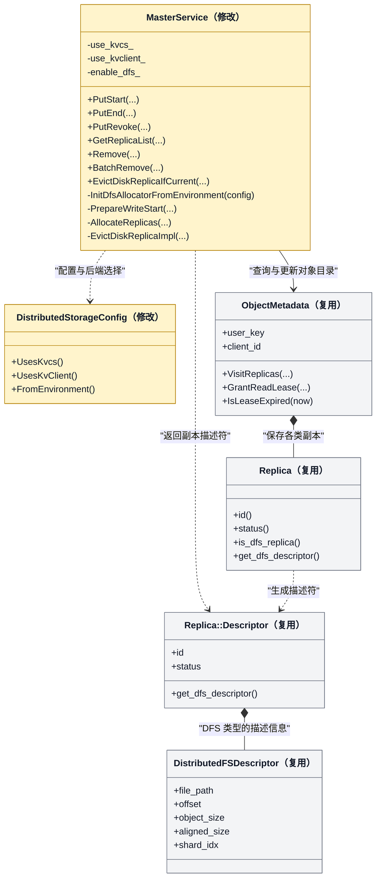

Master 查询自身对象目录，Client 根据返回的描述符经 `DistributedStorageBackend` / `KvClientObjectStorageAdapter` 访问后端。存储返回明确 miss 时，由 Client 请求 `EvictDiskReplicaIfCurrent` 条件清理。

| 类 | 改动与职责 | 状态 |
| --- | --- | --- |
| `MasterService` | 新增私有 `use_kvclient_`（`master_service.h:2065`，与 `use_kvcs_` 平级）。改动：`enable_dfs_` 判定（`:833-834`）、初始化新增分支（`:896-911`）、descriptor 铸造（`:4988`）、`PrepareWriteStart` 两道门（`:5147`、`:5155-5164`）、`EvictDiskReplicaImpl` 白名单两处（`:6331`、`:6348`） | ✅ PR2 |
| `DistributedStorageConfig` | 解析 KVClient 配置，提供与 `UsesKvcs()` 平级的能力判断 | ✅ PR1 |
| `ObjectMetadata` / `Replica` | 保存 key、写入 Client、副本身份、状态和读取租约，沿用既有元数据持久化方式 | 复用 |
| `Replica::Descriptor` / `DistributedFSDescriptor` | 向 Client 返回对象长度、ReplicaID 和状态。KVClient 模式下 `file_path` 为空、`offset` 为 0、`shard_idx` 为 -1，`object_size = N`、`aligned_size = N`（与 KVCS 一致） | ✅ PR2 |

## 2.2 业务交互流程

### 2.2.1 写入流程

下图以新 key 的 Put 为例，按申请、数据写入和提交顺序展开。Master 的申请与收尾分别绘制，元数据 RPC 经 `MasterClient` 发送，数据由请求端访问内存池和远端存储。

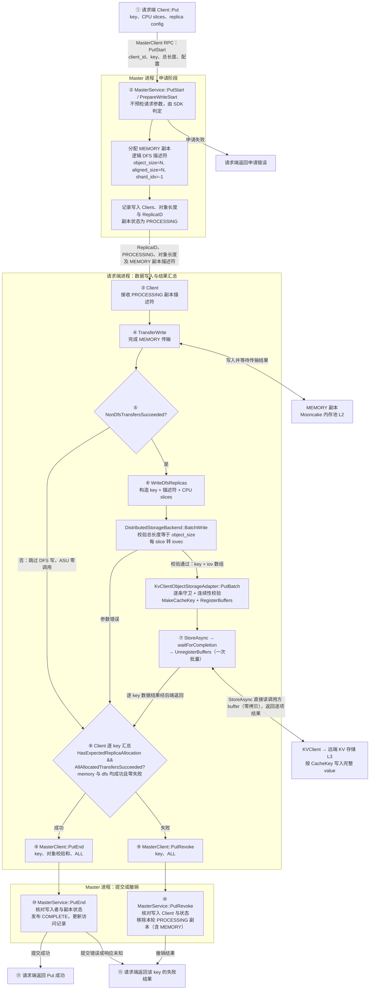

**关键判定**（两副本硬逻辑裁决，零代码改动）：`DetermineReplicaWriteMode` 在 `dfs > 0` 时返回 `RELIABLE_MULTI_REPLICA`，故 `DetermineFinalizeDecision` 要求 `HasExpectedReplicaAllocation` 与 `AllAllocatedTransfersSucceeded` 同时成立——memory 与 dfs **全部成功、零失败且分配数量符合配置**，否则 `PutRevoke(ALL)`。

PutEnd 响应未知时，Client 返回提交错误；后续通过 Master 查询或符合条件的重复提交确认发布状态。

### 2.2.2 读取流程（S1 / S5）

下图展开完整对象 Get 选中 DFS 副本后的数据路径，Master 按查询阶段和 miss 清理阶段分别绘制。内存副本淘汰后，Master 仍保留已发布的 DFS 记录，读取 Client 按相同流程访问 L3。

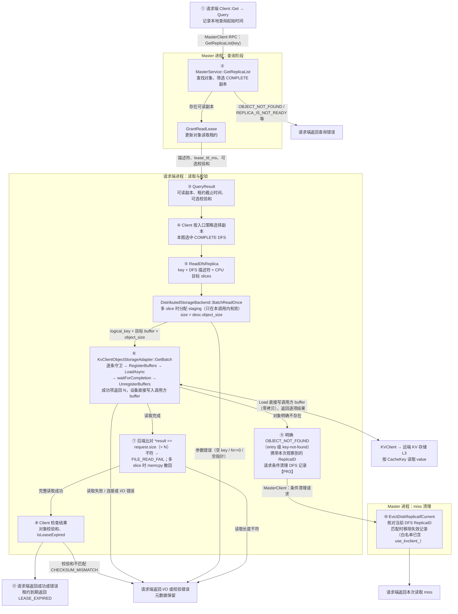

普通 `Client::Query` 使用本地查询起始时间加 `lease_ttl_ms` 计算租约截止时间，完整对象 Get 在 `GetBatch` 返回后检查有效期。

> **【PR3】图中 ⑨⑩ 尚未接通**：适配器已把 entry 级 key-not-found 映射为 `OBJECT_NOT_FOUND`（PR2），Master 白名单也已放宽到 `use_kvclient_`（PR2，`master_service.cpp:6331/6348`），但 Client 侧的触发点 `ReconcileMissingKvcsReplica`（`client_service.cpp:5491`）门控仍是 `UsesKvcs()` only。所以当前 kvclient 读 miss **不会**清理失效记录，只会把 miss 返回给调用方。

### 2.2.3 删除流程（S3，value-first）

删除顺序与 KVCS 相反：Client 先调用 KVClient 删除 value，再对删除成功的 key 请求 Master 移除对象元数据。

> **本节整体属【PR3】**。适配器侧的 `DeleteBatch`（PR1）与 Master 侧的 `EvictDiskReplicaImpl` 白名单（PR2）已就绪，但 Client 侧 `BatchRemove` 的 value-first 分支尚未写入——当前 kvclient 会落到既有 KVCS 分支之外的默认路径，即 **metadata-first**，导致 value 永久泄漏。

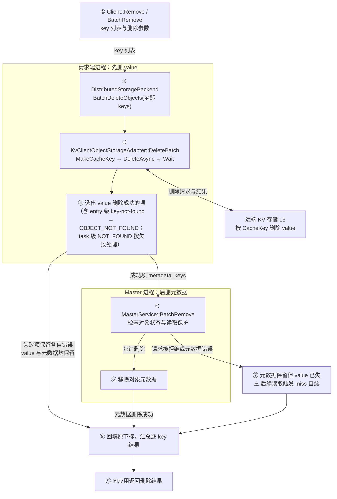

**顺序理由**：KVClient 的三条孤儿回收通道全断，metadata-first 的孤儿是**永久且无界**的。

**中间态自愈**：value 已删、元数据尚在 → 读取返回 `OBJECT_NOT_FOUND`（entry 级 key-not-found）→ `ReconcileMissingKvReplica` → `EvictDiskReplicaIfCurrent` 按 ReplicaID 条件清理。**value-first 删除依赖 miss 清理同时落地**，否则中间态无人清理。

**失败态可安全重试**：value 删除失败的 key **不进入**元数据删除集合，故 value 与元数据同时保留。这是 value-first 相对 metadata-first 的核心优势。

### 2.2.4 Upsert 流程（S4）

Upsert 使用 `UpsertStart / UpsertEnd / UpsertRevoke` 管理本次更新。Master 按现有状态机处理对象可见性，Client 通过同一适配器写入新 value；内存与 DFS 的结果按 key 汇总，处理方式与 Put 一致。

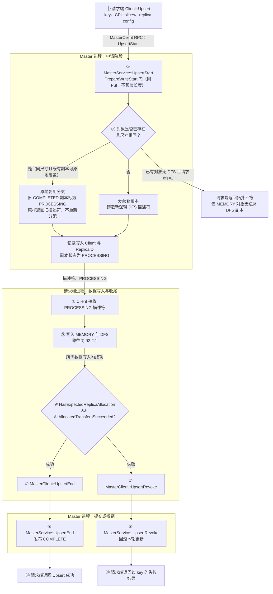

 **仅 MEMORY 的对象无法经 Upsert 补 DFS 副本**，需先 Remove 再 Put。

Upsert 与 Put 共用 `PrepareWriteStart`（`master_service.cpp:5147` 的 `!use_kvcs_ && !use_kvclient_ && ...` 与 `:5155-5164` 的 nof 拒绝）和 `AllocateReplicas`（`:4988` 的 descriptor 铸造），PR2 已同时放宽这两处，因此 Upsert 的门无需额外改动。

## 2.3 运行设计

本节按阶段展开适配器内部的时序。各阶段的判定依据与代码位置见 §3 的 shard 设计。**注册职责已归适配器**：下面各图中 `RegisterRegions` / `UnregisterRegions` 都由适配器自己在批内调用，后端不参与。

### 2.3.1 初始化阶段

初始化在 `CreateStorageBackend` 工厂内创建适配器（`storage_backend.cpp:6522-6533`），随后由后端 `Init()` 触发 SDK 连接（`distributed_storage_backend.cpp:254-256`）。**`Init` 不注册内存**。

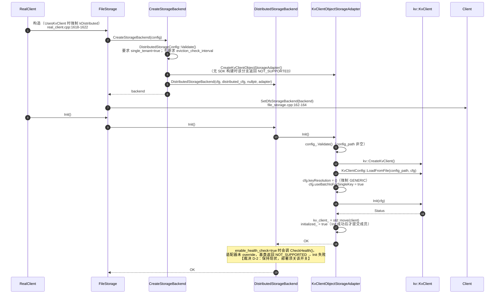

**`Init` 的错误映射**（`kvclient_object_storage_adapter.cpp:40-72`）：

| 失败点 | 返回 |
| --- | --- |
| `config_.Validate()` 不通过（`config_path` 空） | `INVALID_PARAMS` |
| `kv::CreateKvClient()` 返回空 | `DFS_SERVICE_UNAVAILABLE` |
| `LoadFromFile` 失败 | `INVALID_PARAMS` |
| `client->Init(cfg)` 失败 | `DFS_SERVICE_UNAVAILABLE` |

已 `initialized_` 时直接返回成功（幂等）；注入 client 的测试构造路径只校验适配器配置，跳过 `CreateKvClient` / `LoadFromFile` / SDK `Init`。`Init` 失败不提交 `kv_client_`，所以重试从全新 client 开始（SDK 的 `Init` 非幂等）。

> **`CheckHealth` 部署约束（裁决 D-2）**：适配器**不 override** `CheckHealth()`，基类默认返回 `NOT_SUPPORTED`（`object_storage_adapter.h:120-122`）。而 `DistributedStorageBackend::Init()` 在 `distributed_config_.enable_health_check` 为真时会调用它并**把失败当作初始化失败**（`:257-265`）。因此 kvclient 后端下**必须保持 `MOONCAKE_DISTRIBUTED_HEALTH_CHECK=false`**（这也是默认值），否则启动即失败。这是有意的：适配器没有可上报的健康信息，伪造一个「永远健康」的实现会让该开关变成假开关。详见 §6.2。

**buffer 注册在适配器内部**：`PutBatch` / `GetBatch` 逐请求调用私有 `RegisterBuffers(ptr, size)`（封装 SDK `RegisterRegions`），把 handle 记进本批局部 `std::vector<uint64_t> handles`，批末调用一次 `UnregisterBuffers(handles)`（封装 SDK `UnregisterRegions`）。适配器不维护跨批注册表（§3.2.2）。

### 2.3.2 写入阶段

写路径只有一条：零拷贝。`PutBatch` 的守卫为：空 key、`iov == nullptr`、`iovcnt <= 0`、段首地址空、段长 0、求和溢出、**段间物理不连续**、总长 0、同批重复 key；违约项 `results[i] = INVALID_PARAMS`，其余继续。一次 `StoreAsync` 提交整批（SDK 内部按 `batchStoreIoNum`（默认 110）在对象边界切分 transport 子批），再用 `waitForCompletion` 映射逐条结果，写路径经 `ToWriteErrorCode` 转换。不做 staging、不补齐。

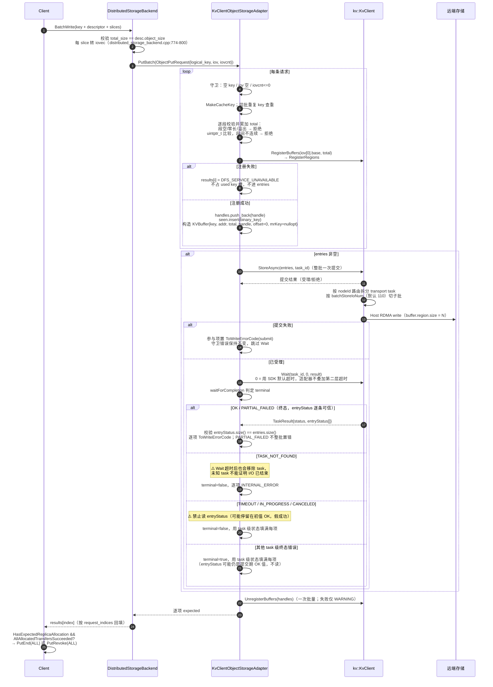

**异常安全**：整个批处理体包在 `try { ... } catch (...) { UnregisterBuffers(handles); throw; }` 中（`:325-432`），所以中途抛异常也会释放已注册 handle。handle 在 `push_back` **之后**才 `seen.insert`，保证「注册失败不占用重复 key 槽」（测试 `RegisterFailureDoesNotClaimKey` 锁定）。

### 2.3.3 读取阶段

读路径与写路径同构，但**不做连续性校验**（后端已把多 slice 收敛成一段连续 buffer 或 staging），也不做重复 key 查重。成功项返回 `requests[index].size`，随后由适配器注销 handle。

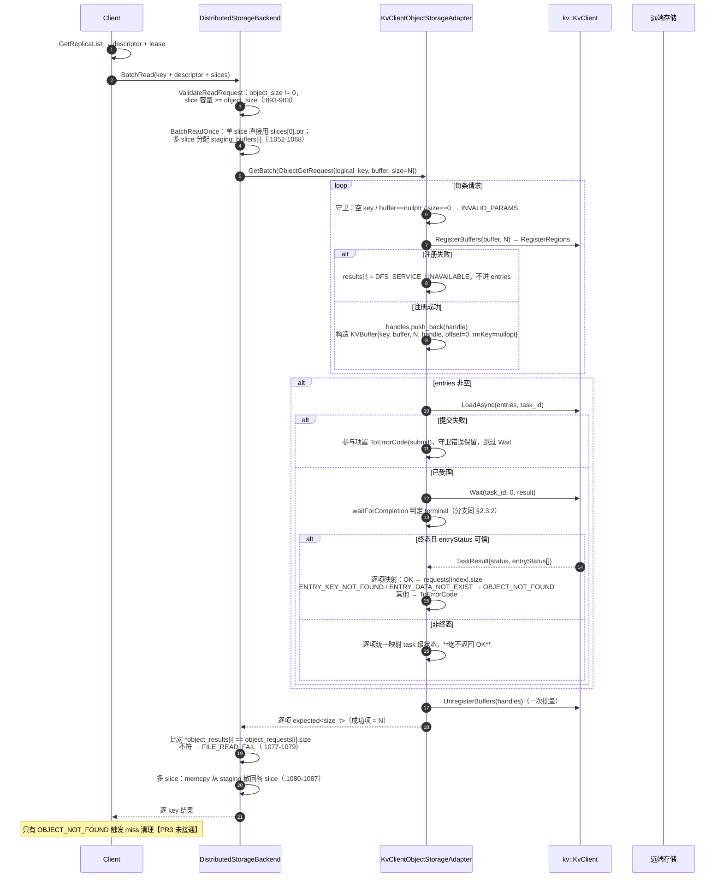

**返回长度语义**：SDK 不暴露实际传输字节数，所以适配器成功时返回**请求长度**而非真实读取量（`:518-526` 的注释已说明）。这意味着**截断读在适配器层不可检测**，只能靠上层 checksum 发现。后端的 `*result == request.size` 比对因此恒真（对成功项而言），它防的是适配器返回错值，不是防截断。

### 2.3.4 删除阶段

删除只传 key、不传 buffer，因此**不涉及注册与注销**——这是三条数据路径里唯一不碰 `RegisterRegions` 的。value 删除成功（含幂等 `NOT_FOUND`）的 key 才进入元数据删除集合；失败项两者同时保留，可安全重试。

> **适配器与 Master 侧已就绪**（PR1 的 `DeleteBatch` + PR2 的白名单），**Client 侧的 value-first 编排属【PR3】**。下图中 ②④⑤ 的 Client 逻辑当前不存在。

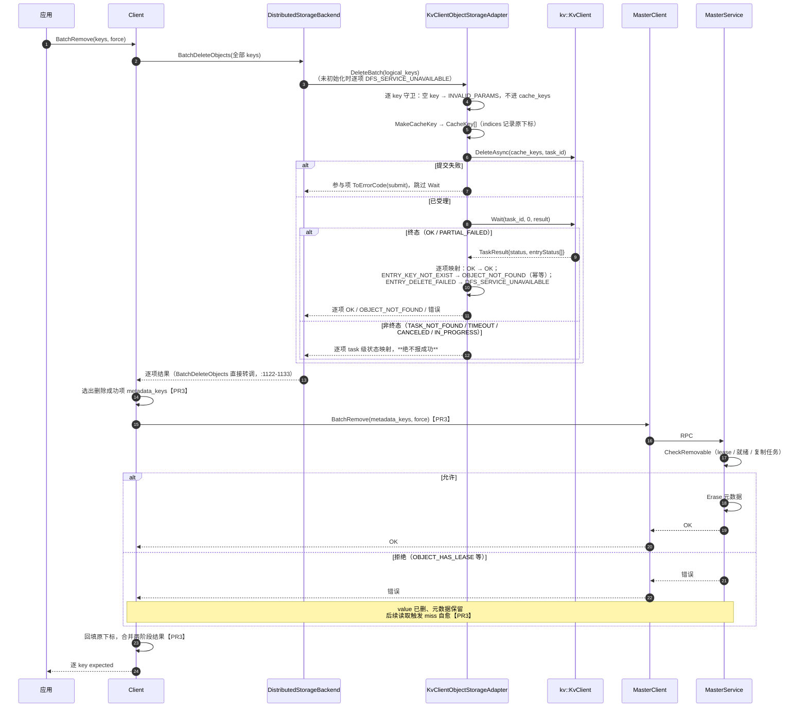

**`Delete` 单 key**（`:246-252`）只是把 key 包成长度 1 的 `std::array` 转调 `DeleteBatch`，取 `results.front()`；`results` 为空时返回 `INVALID_PARAMS`。

**删除侧的错误映射与读写不同**：`ENTRY_DELETE_FAILED` 映射为 `DFS_SERVICE_UNAVAILABLE` 而非 `OBJECT_NOT_FOUND`；`ENTRY_KEY_NOT_EXIST` 才是删除的幂等成功信号（该码只由 QUERY 与 DELETE 产生）。代码注释已明确这一点（`:103-105`）。

### 2.3.5 miss 清理阶段

清理是条件性的：Client 携带本次读取**观察到**的 ReplicaID，Master 在 key 锁内核对，只有仍为当前记录时才移除。读到 R1 而目录已是 R2 时返回不匹配，R2 原样保留。

> **【PR3】Client 侧未接通**。Master 侧白名单已在 PR2 放宽（`master_service.cpp:6329-6331` 的 `supports_dfs_condition` 与 `:6345-6352` 的目标谓词都改成 `use_kvcs_ || use_kvclient_`），所以 RPC 到达 Master 后能正确处理；缺的是 Client 端根本不发起这个 RPC。

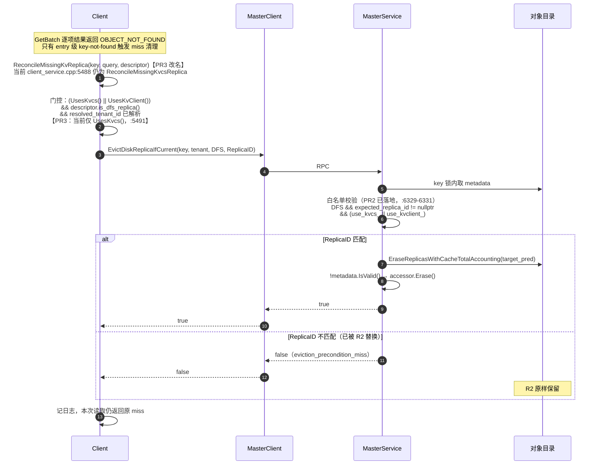

### 2.3.6 关闭阶段

关闭逻辑在析构函数内完成（`:34-38`），没有独立的 `Shutdown()` 方法：适配器停止接受新提交后调用 SDK 的 `Shutdown()`，由 SDK 停止受理请求并排空 pending task。

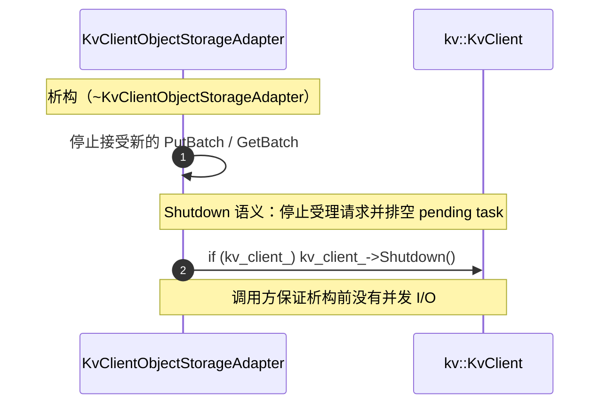

**说明**：同步读写的 `Wait` 都在调用内完成，handle 在 `PutBatch` / `GetBatch` 返回前就已批量注销，所以析构时**适配器不持有任何注册资源**，也没有需要外部消费的完成句柄。`kv_client_` 为空（`Init` 未成功或被注入前析构）时跳过 `Shutdown`。

## 2.4 SFMEA 分析

只列会改变设计或需要专门用例的失效模式；等价分支合并为一条，纯既有语义、范围外与不可达项已删除。每条只占一个编号。「状态」列标注容错措施是否已在代码中落地。

| 编号 | 故障模式 | 故障影响 | 容错措施 | 状态 / 备注 |
| --- | --- | --- | --- | --- |
| SFMEA-01 | logical key XXH64 碰撞：两个不同 key 映射到同一 CacheKey | **数据损坏**：后写覆盖先写，读到错 value。默认（`MOONCAKE_STORE_CHECKSUM` 关闭）无从发现；开启后 Get 端以 `CHECKSUM_MISMATCH` 暴露，但 Put 侧仍是覆盖写 | 不做 fingerprint（默许碰撞）；可复用既有 object checksum 作为检测手段；部署须限定 key 数量级 | 设计取舍。概率 ≈ n²/2^65：10^8 key → 2.7e-4 |
| SFMEA-02 | 非法 key / 长度：空 key、同批重复、N == 0、全零 CacheKey、iov 不连续 | 编码失败；协议层拒绝，预发送失败会 **abort 整个 transport task** | 适配器拒空 key、空/零长 iov、iov 不连续、同批重复 key、总长 0；`MakeCacheKey` 把全零 hash 映射为 seed；**其余参数不预检**，由 SDK 返回错误 | ✅ PR2（连续性校验是实现期新增，设计文档原先没有） |
| SFMEA-03 | 适配器越权做参数校验或拷贝 | 与 SDK 行为重复或偏差；零拷贝退化为拷贝 | 适配器只做结构性守卫（key / iov 形状 / 连续性 / 重复），payload 不拷贝不补齐；其余由 SDK 判定 | ✅ PR2。测试 `RejectsEmptyKeyZeroLengthAndDuplicate` / `RejectsNonContiguousSegments` / `AcceptsContiguousSegments` |
| SFMEA-04 | 初始化门禁失败：`CreateKvClient` 返回空、`LoadFromFile` 失败、SDK `Init` 失败 | 适配器不可用；后续所有 I/O 返回 `DFS_SERVICE_UNAVAILABLE` | `Init` 失败即失败且不提交 `kv_client_`，重试从新 client 开始；已 `initialized_` 时幂等返回 | ✅ PR1。测试 `UninitializedBatchFailsSafely` |
| SFMEA-05 | 注册的 handle 无效、已注销或与 buffer 不匹配 | 到 `Wait` 才以 `BUFFER_NOT_REGISTERED` 暴露且**连坐整 task** | handle 由适配器在同一次调用内注册并使用，**不跨调用、不跨线程持有**；注册失败即拒绝该条且不进 entries；`mrKey = nullopt` 由 SDK 按 handle 解析 | ✅ PR2。注册与使用在同一函数内，消除了设计期「后端填错 handle」的整类风险（原 SFMEA-19 已消解） |
| SFMEA-06 | `Wait` 返回 task 级错误；`entryStatus` 仍停留在初值 `OK` | 把未落盘的数据报成功 | `waitForCompletion` **只在 `OK` / `PARTIAL_FAILED` 时读 `entryStatus`**；`TASK_NOT_FOUND` / `TIMEOUT` / `IN_PROGRESS` / `CANCELED` 为非终态，其余为终态，两者都用 task 级状态填满每项；另校验 `entryStatus.size() == entry_count` | ✅ PR2。测试 `WriteTaskErrorMapsAll` / `ReadTaskErrorMapsAll` |
| SFMEA-07 | task 级 `PARTIAL_FAILED`、派发后 `CANCELED`、或路由失败 | 部分 key 成功、部分失败 | 终态时逐项映射并按 `indices` 回填原下标；非终态统一映射。提交失败只覆盖**参与项**，守卫错误得以保留 | ✅ PR2。测试 `WriteSubmitFailureKeepsGuardErrors` / `WriteEntryFailureKeepsOtherEntriesAndReleases` |
| SFMEA-08 | 设备侧资源 / 连接错误：`CQE_OUT_OF_CREATE_SIZE`、`RESOURCE_BUSY`、`CQE_RESOURCE_BUSY`、`CONNECTION_ERROR`、`IO_ERROR` | 写或读失败；无容量查询与自动回收 | 前三个映射为 `NO_AVAILABLE_HANDLE`，后两个映射为 `DFS_SERVICE_UNAVAILABLE`；Master 不做容量淘汰 | ✅ PR2。测试 `WriteSubmitFailureKeepsGuardErrors`（RESOURCE_BUSY → NO_AVAILABLE_HANDLE） |
| SFMEA-09 | 读时 entry 级 `CQE_KEY_NOT_EXIST` / `ENTRY_KEY_NOT_FOUND` / `ENTRY_DATA_NOT_EXIST` / `ENTRY_KEY_NOT_EXIST` | 对象在存储侧不存在 | 四者都映射为 `OBJECT_NOT_FOUND` → 供 `ReconcileMissingKvReplica` 条件清理。**task 级 `NOT_FOUND` 刻意不映射为 `OBJECT_NOT_FOUND`**（视为路由/配置/视图错误 → `DFS_SERVICE_UNAVAILABLE`），否则 PR3 会据路由失败删元数据、PR2 会据其淘汰活元数据 | ✅ PR2 映射；清理触发 **【PR3】**。测试 `ReadMissIsObjectNotFound` / `ReadDataNotExistIsObjectNotFound` |
| SFMEA-10 | 删除中间态：value 已删而元数据残留（`BatchRemove` 失败 / `CheckRemovable` 拒绝 / Client 崩溃），或 value 删除失败 | 已发布对象不可读；或两者同时保留 | 失败项不进元数据删除集合 → 可安全重试；残留由读取 miss 自愈 | **【PR3】** value-first 与 miss 清理必须同时落地 |
| SFMEA-11 | 迟到 Delete 误删新 value（同 key 重写） | 旧删除请求命中新写入的 value | 无专门机制；调用方须串行组织同 key 的删除 / 重建 / 更新。适配器侧 `StoreAsync` 本身是 upsert，覆盖写不预删（测试 `OverwriteDoesNotPreDelete`） | 调用方契约，非本方案引入 |
| SFMEA-12 | `RemoveAll` / `RemoveByRegex` 被调用 | 若只删元数据不删 value → **一次性泄漏整个 L3** | 门控放宽到 KVClient，返回 `NOT_SUPPORTED` 且**不删元数据** | **【PR3】** 当前 `client_service.cpp:3891/3912` 仍是 `UsesKvcs()` only |
| SFMEA-13 | 不支持的配置：Master 重启无恢复、误配 `enable_oplog=true`、`dfs + nof` 共存 | 目录全丢且不可恢复；或 nof 变为必需导致整 Put 失败 | 恢复门保持 `use_kvcs_` only，kvclient + recovery 在启动期 `LOG(ERROR)` + `throw std::invalid_argument`；`PrepareWriteStart` 拒绝 `nof_replica_num > 0`（该检查**不能**只放在 `#ifndef USE_NOF` 下） | ✅ PR2 |
| SFMEA-14 | miss 清理 CAS 不匹配（读到 R1，目录已是 R2） | 无 | `EvictDiskReplicaIfCurrent` 返回 false，R2 原样保留 | ✅ PR2 白名单已放宽；触发 **【PR3】** |
| SFMEA-15 | 析构时仍有未返回的同步 batch，或 handle 未释放 | 提前注销会让设备访问已注销内存；漏注销会泄漏 SDK 注册 | `PutBatch` / `GetBatch` 在返回前完成 `Wait` 并批量注销；`try/catch(...)` 保证异常路径也注销；析构只调 SDK `Shutdown()` | ✅ PR2。测试 `UnregisterFailureIsLoggedNotFatal` |
| SFMEA-16 | 读回长度 != `object_size` | 数据不完整 | 适配器成功项返回 `requests[index].size`；后端比对 `*result == request.size`（`distributed_storage_backend.cpp:1077-1079`），不符 → `FILE_READ_FAIL` | ✅ PR2。**注意**：SDK 不提供实际传输字节数，所以该比对对成功项恒真，**截断读检测不出来**，只能靠上层 checksum |
| SFMEA-17 | 启用 string key 路径的连带风险：`Resolve()` 提交阶段失败，或配置写了 `inference.engine=vllm_ascend` | 整批同步失败；或 `@...@<数字>` key 被重解释为分层 key，读写落到错误的 key/offset | 本方案只传 `FromBytes`，并在 SDK `Init` 前 `cfg.keyResolution = {}` 复位为 GENERIC | ✅ PR1。注：当前 SDK tip 上 `Resolve()` 对 `TryGetBinaryKey()` 命中的输入直接短路，该复位**可观测效果为零**，属纯防御性代码（保留无害） |
| SFMEA-18 | 注册失败、空 key、`N == 0`、同批重复 key | 整批未提交；或单条失败 | 注册失败只拒该条且不占用重复 key 槽（handle 先 `push_back`、`seen.insert` 后置）；其余守卫同样只拒该条 | ✅ PR2。测试 `RegisterFailureIsolatesEntry` / `RegisterFailureDoesNotClaimKey` |
| SFMEA-19 | ~~handle 与请求 buffer 不匹配（后端填错 handle 或复用已注销 handle）~~ | — | **已消解**：注册职责移入适配器后，handle 从产生到使用不离开同一个函数作用域，不存在跨层填错或跨批复用的可能 | ✅ 设计变更（§0.2 #1）连带消除 |
| SFMEA-20 | 调用方在 `GetBatch` / `PutBatch` 返回前释放或改写 buffer | use-after-free / 数据错位 | 同步语义：适配器返回前完成 I/O 与注销；基类契约已要求「buffer 与 iovec 在同步调用返回前保持有效且不变」 | ✅ 由基类契约保证（`object_storage_adapter.h` 注释） |
| SFMEA-21 | 调用方提交的 value 长度不满足 SDK 协议约束（`length % 512 == 0`、`length != 0`、`length <= 0xFFFFFF`），而适配器把 `region.size` 直接填成 N | SDK 协议层拒绝（`INVALID_ARGUMENT`）；违规在 `PackSqe` 阶段中止整个 transport task——批次 >110 条跨子批时，先前已构建子批的 entry 会**报假 OK** | **裁决 D-1：对齐是调用方契约，适配器不校验、不补齐、不对齐 descriptor，成败由 KvClient 判定** | ✅ 已裁决（§0.3、§6.1）。⚠️ 假 OK 是**契约违约的后果**，不是可在适配器内消除的缺陷——部署前须由调用方保证对齐，并用真机验证违约时的实际表现 |
| SFMEA-22 | `enable_health_check=true` 时后端 `Init` 调用 `CheckHealth()`，而适配器未 override | 基类返回 `NOT_SUPPORTED` → **后端初始化直接失败** | **裁决 D-2：不 override `CheckHealth()`**，保持基类默认。适配器没有可上报的健康信息，伪造「永远健康」会让该开关变成假开关 | ✅ 已裁决（§0.3、§6.2）。**部署约束**：kvclient 下保持 `MOONCAKE_DISTRIBUTED_HEALTH_CHECK=false`（默认值） |
| SFMEA-23 | 写路径把 `ENTRY_KEY_NOT_FOUND` / `ENTRY_DATA_NOT_EXIST` 当 miss 上报 | 写失败被误分类为「对象不存在」，上层可能据此删元数据或淘汰活副本 | 新增 `ToWriteErrorCode`：这两个码在写路径映射为 `FILE_WRITE_FAIL`，其余委托 `ToErrorCode`。根因是 BATCH_STORE 与 BATCH_LOAD 共用 SDK 的 entry 解码器 | ✅ PR2 |
| SFMEA-24 | `Wait` 返回 `TASK_NOT_FOUND` 被当作「I/O 已结束」 | 提前释放 handle 与 staging → 设备访问已注销内存 | `waitForCompletion` 把它判为**非终态**，逐项填 `INTERNAL_ERROR`，调用方保留资源 | ✅ PR2 |

## 2.5 可定位设计

> **【未实现】本节整体尚未落地。** 当前适配器代码里只有两条日志：`Init` 成功时的 `LOG(INFO) << "KVClient adapter initialized"`（`:70`，**不含 SDK 版本**）和注销失败时的 `LOG(WARNING)`（`:241-242`，只含 handle 数量与 error message）。没有任何 metric，没有 `cache_key` / `task_id` / `buffer_addr` / `batch_index` 的结构化输出。
>
> 下面两张表是**待补的设计目标**，不是现状描述。PR2 的评审范围内刻意不含可观测性，需在后续 PR 补齐——尤其 `cache_key` 日志是 SFMEA-01（key 碰撞静默损坏）**唯一**的事后排查手段，缺失时该失效模式在生产上不可诊断。

### 2.5.1 统一关联字段（设计目标）

所有 driver 与适配器日志必须携带以下字段，使一次 I/O 可跨层串联：

| 字段 | 来源 | 用途 | 现状 |
| --- | --- | --- | --- |
| `logical_key` | 应用 | 业务侧关联（可能含敏感信息，按日志级别裁剪） | ❌ 未输出 |
| `cache_key` | `MakeCacheKey` 结果的 16 位 hex | 碰撞排查的**主要**手段：两个不同 logical_key 出现同一 cache_key 即为碰撞 | ❌ 未输出（`MakeCacheKey` 是私有方法，无诊断出口） |
| `object_size` | descriptor | 长度问题定位 | ❌ 未输出 |
| `task_id` | SDK | 跨 client/transport 层关联 SDK 内部日志 | ❌ 未输出 |
| `replica_id` | descriptor | miss 清理 CAS 排查 | ✅ 已有（`client_service.cpp:5508-5512` 的 KVCS 日志，PR3 改名后复用） |
| `buffer_addr` | 适配器 | 定位提交 buffer（调用方 buffer；多 slice 读为后端 staging） | ❌ 未输出 |
| `batch_index` / `original_index` | 适配器 | 批量结果错位排查 | ❌ 未输出 |

### 2.5.2 日志与指标（设计目标）

| 级别 | 内容 | 现状 |
| --- | --- | --- |
| `ERROR` | `Wait` 返回 task 级错误（含 `task_id`、`op`、`task_status`、`buffer_addr`、参与项数）；`RegisterRegions` / `UnregisterRegions` 失败；析构时仍有在途 batch；entryStatus 映射到未知 SDK 码 | ❌ 均未实现（注册失败只转成 `DFS_SERVICE_UNAVAILABLE` 返回，无日志；未知 SDK 码走 `default:` 静默映射 `INTERNAL_ERROR`） |
| `WARNING` | 单项 entryStatus 失败（非整 task）；请求因守卫被拒 | ⚠️ 仅注销失败有 WARNING（`:241`） |
| `INFO` | `Init` 成功（含 SDK 版本）；析构完成 | ⚠️ 仅 `Init` 成功，且不含版本 |
| `VLOG(1)` | 每次 `PutBatch` / `GetBatch` / `DeleteBatch` 的 key 数、总字节、参与项数、耗时分解 | ❌ 未实现 |
| `VLOG(2)` | 逐 entry 的 `logical_key` → `cache_key`、`buffer_addr`、handle | ❌ 未实现 |

| 指标 | 类型 | 说明 | 现状 |
| --- | --- | --- | --- |
| `kvclient_buffer_registrations_total` | counter | `RegisterBuffers` 调用次数 | ❌ 未实现 |
| `kvclient_buffer_registered_bytes_total` | counter | `RegisterBuffers` 的累计字节数 | ❌ 未实现 |

> **注册指标的价值在实现后上升了**：设计期注册由后端按 `(ptr,size)` 去重、可跨批复用；实现改为**每请求注册一次、批末全注销**，所以注册次数 ≈ 请求条数。这使得「每批延迟偏高」的排查从「看 buffer 分散度」变成「看批大小」，两个指标能直接量化每批的注册往返开销。

### 2.5.3 定位手册

| 症状 | 排查路径 |
| --- | --- |
| Init 失败 `DFS_SERVICE_UNAVAILABLE` | 查 SDK `Init` 日志、`MOONCAKE_KVCLIENT_CONFIG` 指向的路径有效性与 provider 可达性。`CreateKvClient()` 返回空也是这个码 |
| Init 失败 `INVALID_PARAMS` | `config_path` 为空（`KvClientAdapterConfig::Validate()`），或 `LoadFromFile` 解析失败（配置文件格式错） |
| **后端 `Init` 失败但适配器日志显示 initialized** | `enable_health_check=true` 触发了基类 `CheckHealth()` → `NOT_SUPPORTED`（裁决 D-2，§6.2）。关掉 `MOONCAKE_DISTRIBUTED_HEALTH_CHECK` |
| Put 全部失败但 SDK 日志无异常 | 查是否读了非终态 task 的 `entryStatus`（SFMEA-06）；`waitForCompletion` 只在 `OK`/`PARTIAL_FAILED` 下信任逐项结果 |
| **Put 全部失败且 SDK 报 `INVALID_ARGUMENT` / `length not 512B aligned`** | **调用方违反了 512B 对齐契约**（裁决 D-1，SFMEA-21，§6.1）：value 长度不是 512 的整数倍、为 0、或超过 `0xFFFFFF`。适配器不校验，由 SDK 判定 |
| **大批量写部分 key 莫名丢失，且无错误日志** | 同上，但批次 >110 条跨子批时 SDK 会**报假 OK**（§6.1）。先查 value 长度是否 512 对齐 |
| 读到错误数据，无报错 | **优先怀疑 key 碰撞**（SFMEA-01）：因 `cache_key` 日志未实现，当前只能靠开启 `MOONCAKE_STORE_CHECKSUM` 让 Get 端报 `CHECKSUM_MISMATCH` 间接发现 |
| 读取恒返回 `FILE_READ_FAIL` | 后端比对 `*result != request.size`（`distributed_storage_backend.cpp:1077`）。适配器成功时返回 `requests[index].size`，正常不会触发；若触发说明适配器与后端的 size 语义不一致 |
| 请求返回 `INVALID_PARAMS` | 空 logical key、`iov == nullptr` / `iovcnt <= 0`、段首地址空、段长 0、**iov 段间物理不连续**、总长 0、写侧同批重复 key（§3.2.3）。其余参数错误由 SDK 返回，映射见下两行 |
| 请求返回 `INVALID_PARAMS` 但守卫都合规 | SDK 侧 `INVALID_ARGUMENT` / `BUFFER_NOT_REGISTERED` / `BUFFER_NOT_SUPPORTED` 都映射到这个码——查 SDK 日志区分 |
| 请求返回 `NO_AVAILABLE_HANDLE` | 设备侧空间不足（`CQE_OUT_OF_CREATE_SIZE`）或资源忙（`RESOURCE_BUSY` / `CQE_RESOURCE_BUSY`），见 SFMEA-08 |
| 请求返回 `DFS_SERVICE_UNAVAILABLE` | `RegisterBuffers` 失败；或 SDK 侧 `NOT_FOUND`（路由/配置/视图错误）/ `NOT_INITIALIZED` / `CONNECTION_ERROR` / `IO_ERROR` / `UNSUPPORTED` / `ENTRY_DELETE_FAILED` / `ENTRY_RETRY_ADVISED`；或未 `Init` |
| 请求返回 `INTERNAL_ERROR` | `IN_PROGRESS` / `CANCELED` / `TASK_NOT_FOUND` / entry 数不匹配 / `ENTRY_NO_RETRY_ADVISED`（显式不可重试）/ 未知 SDK 码 |
| 写失败报 `FILE_WRITE_FAIL` | SDK 在写路径回了 `ENTRY_KEY_NOT_FOUND` / `ENTRY_DATA_NOT_EXIST`，由 `ToWriteErrorCode` 专门区分（SFMEA-23）——是**写失败**，不是对象不存在 |
| 每批延迟偏高 | 每请求一次 `RegisterRegions` + 每批一次 `UnregisterRegions`；批越大注册往返越多。查批大小 |
| Remove 返回错误且对象变为不可读 | **【PR3】落地后**才是已知窗口（SFMEA-10）。当前 kvclient 走 metadata-first，症状相反：Remove 成功但 value 残留（永久泄漏） |
| Get 持续 `OBJECT_NOT_FOUND` 但目录有记录 | **【PR3】未接通**：Client 的 `ReconcileMissingKvcsReplica` 门控仍是 `UsesKvcs()`，不会清理。PR3 落地后若仍如此，查 `EvictDiskReplicaIfCurrent` 是否返回 `INVALID_PARAMS`——说明 Master 白名单漏改（`master_service.cpp:6331/6348`） |
| Master 重启后 L3 全部读不到 | 预期行为（不支持恢复裁决，SFMEA-13）。目录不可恢复，value 不可枚举 |
| Master 启动即 `throw std::invalid_argument` | `enable_oplog=true` + kvclient 被启动期拒绝（`master_service.cpp:899-907`）。改成 `false` |
| Put/Upsert 返回 `DFS_SERVICE_UNAVAILABLE` 且日志 `error=dfs_service_unavailable` | `enable_dfs_` 为假，或 `use_kvcs_`/`use_kvclient_` 都为假且无 dfs allocator（`:5146-5154`）。查 Master 启动日志有无 "KVClient distributed object storage initialized" |
| Put/Upsert 返回 `INVALID_PARAMS` 且日志 `error=nof_not_supported_with_kvclient` | `dfs_replica_num > 0` 与 `nof_replica_num > 0` 同时请求（`:5155-5164`）。二选一 |

---

# 3 shard 设计描述

## 3.1 shard-1：key 编码（`MakeCacheKey`）

**职责**：logical key → 8 字节 `kv::BinaryKey` 的确定性映射，并包装成 SDK 的 `kv::CacheKey`。

**位置**：`KvClientObjectStorageAdapter::MakeCacheKey`（`src/storage/distributed/kvclient/kvclient_object_storage_adapter.cpp:202-215`），不单独建头文件。

**状态**：✅ PR1 已落地，PR2 未改动。以下是**实际代码**（逐字摘自工作区）：

```cpp
// 文件内匿名命名空间（:20-24）
inline constexpr uint64_t kKvClientHashSeed = 5381;

kv::BinaryKey KvClientObjectStorageAdapter::MakeCacheKey(
    std::string_view logical_key) const {
    uint64_t hash =
        XXH64(logical_key.data(), logical_key.size(), kKvClientHashSeed);
    // The protocol rejects an all-zero key; map it to the seed to keep the
    // wire key non-zero without a second constant.
    if (hash == 0) hash = kKvClientHashSeed;
    kv::BinaryKey key{};
    // Pack explicitly little-endian like the SDK's key_resolver; a memcpy of
    // the host-order uint64_t would differ on big-endian clients.
    for (size_t i = 0; i < sizeof(hash); ++i)
        key[i] = static_cast<std::byte>(hash >> (8 * i));
    return key;
}
```

**设计说明**：

- **seed 选择**：取 `5381`，与 SDK 的 `HASH_SEED_VALUE` 同值。本方案不使用 SDK 的 string key 解析，故 seed 不影响今天的 wire 身份；与它保持一致只是为了 (a) 将来若改用 string key 路径，wire key 逐字节不变，(b) 与 UCM/ASUStore 侧用同一函数校验时 `cache_key` 可直接比对。借鉴 `nvme_kv/key_codec.cpp` 的 XXH64 用法，但那里用双 seed 产出 16 字节（`low`/`high`）；本方案只需 8 字节，单 seed 即可。
- **纯函数约束**：映射不得混入 epoch / 进程 id / 随机种子。这既是跨 Client 读取的前提，也是不支持恢复裁决下唯一需要保证的稳定性。
- **SDK 侧 string key 哈希为预留能力，本方案不使用**。
- **全零 key 必须映射掉**：协议层对全零 key 直接 `INVALID_ARGUMENT`，而预发送失败会 abort 整个 transport task（SFMEA-02 同一机制）。XXH64 输出全零的概率是 2^-64，但代价是一整批被毒化，不值得留窗口。映射目标复用 seed 本身，不引入第二个常量。
- **显式小端打包**：不能 `memcpy` host-order `uint64_t`，否则大端客户端产出的 wire key 不同。测试 `MakeCacheKeyIsStableAndLittleEndian` 直接断言 `key[0] == hash & 0xFF` 且 `key[7] == hash >> 56`。
- **不做独立 codec 单元**：编码只有 `MakeCacheKey` 一个调用方；测试通过注入 fake client 截获 `DeleteAsync` 的 `CacheKey`、再 `TryGetBinaryKey()` 反解来做断言。碰撞诊断如需 `cache_key` 日志，可在同一 `.cpp` 内加私有 helper，不引入额外头文件（**目前未实现**，见 §2.5.1）。

> **SDK 侧的 `HASH_SEED_VALUE` 已从 `key_resolver.h` 移入 `key_resolver.cc`**（SDK commit `0149f2b`），且 key resolver 拆成了按引擎的 `ParseEngineKey` override。适配器不依赖这些内部符号，只共享常量值，因此 SDK 的这类重构不影响本方案。**但任何引用 SDK 内部行号的文档都会随 SDK force-push 静默过期**，故本节刻意不写 SDK 行号。

## 3.2 shard-2：适配器（`kvclient_object_storage_adapter`）

**职责**：实现 `ObjectStorageAdapter`，承载 key 编码、**buffer 注册/注销**、提交/等待与结果映射。与 `KvcsObjectStorageAdapter` 平级，互不依赖。

**文件**：

- `mooncake-store/include/storage/distributed/kvclient/kvclient_object_storage_adapter.h`（72 行）
- `mooncake-store/src/storage/distributed/kvclient/kvclient_object_storage_adapter.cpp`（585 行）
- `mooncake-store/include/storage/distributed/kvclient/kvclient_config.h`（31 行，PR1）
- `mooncake-store/include/storage/distributed/kvclient/kvclient_adapter_factory.h`（16 行，PR1；原名 `kvclient_backend.h`，`757edd7c` 改名）

**buffer handle 模型（实现期变更，与设计文档 v4.10 不同）**：

注册**在适配器内部**完成，不跨层传递：

| | 设计期方案（v4.10，**已废弃**） | 实际实现（PR2） |
| --- | --- | --- |
| 注册者 | `DistributedStorageBackend` | `KvClientObjectStorageAdapter` 自己 |
| 基类改动 | 新增 `RegisterBuffer` / `UnregisterBuffer` / `RequiresBufferHandle` | **零改动** |
| 请求结构 | `ObjectPutRequest` / `ObjectGetRequest` 新增 `buffer_handle` | **零改动** |
| 注册粒度 | 后端按 `(ptr,size)` 去重，可跨请求复用同一 handle | 每请求注册一次，不去重、不复用 |
| 注销时机 | 后端在 `PutBatch` / `GetBatch` 返回后 | 适配器在批末（含异常路径）一次批量注销 |
| handle 生命周期 | 跨函数、跨层 | **不离开 `PutBatch` / `GetBatch` 的栈帧** |

**变更理由**：SDK 不会在任务完成后自动释放注册，只有 `UnregisterRegions` / `Shutdown` 会释放；把注册放进适配器后，「注册—使用—注销」三步在同一函数作用域内闭合，从根本上消除了设计期 SFMEA-19（后端填错 handle / 复用已注销 handle）整类风险，也不需要改动被 KVCS/OSS/S3 共用的基类接口。代价是注册次数从「按 buffer 去重」变成「按请求计数」（见 §5）。

### 3.2.1 类定义

以下是**实际头文件**（工作区版，PR2 已在 PR1 基础上加了 `ToWriteErrorCode` / `RegisterBuffers` / `UnregisterBuffers` 三个私有成员）：

```cpp
#pragma once

#include <cstdint>
#include <memory>
#include <string>
#include <string_view>
#include <vector>

#include "kv_client.h"
#include "kv_types.h"
#include "storage/distributed/kvclient/kvclient_config.h"
#include "storage/distributed/object_storage_adapter.h"

namespace mooncake {

inline constexpr char kKvClientAdapterName[] = "kvclient";

// This header includes the KVClient SDK, so only SDK-enabled TUs may include
// it. Keep it out of storage_backend.cpp and every SDK-less unit.
class KvClientObjectStorageAdapter final : public ObjectStorageAdapter {
   public:
    explicit KvClientObjectStorageAdapter(KvClientAdapterConfig config = {});
    // Test seam: inject an SDK client instead of creating one in Init().
    KvClientObjectStorageAdapter(KvClientAdapterConfig config,
                                 std::unique_ptr<kv::KvClient> client);
    ~KvClientObjectStorageAdapter() override;

    tl::expected<void, ErrorCode> Put(const std::string& logical_key,
                                      std::span<const char> data) override;
    tl::expected<void, ErrorCode> PutV(const std::string& logical_key,
                                       const iovec* iov, int iovcnt) override;
    std::vector<tl::expected<void, ErrorCode>> PutBatch(
        const std::vector<ObjectPutRequest>& requests) override;
    tl::expected<size_t, ErrorCode> Get(const std::string& logical_key,
                                        void* buf, size_t len) override;
    std::vector<tl::expected<size_t, ErrorCode>> GetBatch(
        const std::vector<ObjectGetRequest>& requests) override;
    tl::expected<bool, ErrorCode> Exists(
        const std::string& logical_key) override;
    tl::expected<void, ErrorCode> Delete(
        const std::string& logical_key) override;
    ObjectStorageIoResults DeleteBatch(
        std::span<const std::string> logical_keys) override;
    tl::expected<std::vector<KeyInfo>, ErrorCode> ListKeys() override;

    tl::expected<void, ErrorCode> Init() override;
    const char* GetName() const override { return kKvClientAdapterName; }

   private:
    struct Completion {
        bool terminal = false;
        std::vector<kv::Status> entryStatus;
    };

    kv::BinaryKey MakeCacheKey(std::string_view logical_key) const;
    Completion waitForCompletion(kv::TaskId task_id, size_t entry_count);
    static ErrorCode ToErrorCode(const kv::Status& status);
    // Store entries share the SDK's entry decoder with loads, so the codes
    // that mean "object missing" on a read mean "store failed" on a write.
    static ErrorCode ToWriteErrorCode(const kv::Status& status);
    // Registers one host range with the SDK; the returned handle stays valid
    // until it is passed to UnregisterBuffers.
    tl::expected<uint64_t, ErrorCode> RegisterBuffers(void* ptr, size_t size);
    // Releases the handles, logging any failure the SDK cannot retry.
    void UnregisterBuffers(const std::vector<uint64_t>& handles);

    KvClientAdapterConfig config_;
    std::unique_ptr<kv::KvClient> kv_client_;
    bool initialized_ = false;
};

}  // namespace mooncake
```

**未 override 的基类方法**：`GetRange`（→ `NOT_SUPPORTED`）、`CheckHealth`（→ `NOT_SUPPORTED`，裁决 D-2 有意保留，见 §6.2）、`RemoveAll` 类等——适配器只实现纯虚接口与 `GetName`。

### 3.2.2 内部注册与注销

两个私有薄封装（`:217-244`），**不是** 基类 override：

```cpp
tl::expected<uint64_t, ErrorCode> KvClientObjectStorageAdapter::RegisterBuffers(
    void* ptr, size_t size) {
    if (ptr == nullptr || size == 0) {
        return tl::make_unexpected(ErrorCode::INVALID_PARAMS);
    }
    std::vector<kv::MemoryRegion> regions{
        {kv::MemoryType::HOST, reinterpret_cast<uint64_t>(ptr), size, -1, -1}};
    std::vector<kv::RegisteredMemory> registered;
    const auto status = kv_client_->RegisterRegions(regions, registered);
    if (!status.ok() || registered.size() != 1) {
        return tl::make_unexpected(ErrorCode::DFS_SERVICE_UNAVAILABLE);
    }
    return registered[0].handle;
}

void KvClientObjectStorageAdapter::UnregisterBuffers(
    const std::vector<uint64_t>& handles) {
    if (handles.empty()) return;
    // One batched call: the SDK skips invalid and unknown handles itself, and
    // batching avoids taking its memory lock once per handle. A failed
    // unregister is only logged; the SDK keeps those registrations alive and
    // there is no handle left to retry them with.
    const auto status = kv_client_->UnregisterRegions(handles);
    if (!status.ok()) {
        LOG(WARNING) << "KVClient buffer unregister failed, handles="
                     << handles.size() << ", error=" << status.message;
    }
}
```

要点：

- **`RegisterBuffers` 不检查 `initialized_`**：调用方（`PutBatch` / `GetBatch`）已在入口检查过，此处不重复。这也意味着它假定 `kv_client_` 非空。
- **注销是「一次批量」**：整个批的 handle 合成一个 `std::vector<uint64_t>` 一次调用，而不是每 handle 一次。理由是 SDK 会自己跳过无效/未知 handle，批量可避免逐个取其内存锁（代码注释已写明）。
- **注销失败只 WARNING**：失败后 SDK 仍持有那些注册，而 handle 已随栈帧销毁、无从重试——所以既不能重试也不该把已经成功的 I/O 改成失败。测试 `UnregisterFailureIsLoggedNotFatal` 锁定「写成功 + 注销失败 ⇒ 结果仍为成功」。
- **`registered.size() != 1` 视为失败**：注册单个 region 却拿不到恰好一个结果，说明 SDK 行为异常，映射 `DFS_SERVICE_UNAVAILABLE`。
- **批内守卫**（在调用 `RegisterBuffers` 之前）：空 key / `iov == nullptr` / `iovcnt <= 0` / 段首地址空 / 段长 0 / 求和溢出 / **段间不连续** / 总长 0 / 同批重复 key（仅写）——只拒该条，`results[i]` 给出 `INVALID_PARAMS`，不进入提交，也不连坐整批。
- **零拷贝**：写侧把 `iov[0].iov_base` + 总长度作为一个 region 注册；读侧把 `(buffer, size)` 作为一个 region 注册；数据路径没有 payload 拷贝、没有补齐、没有 staging（多 slice 读的 staging 属后端既有逻辑，与 KVCS/OSS/S3 共用）。
- **不复用 handle**：两个请求即使共用同一 `(ptr, size)` 也会各注册一次（设计期的去重未实现）。见 §5。

### 3.2.3 数据路径

适配器有三条真实数据路径（写 `PutBatch`、读 `GetBatch`、查 `Exists`）加一条控制面路径（删 `DeleteBatch`）。单 key 入口中 `Put` / `PutV` / `Delete` 把请求包成 batch 转调，**`Get` 不包装、直接返回 `NOT_SUPPORTED`**。三条路径都在调用内用 `waitForCompletion` 完成等待，不向外暴露完成句柄。

**公共前置**：三条路径入口都检查 `!initialized_ || !kv_client_`，成立时把**每一项**结果填 `DFS_SERVICE_UNAVAILABLE` 后直接返回（`PutBatch:315-320`、`GetBatch:446-451`、`Exists:541-543`、`DeleteBatch:256-260`）。空批返回空/全默认结果，不触碰 SDK。

#### `waitForCompletion`：四分支的终态判定（`:146-200`）

这是三条路径共用的完成语义核心。设计期只有两支，实现分成四支：

```cpp
KvClientObjectStorageAdapter::Completion
KvClientObjectStorageAdapter::waitForCompletion(kv::TaskId task_id,
                                                size_t entry_count) {
    kv::TaskResult result;
    // 0 lets the SDK use its configured defaultWaitTimeoutMs; the adapter does
    // not impose a second timeout. The SDK reports TIMEOUT via the result.
    const auto wait_status = kv_client_->Wait(task_id, 0, result);
    const auto code = wait_status.ok() ? result.status.code : wait_status.code;
    const kv::Status& task_status =
        wait_status.ok() ? result.status : wait_status;

    Completion completion;
    switch (code) {
        case kv::StatusCode::OK:
        case kv::StatusCode::PARTIAL_FAILED:
            // Only these task statuses carry meaningful per-entry results.
            completion.terminal = true;
            break;
        case kv::StatusCode::TASK_NOT_FOUND:
            // Wait removes the task even after a timeout, so an unknown task
            // does not prove that its I/O has finished. Keep it non-terminal
            // so callers retain handles and staging buffers.
            completion.terminal = false;
            completion.entryStatus.assign(
                entry_count, kv::Status::Error(kv::StatusCode::INTERNAL_ERROR,
                                               "task not found"));
            return completion;
        case kv::StatusCode::TIMEOUT:
        case kv::StatusCode::IN_PROGRESS:
        case kv::StatusCode::CANCELED:
            // The SDK may have populated entryStatus before returning the
            // timeout, but the task is not terminal; per-entry results are not
            // trustworthy. Fill with the task-level status and retain
            // resources.
            completion.terminal = false;
            completion.entryStatus.assign(entry_count, task_status);
            return completion;
        default:
            // A final task-level error. entryStatus may still hold submit-time
            // OK values, so propagate the overall error to every entry instead
            // of reading it.
            completion.terminal = true;
            completion.entryStatus.assign(entry_count, task_status);
            return completion;
    }

    if (result.entryStatus.size() != entry_count) {
        completion.entryStatus.assign(
            entry_count, kv::Status::Error(kv::StatusCode::INTERNAL_ERROR,
                                           "entry count mismatch"));
        return completion;
    }
    completion.entryStatus = std::move(result.entryStatus);
    return completion;
}
```

| task 状态 | `terminal` | `entryStatus` 来源 | 理由 |
| --- | --- | --- | --- |
| `OK` / `PARTIAL_FAILED` | true | SDK 的逐项结果（须先校验条数相符） | 只有这两个状态携带可信的逐项结果 |
| `TASK_NOT_FOUND` | **false** | 每项填 `INTERNAL_ERROR`（本地构造） | `Wait` 超时后也会移除 task，所以「未知 task」**不能证明 I/O 已结束**；判非终态才能让调用方保留 handle 与 staging |
| `TIMEOUT` / `IN_PROGRESS` / `CANCELED` | false | 每项填 task 级状态 | SDK 可能在返回超时前已填过 `entryStatus`，但 task 未终结，逐项结果不可信 |
| 其他（default） | **true** | 每项填 task 级状态 | 已是 task 级终态错误；`entryStatus` 可能仍停在提交期的 `OK` 初值，**必须覆盖而不是读取**（SFMEA-06） |

`terminal` 的语义是「task 级状态已最终确定，可据此判定 I/O 是否完成」，**不是**「逐项结果可读」。只有 `OK` / `PARTIAL_FAILED` 同时满足两者。三条数据路径都按 `!completion.terminal` 走「把 `entryStatus[0]` 的错误扇出到所有参与项」的统一分支，因此非终态下**绝不返回成功**。

额外的一道防线：即使 task 状态是 `OK` / `PARTIAL_FAILED`，若 `result.entryStatus.size() != entry_count`，也用本地构造的 `INTERNAL_ERROR` 填满，绝不读取条数不符的向量（`PutBatch:406-410`、`GetBatch:503-507` 还各自再比一次，双保险）。

**超时归属**：`Wait(task_id, 0, result)` 的 `0` 表示使用 SDK 配置的 `defaultWaitTimeoutMs`；适配器不叠加第二层超时。`Wait` 本身返回失败时（`wait_status` 非 ok），取 `wait_status.code` 而非 `result.status.code`，并用 `wait_status` 作为扇出的状态。

#### 写路径 `PutBatch`（`:311-435`）

```cpp
// 入口：!initialized_ || !kv_client_ → 每项 DFS_SERVICE_UNAVAILABLE
std::vector<uint64_t> handles;          // 批内局部；异常路径也要释放
try {
    std::set<kv::BinaryKey> seen;       // 同批重复 key 只是写侧的关注点
    std::vector<kv::KVBuffer> entries;
    std::vector<size_t> indices;        // entries[j] 对应 requests[indices[j]]
    for (size_t i = 0; i < requests.size(); ++i) {
        // 1) 结构性守卫
        if (requests[i].logical_key.empty() || requests[i].iov == nullptr ||
            requests[i].iovcnt <= 0) {
            results[i] = tl::make_unexpected(ErrorCode::INVALID_PARAMS);
            continue;
        }
        // 2) key 编码 + 同批查重（此时还没注册，所以查重失败不浪费注册）
        const auto binary_key = MakeCacheKey(requests[i].logical_key);
        if (seen.find(binary_key) != seen.end()) {
            results[i] = tl::make_unexpected(ErrorCode::INVALID_PARAMS);
            continue;
        }
        // 3) 逐段校验并求和；同时校验物理连续性
        //    - 段首地址为空 / 段长为 0 / 求和溢出 → 拒绝
        //    - uintptr_t(iov[j].base) != base + total → 拒绝（不连续）
        //    用整数而非指针比较：跨分配比较指针是 UB
        //    total 同时充当下一段的期望偏移
        const auto base =
            reinterpret_cast<uintptr_t>(requests[i].iov[0].iov_base);
        size_t total = 0; bool valid = true;
        for (int j = 0; j < requests[i].iovcnt; ++j) {
            const auto& segment = requests[i].iov[j];
            if (segment.iov_base == nullptr || segment.iov_len == 0 ||
                segment.iov_len > std::numeric_limits<size_t>::max() - total) {
                valid = false; break;
            }
            if (reinterpret_cast<uintptr_t>(segment.iov_base) != base + total) {
                valid = false; break;
            }
            total += segment.iov_len;
        }
        if (!valid || total == 0) {
            results[i] = tl::make_unexpected(ErrorCode::INVALID_PARAMS);
            continue;
        }
        // 4) 注册（适配器内部，一次一个 region）
        auto handle = RegisterBuffers(requests[i].iov[0].iov_base, total);
        if (!handle) {
            results[i] = tl::make_unexpected(handle.error());
            continue;                    // 注册失败 ⇒ 不占 used key 槽
        }
        // 5) 先记 handle（保证后续抛异常也能释放），再占 key 槽
        handles.push_back(*handle);
        seen.insert(binary_key);

        kv::KVBuffer entry;
        entry.key = kv::CacheKey::FromBytes(binary_key);
        entry.buffer.region = {kv::MemoryType::HOST,
                               reinterpret_cast<uint64_t>(requests[i].iov[0].iov_base),
                               total, -1, -1};
        entry.buffer.handle = *handle;
        entry.offset = 0;
        entry.mrKey = std::nullopt;      // SDK resolves it from the handle.
        entries.push_back(std::move(entry));
        indices.push_back(i);
    }

    if (!entries.empty()) {
        kv::TaskId task_id = kv::kInvalidTaskId;
        const auto submit = kv_client_->StoreAsync(entries, task_id);
        if (!submit.ok()) {
            for (size_t index : indices)                 // 只覆盖参与项
                results[index] = tl::make_unexpected(ToWriteErrorCode(submit));
        } else {
            const auto completion = waitForCompletion(task_id, entries.size());
            if (completion.entryStatus.size() != entries.size()) {
                for (size_t index : indices)
                    results[index] = tl::make_unexpected(ErrorCode::INTERNAL_ERROR);
            } else if (!completion.terminal) {
                const auto error = ToWriteErrorCode(completion.entryStatus[0]);
                for (size_t index : indices) results[index] = tl::make_unexpected(error);
            } else {
                for (size_t j = 0; j < entries.size(); ++j) {
                    const auto& status = completion.entryStatus[j];
                    results[indices[j]] = status.ok()
                        ? tl::expected<void, ErrorCode>{}
                        : tl::make_unexpected(ToWriteErrorCode(status));
                }
            }
        }
    }
} catch (...) {
    UnregisterBuffers(handles);          // 异常路径也释放
    throw;
}
UnregisterBuffers(handles);              // 正常路径批末一次批量释放
return results;
```

实现要点：

- **连续性校验是实现期新增**，设计文档伪代码里没有。根因：`kv::KVBuffer` 每 entry 只能描述**一段连续** `(addr, size)`，所以非连续的多 slice 零拷贝写不成立。不校验就会把两段之间无关的内存一起注册并提交。测试 `RejectsNonContiguousSegments`（两个独立 `std::vector` → `INVALID_PARAMS`，且 `register_calls_ == 0`、`store_calls_ == 0`）与 `AcceptsContiguousSegments`（同一 buffer 切成 12+20 → 成功，`region.size == 32`）双向锁定。
- **查重在注册前、占位在注册后**：`seen.find()` 在第 2 步，`seen.insert()` 在第 5 步（`handles.push_back` 之后）。这样注册失败的 key 不会占住重复槽——同一 key 在注册恢复后仍可写入。测试 `RegisterFailureDoesNotClaimKey` 锁定该顺序。
- **溢出检查用 `numeric_limits<size_t>::max() - total`** 而不是先加后比，避免自身 UB。注释指出：空段或回绕的 total 会导致注册与提交错误的范围。
- **提交失败只覆盖参与项**（`indices`），守卫项的 `INVALID_PARAMS` 得以保留。测试 `WriteSubmitFailureKeepsGuardErrors` 断言 `results[0] == NO_AVAILABLE_HANDLE` 而 `results[1] == INVALID_PARAMS`，且 `wait_calls_ == 0`。
- **`ToWriteErrorCode` 而非 `ToErrorCode`**（`:130-144`）：BATCH_STORE 与 BATCH_LOAD 共用 SDK 的 entry 解码器，所以 `ENTRY_KEY_NOT_FOUND` / `ENTRY_DATA_NOT_EXIST` 也会到达写路径——在那里它们的含义是「store 失败」而非「对象不存在」。上报 `OBJECT_NOT_FOUND` 会让调用方与指标误分类，更糟的是 PR3 可能据此删元数据。这两个码在写路径映射为 `FILE_WRITE_FAIL`，其余委托 `ToErrorCode`。
- **注销在两个出口都有**：`catch (...)` 内一次、正常返回前一次，都是「一次批量」。

#### 读路径 `GetBatch`（`:442-537`）

与写路径同构，差异只有四处：

| | 写路径 | 读路径 |
| --- | --- | --- |
| 守卫 | 空 key / iov 空 / iovcnt<=0 / 段校验 / 连续性 / 总长 0 / **同批重复 key** | 空 key / `buffer == nullptr` / `size == 0`（**无连续性校验**——后端已把多 slice 收敛为一段；**无查重**——重复读无害） |
| 注册范围 | `iov[0].iov_base` + `total` | `requests[i].buffer` + `requests[i].size` |
| opcode | `StoreAsync` | `LoadAsync` |
| 错误映射 | `ToWriteErrorCode` | `ToErrorCode`（`ENTRY_KEY_NOT_FOUND` 等正是要报 `OBJECT_NOT_FOUND`） |
| 成功值 | `expected<void>` | `expected<size_t>{requests[index].size}` |

成功项返回**请求长度**，注释已写明理由（`:518-521`）：SDK 不暴露传输字节数，所以截断读在此层不可检测，交由上层 checksum 验证。这也意味着后端的 `*result == request.size` 比对对成功项恒真（SFMEA-16）。

读路径同样有 `try/catch(...)` + 批末 `UnregisterBuffers`，异常安全语义一致。测试 `ReadSubmitFailureLeavesBufferUntouched` 额外断言提交失败时**目标 buffer 未被触碰**（16 字节仍全 0）且 handle 仍被释放。

#### `Exists`（`:539-571`）

```cpp
tl::expected<bool, ErrorCode> KvClientObjectStorageAdapter::Exists(
    const std::string& logical_key) {
    if (!initialized_ || !kv_client_)
        return tl::make_unexpected(ErrorCode::DFS_SERVICE_UNAVAILABLE);
    // Reject locally; an empty key never reaches the SDK.
    if (logical_key.empty())
        return tl::make_unexpected(ErrorCode::INVALID_PARAMS);

    std::vector<kv::CacheKey> keys{
        kv::CacheKey::FromBytes(MakeCacheKey(logical_key))};
    kv::TaskId task_id = kv::kInvalidTaskId;
    const auto submit = kv_client_->QueryAsync(keys, task_id);
    if (!submit.ok()) return tl::make_unexpected(ToErrorCode(submit));

    // A missing key leaves the task PARTIAL_FAILED, which still carries a
    // trustworthy per-entry result, so it must not be treated as a failure.
    const auto completion = waitForCompletion(task_id, keys.size());
    if (!completion.terminal)
        return tl::make_unexpected(ToErrorCode(completion.entryStatus[0]));
    // Both outcomes are reported as Error statuses, so ok() cannot tell a hit
    // from a miss; branch on the code instead.
    switch (completion.entryStatus[0].code) {
        case kv::StatusCode::ENTRY_KEY_EXIST:     return true;
        case kv::StatusCode::ENTRY_KEY_NOT_EXIST: return false;
        default:
            return tl::make_unexpected(ToErrorCode(completion.entryStatus[0]));
    }
}
```

- `QueryAsync` 不传 buffer，因此**没有注册、没有 handle、没有资源隔离问题**（测试 `ExistsReturnsEntryCode` 断言 `register_calls_ == 0`）。
- **不能看 `entryStatus[0].ok()`**：命中是 `ENTRY_KEY_EXIST`，它本身是个 **Error** 状态，`ok()` 为假。必须按 code 分支。
- **miss 不是失败**：单个 key 不存在会让 task 停在 `PARTIAL_FAILED`——那仍是终态、逐项结果可信，所以要落到 code 分支返回 `false`，不能被当作查询失败。测试用 `task_status_ = PARTIAL_FAILED` + `entry_status_ = {ENTRY_KEY_NOT_EXIST}` 锁定。
- **不检查 `queryResult`**：设计期伪代码会校验 `result.queryResult->exists.size()`，实现改用 `waitForCompletion` 后不再读 `queryResult`。布尔值只以 entryStatus 的明确 code 为准。
- 空 key 在本地拒绝，不产生任何 SDK 调用（测试断言 `TotalSdkCalls()` 不变）。

#### `DeleteBatch`（`:254-296`）与 `Delete`（`:246-252`）

PR1 落地的控制面。不注册 buffer，因此没有 handle 生命周期问题：

- 逐 key 守卫空 key（→ `INVALID_PARAMS`，不进 `cache_keys`），`indices` 记录参与项的原下标。
- 一次 `DeleteAsync(cache_keys, task_id)`，提交失败时把错误扇出到参与项。
- `waitForCompletion` 后逐项映射，按 `indices[j]` 回填 `results`。
- `Delete` 单 key 用 `std::array<std::string, 1>` 转调 `DeleteBatch`，取 `results.front()`；空结果返回 `INVALID_PARAMS`。

#### `ToErrorCode`：完整映射表（`:74-128`）

SDK 的 `StatusCode` 枚举共 **34** 个成员（16 个通用码 + 7 个 `ENTRY_*` + 11 个 `CQE_*`）。适配器全文件用到其中 **27** 个：`ToErrorCode` 的 switch 覆盖 **23** 个 case，另外 4 个（`PARTIAL_FAILED`、`TASK_NOT_FOUND` 在 `waitForCompletion` 里判终态，`INTERNAL_ERROR` 用于本地构造的填充状态，`ENTRY_KEY_EXIST` 只在 `Exists` 的 code 分支）不经 `ToErrorCode`。

`ToErrorCode` 的 23 个 case 分组与其归属理由（代码注释已逐组说明）：

| `kv::StatusCode` | `ErrorCode` | 归属理由 |
| --- | --- | --- |
| `OK` | `OK` | — |
| `TIMEOUT`、`CQE_IO_TIMEOUT` | `RPC_TIMEOUT` | 超时 |
| `IN_PROGRESS`、`CANCELED` | `INTERNAL_ERROR` | 非终态，不应外泄为具体 I/O 结果 |
| `CQE_KEY_NOT_EXIST`、`ENTRY_KEY_NOT_FOUND`、`ENTRY_DATA_NOT_EXIST`、`ENTRY_KEY_NOT_EXIST` | `OBJECT_NOT_FOUND` | **只有 entry 级 key-not-found 算 miss**。LOAD 报前两者之一，QUERY 报 `ENTRY_KEY_NOT_EXIST` |
| `NOT_FOUND`、`NOT_INITIALIZED`、`CONNECTION_ERROR`、`IO_ERROR`、`UNSUPPORTED`、`ENTRY_DELETE_FAILED`、`ENTRY_RETRY_ADVISED` | `DFS_SERVICE_UNAVAILABLE` | **task 级 `NOT_FOUND` 是路由/配置/视图错误，不是对象缺失**——映射成 `OBJECT_NOT_FOUND` 会让 PR3 删元数据、PR2 淘汰活元数据。`ENTRY_DELETE_FAILED` 归此（`ENTRY_KEY_NOT_EXIST` 只由 QUERY 产生）。`ENTRY_RETRY_ADVISED` 是 SDK 标记的可重试存储侧状况；单 entry LOAD 会把同一状况报成 `IO_ERROR`，这样映射让单条与批量路径一致 |
| `ENTRY_NO_RETRY_ADVISED` | `INTERNAL_ERROR` | 显式不可重试：重试不可能成功，**不能**读作临时服务故障 |
| `INVALID_ARGUMENT`、`BUFFER_NOT_REGISTERED`、`BUFFER_NOT_SUPPORTED` | `INVALID_PARAMS` | 参数/注册问题 |
| `CQE_OUT_OF_CREATE_SIZE`、`RESOURCE_BUSY`、`CQE_RESOURCE_BUSY` | `NO_AVAILABLE_HANDLE` | 设备侧资源 |
| 其他（`default`） | `INTERNAL_ERROR` | 未知码不静默吞掉成 OK |

`ToWriteErrorCode`（`:130-144`）在此之上只改两条：`ENTRY_KEY_NOT_FOUND` / `ENTRY_DATA_NOT_EXIST` → `FILE_WRITE_FAIL`。

#### 单 key 入口的包装情况

| 入口 | 实现 | 说明 |
| --- | --- | --- |
| `Put(key, span)` | ✅ 转 `PutV`（`:298-302`） | 构造单元素 `iovec`；空 span 因 `iov_len == 0` 被守卫拒绝，不产生 SDK 调用 |
| `PutV(key, iov, iovcnt)` | ✅ 转 `PutBatch`（`:304-309`） | 取 `results.front()`；空结果 → `INVALID_PARAMS` |
| `Delete(key)` | ✅ 转 `DeleteBatch`（`:246-252`） | 同上 |
| `Get(key, buf, len)` | ❌ **`NOT_SUPPORTED`**（`:437-440`） | 未包装成 `GetBatch`。单 key 读必须走 `GetBatch` |
| `ListKeys()` | ❌ `NOT_SUPPORTED`（`:573-576`） | SDK 无枚举接口 |
| `GetRange` | ❌ 未 override | 沿用基类 `NOT_SUPPORTED` |
| `CheckHealth` | ❌ 未 override | 沿用基类 `NOT_SUPPORTED` → **`enable_health_check=true` 会让后端 Init 失败**（SFMEA-22） |

**写/读是两份类型化实现**：`PutBatch` 与 `GetBatch` 分别处理 `ObjectPutRequest` / `ObjectGetRequest`，不能合成一个运行期 `is_store` 分支。两者共用 `waitForCompletion`、`MakeCacheKey`、`RegisterBuffers` / `UnregisterBuffers`，但错误映射函数不同（`ToWriteErrorCode` vs `ToErrorCode`）。

**多 slice 读**：后端在 `BatchReadOnce` 内为多 slice 请求分配 `staging_buffers[i]`（`distributed_storage_backend.cpp:1059-1064`），`GetBatch` 只看到一段连续目标 buffer；返回后后端 `memcpy` 散回各 slice（`:1080-1087`）。这段逻辑与 KVCS/OSS/S3 共用，**不是 kvclient 特化**。

#### 工厂（`:578-583`）

```cpp
tl::expected<std::unique_ptr<ObjectStorageAdapter>, ErrorCode>
CreateKvClientObjectStorageAdapter() {
    auto config = KvClientAdapterConfig::FromEnvironment();
    if (!config) return tl::make_unexpected(config.error());
    return std::make_unique<KvClientObjectStorageAdapter>(*config);
}
```

从环境读配置（`MOONCAKE_KVCLIENT_CONFIG`），配置无效即失败。声明在 SDK-free 的 `kvclient_adapter_factory.h`，实现在适配器 TU——这样 `storage_backend.cpp` 无需看见任何 SDK 类型（§3.7）。

## 3.3 shard-3：配置（`kvclient_config`）

**状态**：✅ PR1 落地，`95f88152` 把它从 78 行精简到 31 行（删掉了超时与请求参数类配置，改为全部交给 SDK）。

**环境变量**（沿用 `MC_DEFINE_ENV_VAR` + `Environ::ReadOr` 模式）：

| 变量 | 默认 | 说明 |
| --- | --- | --- |
| `MOONCAKE_KVCLIENT_CONFIG` | 无（必填） | SDK client 配置路径，传给 `KvClientConfig::LoadFromFile` |

定义在 `mooncake-common/include/environment_variables.h:176-178`：

```cpp
struct KvClientEnvironmentVariables {
    MC_DEFINE_ENV_VAR(std::string, MOONCAKE_KVCLIENT_CONFIG);
};
```

> `MC_DEFINE_ENV_VAR(Type, Name)` 展开为 `inline static constexpr EnvironmentVariable<Type> Name { #Name }`，即变量名字面量等于符号名，无需另写注册表。

**校验**（`FromEnvironment` / `Validate`）：`config_path` 非空。**只有这一条**——请求参数由 SDK 判定，不在适配器配置中限制。

配置单元是 **header-only**，不含 SDK 头，因此无 SDK 构建与测试都能独立包含。以下是**实际文件全文**：

```cpp
// kvclient_config.h
#pragma once

#include <string>

#include <ylt/util/tl/expected.hpp>

#include "environment_variables.h"
#include "environ.h"
#include "types.h"

namespace mooncake {

// SDK-free configuration unit: this header must stay includable without the
// KVClient SDK.
struct KvClientAdapterConfig {
    std::string config_path;

    static tl::expected<KvClientAdapterConfig, ErrorCode> FromEnvironment() {
        KvClientAdapterConfig cfg;
        cfg.config_path = Environ::ReadOr(
            KvClientEnvironmentVariables::MOONCAKE_KVCLIENT_CONFIG,
            std::string{});
        if (!cfg.Validate())
            return tl::make_unexpected(ErrorCode::INVALID_PARAMS);
        return cfg;
    }

    bool Validate() const { return !config_path.empty(); }
};

}  // namespace mooncake
```

`FromEnvironment` 与 `Validate` 都在头文件内联实现，没有对应 `.cpp`——这保证了无 SDK 的 TU（如 `distributed_storage_config_test`）也能链接。

**超时归属**：适配器不设置任何超时；`waitForCompletion` 调用 `Wait(task_id, 0, result)`，`0` 表示用 SDK 配置的 `defaultWaitTimeoutMs`，超时判定与状态由 SDK 负责。设计期曾计划在适配器配置里放超时项，`95f88152` 已删除——避免与 SDK 叠加出两层语义不清的超时。

**不设 `MAX_KEY_SIZE`**：hash 编码后 key 恒为 8 字节，与 logical key 长度无关，该配置无意义（这正是 `KvcsDriver::MaxKeySize()` 不适配 KVClient 的表现之一）。对比 `KvcsEnvironmentVariables` 有 8 个变量（socket、max value size、max key size、批量上限、三类 worker 数、超时），kvclient 只有 1 个。

`DistributedStorageConfig::Validate()` 的 KVClient 分支（`distributed_storage_config.cpp:78-92`，**实际代码**）：

```cpp
if (UsesKvClient()) {
    if (!single_tenant) {
        // Client::Put/BatchPut -> WriteDfsReplicas -> DfsWriteRequest ->
        // ObjectPutRequest passes the raw user key; only the offload/read
        // RPC paths use TenantId::MakeScopedKey. The SDK's IoOptions.kvns
        // is not consumed in this version, so two tenants sharing a key
        // would collide in the KV namespace.
        LOG(ERROR) << "DistributedStorageConfig: KVClient requires "
                      "single_tenant=true";
        return false;
    }
    // KVClient has no capacity API, so eviction_check_interval is not
    // required.
    return true;
}
```

与 KVCS 分支的两处刻意差异：

- **不校验 `eviction_check_interval`**：SDK 无容量查询接口 → 不做水位淘汰 → 该配置无意义。KVCS 分支要求它为正。
- **提前 `return true`**：跳过后面所有 filesystem 相关校验（`fsdir` 非空/绝对路径、`allocator_type`、`alignment` 是 2 的幂、`shard_count`/`shard_capacity` 等）。对象存储不需要这些。

`single_tenant` 的理由见 §5 的 namespace 条目。

`UsesObjectStorage()` 与谓词（`distributed_storage_config.h:27-33`，**实际代码**）：

```cpp
bool UsesObjectStorage() const {
    return fs_adapter_type == "oss" || fs_adapter_type == "s3" ||
           fs_adapter_type == "kvcs-lowlevel" ||
           fs_adapter_type == "kvclient";
}
bool UsesKvcs() const { return fs_adapter_type == "kvcs-lowlevel"; }
bool UsesKvClient() const { return fs_adapter_type == "kvclient"; }
```

三个谓词都是纯字符串比较，`UsesKvClient()` 与 `UsesKvcs()` **平级且互斥**——不引入 `UsesManagedKvStorage()` 之类的合并谓词，因为「谓词平级」裁决要求两者独立，且「不支持恢复」裁决要求恢复门保持 KVCS-only（合并成一个 flag 就没法表达）。

**测试**（`distributed_storage_config_test.cpp`）：

| 用例 | 断言 | 条件 |
| --- | --- | --- |
| `ExplicitKvClientAdapterSelectsObjectStorage`（`:194-205`） | `fs_adapter_type == "kvclient"`、`UsesObjectStorage()`、`UsesKvClient()`、`!UsesKvcs()`、`Validate()` | 恒编译 |
| 默认配置（`:83`） | `EXPECT_FALSE(config.UsesKvClient())` | 恒编译 |
| `KvClientFactoryReturnsNotSupportedWithoutSdk`（`:207+`） | `CreateStorageBackend` 返回 `NOT_SUPPORTED` | 仅在 `MOONCAKE_KVCLIENT_TEST_NO_SDK` 下编译，即 **SDK 未检出时**（`tests/CMakeLists.txt:402-405`） |

## 3.4 shard-4：零拷贝与错误归属

`object_size = N`；SDK 的 `region.size` 就是 N。**注册由适配器在批内完成**，写/读都走零拷贝：

| 路径 | 数据路径 |
| --- | --- |
| **写** | 适配器把 `iov[0].iov_base` + 求和长度 N 注册为一个 region（前提：各段物理连续），用返回的 handle 构造 `KVBuffer`，一次 `StoreAsync`；不拷贝、不补齐、不 staging |
| **读** | 适配器把 `(buffer, N)` 注册为一个 region，用 handle 构造 `KVBuffer`，一次 `LoadAsync` + `waitForCompletion`；返回即 N 字节有效 |
| **删** | 只传 key，**完全不注册** |
| **查（Exists）** | 只传 key，**完全不注册** |

**错误归属**：

- 适配器只做**结构性**守卫（key 非空、iov 形状、物理连续性、总长非 0、同批重复 key）；请求参数是否可接受、超时与设备错误全部由 KvClient SDK 判定。
- `aligned_size` 与 `object_size` 都等于 N（对象路径不读取 `aligned_size`）。
- 读成功项必须返回 N；`DistributedStorageBackend` 会比对 `*result == request.size`（`:1077-1079`），不符 → `FILE_READ_FAIL`。
- 写路径的错误映射经 `ToWriteErrorCode`，与读路径的 `ToErrorCode` 在两个 entry 码上不同（SFMEA-23）。

**多 slice**：

- 写路径要求各段**物理连续**（`uintptr_t` 比较），连续时统一注册为一个 region（首地址 + N）；**不连续即拒绝**，不做 staging 拼接。这是设计期伪代码缺失、实现期补上的关键守卫。
- 读路径的多 slice 由后端 staging 承接（`BatchReadOnce:1059-1064`），只在本调用内有效；`GetBatch` 返回后后端 `memcpy` 散回各 slice。这段逻辑与 KVCS/OSS/S3 共用。

**注册粒度**：固定为「每请求一次注册、每批一次批量注销」。设计期「按 `(ptr,size)` 去重、跨请求复用同一 handle」**未实现**——两个请求即使指向同一 buffer 也会各注册一次。见 §5 的性能条目。

**读完成**：读主路径是同步 `GetBatch`，内部 `waitForCompletion` 等到终态后返回逐项结果；详见 §2.3.3。

## 3.5 shard-5：Master 集成

**文件**：`master_service.{h,cpp}`　**状态**：✅ PR2 已落地（工作区改动）

**新增成员**：`bool use_kvclient_ = false;`（`master_service.h:2065`，紧跟 `use_kvcs_`）。

与 `use_kvcs_` **平级而非合并**的理由：谓词平级裁决要求 `UsesKvClient()` 与 `UsesKvcs()` 独立；不支持恢复裁决要求恢复门保持 KVCS-only。合并成一个 flag 就无法同时表达「两者都放行 descriptor 铸造」和「只有 KVCS 放行恢复」。

**改动点全景**（行号为工作区实际值）：

| 位置 | 改动 | 作用 |
| --- | --- | --- |
| `master_service.h:2065` | 新增 `bool use_kvclient_{false};` | 状态位 |
| `master_service.cpp:829-834` | `enable_dfs_ = ...enabled \|\| UsesKvcs() \|\| UsesKvClient();` | kvclient 也启用 distributed-storage 路径（但不用 filesystem allocator） |
| `:896-911` | 新增 `if (dfs_config.UsesKvClient()) { ... return; }` 分支 | 拒绝恢复组合；置位；不建 EFC target、不启淘汰 |
| `:3422-3423` | **仅加注释**：恢复保持 KVCS-only | 说明 kvclient 走不到这条路径 |
| `:3717-3718` | **仅加注释**：同上 | `RestoreFromStandbyStateCore` 的门 |
| `:4007-4008` | **仅加注释**：同上 | standby 描述符重建 |
| `:4988` | `if (use_kvcs_ \|\| use_kvclient_) {` | descriptor 铸造 |
| `:5146-5149` | `(!use_kvcs_ && !use_kvclient_ && (!dfs_allocator_ \|\| ...))` | 放行「无 allocator」的对象存储后端 |
| `:5155-5164` | 新增 `dfs + nof` 拒绝 | 两副本硬逻辑裁决 |
| `:6329-6331` | `(use_kvcs_ \|\| use_kvclient_)`（`supports_dfs_condition`） | miss 清理白名单 |
| `:6345-6352` | `(use_kvcs_ \|\| use_kvclient_) && expected_replica_id != nullptr && ...` | miss 清理目标谓词 |
| **不改** `:3422`、`:3719`、`:4009` 的**条件本身** | 恢复门保持 `!use_kvcs_` | 不支持恢复裁决 |

> 注意 `:3422`/`:3717`/`:4007` 三处只加了注释、没改逻辑——因为它们检查的是 `!use_kvcs_`，而 kvclient 已在启动期被拒绝与恢复共存，所以 kvclient 运行**永远走不到**这些路径。注释正是为了把这条推理固定下来。

**`InitDfsAllocatorFromEnvironment` 新增分支**（`:896-911`，**实际代码**）：

```cpp
if (dfs_config.UsesKvClient()) {
    // KVClient has no snapshot/oplog restore path, and the recovery gates
    // below stay KVCS-only, so reject the combination at startup instead of
    // letting a later restore fail silently.
    if (recovery_enabled) {
        LOG(ERROR) << "KVClient DFS cannot be enabled with snapshot or "
                      "oplog recovery because metadata restoration is not "
                      "supported";
        throw std::invalid_argument(
            "KVClient DFS is incompatible with snapshot/oplog recovery");
    }
    use_kvclient_ = true;
    // Object storage: no EFC target and no watermark eviction.
    LOG(INFO) << "KVClient distributed object storage initialized, config={"
              << dfs_config.FormatStr() << "}";
    return;
}
```

与设计期的两处差异：

1. **`LOG(ERROR)` + `throw std::invalid_argument`，不是 `LOG(FATAL)`**。这与紧邻的 filesystem DFS 分支（`:914-919`）风格一致——`InitDfsAllocatorFromEnvironment` 全函数都用 throw 表达启动期致命错误，`LOG(FATAL)` 会直接 abort、绕过调用方的错误处理与析构。
2. **判定用 `recovery_enabled` 而非直接读 `enable_oplog_`**。`recovery_enabled` 是同函数 `:837` 定义的 `const bool recovery_enabled = enable_oplog_;`，语义相同但复用局部常量，且与其他三个分支（`:842`、`:852`、`:914`）保持一致。

**位置很关键**：该分支必须放在 `dfs_config.Validate()`（`:838-848`）与 `single_tenant` 检查（`:849-857`）**之后**、KVCS 分支（`:859-893`）**之后**、filesystem DFS 的 `recovery_enabled` 检查（`:914`）**之前**。这样：

- 非法配置与多租户先被拦下（且 recovery 模式下同样 throw）；
- KVCS 走自己的 capacity provider 初始化，不受影响；
- kvclient 抢在 filesystem 分支之前 return，避免被误当作 filesystem DFS 而创建 allocator。

**`PrepareWriteStart` 的两道门**（`:5146-5164`，**实际代码**）：

```cpp
if (config.dfs_replica_num > 0 &&
    (!enable_dfs_ || (!use_kvcs_ && !use_kvclient_ &&
                      (!dfs_allocator_ ||
                       !dfs_allocator_->IsInitialized())))) {
    LOG(ERROR) << "key=" << key
               << ", dfs_replica_num=" << config.dfs_replica_num
               << ", error=dfs_service_unavailable";
    return tl::make_unexpected(ErrorCode::DFS_SERVICE_UNAVAILABLE);
}
// NOF replicas cannot coexist with the kvclient object-storage backend.
// This check must not live under #ifndef USE_NOF only, or a NOF-enabled
// build would accept a combination that cannot work.
if (config.dfs_replica_num > 0 && use_kvclient_ &&
    config.nof_replica_num > 0) {
    LOG(ERROR) << "key=" << key
               << ", nof_replica_num=" << config.nof_replica_num
               << ", error=nof_not_supported_with_kvclient";
    return tl::make_unexpected(ErrorCode::INVALID_PARAMS);
}
```

- 第一道：在原有的 `!use_kvcs_ &&` 后插入 `!use_kvclient_ &&`，**保留了 `!enable_dfs_ ||` 前缀**。语义是「dfs 未启用，或既非对象存储后端又没有可用 allocator」才拒绝。
- 第二道：**新增的 nof 拒绝**。写成单个扁平 if（不是嵌套在 `use_kvclient_` 判断里），且**刻意放在 `#ifndef USE_NOF` 之外**——代码注释已说明理由：若只在 `#ifndef USE_NOF` 下检查，NOF-enabled 的构建就会接受一个根本无法工作的组合。

放在 `PrepareWriteStart` 而非 `AllocateReplicas`，因为 Put 与 Upsert 都过这道门（`AllocateReplicas` 只在分配阶段，Upsert 的原地复用分支会绕过它）。

**Master 侧不做请求参数预检**：长度、对齐、可写性等都由 SDK 判定。`PrepareWriteStart` 只加了两副本硬逻辑所需的**拓扑**约束（nof 互斥），没有加任何长度类校验。

**descriptor 铸造**（`:4987-4994`，**实际代码**）：

```cpp
if (config.dfs_replica_num > 0) {
    if (use_kvcs_ || use_kvclient_) {
        DistributedFSDescriptor descriptor;
        descriptor.object_size = value_length;
        descriptor.aligned_size = value_length;
        descriptor.shard_idx = -1;
        replicas.emplace_back(std::move(descriptor),
                              ReplicaStatus::PROCESSING);
    } else if (!dfs_allocator_ || !dfs_allocator_->IsInitialized()) {
        ...
```

与 KVCS 共用同一形状：`object_size = aligned_size = value_length`、`shard_idx = -1`、`file_path` 空、`offset` 0。不需要 `AlignUp`，也不需要区分两条公式。对象存储分支不经过 `IsDfsDescriptorRangeValid`（那是 filesystem/bucket 路径的校验，`ValidateReadRequest:905-908` 在 `UsesObjectStorage()` 下走的是 capacity 分支）。

> **`aligned_size = value_length` 不对齐到 512，这是有意的**（裁决 D-1）：512B 对齐属调用方契约，适配器不校验、不补齐。且对象存储路径**根本不读取 `aligned_size`**（该字段只用于 shard/bucket 的 range 校验），所以对 wire 上的 `length` 没有影响。契约内容与违约后果见 §6.1。

**`EvictDiskReplicaImpl` 白名单**（`:6329-6331` 与 `:6345-6352`，**实际代码**）：

```cpp
const bool supports_dfs_condition = replica_type == ReplicaType::DFS &&
                                    expected_replica_id != nullptr &&
                                    (use_kvcs_ || use_kvclient_);
...
} else if (replica_type == ReplicaType::DFS) {
    return (use_kvcs_ || use_kvclient_) &&
           expected_replica_id != nullptr &&
           r.is_dfs_replica() && r.id() == *expected_replica_id;
}
```

两处都要改：前者是入口白名单（不满足则 `LOG(ERROR)` + `INVALID_PARAMS`），后者是遍历副本时的目标谓词。漏改前者会让 RPC 直接被拒；漏改后者会让谓词恒假、返回「未匹配」而静默不清理。

**Upsert 的门同样已放宽**：逻辑描述符分配（`:4988`）与 `PrepareWriteStart`（`:5147`）都覆盖到了，所以 KVClient 的 Upsert 不会退化成 `DFS_SERVICE_UNAVAILABLE`。这是设计期特别标注的漏改风险点，PR2 已处理。

## 3.6 shard-6：Client 集成

Client 侧的改动分两批，**只有第一批已落地**：

| 批次 | 内容 | 状态 |
| --- | --- | --- |
| 接线（后端注入） | `real_client.cpp` 强制 `kDistributed`、`file_storage.cpp` 的 `enable_dfs`、`file_storage_config.cpp` 跳过本地目录校验 | ✅ PR1 |
| 语义（删除顺序、miss 自愈、门控放宽） | `client_service.{h,cpp}` 的 4 处改动 | **【PR3】全部未落地** |

### 3.6.1 已落地：后端接线（PR1）

| 位置 | 改动 | 实际代码 |
| --- | --- | --- |
| `real_client.cpp:1617-1622` | 加入 `enable_kvclient`，否则 kvclient 不会强制 `kDistributed` | `const bool enable_kvclient = distributed_config.UsesKvClient();`<br>`if (enable_ssd_offload \|\| enable_kvcs \|\| enable_kvclient) { ... if (enable_kvcs \|\| enable_kvclient) file_storage_config.storage_backend_type = kDistributed; ... }` |
| `file_storage.cpp:162-164` | `enable_dfs` 判定加入 `UsesKvClient()`，并注入 DFS 后端 | `config_.enable_dfs = !distributed_backend->UsesObjectStorage() \|\| distributed_backend->UsesKvcs() \|\| distributed_backend->UsesKvClient();` |
| `file_storage_config.cpp:239-244` | 跳过本地目录校验（`storage_filepath` 可为空） | `uses_remote_object_storage = distributed_config.UsesKvcs() \|\| distributed_config.UsesKvClient();` |
| `distributed_storage_backend.h:78-80` | 新增 `UsesKvClient()` 谓词 | `return UsesObjectStorage() && distributed_config_.UsesKvClient();` |
| `storage_backend.cpp:77-78`、`:6522-6533` | 工厂分支，`#ifdef MOONCAKE_HAVE_KVCLIENT_SDK` 包裹 | 见 §3.7 |

**`DistributedStorageBackend` 的数据路径没有 kvclient 特化**：`BatchWrite`（`:774-812`）、`BatchReadOnce`（`:1052-1089`）、`BatchDeleteObjects`（`:1122-1133`）三处的对象存储分支与 KVCS/OSS/S3 **完全共用**。设计期打算在这里加「仅 KVClient 子分支做 buffer 注册」，因注册移入适配器而**不再需要**——这是 §0.2 差异 #1 的连带结果，也让 PR2 对后端零改动。

### 3.6.2 【PR3】待落地：删除语义与 miss 自愈

**文件**：`client_service.{h,cpp}`

> 以下 4 处改动**当前代码里都不存在**。所有引用位置仍是 `UsesKvcs()` only。行号为工作区实际值。

**改动 1：`ReconcileMissingKvcsReplica` → `ReconcileMissingKvReplica`**（miss 清理裁决）

现状（`client_service.cpp:5488-5493`）：

```cpp
void Client::ReconcileMissingKvcsReplica(
    const std::string& key, const QueryResult& query_result,
    const Replica::Descriptor& replica_descriptor) {
    if (!dfs_storage_backend_ || !dfs_storage_backend_->UsesKvcs() ||
        !replica_descriptor.is_dfs_replica()) {
        return;
    }
    ...
```

目标：

```cpp
void Client::ReconcileMissingKvReplica(
    const std::string& key, const QueryResult& query_result,
    const Replica::Descriptor& replica_descriptor) {
    if (!dfs_storage_backend_ ||
        !(dfs_storage_backend_->UsesKvcs() ||
          dfs_storage_backend_->UsesKvClient()) ||
        !replica_descriptor.is_dfs_replica()) {
        return;
    }
    // ... 其余不变（tenant 校验、EvictDiskReplicaIfCurrent、日志）
}
```

调用点 `:1670`、`:1995` 同步改名，声明 `client_service.h:1099` 同步。触发条件不变：仅 `OBJECT_NOT_FOUND`。

> Master 侧的白名单（`master_service.cpp:6331/6348`）已在 PR2 放宽，所以 PR3 只需改 Client 侧发起端。

**改动 2：`BatchRemove` 的 KVClient 分支改 value-first**（value-first 删除裁决）

现状（`client_service.cpp:3935-3960`）：先 `master_client_.BatchRemove` 删元数据，成功后**再**对 KVCS 删 value——即 metadata-first。kvclient 目前落到这条路径的 else 分支，会先删元数据，**value 永久泄漏**。

目标：

```cpp
std::vector<tl::expected<void, ErrorCode>> Client::BatchRemove(
    const std::vector<ObjectKey>& keys, bool force) {
    if (hot_cache_) hot_cache_->BumpKeyGenerations(keys);

    std::vector<tl::expected<void, ErrorCode>> results(keys.size());
    const bool kvclient =
        dfs_storage_backend_ && dfs_storage_backend_->UsesKvClient();

    std::vector<std::string> metadata_keys;
    std::vector<size_t> metadata_indices;
    metadata_keys.reserve(keys.size());
    metadata_indices.reserve(keys.size());

    if (kvclient) {
        // Value first. The KVClient backend has no value reclamation path at
        // all: SDK 无容量查询接口（不做水位淘汰）、无 key 枚举，Master 不持
        // driver. Deleting metadata first would leak the value permanently,
        // and a retry could never fix it because Remove on a gone object
        // returns OBJECT_NOT_FOUND and is skipped.
        const auto deleted = dfs_storage_backend_->BatchDeleteObjects(keys);
        if (deleted.size() != keys.size()) {
            for (size_t i = 0; i < keys.size(); ++i)
                results[i] = tl::make_unexpected(ErrorCode::INTERNAL_ERROR);
            return results;
        }
        for (size_t i = 0; i < keys.size(); ++i) {
            // OBJECT_NOT_FOUND is idempotent success: the value is already
            // gone, which is the intended end state.
            if (deleted[i] ||
                deleted[i].error() == ErrorCode::OBJECT_NOT_FOUND) {
                metadata_keys.push_back(keys[i]);
                metadata_indices.push_back(i);
            } else {
                // Value and metadata both survive -> safe to retry.
                results[i] = tl::make_unexpected(deleted[i].error());
            }
        }
    } else {
        metadata_keys.assign(keys.begin(), keys.end());
        for (size_t i = 0; i < keys.size(); ++i) metadata_indices.push_back(i);
    }

    if (!metadata_keys.empty()) {
        const auto master_results =
            master_client_.BatchRemove(metadata_keys, force);
        for (size_t j = 0; j < metadata_indices.size(); ++j) {
            const size_t i = metadata_indices[j];
            results[i] = (j < master_results.size())
                             ? master_results[j]
                             : tl::make_unexpected(ErrorCode::RPC_FAIL);
        }
    }

    // Non-KVClient path keeps the existing behavior: KVCS deletes the values
    // of the keys whose metadata removal succeeded.
    if (!kvclient && dfs_storage_backend_ &&
        dfs_storage_backend_->UsesKvcs()) {
        ... // 现有 :3947-3960 逻辑不变
    }

    if (hot_cache_) { ... }
    return results;
}
```

**改动 3：`Remove` 单 key 门控放宽**（`:3864`）

```cpp
if (dfs_storage_backend_ &&
    (dfs_storage_backend_->UsesKvcs() ||
     dfs_storage_backend_->UsesKvClient())) {
    auto results = BatchRemove({key}, force);
    ...
```

否则 kvclient 的单 key `Remove` 不走 `BatchRemove`，改动 2 的 value-first 逻辑对单 key 失效。

**改动 4：`RemoveAll` / `RemoveByRegex` 门控放宽**（SFMEA-12，value-first 删除裁决的连带必改项）

```cpp
// :3891（RemoveByRegex）与 :3912（RemoveAll）
if (dfs_storage_backend_ &&
    (dfs_storage_backend_->UsesKvcs() ||
     dfs_storage_backend_->UsesKvClient()))
    return tl::unexpected(ErrorCode::NOT_SUPPORTED);
```

**必须在删元数据之前返回**，否则一次性泄漏整个 L3。当前两处都是 `UsesKvcs()` only，所以 kvclient 下 `RemoveAll` 会**直接调 `master_client_.RemoveAll(force)`**——这是 PR3 之前最危险的缺口。

**改动 5：`AttachHostId` 夹住 `dfs_replica_num`**（`:599-606`）

```cpp
if (dfs_storage_backend_ &&
    (dfs_storage_backend_->UsesKvcs() ||
     dfs_storage_backend_->UsesKvClient())) {
    client_cfg.dfs_replica_num = 1;
}
```

理由同 KVCS：kvclient 由一个 Mooncake DFS descriptor 表示，适配器独立处理目标放置与 provider 副本，所以 Mooncake 副本数 > 1 会造出单个 descriptor 无法满足的策略。

> **不改也能工作，但错误暴露点后移**：Master `PrepareWriteStart:5135-5140` 已经拒绝 `dfs_replica_num > 1`，所以不会造出坏状态。差别只是「Client 侧静默夹成 1」vs「Master 侧返回 `INVALID_PARAMS`」。改这一处是为了与 KVCS 行为一致。

**不改**：`DetermineFinalizeDecision`、`DetermineReplicaWriteMode`、`AllAllocatedTransfersSucceeded`、`HasExpectedReplicaAllocation`、`FinalizeBatchUpsert`——两副本硬逻辑的现有代码已完全实现，零改动。

## 3.7 shard-7：构建与可选依赖

**状态**：✅ PR1 落地（`93ec9401` 初版，`f3c8ffd5` 加入非 pkg-config 检测路径）

### 3.7.1 SDK 检测（`mooncake-store/src/CMakeLists.txt:223-307`）

沿用 KVCS 的可选依赖模式，但**主检测路径不是 pkg-config**（SDK 不提供 `kvclient.pc`）。以下是**实际代码**：

```cmake
# KVClient is optional, but the SDK does not publish kvclient.pc. Detect it
# from pkg-config when a future package provides one, otherwise from an
# explicit SDK root or include/library hints. Set
# MOONCAKE_KVCLIENT_REQUIRED=ON to turn a missing SDK into a configure error
# instead of silently skipping the adapter and hiding compile errors.
set(MOONCAKE_KVCLIENT_SDK_FOUND OFF)
# The SDK currently installs libraries but not headers; point this at the SDK
# source tree, or set MOONCAKE_KVCLIENT_INCLUDE_DIR explicitly.
set(MOONCAKE_KVCLIENT_SDK_ROOT "" CACHE PATH
    "KVClient SDK source tree or install prefix")
option(MOONCAKE_KVCLIENT_REQUIRED
       "Fail configuration when the KVClient SDK is not found" OFF)

find_package(PkgConfig QUIET)
if(PkgConfig_FOUND)
  pkg_check_modules(KVCLIENT QUIET IMPORTED_TARGET GLOBAL "kvclient")
endif()

if(TARGET PkgConfig::KVCLIENT)
  add_library(Mooncake::kvclient INTERFACE IMPORTED GLOBAL)
  set_target_properties(Mooncake::kvclient PROPERTIES
                        INTERFACE_LINK_LIBRARIES PkgConfig::KVCLIENT)
  set(MOONCAKE_KVCLIENT_SDK_FOUND ON)
  message(STATUS "KVClient SDK found via pkg-config: kvclient backend enabled")
else()
  set(_kvclient_hints)
  if(MOONCAKE_KVCLIENT_SDK_ROOT)
    list(APPEND _kvclient_hints "${MOONCAKE_KVCLIENT_SDK_ROOT}")
  endif()
  if(DEFINED ENV{MOONCAKE_KVCLIENT_SDK_ROOT})
    list(APPEND _kvclient_hints "$ENV{MOONCAKE_KVCLIENT_SDK_ROOT}")
  endif()
  find_path(MOONCAKE_KVCLIENT_INCLUDE_DIR
            NAMES kv_client.h
            HINTS ${_kvclient_hints}
            PATH_SUFFIXES include kv_semantics/include include/kv_semantics)
  find_library(MOONCAKE_KVCLIENT_LIBRARY
               NAMES kv_client
               HINTS ${_kvclient_hints}
               PATH_SUFFIXES lib lib64 kv_semantics/src ucm/store/asu src
                             build/src build)
  find_library(MOONCAKE_KVCLIENT_TRANSPORT_LIBRARY
               NAMES kv_transport
               HINTS ${_kvclient_hints}
               PATH_SUFFIXES lib lib64 kv_semantics/src ucm/store/asu src
                             build/src build)
  if(MOONCAKE_KVCLIENT_INCLUDE_DIR AND MOONCAKE_KVCLIENT_LIBRARY)
    add_library(Mooncake::kvclient UNKNOWN IMPORTED GLOBAL)
    set(_kvclient_link_libraries "${MOONCAKE_KVCLIENT_LIBRARY}")
    if(MOONCAKE_KVCLIENT_TRANSPORT_LIBRARY)
      list(APPEND _kvclient_link_libraries
           "${MOONCAKE_KVCLIENT_TRANSPORT_LIBRARY}")
    endif()
    set_target_properties(
      Mooncake::kvclient
      PROPERTIES IMPORTED_LOCATION "${MOONCAKE_KVCLIENT_LIBRARY}"
                 INTERFACE_INCLUDE_DIRECTORIES
                 "${MOONCAKE_KVCLIENT_INCLUDE_DIR}"
                 INTERFACE_LINK_LIBRARIES "${_kvclient_link_libraries}")
    set(MOONCAKE_KVCLIENT_SDK_FOUND ON)
    message(
      STATUS "KVClient SDK found: include=${MOONCAKE_KVCLIENT_INCLUDE_DIR}"
             ", library=${MOONCAKE_KVCLIENT_LIBRARY}")
  endif()
endif()

if(NOT MOONCAKE_KVCLIENT_SDK_FOUND)
  if(MOONCAKE_KVCLIENT_REQUIRED OR MOONCAKE_KVCLIENT_SDK_ROOT)
    message(
      FATAL_ERROR
        "KVClient SDK not found (MOONCAKE_KVCLIENT_REQUIRED=ON or "
        "MOONCAKE_KVCLIENT_SDK_ROOT was set). Set MOONCAKE_KVCLIENT_SDK_ROOT "
        "to a source tree or install prefix that contains kv_client.h and "
        "libkv_client, or set MOONCAKE_KVCLIENT_INCLUDE_DIR and "
        "MOONCAKE_KVCLIENT_LIBRARY.")
  endif()
  message(
    STATUS
      "KVClient SDK not found: adapter disabled. Set "
      "MOONCAKE_KVCLIENT_SDK_ROOT or pass -DMOONCAKE_KVCLIENT_REQUIRED=ON "
      "to make this fatal.")
endif()
set(MOONCAKE_KVCLIENT_SDK_FOUND
    ${MOONCAKE_KVCLIENT_SDK_FOUND}
    PARENT_SCOPE)
```

关键设计点：

- **两条检测路径**：pkg-config（为将来的正式包预留，优先生效）→ `find_path` + `find_library`（当前主路径）。
- **include 与 library 必须命中同一个 root**：两者共用 `_kvclient_hints`（来自 `MOONCAKE_KVCLIENT_SDK_ROOT` 缓存变量或同名环境变量），`PATH_SUFFIXES` 覆盖源码树与安装前缀两种布局。这是因为 SDK 的 `install()` **只装 .so 不装头文件**，所以实践中往往要把头文件手工拷进 prefix 的 `include/`（见 §6.4 的构建配方）。
- **`kv_transport` 是可选的**：找到就一起链，找不到不报错（`if(MOONCAKE_KVCLIENT_TRANSPORT_LIBRARY)`）。
- **两种「找不到」的严重级别**：
  - 用户**显式表达过意图**（设了 `MOONCAKE_KVCLIENT_REQUIRED=ON` **或**设了 `MOONCAKE_KVCLIENT_SDK_ROOT`）→ `FATAL_ERROR`。
  - 完全没提过 kvclient → 只 `STATUS` 提示，静默跳过。
- **`PARENT_SCOPE` 导出**：检测在 `src/CMakeLists.txt` 内，但 `tests/CMakeLists.txt` 也要读这个变量，所以必须导出到父作用域（`:305-307`）。

> ⚠️ **「静默跳过编译」陷阱**：SDK 未检出时 CMake 只打印提示，**整体构建照样成功，但适配器 TU 从未被编译**。一次绿灯构建**不能**证明 `kvclient_object_storage_adapter.cpp` 能编过。本地验证该文件时**必须**带 `-DMOONCAKE_KVCLIENT_SDK_ROOT=... -DMOONCAKE_KVCLIENT_REQUIRED=ON`，并确认 configure 输出出现 `KVClient SDK found: include=..., library=...` 且该 TU 的 object 文件真实生成。构建配方见 §6.4。
>
> 另注：configure 输出里的 `KVCS SDK 0.6.0+ not found: low-level adapter builds with unsupported stub`（`:213-218`）是**另一个独立开关**，走 pkg-config `kvcs>=0.6.0`，与 KVClient 适配器无关，不要混淆。

### 3.7.2 源文件与链接

适配器 TU 只在 SDK 存在时编译（`:730-736`）：

```cmake
# The adapter TU includes the KVClient SDK; only compile it when the SDK is
# present. Keep it out of MOONCAKE_STORE_SHARED_SOURCES: that object library
# also feeds mooncake_store_master, which must stay vendor-free.
if(MOONCAKE_KVCLIENT_SDK_FOUND)
  list(APPEND MOONCAKE_STORE_CLIENT_SOURCES
       storage/distributed/kvclient/kvclient_object_storage_adapter.cpp)
endif()
```

**必须进 `MOONCAKE_STORE_CLIENT_SOURCES`，不得进 `MOONCAKE_STORE_SHARED_SOURCES`**：后者由 `mooncake_store_shared_objects` 消费，而那个 OBJECT 库同时喂给 `mooncake_store_master`——Master 必须保持厂商无关（不支持恢复裁决下 Master 无适配器实例、不做容量淘汰）。

条件编译与链接（`:760-767`）：

```cmake
if(MOONCAKE_KVCLIENT_SDK_FOUND)
  # storage_backend.cpp and the adapter TU are both compiled into this object
  # library, so the define must live here rather than on shared objects.
  target_compile_definitions(mooncake_store_client_objects
                             PRIVATE MOONCAKE_HAVE_KVCLIENT_SDK=1)
  target_link_libraries(mooncake_store_client_objects
                        PRIVATE Mooncake::kvclient)
endif()
```

**宏定义落在 `mooncake_store_client_objects` 而非 shared objects**：因为 `storage_backend.cpp`（含 `#ifdef MOONCAKE_HAVE_KVCLIENT_SDK` 的工厂分支）和适配器 TU **都**编进这个 object 库。

最终库需要**再链一次**（`:881-884`）：

```cmake
if(MOONCAKE_KVCLIENT_SDK_FOUND)
  # OBJECT-library PRIVATE links do not propagate to the final link.
  target_link_libraries(mooncake_store PRIVATE Mooncake::kvclient)
endif()
```

OBJECT 库的 PRIVATE 链接不向最终库传递，所以 `mooncake_store` 要单独链。**对比 KVCS**：KVCS 需要在 `mooncake_store_shared_objects`（`:676-680`）、`mooncake_store_master`（`:841-843`）、`mooncake_store`（`:878-880`）**三处**都链；KVClient 只需 `mooncake_store_client_objects` + `mooncake_store` **两处**——**`mooncake_store_master` 不链 KVClient SDK**。

### 3.7.3 厂商类型隔离

适配器头文件直接 `#include "kv_client.h"` / `kv_types.h`，因此只有适配器 TU 需要看到 SDK。`storage_backend.cpp` 只包含厂商无关的工厂头（`:77-78`），并在同一宏下调用工厂（`:6522-6533`，**实际代码**）：

```cpp
#ifdef MOONCAKE_HAVE_KVCLIENT_SDK
#include "storage/distributed/kvclient/kvclient_adapter_factory.h"
#endif

// CreateStorageBackend 的 distributed 分支，紧随 UsesKvcs() 之后：
} else if (distributed_config.UsesKvClient()) {
#ifdef MOONCAKE_HAVE_KVCLIENT_SDK
    auto adapter = CreateKvClientObjectStorageAdapter();
    if (!adapter)
        return tl::make_unexpected(adapter.error());
    object_storage_adapter = std::move(*adapter);
#else
    LOG(ERROR) << "KVClient SDK not built in; kvclient backend "
                  "unavailable";
    return tl::make_unexpected(ErrorCode::NOT_SUPPORTED);
#endif
} else {
```

工厂声明（`kvclient_adapter_factory.h`，全文 16 行）本身不含厂商类型：

```cpp
#pragma once

#include <memory>

#include <ylt/util/tl/expected.hpp>

#include "storage/distributed/object_storage_adapter.h"

namespace mooncake {

// Vendor-neutral factory declaration: this header is SDK-free and is the only
// kvclient header storage_backend.cpp may include.
tl::expected<std::unique_ptr<ObjectStorageAdapter>, ErrorCode>
CreateKvClientObjectStorageAdapter();

}  // namespace mooncake
```

SDK 存在时由适配器 TU 实现；缺失时整个适配器 TU 不参与编译，工厂调用点在 `#else` 分支返回 `NOT_SUPPORTED`，**不引用任何 SDK 符号**，因此不需要额外的 stub 源文件。

**三层 SDK-free 边界**（都写在头文件注释里，防回归）：

| 头文件 | 是否含 SDK 头 | 谁可以包含 |
| --- | --- | --- |
| `kvclient_adapter_factory.h` | ❌ | 任何 TU；**`storage_backend.cpp` 唯一可包含的 kvclient 头** |
| `kvclient_config.h` | ❌ | 任何 TU，含无 SDK 构建与测试 |
| `kvclient_object_storage_adapter.h` | ✅ `kv_client.h` + `kv_types.h` | **只有 SDK-enabled TU**（适配器 `.cpp` 与其测试） |

### 3.7.4 测试目标（`mooncake-store/tests/CMakeLists.txt:485-493`）

```cmake
# The kvclient adapter test includes the SDK headers, so it only builds when
# the SDK was detected. mooncake_store links Mooncake::kvclient PRIVATE, which
# does not propagate the include directories, so link it here as well.
if(MOONCAKE_KVCLIENT_SDK_FOUND)
  add_store_test(kvclient_object_storage_adapter_test
                 kvclient_object_storage_adapter_test.cpp)
  target_link_libraries(kvclient_object_storage_adapter_test
                        PRIVATE Mooncake::kvclient Mooncake::xxhash)
endif()
```

- 测试目标**只在 SDK 存在时创建**：`kv_client.h` / `kv_types.h` 由 SDK 提供；fake SDK 通过注入构造函数实现，但**仍需要真实的 SDK 类型定义**（`FakeKvClient` 继承 `kv::KvClient` 并 override 其虚函数）。
- 需要额外链 **`Mooncake::xxhash`**：测试里的 `ExpectedKey()` 辅助函数自己调 `XXH64` 来独立复算期望 key（不复用适配器的私有 `MakeCacheKey`），所以需要 xxhash 符号。这是设计期伪代码没预见的依赖。
- 另有一个**无 SDK 时**的配置测试（`:402-405`）：`distributed_storage_config_test` 在 `NOT MOONCAKE_KVCLIENT_SDK_FOUND` 时定义 `MOONCAKE_KVCLIENT_TEST_NO_SDK=1`，激活 `KvClientFactoryReturnsNotSupportedWithoutSdk` 用例，覆盖 §3.7.3 的 `#else` 分支。这样两条编译路径都有测试。

> **CI 永远不会编译适配器 TU**：`.github/` 下所有 workflow 都不设置 `MOONCAKE_KVCLIENT_SDK_ROOT` / `MOONCAKE_KVCLIENT_REQUIRED`，所以 `MOONCAKE_KVCLIENT_SDK_FOUND` 在 CI 里恒为 OFF。**CI 绿灯 ≠ 这个文件能编过**，只能靠本地验证（§6.4）。

---

# 4 开发自验证用例

层级：**单元** = fake SDK，无需真机；**集成** = Mooncake 端到端（fake SDK）；**真机** = fake 无法覆盖的确认项。

编号沿用设计期的 T-nn，便于与旧版对照；「状态」列标注是否已落地。**已落地 22 个单元测试**（`mooncake-store/tests/kvclient_object_storage_adapter_test.cpp`，625 行）+ **3 个配置测试**（`distributed_storage_config_test.cpp`）。

## 4.1 已落地：适配器单元测试（PR2）

测试基建：`FakeKvClient`（`:28-148`）继承真实 `kv::KvClient` 并 override 全部虚函数，记录每次 SDK 调用（`query_calls_` / `load_calls_` / `store_calls_` / `delete_calls_` / `wait_calls_` / `register_calls_` / `unregister_calls_` / `shutdown_calls_`）与参数（`store_entries_` / `load_entries_` / `registered_regions_` / `unregistered_handles_`），并可注入 submit / task / entry / register / unregister 五级失败。`RegisterRegions` 按输入顺序发出单调递增 handle（从 1 开始）。`Harness`（`:153-170`）用注入构造函数把 fake 装进适配器——这正是适配器的 test seam，`Init()` 因此只校验适配器配置、不调 SDK 的 `Init`。`ExpectedKey()`（`:177-185`）**独立复算** XXH64 与小端打包，不复用适配器的私有 `MakeCacheKey`，避免「用被测代码验证被测代码」。

| 编号 | 测试名 | 断言要点 | 覆盖 |
| --- | --- | --- | --- |
| T-01 | `MakeCacheKeyIsStableAndLittleEndian` | 同一 logical key 两次 `DeleteBatch` 产出的 `CacheKey` 逐字节相同；`TryGetBinaryKey()` 反解后 `key[0] == hash & 0xFF`、`key[7] == hash >> 56`（显式小端） | SFMEA-01/02 |
| T-03 | `RegisterBuffersRegistersAndReleases` | 两个不同长度的请求 → `register_calls_ == 2`，region 的 `addr`/`size` 逐一对应调用方 buffer（64B、32B）；**`unregister_calls_ == 1`** 且一次释放两个 handle（1、2）；handle 原样进入 `store_entries_`，`mrKey` 保持 `nullopt` | SFMEA-03/05、§3.2.2 |
| T-02 | `RejectsEmptyKeyZeroLengthAndDuplicate` | 6 条混合请求：空 key / 重复 key（第 2 次） / 零长段 / 空段地址 / 无 iov → 全 `INVALID_PARAMS`；**首次出现的 key 必须成功**；只有被接受的那条参与注册与提交（`register_calls_ == 1`、`store_entries_.size() == 1`） | SFMEA-02/18 |
| T-02b | `RejectsNonContiguousSegments` | 两个独立 `std::vector` 组成的 2 段 iov → `INVALID_PARAMS`，且 **`register_calls_ == 0`、`store_calls_ == 0`**（不注册无关内存、不提交） | SFMEA-02/03（实现期新增） |
| T-02c | `AcceptsContiguousSegments` | 同一 buffer 切成 12+20 两段 → 成功；`region.addr == payload.data()`、`region.size == 32`（合并为一个 region） | SFMEA-03 |
| T-20 | `RegisterFailureIsolatesEntry` | 注入 `RegisterRegions` 失败 → 两项都 `DFS_SERVICE_UNAVAILABLE`；`store_calls_ == 0`（不提交）、`unregister_calls_ == 0`（没注册就没什么可释放） | SFMEA-18 |
| T-20b | `RegisterFailureDoesNotClaimKey` | 注册失败时同一 key **不占用重复槽**：第一批失败后，第二批用同一 key 仍成功 | SFMEA-18（顺序契约） |
| T-11 | `SingleEntryUsesBatchPath` | `Put(key, span)` → `store_calls_ == 1`、`region.size == value.size()`、`register_calls_ == 1`、`unregister_calls_ == 1`；`PutV` 同样走 batch；**空 span 在任何 SDK 调用之前被拒**（`TotalSdkCalls()` 不变） | §3.2.3 单 key 包装 |
| T-06 | `WriteTaskErrorMapsAll` | task 级 `CONNECTION_ERROR` → 两项都 `DFS_SERVICE_UNAVAILABLE`；**失败后 handle 仍被释放**（`unregister_calls_ == 1`、2 个 handle） | SFMEA-06/15 |
| T-21 | `WriteSubmitFailureKeepsGuardErrors` | `StoreAsync` 返回 `RESOURCE_BUSY` → 参与项 `NO_AVAILABLE_HANDLE`，**守卫项保持 `INVALID_PARAMS`**；`wait_calls_ == 0`（跳过 Wait）；只释放那 1 个已注册 handle | SFMEA-07/08 |
| T-09 | `WriteEntryFailureKeepsOtherEntriesAndReleases` | task `PARTIAL_FAILED` + entry[1] = `ENTRY_RETRY_ADVISED` → `results[0]` 成功、`results[1] == DFS_SERVICE_UNAVAILABLE`（按原下标回填，不整批置错）；两个 handle 都释放 | SFMEA-07 |
| T-05 | `ReadSucceeds` | 成功项返回**请求长度**（24）而非 SDK 传输计数；`load_calls_ == 1`、`store_calls_ == 0`、`wait_calls_ == 1`；`region.size == 24`、`handle == 1`；注册一次、返回前释放 | SFMEA-16、§3.4 |
| T-08 | `ReadSubmitFailureLeavesBufferUntouched` | `LoadAsync` 返回 `CONNECTION_ERROR` → `DFS_SERVICE_UNAVAILABLE`、`wait_calls_ == 0`；**16 字节目标 buffer 逐字节未被触碰**（仍全 0）；handle 仍被释放 | SFMEA-06/15 |
| T-08b | `ReadTaskErrorMapsAll` | task 级 `CQE_IO_TIMEOUT` → 两项都 **`RPC_TIMEOUT`**（验证超时码映射，非笼统错误）；两个 handle 释放 | SFMEA-06 |
| T-10 | `ReadMissIsObjectNotFound` | task `PARTIAL_FAILED` + entry `ENTRY_KEY_NOT_FOUND` → `OBJECT_NOT_FOUND`（**PARTIAL_FAILED 不掩盖逐项结果**） | SFMEA-09 |
| T-10b | `ReadDataNotExistIsObjectNotFound` | entry `ENTRY_DATA_NOT_EXIST` → 同样 `OBJECT_NOT_FOUND`（LOAD 的两种 miss 码都覆盖） | SFMEA-09 |
| T-23 | `ExistsReturnsEntryCode` | 命中 `ENTRY_KEY_EXIST`（本身是 Error 状态）→ `true`，且 **`register_calls_ == 0`**（查询不注册）；miss 时 task 停在 `PARTIAL_FAILED` 但 entry `ENTRY_KEY_NOT_EXIST` → `false`（**不当作失败**） | §3.2.3、S7 |
| T-23b | `ExistsErrors` | 空 key → `INVALID_PARAMS` 且 `TotalSdkCalls()` 不变（本地拒绝）；submit `CONNECTION_ERROR` → `DFS_SERVICE_UNAVAILABLE`；entry `IO_ERROR` → `DFS_SERVICE_UNAVAILABLE` | SFMEA-02/08 |
| T-19a | `OverwriteDoesNotPreDelete` | 同 key 连写两次 → `store_calls_ == 2`、**`delete_calls_ == 0`**（`StoreAsync` 本身是 upsert，覆盖写不预删） | SFMEA-11 |
| T-04 | `UninitializedBatchFailsSafely` | 未 `Init` 时 `PutBatch` / `GetBatch` / `Exists` 全部 `DFS_SERVICE_UNAVAILABLE`，且 **`TotalSdkCalls() == 0`**（Init 前不碰 SDK） | SFMEA-04 |
| T-15a | `UnregisterFailureIsLoggedNotFatal` | 注销失败**不改变已成功的写结果**（`results[0]` 仍成功），且只调用一次（不重试） | SFMEA-15 |
| T-13 | `ListKeysIsUnsupported` | `ListKeys()` → `NOT_SUPPORTED`；`GetName()` == `"kvclient"` | §1.2.2 |

## 4.2 已落地：配置与构建测试（PR1）

| 编号 | 用例 | 断言要点 | 编译条件 |
| --- | --- | --- | --- |
| T-24 | `ExplicitKvClientAdapterSelectsObjectStorage` | `MOONCAKE_DFS_FS_ADAPTER=kvclient` → `fs_adapter_type == "kvclient"`、`UsesObjectStorage()`、`UsesKvClient()`、`!UsesKvcs()`、`Validate()` 通过（`single_tenant` 默认 true） | 恒编译 |
| T-25 | 默认配置断言 | 默认 `fs_adapter_type == "hf3fs"` → `EXPECT_FALSE(config.UsesKvClient())` | 恒编译 |
| T-26 | `KvClientFactoryReturnsNotSupportedWithoutSdk` | `CreateStorageBackend(kDistributed)` 返回 `NOT_SUPPORTED`，覆盖 `storage_backend.cpp` 的 `#else` 分支 | **仅 `MOONCAKE_KVCLIENT_TEST_NO_SDK`**，即 SDK 未检出时 |

## 4.3 待补用例

| 编号 | 层级 | 用例 | 预期结果 | 覆盖 | 归属 |
| --- | --- | --- | --- | --- | --- |
| T-07 | 单元 | fake SDK 让 `Wait` 返回 `BUFFER_NOT_REGISTERED` | 该 task 内 key 全部映射为 `INVALID_PARAMS` | SFMEA-05 | 缺口（注册移入适配器后风险已大降，优先级低） |
| T-12 | 单元 | 析构时 SDK 内部仍有 pending task | 只调 SDK `Shutdown()`；适配器无需外部消费的资源 | SFMEA-15 | 缺口（`shutdown_calls_` 已有计数字段，但无用例断言） |
| T-22 | 单元 | `waitForCompletion` 的 `TASK_NOT_FOUND` 分支 | 非终态；逐项 `INTERNAL_ERROR`；调用方保留资源 | SFMEA-24 | **缺口**（PR2 新增的分支，无测试覆盖） |
| T-27 | 单元 | `waitForCompletion` 的 entry 数不匹配分支 | 逐项 `INTERNAL_ERROR`，不读取条数不符的向量 | SFMEA-06 | 缺口 |
| T-28 | 单元 | 写路径 `ENTRY_KEY_NOT_FOUND` / `ENTRY_DATA_NOT_EXIST` | 映射为 **`FILE_WRITE_FAIL`**（不是 `OBJECT_NOT_FOUND`） | SFMEA-23 | **缺口**（`ToWriteErrorCode` 无专属测试） |
| T-29 | 单元 | 求和溢出（`iov_len` 接近 `SIZE_MAX`） | `INVALID_PARAMS`，不注册、不提交 | SFMEA-02 | 缺口 |
| T-30 | 单元 | 跨对象合批：3 对象 250 entry，SDK 子批 110 | 适配器一次 `StoreAsync` 提交全部 entry；结果按原下标回填 | §3.2.3 | 缺口（fake SDK 不模拟子批切分，需真机或更复杂的 fake） |
| T-14 | 集成 | 两副本 Put → 淘汰 memory → 另一 Client Get；DFS-only 全流程 | 数据逐字节一致；DFS-only 成功 | S1 / S2 | **【PR3】** |
| T-15 | 集成 | 注入 ASU 写失败；注入 memory 写失败 | 前者整 Put 失败且 memory 一起 revoke；后者 ASU 零调用 | 两副本硬逻辑 | **【PR3】** |
| T-16 | 集成 | 同尺寸 Upsert；仅 MEMORY 对象请求 dfs=1 | 原地复用并读到新值；后者拓扑不符失败 | §2.2.4 | **【PR3】** |
| T-17 | 集成 | 删除：元数据失败 / lease 保护 / value 删除失败 / 部分成功；删除幂等 | 失败项两者保留可重试；成功项元数据删除；miss 自愈 | SFMEA-10 | **【PR3】** |
| T-18 | 集成 | `RemoveAll()` / `RemoveByRegex()` | `NOT_SUPPORTED`，**且 Master 侧元数据完全未变** | SFMEA-12 | **【PR3】** |
| T-31 | 集成 | Master 侧门控：`enable_oplog=true` + kvclient | 启动期 `throw std::invalid_argument` | SFMEA-13 | 缺口（PR2 的 Master 改动无测试） |
| T-32 | 集成 | Master 侧门控：`dfs_replica_num > 0 && nof_replica_num > 0` | `PrepareWriteStart` 返回 `INVALID_PARAMS`，日志 `error=nof_not_supported_with_kvclient` | SFMEA-13 | 缺口 |
| T-33 | 集成 | `EvictDiskReplicaIfCurrent` 白名单 | kvclient 下 ReplicaID 匹配 → 清理；不匹配 → false | SFMEA-14 | 缺口 |
| T-19 | 真机 | 覆盖写；零拷贝读写返回后调用方 buffer 生命周期；跨节点合批路由；**512B 对齐契约的实际表现**（含违约时 >110 条大批次的假 OK 边界） | 分别确认 | 决定 buffer 归还时机；确认 §6.1 的失败形态 | 未开始 |

## 4.4 验收标准

- §4.1 / §4.2 的全部用例通过（fake SDK / 无 SDK 构建两种配置各跑一次）。
- §4.3 的单元缺口（T-07 / T-12 / T-22 / T-27 / T-28 / T-29）在 PR2 合入前补齐——其中 **T-22 与 T-28 覆盖了 PR2 新增却无测试的两个分支**，优先级最高。
- §4.3 的集成用例随 PR3 落地；Master 门控用例（T-31/32/33）应与 PR2 的 Master 改动一起补。
- T-19 真机验证通过后方可进入生产部署，**且调用方须先确认 value 长度满足 §6.1 的 512B 对齐契约**（裁决 D-1 把保证义务放在调用方，不在适配器）。
- 既有 KVCS / oss / s3 / hf3fs / posix 后端回归全部通过（CI 回归）。
- 本地必须验证适配器 TU 真的被编译（§3.7.1 的陷阱、§6.4 的构建配方）——CI 不覆盖。

---

# 5 已知限制

| 限制 | 说明 | 缓解 |
| --- | --- | --- |
| **key 碰撞静默损坏** | XXH64 单 hash，无 fingerprint（key 碰撞裁决）。碰撞概率 ≈ n²/2^65：10^7 key → 2.7e-6，10^9 → 2.7% | 设计上应靠 §2.5.1 的 `cache_key` 日志事后排查，**但该日志未实现**，当前只能开启 `MOONCAKE_STORE_CHECKSUM` 让 Get 端以 `CHECKSUM_MISMATCH` 发现（Put 仍会覆盖，不报错）。**部署须限定 key 数量级** |
| **value 长度必须 512B 对齐（调用方契约）** | SDK 协议逐 entry 要求 `length % 512 == 0`、`length != 0`、`length <= 0xFFFFFF`，而 `length` 取自 `region.size` = N | **裁决 D-1：适配器不校验、不补齐，成败由 KvClient 判定**。部署前由调用方保证对齐（推理场景通常是 KV block 整数倍，天然满足）。违约后果见 §6.1 |
| **`enable_health_check=true` 会让后端 Init 失败** | 适配器不 override `CheckHealth()`，基类返回 `NOT_SUPPORTED`，而后端把该失败当作初始化失败 | **裁决 D-2：不 override**。部署约束——保持 `MOONCAKE_DISTRIBUTED_HEALTH_CHECK=false`（默认值）。误设时启动即失败且日志明确，不会带病运行。见 §6.2 |
| **可观测性缺失** | 无 metric，无结构化日志字段（`cache_key` / `task_id` / `buffer_addr` / `batch_index`）；只有 1 条 INFO + 1 条 WARNING | §2.5 是待补的设计目标。碰撞与批量错位在修复前**不可诊断** |
| 删除孤儿窗口 | value-first 下 `CheckRemovable` 拒绝会留下不可读的已发布对象 | 语义安全（不返回错数据）；靠读取 miss 自愈。**【PR3】** 未落地前 kvclient 走 metadata-first，症状相反：Remove 成功但 value 永久泄漏 |
| 无容量管理 | SDK 无容量查询 API → Master 水位淘汰不生效 | `InitDfsAllocatorFromEnvironment` 的 kvclient 分支直接 `return`，不建 capacity provider、不启淘汰（`:896-911`）；容量控制留待 SDK 提供接口 |
| 不支持元数据恢复 | Master 重启即目录全丢，L3 数据不可发现 | 启动期显式拒绝 `recovery_enabled`（`LOG(ERROR)` + `throw std::invalid_argument`）；三处恢复门只加注释、保持 `!use_kvcs_`；运维需知晓 |
| 不支持 key 枚举 | `ListKeys` 返回 `NOT_SUPPORTED`；`RemoveAll` / `RemoveByRegex` 应同样拒绝 | **【PR3】** 后两者当前仍为 `UsesKvcs()` only，是 PR3 前最危险的缺口 |
| 不支持范围读 | `ValidateReadRequest` 在 `UsesObjectStorage()` 下走 capacity 分支，忽略 `range_read` 与 `value_offset`（`:897-903`）；`GetRange` 未 override | 上层回退整对象读后截取 |
| **`Get` 单 key 不可用** | `Get` 返回 `NOT_SUPPORTED`，未像 `Put` / `PutV` / `Delete` 那样包装成 batch | 单 key 读必须走 `GetBatch`。基类 `GetBatch` 默认实现是逐条调 `Get`，所以**若有人调基类 `GetBatch` 而适配器未 override 就会全失败**——本适配器已 override，无此问题 |
| **注册开销高于设计预期** | 设计期打算按 `(ptr,size)` 去重、跨请求复用 handle；实现改为**每请求注册一次、每批一次批量注销**。注册次数 ≈ 请求条数 | 批越大注册往返越多。若成为瓶颈，可在适配器内加同批 `(ptr,size)` → handle 缓存（注销时去重），无需改动基类 |
| **截断读不可检测** | SDK 不暴露实际传输字节数，适配器成功时返回请求长度，所以后端的 `*result == request.size` 比对对成功项恒真 | 只能靠上层 checksum（`MOONCAKE_STORE_CHECKSUM`）发现 |
| Upsert 无法为仅 MEMORY 对象补 DFS 副本 | 拓扑不符 | 先 Remove 再 Put |
| **namespace 为预留能力，当前不上线格式** | `IoOptions.kvns` 在 SDK 内被哈希成 GNSID 并挂在 `ClientTask` / `TransportTask` 上，但**没有消费方**：SQE 的 `kv_ns_id` 取自 `GetTransportConfigAttr(attrs, "kv_ns_id")`（transport 配置），与 `IoOptions.kvns` 无关。新版 SDK 有回归测试锁定该行为 | 本方案不填 `kvns`；同步写路径（`Client::Put/BatchPut` → `WriteDfsReplicas` → `BatchWrite` → `ObjectPutRequest`）传的是未加租户前缀的 raw key，只有 offload/read RPC 路径用 `TenantId::MakeScopedKey`，因此仍要求 `single_tenant=true`。SDK 升级时须确认 GNSID 是否开始影响 `kv_ns_id`——那会是一次数据可见性迁移 |
| 推理引擎配置可污染 key 解析 | `KvClientConfig::LoadFromFile` 会解析 `inference.engine` / `aggregation.*` | 适配器只传 `FromBytes`，并在 SDK `Init` 前 `cfg.keyResolution = {}` 复位。**注**：当前 SDK tip 上 `Resolve()` 对 `TryGetBinaryKey()` 命中的输入直接短路，该复位可观测效果为零，属纯防御性代码（保留无害，`Force GENERIC` 注释仍准确） |
| **单 key IO 必须走 batch 协议** | 非 batch 的 LOAD/STORE 只回 CQE 状态、无逐项结果缓冲，读 miss 会变成 `CQE_CHECK_RESULT_BUFFER` 而非 entry 级 not-found，miss 自愈就无法区分「对象不存在」与「一般失败」 | `cfg.useBatchIoForSingleKey = true`（SDK 默认已是 true，代码显式固定以防 SDK 改默认值）。见 `95f88152` / `8af2fc10` |

---

# 6 契约、部署约束与本地验证

## 6.1 512B 对齐：调用方契约（裁决 D-1）

**裁决**：默认所有请求都是 512B 对齐的，成功与否由 KvClient 判定。适配器**不加对齐守卫、不做 staging 补零**，Master **不对齐 descriptor**。

**契约内容**（在 SDK commit `0149f2b` 上核实）：

- `kv_types.h:66`：`constexpr std::uint32_t kAlignmentBytes = 512;`
- `sqe_request.cc:207-211`（Store）与 `:224-228`（Retrieve）把 `region.size` 直接搬上 wire：`request.buffer_length = static_cast<std::uint32_t>(entry.buffer.region.size);` 紧接 `request.length = request.buffer_length;`。即 wire 上的 `length` **就是适配器填的 `region.size`**，中间没有任何对齐处理。
- `kv_protocol.cc` 的 `ValidateRequest`（Store `:183-215`、Retrieve `:322+`、BatchStore `:465+`、BatchRetrieve `:665+`、Delete `:854+`）逐条要求：`buffer_length != 0`、`buffer_length % 512 == 0`、`buffer_length <= 0xFFFFFF`、`offset % 512 == 0`、`length != 0`、`length <= 0xFFFFFF`，违反即 `INVALID_ARGUMENT`。批式路径的 `entry.length` 取自 `buffer.region.size`，同样受 `% 512 == 0` 约束（`:147-150`）。

所以调用方必须保证：**value 长度是 512 的整数倍、非 0、且 ≤ 0xFFFFFF（16 MB − 1）**。这与基类既有的「buffer 与 iovec 在同步调用返回前保持有效且不变」是同级的使用前提。

**Mooncake 侧的现状与该契约一致**：

| 环节 | 行为 |
| --- | --- |
| Master 铸 descriptor（`master_service.cpp:4990-4991`） | `object_size = aligned_size = value_length`，**不对齐** |
| 适配器注册/提交（`:384-387`、`:482-485`） | `region.size = N`，**不对齐、不补齐** |
| `aligned_size` 字段 | 对象存储路径**根本不读取它**——`aligned_size` 只出现在 shard/bucket 的 range 校验里（`distributed_storage_backend.cpp:64-95`），`ValidateReadRequest` 在 `UsesObjectStorage()` 下走 capacity 分支（`:897-903`） |

> **这否决了「Master 对齐 descriptor」这条路**：既然对象路径不读 `aligned_size`，把它对齐到 512 也不会改变适配器提交的 `region.size`（后者来自 `object_size` 与调用方 buffer）。要真正对齐就得改注册长度并让读侧截取，代价是零拷贝失效——与裁决相反。

**为什么 fake SDK 测试覆盖不到**：`FakeKvClient::StoreAsync` 只记录 entries 并返回注入状态，**不执行任何协议校验**；22 个单元测试全部通过，因为它们测的是适配器的映射与生命周期逻辑，不是 wire 契约。这是**有意的分层**：wire 契约属 SDK 的职责与测试范围。

**违约时的失败形态（部署前须知）**：违规在 `PackSqe` 阶段中止**整个 transport task**。批次 >110 条跨 sub-batch 时，先前已构建完成的 sub-batch 里的 entry 会**报假 OK**——数据实际没写进去，但 Mooncake 收到成功、`PutEnd` 发布副本，之后读取才发现丢失。≤110 条时整个 sub-batch 报错（假阴性，相对安全）。

这不是适配器内可消除的缺陷，而是**契约违约的后果**——适配器的守卫在提交前，而违规要到 `PackSqe`（提交后、SDK 内部）才被发现。因此：

- **部署前**：由调用方保证对齐（推理场景通常是 KV block 的整数倍，天然满足 512）。
- **真机验证**（T-19）：确认违约时的实际表现，特别是 >110 条大批次的假 OK 边界。
- 若将来需要防御性保护，正确位置是**上层**（`Client::Put` 或后端）在持有 `object_size` 时校验，而不是适配器；也可推动 SDK 在 `StoreAsync` 提交前而非 `PackSqe` 阶段校验，让失败变成同步的逐项错误。

> **该契约新旧 SDK 逐字节相同**，不是某次 force-push 引入的回归。

## 6.2 `CheckHealth` 不 override：部署约束（裁决 D-2）

**裁决**：不 override `CheckHealth()`，保持基类默认。

**事实链**：

- 基类默认（`object_storage_adapter.h:120-122`）：`virtual tl::expected<void, ErrorCode> CheckHealth() { return tl::make_unexpected(ErrorCode::NOT_SUPPORTED); }`
- 后端 `Init`（`distributed_storage_backend.cpp:254-265`）：`object_storage_adapter_->Init()` 成功后，**若 `distributed_config_.enable_health_check` 为真**则调 `CheckHealth()`，失败即 `return health_result`，后端初始化失败。
- 该开关来自 `MOONCAKE_DISTRIBUTED_HEALTH_CHECK`（`distributed_storage_config.cpp:186-188`），默认 **false**。

**所以这是一条部署约束，不是缺陷**：kvclient 后端下 `MOONCAKE_DISTRIBUTED_HEALTH_CHECK` 必须保持 false（默认值即符合）。若误设为 true，后端 `Init` 会以 `NOT_SUPPORTED` 失败，日志明确指向 `Object storage health check failed, adapter=kvclient`——**启动即失败，不会带病运行**。

**为什么不 override**：适配器没有可上报的健康信息（SDK 未提供探测接口）。可选的两种实现都更糟：

- 返回 OK → 开关变成**假开关**，运维以为在做健康检查而实际什么都没查，比启动失败危险。
- 转发某个 SDK 调用（如空 `QueryAsync`）→ 引入设计外的语义与失败模式，且需要新的错误映射。

`DistributedStorageConfig::Validate()` 的 kvclient 分支（`:78-92`）**刻意不拦** `enable_health_check`：拦下它等于替运维决定一个与本后端无关的全局开关，而现状的失败信息已足够定位（见 §2.5.3 对应手册行）。

## 6.3 SDK 基线与 force-push 风险

- **必须用的 SDK**：`D:\xiaojun\work\tmp_pr1641\ucm-pr\kv_semantics`，分支 `feat/kvclient-typed-keys-namespaces`，commit **`0149f2b`**。含 `kv::BinaryKey`、`CacheKey::FromBytes`、`cfg.keyResolution`。
- **不能用的 SDK**：`D:\xiaojun\work\DramPool\unified-cache-management\kv_semantics`（分支 `z00984767-0917` / `223a06a1`）。`kv::BinaryKey` 不存在，`CacheKey` 只是 `std::array<std::byte,8>` 别名（别名无成员函数），`KvClientConfig` 无 `keyResolution` 字段。设计文档里写的基线路径指向的是这份旧版，**不要照抄**。
- **该分支会被反复 force-push**：旧 tip `f3e601f` 已从新历史消失，仅存本地 `backup/pre-force-push-20261120` 分支与 GitHub 残留（可按 SHA fetch）。**任何引用 SDK 内部行号的文档都会静默过期**——本文档因此刻意只在 §6.1 这种「必须给出证据」的地方引用 SDK 行号，其余章节不引。
- 适配器用到的 27 个 `StatusCode`（其中 `ToErrorCode` 的 switch 有 23 个显式 case）与全部 SDK 签名在 `0149f2b` 上完好，实测编译 0 错误 0 warning。

## 6.4 本地构建与验证配方

**为什么必须本地验证**：CI 从不设置 `MOONCAKE_KVCLIENT_SDK_ROOT` / `REQUIRED`，`MOONCAKE_KVCLIENT_SDK_FOUND` 在 CI 里恒为 OFF，适配器 TU 被 `if()` 排除（§3.7.1）。

```bash
# WSL 内执行。SDK 用 tmp_pr1641 那份（含 BinaryKey）。
SDK=/mnt/d/xiaojun/work/tmp_pr1641/ucm-pr/kv_semantics
SDK_BUILD=$HOME/kv/sdk_build; SDK_PREFIX=$HOME/kv/prefix
REPO=/mnt/d/xiaojun/work/Mooncake/Mooncake; MC_BUILD=$HOME/kv/mc_build
mkdir -p "$HOME/kv"

# 1) 构建 SDK（simu 环境，无需 Ascend 硬件；x86_64 可构建）
cmake -S "$SDK" -B "$SDK_BUILD" -G Ninja -DCMAKE_BUILD_TYPE=Release \
  -DRUNTIME_ENVIRONMENT=simu -DBUILD_UNIT_TESTS=OFF -DDOWNLOAD_DEPENDENCE=ON \
  -DBUILD_KV_CLIENT_PROVIDER_FAKE=ON -DBUILD_KV_CLIENT_PROVIDER_AICPU=OFF \
  -DBUILD_KV_CLIENT_PROVIDER_AIV=OFF -DCMAKE_INSTALL_PREFIX="$SDK_PREFIX" \
  -DCMAKE_CXX_COMPILER_LAUNCHER=ccache -DCMAKE_C_COMPILER_LAUNCHER=ccache
cmake --build "$SDK_BUILD" --target kv_client kv_transport --parallel 8

# 2) 组装 prefix：SDK 的 install() 只装 .so 不装头文件，必须手工拷；
#    include 与 library 必须落在同一个 root 下（§3.7.1 的检测要求）
mkdir -p "$SDK_PREFIX/include" "$SDK_PREFIX/src"
cp "$SDK"/include/kv_client.h "$SDK"/include/kv_types.h "$SDK_PREFIX/include/"
cp "$SDK_BUILD"/src/libkv_{client,transport}.so "$SDK_BUILD"/metrics/libkv_metrics.so "$SDK_PREFIX/src/"

# 3) 配置 Mooncake。本机无 CUDA，用 ci.yml 里 USE_CUDA=OFF 那套，别照抄含 USE_CUDA=ON 的
cmake -S "$REPO" -B "$MC_BUILD" -G Ninja -DCMAKE_BUILD_TYPE=Release \
  -DUSE_HTTP=ON -DUSE_ETCD=OFF -DUSE_CXL=ON -DUSE_REDIS=ON \
  -DUSE_CUDA=OFF -DUSE_MNNVL=OFF -DUSE_UB=OFF -DWITH_P2P_STORE=OFF -DWITH_STORE_GO=OFF \
  -DWITH_STORE_RUST=OFF -DBUILD_UNIT_TESTS=OFF -DBUILD_EXAMPLES=OFF -DENABLE_DEBUG_SYMBOLS=OFF \
  -DCMAKE_CXX_COMPILER_LAUNCHER=ccache -DCMAKE_C_COMPILER_LAUNCHER=ccache \
  -DMOONCAKE_KVCLIENT_SDK_ROOT="$SDK_PREFIX" -DMOONCAKE_KVCLIENT_REQUIRED=ON
#    期望输出: "-- KVClient SDK found: include=$HOME/kv/prefix/include, library=.../libkv_client.so"

# 4) 只编适配器 TU（避免整库构建；内存有限时高并发会 OOM 杀 cc1plus）
cd "$MC_BUILD" && ninja mooncake-store/src/CMakeFiles/mooncake_store_client_objects.dir/storage/distributed/kvclient/kvclient_object_storage_adapter.cpp.o

# 5) 证明编出来的确实是你的代码（别只看退出码）
nm -C "$MC_BUILD"/mooncake-store/src/CMakeFiles/mooncake_store_client_objects.dir/storage/distributed/kvclient/kvclient_object_storage_adapter.cpp.o \
  | grep -E "RegisterBuffers|UnregisterBuffers|MakeCacheKey|ToWriteErrorCode"
```

要跑单元测试，第 3 步改成 `-DBUILD_UNIT_TESTS=ON`，然后 `ninja kvclient_object_storage_adapter_test && ctest -R KvClientAdapterTest`。

**环境陷阱清单**（都实测踩过）：

| 陷阱 | 现象 | 解法 |
| --- | --- | --- |
| **构建目录放 `/tmp`** | WSL 空闲关 VM 后 tmpfs 被清空，`sdk_build` / `prefix` / `mc_build` 全丢 | 必须放家目录（ext4，持久且远快于 `/mnt/d` 的 9p） |
| **CRLF** | 仓库 `core.autocrlf=true` 且无 `.gitattributes`，WSL bash 执行 `.sh` 报 `syntax error near unexpected token $'{\r'`；`code_format.sh` 报 `/bin/bash^M: bad interpreter`（退出码 126） | 不改受版本控制文件：`git show HEAD:dependencies.sh > /tmp/dep_lf.sh` 取 LF 版；或 `sed -i 's/\r$//'`（仓库里存的是 LF，剥掉 CR 后与索引逐字节相同，不污染 PR） |
| **git safe.directory** | 以 root 进 `/mnt/d/...` 报 `detected dubious ownership` | `git config --global --add safe.directory /mnt/d/xiaojun/work/Mooncake/Mooncake` |
| **WSL 侧 git 未对齐 autocrlf** | 同一工作区 Windows 侧 `git diff --name-only` 显示 2 个文件，WSL 侧显示 **3063** 个；在 WSL 里 `git add -A` 会污染 PR | `git config --global core.autocrlf true`（写入 WSL 的 `~/.gitconfig`）后 `git update-index --refresh` |
| **企业代理 SSL 拦截** | 华为代理做 MITM，WSL 系统 CA 无该证书 → `curl` 全部 `HTTP 000`；CMake `FetchContent` 用 URL 下载会失败（如 `FindGTest.cmake` 拉 googletest）→ configure 中断。而 `git clone` 却成功（链的是 `libcurl-gnutls`，信任链不同） | 从 Windows 证书库导出华为 CA → `/usr/local/share/ca-certificates/` → `update-ca-certificates` |
| **损坏的 apt 源** | `docker.list` 公钥缺失 → `E: The repository ... is not signed`，apt 遇 E 级错误中断安装 | `mv docker.list docker.list.disabled` |
| **后台命令用 `\| tail -N`** | 输出被缓冲，进程仍在跑但输出文件显示 0 行，误判失败；管道退出码来自 `tail` 而非命令 | `wsl.exe ... bash script.sh > out.txt 2>&1`，再单独读 out.txt |
| **git bash 调 `wsl.exe`** | `bash -c '...$var...'` 里的 `$var` 与以 `/` 开头的路径被 MSYS 改写 | `export MSYS_NO_PATHCONV=1`；用 heredoc 写脚本文件到 `/d/...`（生成 LF）再 `wsl.exe -d Ubuntu bash /mnt/d/.../script.sh` |
| **换行符判定** | `grep '\r'` 在 BRE 里匹配字母 r，会数出全文件行数 | 用 `tr -dc '\r' < file \| wc -c` |

**格式检查**：用 `clang-format-20 --dry-run`（仓库 `.clang-format`）判断，**不要**看未 stage 时的 pre-commit `Passed`——钩子 entry 是 `./scripts/code_format.sh --staged`，只处理已 staged 的文件，未 stage 时是空跑，Pass 无意义。真实验证要先 `git add` 再跑（此时钩子会实际改写文件，测完记得用 `git hash-object` 逐字节还原）。

**版本偏差**：CI 是 `ubuntu-22.04`，本机 WSL 是 26.04（gcc 15.2、cmake 4.2.3、python 3.14）。CMake 4.x 已移除对 `cmake_minimum_required(VERSION <3.5)` 的兼容，而 submodule `extern/pybind11` 固定在 v2.11.1。本机无 CUDA，所以含 `-DUSE_CUDA=ON` 的那套 CI configure 参数不能照抄。
