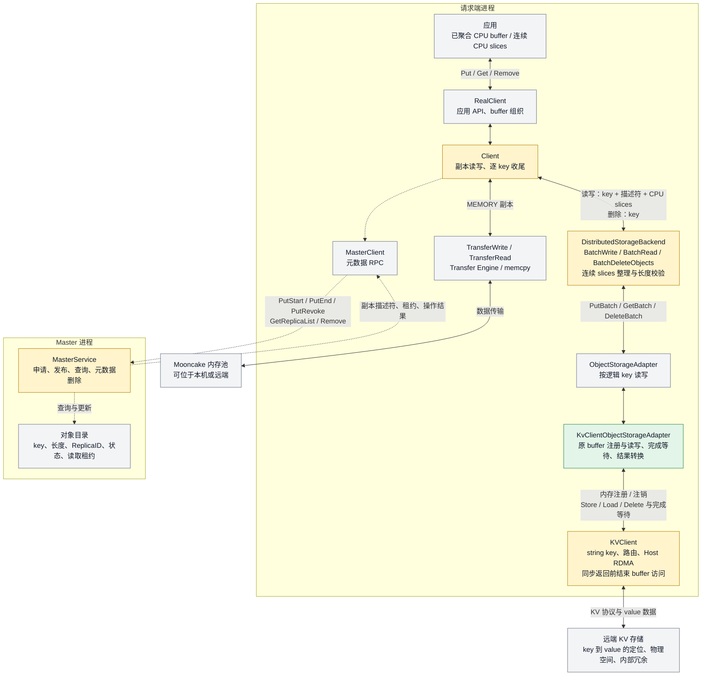
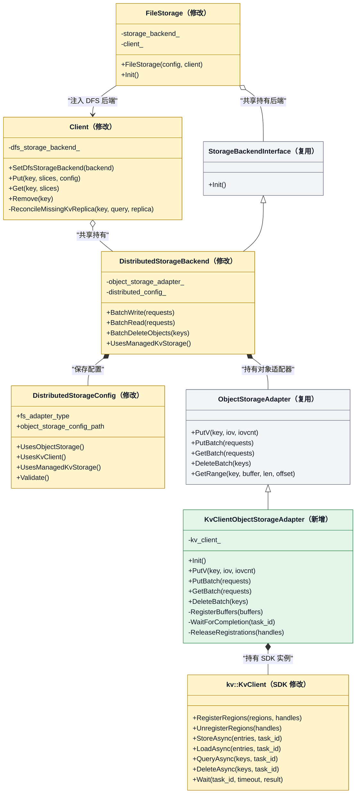
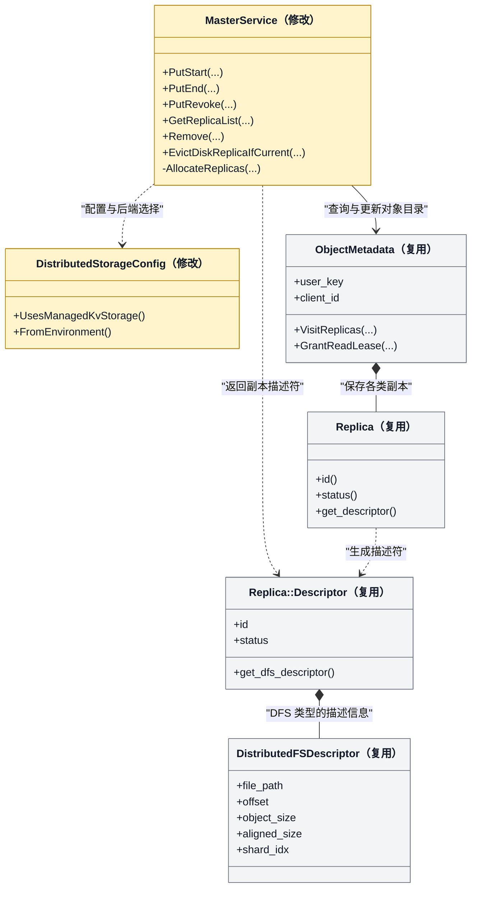
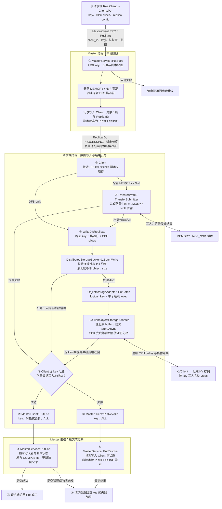
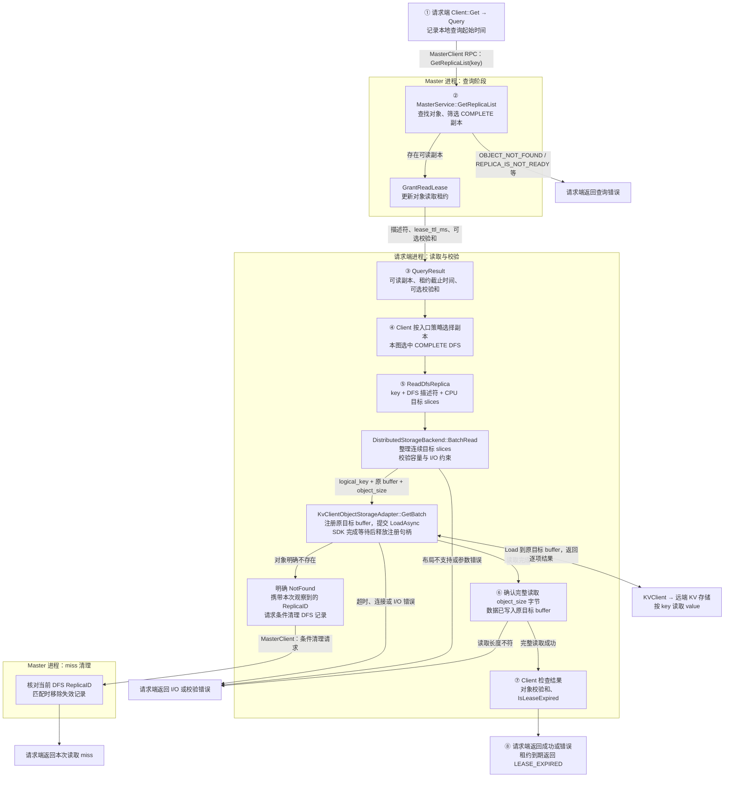
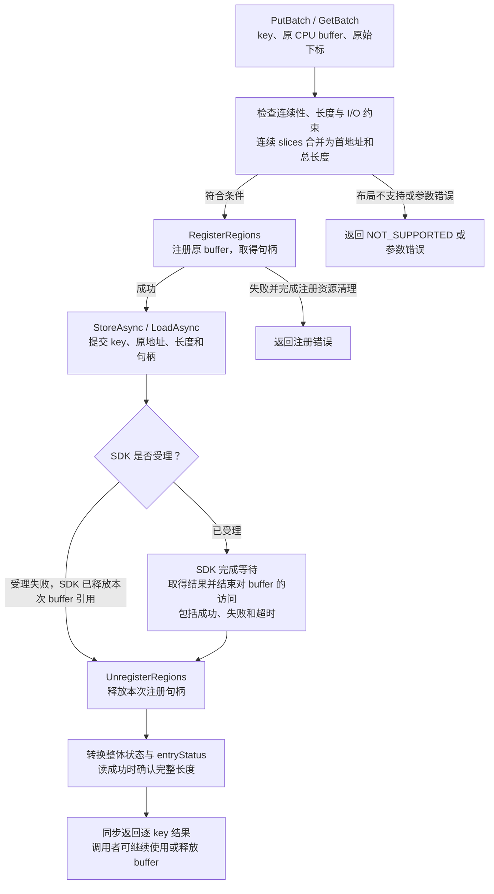
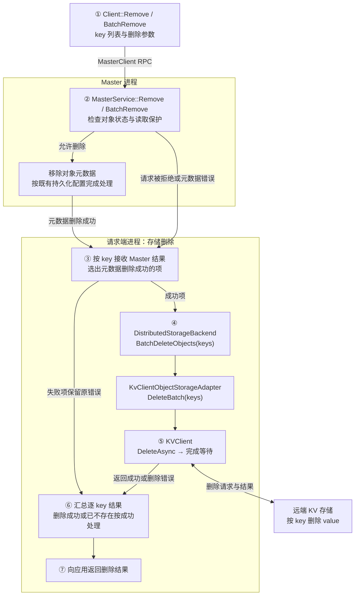

更新日期：2026-11-06。

## 1 目标与范围

### 1.1 目标

通过 KVClient 将远端 KV 存储接入 Mooncake 的 DFS 副本流程，作为共享 L3。应用沿用 Put / Get 接口，在请求内完成配置中的内存与存储写入；内存副本淘汰后，其他 Client 通过 Master 查询并读取 L3 数据。

Master 保存对象目录和逻辑副本，管理发布、读取租约和元数据删除。Client 组织数据 I/O，通过 `KvClientObjectStorageAdapter` 调用 KVClient。KVClient 与存储服务负责按 key 定位数据和实际存取。

### 1.2 范围与接口约定

本节集中列出SDK 配合项和接入范围，后文按这些约定展开。

| 项目       | 约定                                                                                       |
| -------- | ---------------------------------------------------------------------------------------- |
| 对象接口     | Put / BatchPut、Get / BatchGet、Remove / BatchRemove、Upsert；写入配置支持 MEMORY + DFS 和 DFS-only |
| 对象身份     | 一个 Mooncake key 对应一个存储 value；Get 和应用 Exists 以 Master 对象目录为入口                             |
| SDK 配合项  | string key 贯通 Store / Load / Query / Delete；CPU Client 通过 Host RDMA 使用已注册主机内存            |
| 同步完成     | 由 SDK 后续实现：同步调用返回时，结束对应用 buffer 的访问，覆盖成功、失败和超时。异步提交与完成等待共同组成同步操作                         |
| 存储操作     | Store 成功对应完整 value 发布，Upsert 使用整值替换；Load 成功确认完整读取请求长度。替换、重试和错误语义在联调中验证                   |
| 对象后端输入   | 已聚合的连续 CPU buffer，或同一个 key 下地址相邻的多个 CPU slices；非连续输入返回 `NOT_SUPPORTED`                   |
| 输入参数     | 有效地址、非零长度、足够目标容量，满足 SDK 对齐与大小限制；当前协议的长度和存储 offset 按 512 字节对齐。参数不满足时返回对应错误                |
| 数据整理     | 上层或 KVClient 承担跨 key 聚合、padding 和重新打包；适配器存储原始 value。已有上层 D2H 路径产生的连续 CPU buffer 可接入      |
| 同 key 操作 | 调用方串行组织删除、重建和更新，结果未知时先确认状态，再推进后续操作                                                       |
| 容量管理     | KVClient 当前没有容量查询接口；容量统计和 Master 水位淘汰后续讨论。显式 Remove 负责请求删除，写入失败按 SDK 结果返回                |
| 故障处理     | 沿用 Mooncake 副本状态机和元数据恢复。写入撤销、删除失败可能留下存储残留，物理清理由存储侧已有机制或运维处理；自动残留回收和跨重启操作重试列入后续扩展         |
| 其他范围     | 设备地址直达、范围读取、key 枚举、RemoveAll / RemoveByRegex 返回 `NOT_SUPPORTED`；局部数据由调用方在完整读取后截取         |

SDK 配合项以扩展后的接口为目标。代码核对基线中的 `CacheKey` 为 8 字节，现有异步接口与任务实现见 [SDK 类型][sdk-types]、[SDK 接口][sdk-api]、[任务管理][sdk-tasks]；I/O 对齐要求见 [协议实现][sdk-protocol]。

## 2 模块交互

### 2.1 总体结构

实线表示应用调用与存储 I/O，虚线表示元数据交互。灰色模块沿用现有职责，黄色模块需要调整，绿色模块为新增。



### 2.2 初始化与接入位置

RealClient 通过 `FileStorage` 创建 `DistributedStorageBackend`，再经 `Client::SetDfsStorageBackend` 注入 Client。C++ 调用者也可以显式创建并注入后端。[FileStorage][mc-file-storage]

增加 `kvclient` 后端配置后，工厂创建 `KvClientObjectStorageAdapter`，初始化 SDK。读写时在原 buffer 上建立注册，操作结束后释放本次注册句柄。Client 的 DFS 写入、读取入口继续使用现有请求结构：

```text
DfsWriteRequest = key + DistributedFSDescriptor + slices
DfsReadRequest  = key + DistributedFSDescriptor + slices + 范围读取信息
```

KVClient 分支先检查 slices 的连续性，整理为一段地址和长度，再转换为 `ObjectPutRequest` / `ObjectGetRequest`。文件位置字段留在通用描述符中，对象适配器以 key 定位 value。[DFS 后端][mc-backend]、[对象接口][mc-adapter]

自动启用 DFS、逻辑副本分配、恢复校验和明确 miss 清理等公共入口使用 `UsesManagedKvStorage()` 判断，覆盖 KVCS 和 KVClient。工厂根据具体后端创建对应适配器，后端专属的初始化分别执行。KVClient 部署中的 SDK 实例由请求端适配器持有，Master 完成配置解析和逻辑副本管理。[Client][mc-client]、[Master][mc-master]

### 2.3 Client 侧类图

黄色表示修改现有类，绿色表示新增类，灰色表示复用接口或数据结构。类图列出相关成员，参数和返回类型作了简化；新增方法使用设计名称。



继承线表示接口实现，实心菱形表示对象内持有，空心菱形表示共享持有。`FileStorage` 与 `Client` 使用同一份 `DistributedStorageBackend`；后端持有的对象适配器在配置为 KVClient 时取 `KvClientObjectStorageAdapter`。[后端类定义][mc-backend-class]、[Client 类定义][mc-client-class]

| 类或函数 | 接口与改动说明 |
| --- | --- |
| `DistributedStorageConfig` | 扩展现有 `UsesObjectStorage()`、配置解析与校验；增加 `UsesKvClient()` 和 `UsesManagedKvStorage()`，后者覆盖 KVCS / KVClient 的逻辑 DFS 路径 |
| `CreateStorageBackend(config)` | 修改现有工厂函数，在 distributed 分支创建新适配器并交给后端；该入口是自由函数，列在图外 |
| `FileStorage` | 修改构造时的 DFS 启用判断，将 KVClient 后端注入 Client；沿用现有初始化入口 |
| `Client` | 扩展自动 DFS 配置、Remove 路由和明确 miss 清理；将 `ReconcileMissingKvcsReplica()` 推广为图中的 `ReconcileMissingKvReplica()` |
| `DistributedStorageBackend` | 在 `BatchWrite` / `BatchRead` 的 KVClient 分支整理连续 slices、校验 I/O 约束，生成直接引用原 buffer 的对象请求；增加对应后端能力判断 |
| `KvClientObjectStorageAdapter` | 新增实现 `ObjectStorageAdapter` 的具体类；图中注册、等待和释放方法为新增私有辅助方法，具体流程见 6.3 |
| `kv::KvClient` | 通过异步提交与完成等待执行对象操作，注册接口管理本次 I/O 使用的原 buffer |

连续 slices 整理可以作为公共辅助函数供后端和适配器的直接 `PutV` 入口使用。适配器在每次操作中调用 SDK 注册与注销接口，并在操作内保存注册句柄和转换结果。`Put`、`Get`、`Exists` 等其余适配器实现沿用 6.1 的接口映射。

### 2.4 Master 侧类图

Master 在现有 `ObjectMetadata` 和 `Replica` 上管理 KVClient 的逻辑 DFS 副本。`PutStart` 创建描述符，`PutEnd` 发布副本，查询返回可读副本，Remove 和明确 miss 清理更新对象目录。



| 类 | 改动与职责 |
| --- | --- |
| `MasterService` | 将逻辑 DFS 分配、描述符恢复校验和按 ReplicaID 清理的后端判断扩展到 KVClient；沿用 Put / Get / Remove 状态机 |
| `DistributedStorageConfig` | 解析 KVClient 配置，提供逻辑 KV 后端的公共能力判断 |
| `ObjectMetadata` / `Replica` | 保存 key、写入 Client、副本身份、状态和读取租约，沿用既有元数据持久化方式 |
| `Replica::Descriptor` / `DistributedFSDescriptor` | 向 Client 返回对象长度、ReplicaID 和状态，字段约定见第三章 |

Master 查询自身对象目录，Client 根据返回的描述符调用 KVClient。存储返回明确 miss 时，由 Client 请求 `EvictDiskReplicaIfCurrent` 条件清理。[Master 类定义][mc-master-class]、[副本定义][mc-replica]

## 3 对象身份与 Master 元数据

### 3.1 key 如何到达存储

string key 贯穿整个数据路径：

```text
应用 key
  → Client 请求中的 key
  → DfsWriteRequest / DfsReadRequest.key
  → ObjectPutRequest / ObjectGetRequest.logical_key
  → KVClient 的 string key
  → 远端 value
```

KVClient 按完整 key 处理对象，字符串长度和字节内容随请求传递。SDK 承接底层协议需要的编码、映射和聚合，并保证不同 key 的区分、跨 Client 一致性及重启后的稳定访问。

Master 保存 `key → DFS 副本` 的关系，Client 使用同一个 key 访问存储。对象的可发现性由 Master 目录提供，存储位置由 KVClient 解析。

### 3.2 Master 返回什么

沿用 KVCS 的逻辑 DFS 描述符约定，`PutStart` 返回 `Replica::Descriptor`，其中包含 ReplicaID、状态和 `DistributedFSDescriptor`。[副本定义][mc-replica]、[Master 分配][mc-master]

| 字段 | KVClient 接入中的含义 |
| --- | --- |
| `ReplicaID` | 标识 Master 中这一份副本，用于状态管理和条件清理 |
| `status` | 写入期间为 `PROCESSING`，发布后为 `COMPLETE` |
| `object_size` | 应用 value 的有效长度 N |
| `aligned_size` | 沿用 KVCS 对象模式，取 N；输入长度 N 本身满足 SDK 的对齐要求 |
| `file_path` | 空字符串 |
| `offset` | 0 |
| `shard_idx` | -1，沿用对象模式约定 |

Client 使用自己持有的 key、Master 返回的对象长度，以及本地后端配置执行 I/O。存储节点选择和物理空间分配由 KVClient 与存储服务完成。

ReplicaID 标识元数据中的副本，供提交状态管理和条件清理使用。实际 Store / Load / Delete 使用逻辑 key。

Master 同时保存写入 Client、可选对象校验和、读取租约与访问记录。对象元数据沿用现有状态机及 snapshot / OpLog 恢复路径。

## 4 写入：申请副本、写入数据、提交

### 4.1 Client 与 Master 的完整交互

下图以新 key 的 Put 为例，按申请、数据写入和提交顺序展开。Master 的申请与收尾分别绘制，元数据 RPC 经 `MasterClient` 发送，数据由请求端访问内存池和远端存储。



单个 CPU buffer 直接进入对象分支；多个 CPU slices 在地址相邻时合并为首地址和长度之和，复用原内存。设备数据可通过 Mooncake 已有入口完成 D2H，转换结果同样按连续 CPU buffer 的条件校验。[Client 写入][mc-client]

Put 的成功条件是该 key 配置的必要数据写入完成，并且 Master 接受提交。`StoreAsync` 返回成功表示请求已受理；适配器随后调用 SDK 的完成等待接口，取得结果并释放注册句柄，再向 Client 返回。完成等待按 6.3 的契约结束对 buffer 的访问。

PutEnd 响应未知时，Client 返回提交错误；后续通过 Master 查询或符合条件的重复提交确认发布状态。

### 4.2 BatchPut

`BatchPutStart` 按 key 返回描述符或错误。Client 先汇总 MEMORY / NoF 传输结果，再把可以继续写入 DFS 的对象交给 `BatchWrite`。

适配器按 SDK 批量上限和在途请求限额分批提交，保存每个请求的原始下标。每个 key 仍对应一个连续 buffer；KVClient 可进一步按节点拆分，最终结果映射回 Mooncake 请求顺序。成功项进入 `BatchPutEnd`，失败项进入 `BatchPutRevoke`，整批返回逐 key 结果。多个小对象的 value 聚合由上层或 KVClient 负责。

## 5 读取：查询副本、读取 value、校验结果

### 5.1 Client 与 Master 的完整交互

下图展开完整对象 Get 选中 DFS 副本后的数据路径，Master 按查询阶段和 miss 清理阶段分别绘制。内存副本淘汰后，Master 仍保留已发布的 DFS 记录，读取 Client 按相同流程访问 L3。



普通 `Client::Query` 使用本地查询起始时间加 `lease_ttl_ms` 计算租约截止时间，完整对象 Get 在读取结束后检查有效期。读取成功直接返回调用者，Master 按租约期限管理读取保护。[Client 查询与读取][mc-client]、[Master 查询][mc-master]

明确 miss 时进入 5.3 的条件清理流程。超时、连接失败和数据校验错误保留副本记录，供后续读取或诊断使用。

### 5.2 目标 buffer 与批量读取

底层 Client 接收应用提供的连续 CPU buffer，或地址相邻的多个 CPU slices。后端将其整理为一个目标区域，容量至少为 `object_size`，本次 Load 长度取 `object_size`。SDK 直接写入该区域。

在对象请求转换处增加 KVClient 的连续性处理分支，将相邻 slices 整理为一个目标地址和容量，再创建 `ObjectGetRequest`。这一分支直接引用原目标内存。[DFS 后端][mc-backend]

RealClient 的部分入口已经使用 `client_buffer_allocator_` 管理 CPU 临时空间，最后经 `scatter_host_to_maybe_device` 复制到调用者目标。这些上层入口可继续提供符合条件的连续 CPU buffer，其暂存和复制沿用各自的生命周期。[RealClient][mc-real-client]

BatchGet 按 key 组织查询、读取和结果校验。应用 Exists 根据 Master 目录判断对象状态；适配器的 `Exists` 使用 SDK `QueryAsync` 查询存储，供适配层调用和诊断。常规 Get 在取得 Master 描述符后直接提交 Load。

### 5.3 明确 miss 后的副本清理

`ReconcileMissingKvReplica()` 处理目录记录与实际读取结果的差异。Client 已经查询到 COMPLETE DFS 副本，但 SDK 返回 `OBJECT_NOT_FOUND` 时，向 Master 发送 key 和本次读取观察到的 ReplicaID。

Master 在 key 锁内核对 ReplicaID，匹配时移除对应 DFS 记录；其他有效副本继续保留。例如 Client 读的是 R1，而目录已经更新为 R2，清理请求返回条件不匹配，R2 保持原样。

该流程复用现有 `ReconcileMissingKvcsReplica()` 与 `EvictDiskReplicaIfCurrent`，将两端的后端判断扩展到 KVClient。清理操作的结果用于日志与后续目录维护，本次读取仍返回原来的 miss。[Client][mc-client]、[Master][mc-master]

## 6 对象适配器

### 6.1 接口映射

`KvClientObjectStorageAdapter` 实现现有 `ObjectStorageAdapter`，通过 SDK 的异步提交与完成等待组成同步对象操作。

| Mooncake 接口 | KVClient 操作 | 适配器工作 |
| --- | --- | --- |
| `Put` / `PutV` | `StoreAsync` + 完成等待 | 将连续 slices 合并描述，注册原内存，写入原始 value |
| `PutBatch` | 批量 `StoreAsync` + 完成等待 | 校验各 key、注册原内存、拆分批次、还原逐项结果 |
| `Get` / `GetBatch` | `LoadAsync` + 完成等待 | 直接读入原目标 buffer，完整读取 N 字节后返回 N |
| `Exists` | `QueryAsync` | 解析逐项存在性结果 |
| `Delete` / `DeleteBatch` | `DeleteAsync` | 等待删除完成，将已不存在视为幂等成功 |
| `Init` | `CreateKvClient` / `Init` | 初始化 SDK 与连接 |
| `GetRange` | — | 返回 `NOT_SUPPORTED` |
| `ListKeys` | — | 返回 `NOT_SUPPORTED` |

批量操作同时检查提交状态、任务整体状态和 `entryStatus`，每个输入对应一个输出。明确不存在映射为对象 miss，传输和服务错误保留各自的失败含义。

### 6.2 连续 buffer 与 I/O 粒度

底层设备适合较大的 I/O，通常由上层先在 CPU 聚合数据。对于同一个 key 的多个 slices，适配层按输入顺序检查地址相邻关系：

```text
slice[i + 1].addr == slice[i].addr + slice[i].size

提交地址 = 第一个 slice 的地址
写入长度 N = 各 slice 长度之和
读取长度 N = Master 返回的 object_size，连续目标容量至少为 N
KVClient offset = 0
```

这一步只整理地址和长度。适配层校验地址、长度求和及注册范围，合并后的整段内存在操作期间保持有效。直接调用适配器 `PutV` 时也执行相同检查。

存储 value 就是应用提供的 N 字节原始数据，`object_size` 与实际 I/O 长度均为 N。数据校验沿用 Mooncake 的可选对象校验和。读取成功要求 SDK 确认完整取得 N 字节：SDK 可返回实际长度供适配器检查，或在读取长度不符时明确返回错误。

适配器按 N 检查对象大小和 I/O 参数，写入长度与 Master 记录一致，读取目标容量覆盖 N 字节。

推荐 I/O 粒度用于指导上层聚合，具体取值根据设备性能测试确定。小于推荐粒度但仍满足硬性约束的请求可以提交。BatchPut 保留逐 key 的对象语义，跨 key 的数据聚合由上层或 KVClient 完成。

### 6.3 内存注册与同步完成

适配器在原 CPU buffer 上调用 `RegisterRegions`，用返回的句柄提交 I/O。采用按次注册、按次释放：完成等待返回后调用 `UnregisterRegions`，再向上返回结果。TE 与 KVClient 各自管理注册。

`StoreAsync` / `LoadAsync` 返回提交结果，完成等待接口负责取得操作结果并结束 buffer 访问。适配器依次完成提交、等待、注销和结果转换。[SDK 接口][sdk-api]



调用者在同步操作期间保持源数据和目标内存有效；操作返回后可以复用或释放。适配器负责注册句柄及结果转换，SDK 负责等待、取消和超时收尾。进程退出时停止提交，等待 SDK 完成在途操作，再释放注册资源。

## 7 删除、更新与元数据恢复

### 7.1 Remove / BatchRemove

删除沿用 KVCS 接入采用的顺序：Client 先调用 Master 移除对象元数据，再对成功移除的 key 调用 KVClient 删除 value。Master 按现有状态、读取租约及删除参数处理请求，Client 汇总最终结果。



BatchRemove 保留原始下标，分别记录元数据删除与存储删除结果。存储删除失败时返回该 key 的错误，已移除的元数据保持删除状态。[Client Remove 实现][mc-client]

### 7.2 Upsert

Upsert 使用 `UpsertStart / UpsertEnd / UpsertRevoke` 管理本次更新。Master 按现有状态机处理对象可见性，Client 通过同一对象适配器写入新 value。

KVClient 完成整值替换后，Client 提交 UpsertEnd；数据写入失败时提交 UpsertRevoke。内存与 DFS 的结果按 key 汇总，处理方式与 Put 一致。

### 7.3 失败处理与恢复

| 场景 | 处理 |
| --- | --- |
| PutStart 返回错误 | Client 返回申请结果 |
| 数据写入失败，包括 SDK 返回的空间不足 | Client 按现有完成规则发送 PutRevoke，Master 移除本轮对应的 PROCESSING 副本 |
| 数据写入完成，PutEnd 响应未知 | Client 返回提交错误，通过查询或符合条件的重复提交确认 Master 状态 |
| Client 退出或 PROCESSING 超时 | Master 沿用后台清理流程移除超时副本记录 |
| Load 返回明确 miss | Client 按观察到的 ReplicaID 请求条件清理 |
| Master 重启 | 从既有 snapshot / OpLog 恢复对象目录，Client 根据恢复后的可读副本继续访问存储 |

恢复所需的 DFS 描述符沿用现有字段。接入时将对象模式的描述符校验和恢复判断扩展到 KVClient，复用 Mooncake 的元数据恢复流程。L3 数据的可发现性由恢复后的 Master 目录提供。[Master][mc-master]

## 8 改动位置与实施顺序

### 8.1 改动位置

| 位置 | 改动 |
| --- | --- |
| 后端配置、工厂和构建 | 增加 `kvclient` 选择、SDK 可选依赖及初始化配置；按配置创建对应适配器 |
| `FileStorage` / `Client` | 启用 KVClient DFS 分支，接入自动 DFS 配置、明确 miss 清理和 Client 侧存储删除 |
| `DistributedStorageBackend` | 整理连续 slices，检查 I/O 参数，读写直接使用原 buffer，删除请求转给对象适配器 |
| `KvClientObjectStorageAdapter` | 新增原内存注册、SDK 操作与完成等待、批量结果映射 |
| `MasterService` | 扩展逻辑 DFS 分配、条件清理和恢复校验的后端判断，复用已有元数据状态机 |
| SDK | 落实 1.2 的接口约定，并提供逐 key 的读写、查询和删除结果 |

### 8.2 实施顺序

先完成适配器和整对象 Put / Get，验证连续 buffer、原内存注册、完整读取及批量结果映射。随后接通后端选择和 Master 的逻辑 DFS 分支，串起 PutStart、数据写入、PutEnd 与跨 Client 读取。

再完成 Remove / BatchRemove、明确 miss 清理、Upsert 和元数据恢复校验，按完整对象生命周期联调。

### 8.3 验证场景

1. MEMORY + DFS 写入成功，内存副本淘汰、写入 Client 退出后，另一 Client 从 L3 读取原数据。
2. DFS-only 完成写入、读取和显式删除。
3. 单个 buffer 与连续 slices 读写结果一致；非连续、未对齐、容量不足等输入在提交 SDK I/O 前返回对应错误。
4. 成功、失败和超时返回后立即复用或释放应用 buffer，验证 SDK 已结束访问，注册句柄正确释放。
5. 批量写入、读取和删除部分失败时，结果与原 key 下标对应；SDK 空间不足错误按现有写入规则收尾。
6. Client 观察到 R1 的 miss 后，Master 已发布 R2，条件清理保留 R2。
7. 按约定顺序完成同 key 删除、重建和 Upsert，检查元数据状态与读取内容。
8. 已发布对象的元数据经 snapshot / OpLog 恢复后，另一 Client 能按 key 读取 L3。
9. 分别测量上层聚合、注册与注销、SDK I/O 和 Master RPC 耗时，确定推荐 I/O 粒度。

## 9 代码依据

代码核对基线：Mooncake `5474d9b2374ffb1092c6ba5a9bd6bb4865d0ac1f`；KVClient `e25e7e1a00654802034963544ad43cc3d64f1cbf`。

[mc-replica]: /home/nrj/codes/Mooncake/mooncake-store/include/replica.h
[mc-client]: /home/nrj/codes/Mooncake/mooncake-store/src/client_service.cpp
[mc-master]: /home/nrj/codes/Mooncake/mooncake-store/src/master_service.cpp
[mc-real-client]: /home/nrj/codes/Mooncake/mooncake-store/src/real_client.cpp
[mc-file-storage]: /home/nrj/codes/Mooncake/mooncake-store/src/file_storage.cpp
[mc-backend]: /home/nrj/codes/Mooncake/mooncake-store/src/storage/distributed/distributed_storage_backend.cpp
[mc-adapter]: /home/nrj/codes/Mooncake/mooncake-store/include/storage/distributed/object_storage_adapter.h
[sdk-api]: /home/nrj/codes/ucm-pod/kv_semantics/include/kv_client.h
[sdk-types]: /home/nrj/codes/ucm-pod/kv_semantics/include/kv_types.h
[sdk-protocol]: /home/nrj/codes/ucm-pod/kv_semantics/src/trans/proto/kv_protocol.cc
[sdk-tasks]: /home/nrj/codes/ucm-pod/kv_semantics/src/client/task/task_manager.cc
[mc-backend-class]: /home/nrj/codes/Mooncake/mooncake-store/include/storage/distributed/distributed_storage_backend.h
[mc-client-class]: /home/nrj/codes/Mooncake/mooncake-store/include/client_service.h
[mc-master-class]: /home/nrj/codes/Mooncake/mooncake-store/include/master_service.h
