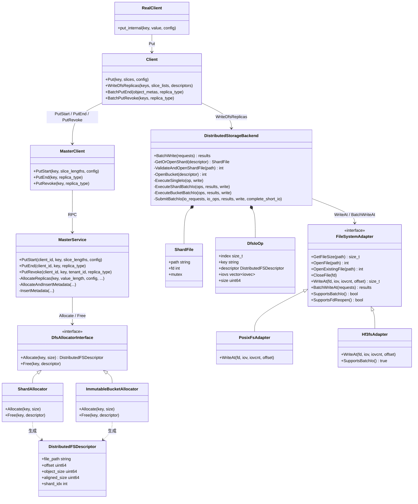
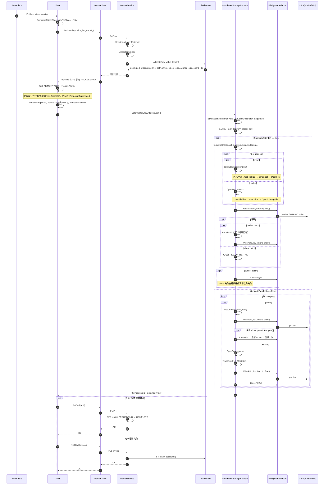
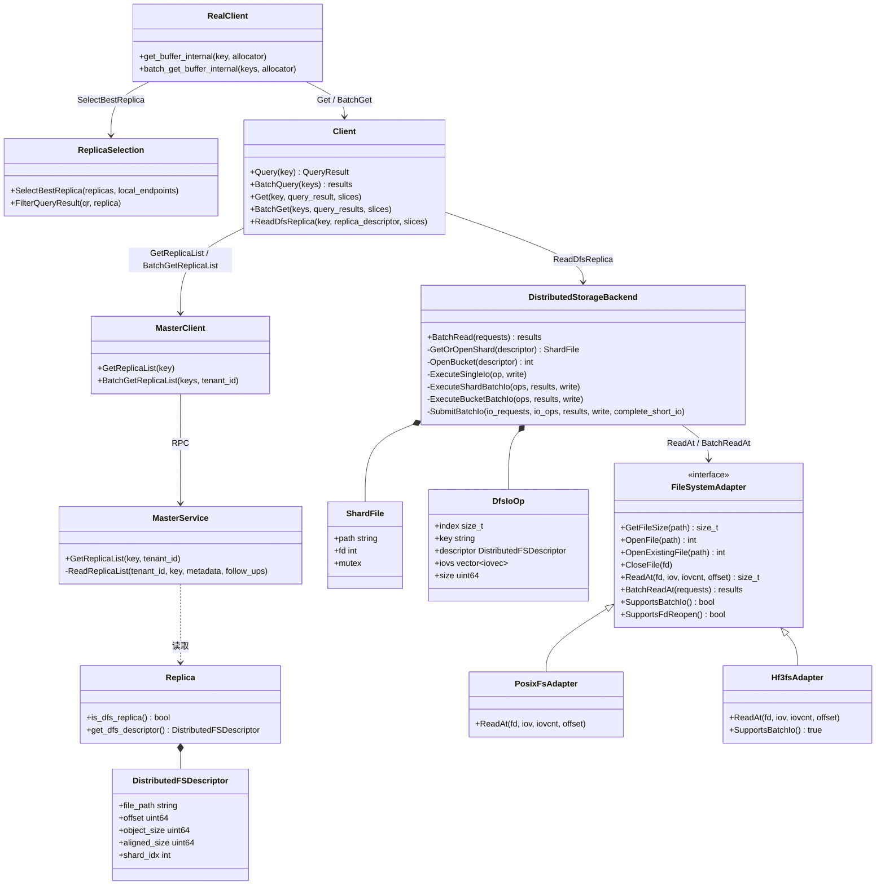
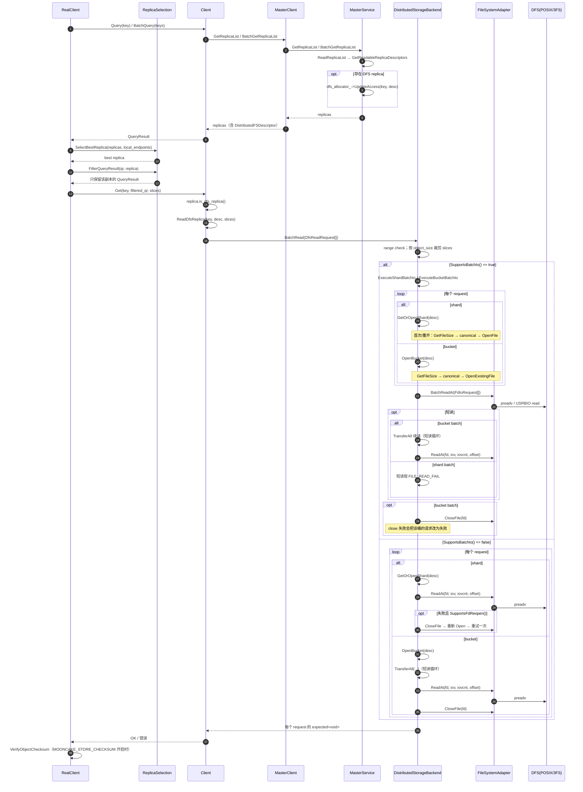
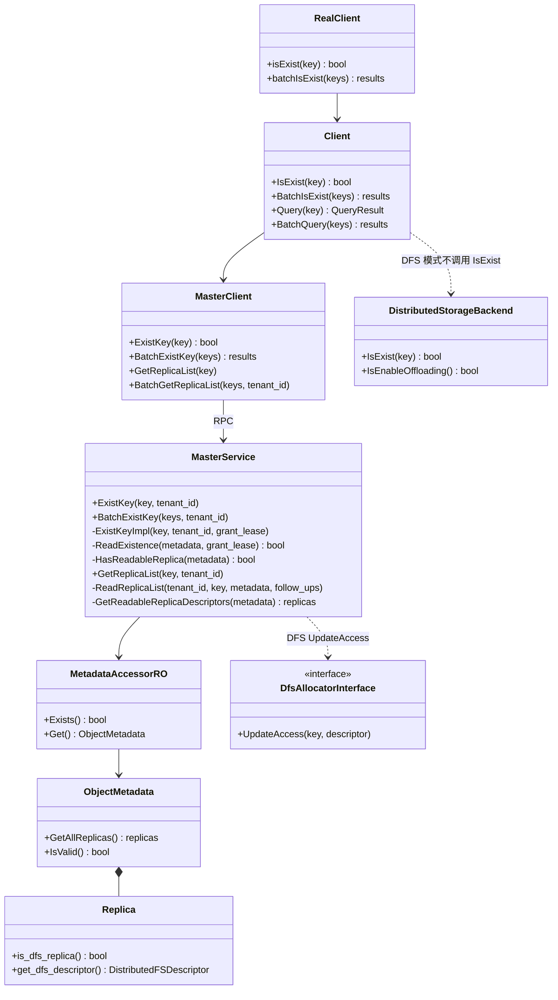
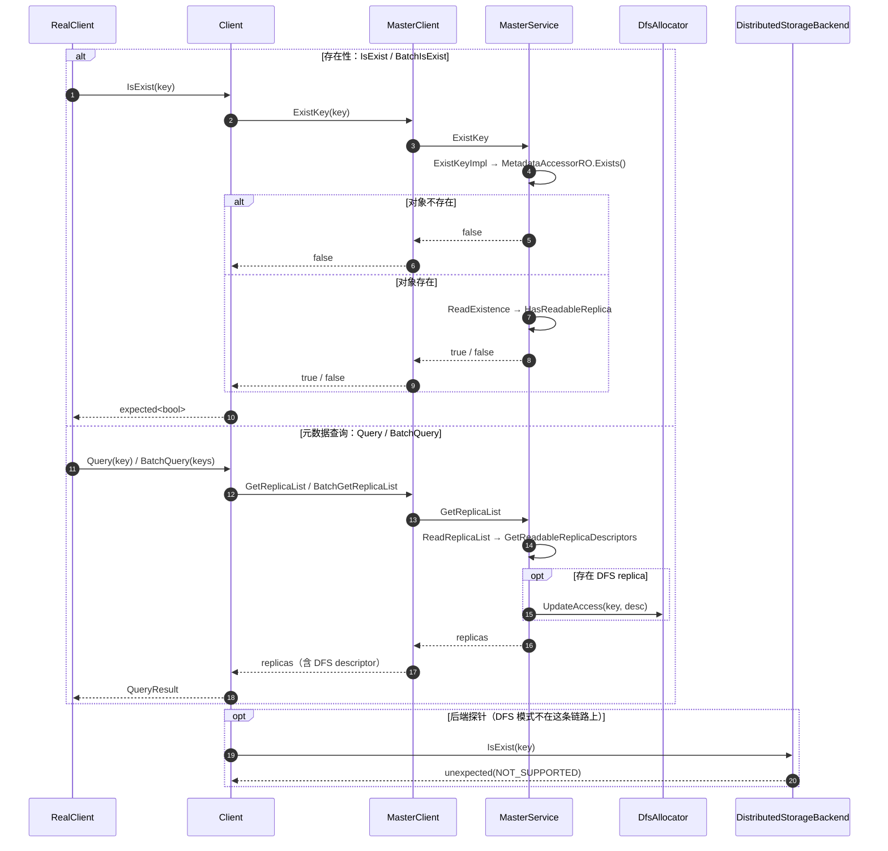
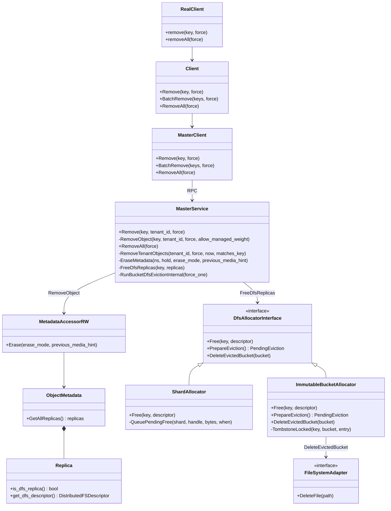
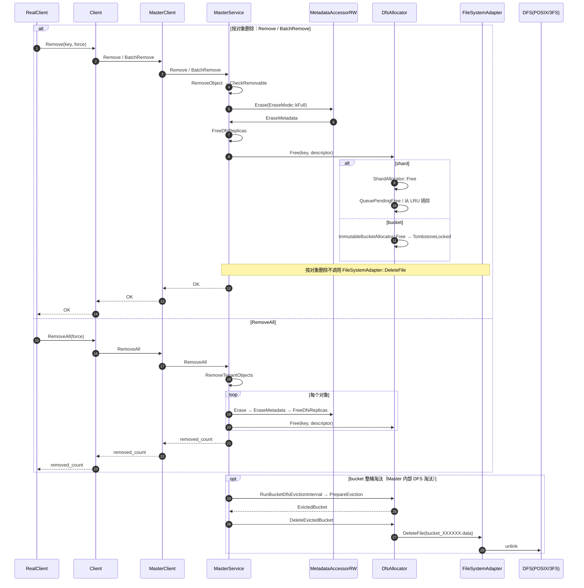
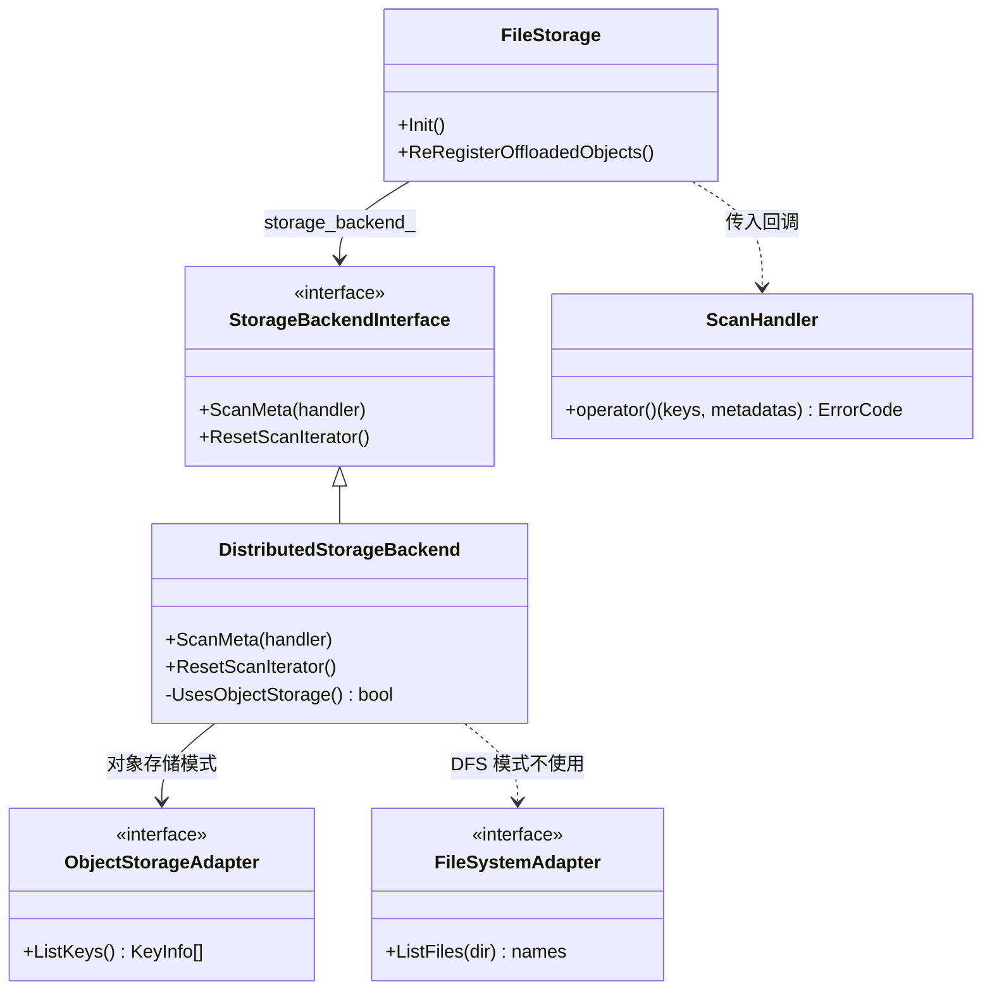
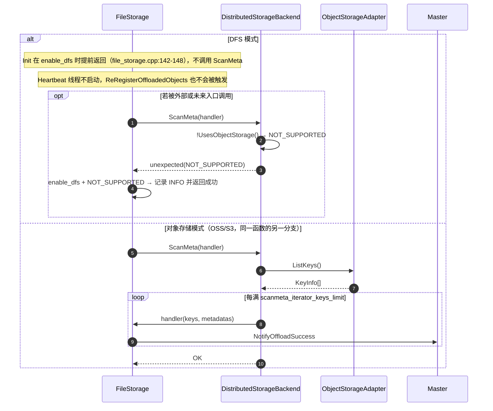

# Mooncake DFS 当前实现：写、读、查、删、ScanMeta 的类图与时序图

> 代码基线：Mooncake `main` @ `522b716e`。图中 `文件:行号` 为当前 HEAD 核对结果。

---

## 1. 写

### 1.1 类图

### 1.2 时序图

---

## 2. 读

### 2.1 类图

### 2.2 时序图

---

## 3. 查

### 3.1 类图

### 3.2 时序图

---

## 4. 删

### 4.1 类图

### 4.2 时序图

---

## 5. ScanMeta

### 5.1 类图

### 5.2 时序图

