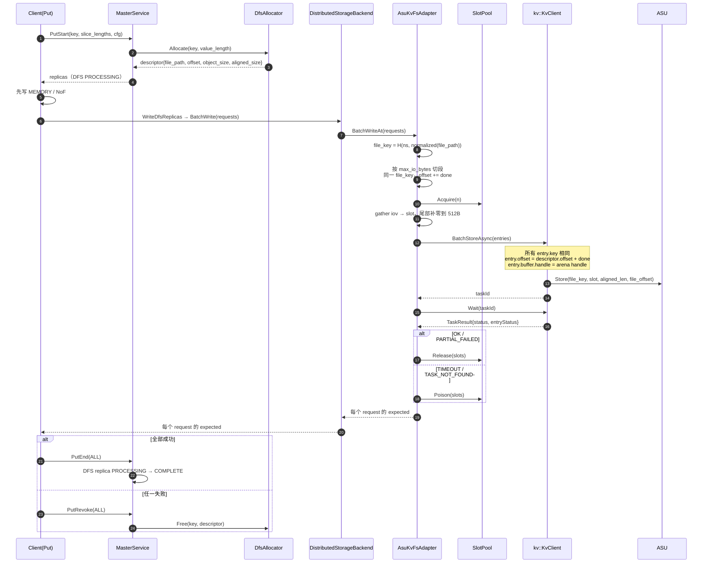
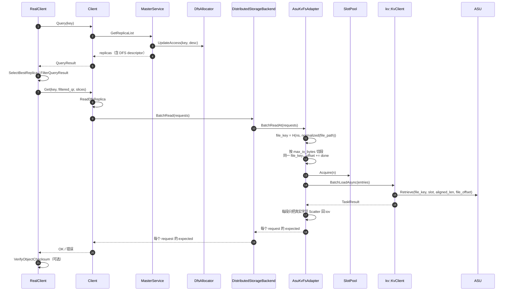
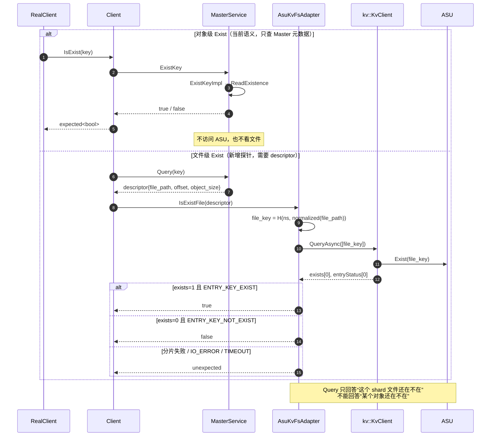
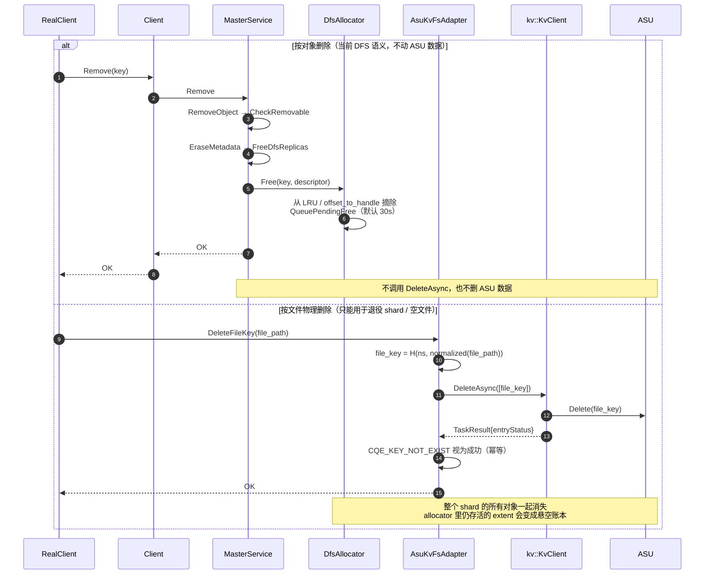

# Mooncake DFS「每文件一键」变体：写、读、查、删时序图

> 变体前提：一个 shard 文件 = 一个 8B key，`file_key = XXH64(namespace, normalized(file_path))`；
> 读写用 `Store/Retrieve(key, buffer, offset, length)` 做文件内 offset 寻址。
> 代码基线：Mooncake `main` @ `522b716e`；ASU SDK `kv_semantics` 的 `kv_client.h` / `kv_types.h`。

---

## 1. 写

约束：

- 单次 I/O ≤ 16,776,704B（24-bit、512B 对齐）；
- `descriptor.offset + done` 必须 < 2^32，所以 `shard_capacity ≤ 4 GiB`；
- 同一 key 的多个 entry 是否被设备接受、是否支持任意 offset 写/自动扩展，取决于 H1/H1b 真机验证。

## 2. 读

同一对象的多段读共享同一个 `file_key`，只是 `offset` 不同；读路径不关心文件里其它对象。

## 3. 查

注意：Query 的分片失败会让 `exists` 保持 0，所以不能只看 `exists == 0` 判“不存在”，必须同时看任务状态和 `entryStatus`。

## 4. 删

文件级删除不能接到按对象的 `Remove` 上：一个 key 覆盖整个 shard，删掉它会让同一 shard 内其它仍然存活的对象一起不可读；同时 `ShardAllocator::offset_to_handle` / LRU 仍然认为这些 extent 有效，必须先把 shard 退役并重置 allocator 状态。这个变体能给出“文件是否还在”的答案，但**按对象删除/Exist 仍然做不到**。
