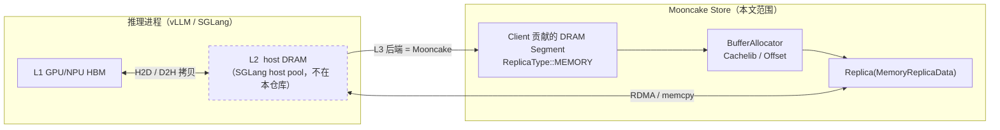
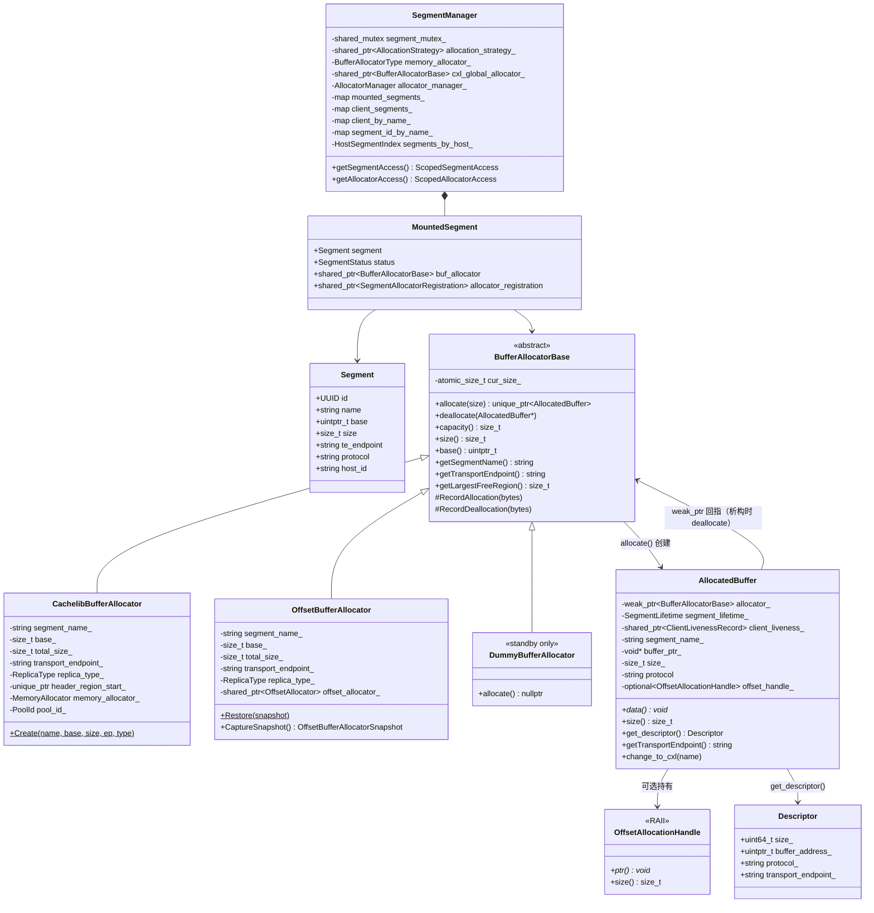
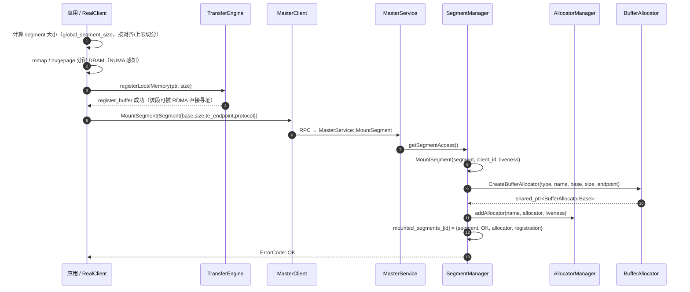
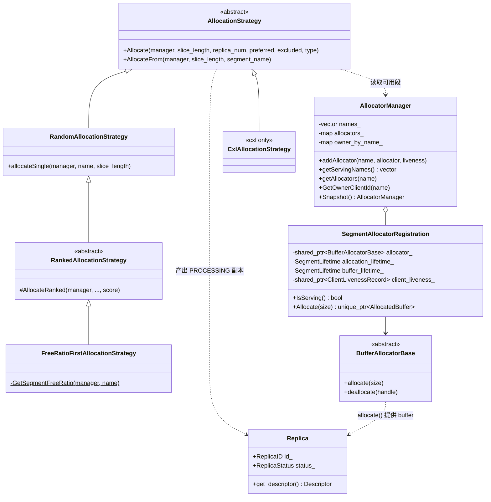
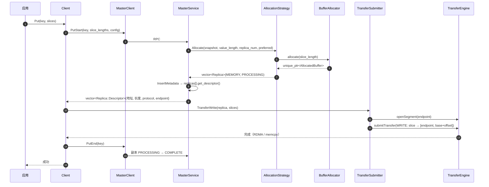
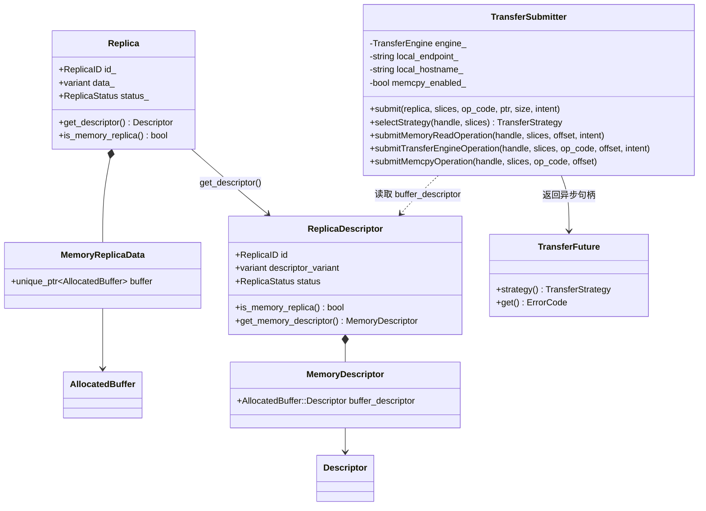
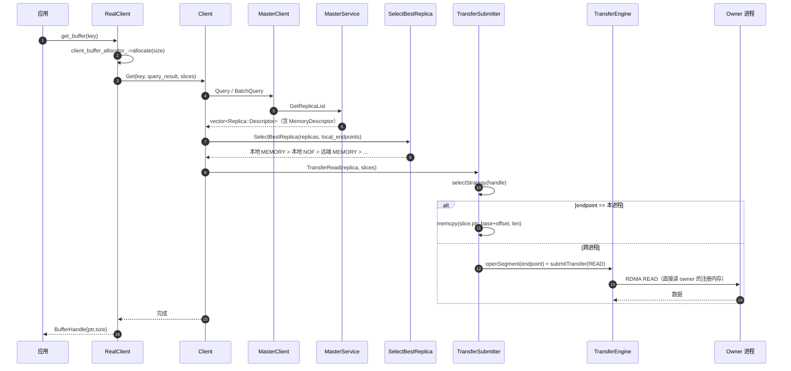
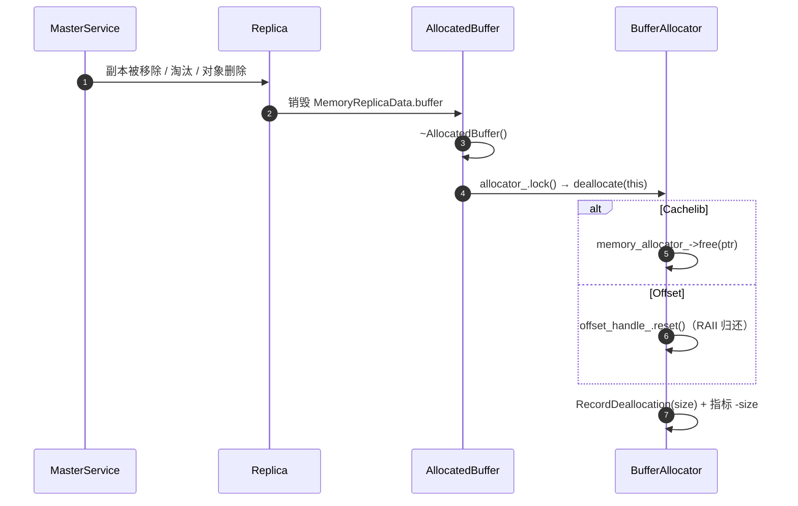
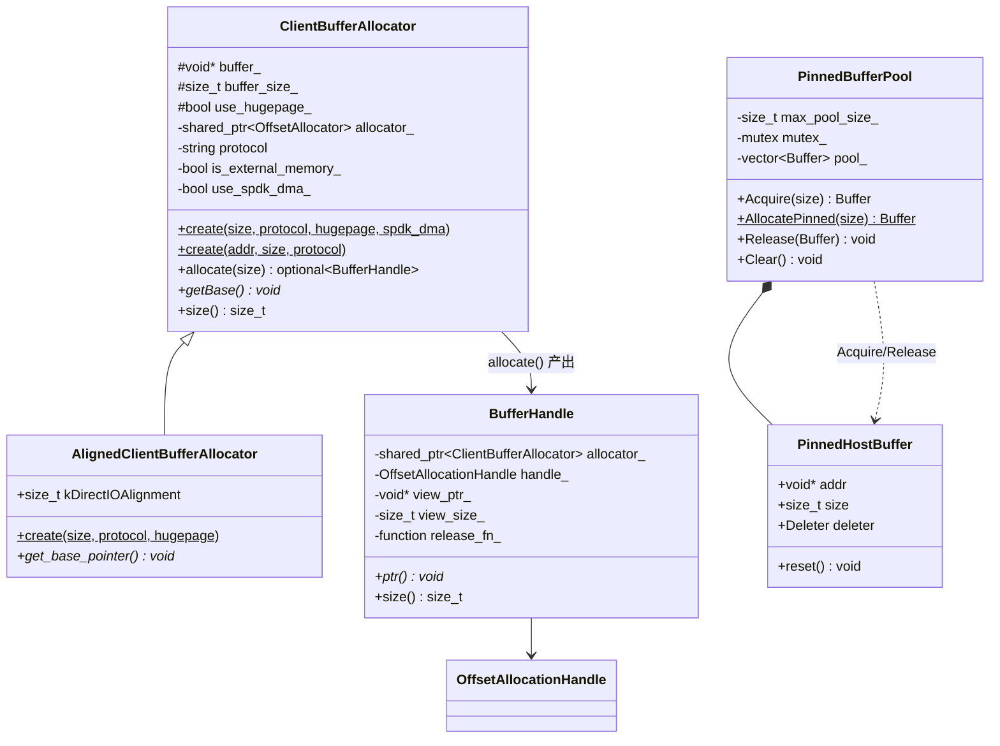
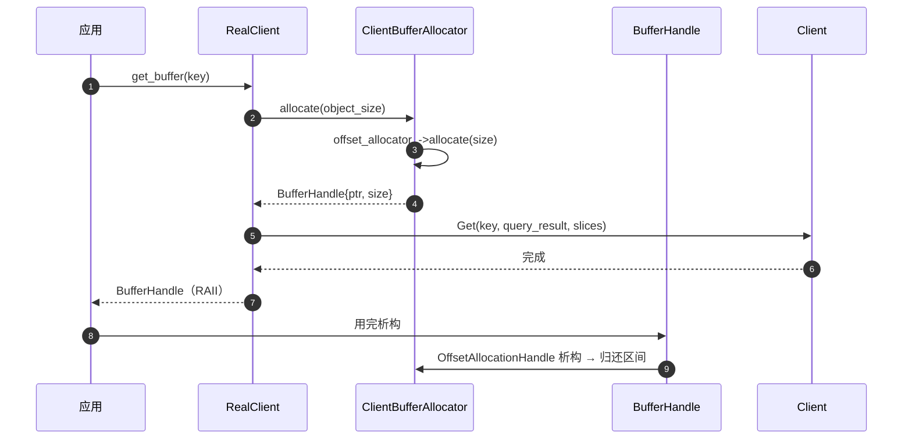

# Mooncake L2（主机内存层）代码解读

> **对应原文**：`docs/source/design/hicache-design.md:5`
> —— *“HiCache organizes GPU memory as L1, host memory as L2, and distributed storage as L3.”*
>
> **代码基线**：`main` @ `67df8c41`，所有位置写成 `路径:起止行`。
>
> **代码约定**：正文代码块是**源码原文**，只做了两件事——在行尾/行首加了 `//` 中文注释，以及用 `// ...（略 …）` 跳过与本步无关的整段。除这两类改动外没有改写任何代码，可以直接按行号对照仓库。
>
> **范围**：本文只讲 **L2 = 主机 DRAM 层**在 Mooncake 代码里的实现（Segment / Allocator / AllocatedBuffer / Memory 副本 / 客户端缓冲区 / 数据面）。SSD、NoF、DFS、对象存储属于 L3，只在必要处作对比，不展开。

---

## 目录

| 章 | 主题 | 图 | 代码 |
| --- | --- | --- | --- |
| 0 | 怎么读这份文档 | — | — |
| 1 | L2 在 Mooncake 里指什么 | 关系图 | — |
| 2 | 核心对象：空间结构 | **类图** | `AllocatedBuffer` / 分配器接口 / `Segment` |
| 3 | 启动：注册 DRAM 段 | **时序图** | `MountSegment` / 工厂 / `AllocatorManager` |
| 4 | 写入：Put | **类图 + 时序图** | 分配策略 / 两种 `allocate` / Master / Client |
| 5 | 读取：Get | **类图 + 时序图** | 描述符 / 副本选择 / 数据面 |
| 6 | 释放与生命周期 | **时序图** | `~AllocatedBuffer` / 两种 `deallocate` |
| 7 | 客户端缓冲区 | **类图 + 时序图** | `ClientBuffer` / `BufferHandle` / `Pinned` |
| 8 | 关键设计决策 | — | — |
| 9 | 参数与调优 | — | — |
| 10 | 速查表 | — | — |
| 11 | 一页纸总结 | — | — |

---

## 0. 怎么读这份文档

全文按**功能环节**分章，每一章内部固定是「**类图 → 时序图 → 代码逐行讲解**」，也就是先看这一环节涉及哪些对象，再看它们的调用顺序，最后落到具体代码。

每一段代码后面固定有两小节：

- **这一段在做什么** —— 读完应该记住的判断；
- **重点语法 / 惯用法** —— 这段代码用到的 C++ 写法与坑。

如果你只想知道「一次 Get 到底怎么从远端 DRAM 读到本地」，直接看 **5.2**（时序）与 **5.5–5.7**（代码）。如果想先建立整体印象，看 **2.1** 的类图。

---

## 1. L2 在 Mooncake 里到底指什么

### 1.1 先消除歧义：两个“L2”

HiCache 的三级是**推理进程视角**：

| 层级 | 介质 | 谁管理 |
| --- | --- | --- |
| L1 | GPU / NPU HBM | 推理引擎（vLLM / SGLang） |
| **L2** | **主机 DRAM（pinned / hugepage）** | **推理引擎**（SGLang 的 host memory pool） |
| L3 | 分布式存储 | **Mooncake Store** |

也就是说，在 SGLang + Mooncake 的部署里，**HiCache 的 L2 并不在 Mooncake 仓库内**——它是 SGLang 进程里的一块 host 内存池；Mooncake 提供的是 L3。

但 Mooncake **自己也有一层主机内存**，就是 Store 的 `ReplicaType::MEMORY`：每台机器上的 client 贡献一段注册过的 DRAM 作为 segment，master 负责分配，读方直接 RDMA 拉取。它在物理介质上和 HiCache 的 L2 是同一级，只是归属不同。

本文讲的是**后者**——Mooncake 代码里那套“把主机 DRAM 组织成可分配、可远程访问的层级”的实现。两者的关系如下：



> 一句话：**HiCache 的 L2 是“推理引擎自己的 host 内存”；Mooncake 的 L2 是“集群共享的 host 内存池”。** 本文把后者拆开讲透。

### 1.2 三个角色

| 角色 | 代码 | 在 L2 里干什么 |
| --- | --- | --- |
| **Master** | `MasterService` | 只做决策：算出该给哪个 segment 分配多少字节，把 `(地址, 长度, endpoint)` 写进副本描述符返回。**从不碰数据**。 |
| **Client（owner）** | `Client` / `RealClient` | 贡献一段注册 DRAM（segment），持有 `BufferAllocator`，负责真正 `allocate/free`。 |
| **Client（reader）** | `Client` / `RealClient` | 拿到描述符后，用 Transfer Engine 直接读 owner 的注册内存；同进程时走 `memcpy`。 |

### 1.3 一张表看完 L2 的对象

| 概念 | 类型 | 关键字段 | 位置 |
| --- | --- | --- | --- |
| 段 | `Segment` | `id / name / base / size / te_endpoint / protocol / host_id` | [types.h:457](../Mooncake/mooncake-store/include/types.h#L457) |
| 挂载状态 | `MountedSegment` | `segment + status + buf_allocator + allocator_registration` | [segment.h:28](../Mooncake/mooncake-store/include/segment.h#L28) |
| 分配器接口 | `BufferAllocatorBase` | `capacity / size / base / allocate / deallocate` | [allocator.h:183](../Mooncake/mooncake-store/include/allocator.h#L183) |
| 分配句柄 | `AllocatedBuffer` | `allocator_（weak）+ buffer_ptr_ + size_ + offset_handle_` | [allocator.h:70](../Mooncake/mooncake-store/include/allocator.h#L70) |
| 副本 | `Replica` | `variant<MemoryReplicaData, ...>` | [replica.h:301](../Mooncake/mooncake-store/include/replica.h#L301) |
| 线上描述符 | `MemoryDescriptor` | `size_ / buffer_address_ / protocol_ / transport_endpoint_` | [replica.h:278](../Mooncake/mooncake-store/include/replica.h#L278) |
| 分配策略 | `AllocationStrategy` | `Allocate(slice_len, replica_num, preferred, excluded)` | [allocation_strategy.h:220](../Mooncake/mooncake-store/include/allocation_strategy.h#L220) |
| 客户端缓冲区 | `ClientBufferAllocator` | 本地 staging，`BufferHandle` RAII | [client_buffer.h:27](../Mooncake/mooncake-store/include/client_buffer.h#L27) |

---

## 2. 核心对象：空间结构

> **本章结构**：2.1 类图 → 2.2–2.4 代码

这一章回答“L2 由哪些对象组成、谁持有谁”。先看类图，再看三个最基础类型的代码。

### 2.1 类图



三个实现的分工：

| 实现 | 底层 | 适用 | 特点 |
| --- | --- | --- | --- |
| `CachelibBufferAllocator` | Facebook CacheLib slab | 默认，`MEMORY` / `NOF_SSD` 段 | 按 slab 分级，抗碎片；要求 base/size 4 MB 对齐 |
| `OffsetBufferAllocator` | 自带 offset allocator（bin + 位图） | 需要精确大块、要快照恢复 | `getLargestFreeRegion()` 精确；支持 `CaptureSnapshot/Restore` |
| `DummyBufferAllocator` | 无 | HA standby 只保留元数据 | 不分配，只保住 endpoint 信息 |

关系只有三条：

1. **`SegmentManager` 是 master 进程里的“账本”**：`MountedSegment` 把「段元信息 + 分配器 + 注册记录」绑在一起，用 `segment_mutex_` 保护。
2. **`BufferAllocatorBase` 的每个实现负责一个段内的子分配**，`allocate()` 产出一个 `AllocatedBuffer`。
3. **`AllocatedBuffer` 用 `weak_ptr` 回指分配器**，析构时归还；`Descriptor` 是它跨进程传输的纯 POD 形态。

### 2.2 代码：`AllocatedBuffer`（最小单元）

`mooncake-store/include/allocator.h:70-177`

```cpp
class AllocatedBuffer {                                   // L2 里"一块被分配出去的内存"的唯一句柄
   public:
    friend class CachelibBufferAllocator;                 // 两个分配器需要直接改私有成员（offset_handle_ 等）
    friend class OffsetBufferAllocator;
    struct Descriptor;                                    // 前向声明：序列化用的纯 POD，定义在下面

    AllocatedBuffer(std::shared_ptr<BufferAllocatorBase> allocator,  // 强引用：构造时保证 allocator 活着
                    void* buffer_ptr, std::size_t size,              // 数据地址与逻辑长度
                    std::optional<offset_allocator::OffsetAllocationHandle>&&  // Offset 分配器的 RAII 归还句柄（可选）
                        offset_handle = std::nullopt)
        : allocator_(std::move(allocator)),               // 注意：move 进 weak_ptr 成员（见下方声明）
          buffer_ptr_(buffer_ptr),
          size_(size),
          offset_handle_(std::move(offset_handle)) {}

    AllocatedBuffer(std::shared_ptr<BufferAllocatorBase> allocator,
                    const Descriptor& descriptor);        // 重启/HA 恢复：从描述符重建句柄

    ~AllocatedBuffer();

    AllocatedBuffer(const AllocatedBuffer&) = delete;     // 禁止拷贝：一块内存只能有一个所有者
    AllocatedBuffer& operator=(const AllocatedBuffer&) = delete;

    AllocatedBuffer(AllocatedBuffer&&) noexcept;          // 允许移动：vector<AllocatedBuffer> 需要
    AllocatedBuffer& operator=(AllocatedBuffer&&) noexcept;

    [[nodiscard]] void* data() const noexcept { return buffer_ptr_; }   // 只读访问，不转移所有权
    [[nodiscard]] std::size_t size() const noexcept { return this->size_; }

    [[nodiscard]] bool isAllocatorValid() const {
        return !allocator_.expired() && segment_lifetime_.isAvailable();  // weak_ptr 还有效 且 段没被卸载
    }

    [[nodiscard]] std::shared_ptr<BufferAllocatorBase> getAllocator() const {
        return allocator_.lock();                          // weak_ptr → shared_ptr；失败返回空
    }

    [[nodiscard]] bool isAvailable() const {
        if (!isAllocatorValid()) {
            return false;                                  // 段已经没了，这块 buffer 也不可用
        }
        const ClientLivenessRecord* record = client_liveness_.get();
        return record == nullptr || record->IsServing();   // owner 进程还活着（心跳正常）
    }

    void bindClientLiveness(
        std::shared_ptr<ClientLivenessRecord> client_liveness) {   // 绑定 owner 心跳记录
        client_liveness_ = std::move(client_liveness);
    }

    void bindSegmentLifetime(SegmentLifetime lifetime) {   // 绑定段生命周期（卸载时统一失效）
        segment_lifetime_ = std::move(lifetime);
    }

    [[nodiscard]] std::shared_ptr<ClientLivenessRecord> getClientLiveness()
        const {
        return client_liveness_;
    }

    // Serialize the buffer into a descriptor for transfer
    [[nodiscard]] Descriptor get_descriptor() const;       // 压成可跨进程传的 POD

    [[nodiscard]] std::string getSegmentName() const noexcept;
    [[nodiscard]] std::string getTransportEndpoint() const; // 跨进程寻址键（ip:port）

    friend std::ostream& operator<<(std::ostream& os,      // 日志用
                                    const AllocatedBuffer& buffer);

    // Represents the serializable state
    struct Descriptor {
        uint64_t size_;                        // 逻辑长度
        uintptr_t buffer_address_;             // owner 进程的虚拟地址（数值，不是指针）
        std::string protocol_;                 // "tcp" / "rdma" / "cxl" ...
        std::string transport_endpoint_;       // 读方要 open 的 TE 段
        YLT_REFL(Descriptor, size_, buffer_address_, protocol_,
                 transport_endpoint_);        // 反射宏：自动生成序列化代码
    };

    void change_to_cxl(std::string client_segment_name);   // 把绝对地址改写成 CXL 池内偏移
    void* get_vaddr_from_cxl();                            // 偏移 → 本进程可访问的虚拟地址

   private:
    bool copyTransferProtocolFrom(const AllocatedBuffer& source);

    std::weak_ptr<BufferAllocatorBase> allocator_;         // ⚠ weak：不延长段的寿命，避免循环引用
    SegmentLifetime segment_lifetime_;                     // 段是否仍挂载（共享原子标志）
    std::shared_ptr<ClientLivenessRecord> client_liveness_; // owner 是否仍在线
    std::string segment_name_;
    void* buffer_ptr_{nullptr};
    std::size_t size_{0};
    std::string protocol{"tcp"};
    std::optional<offset_allocator::OffsetAllocationHandle> offset_handle_{  // Offset 分配器的归还句柄
        std::nullopt};

    friend class Serializer<AllocatedBuffer>;
    friend class Replica;
    friend class SegmentAllocatorRegistration;
};
```

**这一段在做什么**

`AllocatedBuffer` 是 L2 的“借条”：它不拥有内存，只记住「哪块地址、多长、属于哪个分配器」。析构时通过 `allocator_` 把内存还回去。`Descriptor` 是它的“复印件”，只含数值，可以跨进程传输。

**重点语法 / 惯用法**

- `allocator_` 声明为 `std::weak_ptr`，但构造函数参数是 `shared_ptr`——`std::move` 进 `weak_ptr` 是合法且常见的写法（`shared_ptr` → `weak_ptr` 有转换构造）。目的是**避免 `allocator → buffer → allocator` 的循环引用**。
- `[[nodiscard]]`：调用方忽略返回值会告警。这里所有 `data()/size()/get_descriptor()` 都是查询，不该被丢弃。
- `YLT_REFL(...)`：ylt 反射宏，把字段名列表注册给序列化框架；不写它，RPC 传不过去。
- `friend class Serializer<AllocatedBuffer>`：序列化器需要读写私有字段，又不想把字段暴露成 public。

### 2.3 代码：分配器接口

`mooncake-store/include/allocator.h:183-227`

```cpp
class BufferAllocatorBase {                                // 所有"段内子分配器"的抽象基类
   public:
    virtual ~BufferAllocatorBase() = default;              // 虚析构：允许通过基类指针删除派生类

    virtual std::unique_ptr<AllocatedBuffer> allocate(size_t size) = 0;   // 分配；失败返回 nullptr
    virtual void deallocate(AllocatedBuffer* handle) = 0;                 // 归还（由 ~AllocatedBuffer 调用）
    virtual size_t capacity() const = 0;                   // 段总容量（字节）
    virtual size_t size() const = 0;                       // 已用字节（近似）
    virtual uintptr_t base() const = 0;                    // 段基址（数值）
    virtual std::string getSegmentName() const = 0;        // 逻辑段名
    virtual std::string getTransportEndpoint() const = 0;  // TE endpoint

    virtual size_t getLargestFreeRegion() const = 0;       // 最大连续空闲块；用于"放得下吗"预筛

    void AttachUsageTracker(                          // 绑定用量统计（每个 allocator 只能绑一次）
        const std::shared_ptr<StorageUsageTracker>& usage_tracker);

   protected:
    [[nodiscard]] size_t GetUsageBytes() const noexcept {
        return cur_size_.load(std::memory_order_relaxed);  // 原子读；统计用途，不需要强序
    }
    void RecordAllocation(size_t bytes) noexcept;          // cur_size_ += bytes，并同步到 tracker
    void RecordDeallocation(size_t bytes) noexcept;        // cur_size_ -= bytes，并同步到 tracker
    void SetUsageBytesForRestore(size_t bytes) noexcept {  // HA 恢复：直接写入已知用量
        cur_size_.store(bytes, std::memory_order_relaxed);
    }

   private:
    std::atomic_size_t cur_size_{0};                       // 已用字节（无锁）
    std::unique_ptr<StorageUsageRegistration> usage_registration_;  // RAII 注销
};
```

**这一段在做什么**

接口只有 7 个纯虚函数 + 1 个统计钩子。注意 `getLargestFreeRegion()` 的语义是“**尽力而为的估计**”：Cachelib 直接返回 `SIZE_MAX`（表示“我不知道，但你别排除我”），Offset 返回精确值。它的用途是**预筛**，不是保证。

**重点语法 / 惯用法**

- `std::atomic_size_t` + `memory_order_relaxed`：只做计数，不参与同步，relaxed 足够。
- `AttachUsageTracker` 用 `usage_registration_` 判重，保证“绑一次”；`StorageUsageRegistration` 是 RAII，allocator 销毁时自动从 tracker 注销。

### 2.4 代码：`Segment` 与 `MountedSegment`

`mooncake-store/include/types.h:457-469`

```cpp
struct Segment {
    UUID id{0, 0};                        // 段唯一 ID（master 分配）
    std::string name{};                   // 逻辑段名：preferred allocation 用它
    uintptr_t base{0};                    // owner 进程的虚拟地址基址
    size_t size{0};                       // 段长度
    // TE p2p endpoint (ip:port) for transport-only addressing
    std::string te_endpoint{};            // 读方要 open 的 TE 端点
    std::string protocol;                 // "rdma" / "tcp" / "cxl" ...
    std::string host_id{};                // 主机标识：用于同机优先分配
    Segment() = default;
    bool operator==(const Segment&) const = default;   // C++20：逐字段比较
};
YLT_REFL(Segment, id, name, base, size, te_endpoint, protocol, host_id);
```

`mooncake-store/include/segment.h:28-34`

```cpp
struct MountedSegment {
    Segment segment;                                        // 段元信息（base/size/endpoint/...）
    SegmentStatus status;                                   // OK / UNMOUNTING / GRACEFULLY_UNMOUNTING ...
    std::shared_ptr<BufferAllocatorBase> buf_allocator;     // 段内分配器
    std::shared_ptr<SegmentAllocatorRegistration> allocator_registration;  // 注册记录（含 liveness）
};
```

**这一段在做什么**

`Segment` 是**通信契约**：`base` 只对 owner 有意义，`te_endpoint` 才是别人的寻址入口。`MountedSegment` 是 master 侧的**运行时聚合**：同一个 `Segment` 加上分配器和注册记录，才能参与分配。

**重点语法 / 惯用法**

- `bool operator==(const Segment&) const = default;`：C++20 的默认比较，逐字段展开，省掉一堆手写代码。
- `UUID id{0, 0}`：UUID 是两个 64 位整数，`{0,0}` 是聚合初始化。

---

## 3. 启动：把一段 DRAM 注册成 L2

> **本章结构**：3.1 时序图 → 3.2–3.4 代码

### 3.1 时序图



要点：

- **先注册 TE，再挂载 master**。顺序反了，客户端拿到描述符也读不到数据。
- `te_endpoint`（`ip:port`）是后续所有跨进程读的寻址键；`base` 是本进程虚拟地址，**只对 owner 自己有意义**。
- 一个逻辑 segment 可能被切成多个物理注册（注册上限），所以 `AllocatorManager` 里一个名字对应**一组** allocator。

### 3.2 代码：挂载入口

`mooncake-store/src/segment.cpp:169-300`

```cpp
ErrorCode ScopedSegmentAccess::MountSegment(
    const Segment& segment, const UUID& client_id,
    std::shared_ptr<ClientLivenessRecord> client_liveness) {
    const auto indexed_name =
        segment_manager_->segment_id_by_name_.find(segment.name);
    if (indexed_name != segment_manager_->segment_id_by_name_.end()) {
        const auto indexed_segment =
            segment_manager_->mounted_segments_.find(indexed_name->second);
        if (indexed_segment == segment_manager_->mounted_segments_.end()) {
            // Offboarding retains this name until its durable unmount record
            // has been accepted. Live same-name Segments remain supported.
            return ErrorCode::INVALID_PARAMS;
        }
        if (indexed_segment->second.status == SegmentStatus::UNMOUNTING) {
            return ErrorCode::UNAVAILABLE_IN_CURRENT_STATUS;   // 正在卸载：拒绝
        }
    }
    // SEGMENT_ALREADY_EXISTS is a liveness signal only for a confirmed replay
    // of the same mount. Keep this common to every memory protocol, including
    // CXL, instead of letting protocol-specific branches bypass it.
    auto existing = segment_manager_->mounted_segments_.find(segment.id);
    if (existing != segment_manager_->mounted_segments_.end()) {   // 幂等：重复挂载同一段
        if (existing->second.status != SegmentStatus::OK) {
            return ErrorCode::UNAVAILABLE_IN_CURRENT_STATUS;
        }
        const auto owner = segment_manager_->client_segments_.find(client_id);
        const bool owned = owner != segment_manager_->client_segments_.end() &&
                           std::find(owner->second.begin(), owner->second.end(),
                                     segment.id) != owner->second.end();
        const auto& mounted = existing->second.segment;
        if (!owned || mounted.name != segment.name ||
            mounted.base != segment.base || mounted.size != segment.size ||
            mounted.te_endpoint != segment.te_endpoint ||
            mounted.protocol != segment.protocol) {
            return ErrorCode::INVALID_PARAMS;                  // 字段不一致：不是一个段
        }
        return ErrorCode::SEGMENT_ALREADY_EXISTS;              // 告诉客户端"已经挂过了"
    }
    const uintptr_t buffer = segment.base;
    const size_t size = segment.size;

    // Check if cxl storage is enable
    if (segment_manager_->enable_cxl_ && segment.protocol == "cxl") {
        LOG(INFO) << "Start Mounting CXL Segment.";
        if (segment_manager_->memory_allocator_ ==
            BufferAllocatorType::CACHELIB) {
            auto allocator = segment_manager_->cxl_global_allocator_;   // CXL 用全局唯一分配器
            if (segment_manager_->cxl_global_allocator_ == nullptr) {
                LOG(ERROR) << "Cxl global allocator has not been initialized.";
                return ErrorCode::INTERNAL_ERROR;
            }
            auto registration =
                segment_manager_->allocator_manager_.addAllocator(
                    segment.name, allocator, std::move(client_liveness));
            segment_manager_->client_segments_[client_id].push_back(segment.id);
            segment_manager_->mounted_segments_[segment.id] = {
                segment, SegmentStatus::OK, allocator, registration};
            segment_manager_->client_by_name_[segment.name] = client_id;
            segment_manager_->segment_id_by_name_[segment.name] = segment.id;
            AddHostSegment(segment_manager_->segments_by_host_, segment);

            LOG(INFO) << "[CXL Segment Mounted Successfully] Segment name: "
                      << segment.name
                      << ", Mount size: " << (size / 1024 / 1024 / 1024)
                      << " GB";
            return ErrorCode::OK;
        }
        return ErrorCode::INTERNAL_ERROR;
    }
    // Check if parameters are valid before allocating memory.
    if (buffer == 0 || size == 0) {
        LOG(ERROR) << "buffer=" << buffer << " or size=" << size
                   << " is invalid";
        return ErrorCode::INVALID_PARAMS;
    }

    if (segment_manager_->memory_allocator_ == BufferAllocatorType::CACHELIB &&
        (buffer % facebook::cachelib::Slab::kSize ||
         size % facebook::cachelib::Slab::kSize)) {            // CacheLib 要求 4MB 对齐
        LOG(ERROR) << "buffer=" << buffer << " or size=" << size
                   << " is not aligned to " << facebook::cachelib::Slab::kSize
                   << " as required by Cachelib";
        return ErrorCode::INVALID_PARAMS;
    }

    auto created =
        CreateBufferAllocator(segment_manager_->memory_allocator_, segment.name,
                              buffer, size, segment.te_endpoint);   // 工厂
    if (!created) {
        return created.error();
    }
    auto allocator = std::move(*created);

    allocator->AttachUsageTracker(segment_manager_->usage_tracker_);  // 用量统计接入
    auto registration = segment_manager_->allocator_manager_.addAllocator(
        segment.name, allocator, std::move(client_liveness));
    segment_manager_->client_segments_[client_id].push_back(segment.id);
    segment_manager_->mounted_segments_[segment.id] = {
        segment, SegmentStatus::OK, std::move(allocator), registration};
    segment_manager_->client_by_name_[segment.name] = client_id;
    segment_manager_->segment_id_by_name_[segment.name] = segment.id;
    AddHostSegment(segment_manager_->segments_by_host_, segment);   // 按 host 建索引，供本地优先分配
    MasterMetricManager::instance().inc_total_mem_capacity(segment.name, size);

    return ErrorCode::OK;
}
```

**这一段在做什么**

一次挂载要维护**五张索引**：`mounted_segments_`（主表）、`client_segments_`（client → segments）、`client_by_name_`、`segment_id_by_name_`、`segments_by_host_`。前四个用于查找和幂等，最后一个用于“本地优先”分配。

**重点语法 / 惯用法**

- `ScopedSegmentAccess`：RAII 锁。`getSegmentAccess()` 返回它，构造时 `std::shared_lock` 或 `unique_lock` 加锁，析构自动释放；所有 `Mount/Unmount` 都必须通过它，避免忘记加锁。
- `SEGMENT_ALREADY_EXISTS` 被当作**成功信号**而不是错误：客户端重试时看到它就继续，不做任何事。

### 3.3 代码：分配器工厂与 Cachelib 构造

`mooncake-store/src/allocator.cpp:142-222`

```cpp
tl::expected<std::shared_ptr<CachelibBufferAllocator>, ErrorCode>
CachelibBufferAllocator::Create(std::string segment_name, size_t base,
                                size_t size, std::string transport_endpoint,
                                ReplicaType replica_type) {
    if (!IsValidCachelibLayout(base, size)) {              // base/size 必须 4MB 对齐、非零、不溢出
        return tl::make_unexpected(ErrorCode::INVALID_PARAMS);
    }

    // CacheLib's parameter-dependent constructor failures are covered by the
    // layout validation above. Do not catch allocation failures here: metadata
    // exhaustion follows the process-level fail-fast policy.
    return std::shared_ptr<CachelibBufferAllocator>(new CachelibBufferAllocator(
        std::move(segment_name), base, size, std::move(transport_endpoint),
        replica_type));                                    // 用 new 而非 make_shared：构造函数是私有的
}

tl::expected<std::shared_ptr<BufferAllocatorBase>, ErrorCode>
CreateBufferAllocator(BufferAllocatorType allocator_type,  // 工厂：按配置选实现
                      std::string segment_name, size_t base, size_t size,
                      std::string transport_endpoint,
                      ReplicaType replica_type) {
    switch (allocator_type) {
        case BufferAllocatorType::CACHELIB: {
            auto allocator = CachelibBufferAllocator::Create(
                std::move(segment_name), base, size,
                std::move(transport_endpoint), replica_type);
            if (!allocator) {
                return tl::make_unexpected(allocator.error());   // tl::expected 的错误透传
            }
            return std::shared_ptr<BufferAllocatorBase>(std::move(*allocator));  // 向上转型
        }
        case BufferAllocatorType::OFFSET:
            // Offset construction has no parameter-dependent throwing path;
            // metadata allocation failures intentionally follow fail-fast.
            return std::shared_ptr<BufferAllocatorBase>(
                std::make_shared<OffsetBufferAllocator>(
                    std::move(segment_name), base, size,
                    std::move(transport_endpoint), replica_type));
        default:
            return tl::make_unexpected(ErrorCode::INVALID_PARAMS);
    }
}

CachelibBufferAllocator::CachelibBufferAllocator(std::string segment_name,
                                                 size_t base, size_t size,
                                                 std::string transport_endpoint,
                                                 ReplicaType replica_type)
    : segment_name_(segment_name),
      base_(base),
      total_size_(size),
      transport_endpoint_(std::move(transport_endpoint)),
      replica_type_(replica_type) {
    VLOG(1) << "initializing_buffer_allocator segment_name=" << segment_name
            << " base_address=" << reinterpret_cast<void*>(base)
            << " size=" << size;

    // Calculate the size of the header region.
    header_region_size_ =                                  // 每个 slab 一个 SlabHeader
        sizeof(facebook::cachelib::SlabHeader) *
            static_cast<unsigned int>(size / sizeof(facebook::cachelib::Slab)) +
        1;                                                 // +1：避免 0 字节分配
    header_region_start_ = std::make_unique<char[]>(header_region_size_);  // 元数据区（普通堆）

    LOG_ASSERT(header_region_start_);                      // glog 断言，失败直接 abort

    // Initialize the CacheLib MemoryAllocator.
    memory_allocator_ = std::make_unique<facebook::cachelib::MemoryAllocator>(
        facebook::cachelib::MemoryAllocator::Config(
            facebook::cachelib::MemoryAllocator::generateAllocSizes()),   // slab 分级表
        reinterpret_cast<void*>(header_region_start_.get()),              // 元数据基址
        header_region_size_, reinterpret_cast<void*>(base), size);        // 元数据长度 + 数据区基址与长度

    if (!memory_allocator_) {
        LOG(ERROR) << "status=failed_to_init_facebook_memory_allocator";
    }

    // Add the main pool to the allocator.
    pool_id_ = memory_allocator_->addPool("main", size);   // CacheLib 的池，容量 = 整个段
    VLOG(1) << "buffer_allocator_initialized pool_id="
            << static_cast<int>(pool_id_);
}
```

**这一段在做什么**

工厂把「配置里的枚举」翻译成「具体分配器对象」。Cachelib 的构造分两步：先在普通堆上分配**元数据区**（每个 slab 一个 header），再用 `base + size` 这段**用户贡献的 DRAM** 作为数据区初始化 CacheLib。

**重点语法 / 惯用法**

- `new CachelibBufferAllocator(...)` 包进 `shared_ptr`：构造函数是 private，`make_shared` 无法调用。
- `LOG_ASSERT`：glog 的断言宏，失败会打日志并 abort——这里是“元数据分配失败即进程不可用”的 fail-fast 策略。

### 3.4 代码：`AllocatorManager`

`mooncake-store/include/allocation_strategy.h:33-215`

```cpp
class AllocatorManager {                                   // 按"段名"索引的分配器表
   public:
    AllocatorManager() = default;
    ~AllocatorManager() = default;

    AllocatorManager(const AllocatorManager&) = delete;     // 禁止拷贝：内部是 shared_ptr 表
    AllocatorManager& operator=(const AllocatorManager&) = delete;
    AllocatorManager(AllocatorManager&&) = default;         // 允许移动：Snapshot() 要返回一份
    AllocatorManager& operator=(AllocatorManager&&) = default;

    std::shared_ptr<SegmentAllocatorRegistration> addAllocator(   // 注册一个 allocator 到某个段名
        const std::string& name,
        const std::shared_ptr<BufferAllocatorBase>& allocator) {
        return addAllocator(name, allocator, nullptr);
    }

    std::shared_ptr<SegmentAllocatorRegistration> addAllocator(
        const std::string& name,
        const std::shared_ptr<BufferAllocatorBase>& allocator,
        std::shared_ptr<ClientLivenessRecord> client_liveness) {
        auto registration = std::shared_ptr<SegmentAllocatorRegistration>(
            new SegmentAllocatorRegistration(allocator,
                                             std::move(client_liveness)));  // 私有构造，故用 new
        addRegistration(name, registration);
        return registration;                               // 调用方持有，用于后续注销
    }

    bool removeAllocator(                                   // 注销；段名空了就从 names_ 里删掉
        const std::string& name,
        const std::shared_ptr<SegmentAllocatorRegistration>& registration) {
        auto it = allocators_.find(name);
        if (it == allocators_.end()) {
            return false;
        }

        bool registration_removed = false;
        auto registration_it =
            std::find(it->second.begin(), it->second.end(), registration);
        if (registration_it != it->second.end()) {
            it->second.erase(registration_it);
            registration_removed = true;
        }

        if (it->second.empty()) {
            allocators_.erase(name);
            auto name_it = std::find(names_.begin(), names_.end(), name);  // O(n) 删除
            if (name_it != names_.end()) {
                std::swap(*name_it, names_.back());        // 用"和末尾交换 + pop_back"把删除降到 O(1) 摊销
                names_.pop_back();
            }
        }

        return registration_removed;
    }

    AllocatorManager Snapshot(                              // 拷贝一份快照，供无锁分配使用
        const std::unordered_map<std::string, UUID>* owners = nullptr) const {
        AllocatorManager snapshot;
        snapshot.names_ = names_;
        snapshot.allocators_ = allocators_;                 // shared_ptr 浅拷贝：allocator 本体共享
        if (owners) {
            snapshot.owner_by_name_ = *owners;
        }
        return snapshot;
    }

    [[nodiscard]] std::optional<UUID> GetOwnerClientId(
        const std::string& name) const {
        const auto owner = owner_by_name_.find(name);
        return owner == owner_by_name_.end()
                   ? std::nullopt
                   : std::optional<UUID>(owner->second);
    }

    const std::vector<std::string>& getNames() const { return names_; }  // 直接暴露只读引用

    [[nodiscard]] std::vector<std::string> getServingNames() const {     // 只返回"至少有一个存活 allocator"的段
        std::vector<std::string> serving_names;
        serving_names.reserve(names_.size());
        for (const auto& name : names_) {
            const auto& registrations = allocators_.at(name);
            if (std::any_of(registrations.begin(), registrations.end(),
                            [](const auto& registration) {
                                return registration->IsServing();
                            })) {
                serving_names.push_back(name);
            }
        }
        return serving_names;
    }

    const std::vector<std::shared_ptr<SegmentAllocatorRegistration>>*
    getAllocators(const std::string& name) const {
        auto it = allocators_.find(name);
        if (it != allocators_.end()) {
            return &it->second;                            // 返回指针：不存在时返回 nullptr
        } else {
            return nullptr;
        }
    }
    // ...（略 private: addRegistration 与成员）
};
```

**这一段在做什么**

`AllocatorManager` 回答两个问题：「现在有哪些段可用」（`getServingNames`）和「这个段下面有哪几个 allocator」（`getAllocators`）。一个段名对应**多个** allocator，是因为大段会按 NUMA 节点或注册上限被切分。

**重点语法 / 惯用法**

- `std::swap(*name_it, names_.back()); names_.pop_back();`：典型的 O(1) 删除（会打乱顺序，但这里顺序无意义）。
- `Snapshot()` 是**浅拷贝**：`shared_ptr` 被复制，allocator 本体不复制。这保证快照期间即使段被卸载，正在进行的分配也不会崩（引用计数兜底）。

---

## 4. 写入：Put 如何在 L2 里落地

> **本章结构**：4.1 类图 → 4.2 时序图 → 4.3–4.8 代码

### 4.1 类图：分配决策涉及的对象



### 4.2 时序图



要点：

- **alloc 在 master 侧、copy 在 client 侧**。master 只把「地址」算出来，数据始终由 client 自己搬。
- 写成功后还要 `PutEnd` 把副本从 `PROCESSING` 推到 `COMPLETE`，否则读者看不到。
- 分配失败返回 `NO_AVAILABLE_HANDLE`，master 会触发 **mem eviction** 再试一次（见 4.7）。

### 4.3 代码：随机 + 本地优先策略

`mooncake-store/include/allocation_strategy.h:299-460`

```cpp
class RandomAllocationStrategy : public AllocationStrategy {
   public:
    RandomAllocationStrategy() = default;

    tl::expected<std::vector<Replica>, ErrorCode> Allocate(
        const AllocatorManager& allocator_manager, const size_t slice_length,
        const size_t replica_num = 1,
        const std::vector<std::string>& preferred_segments =
            std::vector<std::string>(),
        const std::set<std::string>& excluded_segments =
            std::set<std::string>(),
        const ReplicaType replica_type = ReplicaType::MEMORY) override {
        // Validate input parameters
        if (slice_length == 0 || replica_num == 0) {
            return tl::make_unexpected(ErrorCode::INVALID_PARAMS);
        }

        // Check available segments.
        const auto names = allocator_manager.getServingNames();   // 只考虑活着的段
        if (names.empty()) {
            return tl::make_unexpected(ErrorCode::NO_AVAILABLE_HANDLE);   // 触发上层 eviction
        }

        std::vector<Replica> replicas;
        replicas.reserve(replica_num);

        // Fast path: single segment case
        if (names.size() == 1) {                                 // 只有一个段：不用随机
            if (excluded_segments.contains(names[0])) {
                return tl::make_unexpected(ErrorCode::NO_AVAILABLE_HANDLE);
            }

            auto buffer =
                allocateSingle(allocator_manager, names[0], slice_length);
            if (buffer) {
                replicas.emplace_back(std::move(buffer),
                                      ReplicaStatus::PROCESSING, replica_type);  // 新副本初始为 PROCESSING
                return replicas;
            }
            return tl::make_unexpected(ErrorCode::NO_AVAILABLE_HANDLE);
        }

        std::set<std::string> used_segments;                     // 保证同一 slice 的副本落在不同段

        // Try preferred segments first if specified
        for (auto& preferred_segment : preferred_segments) {      // "本地优先"就靠这个参数
            if (excluded_segments.contains(preferred_segment) ||
                used_segments.contains(preferred_segment)) {
                // Skip excluded and used segments
                continue;
            }

            auto buffer = allocateSingle(allocator_manager, preferred_segment,
                                         slice_length);
            if (buffer) {
                replicas.emplace_back(std::move(buffer),
                                      ReplicaStatus::PROCESSING, replica_type);
                if (replicas.size() == replica_num) {
                    return replicas;
                }

                // Add preferred segment to used_segments on allocation success
                used_segments.insert(preferred_segment);
            }
        }

        // If replica_num is not satisfied, allocate the remaining replicas
        // randomly.
        size_t start_idx = randomIndex(names.size());            // 随机起点，避免热点

        const size_t max_retry = std::min(kMaxRetryLimit, names.size());  // 最多试 100 次或段数
        size_t try_count = 0;

        while (replicas.size() < replica_num && try_count < max_retry) {
            auto index = start_idx % names.size();
            start_idx++;
            try_count++;

            // Skip excluded and used segments
            if (excluded_segments.contains(names[index]) ||
                used_segments.contains(names[index])) {
                continue;
            }

            auto buffer =
                allocateSingle(allocator_manager, names[index], slice_length);
            if (buffer) {
                replicas.emplace_back(std::move(buffer),
                                      ReplicaStatus::PROCESSING, replica_type);
                // Nit: no need to insert names[index] into used_segments here
                // because we only traverse all names once, thus there is no
                // chance to try allocating from a segment for the second time.
            }
        }

        // Return allocated replicas (may be fewer than requested)
        if (replicas.empty()) {                                  // 一个都没成功才算失败
            return tl::make_unexpected(ErrorCode::NO_AVAILABLE_HANDLE);
        }
        return replicas;                                         // 可能少于 replica_num：best-effort
    }

    std::unique_ptr<AllocatedBuffer> allocateSingle(             // 在一个段名下的多个 allocator 间轮转
        const AllocatorManager& allocator_manager, const std::string& name,
        const size_t slice_length) {
        const auto allocators = allocator_manager.getAllocators(name);
        if (allocators == nullptr || allocators->size() == 0) {
            return nullptr;
        }

        const auto num_segs = allocators->size();
        if (num_segs == 1) {
            // Fast path for single segment
            return (*allocators)[0]->Allocate(slice_length);
        }

        // Randomly select a start point to distribute
        // allocations across all segments
        size_t seg_offset = randomIndex(num_segs);               // 随机起点，均衡多个物理注册
        for (size_t i = 0; i < num_segs; i++) {                  // only allocate one replica
            const auto& registration =
                (*allocators)[(i + seg_offset) % num_segs];
            if (auto buffer = registration->Allocate(slice_length)) {
                return buffer;                                   // 第一个成功的
            }
        }

        return nullptr;
    }
    // ...（略 AllocateFrom）
   private:
    static constexpr size_t kMaxRetryLimit = 100;
};
```

**这一段在做什么**

三段式：**先试 preferred（本地/NUMA 亲和）→ 再随机 → 都不行就返回已分配到的部分**。注意 best-effort 语义：只有“一块都没分到”才失败，否则即使少于 `replica_num` 也返回，由上层决定是否降级。

**重点语法 / 惯用法**

- `emplace_back(std::move(buffer), ReplicaStatus::PROCESSING, replica_type)`：直接在 vector 尾部构造，避免临时对象。
- `used_segments` 只保证**同一个 slice 的多个副本**落在不同段；不同 slice 可以复用同一段。

### 4.4 代码：按空闲比例排序的策略

`mooncake-store/include/allocation_strategy.h:573-618`

```cpp
class FreeRatioFirstAllocationStrategy final : public RankedAllocationStrategy {
   public:
    tl::expected<std::vector<Replica>, ErrorCode> Allocate(
        const AllocatorManager& allocator_manager, const size_t slice_length,
        const size_t replica_num = 1,
        const std::vector<std::string>& preferred_segments =
            std::vector<std::string>(),
        const std::set<std::string>& excluded_segments =
            std::set<std::string>(),
        const ReplicaType replica_type = ReplicaType::MEMORY) override {
        return AllocateRanked(                                // 复用"采样 + 排序 + 兜底"框架
            allocator_manager, slice_length, replica_num, preferred_segments,
            excluded_segments, replica_type, [&](const std::string& name) {
                return GetSegmentFreeRatio(allocator_manager, name);  // 打分：空闲率越高越优先
            });
    }

   private:
    static double GetSegmentFreeRatio(const AllocatorManager& allocator_manager,
                                      const std::string& name) {
        const auto* allocators = allocator_manager.getAllocators(name);
        if (!allocators || allocators->empty()) {
            return 0.0;
        }

        uint64_t total_capacity = 0;
        uint64_t total_free = 0;
        for (const auto& registration : *allocators) {
            if (!registration->IsServing()) {
                continue;                                     // 死掉的 allocator 不参与打分
            }
            const auto buffer_allocator = registration->GetAllocator();
            const auto capacity =
                static_cast<uint64_t>(buffer_allocator->capacity());
            total_capacity += capacity;
            total_free +=
                capacity - static_cast<uint64_t>(buffer_allocator->size());
        }
        if (total_capacity == 0) {
            return 0.0;
        }
        return static_cast<double>(total_free) /
               static_cast<double>(total_capacity);            // [0,1] 的空闲率
    }
};
```

**这一段在做什么**

`RankedAllocationStrategy::AllocateRanked` 的骨架是：**采样 `6 × remaining` 个候选 → 按 score 降序 → 依次尝试 → 不够再随机兜底**。`FreeRatioFirst` 只是把 score 定义成“空闲率”，让写入自然摊平到最空的段。

**重点语法 / 惯用法**

- 模板参数 `ScoreFn&& score` + lambda 捕获引用：策略模式，避免为每种排序写一遍循环。
- `final`：禁止再派生，编译器可以做去虚化。

### 4.5 代码：Cachelib 的 `allocate`

`mooncake-store/src/allocator.cpp:235-266`

```cpp
std::unique_ptr<AllocatedBuffer> CachelibBufferAllocator::allocate(
    size_t size) {
    void* buffer = nullptr;
    try {
        // Allocate memory using CacheLib.
        size_t padding_size = std::max<size_t>(size, kMinSliceSize);   // 小于最小切片时向上取整
        buffer = memory_allocator_->allocate(pool_id_, padding_size);  // slab 命中则 O(1)
        if (!buffer) {
            VLOG(1) << "allocation_failed size=" << size
                    << " segment=" << segment_name_
                    << " current_size=" << GetUsageBytes();
            return nullptr;                                            // 空间不足：返回空，由上层决定淘汰
        }
    } catch (const std::exception& e) {                                // CacheLib 可能抛
        LOG(ERROR) << "allocation_exception error=" << e.what();
        return nullptr;
    } catch (...) {
        LOG(ERROR) << "allocation_unknown_exception";
        return nullptr;
    }
    VLOG(1) << "allocation_succeeded size=" << size
            << " segment=" << segment_name_ << " address=" << buffer;
    RecordAllocation(size);                                            // 统计：按请求长度，不是 padding 后
    if (replica_type_ == ReplicaType::MEMORY) {
        MasterMetricManager::instance().inc_allocated_mem_size(segment_name_,
                                                               size);
    } else if (replica_type_ == ReplicaType::NOF_SSD) {
        MasterMetricManager::instance().inc_allocated_nof_size(segment_name_,
                                                               size);
    }
    return std::make_unique<AllocatedBuffer>(shared_from_this(), buffer, size);  // 返回 RAII 句柄
}
```

**这一段在做什么**

Cachelib 把段切成固定大小的 slab，分配时按请求大小向上匹配 slab 等级，因此**分配是 O(1)，代价是内部碎片**（`size` 记的是请求长度，不是 slab 长度，所以统计值会略小于真实占用）。`kMinSliceSize` 保证不会产生过小的 slab，避免元数据爆炸。

**重点语法 / 惯用法**

- `std::enable_shared_from_this<CachelibBufferAllocator>`：`allocate()` 里要传 `shared_from_this()` 给 `AllocatedBuffer`，所以析构/构造必须由 `shared_ptr` 管理。
- `catch (...)` 兜底：CacheLib 是第三方代码，异常类型不可控。
- `RecordAllocation(size)` 传入的是**请求长度**而非 `padding_size`，这是有意的：上层看到的是字节数，不需要知道 slab 浪费。

### 4.6 代码：Offset 的构造与 `allocate`

`mooncake-store/src/allocator.cpp:352-395`（构造）

```cpp
OffsetBufferAllocator::OffsetBufferAllocator(std::string segment_name,
                                             size_t base, size_t size,
                                             std::string transport_endpoint,
                                             ReplicaType replica_type)
    : segment_name_(segment_name),
      base_(base),
      total_size_(size),
      transport_endpoint_(std::move(transport_endpoint)),
      replica_type_(replica_type) {
    VLOG(1) << "initializing_offset_buffer_allocator segment_name="
            << segment_name << " base_address=" << reinterpret_cast<void*>(base)
            << " size=" << size;

    try {
        // 1k <= init_capacity <= 64k
        uint64_t init_capacity = size / 4096;              // 初始 bin 数量：按 4KB 一块估
        init_capacity = std::max(init_capacity, static_cast<uint64_t>(1024));   // 下限 1K
        init_capacity =
            std::min(init_capacity, static_cast<uint64_t>(64 * 1024));          // 上限 64K
        // 1M <= max_capacity <= 64G / 1K = 64M
        uint64_t max_capacity = size / 1024;               // 最大 bin 数：按 1KB 一块估
        max_capacity =
            std::max(max_capacity, static_cast<uint64_t>(1024 * 1024));
        max_capacity =
            std::min(max_capacity,
                     static_cast<uint64_t>(
                         offset_allocator::OffsetAllocatorSnapshot::kMaxNodes));  // 硬上限
        // Create the offset allocator
        offset_allocator_ = offset_allocator::OffsetAllocator::create(
            base, size, static_cast<uint32_t>(init_capacity),
            static_cast<uint32_t>(max_capacity));
        if (!offset_allocator_) {
            LOG(ERROR) << "status=failed_to_create_offset_allocator";
            throw std::runtime_error("Failed to create offset allocator");
        }

        VLOG(1) << "offset_buffer_allocator_initialized segment_name="
                << segment_name;
    } catch (const std::exception& e) {
        LOG(ERROR) << "offset_allocator_init_exception error=" << e.what();
        throw;                                             // 构造失败：向上抛，由调用方决定
    }
}
```

`mooncake-store/src/allocator.cpp:480-523`（分配）

```cpp
std::unique_ptr<AllocatedBuffer> OffsetBufferAllocator::allocate(size_t size) {
    if (!offset_allocator_) {
        LOG(ERROR) << "allocator_status=not_initialized";
        return nullptr;
    }

    std::unique_ptr<AllocatedBuffer> allocated_buffer = nullptr;
    try {
        // Allocate memory using OffsetAllocator
        auto allocation_handle = offset_allocator_->allocate(size);   // 返回 RAII 句柄
        if (!allocation_handle) {
            VLOG(1) << "allocation_failed size=" << size
                    << " segment=" << segment_name_
                    << " current_size=" << GetUsageBytes();
            return nullptr;
        }

        // Create AllocatedBuffer with the allocated memory
        void* buffer_ptr = allocation_handle->ptr();                  // 已换算成绝对地址

        // Create a custom AllocatedBuffer that manages the
        // OffsetAllocationHandle
        allocated_buffer = std::make_unique<AllocatedBuffer>(
            shared_from_this(), buffer_ptr, size, std::move(allocation_handle));  // 句柄交给 buffer 保管
        VLOG(1) << "allocation_succeeded size=" << size
                << " segment=" << segment_name_ << " address=" << buffer_ptr;
    } catch (const std::exception& e) {
        LOG(ERROR) << "allocation_exception error=" << e.what();
        return nullptr;
    } catch (...) {
        LOG(ERROR) << "allocation_unknown_exception";
        return nullptr;
    }

    RecordAllocation(size);
    if (replica_type_ == ReplicaType::MEMORY) {
        MasterMetricManager::instance().inc_allocated_mem_size(segment_name_,
                                                               size);
    } else if (replica_type_ == ReplicaType::NOF_SSD) {
        MasterMetricManager::instance().inc_allocated_nof_size(segment_name_,
                                                               size);
    }
    return allocated_buffer;
}
```

**这一段在做什么**

Offset 分配器维护一张“空闲区间表”，分配时按 bin 找最合适的块，归还时把相邻空闲块合并。它比 slab 更省内存，但元数据开销随碎片增长——所以 `init_capacity/max_capacity` 都设了上下限，防止大段把元数据撑爆。

**重点语法 / 惯用法**

- `allocation_handle` 被 `std::move` 进 `AllocatedBuffer`：句柄的所有权转移给 buffer，buffer 析构时自动归还区间。
- 构造函数里 `throw std::runtime_error(...)` 后又在 `catch` 里 `throw;`：把内部错误转成标准异常继续上抛。

### 4.7 代码：Master 侧分配入口

`mooncake-store/src/master_service.cpp:5150-5226`

```cpp
    const auto write_mode = DetermineReplicaWriteMode(config);   // 决定是"必须双副本"还是"尽力而为"
    size_t allocated_memory_replicas = 0;
    size_t allocated_nof_replicas = 0;
    bool has_enough_memory_segments = false;

    if (config.replica_num > 0) {
        std::vector<std::string> preferred_segments;             // 本地优先的候选段
        auto append_preferred_segment = [&preferred_segments](
                                            const std::string& segment_name) {
            if (!segment_name.empty() &&
                std::find(preferred_segments.begin(), preferred_segments.end(),
                          segment_name) == preferred_segments.end()) {
                preferred_segments.push_back(segment_name);      // 去重
            }
        };
        if (!config.preferred_segment.empty()) {
            append_preferred_segment(config.preferred_segment);  // 显式指定
        } else {
            for (const auto& preferred_segment : config.preferred_segments) {
                append_preferred_segment(preferred_segment);
            }
        }
        AllocatorManager allocator_snapshot;                     // 在锁内拍快照，锁外分配
        {
            ScopedAllocatorAccess allocator_access =
                segment_manager_.getAllocatorAccess();
            has_enough_memory_segments = allocator_access.getAllocatorManager()
                                             .getServingNames()
                                             .size() >= config.replica_num;
            if (!writer_host_id.empty()) {
                auto host_ordered_segments =
                    allocator_access.GetHostOrderedSegments(writer_host_id,
                                                            key);   // 同主机优先
                for (const auto& segment_name : host_ordered_segments) {
                    append_preferred_segment(segment_name);
                }
                if (!host_ordered_segments.empty()) {
                    VLOG(1) << "key=" << key
                            << ", writer_host_id=" << writer_host_id
                            << ", local_first_preferred_segments="
                            << host_ordered_segments.size();
                }
            }
            allocator_snapshot = allocator_access.SnapshotAllocatorManager();
        }                                                        // ← 这里释放 segment 锁

        auto allocation_result = allocation_strategy_->Allocate(
            allocator_snapshot, value_length, config.replica_num,
            preferred_segments, std::set<std::string>(), ReplicaType::MEMORY);

        if (!allocation_result.has_value()) {
            VLOG(1) << "Failed to allocate replicas for key=" << key
                    << ", error: " << allocation_result.error();
            if (allocation_result.error() == ErrorCode::INVALID_PARAMS) {
                return tl::make_unexpected(ErrorCode::INVALID_PARAMS);   // 参数错：不触发淘汰
            }
            if (write_mode != ReplicaWriteMode::FLEXIBLE_DUAL_REPLICA) {
                MasterMetricManager::instance().inc_put_start_alloc_failures();
                if (has_enough_memory_segments) {
                    need_mem_eviction_ = true;               // 段够但没空间 → 让上层淘汰后再试
                }
                return tl::make_unexpected(ErrorCode::NO_AVAILABLE_HANDLE);
            }
        } else {
            allocated_memory_replicas = allocation_result->size();
            replicas = std::move(allocation_result.value());
        }
    }
```

**这一段在做什么**

三件事：**算 preferred（写入者所在主机优先）→ 在锁内拍快照 → 在锁外分配**。最后一步很关键：分配可能很慢（尤其触发 Cachelib 内部统计），不能全程持锁，否则所有 client 的挂载/卸载都会被阻塞。

**重点语法 / 惯用法**

- `need_mem_eviction_ = true` 是一个**出参式的副作用**：`AllocateReplicasForWrite` 不直接淘汰，而是打个标记，由 `PutStart` 的调用方决定是否先淘汰再重试。
- `ScopedAllocatorAccess` 的作用域块 `{ ... }` 显式圈出锁的范围——这是这个代码库统一的“锁边界可视化”写法。

### 4.8 代码：`Client::Put`

`mooncake-store/src/client_service.cpp:1959-2050`

```cpp
tl::expected<void, ErrorCode> Client::Put(const ObjectKey& key,   // 成功无返回值，失败带回 ErrorCode
                                          std::vector<Slice>& slices,  // 非 const：透传给 TransferWrite
                                          const ReplicateConfig& config) {
    std::optional<uint64_t> object_checksum;                     // 空 = 不计算（默认关闭）
    if (object_checksum_enabled_) {
        auto checksum_result = ComputeObjectChecksumForSlices(
            key, slices, CalculateSliceSize(slices));            // CRC 扫全部 slice
        if (!checksum_result) {
            return tl::unexpected(checksum_result.error());      // 算不出就整体失败，不留半截对象
        }
        object_checksum = *checksum_result;
    }

    // Prepare slice lengths
    std::vector<size_t> slice_lengths;                           // master 只按长度分配
    for (size_t i = 0; i < slices.size(); ++i) {
        slice_lengths.emplace_back(slices[i].size);
    }

    ReplicateConfig client_cfg = AttachHostId(config);           // 补 host_id，供 master 做同机分配
    if (protocol_ == "cxl") {
        client_cfg.preferred_segment = local_hostname_;          // CXL：强制写自己的段
    }

    if (hot_cache_) {
        hot_cache_->RemoveHotKey(key);                           // 写之前先让本地热缓存失效
    }

    // Start put operation
    auto start_result = master_client_.PutStart(key, slice_lengths, client_cfg);
    if (!start_result &&
        start_result.error() == ErrorCode::OBJECT_ALREADY_EXISTS &&
        healDanglingLocalDiskReplica(key) == DiskReplicaHealResult::kEvicted) {
        start_result = master_client_.PutStart(key, slice_lengths, client_cfg);  // 修复悬空盘副本后重试
    }
    if (!start_result) {
        ErrorCode err = start_result.error();
        if (err == ErrorCode::OBJECT_ALREADY_EXISTS) {           // 幂等：对象已存在视作成功
            VLOG(1) << "object_already_exists key=" << key;
            return {};
        }
        if (err == ErrorCode::NO_AVAILABLE_HANDLE) {
            LOG(WARNING) << "Failed to start put operation for key=" << key
                         << PUT_NO_SPACE_HELPER_STR;
        } else {
            LOG(ERROR) << "Failed to start put operation for key=" << key
                       << ": " << toString(err);
        }
        return tl::unexpected(err);
    }

    ReplicaTransferSummary transfer_summary;                     // 记录每个副本的传输结果
    for (const auto& replica : start_result.value()) {
        transfer_summary.RecordAllocatedReplica(replica);
    }

    // Record Put transfer latency (all replicas)
    auto t0_put = std::chrono::steady_clock::now();

    // We must deal with disk replica first, then the disk putrevoke/putend can
    // be called surely
    if (storage_backend_) {
        for (auto it = start_result.value().rbegin();
             it != start_result.value().rend(); ++it) {          // 逆序：先处理排在最后的 DISK
            const auto& replica = *it;
            if (replica.is_disk_replica()) {
                // Store to local file if storage backend is available
                auto disk_descriptor = replica.get_disk_descriptor();
                PutToLocalFile(key, slices, disk_descriptor);
                break;  // Only one disk replica is needed
            }
        }
    }

    for (const auto& replica : start_result.value()) {
        if (replica.is_memory_replica() || replica.is_nof_replica()) {
            // Transfer data using allocated handles from all replicas
            const auto replica_type = replica.is_memory_replica()
                                          ? ReplicaType::MEMORY
                                          : ReplicaType::NOF_SSD;
            ErrorCode transfer_err = TransferWrite(replica, slices);   // ← L2 写入的核心
            if (transfer_err != ErrorCode::OK) {
                transfer_summary.RecordFailure(replica_type, transfer_err);
                continue;                                        // 单个副本失败：继续尝试其它副本
            }
            transfer_summary.RecordSuccess(replica_type);
        }
    }
    // ...（略 DFS 写入与最终 PutEnd / PutRevoke 决策）
```

**这一段在做什么**

Put 是「先要位置（PutStart）→ 再自己写（TransferWrite）→ 最后确认（PutEnd）」。master 只给地址，数据始终由 client 搬。

**重点语法 / 惯用法**

- `tl::expected<T, ErrorCode>`：Rust 风格的 Result，错误码是强类型的，不会被忽略。
- `start_result.value()` 在 `if (!start_result) return ...` 之后使用：先判错再取值，`expected` 的标准用法。
- 写失败时 `continue` 而不是直接返回：多副本场景下，一个副本失败不影响其它副本，最终由 `transfer_summary` 决定是否 `PutRevoke`。

---

## 5. 读取：Get 怎么从 L2 取数据

> **本章结构**：5.1 类图 → 5.2 时序图 → 5.3–5.7 代码

### 5.1 类图：副本与描述符



### 5.2 时序图



要点：

- **先分配本地 buffer，再发起读**。`get_buffer` 返回的 `BufferHandle` 是 RAII 的，析构即释放暂存区。
- **同进程走 memcpy，跨进程走 RDMA**，判断依据是 `transport_endpoint` 是否等于本进程的 endpoint（**不是**同主机——同主机的两个进程虚拟地址不同）。
- 读失败会按副本优先级重试。

### 5.3 代码：副本描述符

`mooncake-store/include/replica.h:278-282`

```cpp
struct MemoryDescriptor {
    AllocatedBuffer::Descriptor buffer_descriptor;   // 只有"地址 + 长度 + 协议 + endpoint"
    YLT_REFL(MemoryDescriptor, buffer_descriptor);   // 反射：可被 RPC 序列化
};
```

`mooncake-store/include/replica.h:869-889`

```cpp
inline Replica::Descriptor Replica::get_descriptor() const {
    Replica::Descriptor desc;
    desc.id = id_;
    desc.status = status_;

    if (is_memory_replica()) {
        const auto& mem_data = std::get<MemoryReplicaData>(data_);
        MemoryDescriptor mem_desc;
        if (mem_data.buffer) {
            mem_desc.buffer_descriptor = mem_data.buffer->get_descriptor();  // 从 buffer 压成 POD
        } else {
            mem_desc.buffer_descriptor.size_ = 0;
            mem_desc.buffer_descriptor.buffer_address_ = 0;
            mem_desc.buffer_descriptor.transport_endpoint_ = "";
            LOG(ERROR) << "Trying to get invalid memory replica descriptor";
        }
        desc.descriptor_variant = std::move(mem_desc);
    } else if (is_nof_replica()) {
        // ...（略 NoF / Disk / LocalDisk / DFS 分支）
```

`mooncake-store/src/allocator.cpp:112-117`

```cpp
// Implementation of get_descriptor
AllocatedBuffer::Descriptor AllocatedBuffer::get_descriptor() const {
    return {static_cast<uint64_t>(size()),
            reinterpret_cast<uintptr_t>(buffer_ptr_), this->protocol,
            getTransportEndpoint()};
}
```

**这一段在做什么**

`Replica::get_descriptor()` 是「进程内对象 → 线上消息」的那一步：把 `unique_ptr<AllocatedBuffer>` 里的地址、长度、协议、endpoint 抄进一个纯 POD。**指针被压成 `uintptr_t` 数值**，这是它能跨进程传输的根本原因。

**重点语法 / 惯用法**

- `std::get<MemoryReplicaData>(data_)`：`variant` 的按类型取值，类型不对会抛 `bad_variant_access`（这里前面已经用 `is_memory_replica()` 判过）。
- `desc.descriptor_variant = std::move(mem_desc)`：把 POD 移进 `variant`，避免拷贝两个 `std::string`。

### 5.4 代码：副本优先级

`mooncake-store/include/replica_selection.h:122-185`

```cpp
inline const Replica::Descriptor *SelectBestReplica(
    const std::vector<Replica::Descriptor> &replicas,
    const std::unordered_set<std::string> &local_endpoints) {
    const Replica::Descriptor *local_memory = nullptr;
    const Replica::Descriptor *local_nof = nullptr;
    const Replica::Descriptor *first_memory = nullptr;
    const Replica::Descriptor *first_nof = nullptr;
    for (const auto &r : replicas) {
        if (r.status != ReplicaStatus::COMPLETE) continue;       // 只考虑 COMPLETE
        if (r.is_memory_replica()) {
            if (local_endpoints.count(
                    r.get_memory_descriptor()
                        .buffer_descriptor.transport_endpoint_)) {
                if (!local_memory) local_memory = &r;             // 同进程内存：最快
            } else {
                if (!first_memory) first_memory = &r;             // 远端内存：次快
            }
        } else if (r.is_nof_replica()) {
            if (local_endpoints.count(
                    r.get_nof_descriptor()
                        .buffer_descriptor.transport_endpoint_)) {
                if (!local_nof) local_nof = &r;
            } else {
                if (!first_nof) first_nof = &r;
            }
        }
    }
    // Local MEMORY always beats local NOF regardless of list order.
    if (local_memory) return local_memory;                       // 1. 本地 MEMORY
    if (local_nof) return local_nof;                             // 2. 本地 NOF
    // No local replica. Among remote MEMORY replicas, optionally pick the
    // best-scoring one instead of the first encountered (issue #2516).
    if (first_memory && RemoteReplicaScoringEnabled()) {
        if (const auto *scored =
                PickBestRemoteMemory(replicas, local_endpoints)) {
            return scored;
        }
    }
    if (first_memory) return first_memory;                       // 3. 远端 MEMORY
    if (first_nof) return first_nof;                             // 4. 远端 NOF

    const Replica::Descriptor *best = nullptr;
    for (const auto &r : replicas) {
        if (r.status != ReplicaStatus::COMPLETE) continue;
        if (r.is_local_disk_replica()) {
            best = &r;  // LOCAL_DISK always overrides DFS and DISK        // 5. 本地盘
        } else if (r.is_dfs_replica()) {
            if (!best || !best->is_local_disk_replica()) best = &r;     // 6. DFS
        } else if (r.is_disk_replica() && !best) {
            best = &r;                                                  // 7. 共享文件
        }
    }
    return best;
}
```

**这一段在做什么**

这就是上一轮讨论里最关键的那条结论的代码证据：**远端 MEMORY（第 3 位）排在 LOCAL_DISK（第 5 位）之前**。因为 RDMA 读远端 DRAM 是微秒级，读本地 NVMe 是几十微秒级。任何“本地一定优于远端”的 L1/L2/L3 全序，在这里都不成立。

**重点语法 / 惯用法**

- 返回 `const Replica::Descriptor*` 而不是拷贝：调用方只读，避免复制 descriptor（含两个 string）。
- `local_endpoints` 是**endpoint 集合**而不是主机名集合：同主机的两个进程虚拟地址空间不同，必须用 `ip:port` 精确匹配，才能安全 memcpy。

### 5.5 代码：`Client::Get`

`mooncake-store/src/client_service.cpp:1382-1455`

```cpp
tl::expected<void, ErrorCode> Client::Get(const std::string& object_key,
                                          const QueryResult& query_result,
                                          std::vector<Slice>& slices) {
    // Find the first complete replica
    Replica::Descriptor replica;
    ErrorCode err = FindFirstCompleteReplica(query_result.replicas, replica);  // 跳过 PROCESSING
    if (err != ErrorCode::OK) {
        if (err == ErrorCode::INVALID_REPLICA) {
            LOG(ERROR) << "no_complete_replicas_found key=" << object_key;
        }
        return tl::unexpected(err);
    }

    // Check local hot cache and update replica descriptor if cache hit
    bool cache_used = false;
    if (hot_cache_ && replica.is_memory_replica()) {
        cache_used = RedirectToHotCache(object_key, replica);   // 本地 DRAM 热缓存：把描述符改指向本地
    }

    auto t0_get = std::chrono::steady_clock::now();
    if (replica.is_dfs_replica()) {
        err = ReadDfsReplica(object_key, replica, slices);      // DFS 走文件读
    } else {
        err = TransferRead(replica, slices);                    // ← L2 读取的核心
    }

    // Release the cache block after transfer completes (memcpy is done)
    if (hot_cache_ && cache_used) {
        hot_cache_->ReleaseHotKey(object_key);
    }

    auto us_get = std::chrono::duration_cast<std::chrono::microseconds>(
                      std::chrono::steady_clock::now() - t0_get)
                      .count();
    if (metrics_) {
        metrics_->transfer_metric.get_latency_us.observe(us_get);   // 传输耗时直方图
    }

    if (err != ErrorCode::OK) {
        LOG(ERROR) << "transfer_read_failed key=" << object_key;
        return tl::unexpected(err);
    }

    auto checksum_result =
        VerifyObjectChecksum(object_key, slices, calculate_total_size(replica),
                             query_result.object_checksum);       // 可选校验
    if (!checksum_result) {
        // add checksum err for single-key
        auto* dfs_metric = GetDfsMetricPtr();
        if (replica.is_dfs_replica() && dfs_metric) {
            dfs_metric->RecordReadErrors(toString(checksum_result.error()));
        }
        return tl::unexpected(checksum_result.error());
    }

    // Frequency admission: only promote frequently accessed keys to hot cache.
    // Skip when cache_used — data was already served from local cache, no need
    // to re-promote or increment the CMS counter.
    if (ShouldAdmitToHotCache(object_key, cache_used)) {
        ProcessSlicesAsync(object_key, slices, replica);         // 异步回填本地热缓存
    }

    if (query_result.IsLeaseExpired()) {                         // 租约在传输期间过期
        LOG(WARNING) << "lease_expired_before_data_transfer_completed key="
                     << object_key;
        return tl::unexpected(ErrorCode::LEASE_EXPIRED);
    }
    // ...（略缓存命中统计）
}
```

**这一段在做什么**

Get 是「先查元数据（Query）→ 选副本 → 直接读」。全程不经过 master 的数据面。注意租约检查放在**传输完成之后**：传输前检查没意义（可能在传输期间过期），传输后检查才能保证“读到的数据在租约有效期内”。

**重点语法 / 惯用法**

- `RedirectToHotCache` 直接修改 `replica` 描述符的地址/endpoint，后续 `TransferRead` 完全不知道数据其实来自本地缓存——这是“透明重定向”。
- `std::chrono::duration_cast<std::chrono::microseconds>`：把任意时钟差换算成微秒，便于直接喂给直方图。

### 5.6 代码：策略选择与分发

`mooncake-store/src/transfer_task.cpp:2040-2063`

```cpp
TransferStrategy TransferSubmitter::selectStrategy(
    const AllocatedBuffer::Descriptor& handle,
    const std::vector<Slice>& /* slices */) const {
    return canUseLocalMemcpy(handle.transport_endpoint_)   // 只有同一个进程才敢直接 memcpy
               ? TransferStrategy::LOCAL_MEMCPY
               : TransferStrategy::TRANSFER_ENGINE;
}

bool TransferSubmitter::canUseLocalMemcpy(const std::string& endpoint) const {
    return memcpy_enabled_ &&
           (isSameProcessEndpoint(endpoint, local_hostname_) ||
            isSameProcessEndpoint(endpoint, local_endpoint_));
}

bool TransferSubmitter::isSameProcessEndpoint(
    const std::string& handle_endpoint, const std::string& local_endpoint) {
    // Local memcpy requires that handle.buffer_address_ is a virtual address
    // valid in THIS process. Same host is not enough: two processes on the
    // same host share an IP but have distinct virtual address spaces, so a
    // memcpy on a peer process's address would segfault. Require the full
    // transport endpoint to match, which uniquely identifies the owning
    // process.
    return !handle_endpoint.empty() && handle_endpoint == local_endpoint;
}
```

`mooncake-store/src/transfer_task.cpp:1077-1120`

```cpp
std::optional<TransferFuture> TransferSubmitter::submit(
    const Replica::Descriptor& replica, std::vector<Slice>& slices,
    TransferRequest::OpCode op_code, void* ptr, size_t size,
    TransferIntent intent) {
    std::optional<TransferFuture> future;

    if (replica.is_memory_replica()) {                     // ← L2 分支
        auto& mem_desc = replica.get_memory_descriptor();
        auto& handle = mem_desc.buffer_descriptor;

        if (!validateTransferParams(handle, slices)) {     // 长度必须与 descriptor 一致
            return std::nullopt;
        }

        if (op_code == TransferRequest::READ) {
            future = submitMemoryReadOperation(handle, slices, 0, intent);
        } else {
            TransferStrategy strategy = selectStrategy(handle, slices);

            switch (strategy) {
                case TransferStrategy::LOCAL_MEMCPY:
                    future = submitMemcpyOperation(handle, slices, op_code);
                    break;
                case TransferStrategy::TRANSFER_ENGINE:
                    future = submitTransferEngineOperation(handle, slices,
                                                           op_code, 0, intent);
                    break;
                default:
                    LOG(ERROR) << "Unknown transfer strategy: " << strategy;
                    return std::nullopt;
            }
        }
    } else if (replica.is_nof_replica()) {
        // ...（略 NoF 分支）
```

**这一段在做什么**

`selectStrategy` 只做一件事：判断这块内存是否**属于本进程**。是就 `memcpy`（微秒级、无网络），否则交给 Transfer Engine（RDMA/TCP）。`submit` 则按副本类型分派到 memory / NoF / disk 三条路径。

**重点语法 / 惯用法**

- 未命名参数 `const std::vector<Slice>& /* slices */`：显示“我接收但不用”，避免 `-Wunused-parameter`。
- `isSameProcessEndpoint` 用 `handle_endpoint == local_endpoint` 严格相等，而不是比较 IP——注释里明确解释了为什么“同主机”不够。

### 5.7 代码：组请求与提交

`mooncake-store/src/transfer_task.cpp:1814-1868`

```cpp
std::optional<TransferFuture> TransferSubmitter::submitTransferEngineOperation(
    const AllocatedBuffer::Descriptor& handle, const std::vector<Slice>& slices,
    const TransferRequest::OpCode op_code, uint64_t src_offset,
    TransferIntent intent) {
    if (handle.transport_endpoint_.empty()) {
        LOG(ERROR) << "Transport endpoint is empty for handle with address "
                   << handle.buffer_address_;
        return std::nullopt;
    }
    SegmentHandle seg = 0;
#ifdef USE_TENT
    if (tent_engine_) {                                    // TENT 引擎
        tent::SegmentID seg_id;
        auto status =
            tent_engine_->openSegment(seg_id, handle.transport_endpoint_);
        if (!status.ok()) {
            LOG(ERROR) << "Failed to open segment for endpoint='"
                       << handle.transport_endpoint_ << "'";
            return std::nullopt;
        }
        seg = seg_id;
    } else
#endif
    {
        seg = engine_.openSegment(handle.transport_endpoint_);   // 经典 TE
        if (seg == static_cast<uint64_t>(ERR_INVALID_ARGUMENT)) {
            LOG(ERROR) << "Failed to open segment for endpoint='"
                       << handle.transport_endpoint_ << "'";
            return std::nullopt;
        }
    }

    // Create transfer requests
    std::vector<TransferRequest> requests;
    requests.reserve(slices.size());
    uint64_t base_address = static_cast<uint64_t>(handle.buffer_address_);  // owner 侧基址
    uint64_t offset = src_offset;

    for (size_t i = 0; i < slices.size(); ++i) {
        const auto& slice = slices[i];
        if (slice.ptr == nullptr) continue;                // 空 slice：跳过

        TransferRequest request;
        request.opcode = op_code;                          // READ / WRITE
        request.source = static_cast<char*>(slice.ptr);    // 本进程的 buffer
        request.target_id = seg;                           // owner 的 segment
        request.target_offset = base_address + offset;     // owner 侧地址
        request.length = slice.size;

        offset += slice.size;                              // 顺序拼接到连续区间
        requests.emplace_back(request);
    }
    return submitTransfer(requests, intent);               // 批量提交
}
```

`mooncake-store/src/transfer_task.cpp:1720-1740`

```cpp
std::optional<TransferFuture> TransferSubmitter::submitMemcpyOperation(
    const AllocatedBuffer::Descriptor& handle, const std::vector<Slice>& slices,
    const TransferRequest::OpCode op_code, uint64_t src_offset) {
    std::vector<MemcpyOperation> operations;
    operations.reserve(slices.size());
    appendMemcpyOperations(handle, slices, op_code, src_offset, operations);
    return submitMemcpyOperations(std::move(operations));   // 交给线程池，返回 future
}

std::optional<TransferFuture> TransferSubmitter::submitMemcpyOperations(
    std::vector<MemcpyOperation> operations) {
    auto state = std::make_shared<MemcpyOperationState>();
    const size_t operation_count = operations.size();
    MemcpyTask task(std::move(operations), state);
    memcpy_pool_->submitTask(std::move(task));              // 异步：不阻塞调用线程

    VLOG(1) << "Memcpy transfer submitted to worker pool with "
            << operation_count << " operations";

    return TransferFuture(state);                           // 调用方 get() 等待
}
```

**这一段在做什么**

`submitTransferEngineOperation` 把「本地 slice 列表 + owner 的段与基址」翻译成一串 `TransferRequest{opcode, source, target_id, target_offset, length}`，再一次性提交给 TE。**数据方向由 opcode 决定**：READ 是“从 target 读到 source”，WRITE 相反。

**重点语法 / 惯用法**

- `SegmentHandle` / `tent::SegmentID`：两种引擎的句柄类型不同，代码用 `#ifdef USE_TENT` 在编译期二选一，运行期再按 `tent_engine_` 是否为空兜底。
- `offset` 的顺序累加要求 `slices` 在 owner 侧是**连续**的：这也是为什么 Put 时 `slice_lengths` 必须与 `slices` 一一对应。
- `TransferFuture` 是异步句柄，`get()` 阻塞到完成；memcpy 路径与 RDMA 路径共用同一个 future 接口，上层无感。

---

## 6. 释放与生命周期

> **本章结构**：6.1 时序图 → 6.2–6.4 代码

### 6.1 时序图



要点：

- **释放是纯 RAII**：没有显式的 `free` RPC。谁最后持有 `AllocatedBuffer`，谁负责归还。
- `allocator_` 是 `weak_ptr`：段被卸载后 allocator 可能已销毁，此时析构**静默跳过**（内存随段一起消失，不需要单独回收）。
- CXL 段需要先把偏移还原成真实虚拟地址再 free，所以有 `get_vaddr_from_cxl()` 这一步。

### 6.2 代码：`~AllocatedBuffer`

`mooncake-store/src/allocator.cpp:66-75`

```cpp
AllocatedBuffer::~AllocatedBuffer() {
    // Note: This is an edge case. If the 'weak_ptr' is released, the segment
    // has already been deallocated at this point, and its memory usage details
    // (capacity/allocated) no longer need to be maintained.
    auto alloc = allocator_.lock();          // weak → shared；段已卸载则为空
    if (alloc) {
        alloc->deallocate(this);             // 把"借条"还给分配器
        VLOG(1) << "buf_handle_deallocated size=" << size_;
    }
}
```

`mooncake-store/src/allocator.cpp:96-110`

```cpp
std::string AllocatedBuffer::getTransportEndpoint() const {
    auto alloc = allocator_.lock();
    std::string endpoint;
    if (alloc) {
        endpoint = alloc->getTransportEndpoint();
    } else {
        LOG(ERROR) << "allocator=expired_or_null in getTransportEndpoint";
    }

    if (this->protocol == "cxl") {
        endpoint = this->segment_name_;      // CXL：endpoint 就是段名
    }
    return endpoint;
}
```

**这一段在做什么**

析构只做一件事：`allocator_.lock()` 成功就 `deallocate`，失败就直接返回。`getTransportEndpoint()` 是同一个模式——allocator 活着就问它，死了就返回空/段名。

**重点语法 / 惯用法**

- `weak_ptr::lock()` 返回 `shared_ptr`，同时完成“判空 + 提权”两步；在单线程析构里是安全的。
- 析构不抛异常（隐式 `noexcept`），所以 `deallocate` 内部必须自己 `try/catch`——这也是为什么两种 `deallocate` 都包了 `try`。

### 6.3 代码：Cachelib 的 `deallocate`

`mooncake-store/src/allocator.cpp:268-292`

```cpp
void CachelibBufferAllocator::deallocate(AllocatedBuffer* handle) {
    try {
        void* buffer = handle->get_descriptor().protocol_ == "cxl"
                           ? handle->get_vaddr_from_cxl()   // CXL：偏移 → 真实地址
                           : handle->buffer_ptr_;           // 普通：直接用
        // Deallocate memory using CacheLib.
        memory_allocator_->free(buffer);
        size_t freed_size =
            handle->size_;  // Store size before handle might become invalid
        RecordDeallocation(freed_size);
        if (replica_type_ == ReplicaType::MEMORY) {
            MasterMetricManager::instance().dec_allocated_mem_size(
                segment_name_, freed_size);
        } else if (replica_type_ == ReplicaType::NOF_SSD) {
            MasterMetricManager::instance().dec_allocated_nof_size(
                segment_name_, freed_size);
        }
        VLOG(1) << "deallocation_succeeded address=" << handle->buffer_ptr_
                << " size=" << freed_size << " segment=" << segment_name_;
    } catch (const std::exception& e) {
        LOG(ERROR) << "deallocation_exception error=" << e.what();
    } catch (...) {
        LOG(ERROR) << "deallocation_unknown_exception";
    }
}
```

**这一段在做什么**

先判断是不是 CXL 段（是则把偏移换算回真实地址），再交给 CacheLib `free`。注意 `freed_size` 在 `free` 之后立刻取走——`handle` 在这一步之后就不该再被访问。

**重点语法 / 惯用法**

- 注释 *Store size before handle might become invalid* 是对调用顺序的显式提醒：`free` 之后 `handle` 指向的内存已归还，读 `handle->size_` 仍然是安全的（对象还在），但这是代码作者刻意标注的脆弱点。
- `catch` 后只记日志、不重抛：析构路径不能抛。

### 6.4 代码：Offset 的 `deallocate`

`mooncake-store/src/allocator.cpp:525-560`

```cpp
void OffsetBufferAllocator::deallocate(AllocatedBuffer* handle) {
    try {
        // The OffsetAllocator handles deallocation automatically through RAII
        // when the OffsetAllocationHandle goes out of scope
        size_t freed_size = handle->size();
        handle->offset_handle_.reset();        // 唯一需要做的事：让 RAII 句柄析构
        RecordDeallocation(freed_size);
        if (replica_type_ == ReplicaType::MEMORY) {
            MasterMetricManager::instance().dec_allocated_mem_size(
                segment_name_, freed_size);
        } else if (replica_type_ == ReplicaType::NOF_SSD) {
            MasterMetricManager::instance().dec_allocated_nof_size(
                segment_name_, freed_size);
        }
        VLOG(1) << "deallocation_succeeded address=" << handle->data()
                << " size=" << freed_size << " segment=" << segment_name_;
    } catch (const std::exception& e) {
        LOG(ERROR) << "deallocation_exception error=" << e.what();
    } catch (...) {
        LOG(ERROR) << "deallocation_unknown_exception";
    }
}
```

**这一段在做什么**

`handle->offset_handle_.reset()` 是**唯一**的归还动作：`OffsetAllocationHandle` 的析构函数把区间还回分配器。这种“借条即所有权”的写法，让 `AllocatedBuffer` 同时支持两种完全不同的分配器。

**重点语法 / 惯用法**

- `std::optional<T>::reset()`：销毁内部对象并置空。这里正是利用 `OffsetAllocationHandle` 的析构函数完成归还。
- 与 Cachelib 版本对比：一个显式调用 `free`，一个靠 RAII；上层 `~AllocatedBuffer` 完全不需要知道区别——这就是 `BufferAllocatorBase` 抽象的价值。

---

## 7. 客户端缓冲区

> **本章结构**：7.1 类图 → 7.2 时序图 → 7.3–7.5 代码

### 7.1 类图



- `ClientBufferAllocator` 管的是**客户端本地暂存区**（`local_buffer_size`），不是贡献给集群的 segment。
- `PinnedBufferPool` 管的是**跨设备拷贝用的 pinned host 暂存**，最多缓存 32 块，防止 pinned 内存无界增长。
- `AlignedClientBufferAllocator` 只是把基址按 4096 对齐，供 O_DIRECT / io_uring 用。

### 7.2 时序图：`get_buffer` 的暂存分配



### 7.3 代码：`ClientBufferAllocator`

`mooncake-store/include/client_buffer.h:27-80`

```cpp
class ClientBufferAllocator
    : public std::enable_shared_from_this<ClientBufferAllocator> {
   public:
    static std::shared_ptr<ClientBufferAllocator> create(       // 堆内存版
        size_t size, const std::string& protocol = "",
        bool use_hugepage = false, bool use_spdk_dma = false);

    static std::shared_ptr<ClientBufferAllocator> create(       // 外部/共享内存版
        void* addr, size_t size, const std::string& protocol = "");

    ~ClientBufferAllocator();

    ClientBufferAllocator(const ClientBufferAllocator&) = delete;   // 禁止拷贝
    ClientBufferAllocator& operator=(const ClientBufferAllocator&) = delete;
    ClientBufferAllocator(ClientBufferAllocator&&) = delete;        // 也禁止移动
    ClientBufferAllocator& operator=(ClientBufferAllocator&&) = delete;

    [[nodiscard]] void* getBase() const { return buffer_; }
    [[nodiscard]] size_t size() const { return buffer_size_; }
    [[nodiscard]] std::optional<BufferHandle> allocate(size_t size);  // 失败返回 nullopt
   protected:
    ClientBufferAllocator(void* addr, size_t size, const std::string& protocol);
    void* buffer_;
    size_t buffer_size_;
    bool use_hugepage_ = false;
   private:
    ClientBufferAllocator(size_t size, const std::string& protocol,
                          bool use_hugepage, bool use_spdk_dma);
    std::shared_ptr<offset_allocator::OffsetAllocator> allocator_;   // 内部仍是 offset 分配
    std::string protocol;
    bool is_external_memory_ = false;                                 // 外部内存：析构时不要 free
    bool use_spdk_dma_ = false;
};
```

`mooncake-store/src/client_buffer.cpp:32-105`

```cpp
ClientBufferAllocator::ClientBufferAllocator(size_t size,
                                             const std::string& protocol,
                                             bool use_hugepage,
                                             bool use_spdk_dma)
    : buffer_size_(size),
      use_hugepage_(use_hugepage),
      protocol(protocol),
      use_spdk_dma_(use_spdk_dma) {
    if (size == 0) {                                    // 0 字节：合法配置（纯 client 模式）
        buffer_ = nullptr;
        allocator_ = nullptr;
        return;
    }
    // Align to 64 bytes(cache line size) for better cache performance
    constexpr size_t alignment = 64;                    // 缓存行对齐
    if (use_hugepage_) {
        buffer_ = allocate_buffer_mmap_memory(size, alignment);   // 大页：mmap + MAP_HUGETLB
    } else {
#if defined(USE_SUNRISE)
        if (protocol == "sunrise_link") {
            buffer_ = sunrise_allocate_memory(size, alignment, false);  // 专用链路内存
        } else
#endif
        {
            buffer_ = allocate_buffer_allocator_memory(
                size, protocol, alignment, use_spdk_dma_);    // 普通堆 / SPDK DMA 内存
        }
    }
    if (!buffer_) {
        throw std::bad_alloc();                          // 本地 buffer 是硬需求：失败即抛
    }

    allocator_ = mooncake::offset_allocator::OffsetAllocator::create(
        reinterpret_cast<uint64_t>(buffer_), size);      // 在整块 buffer 上做子分配
}

std::optional<BufferHandle> ClientBufferAllocator::allocate(size_t size) {
    if (allocator_ == nullptr) {
        return std::nullopt;                             // 0 容量：永不分配
    }
    auto handle = allocator_->allocate(size);
    if (!handle) {
        return std::nullopt;                             // 暂存区满：调用方应重试或换更大的 local_buffer_size
    }

    return std::make_optional<BufferHandle>(shared_from_this(),
                                            std::move(*handle));   // RAII 句柄
}
```

**这一段在做什么**

`ClientBufferAllocator` 是**客户端本地暂存区**，和贡献给集群的 segment 是两回事：`local_buffer_size` 决定它多大，`get_buffer` 从它里面切一块给应用放数据。

**重点语法 / 惯用法**

- `std::optional<BufferHandle>` 而不是返回 `nullptr`：句柄本身是值类型，用 `optional` 表达“可能没有”更自然。
- `enable_shared_from_this` + `shared_from_this()`：`allocate()` 需要把 allocator 自己交给 `BufferHandle` 保管，保证 handle 存活期间 allocator 不会被销毁。
- `#if defined(USE_SUNRISE)`：编译期选择专用链路分配器，运行期零开销。

### 7.4 代码：`BufferHandle`

`mooncake-store/include/client_buffer.h:82-112`

```cpp
class BufferHandle {                                     // 两块内存的 RAII 包装
   public:
    // Owning mode: backed by allocator
    BufferHandle(std::shared_ptr<ClientBufferAllocator> allocator,
                 offset_allocator::OffsetAllocationHandle handle);   // 拥有模式：析构时归还

    // View mode: non-owning, calls release_fn on destruction
    BufferHandle(void* ptr, size_t size, std::function<void()> release_fn);  // 视图模式：只回调

    ~BufferHandle();

    BufferHandle(BufferHandle&&) = default;              // 可移动（放进 vector）
    BufferHandle& operator=(BufferHandle&&) = default;

    BufferHandle(const BufferHandle&) = delete;          // 不可拷贝
    BufferHandle& operator=(const BufferHandle&) = delete;

    [[nodiscard]] void* ptr() const;                     // 视图优先，否则取 handle
    [[nodiscard]] size_t size() const;

   private:
    // Owning mode members
    std::shared_ptr<ClientBufferAllocator> allocator_;
    offset_allocator::OffsetAllocationHandle handle_;

    // View mode members
    void* view_ptr_ = nullptr;
    size_t view_size_ = 0;
    std::function<void()> release_fn_;                   // 视图模式的清理回调
};
```

`mooncake-store/src/client_buffer.cpp:101-123`

```cpp
BufferHandle::BufferHandle(
    std::shared_ptr<ClientBufferAllocator> allocator,
    mooncake::offset_allocator::OffsetAllocationHandle handle)
    : allocator_(std::move(allocator)), handle_(std::move(handle)) {}

BufferHandle::BufferHandle(void* ptr, size_t size,
                           std::function<void()> release_fn)
    : view_ptr_(ptr), view_size_(size), release_fn_(std::move(release_fn)) {}

BufferHandle::~BufferHandle() {
    if (release_fn_) {
        release_fn_();                                   // 视图模式：调回调
    }
    // Otherwise OffsetAllocationHandle destructor handles deallocation
}

void* BufferHandle::ptr() const {
    return view_ptr_ ? view_ptr_ : handle_.ptr();        // 视图优先
}

size_t BufferHandle::size() const {
    return view_ptr_ ? view_size_ : handle_.size();
}
```

**这一段在做什么**

`BufferHandle` 有两种模式——「拥有」（从分配器来，析构归还）和「视图」（指向别人的内存，析构时调回调）。两种模式共用同一个类型，调用方只关心 `ptr()/size()`。

**重点语法 / 惯用法**

- `ptr()` 用 `view_ptr_ ? view_ptr_ : handle_.ptr()` 做运行期分派：视图指针非空就走视图，否则走向拥有句柄。省掉了一个 `variant`。
- 析构里 `if (release_fn_)` 而不是 `if (view_ptr_)`：以“是否配置了清理动作”为准，更稳妥。

### 7.5 代码：`PinnedHostBuffer` 与 `PinnedBufferPool`

`mooncake-store/include/pinned_host_buffer.h:8-50`

```cpp
using PinnedHostBufferDeleter = void (*)(void* addr);    // 函数指针 deleter：跨平台，不需要 std::function

struct PinnedHostBuffer {
    void* addr = nullptr;
    size_t size = 0;
    PinnedHostBufferDeleter deleter = nullptr;

    PinnedHostBuffer() = default;
    PinnedHostBuffer(void* addr, size_t size, PinnedHostBufferDeleter deleter)
        : addr(addr), size(size), deleter(deleter) {}

    PinnedHostBuffer(const PinnedHostBuffer&) = delete;  // 独占
    PinnedHostBuffer& operator=(const PinnedHostBuffer&) = delete;

    PinnedHostBuffer(PinnedHostBuffer&& other) noexcept  // 移动：转移所有权并置空源
        : addr(other.addr), size(other.size), deleter(other.deleter) {
        other.addr = nullptr;
        other.size = 0;
        other.deleter = nullptr;
    }
    PinnedHostBuffer& operator=(PinnedHostBuffer&& other) noexcept {
        if (this != &other) {
            reset();                                     // 先释放自己持有的
            addr = other.addr;
            size = other.size;
            deleter = other.deleter;
            other.addr = nullptr;
            other.size = 0;
            other.deleter = nullptr;
        }
        return *this;
    }

    ~PinnedHostBuffer() { reset(); }                     // RAII

    void reset() {
        if (addr && deleter) deleter(addr);              // 只有 deleter 存在才释放（视图模式不释放）
        addr = nullptr;
        size = 0;
        deleter = nullptr;
    }
};
```

`mooncake-store/include/pinned_buffer_pool.h:25-139`

```cpp
class PinnedBufferPool {                                 // 线程安全的可复用 pinned 内存池
   public:
    static constexpr size_t kDefaultMaxPoolSize = 32;    // 最多缓存 32 块

    struct Buffer {
        PinnedHostBuffer pinned_host;                    // 真·pinned 内存（可能为空）
        std::unique_ptr<char[]> pageable_host;           // 兜底：普通可分页内存
        char* data = nullptr;                            // 指向上面两者之一
        size_t capacity = 0;

        Buffer() = default;
        explicit Buffer(PinnedHostBuffer pinned_host)
            : pinned_host(std::move(pinned_host)),
              data(static_cast<char*>(this->pinned_host.addr)),
              capacity(this->pinned_host.size) {}

        static Buffer Pageable(size_t size) {            // 降级路径
            Buffer buf;
            buf.pageable_host = std::make_unique<char[]>(size);
            buf.data = buf.pageable_host.get();
            buf.capacity = size;
            return buf;
        }
        // ...（略移动构造/赋值）
    };

    explicit PinnedBufferPool(size_t max_pool_size = kDefaultMaxPoolSize)
        : max_pool_size_(max_pool_size) {}

    ~PinnedBufferPool() { Clear(); }

    Buffer Acquire(size_t size) {                        // 取一块 >= size 的
        {
            std::lock_guard<std::mutex> lk(mutex_);
            for (size_t i = 0; i < pool_.size(); ++i) {
                if (pool_[i].capacity >= size) {
                    Buffer buf = std::move(pool_[i]);
                    if (i != pool_.size() - 1) {
                        pool_[i] = std::move(pool_.back());   // O(1) 删除
                    }
                    pool_.pop_back();
                    return buf;
                }
            }
        }
        return AllocNew(size);                           // 池里没有：新分配
    }

    // Never falls back to pageable memory.
    static Buffer AllocatePinned(size_t size) {          // 只分配 pinned，不降级
        auto accelerators =
            device::GetAcceleratorRegistry().RuntimeAccelerators();
        for (auto* accelerator : accelerators.Devices()) {   // 多设备：第一个成功的
            auto host = accelerator->AllocatePinnedHost(size);
            if (host.addr) return Buffer(std::move(host));
        }
        return {};
    }

    void Release(Buffer buf) {
        std::lock_guard<std::mutex> lk(mutex_);
        if (pool_.size() < max_pool_size_) {
            pool_.push_back(std::move(buf));             // 缓存复用
        } else {
            // Pool full: free immediately to bound pinned memory usage.
            FreeBuffer(buf);                             // 池满即释放：pinned 内存不能无界增长
        }
    }

    void Clear() {
        std::lock_guard<std::mutex> lk(mutex_);
        for (auto& buf : pool_) {
            FreeBuffer(buf);
        }
        pool_.clear();
    }
   private:
    static Buffer AllocNew(size_t size) {
        auto pinned = AllocatePinned(size);
        if (pinned.data) return pinned;                  // 优先 pinned
        return Buffer::Pageable(size);                   // 失败降级到普通内存
    }
    // ...
};
```

**这一段在做什么**

Pinned（page-locked）内存的 D2H/H2D 带宽比普通页高 10~100 倍，但**不能无界申请**（会锁死物理页）。所以这里做了三层控制：优先 pinned → 失败降级 pageable → 池最多缓存 32 块。

**重点语法 / 惯用法**

- `PinnedHostBufferDeleter` 用函数指针而非 `std::function`：避免每个 buffer 一次堆分配，也方便跨 C ABI 传递。
- `Buffer` 同时持有 `pinned_host` 和 `pageable_host`，但 `data` 只指向其中一个——用“两个 optional 字段 + 一个裸指针”表达联合体，比 `std::variant` 更省事。
- `Acquire` 里先加锁查找、再在锁外 `AllocNew`：分配可能很慢，不能持锁。

---

## 8. 关键设计决策

### 8.1 为什么分配在 Master，拷贝在 Client

Master 只持有**元数据**（哪段、哪个偏移、多长），地址由 owner 进程自己的虚拟地址空间决定。如果让 master 分配真实内存，数据就必须先经过 master，等于把一个中心节点变成带宽瓶颈。Mooncake 的选择是：**master 算地址，client 搬数据**。

代价是 master 必须知道每个段的容量与已用量——这就是 `BufferAllocator` 被复制进 master 进程的原因：master 并不持有那块内存，只持有“账本”。

### 8.2 为什么 `AllocatedBuffer::allocator_` 是 `weak_ptr`

如果它是 `shared_ptr`，就形成环：

```
SegmentManager → allocator → AllocatedBuffer → allocator
```

段卸载时 `SegmentManager` 释放 allocator，但 buffer 还指着它，allocator 永远不析构。改成 `weak_ptr` 后：段没了 → allocator 没了 → buffer 的 `allocator_.lock()` 返回空 → 析构静默跳过（内存已随段消失，无需归还）。

### 8.3 为什么描述符里没有指针

`Descriptor` 只有 `uintptr_t buffer_address_` 和 `std::string transport_endpoint_`。原因是**跨进程**：地址数值只有在 owner 进程里才是有效指针，reader 拿到后必须交给 TE，由 TE 在 owner 侧做地址翻译。直接传指针会立刻崩溃。

### 8.4 为什么有两种分配器

| | Cachelib | Offset |
| --- | --- | --- |
| 分配复杂度 | O(1)（slab 命中） | O(log n)（bin 查找） |
| 碎片 | 内部碎片（按 slab 取整） | 外部碎片（但可合并） |
| 最大空闲块 | 不知道（返回 `SIZE_MAX`） | 精确 |
| 快照恢复 | `importAllocations` | `CaptureSnapshot/Restore` |
| 典型用途 | 大段、KV 对象大小集中 | 需要精确控制、需要 HA 快照 |

### 8.5 为什么写路径要 `PutStart → 写 → PutEnd`

两阶段保证**读者永远看不到半成品**：副本在 `PROCESSING` 状态时不参与 `SelectBestReplica`（只选 `COMPLETE`）。如果写失败，`PutRevoke` 直接丢弃副本，不会留下脏数据。

### 8.6 分段与 NUMA

`global_segment_size` 不是一个段，而是**一组段**：

- 受 TE 的注册上限约束（`GetTransportRegistrationLimit`），超了就切成多块；
- RDMA 下按 NIC 所在 NUMA 节点切分（`GetNicNumaNodes`），每块在自己的节点上分配，保证跨节点流量不穿过 UPI；
- 每块都单独 `registerLocalMemory`，因此 `AllocatorManager` 里一个段名对应多个 allocator。

---

## 9. 参数与调优

| 参数 | 默认 | 作用 | 调优建议 |
| --- | --- | --- | --- |
| `global_segment_size` | 0 | 贡献给集群的 DRAM 总量 | 0 = 纯 client；一般留出推理进程所需内存后的剩余量 |
| `local_buffer_size` | 0 | 本地暂存区（`ClientBufferAllocator`） | 至少覆盖一次 `get`/`put` 的最大对象；太小会 `allocate` 失败 |
| `protocol` | `tcp` | `rdma` / `tcp` / `cxl` / `ascend` ... | 生产用 `rdma`；`tcp` 下 `memcpy_enabled` 自动开启 |
| `--memory_allocator` | `cachelib` | `cachelib` / `offset` | 需要 HA 快照或精确空闲块 → `offset` |
| `replica_num` | 1 | 每个 slice 的副本数 | 2 可抗单段故障；跨段自动保证 |
| `allocation_strategy` | `random` | `random` / `free_ratio_first` / `cxl` | 段大小不均 → `free_ratio_first` |
| `enable_cxl` / `cxl_path` / `cxl_size` | off | CXL DAX 内存池 | CXL 段全集群共享一个 allocator |
| `MC_STORE_MEMCPY` | 自动 | 是否允许同进程 memcpy | TCP-only 环境自动开启 |
| `PinnedBufferPool::kMaxPoolSize` | 32 | pinned 暂存块上限 | 并发 D2H 多时可调大，但会锁更多物理页 |

---

## 10. 速查表

### 10.1 想改“分配放在哪”

| 需求 | 改这里 |
| --- | --- |
| 换分配算法（随机/空闲率优先） | `CreateAllocationStrategy`（`master_service.cpp:213` 附近） |
| 换段内分配器（slab/offset） | 启动参数 `--memory_allocator`，落到 `CreateBufferAllocator` |
| 加“同机优先” | `ReplicateConfig.host_id` + `GetHostOrderedSegments` |
| 强制某段 | `ReplicateConfig.preferred_segment` |

### 10.2 想改“数据怎么搬”

| 需求 | 改这里 |
| --- | --- |
| 新增传输方式 | `TransferSubmitter::submit` 的分支 + `selectStrategy` |
| 改 memcpy 判定 | `canUseLocalMemcpy` / `isSameProcessEndpoint` |
| 加传输优先级 | `TransferIntent` + TENT 的 transport selector |

### 10.3 常见错误码

| 错误 | 含义 | 排查 |
| --- | --- | --- |
| `NO_AVAILABLE_HANDLE` | 所有段都分配失败 | 段是否挂满？是否 `PROCESSING` 副本过多？看 `getServingNames()` |
| `INVALID_PARAMS` | 参数非法（对齐/长度/0） | CacheLib 要求 4MB 对齐；`slice_lengths` 是否与 `slices` 一致 |
| `SEGMENT_NOT_FOUND` | 描述符里的段已卸载 | owner 是否掉线/被 offboarding |
| `TRANSFER_FAIL` | TE 提交失败 | endpoint 是否为空？`openSegment` 是否成功？ |
| `LEASE_EXPIRED` | 传输期间租约过期 | master 是否发生主备切换 |

### 10.4 关键文件清单

| 文件 | 作用 |
| --- | --- |
| `mooncake-store/include/allocator.h` | `AllocatedBuffer` / `BufferAllocatorBase` / 两个实现 |
| `mooncake-store/src/allocator.cpp` | 分配器实现、快照导入 |
| `mooncake-store/include/allocation_strategy.h` | `AllocatorManager` / 三种分配策略 |
| `mooncake-store/include/segment.h` | `Segment` / `MountedSegment` / `SegmentManager` |
| `mooncake-store/src/segment.cpp` | 挂载/卸载、索引维护 |
| `mooncake-store/include/replica.h` | `Replica` / `MemoryDescriptor` / `get_descriptor()` |
| `mooncake-store/include/replica_selection.h` | 副本优先级 |
| `mooncake-store/include/client_buffer.h` | 本地暂存区 |
| `mooncake-store/include/pinned_buffer_pool.h` | pinned 内存池 |
| `mooncake-store/src/master_service.cpp` | master 侧分配入口 |
| `mooncake-store/src/client_service.cpp` | Put/Get 主干 |
| `mooncake-store/src/transfer_task.cpp` | 数据面提交 |
| `mooncake-store/src/real_client.cpp` | 段注册、pinned 暂存 |

---

## 11. 一页纸总结

1. **L2 = 主机 DRAM**，在 Mooncake 里体现为 `ReplicaType::MEMORY`：client 贡献注册段，master 分配偏移，reader 直接 RDMA。
2. **分配是纯元数据操作**：master 侧 `BufferAllocator` 只记账，不持有内存；真正的内存在 owner 进程。
3. **描述符是跨进程契约**：`{size, address, protocol, endpoint}` 四个字段，没有指针。
4. **生命周期是 RAII 链**：`Replica → AllocatedBuffer → allocator`，析构自动归还；`weak_ptr` 断开环。
5. **副本优先级打破“本地优先”直觉**：远端 MEMORY > 本地 DISK，因为 RDMA 微秒级、NVMe 几十微秒级。
6. **两种分配器对应两种取舍**：slab 快但浪费，offset 精确但要维护元数据与快照。
