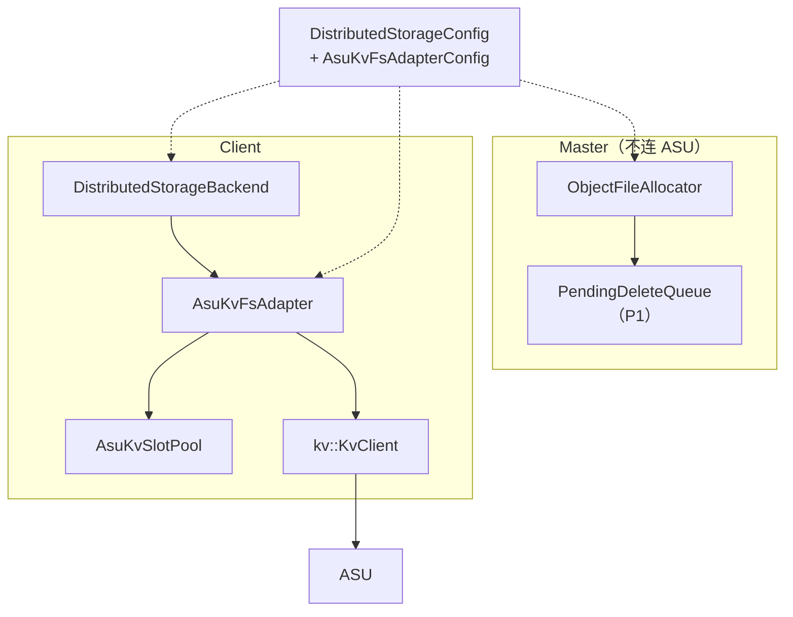
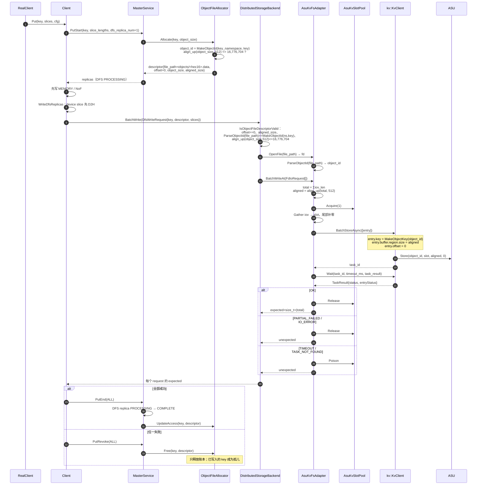
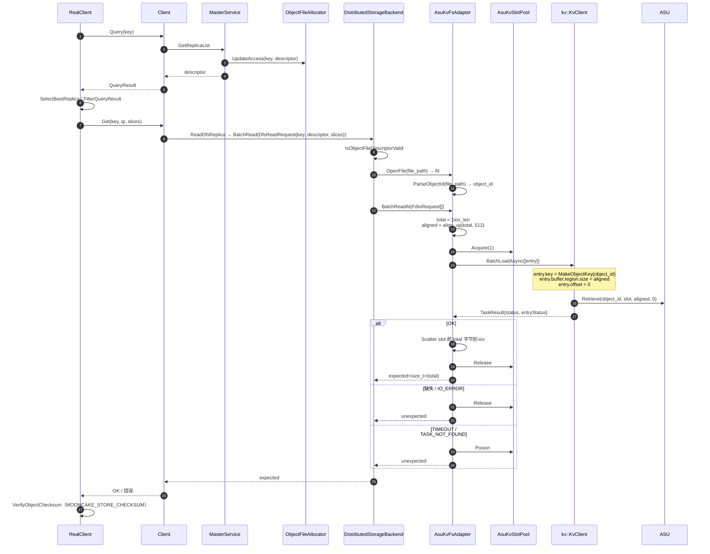
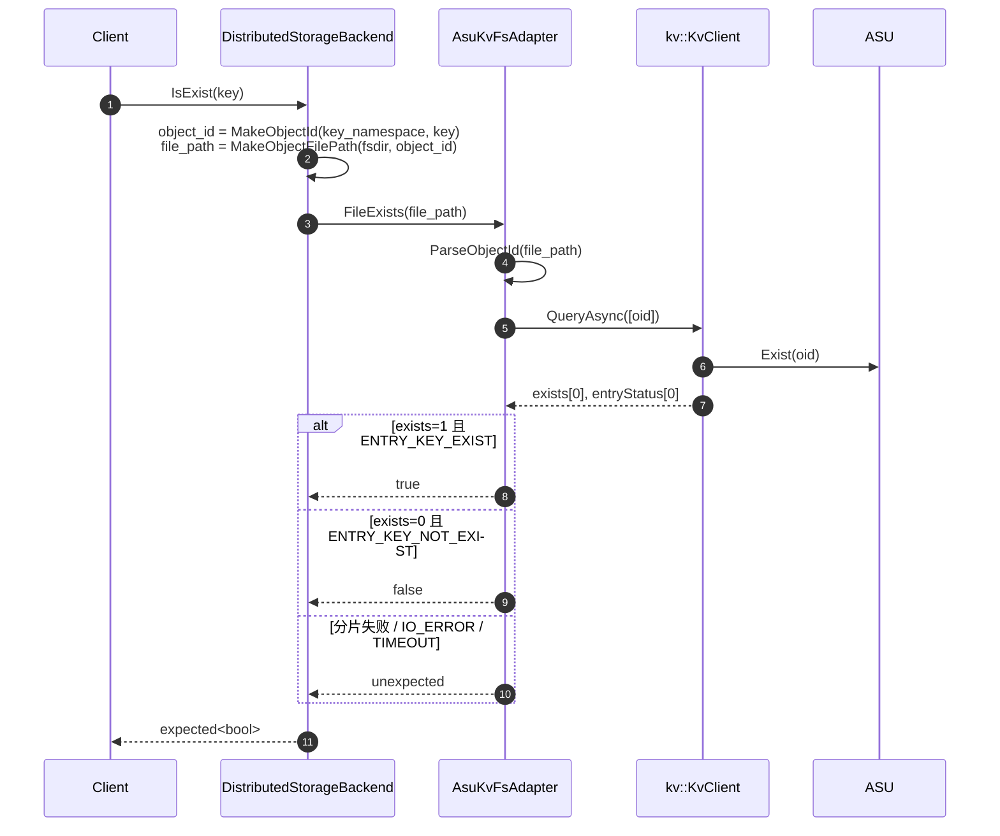
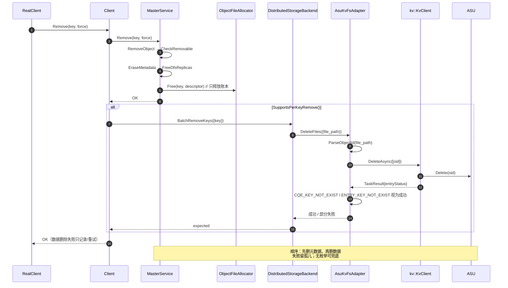
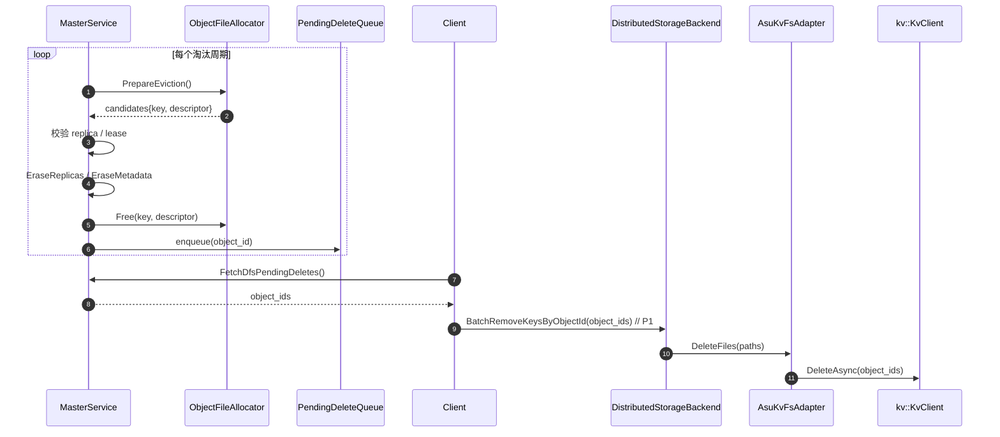
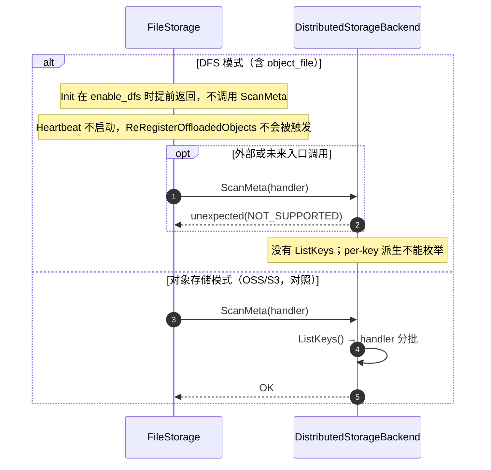

# ASU DFS 路线方案（每对象一文件、单 key）：经 KvClient 接入 ASU

> **状态**：设计稿。已按“一个 object key = 一个 `file_path` = 一个 ASU key”方案修订。
> **代码基线**：Mooncake `main` @ `522b716e`；ASU SDK `DramPool/unified-cache-management/kv_semantics`
> 的 `kv_client.h` / `kv_types.h`。
> **一句话**：保留 Mooncake 的 DFS 副本类型和 Put 时同步写；`object_key` 经稳定哈希得到 `object_id`，
> `object_id` 直接作为 ASU 的 8B key；`file_path` 只是 `object_id` 的稳定别名；写/读/查/删都按 object key 寻址。

---

## 0. 文档命名与命名约定

### 0.1 文档命名

| 项 | 设计 |
| --- | --- |
| 正式标题 | **ASU DFS 路线方案（每对象一文件、单 key）：经 KvClient 接入 ASU** |
| 英文副标题 | One Object, One File, One Key over KvClient |
| 文件名 | `asu-dfs-per-object-file-design.md` |
| 章节命名 | 写 / 读 / 查 / 删 / 淘汰 / ScanMeta |

命名原则：

- **上行（Mooncake）**：类名、方法名、参数名沿用 `StorageBackendInterface`、`FileSystemAdapter`、
  `DistributedStorageBackend`、`DfsAllocatorInterface` 的既有拼写；
- **下行（KvClient）**：调用 `kv::KvClient` 时参数顺序与语义与 SDK 一致；适配器内部变量用 Mooncake
  的 snake_case，不把 `taskId`、`timeoutMs` 扩散到 Mooncake 代码；
- **身份统一**：`object_key`（字符串）→ `object_id`（64-bit）→ `kv::CacheKey`（8B）→ `file_path`（别名），
  四者不得混用；
- **一个对象一个 key**：本文没有 manifest key、没有 part key、没有子 key。`object_id` 就是 ASU key。

### 0.2 术语表

| 术语 | 含义 | 归属 |
| --- | --- | --- |
| `object_key` | Mooncake 的逻辑对象键（`ObjectKey` / `std::string`） | 上行 |
| `key_namespace` | `object_id` 的哈希盐，用于隔离不同部署/集群 | 本文 |
| `object_id` / `oid` | `XXH64(key_namespace, object_key)`，0 映射为 1，稳定 64-bit | 本文 |
| `asu_key` | `object_id` 的 8 字节表示（`kv::CacheKey`） | 下行 |
| `file_path` | `<fsdir>/objects/<hex16(oid)>.data`，一个对象一个虚拟文件 | 上行 |
| `slot` | 适配器内已注册的 bounce buffer | 本文 |
| `descriptor` | `DistributedFSDescriptor`，`file_path`/`offset=0`/`object_size`/`aligned_size` | 上行 |
| `entry` | 一次 `Store`/`Load` 的 `kv::KVBuffer` | 下行 |

### 0.3 命名规则

| 层 | 规则 | 示例 |
| --- | --- | --- |
| 上行类 | PascalCase，沿用 Mooncake 名 | `ObjectFileAllocator`、`AsuKvFsAdapter`、`AsuKvFsAdapterConfig` |
| 上行方法 | PascalCase，动词开头 | `BatchWrite`、`BatchRead`、`BatchRemoveKeys`、`IsExist`、`FileExists`、`DeleteFile` |
| 上行参数 | snake_case，沿用接口拼写 | `key`、`descriptor`、`slices`、`fd`、`iov`、`iovcnt`、`offset`、`path`、`size` |
| 下行类型 | 保留 `kv::` 命名 | `kv::KvClient`、`kv::KVBuffer`、`kv::CacheKey`、`kv::TaskId`、`kv::TaskResult`、`kv::StatusCode` |
| 下行方法 | 保留 SDK 名 | `BatchStoreAsync`、`BatchLoadAsync`、`QueryAsync`、`DeleteAsync`、`Wait`、`RegisterRegions` |
| 适配器内部变量 | snake_case | `object_id`、`asu_key`、`task_id`、`timeout_ms`、`task_result` |
| 常量 | `k` 前缀 | `kAsuObjectIdSeed`、`kAsuMaxObjectBytes`、`kAsuObjectIdHexDigits` |
| 错误映射 | `MapKvStatus` | `MapKvStatus(status, IoDirection::Write)` |

### 0.4 禁止 / 避免的命名

| 避免 | 原因 | 使用 |
| --- | --- | --- |
| `block` | 不是 Mooncake DFS 概念，语义漂移 | `object` |
| `chunk` | 共享文件方案的残留 | `object` |
| `segment` | 与 KvClient 的 scatter-gather segment 混淆 | `object` |
| `manifest` / `part` | 本方案没有 manifest、没有 part | `object_id` / `asu_key` |
| `BlockId` | KV 路线的命名 | `object_id` |
| `AsuKey` | 下行是 `kv::CacheKey` | `asu_key` |
| `scoped_key` | DFS 路线使用 object key，不做 tenant 前缀 | `key` / `object_key` |
| `KvClientStorageBackend` | 那是另一条 KV 路线 | `AsuKvFsAdapter` + `ObjectFileAllocator` |

---

## 1. 背景与边界

### 1.1 路线与目标

```mermaid
flowchart LR
    M["Master<br/>ObjectFileAllocator"]
    C["Client(Put/Get/Remove)"]
    BE["DistributedStorageBackend"]
    AD["AsuKvFsAdapter"]
    KC["kv::KvClient"]
    ASU["ASU"]

    M -->|"PutStart 下发 descriptor<br/>file_path = objects/<hex(oid)>.data"| C
    C -->|"WriteDfsReplicas / ReadDfsReplica"| BE
    BE -->|"BatchWriteAt / BatchReadAt"| AD
    AD -->|"BatchStoreAsync / BatchLoadAsync<br/>QueryAsync / DeleteAsync"| KC
    KC --> ASU
```



目标：

- 按 object key 写、读、查、删，粒度是**对象**；
- 保留 Mooncake 的 `DFS` 副本类型和 `Put` 内同步写；
- 一个对象只占**一个 ASU key**，删除/查询都是单 key 操作；
- Master 在 object_file 模式下不连 ASU；按 key 删除由执行 `Remove` 的客户端完成。

### 1.2 与 KV 路线的区别

| 维度 | KV 路线（`KvClientStorageBackend`） | 本文 DFS 路线 |
| --- | --- | --- |
| 触发 | `PutEnd` 后 offload 心跳 | `Put` 内同步（`dfs_replica_num=1`） |
| 数据布局 | 对象 → 8B key | 对象 → `file_path` → 同一个 8B key |
| Master | 入队/通知 | 分配 `descriptor`、维护 per-object LRU/容量 |
| 读 | backend `BatchLoad` 按 key | `ReadDfsReplica` 按 descriptor/oid |
| 删除 | `BatchRemoveKeys`（设计） | `BatchRemoveKeys` + 客户端 `DeleteAsync` |
| 共享文件 | 无 | 无（每对象一文件） |
| 单对象上限 | 24-bit 传输上限，可拆多 key | **16,776,704B，不拆 key** |

### 1.3 本版范围

| 在范围内 | 说明 |
| --- | --- |
| `ObjectFileAllocator` | Master 侧，每对象一个 `file_path`，`offset=0` |
| `AsuKvFsAdapter` | 客户端侧，单 key 数据面 |
| 写 / 读 | `BatchWriteAt` / `BatchReadAt`，一个对象一个 entry |
| 查 | 对象级 `IsExist`（Master）+ 数据级 `IsExist`（ASU） |
| 删 | `Remove` → Master 元数据/账本 → 客户端 `BatchRemoveKeys` |
| 淘汰 | per-object LRU；待删队列（P1） |
| ScanMeta | 明确返回 `NOT_SUPPORTED`（无枚举） |

| 不在范围内 | 原因 |
| --- | --- |
| 大于 **16,776,704B** 的对象 | 单次 `Store`/`Load` 的 24-bit 长度上限（见 2.2） |
| 大对象分 part / manifest | 本方案是单 key；需要时另立方案 |
| 共享 shard / bucket 文件 | 与“每对象一文件”冲突 |
| 无 descriptor 的对象枚举 | ASU 无 `ListKeys` |
| `RemoveAll` 的逐对象物理删除 | Master 只返回 count，不返回 key 列表；需扩展 RPC |
| 多租户共享 ASU keyspace | DFS 要求 `single_tenant=true` |

### 1.4 前提

| 编号 | 前提 | 依据 | 不成立时 |
| --- | --- | --- | --- |
| H1 | `Store` 在 offset 0 写一个完整对象，允许覆盖同名 key | `kv_protocol.cc:183-230`；常规 Store 路径 | 若返回 `CQE_KEY_ALREADY_EXISTED`，先 `DeleteAsync` 再写 |
| H2 | `DeleteAsync` 对不存在的 key 可视为成功 | `kvclient_deep_read.md` §11；`CQE_KEY_NOT_EXIST` | 把该状态映射为成功（幂等） |
| H3 | `QueryAsync` 未命中通过 `exists=0` + `ENTRY_KEY_NOT_EXIST` 表达，任务状态仍 OK | `kvclient_deep_read.md` §10 | 必须同时看 task/entry 状态 |
| H4 | `BatchStoreAsync`/`BatchLoadAsync` 支持引用已注册区域前缀子区间的 entry | `kv_client_impl.cc:454-457` | 每个对象单独注册或串行化 |

---

## 2. 总体设计

### 2.1 模块与依赖



- **Master**：只生成 `file_path`/descriptor，维护 per-object LRU 与容量；不持有 `kv::KvClient`。
- **Client**：`AsuKvFsAdapter` 持有 `kv::KvClient`；所有 ASU I/O 在客户端。
- **地址真相**：`file_path` 编码 `object_id`；写/读时 adapter 从 `file_path` 解析 `object_id`，
  直接用 `object_id` 作为 ASU key；删除/查询由 object key 计算同一个 `object_id`。

### 2.2 对象文件模型与 16 MiB 限制

```text
object_key
  │  XXH64(key_namespace + '\0' + object_key)   // 0 -> 1
  ▼
object_id (uint64)
  │  hex16
  ├──► file_path = <fsdir>/objects/<hex16(object_id)>.data   // DFS 别名
  └──► asu_key   = object_id                                 // 8B kv::CacheKey
```

数据布局：

```text
objects/00000000a1b2c3d4.data     // 逻辑文件；不是本地文件
  └── ASU key = object_id         // 一个对象、一个 key、一次 Store/Load
```

没有 manifest，没有 part，没有子 key。对象在 ASU 上的字节就是 `align_up(object_size, 512)`。

#### 为什么是 16,776,704B，而不是 16,777,216B

ASU/KvClient 的单次 I/O 长度由 SQE 的 24-bit `length` 字段承载：

- `kv_protocol.cc:207-215`：`length == 0` 或 `length > 0xFFFFFF` 直接拒绝；
- `kv_protocol.cc:192-196`：`buffer_length` 必须 512B 对齐；
- `kv_protocol.h:65-78`：`offset` 是 `uint32_t`，本方案恒为 0；
- `kv_protocol.cc:122-160`：批量 entry 的 `length` 同样是 24-bit、512B 对齐。

因此：

```text
绝对上限      = 0xFFFFFF            = 16,777,215 B
512B 对齐上限 = floor(0xFFFFFF/512)*512 = 16,776,704 B
```

`object_size` 本身可以不是 512 的倍数，但写入/读取时长度是 `align_up(object_size, 512)`，所以：

```text
align_up(object_size, 512) <= 16,776,704
⇒ object_size <= 16,776,704
```

超过这个值的对象无法放进一个 ASU key。本方案不拆分，直接在 `ObjectFileAllocator::Allocate` 和
`AsuKvFsAdapter::WriteAt/ReadAt` 拒绝，返回 `INVALID_PARAMS` 或 `NO_AVAILABLE_HANDLE`。
如果业务对象普遍大于 16,776,704B，需要改用“head + parts”方案（不在本文范围）。

### 2.3 key / path 编码

```cpp
// asu_object_file_layout.h
namespace mooncake {

constexpr std::string_view kAsuObjectDir = "objects";
constexpr std::string_view kAsuObjectSuffix = ".data";
constexpr std::size_t kAsuObjectIdHexDigits = 16;
constexpr uint64_t kAsuObjectIdSeed = 0x9E3779B97F4A7C15ULL;
constexpr uint64_t kAsuAlignmentBytes = 512;                 // 与 kv::kAlignmentBytes 一致
constexpr uint64_t kAsuMaxObjectBytes =
    0xFFFFFF - (0xFFFFFF % kAsuAlignmentBytes);              // 16,776,704

enum class IoDirection { Read, Write };

std::string Hex16(uint64_t object_id);

uint64_t MakeObjectId(std::string_view key_namespace,
                      std::string_view object_key);
std::string MakeObjectFilePath(std::string_view fsdir, uint64_t object_id);
tl::expected<uint64_t, ErrorCode> ParseObjectId(std::string_view file_path);

kv::CacheKey MakeObjectKey(uint64_t object_id);

}  // namespace mooncake
```

```cpp
uint64_t MakeObjectId(std::string_view key_namespace,
                      std::string_view object_key) {
    std::string material;
    material.reserve(key_namespace.size() + object_key.size() + 1);
    material.append(key_namespace);
    material.push_back('\0');
    material.append(object_key);
    uint64_t id = XXH64(material.data(), material.size(), kAsuObjectIdSeed);
    return id == 0 ? 1 : id;   // ASU 拒绝全零 key
}

std::string MakeObjectFilePath(std::string_view fsdir, uint64_t object_id) {
    return (std::filesystem::path(fsdir) / kAsuObjectDir /
            (Hex16(object_id) + std::string(kAsuObjectSuffix)))
        .lexically_normal()
        .string();
}

kv::CacheKey MakeObjectKey(uint64_t object_id) {
    kv::CacheKey key{};
    std::memcpy(key.data(), &object_id, sizeof(object_id));
    return key;
}
```

约束：

- 必须用稳定哈希（`XXH64`），不能用 `std::hash`/`SanitizeKey`；
- `object_id` 是 64-bit，碰撞按生日界约为 `n²/2^65`；
- `MakeObjectFilePath` 在 Master 与 Client 必须使用同一份实现（共享 header，不依赖 SDK）；
- `MakeObjectKey` 与 `object_id` 是同一 8 字节，不做二次哈希；`object_id == 0` 已在 `MakeObjectId` 中映射为 1。

### 2.4 组件职责

| 组件 | 进程 | 职责 | 不做什么 |
| --- | --- | --- | --- |
| `ObjectFileAllocator` | Master | 生成 descriptor、容量/LRU、Free 账本、淘汰候选；拒绝 > 16,776,704B 的对象 | 不连 ASU、不删数据 |
| `DistributedStorageBackend` | Client | 校验 descriptor、按 object key 删除/查询、批量 I/O 编排 | 不做密钥派生细节 |
| `AsuKvFsAdapter` | Client | `file_path`↔`object_id`、单 key 读写、Query/Delete、slot | 不做副本选择 |
| `AsuKvSlotPool` | Client | 注册内存、slot 分配、超时毒化 | 不做 key 编码 |
| `kv::KvClient` | Client | 路由、拆批、SQE/CQE、异步任务 | 不认识 `file_path` |

---

## 3. 写

### 3.1 流程

1. `Client::Put` → `MasterClient::PutStart`；
2. `MasterService::AllocateReplicas` → `ObjectFileAllocator::Allocate(key, object_size)`；
3. 分配器检查 `align_up(object_size, 512) <= 16,776,704`，否则拒绝；
4. 下发 `DistributedFSDescriptor{file_path, offset=0, object_size, aligned_size}`；
5. 客户端先写 MEMORY/NoF；
6. `Client::WriteDfsReplicas` → D2H staging → `DistributedStorageBackend::BatchWrite`；
7. backend 校验 descriptor，`OpenFile(file_path)`；
8. `AsuKvFsAdapter::BatchWriteAt`：一个对象一个 entry，`BatchStoreAsync` + `Wait`；
9. `PutEnd(ALL)` 或 `PutRevoke(ALL)`。

### 3.2 时序图



### 3.3 关键规则

| 规则 | 说明 |
| --- | --- |
| 一个对象一个 entry | 不拆 part、不写 manifest |
| `offset` 必须为 0 | 每对象一文件，不做文件内 offset 写 |
| 长度上限 | `align_up(object_size, 512) <= 16,776,704`；超过直接拒绝 |
| 尾部补零 | 只有对象尾部可能产生 padding；读侧只返回真实字节 |
| 覆盖 | 若 `Store` 允许覆盖，直接覆盖；若返回 `CQE_KEY_ALREADY_EXISTED`，先 `DeleteAsync([oid])` 再写 |
| 幂等 | ASU key 由 object_id 稳定派生，重试写同一对象得到同一个 key |
| 失败隔离 | 一个对象一个 key，失败只影响该对象 |

### 3.4 代码骨架

```cpp
std::vector<tl::expected<size_t, ErrorCode>>
AsuKvFsAdapter::BatchWriteAt(std::span<const FdIoRequest> requests) {
    std::vector<tl::expected<size_t, ErrorCode>> results(requests.size());
    if (!ready_) {
        std::fill(results.begin(), results.end(),
                  tl::make_unexpected(ErrorCode::INTERNAL_ERROR));
        return results;
    }

    std::vector<uint64_t> object_ids(requests.size(), 0);
    std::vector<uint64_t> request_bytes(requests.size(), 0);
    std::vector<std::optional<ErrorCode>> failure(requests.size());

    for (size_t i = 0; i < requests.size(); ++i) {
        auto object_id = fd_table_.Resolve(requests[i].fd);
        if (!object_id) { failure[i] = object_id.error(); continue; }

        uint64_t total = 0;
        for (int k = 0; k < requests[i].iovcnt; ++k)
            total += requests[i].iov[k].iov_len;
        if (total == 0 || requests[i].offset != 0 ||
            AlignUp(total, kAsuAlignmentBytes) > kAsuMaxObjectBytes ||
            AlignUp(total, kAsuAlignmentBytes) > config_.slot_bytes) {
            failure[i] = ErrorCode::INVALID_PARAMS;
            continue;
        }
        object_ids[i] = *object_id;
        request_bytes[i] = total;
    }

    for (size_t begin = 0; begin < requests.size();) {
        const size_t n = std::min(slots_.Capacity(), requests.size() - begin);
        auto lease = slots_.Acquire(n, config_.acquire_timeout_ms);
        if (!lease) {
            for (size_t k = begin; k < requests.size(); ++k)
                failure[k] = lease.error();
            break;
        }

        std::vector<kv::KVBuffer> entries;
        entries.reserve(n);
        for (size_t k = 0; k < n; ++k) {
            const size_t i = begin + k;
            Gather(lease->Addr(k), requests[i].iov, requests[i].iovcnt,
                   request_bytes[i]);
            kv::KVBuffer entry{};
            entry.key = MakeObjectKey(object_ids[i]);
            entry.buffer.region = kv::MemoryRegion{
                kv::MemoryType::HOST_PINNED, lease->Addr(k),
                static_cast<uint64_t>(
                    AlignUp(request_bytes[i], kAsuAlignmentBytes))};
            entry.buffer.handle = slots_.Handle();
            entry.offset = 0;
            entries.push_back(entry);   // mrKey 由 SDK 填
        }

        kv::TaskId task_id{};
        auto submit = client_->BatchStoreAsync(entries, task_id);
        if (!submit.ok()) {
            for (size_t k = 0; k < n; ++k)
                failure[begin + k] =
                    MapKvStatus(submit, IoDirection::Write);
            lease->Release();
            begin += n;
            continue;
        }

        kv::TaskResult task_result;
        auto wait = client_->Wait(task_id, config_.wait_timeout_ms, task_result);
        if (!wait.ok() ||
            task_result.status.code == kv::StatusCode::TIMEOUT ||
            task_result.status.code == kv::StatusCode::TASK_NOT_FOUND) {
            for (size_t k = 0; k < n; ++k)
                failure[begin + k] = MapKvStatus(
                    wait.ok() ? task_result.status : wait, IoDirection::Write);
            lease->Poison();
            begin += n;
            continue;
        }

        for (size_t k = 0; k < n; ++k) {
            const auto& status = k < task_result.entryStatus.size()
                                     ? task_result.entryStatus[k]
                                     : task_result.status;
            if (!status.ok())
                failure[begin + k] =
                    MapKvStatus(status, IoDirection::Write);
        }
        lease->Release();
        begin += n;
    }

    for (size_t i = 0; i < requests.size(); ++i) {
        results[i] = failure[i]
                         ? tl::make_unexpected(*failure[i])
                         : tl::expected<size_t, ErrorCode>{request_bytes[i]};
    }
    return results;
}
```

`Gather` 的约定：

```cpp
void AsuKvFsAdapter::Gather(char* dst, const iovec* iov, int iovcnt,
                            uint64_t total) {
    std::size_t copied = 0;
    for (int i = 0; i < iovcnt && copied < total; ++i) {
        const std::size_t n =
            std::min<std::size_t>(iov[i].iov_len, total - copied);
        std::memcpy(dst + copied, iov[i].iov_base, n);
        copied += n;
    }
    // 尾部补零到 align_up(total, 512)
    std::memset(dst + copied, 0,
                AlignUp(total, kAsuAlignmentBytes) - copied);
}
```

---

## 4. 读

### 4.1 流程

1. `RealClient` → `Client::Query` → `MasterClient::GetReplicaList`；
2. Master 返回 `DistributedFSDescriptor`，并 `UpdateAccess`；
3. `SelectBestReplica` / `FilterQueryResult`；
4. `Client::Get` → `ReadDfsReplica` → `DistributedStorageBackend::BatchRead`；
5. backend 校验 descriptor，`OpenFile(file_path)`；
6. `AsuKvFsAdapter::BatchReadAt`：一个对象一个 entry，`BatchLoadAsync` + `Wait`；
7. Scatter 真实字节；可选 `VerifyObjectChecksum`。

### 4.2 时序图



### 4.3 关键规则

| 规则 | 说明 |
| --- | --- |
| 读长度来自 descriptor | `total = Σiov_len == descriptor.object_size`；ASU 不保存对象长度 |
| 长度上限 | `align_up(total, 512) <= 16,776,704`；超过直接拒绝 |
| 对齐读 | 读 `aligned` 字节，只把前 `total` 字节交给调用方 |
| 缺失 | `CQE_KEY_NOT_EXIST` / `ENTRY_KEY_NOT_EXIST` → `FILE_NOT_FOUND` |
| 失败不写半截 | 任一错误都不 Scatter，避免调用方拿到半截数据 |
| 超时 | slot Poison，绝不复用 |

### 4.4 代码骨架

```cpp
std::vector<tl::expected<size_t, ErrorCode>>
AsuKvFsAdapter::BatchReadAt(std::span<const FdIoRequest> requests) {
    std::vector<tl::expected<size_t, ErrorCode>> results(requests.size());
    // 1. fd -> object_id；offset 必须为 0
    // 2. total = Σiov_len；aligned = AlignUp(total, 512)
    //    校验 aligned <= kAsuMaxObjectBytes 且 aligned <= slot_bytes
    // 3. Acquire(1)；BatchLoadAsync([entry{key=oid, region=slot, size=aligned}])
    // 4. Wait；OK -> Scatter 前 total 字节
    //    缺失 -> FILE_NOT_FOUND；其他 -> MapKvStatus
    //    超时 -> Poison
    // 5. 成功返回 total
}
```

`GetFileSize` 的语义：

- ASU `Query` 只回答“key 是否存在”，不返回 value 长度；
- 本方案没有 manifest，adapter 无法从 `file_path` 恢复 `object_size`；
- 因此 `AsuKvFsAdapter::GetFileSize(path)` 返回 `NOT_SUPPORTED`；
- object_file 模式下 backend 不使用 `GetFileSize`，读长度来自 `descriptor.object_size`。

---

## 5. 查

### 5.1 两种语义

| 语义 | 入口 | 数据来源 | 是否访问 ASU |
| --- | --- | --- | --- |
| 对象级 Exist | `Client::IsExist(key)` | Master `ExistKey` / `ReadExistence` | 否 |
| 数据级 Exist | `Client::IsExistData(key)` → `DistributedStorageBackend::IsExist(key)` | `QueryAsync([oid])` | 是 |

- `Client::IsExist == false` 可能是对象不存在，也可能是没有可读副本；
- `Client::IsExistData == false` 表示 Master 认为对象在，但 ASU 上对应的 key 不存在。

### 5.2 数据级 Exist 时序



### 5.3 状态处理

| ASU 状态 | 含义 | 返回 |
| --- | --- | --- |
| `exists=1` + `ENTRY_KEY_EXIST` | key 存在 | true |
| `exists=0` + `ENTRY_KEY_NOT_EXIST` | key 不存在 | false |
| task `OK` 但 `entryStatus` 为 `IO_ERROR` | 设备错误 | `unexpected(DFS_SERVICE_UNAVAILABLE)` |
| task `TIMEOUT` / `TASK_NOT_FOUND` | 结果未知 | `unexpected(DFS_NETWORK_TIMEOUT)` |
| transport 分片失败 | `exists` 保持 0 | **不能返回 false**；返回 `unexpected` |

补充：`Query` 与后续操作之间 key 可能被并发删除；数据级 Exist 只保证“查询时刻存在”，不提供租约。

### 5.4 代码骨架

```cpp
tl::expected<bool, ErrorCode>
AsuKvFsAdapter::FileExists(const std::string& path) {
    auto object_id = ParseObjectId(path);
    if (!object_id) return tl::make_unexpected(object_id.error());
    return QueryKeys({MakeObjectKey(*object_id)});
}

tl::expected<bool, ErrorCode>
AsuKvFsAdapter::QueryKeys(const std::vector<kv::CacheKey>& keys) {
    // 1. 每次 <= queryIoNum（默认 256）
    // 2. QueryAsync(keys, task_id) + Wait
    // 3. task status 必须 OK；exists.size() == keys.size()
    // 4. exists[i] != 0 && entryStatus[i].code == ENTRY_KEY_EXIST => true
    // 5. 任一 entry 非 KEY_EXIST/KEY_NOT_EXIST => unexpected
}
```

---

## 6. 删

### 6.1 按对象删除时序



### 6.2 顺序与幂等

| 规则 | 说明 |
| --- | --- |
| 先 Master Remove | 元数据是权威；数据删除失败不影响对象已被移除 |
| 再删 ASU key | 一个对象一个 key，`DeleteAsync([oid])` 即可 |
| 幂等 | `CQE_KEY_NOT_EXIST` / `ENTRY_KEY_NOT_EXIST` 视为成功；重复 Remove 不报错 |
| 失败 | 记录 metric/log；P1 用待删队列重试 |
| 并发读 | 依赖 Master 的读租约：租约未过期时 `CheckRemovable` 返回 `OBJECT_HAS_LEASE`；`force` 会绕过租约，可能让读失败 |

### 6.3 RemoveAll 与淘汰

`RemoveAll` 的现状：

- `Client::RemoveAll` → `MasterService::RemoveAll` → `RemoveTenantObjects` 逐对象 `EraseMetadata + Free`；
- Master 只返回 `removed_count`，**不返回 key 列表**；
- 客户端无法知道要删哪些 ASU key。

V1 处理：

- `RemoveAll` 只删元数据/账本；ASU 上的对象 key 成为孤儿；
- 若必须物理删除，扩展 RPC 返回 removed keys（或 oids），客户端再 `BatchRemoveKeys`；
- 或者新增 `FetchDfsPendingDeletes` 待删队列，后台清扫。

淘汰：



> 淘汰删除同样面临“Master 没有 ASU 客户端”的问题。V1 可以先只释放账本、把孤儿留给后续覆盖/换 namespace；
> P1 再加待删队列。

### 6.4 代码骨架

```cpp
// DistributedStorageBackend：新增非 override，命名与 KV 路线一致
std::vector<tl::expected<void, ErrorCode>>
DistributedStorageBackend::BatchRemoveKeys(
    const std::vector<std::string>& keys) {
    std::vector<tl::expected<void, ErrorCode>> results(keys.size());
    if (!UsesObjectFileAllocator()) {
        std::fill(results.begin(), results.end(),
                  tl::make_unexpected(ErrorCode::NOT_SUPPORTED));
        return results;
    }

    std::vector<std::string> file_paths;
    file_paths.reserve(keys.size());
    for (const auto& key : keys) {
        const uint64_t object_id =
            MakeObjectId(distributed_config_.key_namespace, key);
        file_paths.push_back(
            MakeObjectFilePath(distributed_config_.fsdir, object_id));
    }

    auto delete_results = fs_adapter_->DeleteFiles(file_paths);
    for (size_t i = 0; i < keys.size(); ++i) {
        results[i] = i < delete_results.size()
                         ? delete_results[i]
                         : tl::make_unexpected(ErrorCode::INTERNAL_ERROR);
    }
    return results;
}
```

```cpp
// AsuKvFsAdapter：DeleteFile / DeleteFiles
tl::expected<void, ErrorCode>
AsuKvFsAdapter::DeleteFile(const std::string& path) {
    auto object_id = ParseObjectId(path);
    if (!object_id) return tl::make_unexpected(object_id.error());
    return DeleteKeys({MakeObjectKey(*object_id)});
}

tl::expected<void, ErrorCode>
AsuKvFsAdapter::DeleteFiles(const std::vector<std::string>& paths) {
    std::vector<kv::CacheKey> keys;
    keys.reserve(paths.size());
    for (const auto& path : paths) {
        auto object_id = ParseObjectId(path);
        if (!object_id) return tl::make_unexpected(object_id.error());
        keys.push_back(MakeObjectKey(*object_id));
    }
    return DeleteKeys(keys);   // 按 deleteIoNum 分批
}
```

---

## 7. ScanMeta

### 7.1 现状

- `DistributedStorageBackend::ScanMeta` 在 filesystem 模式返回 `NOT_SUPPORTED`
  （`distributed_storage_backend.cpp:863-870`）；
- DFS 模式没有枚举：KvClient 没有 `ListKeys`，ASU 也不提供；
- `ObjectFileAllocator` 只维护“当前分配过的对象”内存账本，Master 重启即丢；
- per-key 派生只能保证“已知 object key 可以删/查”，不能恢复对象列表。

### 7.2 时序图



---

## 8. 组件与接口设计

### 8.1 `ObjectFileAllocator`

文件：`mooncake-store/include/storage/distributed/object_file_allocator.h`、
`mooncake-store/src/storage/distributed/object_file_allocator.cpp`。

```cpp
class ObjectFileAllocator final : public DfsAllocatorInterface {
   public:
    ObjectFileAllocator() = default;
    ~ObjectFileAllocator() override = default;

    DfsAllocatorType Type() const override {
        return DfsAllocatorType::OBJECT_FILE;
    }

    tl::expected<void, ErrorCode> Init(
        const DistributedStorageConfig& config) override;
    bool IsInitialized() const override;

    tl::expected<DistributedFSDescriptor, ErrorCode> Allocate(
        const std::string& key, uint64_t size) override;
    std::vector<BatchAllocateResult> BatchAllocate(
        const std::vector<BatchAllocateRequest>& requests) override;

    void Free(const std::string& key,
              const DistributedFSDescriptor& descriptor) override;
    void UpdateAccess(const std::string& key,
                      const DistributedFSDescriptor& descriptor) override;

    bool IsEvictionEnabled() const override;
    std::chrono::seconds GetEvictionCheckInterval() const override;
    uint64_t GetUsedBytes() const override;
    uint64_t GetTotalCapacity() const override;
    uint64_t GetFileCount() const override;

    // 具体扩展：供 MasterService::RunObjectFileDfsEviction 使用
    struct EvictionCandidate {
        std::string key;
        DistributedFSDescriptor descriptor;
    };
    class PendingEviction { /* 类比 ShardAllocator */ };
    PendingEviction PrepareEviction();
    void CommitPreparedEviction(PendingEviction&& pending);
    void AbortPreparedEviction(PendingEviction&& pending);

   private:
    struct ObjectFileState {
        std::string key;
        DistributedFSDescriptor descriptor;
        uint64_t bytes = 0;
        std::list<uint64_t>::iterator lru_it;
    };

    std::string fsdir_;
    std::string key_namespace_;
    uint64_t alignment_{4096};
    uint64_t max_object_bytes_{kAsuMaxObjectBytes};
    uint64_t capacity_bytes_{0};
    bool eviction_enabled_{true};
    double eviction_high_watermark_{0.9};
    double eviction_low_watermark_{0.7};
    std::chrono::seconds eviction_check_interval_{5};

    std::mutex mutex_;
    std::unordered_map<uint64_t, ObjectFileState> object_files_;  // key = object_id
    std::list<uint64_t> lru_;
    uint64_t used_bytes_{0};
    std::atomic<bool> initialized_{false};
};
```

`Allocate`：

```cpp
tl::expected<DistributedFSDescriptor, ErrorCode>
ObjectFileAllocator::Allocate(const std::string& key, uint64_t size) {
    if (!initialized_.load(std::memory_order_acquire))
        return tl::make_unexpected(ErrorCode::DFS_SERVICE_UNAVAILABLE);
    if (key.empty() || size == 0)
        return tl::make_unexpected(ErrorCode::INVALID_PARAMS);

    // 单 key 的硬上限：24-bit length + 512B 对齐
    if (AlignUp(size, kAsuAlignmentBytes) > kAsuMaxObjectBytes)
        return tl::make_unexpected(ErrorCode::INVALID_PARAMS);

    const uint64_t object_id = MakeObjectId(key_namespace_, key);
    const uint64_t aligned_size = AlignUp(size, alignment_);
    if (aligned_size > max_object_bytes_)
        return tl::make_unexpected(ErrorCode::NO_AVAILABLE_HANDLE);

    std::lock_guard lock(mutex_);
    if (object_files_.contains(object_id)) {
        // 同一个 object key 重复 Put：更新 descriptor，保留 LRU 位置
        auto& state = object_files_.at(object_id);
        state.descriptor = DistributedFSDescriptor{
            MakeObjectFilePath(fsdir_, object_id), 0, size, aligned_size, 0};
        state.bytes = aligned_size;
        return state.descriptor;
    }

    if (used_bytes_ + aligned_size > capacity_bytes_) {
        // 触发淘汰；V1 可以先返回 NO_AVAILABLE_HANDLE
        return tl::make_unexpected(ErrorCode::NO_AVAILABLE_HANDLE);
    }

    DistributedFSDescriptor descriptor{
        MakeObjectFilePath(fsdir_, object_id), 0, size, aligned_size, 0};
    lru_.push_front(object_id);
    object_files_.emplace(object_id,
                          ObjectFileState{key, descriptor, aligned_size,
                                          lru_.begin()});
    used_bytes_ += aligned_size;
    return descriptor;
}
```

> `shard_idx` 在 object_file 模式下置 0，仅用于保持 `DistributedFSDescriptor` 线格式；backend 不使用它。

### 8.2 `DistributedStorageBackend` 增量

| 方法 | 签名 | 说明 |
| --- | --- | --- |
| `UsesObjectFileAllocator` | `bool UsesObjectFileAllocator() const` | `distributed_config_.allocator_type == "object_file"` |
| `SupportsPerKeyRemove` | `bool SupportsPerKeyRemove() const` | object_file 模式为 true；供 `Client::Remove` 判断 |
| `BatchRemoveKeys` | `std::vector<tl::expected<void, ErrorCode>> BatchRemoveKeys(const std::vector<std::string>& keys)` | **非 override**，与 KV 路线同名；按 object key 删 |
| `IsExist` | `tl::expected<bool, ErrorCode> IsExist(const std::string& key)` | object_file 模式走 `fs_adapter_->FileExists(path)` |
| `ExecuteObjectFileBatchIo` | `void ExecuteObjectFileBatchIo(std::vector<DfsIoOp>& ops, std::vector<tl::expected<void, ErrorCode>>& results, bool write)` | 私有；per-object open/close，不缓存 fd |
| `IsObjectFileDescriptorValid` | `bool IsObjectFileDescriptorValid(const DistributedFSDescriptor& desc, const std::string& key) const` | `offset==0`、`align_up(object_size,512) <= 16,776,704`、`ParseObjectId(file_path)==MakeObjectId(ns,key)` |

`BatchWrite` / `BatchRead` 增加模式分支：

> 注意：现有代码在循环开头先算 `IsDfsDescriptorRangeValid` / `IsBucketDescriptorRangeValid`，
> object_file 模式要在这一步之前分流，否则会被 `shard_capacity`/`bucket_capacity` 误判。

```cpp
if (UsesObjectFileAllocator()) {
    if (!IsObjectFileDescriptorValid(desc, request.key)) {
        results[i] = tl::make_unexpected(ErrorCode::INVALID_PARAMS);
        continue;
    }
    DfsIoOp op{i, request.key, desc, std::move(iovs), total_size};
    ops.push_back(std::move(op));
    continue;
}
// 原有 shard / bucket 分支
```

分发：

```cpp
if (UsesObjectFileAllocator()) {
    ExecuteObjectFileBatchIo(ops, results, write);
    return results;
}
if (bucket_mode) {
    ExecuteBucketBatchIo(ops, results, write);
} else {
    ExecuteShardBatchIo(ops, results, write);
}
```

`ExecuteObjectFileBatchIo`：

```cpp
void DistributedStorageBackend::ExecuteObjectFileBatchIo(
    std::vector<DfsIoOp>& ops,
    std::vector<tl::expected<void, ErrorCode>>& results, bool write) {
    if (ops.empty()) return;

    std::vector<int> fds;
    fds.reserve(ops.size());
    std::vector<FdIoRequest> io_requests;
    std::vector<DfsIoOp*> io_ops;
    io_requests.reserve(ops.size());
    io_ops.reserve(ops.size());

    for (auto& op : ops) {
        auto fd = fs_adapter_->OpenFile(op.descriptor.file_path);
        if (!fd) {
            results[op.index] = tl::make_unexpected(fd.error());
            continue;
        }
        fds.push_back(*fd);
        io_requests.push_back({*fd, op.iovs.data(),
                               static_cast<int>(op.iovs.size()),
                               static_cast<int64_t>(op.descriptor.offset)});
        io_ops.push_back(&op);
    }

    SubmitBatchIo(io_requests, io_ops, results, write,
                  /*complete_short_io=*/false);

    for (int fd : fds) (void)fs_adapter_->CloseFile(fd);
}
```

> 不复用 `shard_files_` 缓存：object_file 模式一个对象一个 fd，缓存会随对象数无限增长。
> 每次 batch open/close，adapter 的 `OpenFile` 只是把 `object_id` 放进进程内表，代价很低。

### 8.3 `AsuKvFsAdapter`

文件：`mooncake-store/include/storage/distributed/asu_kv_fs_adapter.h`、
`mooncake-store/src/storage/distributed/asu_kv_fs_adapter.cpp`。
`AsuKvSlotPool`、`FdTable` 见 8.4.1。

```cpp
class AsuKvFsAdapter final : public FileSystemAdapter {
   public:
    AsuKvFsAdapter(const DistributedStorageConfig& config,
                   AsuKvFsAdapterConfig asu_config);

    // 上行：FileSystemAdapter
    tl::expected<void, ErrorCode> Init(const std::string& mount_path) override;
    tl::expected<void, ErrorCode> Shutdown() override;

    tl::expected<bool, ErrorCode> FileExists(const std::string& path) override;
    tl::expected<size_t, ErrorCode> GetFileSize(const std::string& path) override;
    tl::expected<void, ErrorCode> DeleteFile(const std::string& path) override;
    tl::expected<void, ErrorCode> DeleteFiles(
        const std::vector<std::string>& paths) override;

    tl::expected<int, ErrorCode> OpenFile(const std::string& path) override;
    tl::expected<int, ErrorCode> OpenExistingFile(const std::string& path) override;
    tl::expected<void, ErrorCode> CloseFile(int fd) override;

    tl::expected<size_t, ErrorCode> WriteAt(
        int fd, const iovec* iov, int iovcnt, int64_t offset) override;
    tl::expected<size_t, ErrorCode> ReadAt(
        int fd, iovec* iov, int iovcnt, int64_t offset) override;
    std::vector<tl::expected<size_t, ErrorCode>> BatchWriteAt(
        std::span<const FdIoRequest> requests) override;
    std::vector<tl::expected<size_t, ErrorCode>> BatchReadAt(
        std::span<const FdIoRequest> requests) override;

    bool SupportsBatchIo() const override { return true; }
    bool SupportsFdReopen() const override { return false; }
    bool UsesHostFilesystem() const override { return false; }
    const char* GetName() const override { return "asu"; }

   private:
    // 下行：KvClient 封装
    tl::expected<bool, ErrorCode> QueryKeys(
        const std::vector<kv::CacheKey>& keys);
    tl::expected<void, ErrorCode> DeleteKeys(
        const std::vector<kv::CacheKey>& keys);
    ErrorCode MapKvStatus(const kv::Status& status, IoDirection direction) const;

    // 内部工具
    void Gather(char* dst, const iovec* iov, int iovcnt, uint64_t total) const;
    void Scatter(const char* src, iovec* iov, int iovcnt, uint64_t total) const;

    DistributedStorageConfig config_;
    AsuKvFsAdapterConfig asu_config_;
    std::unique_ptr<kv::KvClient> client_;
    AsuKvSlotPool slots_;
    FdTable fd_table_;
    bool ready_{false};
};
```

| 方法 | 上行对应 | 下行调用 | 备注 |
| --- | --- | --- | --- |
| `Init(mount_path)` | `FileSystemAdapter::Init` | `KvClient::Init`、`RegisterRegions`、`AsuKvSlotPool::Init` | 注册失败即 Init 失败 |
| `FileExists(path)` | `FileSystemAdapter::FileExists` | `QueryAsync([oid])` | 数据级 Exist |
| `GetFileSize(path)` | `FileSystemAdapter::GetFileSize` | — | 返回 `NOT_SUPPORTED`；ASU 不保存长度 |
| `DeleteFile(path)` | `FileSystemAdapter::DeleteFile` | `DeleteAsync([oid])` | 幂等 |
| `DeleteFiles(paths)` | `FileSystemAdapter::DeleteFiles` | 批量 `DeleteAsync` | 可合并多个 oid |
| `OpenFile(path)` | `FileSystemAdapter::OpenFile` | — | `ParseObjectId`，登记 fd |
| `CloseFile(fd)` | `FileSystemAdapter::CloseFile` | — | 释放 fd |
| `WriteAt` / `ReadAt` | `FileSystemAdapter::WriteAt/ReadAt` | `BatchStoreAsync` / `BatchLoadAsync` | `offset` 必须为 0 |
| `BatchWriteAt` / `BatchReadAt` | `FileSystemAdapter::BatchWriteAt/BatchReadAt` | 同上 | 批量请求 |
| `SupportsBatchIo` | `FileSystemAdapter` | — | true |
| `UsesHostFilesystem` | `FileSystemAdapter` | — | false |

#### 8.3.1 `MapKvStatus` 映射

| `kv::StatusCode` | 写 | 读 | 查 | 删 |
| --- | --- | --- | --- | --- |
| `OK` | OK | OK | 继续看 `exists` | OK |
| `TIMEOUT` / `CQE_IO_TIMEOUT` / `IN_PROGRESS` | `DFS_NETWORK_TIMEOUT` | `DFS_NETWORK_TIMEOUT` | `DFS_NETWORK_TIMEOUT` | `DFS_NETWORK_TIMEOUT` |
| `TASK_NOT_FOUND` / `CONNECTION_ERROR` / `RESOURCE_BUSY` / `CQE_RESOURCE_BUSY` | `DFS_SERVICE_UNAVAILABLE` | `DFS_SERVICE_UNAVAILABLE` | `DFS_SERVICE_UNAVAILABLE` | `DFS_SERVICE_UNAVAILABLE` |
| `CQE_KEY_NOT_EXIST` / `ENTRY_KEY_NOT_FOUND` / `ENTRY_DATA_NOT_EXIST` | `FILE_WRITE_FAIL` | `FILE_NOT_FOUND` | false | **成功（幂等）** |
| `ENTRY_KEY_NOT_EXIST` | `FILE_WRITE_FAIL` | `FILE_NOT_FOUND` | false | 成功（幂等） |
| `PARTIAL_FAILED` / `IO_ERROR` / `CQE_WRITE_FAULT` | `FILE_WRITE_FAIL` | `FILE_READ_FAIL` | `DFS_SERVICE_UNAVAILABLE` | `FILE_WRITE_FAIL` |
| `CQE_UNRECOVERED_READ_ERROR` / `CQE_INTERNAL_ERROR` / `INTERNAL_ERROR` | `FILE_WRITE_FAIL` | `FILE_READ_FAIL` | `DFS_SERVICE_UNAVAILABLE` | `INTERNAL_ERROR` |
| `INVALID_ARGUMENT` / `CQE_INVALID_COMMAND_OPCODE` / `CQE_INVALID_FIELD_IN_COMMAND` | `INVALID_PARAMS` | `INVALID_PARAMS` | `INVALID_PARAMS` | `INVALID_PARAMS` |
| `BUFFER_NOT_REGISTERED` / `BUFFER_NOT_SUPPORTED` | `NOT_REGISTERED` | `NOT_REGISTERED` | `NOT_REGISTERED` | `NOT_REGISTERED` |
| `UNSUPPORTED` | `NOT_SUPPORTED` | `NOT_SUPPORTED` | `NOT_SUPPORTED` | `NOT_SUPPORTED` |
| 其他 | `INTERNAL_ERROR` | `INTERNAL_ERROR` | `INTERNAL_ERROR` | `INTERNAL_ERROR` |

规则：

- `entryStatus` 是 entry 级结果，`status` 是任务级结果；任务级非 OK 先按上表处理，任务级 OK 再逐 entry 检查；
- `entryStatus.size() != entries.size()` 视为 `INTERNAL_ERROR`，整组失败；
- 删除时 `CQE_KEY_NOT_EXIST`/`ENTRY_KEY_NOT_EXIST` 统一视为成功（幂等）；
- 查询**绝不能**把 `exists=0` 直接当 false，必须同时检查 task status 和 `entryStatus`。

### 8.4 `AsuKvFsAdapterConfig`

```cpp
struct AsuKvFsAdapterConfig {
    std::string client_config_path;   // 传给 KvClient::Init(configPath)
    size_t slot_count = 4;
    size_t slot_bytes = kAsuMaxObjectBytes;   // 16,776,704
    uint32_t wait_timeout_ms = 3000;
    uint32_t acquire_timeout_ms = 3000;

    bool Validate() const;
    static AsuKvFsAdapterConfig FromEnvironment();
};
```

| 字段 | 默认 | 约束 |
| --- | --- | --- |
| `client_config_path` | — | 必填 |
| `slot_count` | 4 | 1–64 |
| `slot_bytes` | 16,776,704 | ≥ `object_file_max_bytes`，512B 对齐 |
| `wait_timeout_ms` | 3000 | > 0 |
| `acquire_timeout_ms` | 3000 | > 0 |

> 默认注册内存 = `slot_count × slot_bytes` ≈ 64 MiB。若内存紧张，可同时下调
> `object_file_max_bytes` 与 `slot_bytes`；两者必须保持一致，否则大于 `slot_bytes` 的对象会在运行期失败。

#### 8.4.1 辅助类型

```cpp
class AsuKvSlotPool {
   public:
    struct Lease {
        size_t size() const;
        char* Addr(size_t index) const;
        void Release();
        void Poison();
    };

    tl::expected<void, ErrorCode> Init(kv::KvClient& client,
                                       size_t slot_bytes, size_t slot_count);
    tl::expected<Lease, ErrorCode> Acquire(size_t count,
                                           uint32_t timeout_ms);
    kv::MRHandle Handle() const;
    size_t Capacity() const;
};

class FdTable {
   public:
    tl::expected<int, ErrorCode> Insert(uint64_t object_id);
    tl::expected<uint64_t, ErrorCode> Resolve(int fd) const;
    void Erase(int fd);
};
```

```cpp
// DistributedStorageConfig：object_file 模式新增字段
struct DistributedStorageConfig {
    // existing: fsdir、allocator_type、alignment、eviction_* ...
    std::string key_namespace;                 // object_id 哈希盐，必填
    uint64_t object_file_max_bytes = kAsuMaxObjectBytes;  // <= 16,776,704
    uint64_t object_file_capacity_bytes = 1ULL * 1024 * 1024 * 1024 * 1024;
};
```

| 字段 | 默认 | 说明 |
| --- | --- | --- |
| `key_namespace` | —（必填） | `MakeObjectId` 的盐；Master 与客户端必须一致 |
| `object_file_max_bytes` | 16,776,704 | 单对象上限；**不得超过** 16,776,704 |
| `object_file_capacity_bytes` | 1 TiB | allocator 总容量/淘汰水位 |

### 8.5 函数/参数命名总表

| 概念 | 上行（Mooncake） | 适配器（本文） | 下行（KvClient） |
| --- | --- | --- | --- |
| 对象键 | `ObjectKey` / `key` | `object_key` | — |
| 对象 id | — | `object_id` / `oid` | — |
| ASU key | — | `asu_key` | `kv::CacheKey` |
| 虚拟文件 | `DistributedFSDescriptor::file_path` | `file_path` | — |
| 数据单位 | `Slice` / `iovec` | object（一个对象一个 entry） | `kv::KVBuffer` |
| 写入 | `BatchWrite` / `WriteAt` | `BatchWriteAt` / `WriteAt` | `BatchStoreAsync` |
| 读取 | `BatchRead` / `ReadAt` | `BatchReadAt` / `ReadAt` | `BatchLoadAsync` |
| 查询 | `IsExist` | `FileExists` / `QueryKeys` | `QueryAsync` |
| 删除 | `BatchRemoveKeys` / `DeleteFile` | `DeleteFile` / `DeleteKeys` | `DeleteAsync` |
| 任务 | — | `task_id` | `kv::TaskId` |
| 结果 | `tl::expected` | `task_result` | `kv::TaskResult` |
| 状态 | `ErrorCode` | `MapKvStatus` | `kv::StatusCode` |
| 内存 | `Slice` | `slot` / `slot_bytes` | `kv::MemoryRegion` |
| 注册 | — | `registered_memory` / `mr_handle` | `kv::RegisteredMemory` |
| 超时 | — | `wait_timeout_ms` / `acquire_timeout_ms` | `Wait(..., timeoutMs, ...)` |

---

## 9. 配置与接线

### 9.1 环境变量

| 变量 | 默认 | 说明 |
| --- | --- | --- |
| `MOONCAKE_DFS_FS_ADAPTER=asu` | — | 选择 ASU 适配器 |
| `MOONCAKE_DFS_ALLOCATOR=object_file` | `shard` | 新增第三种 allocator |
| `MOONCAKE_DFS_ROOT_DIR` | `/mnt/3fs/mooncake` | 虚拟根；不要求本地存在 |
| `MOONCAKE_DFS_KEY_NAMESPACE` | —（必填） | `object_id` 哈希盐；不同部署必须不同 |
| `MOONCAKE_DFS_ALIGNMENT` | 4096 | 必须 ≥ 512 |
| `MOONCAKE_DFS_OBJECT_FILE_MAX_BYTES` | 16,776,704 | 单对象上限；不得超过 16,776,704 |
| `MOONCAKE_DFS_OBJECT_FILE_CAPACITY` | 1 TiB | allocator 总容量（淘汰水位） |
| `MOONCAKE_DFS_ASU_CLIENT_CONFIG` | — | `KvClient::Init(configPath)` |
| `MOONCAKE_DFS_ASU_SLOT_COUNT` | 4 | 注册 slot 数 |
| `MOONCAKE_DFS_ASU_SLOT_BYTES` | 16,776,704 | 每 slot 字节数；≥ `object_file_max_bytes` |
| `MOONCAKE_DFS_ASU_WAIT_TIMEOUT_MS` | 3000 | `Wait` 超时 |
| `MOONCAKE_DFS_ASU_ACQUIRE_TIMEOUT_MS` | 3000 | slot 获取超时 |

> `MOONCAKE_DFS_OBJECT_FILE_MAX_BYTES` 的上限不是拍脑袋的容量参数，而是协议硬限制：
> 24-bit length + 512B 对齐 = 16,776,704B。配置校验必须拒绝更大的值。

### 9.2 工厂与初始化

| 位置 | 改动 |
| --- | --- |
| `DfsAllocatorType` | 增加 `OBJECT_FILE`；`ParseDfsAllocatorType("object_file")`；`ToString` 返回 `"object_file"` |
| `DistributedStorageConfig::Validate` | 接受 `allocator_type == "object_file"`；`alignment >= 512`；`0 < object_file_max_bytes <= 16,776,704` |
| `MasterService::InitDfsAllocatorFromEnvironment` | `object_file` → `ObjectFileAllocator`；增加 `object_file_allocator_` 指针 |
| `MasterService::RunDfsEviction` | 增加 object_file 分支（`RunObjectFileDfsEviction`） |
| `MasterService::ExpandDfsShards` | object_file 模式返回 `UNAVAILABLE_IN_CURRENT_MODE`（或扩展为容量调整，P1） |
| `CreateStorageBackend` | `fs_adapter_type == "asu"` → `AsuKvFsAdapter`（`USE_ASU_KV`） |
| `DistributedStorageBackend::Init` | `UsesHostFilesystem() == false` 时跳过 `create_directories`；object_file 模式不走 `GetOrOpenShard`/`OpenBucket` |
| `AsuKvFsAdapter::Init` | 调 `KvClient::Init`、`RegisterRegions`、`AsuKvSlotPool::Init`；任一步失败即后端 Init 失败 |
| `DistributedStorageBackend` | 增加 object_file 模式分支、`BatchRemoveKeys`、`IsExist`、`SupportsPerKeyRemove` |
| `Client::Remove` / `BatchRemove` | Master 成功后调用 `BatchRemoveKeys` |
| `Client::IsExistData` / `BatchIsExistData` | 新增数据级查询入口（可选） |
| CMake | `USE_ASU_KV` 链接 `kv_client`；Master 目标不链接 |

### 9.3 兼容性

- `shard` / `bucket` 模式保持原样；新增 `object_file` 不影响既有部署；
- `DistributedStorageMode` 建议增加 `kObjectFile`，或通过 `allocator_type` 判断，避免改动 `UsesObjectStorage()`；
- `ScanMeta` / `RemoveAll` 的原有行为不变；
- `FileStorageConfig::Validate` 仍要求 `MOONCAKE_OFFLOAD_FILE_STORAGE_PATH` 指向本地目录（占位即可）。

---

## 10. 失败模式与测试要点

| ID | 失效模式 | 影响 | 处理 | 测试 |
| --- | --- | --- | --- | --- |
| FM-INIT-01 | `KvClient::Init` / `RegisterRegions` 失败或空结果 | 后端 Init 失败 | fail-fast；空结果当失败 | TC-INIT-01 |
| FM-KEY-01 | `object_id` 64-bit 碰撞 | 两对象共用 key | namespace 盐 + XXH64；监控 | TC-KEY-01 |
| FM-KEY-02 | `file_path` 解析失败 / 与 key 不一致 | 写读到错误对象 | `IsObjectFileDescriptorValid` 校验 | TC-KEY-02 |
| FM-SIZE-01 | `align_up(object_size,512) > 16,776,704` | 对象无法单 key 存储 | `Allocate`/`WriteAt` 拒绝；文档化 | TC-SIZE-01 |
| FM-WRITE-01 | `Store` 失败 / 部分失败 | 对象不可读 | 返回错误；PutRevoke | TC-WRITE-01 |
| FM-WRITE-02 | `CQE_KEY_ALREADY_EXISTED` | 重 Put 失败 | 先 `DeleteAsync([oid])` 再写 | TC-WRITE-02 |
| FM-WRITE-03 | `Wait` 超时 | slot 可能仍被读 | Poison slot；request 失败 | TC-WRITE-03 |
| FM-READ-01 | key 缺失 | 对象不可读 | `FILE_NOT_FOUND` | TC-READ-01 |
| FM-READ-02 | 读长度超过 16,776,704 | 无法单 key 读 | 拒绝 | TC-SIZE-01 |
| FM-QUERY-01 | `exists=0` 但分片失败 | 误判“不存在” | 同时检查 task/entry 状态，返回 `unexpected` | TC-QUERY-01 |
| FM-DEL-01 | Master Remove 成功、客户端删除失败 | 孤儿数据 | 日志/metric；P1 待删队列 | TC-DEL-01 |
| FM-DEL-02 | `RemoveAll` 无 key 列表 | 只删元数据 | 文档化；P1 扩展 RPC | TC-DEL-02 |
| FM-EVICT-01 | 淘汰后无人删数据 | 空间不回收 | P1 待删队列；V1 文档化 | TC-EVICT-01 |
| FM-CONC-01 | slot 池耗尽 / 毒化累积 | I/O 挂起 | `Acquire(n, timeout)` 快速失败 | TC-CONC-01 |
| FM-RESTART-01 | Master 重启丢账本 | 无法恢复对象列表 | per-key 可删/查；不能 ScanMeta | TC-RESTART-01 |

边界测试重点：

| 用例 | 输入 | 期望 |
| --- | --- | --- |
| 最大对象 | `object_size = 16,776,704` | 写入/读出成功 |
| 超限对象 | `object_size = 16,776,705` | `Allocate`/`WriteAt` 拒绝（`INVALID_PARAMS`） |
| 非 512 对齐 | `object_size = 16,776,703` | `aligned = 16,776,704`，成功 |
| 最小对象 | `object_size = 1` | `aligned = 512`，成功 |
| 0 字节 | `object_size = 0` | 拒绝 |

---

## 11. 风险与待确认

| # | 风险 | 影响 | 处置 |
| --- | --- | --- | --- |
| R1 | **单对象硬上限 16,776,704B** | 大于该值的 KV cache 对象无法使用本路线 | 在 `Allocate` 拒绝；若业务对象普遍更大，改用 head+parts 方案（另立文档） |
| R2 | `Store` 对已存在 key 的覆盖语义未验证 | 重 Put 失败 | 真机验证；必要时先删后写 |
| R3 | `DeleteAsync` 在生产路径缺少验证（UCM `AsuStore` 不调用 Delete） | 删除行为不确定 | 真机 + fake provider 双验证；`CQE_KEY_NOT_EXIST` 归一成功 |
| R4 | `QueryAsync` 分片失败时 `exists` 保持 0 | 误判不存在 | 同时检查 task/entry 状态 |
| R5 | 64-bit `object_id` 碰撞 | 跨对象覆盖 | namespace + XXH64；P1 碰撞检测 |
| R6 | Master 重启丢账本 | 无法 ScanMeta/恢复 | 文档化；per-key 派生只保证已知 key 可删/查 |
| R7 | `RemoveAll` 无 key 列表 | 物理删除缺口 | 扩展 RPC 返回 keys，或 P1 待删队列 |
| R8 | 淘汰删除无路由 | 空间不回收 | P1 待删队列；V1 接受孤儿 |
| R9 | 一个对象一个 key，key 数量大 | ASU 路由/元数据压力 | 与 KV 路线相同；监控 key 数 |
| R10 | 额外 memcpy + Put 同步等待 | Put 延迟 | V1 接受；P1 直接注册 staging buffer |
| R11 | `file_path` 与 ASU key 双命名空间 | 不一致导致写读错位 | 共享 `MakeObjectId`/`MakeObjectFilePath`；启动校验 |
| R12 | `GetFileSize` 不可用 | 需要长度的调用方拿不到 | object_file 模式由 descriptor 提供长度；文档化 |
| R13 | 单 key 无法保存长度/CRC | 读长度依赖 descriptor；完整性依赖对象校验和 | 读侧用 `descriptor.object_size`；建议开启 `MOONCAKE_STORE_CHECKSUM` |

---

## 12. 一页纸

```text
object_key
  → object_id = XXH64(key_namespace, object_key)          // 0 -> 1
  → asu_key   = object_id                                 // 8B kv::CacheKey
  → file_path = <fsdir>/objects/<hex16(object_id)>.data   // 一个对象一个文件

写：PutStart → ObjectFileAllocator::Allocate
    → 校验 align_up(object_size,512) <= 16,776,704
    → WriteDfsReplicas → BatchWriteAt
    → BatchStoreAsync([entry{key=oid, offset=0}]) → Wait → PutEnd
读：Query → ReadDfsReplica → BatchReadAt
    → BatchLoadAsync([entry{key=oid, offset=0}]) → Scatter → VerifyObjectChecksum
查：Client::IsExist（Master 元数据）
    / Client::IsExistData → backend IsExist → FileExists(path) → QueryAsync([oid])
删：Client::Remove → Master Remove → ObjectFileAllocator::Free
    → Client BatchRemoveKeys → DeleteFiles → DeleteAsync([oid])
ScanMeta：NOT_SUPPORTED（无枚举）
```

命名底线：

- 上行只用 Mooncake 已有词汇：`object_key`、`descriptor`、`file_path`、`BatchWrite`、`BatchRead`、
  `BatchRemoveKeys`、`IsExist`、`ErrorCode`；
- 下行只用 KvClient 已有词汇：`kv::CacheKey`、`kv::KVBuffer`、`BatchStoreAsync`、`BatchLoadAsync`、
  `QueryAsync`、`DeleteAsync`、`Wait`、`TaskId`、`TaskResult`、`StatusCode`；
- 数据单位就是 **object**，没有 block/chunk/segment/manifest/part；
- `file_path` 必须编码 `object_id`，这是写/读时 adapter 唯一能拿到对象身份的地方
  （`FdIoRequest` 只有 fd/iovec/offset）。
