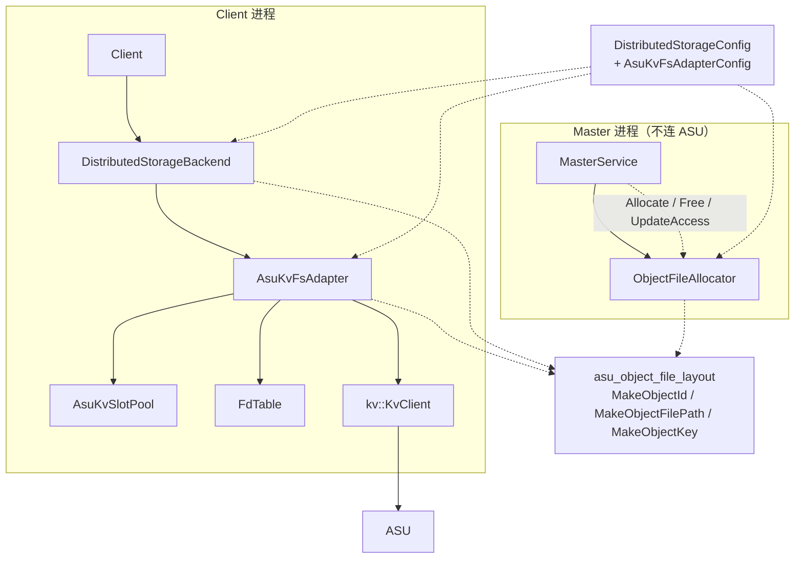
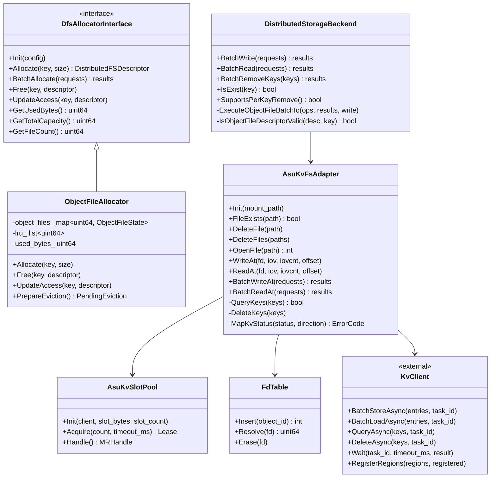
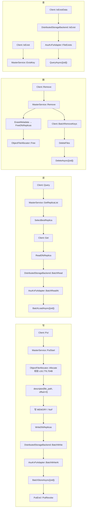
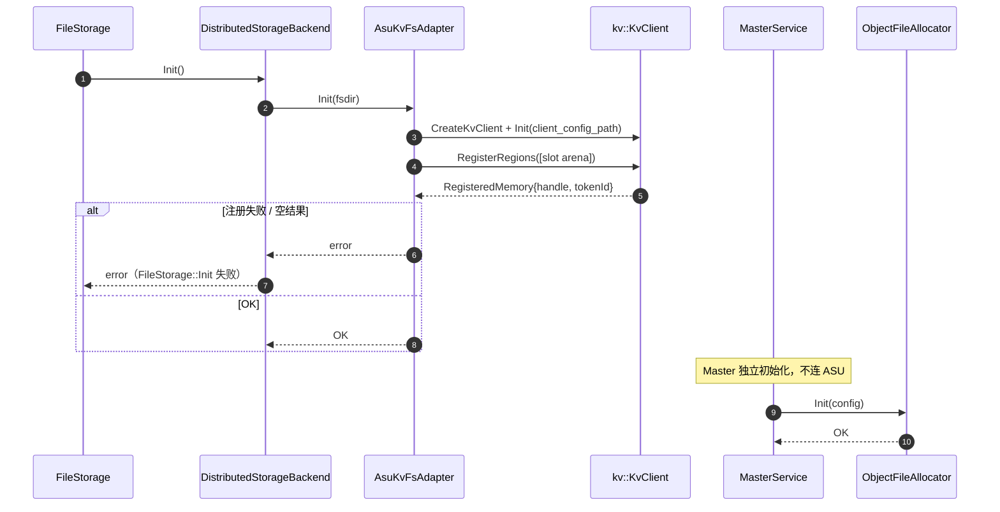
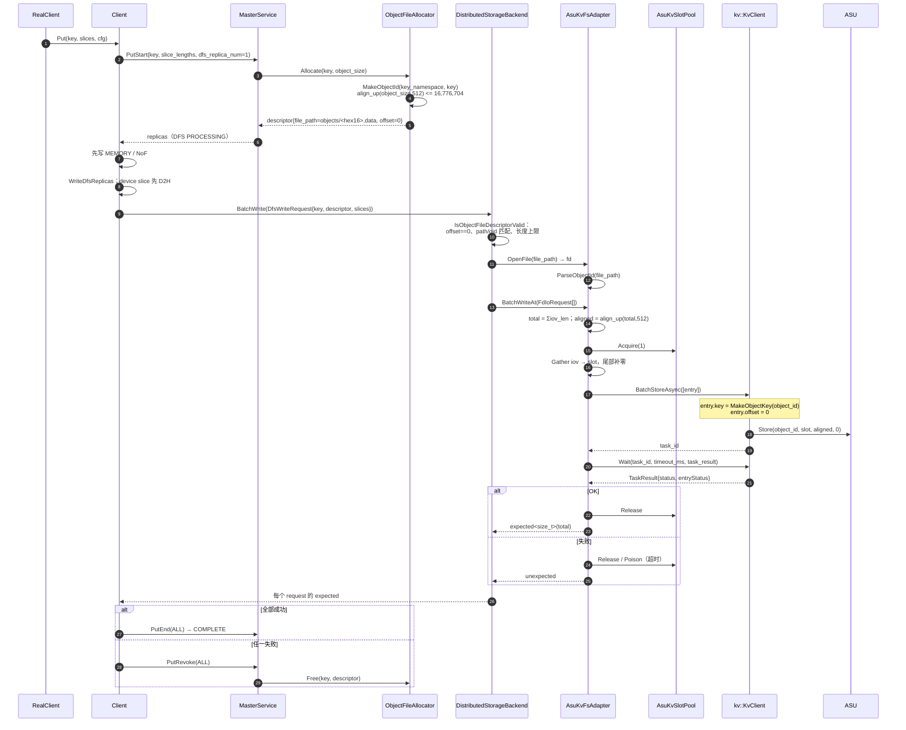
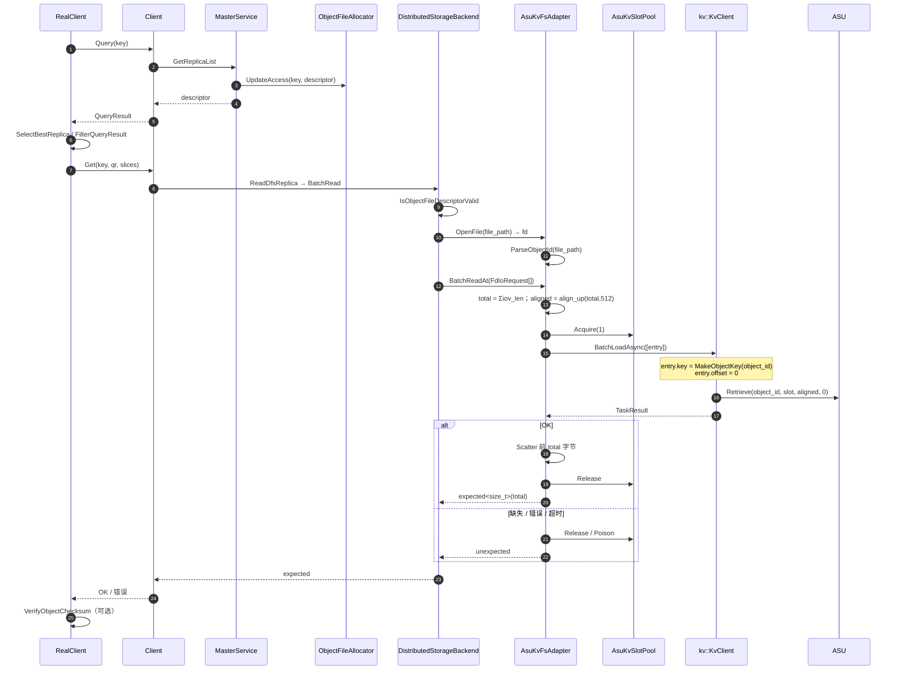
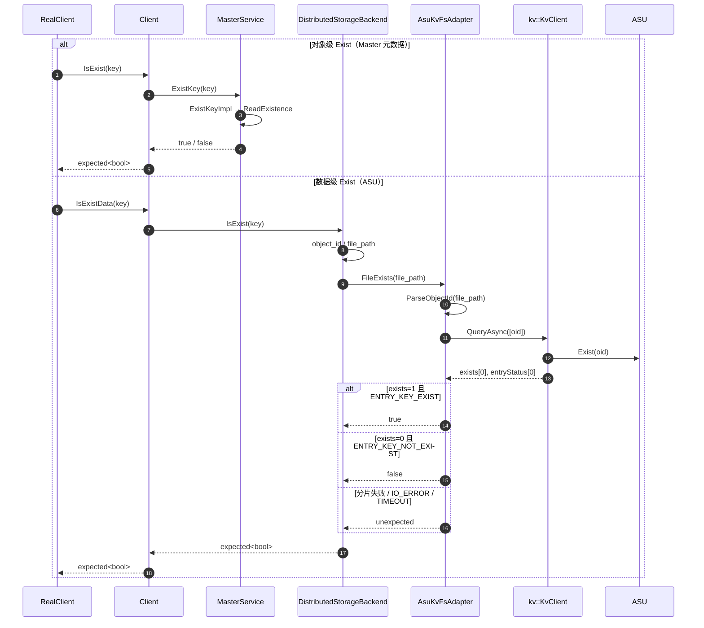
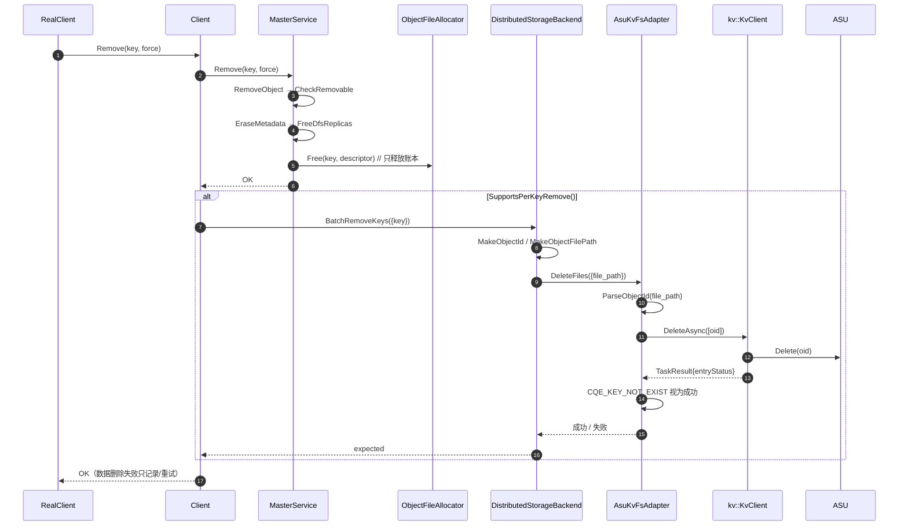
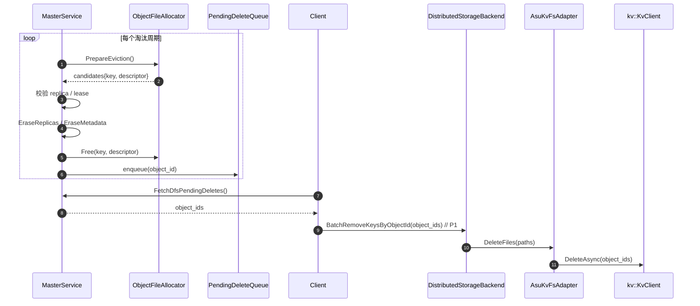

# ASU DFS 路线设计方案（每对象一文件、单 key）

> 代码基线：Mooncake `main` @ `522b716e`；ASU SDK `DramPool/unified-cache-management/kv_semantics`
> 的 `kv_client.h` / `kv_types.h` 与 `dramPool_documents/kvclient_deep_read.md`。
> 本文所有行为、限制与接口均给出代码或文档出处。

---

## 1. 概述

### 1.1 需求分析

**为什么需要**

Mooncake 现有 DFS 路线通过 `DfsAllocatorInterface` 分配 `(file_path, offset)`，客户端用
`DistributedStorageBackend` + `FileSystemAdapter` 做 positional I/O：

- `DfsAllocatorInterface::Allocate/Free` 定义在 `dfs_allocator_interface.h:45-79`；
- `DfsWriteRequest` / `DfsReadRequest` 携带 `key + descriptor + slices`，见
  `distributed_storage_backend.h:25-35`；
- `Client::WriteDfsReplicas` / `ReadDfsReplica` 走该路径，见 `client_service.cpp:3050-3165`、`5196-5220`。

现有 DFS 数据布局是**共享文件**：

- `ShardAllocator` 预分配 `dfs_shard_<idx>.data`，在文件内分配 offset，见
  `shard_allocator.cpp:136-137`、`254-303`；
- `ImmutableBucketAllocator` 把多个对象追加进 `bucket_<id>.data`，见
  `immutable_bucket_allocator.cpp:131-132`、`187-215`；
- 按对象删除只调用 `dfs_allocator_->Free`，不删数据：`FreeDfsReplicas` 见
  `master_service.cpp:7583-7590`；shard `Free` 只延迟归还 offset（`shard_allocator.cpp:381-407`），
  bucket `Free` 只打 tombstone（`immutable_bucket_allocator.cpp:356-362`）。

这导致两个能力缺口：

| 缺口 | 代码事实 |
| --- | --- |
| 按对象物理删除 | 按对象路径没有 `DeleteFile`；shard 只归还 offset，bucket 只 tombstone |
| 按对象数据级 Exist | `DistributedStorageBackend::IsExist` 在 filesystem 模式返回 `NOT_SUPPORTED`，见 `distributed_storage_backend.cpp:847-856` |

而 ASU/KvClient 的原语是 **key 粒度**：

- key 固定 8B：`kv_types.h:39-40`；
- `DeleteAsync(vector<CacheKey>)`、`QueryAsync(vector<CacheKey>)` 只接受 key：
  `kv_client.h:41`、`50`；
- 没有 range delete、没有枚举：`kvclient_deep_read.md` §10、§11。

因此本方案改为：**一个 object key = 一个 `file_path` = 一个 ASU key**，使写、读、查、删都能落到对象粒度。

**单对象 16,776,704B 上限的来源**

- SQE `length` 是 24-bit，超过 `0xFFFFFF` 被拒绝：`kv_protocol.cc:207-215`；
- `buffer_length` 必须 512B 对齐：`kv_protocol.cc:192-196`；
- 批量 entry 的 `length` 同样是 24-bit、512B 对齐：`kv_protocol.cc:122-160`。

```text
0xFFFFFF = 16,777,215 B
floor(0xFFFFFF / 512) * 512 = 16,776,704 B
align_up(object_size, 512) <= 16,776,704  ⇒  object_size <= 16,776,704
```

### 1.2 用户使用场景分析

| 场景 | 参与者 | 主要流程 | 依据 |
| --- | --- | --- | --- |
| Put 时写 DFS 副本 | Client / Master / ASU | `PutStart` 分配 descriptor；客户端同步 `WriteDfsReplicas`；`PutEnd` 置 COMPLETE | `client_service.cpp:2053-2168`、`master_service.cpp:5199-5320` |
| 内存副本淘汰后读 DFS | Client / ASU | `Query` 取 descriptor；`SelectBestReplica` 选 DFS；`ReadDfsReplica` 读 ASU | `client_service.cpp:1311-1320`、`5196-5220`；`replica_selection.h:122` |
| 按对象删除 | Client / Master / ASU | Master `Remove` 删元数据并 `Free` 账本；客户端 `BatchRemoveKeys` 删 ASU key | `master_service.cpp:7170-7203`、`7583-7590`；本方案 6 |
| 数据级存在性检查 | Client / ASU | `IsExistData` → backend `IsExist` → `QueryAsync([oid])` | 本方案 5；`kv_client.h:41` |
| DFS 淘汰 | Master / Client / ASU | per-object LRU 淘汰；待删队列由客户端消费（P1） | 本方案 6.3 |
| DFS 模式启动 | Client / Master | FileStorage 只启动 GC，不跑 offload 心跳；ScanMeta 不调用 | `file_storage.cpp:142-148`、`distributed_storage_backend.cpp:863-870` |

约束：

- DFS 要求单租户：`master_service.cpp:770-776`；
- 单对象 ≤ 16,776,704B（1.1）；
- `RemoveAll` 只返回 count，不返回 key 列表（`master_service.cpp:7347-7405`），物理删除需扩展 RPC；
- `DeleteAsync` 在生产路径缺少验证：`kvclient_deep_read.md` §11.9 明确“`AsuStore` 从不调用 Delete”。

---

## 2. 设计描述

### 2.1 设计

**模块在系统中的位置**



- **Master**：`ObjectFileAllocator` 实现 `DfsAllocatorInterface`，只生成 `file_path` / descriptor、
  维护 per-object LRU 与容量；不持有 `kv::KvClient`。
- **Client**：`DistributedStorageBackend` 负责 DFS 请求编排；`AsuKvFsAdapter` 负责
  `file_path ↔ object_id`、单 key 读写、`QueryAsync` / `DeleteAsync`。
- **共享**：`asu_object_file_layout` 只依赖 XXH64，不依赖 SDK，Master 与 Client 共用。

**类图**



**命名约定**

| 层 | 命名 |
| --- | --- |
| 上行（Mooncake） | `object_key`、`descriptor`、`file_path`、`BatchWrite`、`BatchRead`、`BatchRemoveKeys`、`IsExist`、`ErrorCode` |
| 内部 | `object_id`、`asu_key`、`MakeObjectId`、`MakeObjectFilePath`、`MakeObjectKey`、`ParseObjectId`、`slot` |
| 下行（KvClient） | `kv::CacheKey`、`kv::KVBuffer`、`kv::TaskId`、`kv::TaskResult`、`kv::StatusCode`、`BatchStoreAsync`、`BatchLoadAsync`、`QueryAsync`、`DeleteAsync`、`Wait` |

不使用 `block` / `chunk` / `segment` / `manifest` / `part` 作为数据单位；本方案一个对象一个 key。

### 2.2 业务交互流程



依据：

- Put/Get 调用链见 `client_service.cpp:2053-2168`、`1311-1320`、`5196-5220`；
- Remove 见 `master_service.cpp:7170-7203`、`7583-7590`；
- Query/Exist 见 `master_service.cpp:2824-2860`、`4561-4600`；
- `BatchStoreAsync`/`BatchLoadAsync`/`QueryAsync`/`DeleteAsync` 见 `kv_client.h:41-54`。

### 2.3 运行设计

#### 2.3.1 初始化与注册



说明：注册失败即后端 Init 失败；`RegisterRegions` 在无 transport 时返回 OK 但空结果
（`kv_client_impl.cc:337-340`），因此空结果必须当失败。

#### 2.3.2 写



说明：一个对象一个 entry；`Store` 的 `offset=0`，长度 `align_up(object_size,512)`；失败时
`PutRevoke` 只释放账本，已写入的 key 成为孤儿（本方案 6.3）。

#### 2.3.3 读



说明：ASU 不保存对象长度，读长度来自 `descriptor.object_size`；读 `aligned` 字节，只返回前
`total` 字节。依据：`ReadDfsReplica` 见 `client_service.cpp:5196-5220`；`object_size` 见
`replica.h:329-337`。

#### 2.3.4 查



说明：对象级 Exist 只查 Master，不访问 ASU（`master_service.cpp:2824-2860`）；数据级 Exist 用
`QueryAsync([oid])`（`kv_client.h:41`）。`exists=0` 在 transport 分片失败时也会出现，必须同时检查
task/entry 状态（`kvclient_deep_read.md` §10.8）。

#### 2.3.5 删



说明：先删元数据，再删数据；失败留孤儿（无枚举可兜底）。依据：`RemoveObject` / `EraseMetadata` /
`FreeDfsReplicas` 见 `master_service.cpp:7175-7203`、`2054-2112`、`7583-7590`；`DeleteAsync` 见
`kv_client.h:50`；`RemoveAll` 只返回 count，见 `master_service.cpp:7347-7405`。

#### 2.3.6 淘汰



说明：淘汰删除与按对象删除共用客户端 `DeleteAsync`；P1 引入待删队列，V1 可先只释放账本。

#### 2.3.7 ScanMeta


说明：`DistributedStorageBackend::ScanMeta` 在 filesystem 模式返回 `NOT_SUPPORTED`
（`distributed_storage_backend.cpp:863-870`）；DFS 模式 `FileStorage::Init` 提前返回
（`file_storage.cpp:142-148`）。

### 2.4 SFMEA分析

| 用例编号 | 故障模式 | 是否涉及 | 故障影响 | 容错措施 | 故障注入方法 | 备注 |
| --- | --- | --- | --- | --- | --- | --- |
| SFMEA-01 | `KvClient::Init` 失败 | 是 | 后端初始化失败，节点不参与 DFS | 立即失败，不进入 ready | Fake provider 返回 Init 错误 | `kv_client.h:37-39`；`distributed_storage_backend.cpp:174-215` |
| SFMEA-02 | `RegisterRegions` 失败或返回空 | 是 | 无 MR，写入报 `BUFFER_NOT_REGISTERED` | 空结果当失败；Init 失败 | Fake provider 返回空/错误 | `kv_client_impl.cc:337-340`、`454-457` |
| SFMEA-03 | `object_id` 碰撞 | 是（低概率） | 两个对象共用 key，互相覆盖 | namespace 盐 + XXH64；P1 碰撞检测 | 构造相同 oid 的两个 key | 64-bit 生日界；`kvclient_deep_read.md` §1.5 |
| SFMEA-04 | `file_path` 与 object key 不匹配 | 是 | 写/读到错误对象 | `IsObjectFileDescriptorValid` 校验 oid/path | 篡改 descriptor.file_path | `distributed_storage_backend.cpp:236-247` |
| SFMEA-05 | 对象超过 16,776,704B | 是 | 无法单 key 写入/读取 | `Allocate` / `WriteAt` / `ReadAt` 拒绝 | `object_size = 16,776,705` | `kv_protocol.cc:122-160`、`192-215` |
| SFMEA-06 | `Store` 部分失败 / `PARTIAL_FAILED` | 是 | 对象不可读 | 不写元数据；`PutRevoke` 释放账本 | Fake provider 返回 `CQE_WRITE_FAULT` | `kvclient_deep_read.md` §8、§16 |
| SFMEA-07 | `CQE_KEY_ALREADY_EXISTED` | 是 | 重 Put 失败 | 先 `DeleteAsync([oid])` 再写 | Fake provider 返回该状态 | 真机覆盖语义待确认 |
| SFMEA-08 | `Wait` 超时 | 是 | 结果未知；slot 可能仍被读 | slot Poison，request 失败 | Fake provider 延迟完成 | `kvclient_deep_read.md` §17 |
| SFMEA-09 | 读缺失 key | 是 | 读失败 | 映射 `FILE_NOT_FOUND` | 先 `DeleteAsync` 再读 | `kv_client.h:46`；`kvclient_deep_read.md` §16.2 |
| SFMEA-10 | Query 分片失败但 `exists=0` | 是 | 误判“不存在” | 同时检查 task/entry，返回 `unexpected` | Fake transport 分片失败 | `kvclient_deep_read.md` §10.8 |
| SFMEA-11 | Master Remove 成功、客户端删除失败 | 是 | ASU 孤儿 key | 记录 metric/log；P1 待删队列 | Fake provider 返回 Delete 错误 | `master_service.cpp:7583-7590` |
| SFMEA-12 | `RemoveAll` 无 key 列表 | 是 | 只删元数据，ASU 孤儿 | 文档化；P1 扩展 RPC 返回 keys | 调用 `RemoveAll` | `master_service.cpp:7347-7405` |
| SFMEA-13 | 淘汰后无人删数据 | 是 | 空间不回收 | P1 待删队列 | 强制淘汰 | 本方案 2.3.6 |
| SFMEA-14 | slot 池耗尽 / 毒化累积 | 是 | I/O 失败或挂起 | `Acquire(n, timeout)` 快速失败 | 连续超时毒化全部 slot | 本方案 8.4.1 |
| SFMEA-15 | Master 重启丢账本 | 是 | 无法恢复对象列表 | per-key 删/查仍可用；ScanMeta 不可用 | 重启 Master | `master_service.cpp:763-768` |
| SFMEA-16 | 尾部 padding 越过相邻对象 | 否 | 无相邻对象 | 一个对象一个 key，不存在共享区间 | — | 本方案 2.2 |
| SFMEA-17 | manifest 损坏 | 否 | 本方案无 manifest | — | — | 本方案 0.4 |
| SFMEA-18 | 删除一个对象影响同块其它对象 | 否 | 一个 key 只属于一个对象 | — | — | 本方案 2.2 |
| SFMEA-19 | `GetFileSize` 不可用 | 是 | 调用方拿不到大小 | 读长度用 `descriptor.object_size` | 调用 `GetFileSize` | ASU Query 不返回长度 |
| SFMEA-20 | 同一对象并发 Put | 是 | 后写覆盖先写/`ALREADY_EXISTED` | DFS 副本 PROCESSING；按对象串行 | 并发 Put 同一 key | `master_service.cpp:5199-5320` |

### 2.5 可定位设计

**生命周期日志字段**

| 字段 | 来源 | 用途 |
| --- | --- | --- |
| `object_key` | `Client::Put/Get/Remove` | 关联业务键 |
| `object_id` | `MakeObjectId` | 关联路径与 ASU key |
| `file_path` | `descriptor.file_path` | 关联 DFS descriptor |
| `stage` | 代码埋点 | `allocate/store/load/query/delete/evict` |
| `task_id` | `kv::TaskId` | 关联一次 ASU 任务 |
| `entry_index` | entry 下标 | 关联 `entryStatus` |
| `kv_status` | `kv::StatusCode` | 原始设备状态 |
| `error_code` | `MapKvStatus` | Mooncake 错误码 |
| `latency_us` | 代码埋点 | 时延 |
| `slot_index` | `AsuKvSlotPool` | 定位 bounce buffer |

**日志埋点**

| 阶段 | 级别 | 内容 | 依据 |
| --- | --- | --- | --- |
| Allocate | INFO | `object_key`、`object_id`、`object_size`、`aligned_size`、`file_path` | `ObjectFileAllocator::Allocate` |
| Write 开始 | DEBUG | request 数、总字节、slot 数 | `BatchWriteAt` |
| Write 完成 | INFO | `task_id`、成功/失败 entry 数、`latency_us` | `Wait` 返回 |
| Read 开始/完成 | DEBUG/INFO | `task_id`、entry 状态、`latency_us` | `BatchReadAt` |
| Query | DEBUG | `object_id`、`exists`、`entryStatus` | `QueryKeys` |
| Delete | INFO | `object_id`、`task_id`、是否幂等命中 | `DeleteKeys` |
| Evict | INFO | `object_id`、原因、待删队列长度 | `PrepareEviction` |
| 错误 | WARNING/ERROR | 原始 `kv_status` + 映射后的 `error_code` | `MapKvStatus` |

现有 DFS 指标可复用：`GetDfsMetricPtr()->RecordWriteErrors/RecordReadErrors`
（`client_service.cpp:3063-3068`、`1890-1936`）。

**错误映射**

`MapKvStatus` 统一把 `kv::StatusCode` 映射为 `ErrorCode`；日志同时打印原始码与映射码，避免
`PARTIAL_FAILED` 掩盖 entry 级错误。映射表见 3.8。

**建议日志格式**

```text
[dfs][object_file][stage=store][key=<key>][oid=<hex16>][task=<id>]
[entries=<n>][ok=<n>][fail=<n>][kv_status=<code>][error=<code>][latency_us=<n>]
```

---

## 3. shard设计描述

本节按功能拆分：对象身份/路径编码、allocator、adapter、backend、client 接线、配置与命名。

### 3.1 对象身份与路径编码

```cpp
// asu_object_file_layout.h
namespace mooncake {

constexpr std::string_view kAsuObjectDir = "objects";
constexpr std::string_view kAsuObjectSuffix = ".data";
constexpr std::size_t kAsuObjectIdHexDigits = 16;
constexpr uint64_t kAsuObjectIdSeed = 0x9E3779B97F4A7C15ULL;
constexpr uint64_t kAsuAlignmentBytes = 512;
constexpr uint64_t kAsuMaxObjectBytes =
    0xFFFFFF - (0xFFFFFF % kAsuAlignmentBytes);   // 16,776,704

uint64_t MakeObjectId(std::string_view key_namespace,
                      std::string_view object_key);
std::string MakeObjectFilePath(std::string_view fsdir, uint64_t object_id);
tl::expected<uint64_t, ErrorCode> ParseObjectId(std::string_view file_path);
kv::CacheKey MakeObjectKey(uint64_t object_id);
std::string Hex16(uint64_t object_id);

}  // namespace mooncake
```

```cpp
uint64_t MakeObjectId(std::string_view key_namespace,
                      std::string_view object_key) {
    std::string material;
    material.reserve(key_namespace.size() + object_key.size() + 1);
    material.append(key_namespace);
    material.push_back('\0');
    material.append(object_key);
    uint64_t id = XXH64(material.data(), material.size(), kAsuObjectIdSeed);
    return id == 0 ? 1 : id;   // ASU 拒绝全零 key
}

std::string MakeObjectFilePath(std::string_view fsdir, uint64_t object_id) {
    return (std::filesystem::path(fsdir) / kAsuObjectDir /
            (Hex16(object_id) + std::string(kAsuObjectSuffix)))
        .lexically_normal()
        .string();
}

kv::CacheKey MakeObjectKey(uint64_t object_id) {
    kv::CacheKey key{};
    std::memcpy(key.data(), &object_id, sizeof(object_id));
    return key;
}
```

依据：

- key 固定 8B：`kv_types.h:39-40`；
- 必须使用稳定哈希，`std::hash`/`SanitizeKey` 有损或实现定义：`file_util.cpp:18-30`、`117-126`；
- `XXH64` 已有依赖：`nvme_kv/key_codec.cpp:44-45`；
- `file_path` 必须编码 `object_id`：`FdIoRequest` 只有 `fd/iovec/offset`
  （`fs_adapter.h:20-25`），adapter 写/读时只能从路径恢复对象身份。

### 3.2 `ObjectFileAllocator`

```cpp
class ObjectFileAllocator final : public DfsAllocatorInterface {
   public:
    DfsAllocatorType Type() const override {
        return DfsAllocatorType::OBJECT_FILE;
    }

    tl::expected<DistributedFSDescriptor, ErrorCode>
    Allocate(const std::string& key, uint64_t size) override {
        if (!initialized_.load(std::memory_order_acquire))
            return tl::make_unexpected(ErrorCode::DFS_SERVICE_UNAVAILABLE);
        if (key.empty() || size == 0)
            return tl::make_unexpected(ErrorCode::INVALID_PARAMS);

        // 24-bit length + 512B 对齐
        if (AlignUp(size, kAsuAlignmentBytes) > kAsuMaxObjectBytes)
            return tl::make_unexpected(ErrorCode::INVALID_PARAMS);

        const uint64_t object_id = MakeObjectId(key_namespace_, key);
        const uint64_t aligned_size = AlignUp(size, alignment_);

        std::lock_guard lock(mutex_);
        if (used_bytes_ + aligned_size > capacity_bytes_)
            return tl::make_unexpected(ErrorCode::NO_AVAILABLE_HANDLE);

        DistributedFSDescriptor descriptor{
            MakeObjectFilePath(fsdir_, object_id), 0, size, aligned_size, 0};
        lru_.push_front(object_id);
        object_files_.insert_or_assign(
            object_id, ObjectFileState{key, descriptor, aligned_size,
                                       lru_.begin()});
        used_bytes_ += aligned_size;
        return descriptor;
    }

    void Free(const std::string& key,
              const DistributedFSDescriptor& descriptor) override {
        std::lock_guard lock(mutex_);
        const uint64_t object_id = MakeObjectId(key_namespace_, key);
        auto it = object_files_.find(object_id);
        if (it == object_files_.end()) return;
        used_bytes_ -= it->second.bytes;
        lru_.erase(it->second.lru_it);
        object_files_.erase(it);
    }

    void UpdateAccess(const std::string& key,
                      const DistributedFSDescriptor& descriptor) override {
        std::lock_guard lock(mutex_);
        const uint64_t object_id = MakeObjectId(key_namespace_, key);
        auto it = object_files_.find(object_id);
        if (it == object_files_.end()) return;
        lru_.splice(lru_.begin(), lru_, it->second.lru_it);
    }
};
```

说明：

- `shard_idx` 置 0，仅保持 `DistributedFSDescriptor` 线格式（`replica.h:329-337`）；
- `aligned_size` 用 DFS 配置的 `alignment`，ASU 写入长度用 `kAsuAlignmentBytes`；
- 16,776,704B 校验依据 `kv_protocol.cc:122-160`、`192-215`。

### 3.3 `AsuKvFsAdapter` 初始化与注册

```cpp
tl::expected<void, ErrorCode>
AsuKvFsAdapter::Init(const std::string& mount_path) {
    mount_path_ = Normalize(mount_path);
    client_ = kv::CreateKvClient();
    if (!client_) return tl::make_unexpected(ErrorCode::INTERNAL_ERROR);

    if (!client_->Init(asu_config_.client_config_path).ok())
        return tl::make_unexpected(ErrorCode::DFS_SERVICE_UNAVAILABLE);

    auto slots = slots_.Init(*client_, asu_config_.slot_bytes,
                             asu_config_.slot_count);
    if (!slots) return slots;

    ready_ = true;
    return {};
}
```

说明：`RegisterRegions` 由 `AsuKvSlotPool::Init` 调用；失败或空结果都返回错误
（`kv_client_impl.cc:337-340`、`454-457`）。

### 3.4 写路径

```cpp
std::vector<tl::expected<size_t, ErrorCode>>
AsuKvFsAdapter::BatchWriteAt(std::span<const FdIoRequest> requests) {
    std::vector<tl::expected<size_t, ErrorCode>> results(requests.size());
    std::vector<uint64_t> object_ids(requests.size(), 0);
    std::vector<uint64_t> totals(requests.size(), 0);
    std::vector<std::optional<ErrorCode>> failures(requests.size());

    for (size_t i = 0; i < requests.size(); ++i) {
        auto object_id = fd_table_.Resolve(requests[i].fd);
        if (!object_id) { failures[i] = object_id.error(); continue; }

        uint64_t total = 0;
        for (int k = 0; k < requests[i].iovcnt; ++k)
            total += requests[i].iov[k].iov_len;
        if (total == 0 || requests[i].offset != 0 ||
            AlignUp(total, kAsuAlignmentBytes) > kAsuMaxObjectBytes ||
            AlignUp(total, kAsuAlignmentBytes) > asu_config_.slot_bytes) {
            failures[i] = ErrorCode::INVALID_PARAMS;
            continue;
        }
        object_ids[i] = *object_id;
        totals[i] = total;
    }

    for (size_t begin = 0; begin < requests.size();) {
        const size_t n = std::min(slots_.Capacity(), requests.size() - begin);
        auto lease = slots_.Acquire(n, asu_config_.acquire_timeout_ms);
        if (!lease) {
            for (size_t k = begin; k < requests.size(); ++k)
                failures[k] = lease.error();
            break;
        }

        std::vector<kv::KVBuffer> entries;
        entries.reserve(n);
        for (size_t k = 0; k < n; ++k) {
            const size_t i = begin + k;
            Gather(lease->Addr(k), requests[i].iov, requests[i].iovcnt,
                   totals[i]);
            kv::KVBuffer entry{};
            entry.key = MakeObjectKey(object_ids[i]);
            entry.buffer.region = kv::MemoryRegion{
                kv::MemoryType::HOST_PINNED, lease->Addr(k),
                AlignUp(totals[i], kAsuAlignmentBytes)};
            entry.buffer.handle = slots_.Handle();
            entry.offset = 0;
            entries.push_back(entry);
        }

        kv::TaskId task_id{};
        auto submit = client_->BatchStoreAsync(entries, task_id);
        if (!submit.ok()) {
            for (size_t k = 0; k < n; ++k)
                failures[begin + k] = MapKvStatus(submit, IoDirection::Write);
            lease->Release();
            begin += n;
            continue;
        }

        kv::TaskResult task_result;
        auto wait = client_->Wait(task_id, asu_config_.wait_timeout_ms,
                                  task_result);
        if (!wait.ok() ||
            task_result.status.code == kv::StatusCode::TIMEOUT ||
            task_result.status.code == kv::StatusCode::TASK_NOT_FOUND) {
            for (size_t k = 0; k < n; ++k)
                failures[begin + k] = MapKvStatus(
                    wait.ok() ? task_result.status : wait, IoDirection::Write);
            lease->Poison();
            begin += n;
            continue;
        }

        for (size_t k = 0; k < n; ++k) {
            const auto& status = k < task_result.entryStatus.size()
                                     ? task_result.entryStatus[k]
                                     : task_result.status;
            if (!status.ok())
                failures[begin + k] =
                    MapKvStatus(status, IoDirection::Write);
        }
        lease->Release();
        begin += n;
    }

    for (size_t i = 0; i < requests.size(); ++i) {
        results[i] = failures[i]
                         ? tl::make_unexpected(*failures[i])
                         : tl::expected<size_t, ErrorCode>{totals[i]};
    }
    return results;
}

void AsuKvFsAdapter::Gather(char* dst, const iovec* iov, int iovcnt,
                            uint64_t total) {
    std::size_t copied = 0;
    for (int i = 0; i < iovcnt && copied < total; ++i) {
        const std::size_t n =
            std::min<std::size_t>(iov[i].iov_len, total - copied);
        std::memcpy(dst + copied, iov[i].iov_base, n);
        copied += n;
    }
    std::memset(dst + copied, 0,
                AlignUp(total, kAsuAlignmentBytes) - copied);
}
```

### 3.5 读路径

```cpp
std::vector<tl::expected<size_t, ErrorCode>>
AsuKvFsAdapter::BatchReadAt(std::span<const FdIoRequest> requests) {
    std::vector<tl::expected<size_t, ErrorCode>> results(requests.size());
    // 1. fd -> object_id；offset 必须为 0
    // 2. total = Σiov_len；aligned = AlignUp(total, 512)
    //    校验 aligned <= kAsuMaxObjectBytes 且 aligned <= slot_bytes
    // 3. Acquire(1)；BatchLoadAsync([entry{key=oid, region=slot, size=aligned}])
    // 4. Wait；OK -> Scatter 前 total 字节
    //    缺失 -> FILE_NOT_FOUND；其他 -> MapKvStatus
    //    超时 -> Poison
    // 5. 成功返回 total
}

void AsuKvFsAdapter::Scatter(const char* src, iovec* iov, int iovcnt,
                             uint64_t total) {
    std::size_t copied = 0;
    for (int i = 0; i < iovcnt && copied < total; ++i) {
        const std::size_t n =
            std::min<std::size_t>(iov[i].iov_len, total - copied);
        std::memcpy(iov[i].iov_base, src + copied, n);
        copied += n;
    }
}
```

说明：读长度来自 `descriptor.object_size`，ASU 不保存对象长度；`GetFileSize` 返回
`NOT_SUPPORTED`。

### 3.6 查路径

```cpp
tl::expected<bool, ErrorCode>
AsuKvFsAdapter::FileExists(const std::string& path) {
    auto object_id = ParseObjectId(path);
    if (!object_id) return tl::make_unexpected(object_id.error());
    return QueryKeys({MakeObjectKey(*object_id)});
}

tl::expected<bool, ErrorCode>
AsuKvFsAdapter::QueryKeys(const std::vector<kv::CacheKey>& keys) {
    // 1. 每次 <= queryIoNum（默认 256）
    // 2. QueryAsync(keys, task_id) + Wait
    // 3. task status 必须 OK；exists.size() == keys.size()
    // 4. exists[i] != 0 && entryStatus[i].code == ENTRY_KEY_EXIST => true
    // 5. 其他状态 => unexpected
}
```

依据：`QueryAsync` 见 `kv_client.h:41`；未命中语义见 `kvclient_deep_read.md` §10.8、§10.9；
`exists=0` 分片失败不能当“不存在”。

### 3.7 删路径

```cpp
tl::expected<void, ErrorCode>
AsuKvFsAdapter::DeleteFile(const std::string& path) {
    auto object_id = ParseObjectId(path);
    if (!object_id) return tl::make_unexpected(object_id.error());
    return DeleteKeys({MakeObjectKey(*object_id)});
}

tl::expected<void, ErrorCode>
AsuKvFsAdapter::DeleteFiles(const std::vector<std::string>& paths) {
    std::vector<kv::CacheKey> keys;
    keys.reserve(paths.size());
    for (const auto& path : paths) {
        auto object_id = ParseObjectId(path);
        if (!object_id) return tl::make_unexpected(object_id.error());
        keys.push_back(MakeObjectKey(*object_id));
    }
    return DeleteKeys(keys);   // 按 deleteIoNum（默认 254）分批
}
```

说明：`CQE_KEY_NOT_EXIST` / `ENTRY_KEY_NOT_EXIST` 视为成功（`kvclient_deep_read.md` §11.9）；
`DeleteAsync` 不需要注册 buffer（`kvclient_deep_read.md` §11.3）。

### 3.8 `DistributedStorageBackend` 接入

```cpp
bool DistributedStorageBackend::UsesObjectFileAllocator() const {
    return distributed_config_.allocator_type == "object_file";
}

bool DistributedStorageBackend::SupportsPerKeyRemove() const {
    return UsesObjectFileAllocator();
}

std::vector<tl::expected<void, ErrorCode>>
DistributedStorageBackend::BatchRemoveKeys(
    const std::vector<std::string>& keys) {
    std::vector<tl::expected<void, ErrorCode>> results(keys.size());
    if (!UsesObjectFileAllocator()) {
        std::fill(results.begin(), results.end(),
                  tl::make_unexpected(ErrorCode::NOT_SUPPORTED));
        return results;
    }
    std::vector<std::string> paths;
    paths.reserve(keys.size());
    for (const auto& key : keys) {
        const uint64_t object_id =
            MakeObjectId(distributed_config_.key_namespace, key);
        paths.push_back(
            MakeObjectFilePath(distributed_config_.fsdir, object_id));
    }
    return fs_adapter_->DeleteFiles(paths);
}

tl::expected<bool, ErrorCode>
DistributedStorageBackend::IsExist(const std::string& key) {
    if (!UsesObjectFileAllocator())
        return tl::make_unexpected(ErrorCode::NOT_SUPPORTED);
    const uint64_t object_id =
        MakeObjectId(distributed_config_.key_namespace, key);
    return fs_adapter_->FileExists(
        MakeObjectFilePath(distributed_config_.fsdir, object_id));
}
```

```cpp
void DistributedStorageBackend::ExecuteObjectFileBatchIo(
    std::vector<DfsIoOp>& ops,
    std::vector<tl::expected<void, ErrorCode>>& results, bool write) {
    std::vector<int> fds;
    std::vector<FdIoRequest> requests;
    std::vector<DfsIoOp*> io_ops;
    for (auto& op : ops) {
        auto fd = fs_adapter_->OpenFile(op.descriptor.file_path);
        if (!fd) { results[op.index] = tl::make_unexpected(fd.error()); continue; }
        fds.push_back(*fd);
        requests.push_back({*fd, op.iovs.data(),
                            static_cast<int>(op.iovs.size()),
                            static_cast<int64_t>(op.descriptor.offset)});
        io_ops.push_back(&op);
    }
    SubmitBatchIo(requests, io_ops, results, write, false);
    for (int fd : fds) (void)fs_adapter_->CloseFile(fd);
}
```

说明：

- `BatchWrite`/`BatchRead` 在 `IsDfsDescriptorRangeValid` 之前分流到 object_file，否则会被
  `shard_capacity` 误判（`distributed_storage_backend.cpp:657-700`、`722-800`）；
- `IsObjectFileDescriptorValid` 校验 `offset==0`、长度上限、`ParseObjectId(file_path)` 与
  `MakeObjectId(key_namespace,key)` 一致；
- 不复用 `shard_files_` 缓存，避免 per-object fd 无限增长（`distributed_storage_backend.h:144-153`）。

### 3.9 Client 接线

```cpp
tl::expected<void, ErrorCode> Client::Remove(const ObjectKey& key, bool force) {
    auto result = master_client_.Remove(key, force);
    if (!result) return tl::unexpected(result.error());
    if (dfs_storage_backend_ && dfs_storage_backend_->SupportsPerKeyRemove()) {
        auto deleted = dfs_storage_backend_->BatchRemoveKeys({key});
        if (deleted.size() == 1 && !deleted[0]) {
            LOG(WARNING) << "Remove: metadata removed, data delete failed, key="
                         << key << ", error=" << deleted[0].error();
        }
    }
    return {};
}

tl::expected<bool, ErrorCode> Client::IsExistData(const std::string& key) {
    if (!dfs_storage_backend_ ||
        !dfs_storage_backend_->SupportsPerKeyRemove())
        return tl::make_unexpected(ErrorCode::NOT_SUPPORTED);
    return dfs_storage_backend_->IsExist(key);
}
```

依据：现有 `Client::Remove` 只发 Master RPC（`client_service.cpp:3795-3812`）；
`IsExist` 只走 Master（`4201-4204`）；`SetDfsStorageBackend` 见 `client_service.h:764-765`。

### 3.10 配置与工厂

| 配置 | 默认 | 约束 | 依据 |
| --- | --- | --- | --- |
| `allocator_type` | `shard` | `object_file` 时启用本方案 | `distributed_storage_config.h:12` |
| `key_namespace` | — | 必填；Master/客户端一致 | `MakeObjectId` |
| `object_file_max_bytes` | 16,776,704 | `0 < v <= 16,776,704` | `kv_protocol.cc:192-215` |
| `object_file_capacity_bytes` | 1 TiB | allocator 总容量 | `DfsAllocatorInterface::GetTotalCapacity` |
| `slot_count` | 4 | 1–64 | `AsuKvSlotPool` |
| `slot_bytes` | 16,776,704 | ≥ `object_file_max_bytes`，512B 对齐 | `kv_protocol.cc:192-196` |
| `wait_timeout_ms` | 3000 | > 0 | `kv_client.h:54` |
| `acquire_timeout_ms` | 3000 | > 0 | 本方案 2.4 SFMEA-14 |

工厂改动：

- `DfsAllocatorType` 增加 `OBJECT_FILE`，`ParseDfsAllocatorType("object_file")`；
- `MasterService::InitDfsAllocatorFromEnvironment` 构造 `ObjectFileAllocator`
  （`master_service.cpp:758-805`）；
- `CreateStorageBackend` 的 `fs_adapter_type == "asu"` 构造 `AsuKvFsAdapter`
  （`storage_backend.cpp:5692-5734`）；
- `MasterService::RunDfsEviction` 增加 object_file 分支（`master_service.cpp:7755-7762`）。

### 3.11 命名对照

| 概念 | 上行（Mooncake） | 内部 | 下行（KvClient） |
| --- | --- | --- | --- |
| 对象键 | `ObjectKey` / `key` | `object_key` | — |
| 对象 id | — | `object_id` / `oid` | — |
| ASU key | — | `asu_key` | `kv::CacheKey` |
| 虚拟文件 | `file_path` | `file_path` | — |
| 写入 | `BatchWrite` / `WriteAt` | `BatchWriteAt` / `WriteAt` | `BatchStoreAsync` |
| 读取 | `BatchRead` / `ReadAt` | `BatchReadAt` / `ReadAt` | `BatchLoadAsync` |
| 查询 | `IsExist` | `FileExists` / `QueryKeys` | `QueryAsync` |
| 删除 | `BatchRemoveKeys` / `DeleteFile` | `DeleteFile` / `DeleteKeys` | `DeleteAsync` |
| 任务 | — | `task_id` | `kv::TaskId` |
| 结果 | `tl::expected` | `task_result` | `kv::TaskResult` |
| 状态 | `ErrorCode` | `MapKvStatus` | `kv::StatusCode` |
| 内存 | `Slice` | `slot` / `slot_bytes` | `kv::MemoryRegion` |

---

## 4. 开发自验证用例

| 用例编号 | 用例名称 | 前置条件 | 步骤 | 预期结果 | 依据/备注 |
| --- | --- | --- | --- | --- | --- |
| TC-01 | Init 注册成功 | Fake provider 可用 | 启动 FileStorage，配置 `object_file` + `asu` | 后端 Init 成功；`RegisterRegions` 返回非空 handle | 本方案 2.3.1；`kv_client_impl.cc:322-410` |
| TC-02 | Init 注册失败 | Fake provider Init/Register 失败 | 启动 | `FileStorage::Init` 失败，不进入 ready | SFMEA-01/02 |
| TC-03 | `object_id` 稳定性 | 同一 `key_namespace + object_key` | 两个进程/两次启动计算 oid | oid 一致；0 映射为 1；不同 namespace 不同 | 本方案 3.1 |
| TC-04 | 路径解析 | 合法/非法 `file_path` | `ParseObjectId` | 合法返回 oid；非法返回 `INVALID_PARAMS` | 本方案 3.1 |
| TC-05 | 1B 对象写读 | `object_size=1` | Put → 淘汰内存 → Get | 读回 1B；`aligned=512`；校验和通过 | 本方案 3.4/3.5 |
| TC-06 | 最大对象 | `object_size=16,776,704` | Put → Get | 成功；`aligned=16,776,704` | 1.1；`kv_protocol.cc:192-215` |
| TC-07 | 超限对象 | `object_size=16,776,705` | Put | `Allocate`/`WriteAt` 返回 `INVALID_PARAMS` | SFMEA-05 |
| TC-08 | 非 512 对齐 | `object_size=16,776,703` | Put → Get | `aligned=16,776,704`；数据一致 | 本方案 2.2 |
| TC-09 | 0 字节对象 | `object_size=0` | Put | `INVALID_PARAMS` | 本方案 3.2 |
| TC-10 | 重 Put | 同一 key 已存在 | 再次 Put | 覆盖或先删后写成功；无 `ALREADY_EXISTED` 泄漏 | SFMEA-07；真机确认 |
| TC-11 | 部分失败 | Fake provider 返回 `CQE_WRITE_FAULT` | Put | Put 失败；`PutRevoke` 释放账本；不发布对象 | SFMEA-06 |
| TC-12 | Wait 超时 | Fake provider 延迟完成 | Put/Get | request 失败；slot Poison；后续不复用 | SFMEA-08 |
| TC-13 | 读缺失 key | 先 `DeleteAsync([oid])` | Get | `FILE_NOT_FOUND`；不返回零数据 | SFMEA-09 |
| TC-14 | 数据级 Exist=true | 对象已写入 | `IsExistData` | true；task OK + `ENTRY_KEY_EXIST` | 本方案 2.3.4 |
| TC-15 | 数据级 Exist=false | key 不存在 | `IsExistData` | false；`ENTRY_KEY_NOT_EXIST` | 本方案 2.3.4 |
| TC-16 | Query 分片失败 | Fake transport 分片失败 | `IsExistData` | `unexpected`，不能返回 false | SFMEA-10 |
| TC-17 | 删除存在对象 | 对象已写入 | `Remove` | Master 元数据删除；`DeleteAsync([oid])` 成功 | 本方案 2.3.5 |
| TC-18 | 删除不存在对象 | key 不存在 | `Remove` / `DeleteAsync` | 幂等成功（`KEY_NOT_EXIST` 归一） | `kvclient_deep_read.md` §11.9 |
| TC-19 | Master Remove 后删除失败 | Fake provider 返回 Delete 错误 | `Remove` | 元数据已删；记录日志/metric；不留错误元数据 | SFMEA-11 |
| TC-20 | RemoveAll | 多个对象 | `RemoveAll` | 只删元数据；文档化无物理删除 | SFMEA-12 |
| TC-21 | 淘汰 | 达到高水位 | 触发 `PrepareEviction` | 候选按 LRU；删除后账本释放 | 本方案 2.3.6 |
| TC-22 | 并发批量写读 | 多线程 `BatchWriteAt/BatchReadAt` | 并发执行 | TSAN/ASAN 干净；slot 计数守恒；无死锁 | 本方案 3.4/3.5 |
| TC-23 | Master 重启 | 写入后重启 Master | 重启后 `IsExistData` / `Remove` | 已知 key 可查/删；`ScanMeta` 不可用 | SFMEA-15 |
| TC-24 | Fake provider 端到端 | `seekp/read` fake | Put → 淘汰内存 → Get → Remove | 数据一致；`Delete` 后 `Query=0` | `fake_trans_provider.cc:386-456` |
| TC-25 | posix/hf3fs 回归 | 现有 DFS 测试 | 跑原有测试 | 行为不变；`object_file` 分支不影响 shard/bucket | `UsesHostFilesystem` 默认 true |
| TC-26 | 日志可定位 | 一次 Put/Get/Remove | 检查日志字段 | 每次操作有 `object_key/oid/task_id/stage/status/latency` | 本方案 2.5 |

边界组合（必须覆盖）：

| 组合 | 期望 |
| --- | --- |
| `object_size` = 1 / 511 / 512 / 513 | `aligned` = 512 / 512 / 512 / 1024 |
| `object_size` = 16,776,703 / 16,776,704 / 16,776,705 | 成功 / 成功 / 拒绝 |
| `offset` = 0 / 1 | 接受 / `INVALID_PARAMS` |
| `slot_bytes` < `object_size` | `INVALID_PARAMS`（配置校验/运行期保护） |
| `object_id` = 0 | 映射为 1，写入成功 |
