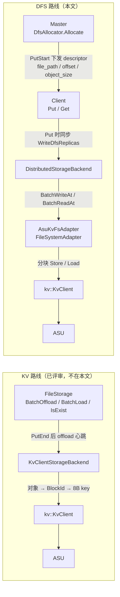
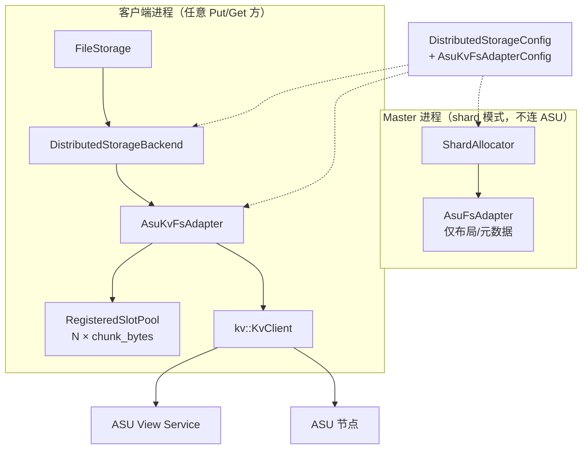
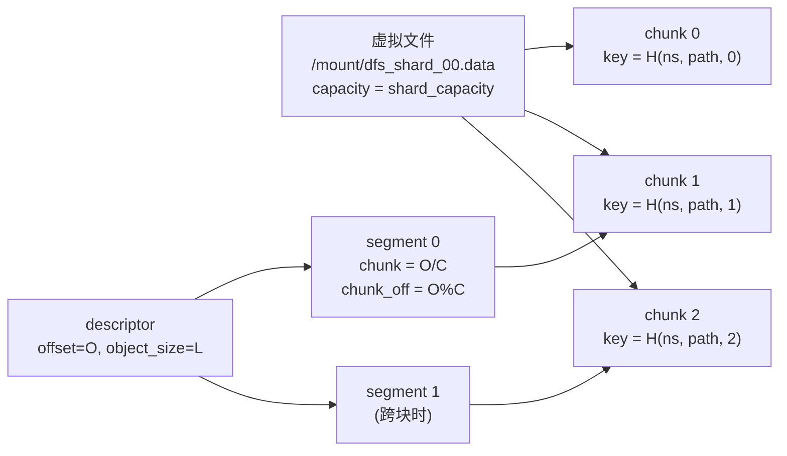
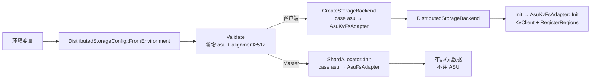
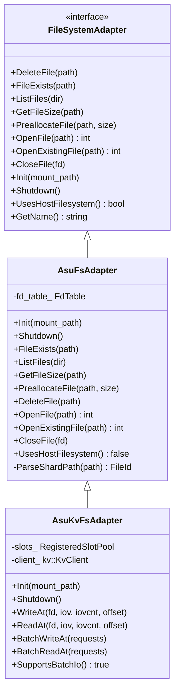
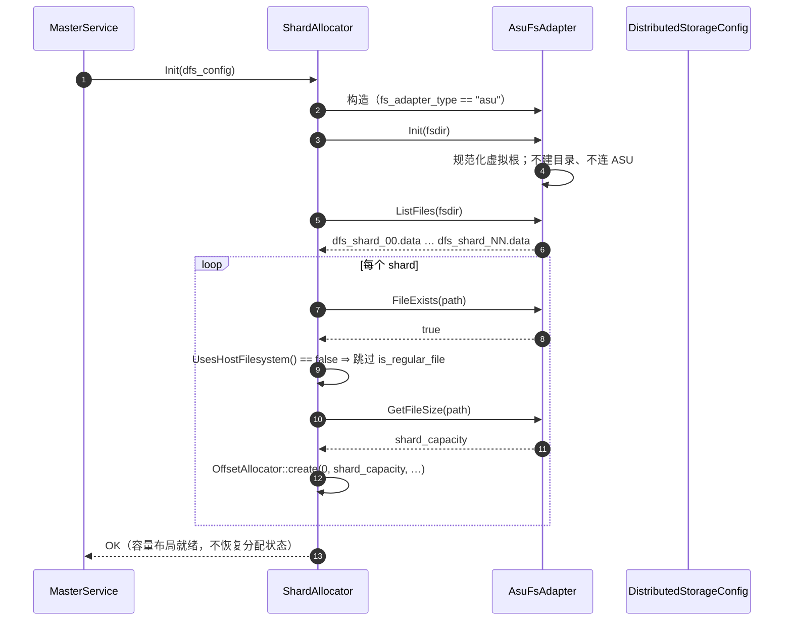
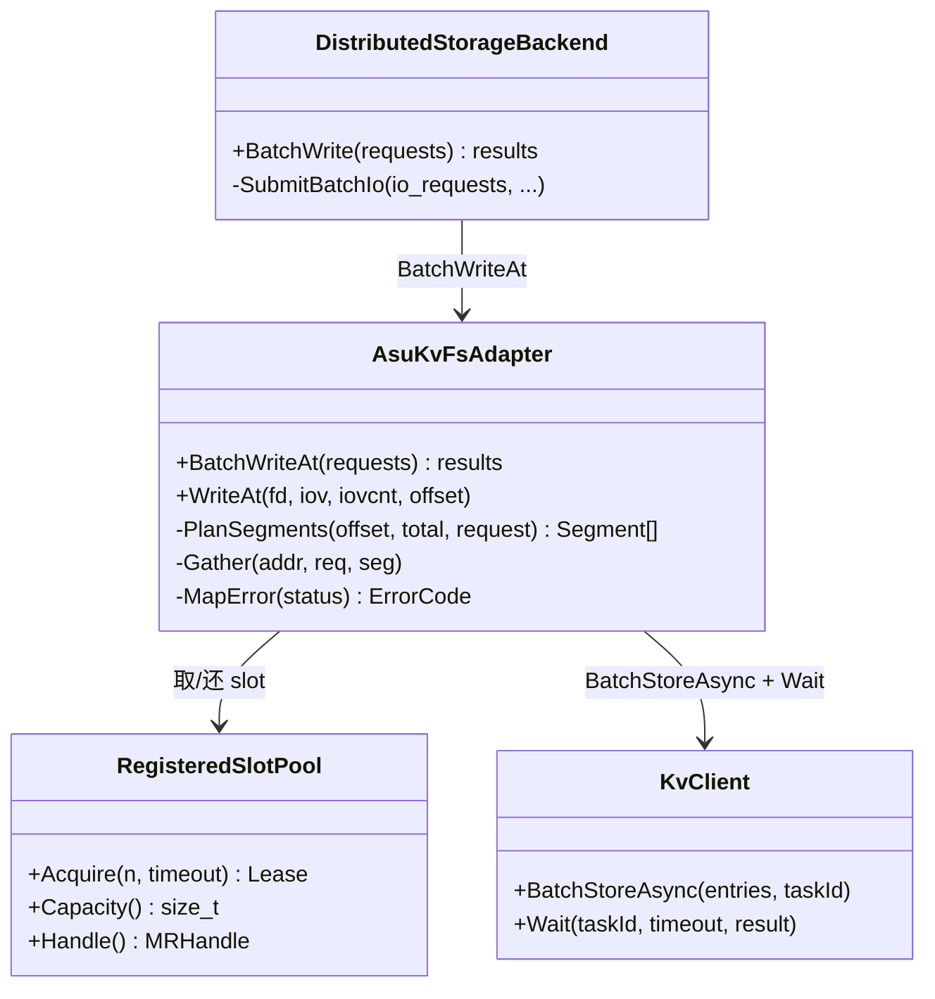
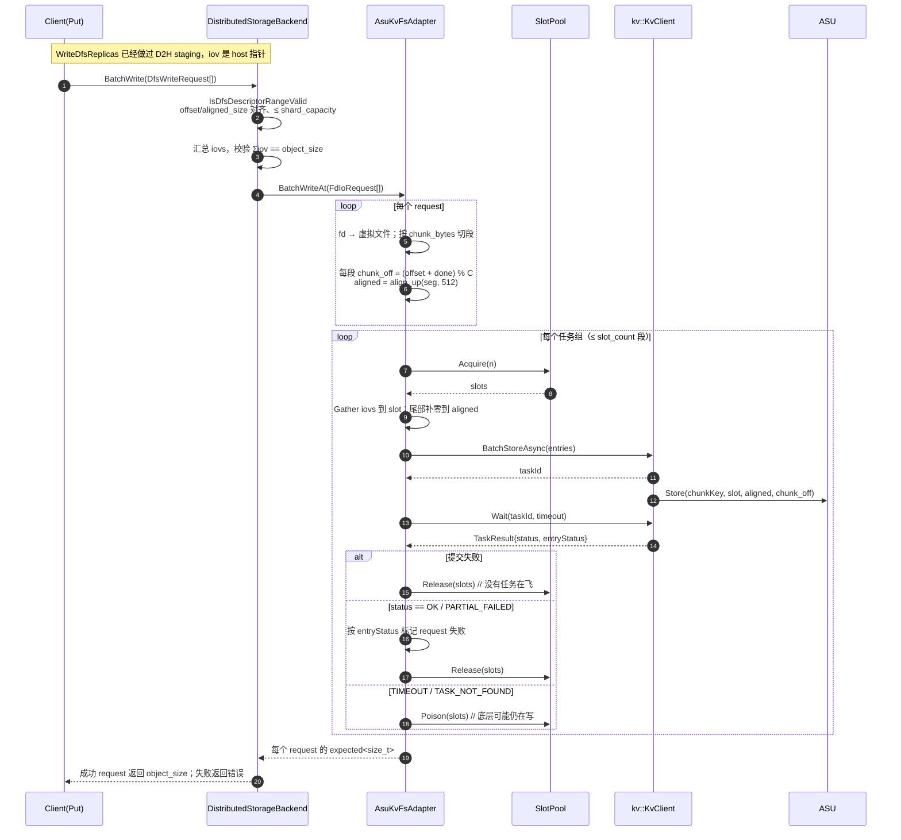
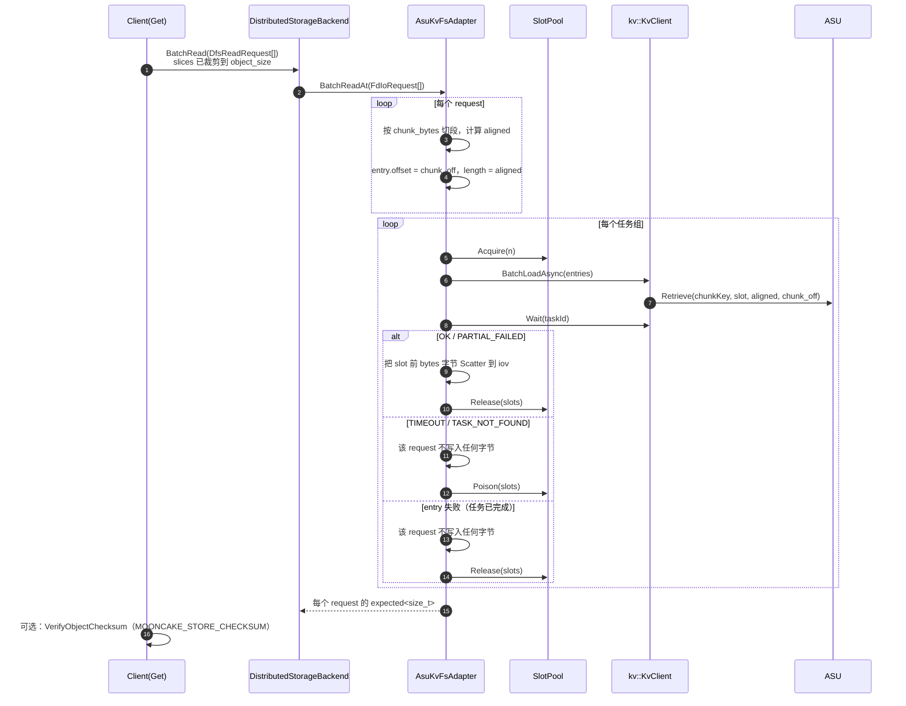

# ASU-DFS 路线方案：用 KvClient 实现 FileSystemAdapter

> **本文回答的问题**：如果不用 `KvClientStorageBackend` 那条“对象 → 8B key”的 KV 路线，
> 而是复用 Mooncake 现有的 **DFS 副本路径**（Master 分配 `file_path + offset`，客户端做 positional I/O），
> 怎样通过 `kv::KvClient` 把 ASU 接成这个 DFS 的底层存储。
>
> **代码基线**：Mooncake `main` @ `522b716e`；ASU SDK 采用
> `DramPool/unified-cache-management/kv_semantics` 的 `kv_client.h` / `kv_types.h`
> （不是 UCM `feature_26h1` 里的旧 `UC::ASU::AsuClient`）。文中位置均按该基线核对。

---

## 1. 背景与边界

### 1.1 两条路线的位置



两条路线的**触发点不同**，这是选型的核心：

| 维度 | KV 路线 | DFS 路线 |
| --- | --- | --- |
| 数据何时离开内存 | `PutEnd` 后由 owner 的 offload 心跳批次下沉 | `Put` 内同步写（`dfs_replica_num > 0`） |
| 谁执行写 | 对象的 owner 节点 | 任意发起 `Put` 的客户端 |
| Master 的角色 | 只入队/通知，不认识数据布局 | `DfsAllocator` 分配 `file_path + offset`，下发 `DistributedFSDescriptor` |
| FileStorage 心跳 | 跑 offload 心跳 | 不跑；DFS 模式下只启动 client buffer GC（`file_storage.cpp:142-148`） |
| 读 | `BatchLoad` 按 key 读 | 任意客户端按 descriptor 做 positional read |
| 删除 | 逻辑删除（KV 路线 V1），后端另有 `BatchRemoveKeys` | `DfsAllocator::Free` 归还区间，**不删除 ASU 数据** |

DFS 路线的既有事实依据：

- `FileStorage` 构造时若 backend 是文件系统形态的 `DistributedStorageBackend`，会置 `enable_dfs` 并把 backend 交给 `Client`（`file_storage.cpp:86-93`）。
- `FileStorage::Init` 在 `enable_dfs` 时直接启动 GC 线程并返回，不进入 `IsEnableOffloading` / 心跳路径（`file_storage.cpp:142-148`）。
- `Client::Put` 在 descriptor 含 DFS 副本时调用 `WriteDfsReplicas`（`client_service.cpp:3050-3165`，调用点 `2157` / `2365`）；读走 `ReadDfsReplica`（`client_service.cpp:5196-5220`）。
- Master 的 DFS 分配只支持单租户，且与 oplog/snapshot 恢复互斥（`master_service.cpp:763-776`）。

### 1.2 前提假设（先列出来，避免把未验证项写成事实）

| 编号 | 假设 | 现有证据 | 不成立时 |
| --- | --- | --- | --- |
| **H1** | ASU 的 `Store` 允许在同一个 key 上按 512B 对齐的**任意 offset** 写入，自动扩展该 key 的 create size；对已存在的区间再次写入是允许的（覆盖），不会因为“key/区间已存在”失败 | SQE 有独立 `offset` 字段且 512B 校验（`kv_protocol.cc:122-160`、`202-206`）；SDK 自带 fake backend 直接 `seekp(offset)` 写文件（`fake_trans_provider.cc:386-427`） | **DFS 路线的基本前提不成立**：要么退化为“首次写零填充建仓”，要么回到 KV 路线 |
| **H1b** | `Store` 到已存在的 key/区间不会返回 `CQE_KEY_ALREADY_EXISTED`；在已有长度之外写入不会返回 `CQE_OUT_OF_CREATE_SIZE`（即会自动扩展） | 反证：`kv_types.h:81-84` 定义了这两个状态码，说明设备有 create size / key 存在性语义；真机行为未验证 | 同 H1 |
| **H2** | `Wait` 返回的是最终结果；`TIMEOUT`/`TASK_NOT_FOUND` 后底层任务仍可能继续完成 | `Wait` 语义见 `kv_client.h:52-54`；本次无法从代码证明超时后的取消 | 超时后的迟到写需要额外隔离（见 3.6 / R7） |
| **H3** | `Retrieve` 读到未写区间返回错误，而不是补零 | fake backend 会补零（`fake_trans_provider.cc:444-453`），**真机必须不同**；否则损坏会被静默成“全零数据” | 读路径需要额外的记录头/校验，DFS 路线不做 |
| **H4** | `KvClient` 线程安全；`BatchStoreAsync` 接受引用已注册区域**前缀子区间**的 entry；SDK 会按 `batchStoreIoNum` 自行拆分任务 | `kv_client_impl.cc:454-457` 只按 `buffer.handle` 解析 `mrKey`，地址/长度由 entry 自带；`io_scheduler` 按配置拆批 | 需要每个分块单独注册，或串行化 I/O（R6） |

> **H1/H1b 是 go/no-go 项。** 本文其余设计都以 H1 成立为前提；若真机不支持，DFS 路线不应进入实现。

### 1.3 本版范围

| 在范围内 | 说明 |
| --- | --- |
| `FileSystemAdapter` 实现 | 新增 `AsuFsAdapter`（元数据/布局，不依赖 SDK）+ `AsuKvFsAdapter`（数据面，依赖 `kv::KvClient`） |
| shard allocator 模式 | `MOONCAKE_DFS_ALLOCATOR=shard`，也就是 `ShardAllocator` 的“预分配 N 个固定大小 shard 文件 + offset 分配” |
| 写 | `BatchWriteAt` / `WriteAt`：把 descriptor 的 `(offset, object_size)` 切成 512B 对齐的分块段，`BatchStoreAsync` + `Wait` |
| 读 | `BatchReadAt` / `ReadAt`：按同一套分块段 `BatchLoadAsync` + `Wait`，读到 bounce slot 后拷回 iov |
| 元数据 | `Init` / `FileExists` / `ListFiles` / `GetFileSize` / `PreallocateFile` / `DeleteFile` / `OpenFile` / `OpenExistingFile` / `CloseFile` |
| 注册与缓冲 | 一个进程内、`HOST_PINNED` 的注册 bounce arena（N 个 slot），超时槽位毒化 |
| 控制面接线 | `CreateStorageBackend` / `ShardAllocator::Init` 的 `asu` 分支；`DistributedStorageConfig` 校验；`UsesHostFilesystem()` 能力开关 |

| 不在范围内 | 原因 |
| --- | --- |
| bucket allocator（`MOONCAKE_DFS_ALLOCATOR=bucket`） | bucket 的物理删除在 **Master 进程**做（`immutable_bucket_allocator.cpp:546`、`591`），要求 Master 也连 ASU；V1 不引入这个依赖。`AsuFsAdapter::Init` 直接返回 `NOT_SUPPORTED` |
| 按对象物理删除 | DFS 语义就是“归还 offset”，`FreeDfsReplicas` 只调 `dfs_allocator_->Free`（`master_service.cpp:7583-7590`）；没有 `DeleteFile` 的生产调用 |
| `ScanMeta` / `BatchOffload` / `BatchLoad` / `IsExist` 的 DFS 语义 | DFS 模式不跑 offload 心跳；这些操作在 filesystem 模式的 `DistributedStorageBackend` 里本来就返回 `NOT_SUPPORTED` |
| 压缩 / 加密 / 校验和重写 | 沿用 Mooncake 的 `MOONCAKE_STORE_CHECKSUM`（读到 DFS 副本后仍会校验，`real_client.cpp:4090`） |
| 多租户 / 多集群共享同一个 ASU keyspace | Master 侧 DFS 本来就要求 `single_tenant=true`（`master_service.cpp:771-776`）；namespace 盐只解决不同部署之间的 key 冲突 |
| ASU SDK 内部改动 | SDK 形态与实现不在本文改动范围 |

---

## 2. 总体设计

### 2.1 模块与依赖



- **Master 只做布局**：`ShardAllocator::Init` → `AsuFsAdapter`；它只回答“这个 shard 文件在逻辑上存在、大小是 `shard_capacity`”，不发任何 ASU I/O。这样 Master 二进制不需要链接 ASU SDK（shard 模式下）。
- **客户端做数据面**：`CreateStorageBackend` 构造 `AsuKvFsAdapter`，它在 `Init` 中完成 `KvClient::Init` + `RegisterRegions`，注册失败即后端初始化失败。
- **单个类拆成两层**：`AsuFsAdapter` 不含 SDK 头文件；`AsuKvFsAdapter` 继承它并加 I/O。目的不是抽象，而是让 Master 的构建/部署不依赖 ASU 运行时。

### 2.2 虚拟文件模型

一个 Mooncake 对象在 DFS 上不是一个文件，而是**某个 shard 文件上的一个区间**。ASU 只有一个 64-bit key 空间，没有文件名/目录/offset 寻址之外的元数据，所以要把“文件 + 文件内 offset”映射成“chunk key + chunk 内 offset”：



映射公式（`C = chunk_bytes`）：

```text
chunk(path, file_offset) = file_offset / C
chunk_offset             = file_offset % C          // 必然 512B 对齐
key(path, chunk)         = XXH64(ns + '\0' + normalized_path + '\0' + chunk_le, seed)
                           若结果为 0 则映射为 1          // ASU 拒绝全零 key
```

硬限制与来源：

| 项 | 限制 | 依据 | 对本设计的影响 |
| --- | --- | --- | --- |
| key | 8B | `kv_types.h:39-40` | 用 64-bit 哈希；需要 namespace 盐 + 碰撞风险说明 |
| `offset` | 32-bit，512B 对齐 | `kv_protocol.h:65-78`、`kv_protocol.cc:202-206` | **只用来放 chunk 内偏移**，所以 shard 文件可以大于 4 GiB |
| 单次 `length` | 24-bit，512B 对齐，最大 16,776,704 | `kv_protocol.cc:122-160`、`192-201` | `chunk_bytes` 上限 |
| batch 条数 | 110（SDK 会再按 `batchStoreIoNum` 拆） | `kv_protocol.h:55`、`io_scheduler.cc` | 适配器不必自己按 110 拆；按 slot 数分组即可 |
| 设备 buffer | 必须已注册，512B 对齐 | `kv_types.h:43`、`kv_client_impl.cc:454-457` | 用注册 bounce arena |
| DFS `alignment` | 默认 4096 | `distributed_storage_config.h:18` | 必须 **≥ 512**，否则 tail padding 会越过分配区间 |

**为什么分块而不是“一个 shard 文件 = 一个 key”：**

1. `offset` 只有 32-bit，单 key 直接映射会把单 shard 文件锁在 4 GiB 以内；分块后限制只作用于 chunk 内偏移。
2. 单次 I/O 只有 24-bit；对象跨 16 MiB 时必须拆。
3. H1/H1b 的“create size”风险被限制在 `chunk_bytes` 内，而不是整个 shard 文件。
4. chunk 是天然的失败/重试/GC 单元；未来要物理回收也只按 chunk 删。

### 2.3 文件元数据从哪里来（三种方案对照）

`FileSystemAdapter` 要求 `ListFiles` / `GetFileSize` / `FileExists` / `PreallocateFile`，而 ASU 的 `KvClient` **没有枚举、没有目录、没有 key 长度查询**。可选方案：

| 方案 | 数据来源 | Master 是否连 ASU | 重启后布局 | 本地依赖 | 结论 |
| --- | --- | --- | --- | --- | --- |
| **A. 配置推导**（选定） | `DistributedStorageConfig`：shard 名、`shard_count`、`shard_capacity` | 否 | 回到配置值；运行期 `ExpandDfsShards` 的扩展不保留 | 无 | 与 DFS 现有“不恢复分配状态”的定位一致 |
| B. ASU 目录键 | 在 ASU 里维护一个目录记录 key，存 `{name,size}` 列表 | 是（Master 要读/写） | 可保留扩展后的布局 | 无 | 多一条 Master→ASU 写路径与并发/一致性问题；换不来对象元数据恢复 |
| C. 本地占位镜像 | 在 Master/客户端本地 `fsdir` 建同名稀疏文件，只做 `stat` | 否 | 依赖本地文件是否还在 | **每个客户端都要可写的 `fsdir` + 稀疏文件** | 不改 DFS 控制面，但把“文件系统”拆成两半，运维复杂 |

选 **A**。关键理由：

- Master 的 DFS 状态本来就不持久：`InitDfsAllocatorFromEnvironment` 明确拒绝与 oplog/snapshot 共用（`master_service.cpp:763-768`），`ShardAllocator::Init` 只恢复容量布局、不恢复分配句柄（`shard_allocator.cpp:91-93` 注释）。重启后对象元数据照样丢失，ASU 上的数据也照样是孤儿。B 方案能恢复的只是“shard 文件列表”，价值有限。
- A 方案的代价是**弱化了校验**：`ValidateAndOpenShardFile` 的 `size == shard_capacity` 永远成立，`CreateShard` 的 `is_regular_file` 也没有真实文件可查。这是明确的取舍，见 R3/R9。

A 方案下的具体语义（shard 模式）：

| 方法 | 语义 | 是否访问 ASU |
| --- | --- | --- |
| `Init(mount_path)` | 规范化并保存虚拟根；不创建本地目录、不连 ASU | 否 |
| `FileExists(path)` | 名字匹配 `dfs_shard_<idx>.data`、父目录等于虚拟根、`0 ≤ idx < shard_count` ⇒ true | 否 |
| `ListFiles(dir)` | `dir == 虚拟根` ⇒ 返回 `dfs_shard_00.data … dfs_shard_NN.data`（由 `shard_count` 生成） | 否 |
| `GetFileSize(path)` | 合法 shard 名 ⇒ `shard_capacity` | 否 |
| `PreallocateFile(path, size)` | 合法 shard 名且 `size == shard_capacity` ⇒ OK；**不预创建 ASU key** | 否 |
| `DeleteFile(path)` | 合法 shard 名 ⇒ OK 的 **no-op** | 否 |
| `OpenFile(path)` | 分配进程内 fd 句柄，记录虚拟文件身份 | 否 |
| `OpenExistingFile(path)` | 同 `OpenFile`；不做存在性查询（存在性交给实际读） | 否 |
| `CloseFile(fd)` | 释放句柄 | 否 |
| `Shutdown()` | 清空 fd 表；不访问 ASU | 否 |

> `DeleteFile` 必须是 no-op：`ShardAllocator::CleanupCreatedFiles` 会在**初始化失败**时删除“本次新建”的 shard（`shard_allocator.cpp:246-253`）。如果用同名路径去删 ASU 上的 chunk key，会把上一轮仍在使用的数据一起删掉。

### 2.4 注册内存与 bounce arena

`kv::KvClient` 的每个 entry 都要求 `buffer.handle` 能在 `registeredRegions_` 里找到，否则 `mrKey` 为空、transport 报 `BUFFER_NOT_REGISTERED`（`kv_client_impl.cc:454-457`）。DFS 路线的两端缓冲来源都不稳定：

- **写**：`WriteDfsReplicas` 把 device slice 经 D2H 拷进 `PinnedBufferPool`（`client_service.cpp:3079-3130`）；该池满时会立即释放 buffer（`pinned_buffer_pool.h:105-113`），并且分配失败会退化成 pageable（`pinned_buffer_pool.h:124-128`）。
- **读**：目标是 RealClient 分配的 client buffer slice，地址/大小随对象变化；`ReadDfsReplica` 直接把它交给 `BatchRead`（`client_service.cpp:5196-5220`）。

因此 V1 不在调用方缓冲上做注册，而是在适配器内部维护一个**固定大小、一次性注册**的 bounce arena：

```text
arena = slot_count × chunk_bytes，HOST_PINNED
每个 slot: {base, state = Free | Busy | Poisoned}
一次 I/O 任务组占用 ≤ slot_count 个 slot；Wait 返回最终状态后才 Release
Wait 超时 / TASK_NOT_FOUND ⇒ Poison（永不复用，进程重启才回收）
Acquire(n, timeout) 超时或可用 slot 不足 ⇒ 立即返回 DFS_SERVICE_UNAVAILABLE（不无限阻塞）
```

代价与理由：

- 写多一次 `memcpy`（iov → slot），读多一次 `memcpy`（slot → iov）。DFS 写路径本来就有 D2H staging，读路径本来也要拷进 client buffer，V1 接受这笔开销。
- 注册在 `AsuKvFsAdapter::Init` 完成，失败即 `FileStorage::Init` 失败（fail-fast）。`RegisterRegions` 在无 transport 时会返回 OK 但空结果（`kv_client_impl.cc:337-340`），**空结果必须当失败**。
- entry 的 `buffer.region` 使用 slot 的前缀子区间：`addr = slot base`、`size = aligned_len`，`handle = arena handle`。这要求 H4；若真机不支持子区间，只能退化到“每个 chunk 单独注册”（R6）。

### 2.5 DFS 控制面里写死的“本地文件系统”假设

这是 DFS 路线与 KV 路线最大的工程差异：**通用 DFS 代码在几处直接用了 `std::filesystem`，绕过了 `FileSystemAdapter`**。ASU 路径是虚拟的，这些调用必须处置。

| # | 位置 | 调用 | 影响 | 处置 |
| --- | --- | --- | --- | --- |
| 1 | `shard_allocator.cpp:61` | `create_directories(mount_path_)` | Master 要求本地存在可写目录 | 由 `UsesHostFilesystem()` 控制，ASU 跳过 |
| 2 | `shard_allocator.cpp:212` | `is_regular_file(path)` | `FileExists` 返回 true 后仍会失败 | 由能力开关控制；ASU 只信任 adapter 的 `FileExists + GetFileSize` |
| 3 | `distributed_storage_backend.cpp:199` | `create_directories(root_dir_)` | 每个客户端要求本地目录 | 由能力开关控制 |
| 4 | `distributed_storage_backend.cpp:295-302` | `canonical(root)` / `canonical(path)` | 虚拟路径不存在 ⇒ `FILE_OPEN_FAIL`，**客户端数据面直接不可用** | 由能力开关控制，保留前面的词法校验（`ParseShardFileName` + `parent == root`） |
| 5 | `distributed_storage_backend.cpp:348-355` | `canonical(...)`（`OpenBucket`） | bucket 模式；V1 不在范围 | 一并加开关，避免后续踩坑 |

做法：在 `FileSystemAdapter` 里加一个能力查询，默认 true，posix/hf3fs 行为完全不变：

```cpp
// fs_adapter.h，放在 SupportsFdReopen / SupportsBatchIo 附近
virtual bool UsesHostFilesystem() const { return true; }
```

`AsuFsAdapter` 返回 false。上述 5 处改为：

```cpp
if (fs_adapter_->UsesHostFilesystem()) {
    std::filesystem::create_directories(root_dir_, ec);   // 或 mount_path_
}
...
if (fs_adapter_->UsesHostFilesystem()) {
    // canonical 校验保持原样
}
```

> `ShardAllocator::Init` 目前在 `create_directories`（`shard_allocator.cpp:61`）**之后**才构造 adapter（`76-91`）。
> 落地时需要把 adapter 构造前移，或直接按 `config.fs_adapter_type == "asu"` 判断；两种写法都要保证
> posix/hf3fs 的调用顺序与行为不变。

**替代方案（零核心改动）**：让 ASU 适配器在本地 `fsdir` 维护同名稀疏占位文件，`GetFileSize`/`ListFiles`/`FileExists` 都 `stat` 本地文件，`PreallocateFile` 用 `ftruncate` 建稀疏文件。这样 `create_directories`/`canonical`/`is_regular_file` 全部原样通过。代价是每个客户端都要有可写的 `fsdir` 和 `shard_count` 个稀疏文件（4 GiB 稀疏在 ext4/xfs 上不占实际块，但目录项和 inode 存在），且“文件系统”的真相被拆到本地和 ASU 两处。**推荐能力开关方案**；如果 Mooncake 核心代码不可动，再退到这个镜像方案。

---

## 3. 功能实现

### 3.1 接线与配置



需要改动的点：

| 文件 | 改动 | 量级 |
| --- | --- | --- |
| `storage/distributed/fs_adapter.h` | 新增 `UsesHostFilesystem()` 虚函数（默认 true） | ~3 行 |
| `storage/distributed/distributed_storage_backend.cpp` | 2 处 `create_directories` / `canonical` 加开关 | ~12 行 |
| `storage/distributed/shard_allocator.cpp` | 2 处 `create_directories` / `is_regular_file` 加开关；新增 `asu` 分支 | ~15 行 |
| `storage_backend.cpp` | `CreateStorageBackend` 新增 `asu` 分支（`USE_ASU_KV` 编译开关） | ~8 行 |
| `config/distributed_storage_config.{h,cpp}` | 接受 `asu`；`alignment >= 512`；shard-only 校验 | ~10 行 |
| 新增 `asu_fs_adapter.{h,cpp}` | 布局/元数据适配器（不含 SDK） | ~150 行 |
| 新增 `asu_kv_fs_adapter.{h,cpp}` | 数据面：slot 池、分块、批 I/O、状态映射 | ~450–600 行 |
| 新增 `asu_kv_fs_adapter_config.h` | ASU 专属配置 + `FromEnvironment` | ~40 行 |
| CMake | `USE_ASU_KV=ON` 时链接 UCM `kv_client`，Master 目标不链接 | ~10 行 |

配置（新增项沿用 `MOONCAKE_DFS_*` 前缀）：

| 环境变量 | 默认 | 说明 |
| --- | --- | --- |
| `MOONCAKE_DFS_FS_ADAPTER=asu` | — | 选择 ASU 适配器 |
| `MOONCAKE_DFS_ALLOCATOR=shard` | `shard` | V1 仅 shard；bucket 在 `AsuFsAdapter::Init` 返回 `NOT_SUPPORTED` |
| `MOONCAKE_DFS_ROOT_DIR` | `/mnt/3fs/mooncake` | 虚拟根；**不要求本地存在** |
| `MOONCAKE_DFS_SHARD_COUNT` | 64 | 虚拟文件数 |
| `MOONCAKE_DFS_SHARD_CAPACITY` | 4 GiB | 单虚拟文件容量；`shard_count × capacity` 是 Master 的 DFS 容量口径 |
| `MOONCAKE_DFS_ALIGNMENT` | 4096 | 必须 ≥ 512 |
| `MOONCAKE_DFS_ASU_CLIENT_CONFIG` | — | 传给 `KvClient::Init(configPath)` |
| `MOONCAKE_DFS_ASU_NAMESPACE` | —（必填） | key 哈希盐；不同部署必须不同 |
| `MOONCAKE_DFS_ASU_CHUNK_BYTES` | 2 MiB | 512B 对齐，≤ 16,776,704 |
| `MOONCAKE_DFS_ASU_SLOT_COUNT` | 8 | 注册 slot 数；`slot_count × chunk_bytes` 是注册内存 |
| `MOONCAKE_DFS_ASU_WAIT_TIMEOUT_MS` | 3000 | 单任务组 `Wait` 超时；SDK 的 `defaultWaitTimeoutMs` 默认 100ms，不直接复用 |
| `MOONCAKE_DFS_ASU_ACQUIRE_TIMEOUT_MS` | 3000 | 等空闲 slot 的超时；超时快速失败，不无限阻塞 |

> 部署上仍有一个与 DFS 无关、但绕不开的前置条件：`FileStorageConfig::Validate` 要求
> `MOONCAKE_OFFLOAD_FILE_STORAGE_PATH` 指向一个**本地已存在**的目录（`file_storage_config.cpp:146-176` 用 `stat` 检查）。
> DFS 后端并不使用这个路径，把它指向一个占位目录即可；这一点与 KV 路线相同，不要误以为配置了 `MOONCAKE_DFS_ROOT_DIR` 就够了。

校验分两层（避免把 ASU 专属字段塞进 Master 也读的通用配置）：

```cpp
constexpr uint64_t kAsuAlignmentBytes = 512;   // ASU 协议常量；通用配置不 include SDK 头

// DistributedStorageConfig::Validate：只做 DFS 语义相关的约束
if (fs_adapter_type == "asu") {
    if (allocator_type != "shard") return false;            // V1
    if (alignment < kAsuAlignmentBytes) return false;       // tail padding 不能越界
    // power-of-two 与 shard_capacity % alignment == 0 已有校验
}

// AsuKvFsAdapterConfig::Validate：ASU 数据面字段
if (ns.empty()) return false;                             // 防止跨部署 key 冲突
if (chunk_bytes == 0 || chunk_bytes % kAsuAlignmentBytes != 0 ||
    chunk_bytes > 0xFFFFFF - (0xFFFFFF % kAsuAlignmentBytes)) return false;
if (slot_count == 0 || slot_count > 64) return false;
if (wait_timeout_ms == 0 || acquire_timeout_ms == 0) return false;
if (shard_capacity % chunk_bytes != 0) return false;        // 简化分块，不做尾块特判
```

> `shard_capacity % chunk_bytes == 0` 不是协议要求，但让“最后一个 chunk 是否满”不需要特判，V1 值得加上。

### 3.2 文件命名与 key 编码

```cpp
constexpr uint64_t kAsuDfsSeed = 0x9E3779B97F4A7C15ULL;

kv::CacheKey MakeChunkKey(std::string_view ns, std::string_view path,
                          uint32_t chunk) {
    std::string material;
    material.reserve(ns.size() + path.size() + 8);
    material.append(ns);
    material.push_back('\0');
    material.append(path);          // 已 lexically_normal 的绝对虚拟路径
    material.push_back('\0');
    for (int i = 0; i < 4; ++i)
        material.push_back(static_cast<char>((chunk >> (8 * i)) & 0xFF));

    uint64_t h = XXH64(material.data(), material.size(), kAsuDfsSeed);
    if (h == 0) h = 1;              // ASU 拒绝全零 key（kv_protocol.cc:99-113）
    kv::CacheKey key{};
    std::memcpy(key.data(), &h, sizeof(h));
    return key;                     // 同架构字节序一致；跨端部署需固定小端
}
```

约束：

- **必须用稳定哈希**（`XXH64`，仓库已有，见 `nvme_kv/key_codec.cpp:44-45`），不能用 `std::hash`：不同进程/不同 libstdc++ 版本不保证一致。
- `path` 必须与 Master 下发的 `descriptor.file_path` 用同一套规范化：`std::filesystem::path(p).lexically_normal()`，并沿用 `GetOrOpenShard` 的 `ParseShardFileName` + `parent == root` 校验（`distributed_storage_backend.cpp:233-247`）。
- `namespace` 参与哈希，避免与 KV 路线、其他租户/集群的 8B key 撞车。
- 64-bit 碰撞是残余风险：`n` 个 chunk key 的生日界约 `n²/2^65`；64 shard × 2048 chunk ≈ 1.3×10⁵，约 `2.3×10⁻¹⁰`。V1 接受，P1 可加碰撞检测（R4）。

### 3.3 元数据操作



Master 侧初始化时序：



实现：

```cpp
tl::expected<void, ErrorCode> AsuFsAdapter::Init(const std::string& mount_path) {
    if (config_.allocator_type != "shard")       // V1：bucket 需要 Master 连 ASU
        return tl::make_unexpected(ErrorCode::NOT_SUPPORTED);
    mount_path_ = Normalize(mount_path);          // absolute + lexically_normal
    return {};
}

tl::expected<bool, ErrorCode> AsuFsAdapter::FileExists(const std::string& path) {
    auto id = ParseShardPath(path);                 // 命名 + 父目录 + idx 范围
    if (!id) return tl::make_unexpected(id.error());
    return true;                                    // 虚拟文件“预先分配即存在”
}

tl::expected<size_t, ErrorCode> AsuFsAdapter::GetFileSize(const std::string& path) {
    auto id = ParseShardPath(path);
    if (!id) return tl::make_unexpected(id.error());
    return config_.shard_capacity;                  // 声明值，不是测量值
}

tl::expected<std::vector<std::string>, ErrorCode>
AsuFsAdapter::ListFiles(const std::string& dir) {
    if (Normalize(dir) != mount_path_)
        return tl::make_unexpected(ErrorCode::INVALID_PARAMS);
    std::vector<std::string> names;
    names.reserve(config_.shard_count);
    for (int i = 0; i < config_.shard_count; ++i)
        names.push_back("dfs_shard_" + FormatShardIdx(i) + ".data");
    return names;
}

tl::expected<void, ErrorCode>
AsuFsAdapter::PreallocateFile(const std::string& path, uint64_t size) {
    auto id = ParseShardPath(path);
    if (!id) return tl::make_unexpected(id.error());
    if (size != config_.shard_capacity)
        return tl::make_unexpected(ErrorCode::INVALID_PARAMS);
    return {};                                      // 惰性创建，首次 Store 才落 key
}

tl::expected<void, ErrorCode> AsuFsAdapter::DeleteFile(const std::string& path) {
    auto id = ParseShardPath(path);
    if (!id) return tl::make_unexpected(id.error());
    return {};                                      // no-op：绝不能删 ASU 上可能仍在用的数据
}
```

`ParseShardPath` 的校验必须与 `DistributedStorageBackend::GetOrOpenShard` 的路由规则完全一致，否则会出现“backend 认为合法、adapter 拒绝”或反过来：

```cpp
tl::expected<FileId, ErrorCode>
AsuFsAdapter::ParseShardPath(const std::string& path) const {
    const auto p = std::filesystem::path(path).lexically_normal();
    auto root = std::filesystem::path(mount_path_).lexically_normal();
    if (root.filename().empty()) root = root.parent_path();
    if (p.parent_path() != root) return tl::make_unexpected(ErrorCode::INVALID_PARAMS);
    auto idx = ParseShardFileName(p.filename().string());   // "dfs_shard_<n>.data"
    if (!idx || *idx < 0 || *idx >= config_.shard_count)
        return tl::make_unexpected(ErrorCode::INVALID_PARAMS);
    return FileId{*idx, p.string()};
}
```

> `ListFiles` 生成的名字必须与 `ShardAllocator::FormatShardIdx` 完全一致（宽度 2、`setfill('0')`，见 `shard_allocator.cpp:577-584`），否则 `Init` 的 `existing_paths` 会出现重复/不连续，直接 `INVALID_PARAMS`。

### 3.4 写：`BatchWriteAt`





分块与措辞细节：

- 一个 request 的总字节数是 `desc.object_size`，不是 `aligned_size`；`aligned_size` 只保证 tail padding 有地方落。
- 每段的 `Store` 长度是 `align_up(seg_bytes, 512)`；只有最后一段可能产生 padding。
- 因为 `descriptor.offset` 和 `chunk_bytes` 都是 512B 对齐，段起点天然对齐；`alignment < 512` 会在配置校验时被拒绝。
- 结果映射是**按 request 精确**的：一个 request 的所有段都成功才算成功；`PARTIAL_FAILED` 不需要像 KV 路线那样“整块不发布”，因为 entry→request 的映射是已知的。
- 提交失败时立即 Release slot；只有 `Wait` 失败/超时才 Poison。

```cpp
std::vector<tl::expected<size_t, ErrorCode>>
AsuKvFsAdapter::BatchWriteAt(std::span<const FdIoRequest> requests) {
    std::vector<tl::expected<size_t, ErrorCode>> results(requests.size());
    if (!ready_) {
        std::fill(results.begin(), results.end(),
                  tl::make_unexpected(ErrorCode::INTERNAL_ERROR));
        return results;
    }

    std::vector<FileId> files(requests.size());
    std::vector<Segment> segments;
    std::vector<size_t> request_bytes(requests.size(), 0);
    std::vector<std::optional<ErrorCode>> failure(requests.size());

    for (size_t i = 0; i < requests.size(); ++i) {
        auto file = fd_table_.Resolve(requests[i].fd);
        if (!file) { failure[i] = file.error(); continue; }

        size_t total = 0;
        for (int k = 0; k < requests[i].iovcnt; ++k)
            total += requests[i].iov[k].iov_len;
        if (total == 0 || requests[i].offset < 0) {
            failure[i] = ErrorCode::INVALID_PARAMS;
            continue;
        }
        if (!PlanSegments(static_cast<uint64_t>(requests[i].offset), total,
                          i, config_.chunk_bytes, segments)) {
            failure[i] = ErrorCode::INVALID_PARAMS;
            continue;
        }
        files[i] = *file;
        request_bytes[i] = total;
    }

    for (size_t begin = 0; begin < segments.size();) {
        const size_t n = std::min(slots_.Capacity(), segments.size() - begin);
        auto lease = slots_.Acquire(n, asu_.acquire_timeout_ms);
        if (!lease) {
            // 槽位耗尽（含 Poison 累积）时快速失败，绝不无限阻塞
            for (size_t k = begin; k < segments.size(); ++k)
                failure[segments[k].request] = lease.error();
            break;
        }

        std::vector<kv::KVBuffer> entries;
        entries.reserve(n);
        for (size_t k = 0; k < n; ++k) {
            const auto& seg = segments[begin + k];
            Gather(lease->Addr(k), requests[seg.request], seg);  // 尾部补零
            kv::KVBuffer entry{};
            entry.key = MakeChunkKey(asu_.ns, files[seg.request].path, seg.chunk);
            entry.buffer.region = kv::MemoryRegion{
                kv::MemoryType::HOST_PINNED, lease->Addr(k), seg.aligned};
            entry.buffer.handle = slots_.Handle();
            entry.offset = seg.chunk_off;
            entries.push_back(entry);                    // mrKey 由 SDK 填
        }

        kv::TaskId task{};
        auto submit = client_->BatchStoreAsync(entries, task);
        if (!submit.ok()) {
            for (size_t k = 0; k < n; ++k)
                failure[segments[begin + k].request] = MapWriteError(submit);
            lease->Release();                            // 无任务在飞
            begin += n;
            continue;
        }

        kv::TaskResult result;
        auto wait = client_->Wait(task, asu_.wait_timeout_ms, result);
        if (!wait.ok() ||
            result.status.code == kv::StatusCode::TIMEOUT ||
            result.status.code == kv::StatusCode::TASK_NOT_FOUND) {
            for (size_t k = 0; k < n; ++k)
                failure[segments[begin + k].request] =
                    MapWriteError(wait.ok() ? result.status : wait);
            lease->Poison();                             // 绝不复用
            begin += n;
            continue;
        }

        for (size_t k = 0; k < n; ++k) {
            const auto& st = k < result.entryStatus.size()
                                 ? result.entryStatus[k]
                                 : result.status;
            if (!st.ok())
                failure[segments[begin + k].request] = MapWriteError(st);
        }
        lease->Release();
        begin += n;
    }

    for (size_t i = 0; i < requests.size(); ++i) {
        results[i] = failure[i]
                         ? tl::make_unexpected(*failure[i])
                         : tl::expected<size_t, ErrorCode>{request_bytes[i]};
    }
    return results;
}

tl::expected<size_t, ErrorCode>
AsuKvFsAdapter::WriteAt(int fd, const iovec* iov, int iovcnt, int64_t offset) {
    FdIoRequest req{fd, const_cast<iovec*>(iov), iovcnt, offset};
    auto r = BatchWriteAt(std::span<const FdIoRequest>(&req, 1));
    if (r.empty() || !r[0])
        return tl::make_unexpected(r.empty() ? ErrorCode::INTERNAL_ERROR
                                             : r[0].error());
    return *r[0];
}
```

`Segment` 的规划：

```cpp
struct Segment {
    size_t request;      // 所属 FdIoRequest
    uint32_t chunk;      // 逻辑 chunk 号
    uint32_t chunk_off;  // chunk 内偏移，512B 对齐
    uint32_t bytes;      // 真实字节
    uint32_t aligned;    // align_up(bytes, 512)
    size_t iov_index;    // 首个 iov
    size_t iov_offset;   // 首个 iov 内偏移
};

bool PlanSegments(uint64_t offset, uint64_t total, size_t request,
                  uint64_t chunk_bytes, std::vector<Segment>& out) {
    if (offset % kv::kAlignmentBytes != 0) return false;   // alignment≥512 时不会发生
    uint64_t done = 0;
    size_t iov_index = 0, iov_offset = 0;
    while (done < total) {
        const uint64_t file_off = offset + done;
        const uint64_t chunk = file_off / chunk_bytes;
        const uint64_t chunk_off = file_off % chunk_bytes;
        const uint64_t bytes = std::min<uint64_t>(total - done, chunk_bytes - chunk_off);
        const uint64_t aligned = AlignUp(bytes, kv::kAlignmentBytes);
        out.push_back({request, static_cast<uint32_t>(chunk),
                       static_cast<uint32_t>(chunk_off),
                       static_cast<uint32_t>(bytes),
                       static_cast<uint32_t>(aligned), iov_index, iov_offset});
        AdvanceIov(bytes, iov_index, iov_offset);
        done += bytes;
    }
    return true;
}
```

> `chunk_off + aligned` 不会越出 chunk：`chunk_off` 和 `chunk_bytes` 都是 512 的倍数，所以剩余空间是 512 的倍数；`seg ≤ 剩余空间`，`align_up(seg,512) ≤ 剩余空间`。

#### 3.4.1 状态映射

`kv::StatusCode` 不能直接透传给 Mooncake；统一在适配器里映射，避免 `PARTIAL_FAILED`、`ENTRY_*`、`CQE_*` 混在一起：

| ASU 状态 | 写路径 | 读路径 | 说明 |
| --- | --- | --- | --- |
| `OK` | OK | OK | |
| `TIMEOUT` / `CQE_IO_TIMEOUT` | `DFS_NETWORK_TIMEOUT` | `DFS_NETWORK_TIMEOUT` | 触发 slot Poison |
| `TASK_NOT_FOUND` | `DFS_SERVICE_UNAVAILABLE` | `DFS_SERVICE_UNAVAILABLE` | 任务丢失，触发 Poison |
| `CONNECTION_ERROR` / `RESOURCE_BUSY` / `CQE_RESOURCE_BUSY` | `DFS_SERVICE_UNAVAILABLE` | `DFS_SERVICE_UNAVAILABLE` | 可重试错误，但 V1 不自动重试 |
| `CQE_KEY_NOT_EXIST` / `ENTRY_KEY_NOT_FOUND` / `ENTRY_KEY_NOT_EXIST` / `ENTRY_DATA_NOT_EXIST` / `NOT_FOUND` | `FILE_WRITE_FAIL` | `FILE_NOT_FOUND` | 读路径要能和“损坏”区分 |
| `PARTIAL_FAILED` / `IO_ERROR` / `CQE_WRITE_FAULT` | `FILE_WRITE_FAIL` | `FILE_READ_FAIL` | 任务级/entry 级都可能 |
| `CQE_UNRECOVERED_READ_ERROR` / `CQE_INTERNAL_ERROR` / `INTERNAL_ERROR` | `FILE_WRITE_FAIL` | `FILE_READ_FAIL` | |
| `INVALID_ARGUMENT` / `CQE_INVALID_COMMAND_OPCODE` / `CQE_INVALID_FIELD_IN_COMMAND` | `INVALID_PARAMS` | `INVALID_PARAMS` | 说明 entry 构造有 bug |
| `BUFFER_NOT_REGISTERED` / `BUFFER_NOT_SUPPORTED` | `NOT_REGISTERED` | `NOT_REGISTERED` | H4/R6 失败时的表现 |
| `UNSUPPORTED` | `NOT_SUPPORTED` | `NOT_SUPPORTED` | |
| 其他 | `INTERNAL_ERROR` | `INTERNAL_ERROR` | |

`entryStatus[i]` 是 entry 级结果，`status` 是任务级结果；任务级非 OK 时按上表处理，任务级 OK 时逐 entry 检查。`entryStatus.size() != entries.size()` 视为 `INTERNAL_ERROR`，整组失败。

### 3.5 读：`BatchReadAt`

类图与写相同，只把 `BatchStoreAsync` 换成 `BatchLoadAsync`、`Gather` 换成 `Scatter`。时序差异：



要点：

- 读的长度是 `align_up(seg, 512)`，但只把前 `seg.bytes` 拷回 iov；对齐尾部是写入时补的零。
- 某个 entry 失败（包括 `CQE_KEY_NOT_EXIST`）时，该 request **整体失败**，不能让调用方拿到半截数据。`DistributedStorageBackend` 对失败 request 返回 `FILE_READ_FAIL`，RealClient 会按副本选择策略回退到其他副本。
- 如果 H3 不成立（真机对未写区间补零），这里会静默返回零；因此 **H3 必须真机确认**，否则只能在对象头里加校验（超出 V1）。
- `ReadDfsReplica` 的目标可能是 client buffer 的多个 slice；`DistributedStorageBackend::BatchRead` 已经把 slice 裁剪到 `object_size`（`distributed_storage_backend.cpp:780-800`），适配器只需按 iov 顺序 Scatter。

读的实现与写共用 `Segment` 规划和 slot 池，差异只在 entry 提交与结果处理：

```cpp
std::vector<tl::expected<size_t, ErrorCode>>
AsuKvFsAdapter::BatchReadAt(std::span<const FdIoRequest> requests) {
    // 1. 与 BatchWriteAt 相同的 PlanSegments：offset/total → 段 + slot
    // 2. Gather → 不拷贝；entry 指向 slot，offset = chunk_off，length = aligned
    // 3. BatchLoadAsync(entries, taskId) + Wait 一次
    // 4. 任务级 OK/PARTIAL_FAILED：
    //      entryStatus[i].ok() ⇒ Scatter(slot, requests[seg.request], seg)
    //      任一 entry 失败 ⇒ 该 request 整体失败，不写调用方 buffer
    //    任务级 TIMEOUT/TASK_NOT_FOUND ⇒ Poison slots；entry 失败 ⇒ Release
    // 5. 成功 request 返回 Σ iov_len（== object_size）
}
```

> 读路径不要“部分成功就拷贝一部分”：`DistributedStorageBackend` 的返回是 request 级的 `expected<void>`，半截数据只会让调用方误以为对象完整。

### 3.6 删除与淘汰

DFS 路线没有“按对象删除 ASU 数据”的路径：

- Master 在对象移除/淘汰时调用 `FreeDfsReplicas` → `dfs_allocator_->Free`（`master_service.cpp:7583-7590`），只归还 offset。
- put 失败会 `PutRevoke`，同样会释放 DFS 分配（`master_service.cpp:5257` 等调用点）。
- `ShardAllocator` 对归还的区间有延迟复用队列（`deferred_free_duration` 默认 30s，`distributed_storage_config.h:23`），这顺带缩小了“超时迟到写”与新区间重叠的窗口（R7）。
- 因此 ASU 上的旧字节会一直留到被后续写入覆盖。空间回收依赖 offset 分配器的复用，不依赖 ASU 删除。

这与 KV 路线“按 key 逻辑删除、靠同 key 覆盖/ASU GC”不同：DFS 路线连 key 都不存在，只有 chunk key 和 offset。文档化即可，不需要额外实现。

### 3.7 与 KV 路线对照

| 维度 | KV 路线（`KvClientStorageBackend`） | DFS 路线（本文） |
| --- | --- | --- |
| 数据布局 | 一个对象 = 一个 tensor = 一个 8B key，`offset=0` | 一个对象 = shard 文件上的一个区间，按 `chunk_bytes` 切成多个 key + chunk 内 offset |
| 触发 | `PutEnd` 后 offload 心跳 | `Put` 内同步（`dfs_replica_num=1`） |
| 写方 | owner | 所有 Put 客户端 |
| Master | 入队/通知，不认识数据 | `DfsAllocator` 分配 `(file, offset)`；shard 模式下不连 ASU |
| 读 | backend `BatchLoad` 按 key | 任意客户端按 descriptor positional read |
| 失败隔离 | 块级（`PARTIAL_FAILED` 整块不发布） | request 级（entry→request 映射已知） |
| 硬限制 | 单对象 ≤ 24-bit；默认 2 MiB | chunk ≤ 16,776,704；shard 文件可 > 4 GiB |
| 删除 | 逻辑删除；backend 有非 override 的 `BatchRemoveKeys` | 只归还 offset；无 ASU 删除 |
| 恢复 | `ScanMeta` 不实现 | Master 重启即丢全部对象元数据；ASU 数据成孤儿 |
| 额外依赖 | 每个客户端进程注册 KV 区域 | 每个 Put/Get 客户端都要 ASU 连通 + 注册 bounce arena |
| Mooncake 改动面 | 后端 + 工厂 + 配置（约 5 文件） | 适配器 + 4 处 host-FS 能力开关 + 工厂/配置 |
| 适用 | 简单 KV、按 key 管理、写后异步下沉 | 大对象、共享文件语义、多写者、希望避开 offload 队列 |

**选型建议**：

- 如果目标是“复用 Mooncake 现有 DFS 副本能力、让任意客户端直接读写、不要 offload 心跳”，走 DFS 路线；但前提是 H1/H1b/H3 在真机成立。
- 如果 ASU 的键值语义只保证“一个 key 一段连续 value”，不保证稀疏 offset 写/覆盖，DFS 路线的核心假设不成立，应回到 KV 路线。
- 两条路线可以并存：DFS 路线用于大对象/共享文件，KV 路线用于小对象/异步下沉；但 `MOONCAKE_DFS_ASU_NAMESPACE` 与 KV 路线的 key 派生必须隔离。

---

## 4. SFMEA 分析与测试设计

### 4.1 失效模式与影响

> 严重度：S1 数据损坏/误删；S2 功能不可用/永久停；S3 性能/容量退化。

| ID | 功能 | 失效模式 | 影响 | 严重度 | 检测/缓解 | 测试 |
| --- | --- | --- | --- | --- | --- | --- |
| FM-INIT-01 | Init | `KvClient::Init` / `RegisterRegions` 失败，或注册返回空结果 | 后端 Init 失败 → `FileStorage::Init` 失败，节点不参与 DFS | S2 | 空结果当失败；fail-fast；不进入 `ready_` | TC-INIT-01 |
| FM-INIT-02 | Init | Master 与客户端的 `shard_count` / `shard_capacity` / `alignment` / `chunk_bytes` 不一致 | descriptor 被 `IsDfsDescriptorRangeValid` 拒绝，或 offset 落到不同 chunk | S2 | 启动日志打印配置指纹；部署侧统一配置 | TC-CFG-01 |
| FM-META-01 | 元数据 | `GetFileSize` 是声明值，ASU 实际容量/单 key 上限更小 | 写入在 ASU 侧失败，错误只能以 I/O 错误暴露 | S2 | 用 `shard_count × shard_capacity` 对齐 ASU 配额；监控写失败 | TC-META-01 |
| FM-META-02 | 元数据 | `ListFiles` 不持久，Master 重启后丢失 `ExpandDfsShards` 的扩展 | 新分配回到前 N 个 shard；旧数据本已因元数据丢失不可达 | S2 | 文档化；扩容后不要依赖重启恢复 | TC-META-02 |
| FM-KEY-01 | Key | 64-bit `XXH64` 碰撞 | 两个 chunk 共用一个 key，互相覆盖 | S1 | namespace 盐；概率上可接受；P1 碰撞检测 | TC-KEY-01 |
| FM-KEY-02 | Key | Master 与客户端对 `file_path` 规范化不一致（尾斜杠、`./`、相对路径） | 读写落到不同 key，读不到或写错位置 | S1 | 统一 `lexically_normal`；严格命名/父目录校验 | TC-KEY-02 |
| FM-WRITE-01 | 写 | 真机不支持任意 offset 的 `Store`（`OUT_OF_CREATE_SIZE`） | 写入超出已创建长度的区间全部失败，DFS 路线不可用 | S1（功能） | H1 真机验证；失败即回退 KV 路线 | TC-WRITE-01 |
| FM-WRITE-02 | 写 | 同 chunk 的第二次写入返回 `CQE_KEY_ALREADY_EXISTED` | 同一 shard 内第二个对象起全部失败 | S1 | H1b 真机验证；若只支持 create-once，需改“整 chunk 零填充建仓” | TC-WRITE-01 |
| FM-WRITE-03 | 写 | tail padding 越过 `aligned_size`，覆盖相邻对象 | 静默数据损坏 | S1 | 配置强制 `alignment ≥ 512`；`aligned_size` 由 Master 保证 | TC-WRITE-03 |
| FM-WRITE-04 | 写 | `PARTIAL_FAILED` 下把部分成功的 request 当成功 | 对象不完整但 PutEnd 成功 | S1 | 按 entry→request 精确标记；任一 entry 失败即 request 失败 | TC-WRITE-05 |
| FM-WRITE-05 | 写 | `Wait` 超时后 slot 被复用，底层仍在读该 slot | 数据串写/脏数据 | S1 | 超时 Poison slot，永不复用 | TC-WRITE-06 |
| FM-WRITE-06 | 写 | 超时迟到写落在已 `Free` 并重新分配的区间 | 新对象被旧写覆盖 | S1 | 30s `deferred_free` 缩小窗口；残余风险 R7 | TC-WRITE-06 |
| FM-READ-01 | 读 | 读未写/已删除的 chunk，真机补零而不是报错 | 静默返回全零数据 | S1 | H3 真机验证；无法用 DFS 现有结构兜底 | TC-READ-02 |
| FM-READ-02 | 读 | 尾部对齐读把 padding/邻居字节返回给调用方 | 数据多出/错位 | S1 | 只 Scatter `seg.bytes`；精确校验 iov 总量 | TC-READ-03 |
| FM-CONC-01 | 并发 | slot 池死锁/泄漏；fd 表竞争；并发 `Batch*` 互相踩 | 心跳/Get 阻塞，注册内存耗尽 | S2 | slot 池 mutex+CV；超时 Poison 计数；TSAN | TC-CONC-01 |
| FM-CONC-02 | 并发 | 超时毒化累积到 `slot_count`，后续 `Acquire` 永远等不到 | 该进程 DFS I/O 永久挂起 | S2 | `Acquire(n, timeout)` 超时返回 `DFS_SERVICE_UNAVAILABLE`；毒化计数监控 | TC-CONC-02 |
| FM-HOSTFS-01 | 控制面 | `UsesHostFilesystem()` 开关误改 posix/hf3fs 行为 | 现有 DFS 部署回归 | S2 | 默认 true；只对 asu 返回 false；回归测试 | TC-REG-01 |
| FM-CFG-01 | 配置 | `alignment < 512`、`chunk_bytes` 未对齐/超 24-bit、bucket 模式 | Init 失败或 padding 越界 | S2 | `Validate()` 拒绝；`AsuFsAdapter::Init` 拒绝 bucket | TC-CFG-02 |
| FM-EVICT-01 | 淘汰 | 虚拟容量口径大于 ASU 实容，水位没触发但 ASU 已满 | 写失败集中在高位 shard | S3 | `shard_capacity × shard_count` 按 ASU 配；监控 | TC-META-01 |
| FM-BUILD-01 | 构建 | Master 目标被链接进 ASU SDK，或 `USE_ASU_KV=OFF` 时行为不一致 | 部署依赖膨胀 / 运行时不可用 | S2 | 适配器拆两层；工厂两侧同开关 | TC-BUILD-01 |

### 4.2 测试用例与验收点

| 编号 | 场景 | 注入/前置 | 验收点 |
| --- | --- | --- | --- |
| TC-INIT-01 | 注册失败 / 空结果 | 注入 `Init` 失败、`RegisterRegions` 空 vector | 后端 Init 失败；`FileStorage::Init` 返回错误；无 `ready_` |
| TC-CFG-01 | Master/客户端配置漂移 | 两侧 `shard_capacity` 不同 | 客户端 descriptor 校验失败；日志含 capacity；不崩溃 |
| TC-CFG-02 | 非法配置 | `alignment=128`、`chunk_bytes=1000`、`chunk_bytes>0xFFFFFF`、`allocator=bucket` | `Validate()` / `Init()` 返回 `INVALID_PARAMS` 或 `NOT_SUPPORTED` |
| TC-KEY-01 | Key 稳定性 | 同一 `path + chunk` 在两个进程/两次启动 | key 一致；不同 namespace 不同；0 被映射为 1 |
| TC-KEY-02 | 路径规范化 | `/mnt/asu/./dfs_shard_00.data`、尾斜杠、`..` | 规范化后同一 key；非法名字/越界 idx 被拒 |
| TC-META-01 | 元数据语义 | 正常 shard 布局 | `FileExists=true`；`GetFileSize=shard_capacity`；`ListFiles` 数量=`shard_count`；`PreallocateFile` 不产生 I/O |
| TC-META-02 | 重启/扩展 | 先 `ExpandDfsShards(128)`，再重启 Master | `ListFiles` 回到配置值；文档化的已知限制被复现 |
| TC-WRITE-01 | 单 chunk 写 | 对象完全落在一个 chunk | fake backend 按 offset 写；读回字节一致；无 `ALREADY_EXISTED` 错误 |
| TC-WRITE-02 | 跨 chunk 写 | 对象跨 2–3 个 chunk | 段边界正确；每段 512B 对齐；读回一致 |
| TC-WRITE-03 | 非 512 对齐对象 | `object_size` 不是 512 的倍数，且相邻对象紧随其后 | 只写 `align_up(object_size,512)`；邻居字节不变 |
| TC-WRITE-04 | 大请求组 | 段数 > `slot_count` | 自动分组；所有 request 结果正确；slot 全部归还 |
| TC-WRITE-05 | 部分失败 | 注入某 entry `CQE_WRITE_FAULT` / `PARTIAL_FAILED` | 该 request 失败，其他 request 成功；不误报成功 |
| TC-WRITE-06 | 超时 | `Wait` 返回 `TIMEOUT` / `TASK_NOT_FOUND` | request 失败；slot 进入 Poison 且不再被 `Acquire` |
| TC-READ-01 | 正常读 | 写后按 descriptor 读 | 字节一致；返回值等于 `object_size` |
| TC-READ-02 | 缺失 chunk | 删除/未写某 chunk | 返回 `FILE_NOT_FOUND`/`FILE_READ_FAIL`，**不能返回全零成功** |
| TC-READ-03 | 尾部精确读 | 对象尾部 < 512B | 只拷回 `object_size`；不越界写调用方 buffer |
| TC-CONC-01 | 并发读写 | 多线程同时 `BatchWriteAt` / `BatchReadAt` | TSAN/ASAN 干净；slot 计数守恒；无死锁 |
| TC-CONC-02 | 槽位耗尽 | 注入连续超时，把全部 slot 毒化 | 后续申请在 `acquire_timeout_ms` 后返回 `DFS_SERVICE_UNAVAILABLE`，不挂起 |
| TC-E2E-01 | Mooncake 端到端 | `dfs_replica_num=1`，SDK fake provider（`seekp/read` 语义） | Put 成功；内存副本淘汰后 Get 从 DFS 读回一致；`VerifyObjectChecksum` 通过 |
| TC-REG-01 | posix/hf3fs 回归 | `UsesHostFilesystem()` 默认 true | 现有 DFS 测试全过；行号对应行为不变 |
| TC-BUILD-01 | 构建矩阵 | `USE_ASU_KV=ON/OFF`；Master/客户端目标 | OFF 时 `asu` 返回 `NOT_SUPPORTED`；ON 时 Master 不拉 SDK 运行时 |

---

## 5. 风险与待确认

| # | 风险 | 影响 | 处置 |
| --- | --- | --- | --- |
| **R1** | **H1/H1b：真机 `Store` 不支持任意 512B 对齐 offset 写、自动扩展、覆盖** | DFS 路线不可行 | 先在真机做最小验证：同一 key 写 offset 0 → 写 offset 4 MiB → 写回 offset 0；再决定是否进入实现 |
| R2 | 单 key 最大 value 受服务端能力限制（旧 SDK 有 `singleValueMaxBytes`，新 SDK 未暴露） | `chunk_bytes` 默认 2 MiB 可能仍偏大 | 按服务端能力把 `chunk_bytes` 调到 ≤ 上限；默认 2 MiB，可配 |
| R3 | `GetFileSize`/`ListFiles` 是配置声明，弱化了 DFS 的容量校验 | 配置漂移只能在第一次 I/O 暴露 | 启动打印配置指纹；部署校验；文档化 |
| R4 | 64-bit chunk key 碰撞 | 跨对象覆盖 | namespace 盐 + XXH64；概率约 1e-10；P1 可加 chunk 级碰撞检测 |
| R5 | `UsesHostFilesystem()` 改动共享 DFS 代码 | posix/hf3fs 回归风险 | V1 shard 路径 4 处 + `OpenBucket` 1 处防御性开关；默认 true；专项回归 |
| R6 | 子区间 MR（slot 前缀）未被真机验证 | `BUFFER_NOT_REGISTERED` 或硬件拒绝 | 真机验证；不支持则每个 chunk 单独注册或按 slot 满块写 |
| R7 | `Wait` 超时后的迟到写与 offset 复用重叠 | 新对象被旧写覆盖 | 30s `deferred_free` 窗口；超时 slot Poison；P1 研究任务取消/完成确认 |
| R8 | Master 与客户端配置漂移 | descriptor 被拒 / 写错 chunk | 统一部署；启动校验；运维检查项 |
| R9 | Master 重启丢失全部对象元数据 | ASU 数据成为孤儿，只能靠 namespace 轮转/GC | 与现有 DFS 语义一致；文档化；不要把它当持久化账本 |
| R10 | 虚拟容量 ≠ ASU 实容 | 水位不触发但 ASU 写满 | `shard_count × shard_capacity` 按 ASU 配额配置；监控写失败 |
| R11 | 多一次 bounce `memcpy` + Put 同步等待 | Put 延迟上升，带宽下降 | V1 接受；P1 可让 `WriteDfsReplicas` 的 staging buffer 直接进入注册 arena |
| R12 | Master 构建形态 | 共享库形态可能把 SDK 带进 Master | 适配器拆两层；CMake 目标隔离；TC-BUILD-01 |
| R13 | bucket 模式不在 V1 | 需要 Master 连 ASU 才能物理删桶 | 明确 out of scope；后续单列 |
| R14 | key 与 KV 路线/其他租户共享 ASU keyspace | 碰撞/误删 | `MOONCAKE_DFS_ASU_NAMESPACE` 必填；与 KV 路线 key 派生隔离 |
| R15 | `std::filesystem` 在 Windows 开发机与 Linux 部署行为不同 | 本地测试误判 | 路径规范化单测在 Linux CI 跑；不要在 Windows 上验证 DFS 路径 |

### 5.1 需要裁决的点

| # | 决策 | 选项 | 建议 |
| --- | --- | --- | --- |
| D1 | 如何处置 DFS 控制面的本地文件系统假设 | (a) 加 `UsesHostFilesystem()` 能力开关（4 处小改） vs (b) 本地稀疏占位镜像（零核心改动） | **(a)**：真相单一、客户端无需可写 `fsdir`；若 Mooncake 核心代码绝对不可动，再退 (b) |
| D2 | V1 是否包含 bucket allocator | (a) 只 shard vs (b) shard + bucket | **(a)**：bucket 的删除在 Master，需要 Master 连 ASU，且 V1 没有恢复需求 |
| D3 | `chunk_bytes` 默认值 | 2 MiB vs 16 MiB | **2 MiB**：与 KV 路线一致，降低单 key create-size 暴露和单次失败影响；按 R2 可调 |
| D4 | H1/H1b/H3 真机验证的优先级 | 先验证再实现 vs 先实现再验证 | **先验证**：这是 go/no-go，失败则整个路线不成立 |
