# Mooncake ASU 原生副本（ReplicaType::ASU=101）统一设计规范：按 key 的写/读/查/删

本文设计 Mooncake Store 的一种全新副本类型 `ReplicaType::ASU = 101`。ASU 通过 UCM 的 `kv::KvClient` 以 8 字节 key 与 512B 对齐的 offset 寻址，本设计让按 key 的写、读、查、删成为副本层面的一等操作，而不是文件系统语义或批量 offload 语义的模拟。Master 只铸造 `AsuDescriptor` 并保有元数据权威，Client 在 `PutEnd` 之前把对象按 chunk 同步写入 ASU 并以 chunk 0 作为提交点，Master 自持 delete-only `KvClient` 在租约宽限期后按 key 精确删除。文档覆盖需求与场景、逻辑模型与类图、交互与时序、SFMEA 与可定位设计、12 个 shard 的实现级设计以及开发自验证用例，并集中列出未经真机验证的 go/no-go 假设与需用户裁决的前提性冲突。

## 目录

- [1. 概述](#1-概述)
  - [1.1 需求分析](#11-需求分析)
  - [1.2 用户使用场景分析](#12-用户使用场景分析)
- [2. 设计描述](#2-设计描述)
  - [2.1 设计](#21-设计)
  - [2.2 业务交互流程](#22-业务交互流程)
  - [2.3 运行设计](#23-运行设计)
  - [2.4 SFMEA 分析](#24-sfmea-分析)
  - [2.5 可定位设计](#25-可定位设计)
- [3. shard 设计描述](#3-shard-设计描述)
  - [3.1 asu_layout（常量与纯函数）](#31-asu_layout常量与纯函数)
  - [3.2 asu_key_codec（键派生）](#32-asu_key_codec键派生)
  - [3.3 asu_record（512B 记录头编解码与 CRC）](#33-asu_record512b-记录头编解码与-crc)
  - [3.4 asu_staging_arena（已注册 staging 池）](#34-asu_staging_arena已注册-staging-池)
  - [3.5 asu_kv_adapter（SDK 适配层）](#35-asu_kv_adaptersdk-适配层)
  - [3.6 asu_storage_backend（对象级 I/O）](#36-asu_storage_backend对象级-io)
  - [3.7 asu_allocator（Master 纯命名分配）](#37-asu_allocatormaster-纯命名分配)
  - [3.8 asu_delete_queue（延迟删除与 GC）](#38-asu_delete_queue延迟删除与-gc)
  - [3.9 replica.h 集成（描述符与 visitor）](#39-replicah-集成描述符与-visitor)
  - [3.10 Client 集成（写、读、批量）](#310-client-集成写读批量)
  - [3.11 Master 集成（分配、回收、恢复）](#311-master-集成分配回收恢复)
  - [3.12 asu_config（配置）](#312-asu_config配置)
- [4. 开发自验证用例](#4-开发自验证用例)
  - [4.1 单元测试（unit）](#41-单元测试unit)
  - [4.2 集成测试（integration）](#42-集成测试integration)
  - [4.3 真机验证（real-hardware）](#43-真机验证real-hardware)
  - [4.4 测试基础设施](#44-测试基础设施)
  - [4.5 真机假设与用例的映射](#45-真机假设与用例的映射)
  - [4.6 测试维度发现的前提性冲突](#46-测试维度发现的前提性冲突)
- [5. 真机 go/no-go 假设](#5-真机-gono-go-假设)
- [6. 待用户裁决的前提性冲突](#6-待用户裁决的前提性冲突)

## 文档信息

| 项目 | 内容 |
| --- | --- |
| 版本 | v1.0 |
| 日期 | 2026-11-04 |
| 状态 | 待评审 |
| 适用代码基线 | Mooncake main @ 522b716e 起始；KvClient SDK 基线 `D:/xiaojun/work/DramPool/unified-cache-management/kv_semantics` |
| 文档范围 | 按 key 的写、读、查、删，以及必要的 init |

> **装配说明（跨节一致性裁决）**：以下为分节写作中发现、在装配时已统一或如实保留的跨节差异，读者可据此判断各节口径。
>
> 1. **`AsuDescriptor` 线格式**：§1、§2.1、§2.3 原写 40B 且不含 `object_epoch`；§3.3、§3.7、§3.9 依据记录头必须写入并校验承重的 `object_epoch`，裁决为 **48B（新增 `uint64_t object_epoch`）**。本文已把全文统一为 48B，以 §3.9 的 `static_assert(sizeof(AsuDescriptor) == 48)` 为准。
> 2. **单 task 批量上限**：设计规范同时要求「同一对象全部 chunk 在一个 task 内提交」与「`kBatchMaxEntries=110`、`kBatchMaxBytes=64MiB`」，两者对 4GiB 对象不可同时成立。§3.6 按字节/条数预算切多个 task，并保证 chunk 0 最后单独提交；H10 的「单 `viewSnapshot`」因此只在每个 task 内成立。
> 3. **删除接口签名**：§2.1 只列 `QueryObject`/`DeleteObject`，§3.6 补充 `DeleteObjects(std::span<const AsuDescriptor>)` 与 `Shutdown()`，供 GC 批量删除与生命周期关闭使用；`DeleteObject` 语义上以 key 为单位，一次删除该对象全部 chunk。
> 4. **物理存在性粒度**：`QueryAsync` 的 `exists` 是 key 级位图，不能发现中间 chunk 缺失；物理存在性仅用于诊断与错误归因，不是 Mooncake 可见性权威。
> 5. **delete-only 就绪语义**：§3.6 的 `IsReady() = client initialized && (!register_staging || arena != nullptr)`；§2.3.1 的 probe `Query` 用于启动探活，二者共同构成 Master 侧就绪判定。
> 6. **默认部署可达性**：CACHELIB 默认 `kMaxSliceSize` 约 16MiB，使默认部署下 `N=1`、多 chunk 路径几乎不可达；§2.2/§2.3 的多 chunk 图只在直接单测或非 CACHELIB 配置下可执行，见第 6 章第 2 条。
> 7. **删除宽限期**：正文采用 `release_at = now + max(default_kv_lease_ttl_, asu_delete_grace_ms)`；第 6 章第 7 条保留「lease TTL 大于 grace」的原始张力，提请用户裁决。
> 8. **§4.5/§4.6 与第 5/6 章的关系**：§4.5 是「假设到测试用例」的映射，§4.6 是测试维度发现的前提性冲突（其中第 13 条为额外发现）；第 5、6 章是规范化汇总与裁决入口，两者条目存在少量差异时以第 5、6 章为准。
> 9. **分块公式的实现唯一性**：§3.1 的 `constexpr` 函数是唯一实现，§2.1 的 `AsuChunkPlanner` 仅为面向对象门面；实现时应只保留一份公式来源，避免两处漂移。
> 10. **`replica_id` 透传**：记录头含 `replica_id` 字段，但 §3.6 的 `WriteObject`/`Encode` 目前以 0 填充，`ReplicaID` 位于 `Replica::Descriptor` 外层而未传入；该字段仅作诊断与 Master 日志对账，不影响读端正确性。

## 1. 概述

### 1.1 需求分析

#### 1.1.1 背景与目标

Mooncake Store 是面向 LLM 推理的分布式 KV cache 存储系统。北向是 `MooncakeDistributedStore` / `RealClient`，经 `Client` 与 `MasterService` 协作完成对象元数据与副本管理；南向由副本类型或 `StorageBackendInterface` 承担实际数据落盘。当前 `ReplicaType` 的取值为 MEMORY、DISK、LOCAL_DISK、NOF_SSD、ALL、DFS（`mooncake-store/include/allocator.h:27-34`），没有一种与键值存储同构。

本设计要接入的南向介质是 ASU：它通过 UCM 的 ASU 客户端 SDK `kv::KvClient` 访问。ASU 的原语是纯 key 粒度：

- `CacheKey` 固定 8 字节（`kv_semantics/include/kv_types.h:39-40`）；
- value 由 512B 对齐的 offset 寻址（`kv_types.h:43`、`KVBuffer` 定义见 `kv_types.h:122-128`，其中 `buffer.region.size` 同时充当 entry 长度，`offset` 是 32 位）；
- 公有 API 有 `Init` / `Shutdown`、`QueryAsync`、`StoreAsync` / `BatchStoreAsync`、`LoadAsync` / `BatchLoadAsync`、`DeleteAsync`、`Check`、`Wait`、`RegisterRegions` / `UnregisterRegions`（`kv_client.h:33-61`），以及工厂函数 `CreateKvClient()`（`kv_client.h:64`）。

也就是说，ASU 没有文件、没有目录，也没有长度或 Stat 查询：`TaskResult::queryResult` 只提供 exists 位图与前缀命中数（`kv_types.h:98-101`、`:137-141`）。这与 Mooncake 现有的南向契约存在根本性的语义错配：

| 现有副本 / 后端 | 南向数据契约 | 与 ASU 的错配点 |
| --- | --- | --- |
| MEMORY、NOF_SSD | segment + offset 的内存字节 | 需要注册内存段，ASU 不接受 Mooncake segment 语义 |
| DFS | `(file_path, offset)` 的文件位置 I/O，`WriteAt` / `ReadAt`（`fs_adapter.h:113-124`） | ASU 没有文件，key 也不是路径 |
| `StorageBackendInterface` | `PutEnd` 之后由心跳驱动的整批 offload | 粒度是 per-batch，不是 per-key；没有 per-key 删除入口 |

因此只有两种选择：把 KV 语义硬塞进上述某一种旧契约，或者新增一种与 KV 语义同构的一等副本类型。本设计选择后者：新增 `ReplicaType::ASU = 101`，让按 key 的写、读、查、删成为副本层面的原生操作，而不是文件系统语义或批量 offload 语义的模拟。

#### 1.1.2 现有两条路线的能力缺口

**（a）local_disk 路线：`KvClientStorageBackend` 挂在 `StorageBackendInterface` 下**

这条路线把 ASU 当成 `FileStorage` 的一个后端，能跑通 offload 数据面，但无法提供用户要求的 per-key 语义，原因都能在接口签名和当前 HEAD 的接线状态里找到：

- **接口粒度是 per-batch，不是 per-key。** `StorageBackendInterface::BatchOffload` 接收 `unordered_map<string, vector<Slice>>` 整批对象，回传一个整批的 `ErrorCode`（`mooncake-store/include/storage_backend.h:274-279`）；`BatchLoad` 同样是整批 map（`storage_backend.h:281-282`）。这条链路是 `PutEnd` 成功之后由心跳驱动的推式 offload，而不是 `PutStart` 下发 descriptor、Client 在 `PutEnd` 前同步写完的副本时序，两者互斥。
- **接口里没有「按 key 删除」的位置。** 唯一的删除钩子是 `virtual void RemoveAll()`（`storage_backend.h:319-321`），语义是整后端清空。local_disk 方案自己也承认需要在 backend 内新增一个**非 override** 的 `BatchRemoveKeys`，并把 `FileStorage` / Master 的接线列为「暂不做」（`Mooncake_documents/kv-client-storage-backend-review.md:10`、`:85`）。
- **当前 HEAD 上删除接线是死的。** `Client::PollRemoveAll()` 只有声明与定义（`mooncake-store/include/client_service.h:665`、`mooncake-store/src/client_service.cpp:4337-4339`），全仓库无调用者；`FileStorage::RemoveAll()` 只有定义（`mooncake-store/src/file_storage.cpp:912`），无调用者；`LocalSsdManager::RequestRemoveAll()` 只有定义与 mailbox 内部转发（`mooncake-store/src/local_ssd/manager.cpp:331-345`），仓库内无任何外部调用者；`mooncake-store/tests/local_ssd/local_ssd_test.cpp:63` 调用的是 `LocalSsdTaskMailbox::RequestRemoveAll()`（`manager.cpp:107`），不是 `LocalSsdManager` 的接口。因此「按 key 物理删除」在现有 offload 链路上没有生产入口，不改接口只能做逻辑删除。
- **查询与长度都不是对象级权威。** `IsExist` 是 backend 本地方法（`storage_backend.h:284`），`GetObjectDataSize` 是可选实现且默认返回 `std::nullopt`（`storage_backend.h:292-296`）；Master 不参与长度或物理存在性的裁决。

**（b）DFS 路线：复用 DFS 副本 + `FileSystemAdapter`，per-object 一个文件**

这条路线把 descriptor 改成「一个对象一个文件」，试图用文件名编码 object key，但仍受 DFS 语义与 ASU 未验证行为双重限制：

- **descriptor 与数据面仍是文件位置语义。** DFS 的数据面是 fd + positional I/O（`fs_adapter.h:113-124`、`mooncake-store/src/storage/distributed/distributed_storage_backend.cpp:478-495`），ASU 需要的是 8 字节 key + offset。
- **按对象物理删除仍然打不通。** `ShardAllocator::Free` 只把 extent 放回延迟回收队列（`mooncake-store/src/storage/distributed/shard_allocator.cpp:342-345`、`:586-594`），`MasterService::FreeDfsReplicas` 也只是把 descriptor 交给 `dfs_allocator_->Free`（`mooncake-store/src/master_service.cpp:7583-7591`）；对象回收路径上没有任何 `DeleteFile` 调用。`FileSystemAdapter` 虽然声明了 `DeleteFile`（`fs_adapter.h:40-41`），但 DFS 的对象回收不走它。
- **数据级 Exist 缺失。** `DistributedStorageBackend::IsExist` 在非对象存储模式下直接返回 `NOT_SUPPORTED`（`distributed_storage_backend.cpp:847-851`）。
- **依赖三个未经真机验证的 ASU 行为。** 同一 key 上按任意 offset 写入、单 key 累计写入时设备自动扩展 create size、对已存在 key 的覆盖写语义。覆盖写未验证已被明确记录为风险 `R9`（`kv-client-storage-backend-review.md:855`）；create size 与 offset 行为分别对应本设计的 go/nogo H2 与 H3。
- **改动面外溢。** 通用 DFS 代码存在直接 `std::filesystem` 硬编码（`shard_allocator.cpp:61`、`:212`），复用这些路径就必须加能力开关，修改会扩散到与 ASU 无关的 DFS 逻辑。

**（c）结论：抽象错位，需要新的副本类型**

两条路线的共同问题不是实现细节，而是承载语义的抽象错误：local_disk 把 ASU 当成「批量 offload 的后端」，DFS 把 ASU 当成「文件系统」。二者都无法把「按 key 的写 / 读 / 查 / 删」映射为系统的一等操作。本设计因此新增 `ReplicaType::ASU = 101`，主方案为 `ASUKvReplica`：

- **Master 纯命名分配**：`AllocateReplicas` 只铸造 48B `AsuDescriptor`，不占 segment、不分配字节、无 offset 账本；副本以 PROCESSING 状态进入对象元数据。
- **Client 直连 `KvClient`**：`PutEnd` 前把整对象按 512B chunk 同步写入 ASU；读路径按 descriptor 派生 offset 与长度，用 `BatchLoadAsync` 读回。
- **Master 侧 delete-only `KvClient`**：删除只需要 key，不需要 `RegisterRegions`，因此 Master 可以持有一个只做 `QueryAsync` / `DeleteAsync` 的客户端。
- **延迟 GC**：元数据先删，物理 key 进入去重队列，宽限期后由独立线程删除，避免删掉仍被读租约引用的旧 key。

四个操作由此与 ASU 原语一一对应：写 = `BatchStoreAsync`，读 = `BatchLoadAsync`，查 = Master 元数据（`QueryAsync` 仅做物理归因），删 = `DeleteAsync`。

#### 1.1.3 ASU 的硬约束及其对设计的塑造

设计规范里的 ASU 事实不是实现备注，而是直接决定 chunk 布局、提交顺序与错误映射的输入：

| 约束 | 代码事实 | 对设计的塑造 |
| --- | --- | --- |
| 单个 entry 单次 Store/Load 上限为 16,776,704 B（0xFFFFE00） | SQE 的 `length` / `buffer_length` 是 24-bit 且必须 512B 对齐（`kv_protocol.cc:195`、`:200`、`:214`）。字段绝对上限 0xFFFFFF 本身不满足对齐，向下取整得到 0xFFFFE00 | 导出 `kEntryMaxBytes = 16,776,704`、`kChunkPayloadBytes = 16,776,192`、`kChunkStrideBytes = 16,776,704`；一个 chunk 一个 entry |
| 没有 per-entry size 字段 | `length` 直接取 `KVBuffer.buffer.region.size`（`sqe_request.cc:190`、`:206`、`:223`、`:251`） | 每个 chunk 前 512B 放自描述 header，写入真实的 `data_len`、边界与 CRC；读端不靠 SDK 告知长度 |
| 超限或未对齐在预发送阶段失败会 abort 整个 transport task | `AbortSubBatchesBeforeSend` 把全部 `entryStatus` 置为 CANCELED（`trans_task_executor.cc:226-243`） | 客户端必须在提交前逐 entry 预检 `wire_len`、`offset`、`addr`、`region.size`、`handle`；不能指望「只失败超限那一条」 |
| offset 是 32-bit、512B 对齐 | `KVBuffer::offset` 为 `uint32_t`（`kv_types.h:125`）；协议校验 512B 对齐（`kv_protocol.cc:205`） | 单 key 可寻址约 4 GiB；chunk 布局必须保证总长小于 2^32，超限在 `PutStart` 前置拒绝 |
| 单 key 总量受设备 create size 约束 | 超限错误码 `CQE_OUT_OF_CREATE_SIZE = 0x10000 \| 0x712`（`kv_types.h:81`） | 是否自动扩展是 go/nogo H2；v1 用 `AsuConfig::max_object_bytes` 把不可预期失败变成确定参数错误 |
| `buffer.region.size` 先被 `static_cast<uint32_t>` 再校验 | `sqe_request.cc:190`、`:206`、`:223`、`:251` | 任何 ≥4 GiB 的 region 会被静默截断；本层必须自行禁止 |
| `buffer_addr` 只校验非零，SDK 不校验 512B 对齐 | `kv_protocol.cc:186-190` | 必须自建 512B 对齐的 pinned staging arena，并在提交前断言 `addr` 对齐 |
| `maxInflightBytes` 只解析不生效 | `trans_config_utils.cc:145-146` | 不能依赖 SDK 做字节流控；本设计按条数（`kBatchMaxEntries`）与字节（`kBatchMaxBytes`）自行限流 |
| 设备真实上限只在 Init 日志，公有 API 不暴露 | `kv_client.h:37-64` 无 `ServerKvCapabilities` 相关接口 | 设计按编译期常量切分，真机值由 go/nogo H1、H9 验证 |
| 公有 API 没有长度、Stat、GetMeta | `QueryResult` 只有 exists 位图与前缀命中数（`kv_types.h:98-101`） | 长度的唯一权威是 Master 元数据；header 里的 `object_size` 只做交叉校验 |
| `KvClientConfig::defaultWaitTimeoutMs` 默认 100ms；`Wait(taskId, timeoutMs, result)` 的 `timeoutMs` 是必填参数、没有默认值 | `kv_types.h:215`、`kv_client.h:54` | 必须显式传入按字节估算的 timeout；TIMEOUT 归为结果不确定，隔离 staging slot |
| 删除语义与查询语义不同源 | DELETE 的 `ENTRY_DELETE_FAILED` 与 QUERY 的 `ENTRY_KEY_NOT_EXIST` 是不同错误空间（`kv_types.h:67-73`） | 删除按 rawResult 幂等判定，不假设「删不存在 key 一定报 KEY_NOT_EXIST」 |

这些约束共同推出本设计的三个核心决定：**每 chunk 512B 自描述头**（对抗「SDK 无长度 API」）、**N > 1 时 chunk 1..N-1 先写、chunk 0 最后写**（用 chunk 0 作为提交点，半成品不可读）、**逐 entry 预检 + 单 task 内全成全败**（对抗整批 abort）。payload CRC-32C 是承重项必须保留：Mooncake 端到端 object checksum 默认关闭（`mooncake-store/src/config/client_object_checksum_config.cpp:13-16`），而读路径存在按 slice 的截断读，介质层唯一完整性兜底就是每 chunk 的 `data_crc32c`。

还有一个前提性冲突必须显式标注：默认分配器为 CACHELIB 时，`PrepareWriteStart` 会用 `kMaxSliceSize` 拒绝大对象（`mooncake-store/include/types.h:468-469`、`mooncake-store/src/master_service.cpp:5111-5117`），使默认部署的对象上限约为 16 MiB，多 chunk 路径几乎不可达。是否对 ASU-only 对象豁免该检查属于内存分配前提，本设计不擅自修改，留作待裁决项。

#### 1.1.4 本设计的范围

本设计的范围严格限定为「按 key 的写、读、查、删 + 必要的 init」：

| 在范围内 | 对应操作 |
| --- | --- |
| `AsuClientRuntime` / `AsuMasterRuntime` 的初始化、注册、就绪判定与关闭 | init |
| `Put` / `Upsert` / `BatchPut` / `BatchUpsert` 中 ASU 副本的同步写入 | 写 |
| `Get` / `BatchGet` 及 session 读取中的 ASU 副本读取与前缀读 | 读 |
| `IsExist` / `BatchIsExist` / `Query` 的逻辑存在性；`QueryAsync` 仅用于物理归因 | 查 |
| `Remove` 触发的元数据删除与 ASU 物理延迟删除 | 删 |

以下内容不在本设计范围内，不应出现在实现或文档中：多租户配额管理、QoS、分层调度策略、跨集群复制/灾备、缓存替换策略调优、性能自动调参、多 key 分片作为默认路径（仅在 go/nogo H2 的 `if_false` 中作为退路说明）。对象字节的 CRC-32C 校验、512B 自描述头、key fingerprint 防碰撞、epoch 防代际串读属于承重安全项，必须保留；不承担安全职责的冗余字段可以裁剪。

### 1.2 用户使用场景分析

ASU 副本不是独立服务，而是 Mooncake Store 的一种副本形态。下面六个场景覆盖用户对写、读、查、删的主要使用方式。场景总览如下：

| 场景 | 覆盖操作 | 核心关注点 |
| --- | --- | --- |
| 场景一：LLM 推理 KV cache 首次下沉 | 写（回滚时用删） | 写入原子性、单 entry 上限、失败回滚 |
| 场景二：缓存命中读回 | 读 | 字节一致性、header 与 CRC 校验、错误归因 |
| 场景三：内存淘汰后的容量分层复用 | 读 | 副本选择兜底、内存不在时仍可命中 |
| 场景四：按 key 精确回收 | 删（配合写） | 幂等、宽限期、迟到删除不误伤新对象 |
| 场景五：存在性探测决定是否复用 | 查 | 逻辑存在性权威、热路径零 ASU RTT |
| 场景六：批处理下的批量写与批量读 | 写、读 | 批内错误隔离、流控 |

#### 1.2.1 场景一：LLM 推理 KV cache 首次下沉

- **前置条件**：Mooncake 集群与 ASU 视图已就绪；Client 已启用 ASU 且 `AsuClientRuntime::IsReady()` 为真；用户请求中 `asu_replica_num = 1`（可同时保留 MEMORY 副本，也可配置 `replica_num = 0`、`nof_replica_num = 0` 的 ASU-only 形态）。
- **用户做什么**：调用 `Put(key, slices)`（或 Python 侧 `put` / 张量写入），把 prefill 阶段产出的 KV cache 作为一个对象写入。
- **系统行为**：`MasterClient::PutStart` → Master 的 `PrepareWriteStart` 校验配置与大小（`master_service.cpp:5047-5060`）→ `AllocateReplicas` 为 ASU 铸造 `AsuDescriptor`（`master_service.cpp:4758`）→ Client 先写 MEMORY/NOF 副本，再调用 `AsuStorageBackend::WriteObject`：按公式切 chunk，N > 1 时 chunk 1..N-1 先提交，chunk 0 最后提交作为 commit marker → 全部成功后 `PutEnd(ALL)` 把副本置 COMPLETE。
- **期望结果**：`Put` 返回成功时对象在 ASU 上已可读；任一 chunk 失败则客户端对已写 chunk 做 best-effort 删除并 `PutRevoke(ALL)`，ASU 上不留下可读的半成品。
- **对操作的要求**：以写为主；失败路径需要删。关注点是单 chunk 不超过 16,776,704 B、512B 对齐、同批 entry 全成全败，以及进程在 chunk 0 提交前崩溃时可被过期回收。

#### 1.2.2 场景二：缓存命中读回

- **前置条件**：对象已有状态为 COMPLETE 的 ASU 副本；调用方遵守长度契约（请求长度 ≤ ASU 上已存储长度）。
- **用户做什么**：调用 `Get(key)`、`BatchGet` 或 session 读取，把 KV cache 读回继续 decode。
- **系统行为**：`GetReplicaList` 由 Master 返回 `AsuDescriptor`、`object_checksum` 与 `resolved_tenant_id`（`rpc_types.h:84-105`），Master 不触达 ASU → Client 的副本选择器选中 ASU → `ReadAsuReplica` 计算 `R = min(slice 总长, object_size)`，按 chunk 提交 `BatchLoadAsync` → 逐 chunk 校验 header 的 key_id、fingerprint、epoch、object_size、chunk_index、data_offset、data_len，整 chunk 读时校验 payload CRC-32C → 按 slice 游标回填用户缓冲 → 复用既有 `VerifyObjectChecksum` 与租约检查。
- **期望结果**：返回字节与写入完全一致；header 或 CRC 不符时返回 `ASU_RECORD_CORRUPT`，绝不把损坏字节交给用户；元数据存在但物理 entry 丢失时映射为 `REPLICA_IS_GONE`，允许换副本或触发修复。
- **对操作的要求**：以读为主。关注点是完整性校验、前缀读的截断语义，以及物理丢失与介质损坏的错误归因。

#### 1.2.3 场景三：内存淘汰后的容量分层复用

- **前置条件**：对象最初以 MEMORY + ASU 双副本写入；随后 MEMORY 副本因容量压力被淘汰，ASU 副本仍为 COMPLETE；对象元数据仍在 Master。
- **用户做什么**：再次 `Get(key)`，期望命中下沉到 ASU 的副本。
- **系统行为**：`GetReplicaList` 只返回仍存在的 ASU descriptor；副本选择的兜底链回落到 ASU；读路径与场景二相同，全部在 Client 侧完成。
- **期望结果**：内存副本不在时读取仍然成功，且不需要 Master 转发数据或感知 ASU 拓扑；读延迟主要由 ASU 读带宽与 chunk 数决定。
- **对操作的要求**：只要求读。关注点是副本选择器的兜底顺序（LOCAL_DISK 优于 ASU 优于 DFS 优于 DISK）、读租约，以及 ASU 副本不被额外 offload 到 LOCAL_DISK。

#### 1.2.4 场景四：按 key 精确回收

- **前置条件**：对象不再需要；其全部副本处于 COMPLETE 状态（`CheckRemovable` 的前置）；ASU 集群启用 HA 或 oplog，或部署方接受重启即孤儿的风险。
- **用户做什么**：调用 `Remove(key)`，淘汰某个 KV cache object 并释放 ASU 空间。
- **系统行为**：`MasterService::RemoveObject` 校验可删后擦除元数据；三个元数据擦除汇聚点与全部丢弃点都成对调用 `FreeAsuReplicas`，后者只把 `(key_id, object_epoch, key_fingerprint, user_key, release_at)` 入延迟队列，不做网络 I/O；独立 `AsuGcWorker` 在宽限期（`max(default_kv_lease_ttl_, asu_delete_grace_ms)`）后批量 `DeleteAsync`，逐 entry 判结果，可重试错误指数退避，超限打 ERROR 并计入 `asu_delete_dropped_total`。
- **期望结果**：元数据删除后对象立即对 `IsExist` / `Get` 不可见；物理空间在宽限期后释放；`Remove` 后立刻 `Put` 同一逻辑 key 会得到新的 `object_epoch` 与新的 `key_id`，迟到的 `DeleteAsync` 不会误删新对象。
- **对操作的要求**：以删为主，且删除必须与写共享 epoch/key 推导规则。关注点是删除幂等（删不存在的 key 视为成功）、失败重试、宽限期与读租约的关系，以及 Master 崩溃会丢失内存删除队列这一已知运维代价。

#### 1.2.5 场景五：存在性探测决定是否复用

- **前置条件**：调用方持有一个候选 key，需要在发起昂贵读取或重新计算前判断缓存是否可用。
- **用户做什么**：调用 `IsExist(key)` / `BatchIsExist(keys)` / `Query(key)`。
- **系统行为**：Client 只向 Master 查询元数据（`MasterClient::ExistKey`），Master 按 `HasReadableReplica` 授读租约并返回结果；整条热路径不触达 ASU，零额外 RTT。若需要区分「元数据在但物理丢失」与「传输失败」，诊断路径可以额外调用 `AsuStorageBackend::QueryObject` → `QueryAsync`，读 `TaskResult::queryResult->exists` 位图（`kv_types.h:98-101`），但该结果不作为 Mooncake 的存在性权威，也不进入 `IsExist` / `Query` 热路径。
- **期望结果**：返回的是逻辑存在性，与 MEMORY / DFS / DISK 副本语义一致；长度直接取 `descriptor.object_size`，不再发起第二次查询。
- **对操作的要求**：只要求查。关注点是物理存在性只能用于诊断与错误归因（例如区分 `OBJECT_NOT_FOUND` 与 `TRANSFER_FAIL`），公开 API 不承诺物理存在性；ASU entry 在设备侧丢失时，`IsExist` 仍可能返回 true，读取时才暴露 `REPLICA_IS_GONE`。

#### 1.2.6 场景六：批处理下的批量写与批量读

- **前置条件**：一次推理批处理产生或消费多个 KV block；Client 启用 ASU。
- **用户做什么**：调用 `BatchPut` / `BatchUpsert` 写入一批对象，或调用 `BatchGet` 批量读取一批对象。
- **系统行为**：写路径在 `SubmitDfsWrites` 之后、`FinalizeBatchPut` 之前调用 `SubmitAsuWrites`，逐对象判断 `NonDfsTransfersSucceeded` 后执行 `WriteObject`，每个对象独立记录 ASU 的成功/失败计数；全部对象按既有规则汇聚为 `PutEnd(ALL)` 或 `PutRevoke(ALL)`。读路径在既有 DFS 批量读旁收集 `AsuReadRequest`，按批执行 `BatchLoadAsync`，每个对象仍独立校验 header 与 CRC，并复用对象级 checksum 校验。
- **期望结果**：同一批内某个对象的 ASU 写失败不会把其它对象标记为失败；失败对象走 revoke，成功对象正常置 COMPLETE；批量读按对象返回独立结果，单个对象损坏不影响其它对象的返回。
- **对操作的要求**：同时要求写和读。关注点是批内错误隔离、逐 entry `entryStatus` 的判定、按 `kBatchMaxEntries` 与 `kBatchMaxBytes` 的限流，以及 SDK 的 `maxInflightBytes` 不生效这一事实。

## 2. 设计描述

### 2.1 设计

本节描述 `ReplicaType::ASU = 101` 的 ASUKvReplica 模块。它不是一个挂在现有 offload 插件下面的后端适配器，而是一个一等副本类型：Master 只铸造 48B 的 `AsuDescriptor` 并做元数据记账，不分配任何字节；Client 在 `PutEnd` 之前经 `kv::KvClient` 把对象按 512B 对齐的 chunk 同步写入 ASU；物理删除由 Master 自持的 delete-only `KvClient` 在租约宽限期后按 `key_id` 执行。

#### 2.1.1 模块的逻辑模型

##### 2.1.1.1 分层与系统位置

ASU 副本模块不是一个单点组件，而是同时出现在三个层次上的对称运行时：描述层（`Replica::Descriptor` 的 `AsuDescriptor` alternative）、Client 数据面（`AsuClientRuntime`）、Master 侧删除面（`AsuMasterRuntime`）。它横跨控制面与数据面，但两端互不侵入：Master 侧绝不经手对象字节，Client 侧绝不重建 Master 的元数据。

| 层 | 主要组成 | 上边界（被谁调用） | 下边界（调用谁） | 本期改动 |
| --- | --- | --- | --- | --- |
| L0 用户与 API 层 | 推理引擎、`MooncakeDistributedStore` / `store_py`、`RealClient` | Mooncake 公开 API：`Put` / `Get` / `Query` / `IsExist` / `Remove` 及其 batch 形式 | `Client` 实例 | 既有；`RealClient` 需在 `Init` 中创建 `AsuClientRuntime` |
| L1 Client 控制面 | `Client`：`Put`（client_service.cpp:2053）、`Upsert`（client_service.cpp:2271）、`Get`（client_service.cpp:1578）、`BatchGet`（client_service.cpp:1718）、`Remove`（client_service.cpp:3795）、`IsExist`（client_service.cpp:4191） | `RealClient`；`ReplicateConfig` | `MasterClient` RPC、`Replica::Descriptor`、`AsuClientRuntime` | 改动：写读拦截、批量提交、副本计数 |
| L2 副本描述与分派层 | `Replica::Descriptor`、`replica_selection.h`、`client_buffer.cpp` | L1 的选副本与尺寸计算 | 具体数据面（TransferEngine / 文件 / ASU） | 改动：新增 ASU alternative、兜底链档位、尺寸分支 |
| L3 ASU 客户端数据面（新增） | `AsuClientRuntime` → `AsuStorageBackend` → `AsuStagingArena` + `AsuKvClientAdapter` → `kv::KvClient` → transport provider → ASU | `Client::Put` / `Upsert` / `Get` / `BatchGet` 的同步调用 | `kv::KvClient` 公有异步 API 与 `Wait`（kv_client.h:33-61） | 全部新增 |
| L4 Master 控制面 | `MasterService`：`PutStart` / `PutEnd` / `PutRevoke` / `RemoveObject`、元数据与 oplog | `MasterClient` RPC | `ObjectMetadata`、oplog、`AsuMasterRuntime` | 改动：分配、回收钩子、restore、谓词 |
| L5 Master 侧 ASU 运行时（新增） | `AsuMasterRuntime` = `AsuAllocator` + `AsuDeleteQueue` + `AsuGcWorker` + delete-only `AsuStorageBackend` | `MasterService::AllocateReplicas`（master_service.h:1449）与 `FreeAsuReplicas` | `kv::KvClient` 的 `QueryAsync` / `DeleteAsync`，只传 key | 全部新增 |
| L6 ASU 设备（外部） | `kv::KvClient` SDK、ASU 设备与设备侧 GC | L3 / L5 的 SDK 调用 | 物理设备 | 外部，模块边界之外 |

边界说明：

- 上边界只到 `Client` 的既有公开方法和 `MasterService::AllocateReplicas`，本设计不新增任何公开 RPC，也不新增 `TaskType`。
- 下边界只到 `kv::KvClient` 的公有 API：`QueryAsync`、`BatchLoadAsync`、`BatchStoreAsync`、`DeleteAsync`、`Wait`、`RegisterRegions`（kv_client.h:33-61）。
- L4 / L5 绝不经手对象字节；L5 只发 keys-only 的 `QueryAsync` / `DeleteAsync`。
- L3 承担全部字节搬运、`AsuRecordHeader` 编码与 CRC 校验。
- L2 的 `AsuDescriptor` 是两端之间唯一的契约，客户端绝不自行重算 `asu_key_id`。

##### 2.1.1.2 逻辑模型图

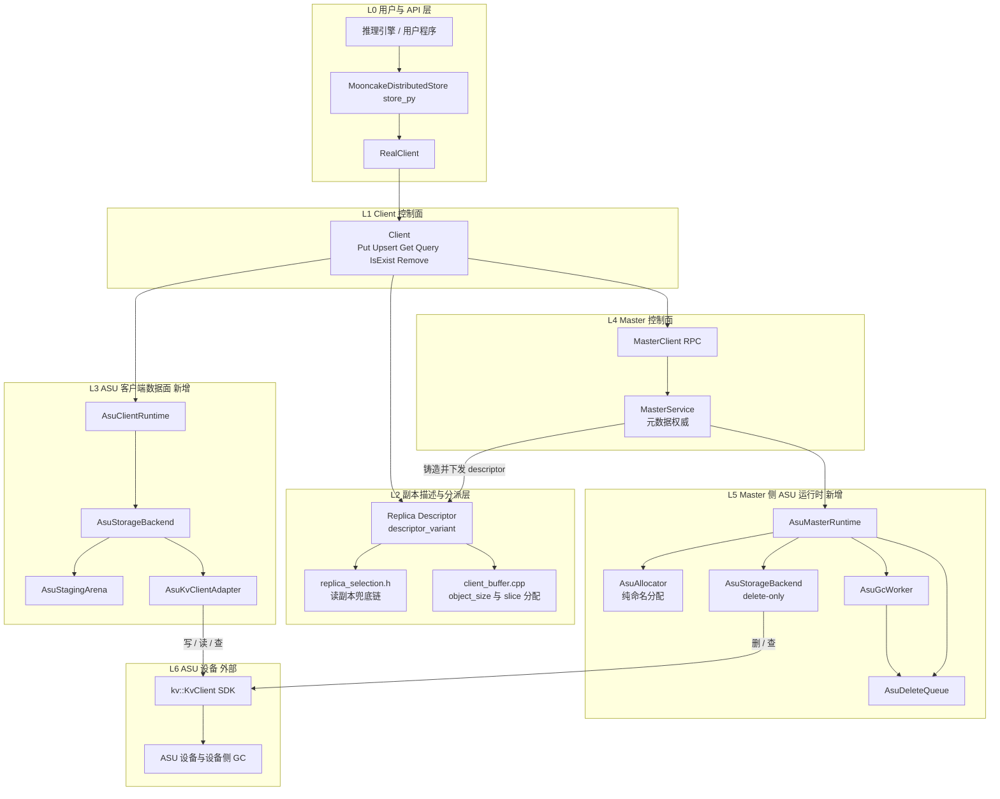

图中实线表示调用方向，边标签标出该段承载的操作。写、读、查三条路径都从 `Client` 出发：写和读进入 L3 后由 `AsuStorageBackend` 按 chunk 组请求，经 `AsuKvClientAdapter` 落到 `kv::KvClient`；查在 `Client` 侧只到 L4 的元数据，物理探活才走 L3。删除路径完全绕开 `Client` 数据面：L4 的 `MasterService` 把 `AsuDescriptor` 交给 L5 的删除队列，由 `AsuGcWorker` 到期后经 delete-only 的 `AsuStorageBackend` 执行。

##### 2.1.1.3 各组成部分的职责与边界

| 组件 | 职责 | 明确不做什么 |
| --- | --- | --- |
| `RealClient` | 进程级装配：创建 `AsuClientRuntime` 并交给 `Client`；与 `enable_ssd_offload` 的 `FileStorage` 初始化并列但不依赖该分支（real_client.cpp:1594-1605） | 不参与单次请求的副本决策 |
| `Client` | 副本计数与 finalize 决策、副本选择、租约与校验；ASU 分支的写读拦截（`SubmitAsuWrites` / `ReadAsuReplica`） | 不维护 `key_id` / `object_epoch`，只使用 descriptor |
| `Replica::Descriptor` / `replica_selection.h` / `client_buffer.cpp` | 跨进程描述与本地尺寸计算；`AsuDescriptor` 作为 `descriptor_variant` 的新 alternative；选择器把 ASU 纳入兜底链 | 不承载任何后端句柄或 fd |
| `AsuClientRuntime` | Client 侧 ASU 运行时的聚合根，持有一个 `AsuStorageBackend` | 不感知 Mooncake 对象元数据 |
| `AsuStorageBackend` | 对象级 I/O 唯一实现：分块、staging 取用、header/CRC、两段提交、逐 entry 错误映射；同一类在 Master 侧以 delete-only 模式复用 | 不做副本选择，不改 Master 元数据，不缓存对象 |
| `AsuStagingArena` | 512B 对齐、Init 时一次性 `RegisterRegions` 的常驻 pinned 缓冲池；slot 状态 `kFree` / `kInUse` / `kQuarantined` | 不使用 `PinnedBufferPool`，不与 offload 共享缓冲 |
| `AsuKvClientAdapter` | 包装 `kv::KvClient`：显式 `Wait` 超时、逐 entry 判定、`entryStatus` 到 `ErrorCode` 的映射 | 不重试有副作用的部分失败，不吞错误 |
| `kv::KvClient` | ASU 的唯一下边界：异步提交与 `Wait` | 不提供长度、Stat、GetMeta API；`maxInflightBytes` 不生效 |
| `MasterService` | 元数据唯一权威：`AsuDescriptor` 的铸造时机、`PROCESSING` → `COMPLETE`、回收入队、restore 重建 | 不访问 ASU 数据面、不读对象字节 |
| `AsuMasterRuntime` | Master 侧 ASU 运行时聚合根，组合 `AsuAllocator`、删除队列、GC 线程与 delete-only 后端 | 不做分配记账，不持有数据缓冲 |
| `AsuAllocator` | 纯命名分配：`Allocate` 返回 `AsuDescriptor`；维护 `object_epoch` 计数器与 `max_object_bytes` | 不占 segment、不分配字节、无 offset 账本 |
| `AsuDeleteQueue` / `AsuGcWorker` | 按 `key_id` 去重的延迟删除队列与独立 GC 线程；到期后批量 `DeleteAsync`，可重试、超限丢弃并计数 | 不在 `master_state_mutex_` 下做网络 I/O |
| delete-only `AsuStorageBackend` | 只保留 `QueryObject` / `DeleteObject` 路径 | 不分配 staging、不 `RegisterRegions` |

##### 2.1.1.4 元数据权威所在层

权威在 L4 的 `MasterService`，不在 L3 也不在 L6：

- 长度：`ObjectPart::length_`（object_part.h:77）在 `PutStart` 由 slice 长度求和写入，并复制进 `AsuDescriptor.object_size`，随 `PutStart` 响应与 `GetReplicaListResponse`（rpc_types.h:84-105）下发。SDK 没有长度 API（kv_client.h:33-61），因此不存在第二权威；`AsuRecordHeader.object_size` 只做交叉校验。
- 逻辑存在性：由 Master 元数据回答（`IsExist` 与 `Query`）。物理存在性只能由 `QueryAsync` 的 `exists` 位图观测（kv_types.h:98-101），仅用于诊断与错误归因，不是 Mooncake 可见性权威。
- 分片表：不存在。`chunk_count`、每 chunk 的 `offset` 与 `data_len` 是 `object_size` 加 `descriptor.chunk_payload` 的纯函数；每 chunk 的 `data_len` 与 CRC 在自身 `AsuRecordHeader` 里。没有 per-object shard 索引或 meta entry。
- Master 维护的状态：`ObjectMetadata` 里的 `AsuDescriptor`（本来就要持久化）、`AsuAllocator` 的 `object_epoch` 计数器、内存删除队列。没有字节账本、容量水位或 offset 分配表。
- Master 重启：`MetadataPayload`（metadata_store.h:104-116）持久化 `vector<Replica::Descriptor>`，`AsuDescriptor` 可 struct_pack 序列化，restore 只需两处 descriptor 重建并推进 epoch，不访问 ASU、不需要 allocator 状态。

##### 2.1.1.5 四条路径穿过的层次

| 操作 | 用户可见入口 | L1 / L2 | L3 | L4 | L5 | L6 |
| --- | --- | --- | --- | --- | --- | --- |
| 写 | `Put` / `Upsert` / `BatchPut` / `BatchUpsert` | 请求 `asu_replica_num=1`；`PutStart` 拿回含 `AsuDescriptor` 的副本列表；写后 `PutEnd(ALL)` / `PutRevoke(ALL)` | `AsuStorageBackend::WriteObject`：分块、编码、`BatchStoreAsync`、`Wait` | 只铸 descriptor 与改副本状态 | 不参与 | `BatchStoreAsync` |
| 读 | `Get` / `BatchGet` | 选择器选中 ASU 副本；`Client::Get` 在 `TransferRead` 之前拦截 | `AsuStorageBackend::ReadObject`：按 chunk `BatchLoadAsync`、校验 header 与 CRC、回填 | `GetReplicaList` 只查元数据并授租约 | 不参与 | `BatchLoadAsync` |
| 查 | `IsExist` / `BatchIsExist` / `Query` | 直接走 Master RPC，零额外 RTT | 不参与（诊断路径除外） | 元数据回答 | 不参与 | 不参与（物理探活时才 `QueryAsync`） |
| 删 | `Remove` | `Client::Remove` 只转发 | 不参与 | 删元数据并在全部回收点 `EnqueueDelete` | 宽限期后 `DeleteAsync` | `DeleteAsync` |

##### 2.1.1.6 与 DFS 路线、local_disk 路线的位置差异

| 维度 | DFS 路线 | local_disk 路线 | 本方案 ASUKvReplica |
| --- | --- | --- | --- |
| 副本类型 | 复用 `ReplicaType::DFS = 100` | 不是副本类型，只是一个 `StorageBackendInterface` 插件 | 新增 `ReplicaType::ASU = 101` |
| 模块位置 | L2 描述层 + `DistributedStorageBackend` / `FileSystemAdapter`（fs_adapter.h:34、distributed_storage_backend.h:40-49） | L1 之后的 offload 线程 → `StorageBackendInterface::BatchOffload`（storage_backend.h:263、274） | L2 一等 descriptor + L3 客户端数据面 + L5 Master 删除运行时 |
| 写入时机 | `PutEnd` 前由 `TransferWrite` 交给 DFS 后端 | `PutEnd` 之后由心跳驱动的推式 `BatchOffload`，带 `complete_handler` | `PutEnd` 前同步 `WriteObject` |
| 长度权威 | `DistributedFSDescriptor.object_size`（replica.h:329-337） | 后端没有长度权威（`GetObjectDataSize` 默认返回 `std::nullopt`） | `AsuDescriptor.object_size`，来自 Master 元数据 |
| 按 key 删除 | `FreeDfsReplicas` 只把 extent 交还 `dfs_allocator_`（master_service.cpp:7583-7591），不是按 key 删后端对象 | 接口没有 per-key 删除，只有整后端清空的 `RemoveAll`（storage_backend.h:321） | Master 自持 delete-only `KvClient` + 延迟 GC，按 `key_id` 精确删除 |
| Master 侧依赖 | 必须与数据面共享同一份 DFS 视图 / 挂载路径 | 不需要 | 只需网络与 delete-only `KvClient`；不注册数据 buffer、不碰字节 |
| 恢复 | `enable_dfs_` 为真时直接拒绝 standby restore（master_service.cpp:3672-3676） | 不涉及 | descriptor 是 `YLT_REFL` 值类型，两处 restore 重建即可 |
| 数据通路 | 文件 positional I/O / TransferEngine | 心跳任务 + `BatchOffload` | 客户端直连 `kv::KvClient`，不进 TransferEngine |

新位置更好的原因：

1. 时序同构。ASU 与 MEMORY / NOF 副本一样在 `PutStart` 拿到 descriptor、在 `PutEnd` 之前写完，`DetermineFinalizeDecision`（client_service.cpp:378）与 ALL group 语义原样复用；local_disk 路线是 `PutEnd` 之后的推式 offload，与副本的同步写时序互斥。
2. 长度权威单一。长度在 L4 的 `ObjectPart::length_`，经 descriptor 下发；offload 插件形态没有这个权威，DFS 形态的权威则绑定在文件描述符上。
3. 删得有主。物理删除由 L5 在租约宽限期后按 key 执行；DFS 的 `Free` 只做 extent 记账，`StorageBackendInterface` 只有 `RemoveAll`。当前 HEAD 上 `PollRemoveAll` 接线已死，不能指望既有 offload 路径补上按 key 删除。
4. Master 不碰字节。L5 的 `AsuStorageBackend` 是 delete-only 模式：不创建 `AsuStagingArena`、不 `RegisterRegions`，只发 `QueryAsync` / `DeleteAsync`，因此 Master 不需要与 Client 共享任何数据面缓冲或挂载。
5. 恢复代价低。`AsuDescriptor` 随 `MetadataPayload` 持久化，restore 只重建 descriptor 与推进 epoch；DFS 在 master_service.cpp:3672-3676 直接拒绝 restore，这是位置差异带来的系统性代价。
6. 读路径不借道 TransferEngine。`Client::Get` 在 `TransferRead` 之前拦截 ASU（client_service.cpp:1599-1602 是 DFS 的同类拦截），否则会落入 `transfer_task.cpp:1152-1154` 的 else 分支，转调 `submitFileReadOperation`（`:2039-2054`）；后者在 `:2043` 调用 `get_disk_descriptor()`，对非 `DiskDescriptor` 在 `replica.h:846-851` 抛 `std::runtime_error`。

#### 2.1.2 模块的类图

##### 2.1.2.1 类图

图中 `ReplicaDescriptor` 是既有嵌套类型 `Replica::Descriptor` 的图内简写，`KvClient` 是外部 SDK 类型 `kv::KvClient`。为可读性，图中省略 `tl::expected<..., ErrorCode>` 外壳、只保留成功值的类型名（失败即 `tl::unexpected`），`ByteVector` 指 `std::vector<uint8_t>`；**容器与指针不省略**，`vector<T>` / `T*` 即真实返回类型。真实签名见 §3 各 shard 的代码。标注 `new` 为新增类，`modified` 为既有类的小改动，`existing` / `external` 为对照项。

```mermaid
classDiagram
    direction LR

    class Replica {
        <<modified>>
        -ReplicaID id_
        -ReplicaStatus status_
        +Replica(AsuDescriptor descriptor, ReplicaStatus status)
        +type() ReplicaType
        +is_asu_replica() bool
        +get_asu_descriptor() AsuDescriptor
        +is_available() bool
        +get_descriptor() ReplicaDescriptor
    }

    class ReplicaDescriptor {
        <<modified>>
        +ReplicaID id
        +variant descriptor_variant
        +ReplicaStatus status
        +is_asu_replica() bool
        +get_asu_descriptor() AsuDescriptor
    }

    class AsuDescriptor {
        <<new>>
        +uint64_t key_id
        +uint64_t key_fingerprint
        +uint64_t object_epoch
        +uint64_t object_size
        +uint32_t chunk_payload
        +uint32_t chunk_count
        +uint32_t record_version
        +uint32_t flags
    }

    class AsuReplicaData {
        <<new>>
        +AsuDescriptor descriptor
    }

    class AsuKeyMaterial {
        <<new>>
        +uint64_t key_id
        +uint64_t key_fingerprint
        +CacheKey cache_key
    }

    class AsuKeyCodec {
        <<new>>
        +Derive(scoped_key, object_epoch) AsuKeyMaterial
        +ToCacheKey(key_id) CacheKey
    }

    class AsuRecordHeader {
        <<new>>
        +uint32_t magic
        +uint16_t version
        +uint16_t header_bytes
        +uint32_t header_crc32c
        +uint16_t flags
        +uint16_t reserved16
        +uint64_t key_id
        +uint64_t key_fingerprint
        +uint64_t object_epoch
        +uint64_t object_size
        +uint32_t chunk_index
        +uint32_t chunk_count
        +uint32_t data_offset
        +uint32_t data_len
        +uint32_t data_crc32c
        +uint32_t chunk_payload
        +uint64_t replica_id
    }

    class AsuRecordCodec {
        <<new>>
        +Encode(header, descriptor, index, data_len, data_crc32c, replica_id) void
        +DecodeAndValidate(raw, expected, index) ErrorCode
    }

    class AsuChunkPlanner {
        <<new>>
        +Count(object_size) uint32_t
        +DataLen(object_size, index) uint32_t
        +Offset(index) uint64_t
        +WireLen(data_len) uint32_t
    }

    class AsuConfig {
        <<new>>
        +bool enable
        +bool master_delete
        +string client_config_path
        +uint64_t max_object_bytes
        +uint64_t delete_grace_ms
        +uint64_t wait_timeout_ms
        +size_t staging_slots
        +uint64_t batch_max_bytes
        +size_t batch_max_entries
        +FromEnvironment() AsuConfig
        +Validate() bool
    }

    class AsuStagingSlot {
        <<new>>
        +void addr
        +size_t capacity
        +MRHandle handle
        +SlotState state
        +uint64_t trace_id
    }

    class AsuStagingArena {
        <<new>>
        +Create(client, slot_bytes, slot_count) AsuStagingArena
        +Acquire(bytes, trace_id) AsuStagingArena::Slot*
        +Release(slot) void
        +Quarantine(slot) void
    }

    class AsuEntryResult {
        <<new>>
        +StatusCode code
        +string message
    }

    class IAsuKvClient {
        <<interface>>
        +Init(config) ErrorCode
        +Shutdown() void
        +Register(regions, registered) ErrorCode
        +BatchStore(entries, timeout_ms) vector<AsuEntryResult>
        +BatchLoad(entries, timeout_ms) vector<AsuEntryResult>
        +Query(keys, timeout_ms) ByteVector
        +Delete(keys, timeout_ms) vector<AsuEntryResult>
    }

    class AsuKvClientAdapter {
        <<new>>
        +Init(config) ErrorCode
        +Shutdown() void
        +Register(regions, registered) ErrorCode
        +BatchStore(entries, timeout_ms) vector<AsuEntryResult>
        +BatchLoad(entries, timeout_ms) vector<AsuEntryResult>
        +Query(keys, timeout_ms) ByteVector
        +Delete(keys, timeout_ms) vector<AsuEntryResult>
    }

    class AsuStorageBackend {
        <<new>>
        +Create(config, client, register_staging) AsuStorageBackend
        +WriteObject(descriptor, slices, trace_id) ErrorCode
        +ReadObject(descriptor, slices, trace_id) ErrorCode
        +QueryObject(descriptor, trace_id) bool
        +DeleteObject(descriptor, trace_id) ErrorCode
        +DeleteObjects(descriptors, trace_id) ErrorCode
        +IsReady() bool
        +Shutdown() void
    }

    class AsuAllocator {
        <<new>>
        +Allocate(tenant, user_key, object_size) AsuDescriptor
        +RestoreObservedEpoch(epoch) void
        +IsInitialized() bool
        +MaxObjectBytes() uint64_t
    }

    class AsuDeleteItem {
        <<new>>
        +uint64_t key_id
        +uint64_t object_epoch
        +uint64_t key_fingerprint
        +string user_key
        +time_point release_at
    }

    class AsuDeleteQueue {
        <<new>>
        +Enqueue(item) void
        +DrainDue(now, max_items) vector<AsuDeleteItem>
        +Pending() size_t
    }

    class AsuGcWorker {
        <<new>>
        +Start() void
        +Stop() void
    }

    class AsuMasterRuntime {
        <<new>>
        +Create(config) AsuMasterRuntime
        +allocator() AsuAllocator
        +EnqueueDelete(descriptor, user_key, release_at) void
        +RestoreEpoch(epoch) void
        +Shutdown() void
    }

    class AsuClientRuntime {
        <<new>>
        +Create(config) AsuClientRuntime
        +backend() AsuStorageBackend
        +IsReady() bool
    }

    class Client {
        <<modified>>
        +Put(key, slices, config) ErrorCode
        +Upsert(key, slices, config) ErrorCode
        +Get(key, query_result, slices) ErrorCode
        +IsExist(key) bool
        +Remove(key, force) ErrorCode
        +BatchGet(object_keys, query_results, slices, group_by_target) ResultList
        +SubmitAsuWrites(ops) void
        +ReadAsuReplica(key, descriptor, slices) ErrorCode
    }

    class MasterService {
        <<modified>>
        +PutStart(client_id, key, tenant_id, slice_length, config) DescriptorList
        +AllocateReplicas(key, tenant_id, value_length, config, writer_host_id, dfs_allocation_failed) ReplicaList
        +PutEnd(client_id, key, tenant_id, replica_type) ErrorCode
        +RemoveObject(key, tenant_id, force, allow_managed_weight) ErrorCode
        +FreeAsuReplicas(key, replicas) void
    }

    class BufferAllocatorBase {
        <<existing>>
        +Allocate(size) Buffer
        +Free(handle) void
    }

    class StorageBackendInterface {
        <<existing>>
        +BatchOffload(batch, complete_handler) int64_t
        +BatchLoad(batched_slices) void
        +IsEnableOffloading() bool
        +RemoveAll() void
    }

    class KvClient {
        <<external>>
        +Init(config_path) Status
        +BatchStoreAsync(entries, task_id) Status
        +BatchLoadAsync(entries, task_id) Status
        +QueryAsync(keys, task_id) Status
        +DeleteAsync(keys, task_id) Status
        +Wait(task_id, timeout_ms, result) Status
        +RegisterRegions(regions, registered) Status
    }

    Client *-- AsuClientRuntime : 持有
    Client ..> ReplicaDescriptor : 读副本选择
    MasterService *-- AsuMasterRuntime : 持有
    MasterService ..> Replica : 分配与回收
    MasterService ..> ReplicaDescriptor : 铸造并下发
    Replica o-- AsuReplicaData : data_ variant
    ReplicaDescriptor o-- AsuDescriptor : descriptor_variant
    AsuReplicaData *-- AsuDescriptor
    AsuClientRuntime *-- AsuStorageBackend
    AsuMasterRuntime *-- AsuAllocator
    AsuMasterRuntime *-- AsuDeleteQueue
    AsuMasterRuntime *-- AsuGcWorker
    AsuMasterRuntime o-- AsuStorageBackend : delete-only
    AsuGcWorker --> AsuDeleteQueue
    AsuGcWorker --> AsuStorageBackend
    AsuStorageBackend *-- IAsuKvClient
    AsuStorageBackend o-- AsuStagingArena
    AsuStorageBackend ..> AsuRecordCodec
    AsuStorageBackend ..> AsuChunkPlanner
    AsuStorageBackend ..> AsuConfig
    AsuStagingArena *-- AsuStagingSlot
    AsuStagingArena --> IAsuKvClient : RegisterRegions
    AsuKvClientAdapter ..|> IAsuKvClient
    AsuKvClientAdapter --> KvClient
    IAsuKvClient ..> AsuEntryResult
    AsuRecordCodec ..> AsuRecordHeader
    AsuRecordCodec ..> AsuDescriptor
    AsuKeyCodec ..> AsuKeyMaterial
    AsuAllocator ..> AsuKeyCodec
    AsuAllocator ..> AsuChunkPlanner
    AsuAllocator ..> AsuConfig
    AsuDeleteQueue *-- AsuDeleteItem
    AsuGcWorker ..> AsuConfig

    note for BufferAllocatorBase "AsuAllocator 无字节账本 不继承此基类"
    note for StorageBackendInterface "ASU 副本不复用此接口"
```

##### 2.1.2.2 逐类简介

| 类 | 类型 | 职责 | 关键方法 | 交互对象 | 生命周期 |
| --- | --- | --- | --- | --- | --- |
| `AsuDescriptor` | 新增，`replica.h` 中纯数据 struct | 48B 线格式：`key_id`、`key_fingerprint`、`object_epoch`、`object_size`、`chunk_payload`、`chunk_count`、`record_version`、`flags`，`YLT_REFL` | 无成员函数 | 被 `AsuReplicaData` 与 `Replica::Descriptor` 组合；随 RPC 与 oplog 跨进程 | 值类型，随副本生灭 |
| `AsuReplicaData` | 新增，纯数据 struct | `Replica::data_` 的新 alternative，只含一个 `AsuDescriptor` | 无 | 被 `Replica` 聚合 | 与 `Replica` 同生命周期 |
| `AsuKeyCodec` | 新增，静态类 | 由 `scoped_key` 与 `object_epoch` 推导 `key_id`、`key_fingerprint`、`CacheKey`；Master 与客户端共用同一实现 | `Derive`、`ToCacheKey` | `AsuAllocator`；客户端只消费 descriptor 里的 `key_id` | 无状态 |
| `AsuKeyMaterial` | 新增，值类型 | `Derive` 的三元组返回值 | 无 | `AsuKeyCodec` | 调用期栈上 |
| `AsuRecordCodec` | 新增，静态类 | `AsuRecordHeader` 的逐字段编解码、header CRC 与 payload CRC 计算、字段交叉校验 | `Encode`、`DecodeAndValidate` | `AsuStorageBackend` | 无状态 |
| `AsuRecordHeader` | 新增，值类型 | 每 chunk 开头 512B 自描述头的内存表示 | 无 | `AsuRecordCodec` | 调用期栈上 |
| `AsuChunkPlanner` | 新增，静态类 | 分块公式：chunk 数、每 chunk 的未填充长度、offset、线上长度 | `Count`、`DataLen`、`Offset`、`WireLen` | `AsuStorageBackend`、`AsuAllocator`、校验代码 | 无状态 |
| `asu_layout.h` | 新增，命名空间而非类 | 编译期常量：`kAlign`、`kEntryMaxBytes`、`kChunkPayloadBytes`、`kChunkStrideBytes`、`kMaxChunks`、`kMaxObjectBytes`、`kBatchMaxEntries`、`kBatchMaxBytes`、`kDefaultWaitTimeoutMs`，以及 `static_assert` 边界断言与 `AlignUp` 等 constexpr 纯函数 | 仅编译期 | `AsuChunkPlanner`、`AsuStorageBackend`、`AsuConfig` | 无状态 |
| `AsuConfig` | 新增 | 环境变量解析与校验；所有 go/nogo 相关上限集中在此 | `FromEnvironment`、`Validate` | 两个 runtime、`AsuStorageBackend`、`AsuGcWorker` | 进程生命周期，只读 |
| `AsuStagingArena` | 新增 | 512B 对齐、Init 时一次性 `RegisterRegions` 的常驻 pinned 池；slot 分配、释放与超时隔离 | `Create`、`Acquire`、`Release`、`Quarantine` | `IAsuKvClient`（注册）、`AsuStorageBackend` | 随 runtime，进程生命周期 |
| `AsuStagingSlot` | 新增，内嵌 `AsuStagingArena::Slot` | 记录 `addr`、`capacity`、`handle`、`state`、`trace_id` | 无 | `AsuStagingArena` | 随 Arena |
| `IAsuKvClient` | 新增，抽象接口 | 隔离 SDK：显式 `Wait` 超时、逐 entry 判定、错误映射；测试用 `FakeAsuKvClient` 实现同一接口 | `Init`、`Shutdown`、`Register`、`BatchStore`、`BatchLoad`、`Query`、`Delete` | `AsuKvClientAdapter`、`AsuStagingArena`、`AsuStorageBackend` | 随 runtime |
| `AsuKvClientAdapter` | 新增 | 组合 `unique_ptr<kv::KvClient>`，做参数转换、显式 `Wait` 超时与任务级 `result.status` 到 `ErrorCode` 的映射；逐 entry 的 `StatusCode` 原样回传，由 `AsuStorageBackend::MapEntryStatus` 决定业务错误 | 同 `IAsuKvClient` | `kv::KvClient` | 随 `AsuStorageBackend` |
| `AsuEntryResult` | 新增，值类型 | 单个 entry 的 `StatusCode` 与 `message` | 无 | `AsuKvClientAdapter`、`AsuStorageBackend` | 调用期 |
| `AsuStorageBackend` | 新增 | 对象级 I/O 唯一实现：分块、staging、header/CRC、两段提交、错误映射；Master 侧以 delete-only 模式复用同一类 | `Create`、`WriteObject`、`ReadObject`、`QueryObject`、`DeleteObject`、`IsReady` | `AsuStagingArena`、`IAsuKvClient`、`AsuRecordCodec`、`AsuChunkPlanner` | 每个 runtime 一个实例 |
| `AsuAllocator` | 新增 | 纯命名分配：铸造 `AsuDescriptor`，维护 `object_epoch` 计数器与 `max_object_bytes`；restore 时推进观察到的 epoch | `Allocate`、`RestoreObservedEpoch`、`IsInitialized`、`MaxObjectBytes` | `AsuKeyCodec`、`AsuChunkPlanner`、`MasterService` | Master 进程生命周期 |
| `AsuDeleteQueue` | 新增 | 按 `key_id` 去重的延迟删除队列，按 `release_at` 到期 | `Enqueue`、`DrainDue`、`Pending` | `FreeAsuReplicas`、`AsuGcWorker` | Master 进程生命周期，内存态 |
| `AsuDeleteItem` | 新增，值类型 | 入队项：`key_id`、`object_epoch`、`key_fingerprint`、`user_key`、`release_at` | 无 | `AsuDeleteQueue` | 入队到删除或丢弃 |
| `AsuGcWorker` | 新增 | 独立线程按最早 `release_at` 等待，到期批量 `DeleteAsync`，可重试、超限丢弃并计数 | `Start`、`Stop` | `AsuDeleteQueue`、delete-only `AsuStorageBackend` | Master 进程；`Shutdown` 先停 GC |
| `AsuMasterRuntime` | 新增，聚合根 | Master 侧 ASU 运行时：分配器、删除队列、GC 线程、delete-only 后端 | `Create`、`allocator`、`EnqueueDelete`、`RestoreEpoch`、`Shutdown` | `MasterService` 与上述组件 | `MasterService::Init` 创建，`Shutdown` 释放 |
| `AsuClientRuntime` | 新增，聚合根 | Client 侧 ASU 运行时：持有唯一 `AsuStorageBackend`，暴露就绪判定 | `Create`、`backend`、`IsReady` | `RealClient`、`Client`、`AsuStorageBackend` | Client 进程生命周期 |
| `Replica` | 既有，改动（risky） | `data_` variant 追加 `AsuReplicaData`；新增公有构造；`is_available` 对 ASU 显式返回 true；新增访问器 | `is_asu_replica`、`get_asu_descriptor`、`get_descriptor` | `Client`、`MasterService`、`Descriptor` | 既有 |
| `Replica::Descriptor` | 既有，改动（risky） | `descriptor_variant` 末尾追加 `AsuDescriptor`；新增 const 与非 const 访问器；`transport_endpoint` 返回 `nullopt`、`get_segment_names` 返回空 | `is_asu_replica`、`get_asu_descriptor` | RPC、oplog、`Client`、`client_buffer.cpp` | 既有 |
| `ReplicateConfig` | 既有，改动（risky） | 追加 `struct_pack::compatible<size_t, 4> asu_replica_num`，禁止裸 `size_t` | 无 | `PutStart`、Python 绑定 | 既有 |
| `Client` | 既有，改动 | ASU 写读拦截、批量提交、副本计数与 finalize 决策 | `SubmitAsuWrites`、`ReadAsuReplica` | `AsuStorageBackend`、`MasterService` | 既有 |
| `MasterService` | 既有，改动（risky） | 分配 ASU 副本、ALL 谓词、11 处回收钩子、两处 restore、offload 排除 | `AllocateReplicas`、`PutEnd`、`PutRevoke`、`RemoveObject`、`FreeAsuReplicas` | `AsuMasterRuntime`、`ObjectMetadata` | 既有 |
| `BufferAllocatorBase` | 既有，无改动 | 对照项：ASU 不实现 allocator，无字节账本 | 无 | 无 | 无 |
| `StorageBackendInterface` | 既有，不复用 | 对照项：offload 插件面，本方案不经它 | 无 | 无 | 无 |

##### 2.1.2.3 新增类与既有改动类的划分

所有新增类放在 `mooncake-store/include/asu/` 与 `src/asu/`，命名空间为 `asu`。唯一的例外是 `AsuDescriptor` 与 `AsuReplicaData`：它们必须放进 `replica.h`，因为要进入 RPC 与 oplog 的线格式。

| kind | 类 / 位置 | 内容 |
| --- | --- | --- |
| 新增（pure-additive 新建文件） | `asu/` 下 12 个头文件与实现、`tests/support/fake_asu_kv_client.h` | `AsuKeyCodec`、`AsuRecordCodec`、`AsuChunkPlanner`、`AsuStagingArena`、`IAsuKvClient`、`AsuKvClientAdapter`、`AsuStorageBackend`、`AsuAllocator`、`AsuDeleteQueue`、`AsuGcWorker`、`AsuMasterRuntime`、`AsuClientRuntime`、`AsuConfig` |
| pure-additive（既有文件追加） | allocator.h:27-34 | 只追加 `ReplicaType::ASU = 101`，不重排、不复用 0 到 4 或 100 |
| pure-additive（既有文件追加） | types.h 错误码区、types.cpp `toString` | 5 个错误码：`ASU_SERVICE_UNAVAILABLE`、`ASU_OBJECT_TOO_LARGE`、`ASU_KEY_COLLISION`、`ASU_RECORD_CORRUPT`、`ASU_DESCRIPTOR_INVALID` |
| modify | `Client`、`Replica` 访问器、`client_buffer.cpp:144-190`、`master_admin_service.cpp`、`transfer_task.cpp`、`real_client.cpp`、`store_py.cpp` / `store_py_internal.h` | 分支接入与显式拒绝，不改变既有类型语义 |
| risky | `Replica::data_` / `Replica::Descriptor::descriptor_variant` / `ReplicateConfig`（replica.h:108、742、925）、`master_service.cpp` 的 ALL 谓词与 11 处 `FreeAsuReplicas` 与两处 restore、`UpsertStart` 强制 Case C、`replica_selection.h:182-193` 兜底链 | 触碰线格式、副本生命周期与跨进程兼容性 |

两个结构性说明：

- `AsuAllocator` 与 `BufferAllocatorBase` 之间没有继承或组合关系。`Allocate` 返回的是 `AsuDescriptor` 而不是 buffer：它不占 segment、不分配字节、没有 offset 账本，因此 Master 侧不存在 allocator 状态需要恢复，这也是 ASU 不与 standby restore 互斥的原因（对照 DFS 在 master_service.cpp:3672-3676 的拒绝）。
- `AsuStorageBackend` 同时服务两个方向，靠构造参数 `register_staging` 区分：Client 侧为 true，创建 `AsuStagingArena` 并一次性 `RegisterRegions`；Master 侧为 false，不创建 arena、不注册数据 buffer，只保留 `QueryObject` / `DeleteObject`。同一个类在两端的错误映射与日志格式完全一致，便于跨进程对账。

### 2.2 业务交互流程

本节给出四个端到端业务场景的粗粒度流程。参与者固定为：U 用户或应用、C Client、M Master、A AsuStorageBackend、K KvClient SDK、D ASU 设备。A 即新副本模块的数据面类，客户端侧由 AsuClientRuntime 持有并使用完整读写能力，Master 侧由 AsuMasterRuntime 以 delete-only 模式持有；A 内部还使用 AsuStagingArena 与 AsuRecordCodec。

#### 2.2.1 场景一 写入并落 ASU

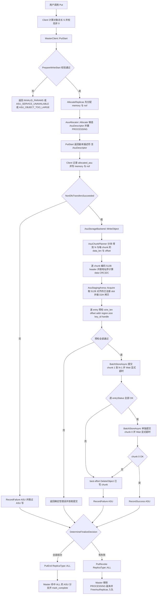

关键决策点：

- `PrepareWriteStart` 是全部参数校验的唯一入口：`asu_replica_num` 只允许 0 或 1；`enable` 或 runtime 未就绪返回 `ASU_SERVICE_UNAVAILABLE`；`S` 超过 `MaxObjectBytes` 返回 `ASU_OBJECT_TOO_LARGE`。CACHELIB 下 `kMaxSliceSize` 检查对 ASU 同样生效（master_service.cpp:5112-5117），默认部署 `S` 被卡在约 16MiB，此时 `N=1`，多 chunk 分支不可达。
- ASU 分配必须放在 `HasExpectedReplicaAllocation` 门槛之前：先完成 memory/nof 分配，再由 `AsuAllocator::Allocate` 铸造 descriptor，最后才执行门槛判定（master_service.cpp:4876-4899）。否则门槛会先按「没有 ASU」判定失败并提前返回。
- ASU 写只在 `NonDfsTransfersSucceeded` 为真时执行。memory/nof 先失败时跳过 ASU 并记录 `failed_asu`，最终走 `PutRevoke(ReplicaType::ALL)`。ASU-only 配置下该条件空洞为真，但客户端与服务端的 `HasExpectedReplicaAllocation` 以及 `AllAllocatedTransfersSucceeded` 都必须把 `allocated_asu` 纳入等式，否则会误判 `NO_AVAILABLE_HANDLE` 或 revoke。
- 提交顺序是 chunk 1 到 N-1 先写、chunk 0 最后写。读到合法的 chunk 0 header 才认为对象已提交，半写对象对读者不可见。
- 任一 chunk 失败即对已成功 chunk 做 best-effort `DeleteObject`，再 `PutRevoke(ReplicaType::ALL)`，不尝试「只失败一条」。
- `PutEnd` 的 `ALL` 分支必须命中 ASU 才 mark_complete（master_service.cpp:5300-5306）；否则副本永远停在 PROCESSING，而读选择器只认 COMPLETE。

#### 2.2.2 场景二 命中 ASU 读回

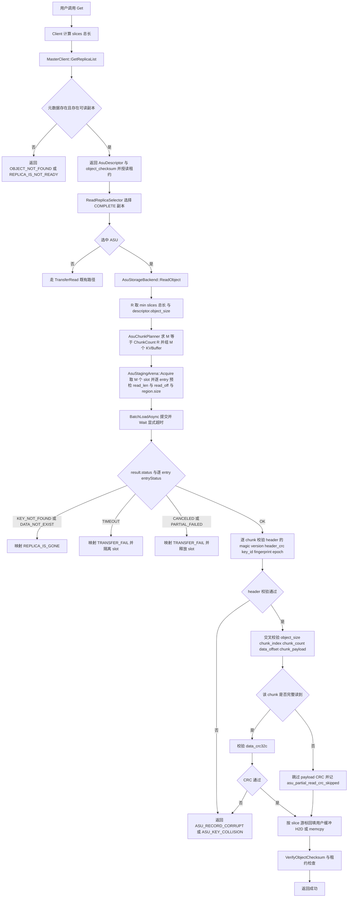

关键决策点：

- 长度权威在 Master：`descriptor.object_size` 是唯一权威，客户端不做二次推导，SDK 也没有长度 API。读路径用 `R=min(slices 总长, object_size)`，绝不 over-read。
- `ReadReplicaSelector` 只认 COMPLETE 副本。默认路径走 `FindFirstCompleteReplica`（client_service.cpp:5609-5621）；多副本且有 HCA affinity 时走 `SelectBestReplica`，ASU 档位在兜底链中位于 LOCAL_DISK 之后、DFS 之前（replica_selection.h:182-193）。
- `Client::Get` 必须在调用 `TransferRead` 之前拦截 ASU（client_service.cpp:1598-1603），否则 `TransferRead` 的 size 分支未命中会落到 `transfer_task.cpp:1152-1154` 的 else 分支，转调 `submitFileReadOperation`（`:2039-2054`）；后者在 `:2043` 调用 `get_disk_descriptor()`，对非 `DiskDescriptor` 在 `replica.h:846-851` 抛 `std::runtime_error`。
- 前缀读的最后一个 chunk 是截断读，无法校验 payload CRC，只记录 `asu_partial_read_crc_skipped`。这是设计已记录的残留风险，原因是 Mooncake 端到端 CRC-64 默认关闭。
- 读端校验是 fail-stop：`result.status`、每 entry `entryStatus`、header 自校验、字段交叉校验、payload CRC，任一失败都不返回部分数据。
- `ENTRY_KEY_NOT_FOUND` 或 `ENTRY_DATA_NOT_EXIST` 映射 `REPLICA_IS_GONE`，可换副本或触发修复；`TIMEOUT` 属不确定结果，必须隔离 slot。

#### 2.2.3 场景三 按 key 查询后决定行为

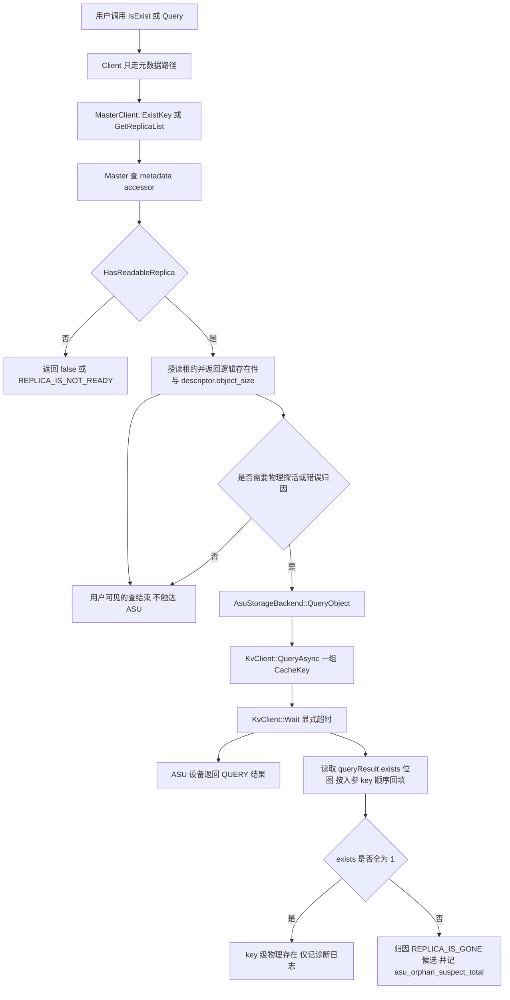

关键决策点：

- 用户可见的查只走元数据，零额外 RTT。逻辑存在性由 Master 元数据回答，`IsExist` 到 `ExistKey` 的路径见 client_service.cpp:4191-4194，Master 侧见 master_service.cpp:2824-2861。
- ASU 设备丢失 entry 时 Master 的 `IsExist` 仍返回 true 并下发读不到的 `AsuDescriptor`，读时才暴露 `REPLICA_IS_GONE`。这与 DFS/DISK 同类，必须写进对外契约。
- `QueryAsync` 的 `exists` 是 key 级位图，不是 per-chunk。key 存在但某个 offset 的中间 chunk 缺失无法被 Query 发现，只能靠读端 header 与 CRC 校验。
- 物理查询只用于删除前后一致性诊断、错误归因、开发自验证与运维探活，不放在 `IsExist` 或 `Query` 热路径，不作为 Mooncake 存在性权威。
- 不新增公开的物理查询 RPC。

#### 2.2.4 场景四 按 key 删除回收

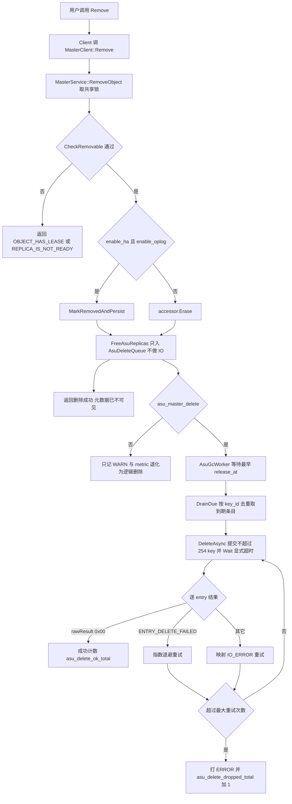

关键决策点：

- 元数据先删、物理后删。宽限期 `release_at` 等于 `now` 加 `max(default_kv_lease_ttl_, asu_delete_grace_ms)`，避免删掉仍被持租约读者引用的旧 key。
- `FreeAsuReplicas` 只入队，不做 IO；`RemoveObject` 持 `master_state_mutex_` 共享锁（master_service.cpp:7179），GC 线程必须在锁外运行。全部 11 个 `FreeDfsReplicas` 调用点都要成对调用 `FreeAsuReplicas`。
- 每个写世代有独立 `object_epoch` 并参与 key 推导，删除队列只删入队时的 `key_id`。因此 Remove 后立即 Put、或 Upsert 重分配，都不会被迟到的 `DeleteAsync` 误删。
- DELETE 的成功语义是 `rawResult` 等于 `0x00`；`ENTRY_DELETE_FAILED`（0x0201）可重试；不要假设 DELETE 会返回 `ENTRY_KEY_NOT_EXIST`，那是 QUERY 的语义。
- `asu_master_delete=false` 时退化为纯元数据删除，ASU 上留下不可枚举孤儿；Master 崩溃会丢内存中的 GC 队列，孤儿同样不回收，只能靠日志里的 `key_id` 人工清理。这是本设计已知最大运维代价。

### 2.3 运行设计

本节按 init、write、read、query、remove 五个阶段给出时序图。五张图使用同一套参与者：

| 标识 | 参与者 | 说明 |
| --- | --- | --- |
| U | 用户或应用 | MooncakeDistributedStore 或 RealClient 的调用方 |
| C | Client | Client 控制面，含 AsuClientRuntime |
| M | Master | MasterService 控制面，含 AsuMasterRuntime、AsuAllocator、AsuDeleteQueue、AsuGcWorker |
| A | AsuStorageBackend | 新副本模块的数据面类；客户端侧持有完整读写，Master 侧为 delete-only；内部使用 AsuStagingArena 与 AsuRecordCodec |
| K | KvClient SDK | kv::KvClient 及其 transport |
| D | ASU 设备 | 外部键值存储 |

#### 2.3.1 Init 阶段

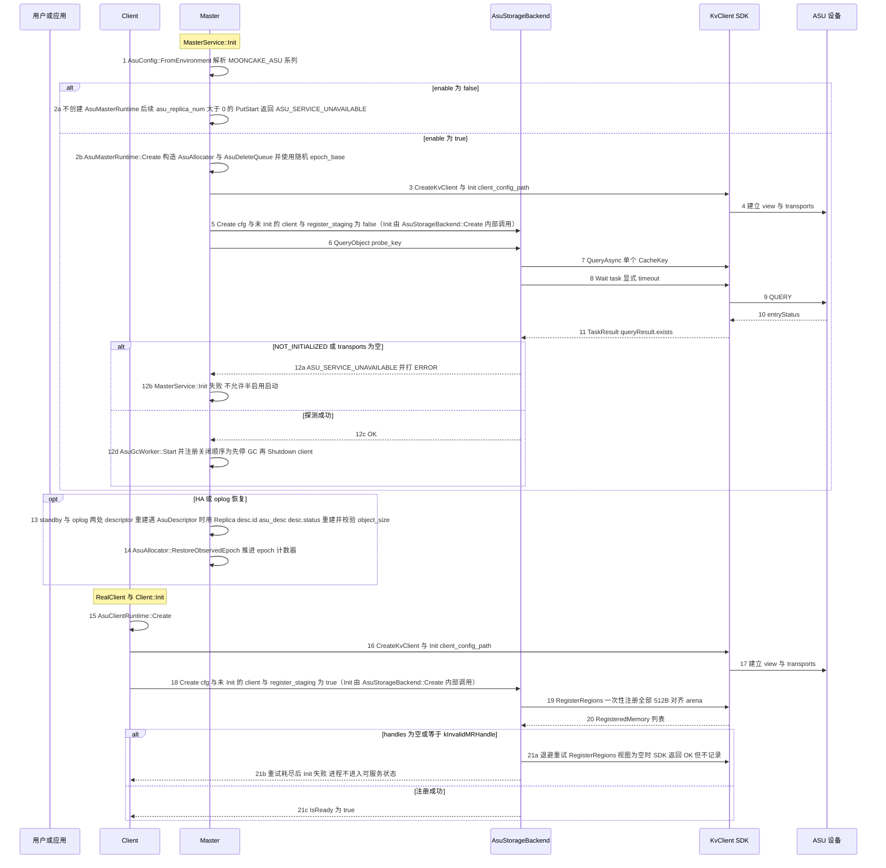

时序简介：

1. Master 入口先解析 `AsuConfig`。`enable=false` 时不创建 `AsuMasterRuntime`，之后 `asu_replica_num>0` 的 `PutStart` 返回 `ASU_SERVICE_UNAVAILABLE`。
2. `AsuMasterRuntime::Create` 构造 `AsuAllocator` 与 `AsuDeleteQueue`。`AsuAllocator` 用 `random_device`、`steady_clock`、`pid` 混合出随机 `epoch_base`，避免 Master 重启后与上一世代的 key 冲突；`AsuDeleteQueue` 只是内存队列。
3. Master 先 `CreateKvClient` 并 `Init(client_config_path)`，KvClient 建立 view 与 transports。
4. 再以 `register_staging=false` 创建 `AsuStorageBackend`。delete-only 模式不分配 staging arena、不调用 `RegisterRegions`，因为 Delete 与 Query 只需要 key（kv_client_impl.cc:292-297、490-501）。
5. 就绪探测走 `QueryObject(probe_key)`，最终是单 key 的 `QueryAsync` 加显式 `Wait`。SDK 在 snapshot、router、transports 任一为空时返回 `NOT_INITIALIZED`。
6. 探测失败必须让 `MasterService::Init` 明确失败，不允许 Master 以「配置启用但后端不可用」的半启用状态启动。
7. 探测成功后才启动 `AsuGcWorker` 线程。关闭顺序必须先 `Stop` GC 再 `Shutdown` KvClient，避免 GC 线程访问已销毁的 client。
8. HA/oplog 恢复时，两处 descriptor 重建遇到 `AsuDescriptor` 用 `Replica(desc.id, asu_desc, desc.status)` 重建并校验 `object_size`，随后推进 `AsuAllocator` 的 epoch 计数器。恢复过程不访问 ASU，因此不与 HA 互斥。
9. Client 侧先 `CreateKvClient` 并 `Init`，再以 `register_staging=true` 创建 `AsuStorageBackend`。数据 client 必须注册 arena，否则运行期所有 entry 会在 Wait 时返回 `BUFFER_NOT_REGISTERED`。
10. `RegisterRegions` 在视图为空时返回 OK 但 `registeredRegions` 为空（kv_client_impl.cc:337-339），因此调用方必须校验返回 handles 非空且不等于 `kInvalidMRHandle`，并带退避重试；失败则 `Client::Init` 明确失败，不允许先接受写再报错。
11. arena 大小等于 `staging_slots` 乘 `kChunkStrideBytes`，基址 512B 对齐，一次性注册。slot 在进程生命周期内复用，超时被隔离的 slot 永不复用。
12. 能力协商：SDK 公有 API 不暴露 `ServerKvCapabilities`，本设计不读取、不 clamp，固定按 `kEntryMaxBytes` 与 `kChunkPayloadBytes` 切分；设备真实上限只能从 Init 日志观察并实测确认。

#### 2.3.2 写入阶段

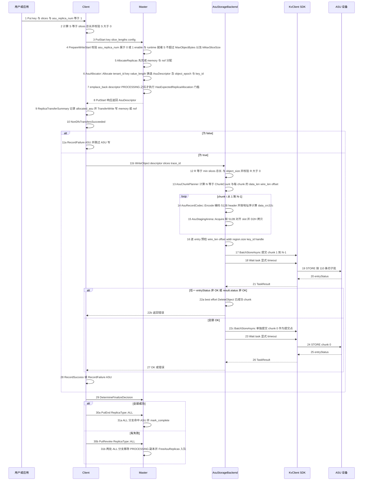

时序简介：

1. Client 计算 `S` 只用于请求与本地分块，真正的长度权威在 Master。
2. `PrepareWriteStart` 是唯一参数校验入口（master_service.cpp:5047-5117）：`asu_replica_num` 只允许 0 或 1；`enable` 或 runtime 未就绪返回 `ASU_SERVICE_UNAVAILABLE`；`S` 超过 `MaxObjectBytes` 返回 `ASU_OBJECT_TOO_LARGE`；CACHELIB 的 `kMaxSliceSize` 检查照常生效。
3. `AllocateReplicas` 先分配 memory/nof，再调用 `AsuAllocator::Allocate` 铸造 `AsuDescriptor`。ASU 分支必须在 `HasExpectedReplicaAllocation` 门槛之前完成（master_service.cpp:4758-4763、4876-4899），只 `emplace_back` 一个 PROCESSING 副本，不占 segment、不分配字节、无 offset 账本。
4. `AsuDescriptor` 的 48B 线格式在 `PutStart` 响应中原样返回给 Client。客户端只使用其中的 `key_id` 与 `object_size`，绝不自行重算 key。`object_epoch` 参与 key 推导，每次 `PutStart` 得到新物理 key。
5. 写 ASU 的前置条件是 `NonDfsTransfersSucceeded`。memory/nof 先失败时跳过 ASU 并记录 `failed_asu`，最终 revoke。ASU-only 配置下该条件空洞为真，但 `HasExpectedReplicaAllocation` 与 `AllAllocatedTransfersSucceeded` 必须把 `allocated_asu` 纳入等式，否则会误判 `NO_AVAILABLE_HANDLE` 或 revoke。
6. 分块发生在 `AsuStorageBackend::WriteObject` 内部，使用 `AsuChunkPlanner::Count`、`DataLen`、`WireLen`、`Offset`。`S=0` 或 `S` 超过 `MaxObjectBytes` 直接拒绝。
7. 512B 对齐由三处共同保证：header 固定 512B；`wire_len` 等于 512 加 `align_up(data_len,512)`；`offset_i` 等于 `i` 乘 `kChunkStrideBytes`，该常量恒为 512B 的整数倍。arena 基址与 slot 也强制 512B 对齐。SDK 只校验 length 与 offset 的对齐，不校验 addr。
8. staging：device 指针的 slice 先 D2H 拷入已注册 pinned slot；每 chunk 独立 slot，slot 不可在 Wait 返回前复用。
9. 逐 entry 预检在第一次 `BatchStoreAsync` 之前完成，检查 `wire_len` 是 512 的整数倍且落在 512 到 16,776,704 之间、`offset` 是 512 的倍数且不超过 `0xFFFFFE00`、`buffer.region.addr` 是 512 的倍数、`buffer.region.size` 精确等于 `wire_len`、`key_id` 非 0、handle 命中已注册区间。原因是 SDK 在预发送阶段失败会 abort 整个 transport task 并把所有 `entryStatus` 置 CANCELED（trans_task_executor.cc:227-243），不存在只失败一条。
10. `region.size` 在 SDK 内部先被 `static_cast<uint32_t>`（sqe_request.cc:190、206、223、251），所以本层禁止任何 entry 大于等于 4GiB；`kMaxObjectBytes` 与 `wire_len` 双重断言。
11. `Wait` 必须显式传 timeout。`KvClientConfig` 的 `defaultWaitTimeoutMs` 默认 100ms（kv_types.h:215），16MiB entry 必然超时；Wait 超时后 task 被无条件 Remove（task_manager.cc:108-116），结果不可再取。
12. 提交顺序：chunk 1 到 N-1 一个 task 并 Wait，全部成功后 chunk 0 单独一个 task 并 Wait。chunk 0 是 commit marker，同样要经过 staging 与预检。
13. 任一 chunk 失败则 best-effort `DeleteObject` 已成功 chunk，再 `RecordFailure(ASU)`；Client 侧最终 `DetermineFinalizeDecision` 产出 `PutRevoke(ReplicaType::ALL)`。
14. `PutEnd(ALL)` 时 Master 的 `is_target_replica` ALL 分支必须命中 ASU 并 mark_complete，checksum 也因 `replica_type` 为 ALL 一并写入。`PutRevoke(ALL)` 时 `processing_rep` 与 `target_pred` 两处 ALL 分支都命中 ASU，移除 PROCESSING 副本并 `FreeAsuReplicas` 入队。
15. 批量 Put/Upsert 由 `SubmitAsuWrites` 在 `SubmitDfsWrites` 之后、`FinalizeBatchPut` 之前逐 op 执行（client_service.cpp:3685、3693、3735）；每个 op 独立判定 `NonDfsTransfersSucceeded`，逐对象调用 `WriteObject`。Upsert 对含 ASU 的对象强制 Case C，新 epoch 得到新 key，旧副本入删除队列，禁止 Case B 原地复用。
16. 约束提示：设计规范要求「chunk 1 到 N-1 一个 task」，隐含前提是 N-1 不超过 `kBatchMaxEntries` 与同时可用的 staging slot 数。默认 `staging_slots` 为 8、`kBatchMaxEntries` 为 110，而 `kMaxChunks` 为 256；超出时必须拆成多个 task，但跨 task 会捕获不同的 viewSnapshot，实现上必须校验 view 版本或按 epoch 重建，否则违反同视图假设。默认 CACHELIB 下 `S` 不超过约 16MiB、`N=1`，该分支不可达。

#### 2.3.3 读取阶段

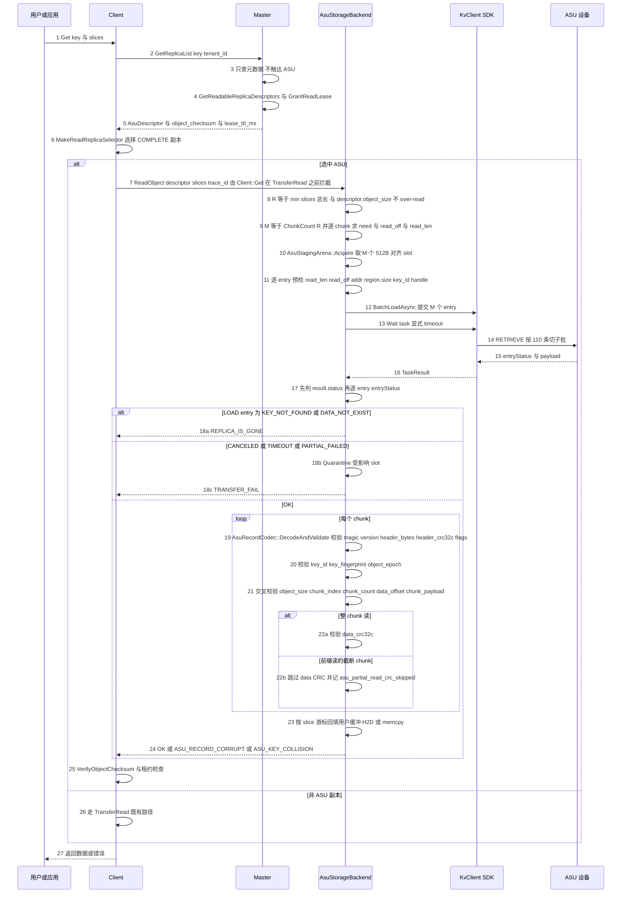

时序简介：

1. `GetReplicaList` 只查元数据并授读租约，Master 不触达 ASU（master_service.cpp:4561-4583）。
2. 返回 `AsuDescriptor`、`object_checksum`、`lease_ttl_ms`（rpc_types.h:84-105）。长度权威是 `descriptor.object_size`，原始来源是 `ObjectPart::length_`（object_part.h:77），在 `PutStart` 时由 `slice_lengths` 求和并复制进 descriptor。
3. 副本选择只认 COMPLETE。默认 `FindFirstCompleteReplica` 接受任意 COMPLETE 副本（client_service.cpp:5609-5621）；多副本与 HCA affinity 时走 `SelectBestReplica`，ASU 档位位于 LOCAL_DISK 之后、DFS 之前。
4. `Client::Get` 在 `TransferRead` 之前拦截 ASU（client_service.cpp:1598-1603），避免 size 分支未命中后落入 TransferEngine 的磁盘路径。
5. 读分块在 `ReadObject` 内部完成：`R=min(slices 总长, object_size)`，`M=ChunkCount(R)`；`need_i` 是本次真正需要的字节，`read_len_i` 等于 512 加 `align_up(need_i,512)`。由 `align_up` 单调性保证 `read_len_i` 不超过写侧已存的 `wire_len_i`，因此不做 over-read，也不需要独立长度索引。
6. staging：每个 chunk 一个 slot；`BatchLoadAsync` 提交 M 个 entry（受 `kBatchMaxEntries` 与 slot 数限制，超出要在读侧分批）。
7. 逐 entry 预检与写侧同规则：`read_len` 是 512 的倍数且不超过 16,776,704、`read_off` 是 512 的倍数、addr 是 512 的倍数、`region.size` 精确等于 `read_len`、handle 已注册。预发送失败同样会整批 CANCELED。
8. 结果判定先看 `result.status`，再看每个 `entryStatus`。LOAD 的 `ENTRY_KEY_NOT_FOUND` 或 `ENTRY_DATA_NOT_EXIST` 映射 `REPLICA_IS_GONE`；`CANCELED`、`TIMEOUT`、`PARTIAL_FAILED` 映射 `TRANSFER_FAIL`，且 TIMEOUT 属不确定结果，必须隔离 slot。
9. header 校验是 fail-stop：magic、version、header_bytes、header_crc32c、flags 未知位、key_id、key_fingerprint、object_epoch、object_size、chunk_index、chunk_count、data_offset、chunk_payload、data_len，任一不符返回 `ASU_RECORD_CORRUPT` 或 `ASU_KEY_COLLISION`，绝不交出别人的字节。
10. 完整读到的 chunk 校验 `data_crc32c`；前缀读的最后一个 chunk 是截断读，跳过 payload CRC 并记 `asu_partial_read_crc_skipped`。
11. CRC 必须按地址序对内存计算，不能按写序增量拼接。
12. 回填按 slice 游标进行，host 缓冲 memcpy、device 缓冲 H2D。回填后仍走既有 `VerifyObjectChecksum`（client_service.cpp:1622-1624）与租约检查。
13. 批量 Get 在 `BatchGet` 中收集 `AsuReadRequest`，在 DFS 批量读旁执行 `AsuStorageBackend` 批量读，读后仍走 `VerifyObjectChecksum`（client_service.cpp:1718 起）。

#### 2.3.4 查询阶段

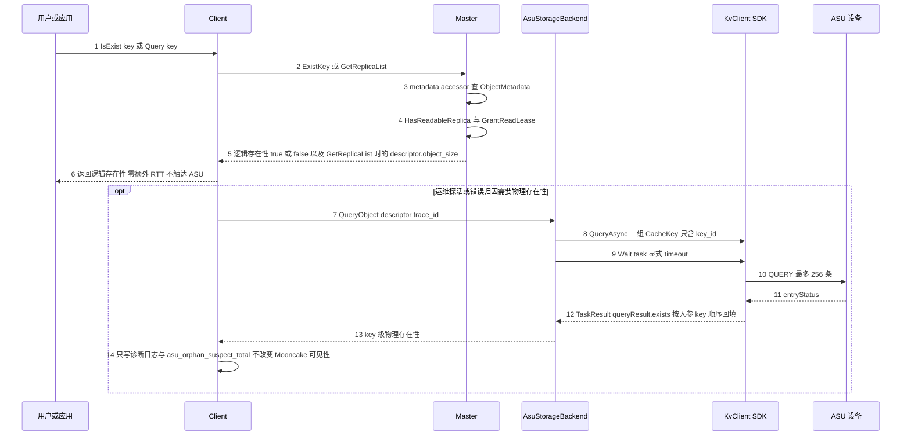

时序简介：

1. `IsExist`、`BatchIsExist`、`Query` 只走元数据，零额外 RTT。Client 侧见 client_service.cpp:4191-4194，Master 侧查 metadata accessor，按 `HasReadableReplica` 决定可见性并授租约（master_service.cpp:2824-2861）。
2. 返回的长度是 `descriptor.object_size`。SDK 没有长度、Stat、GetMeta API（kv_client.h:33-61），不存在第二权威。
3. 物理存在性只能由 `QueryAsync` 的 `exists` 位图观测，按入参 key 顺序回填（trans_task_utils.cc:169-180）。它只回答 key 是否存在，不回答某个 offset 的 chunk 是否存在。
4. 因此物理查询只用于删除前后一致性诊断、错误归因、开发自验证与运维探活；不放在 `IsExist` 或 `Query` 热路径，不作为 Mooncake 存在性权威。
5. 语义边界：ASU entry 丢失时 Master 的 `IsExist` 仍返回 true 并下发读不到的 descriptor，读时才暴露 `REPLICA_IS_GONE`。这与 DFS/DISK 同类，必须写进对外契约。
6. 不新增公开的物理查询 RPC。

#### 2.3.5 删除阶段

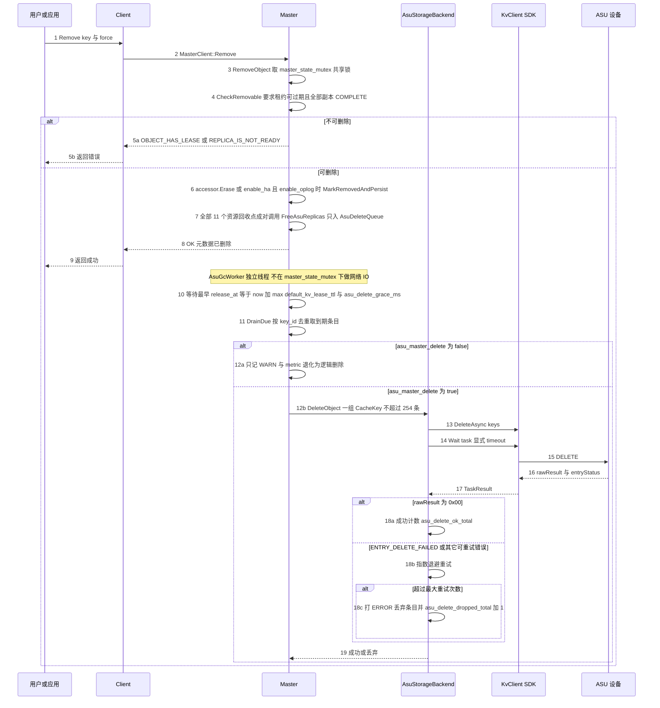

时序简介：

1. `RemoveObject` 取 `master_state_mutex_` 共享锁（master_service.cpp:7179），先做 `CheckRemovable`：租约可过期且全部副本 COMPLETE，否则 `OBJECT_HAS_LEASE` 或 `REPLICA_IS_NOT_READY`（master_service.cpp:7236-7250）。
2. 可删除时按 `enable_ha_ && enable_oplog_` 选择 `MarkRemovedAndPersist` 或 `accessor.Erase()`。
3. 元数据擦除的全部 11 个资源回收点都要成对调用 `FreeAsuReplicas`。它只把 `key_id`、`object_epoch`、`key_fingerprint`、`user_key`、`release_at` 入 `AsuDeleteQueue`，按 `key_id` 去重并保留最早 `release_at`，不做任何 IO。
4. `release_at` 等于 `now` 加 `max(default_kv_lease_ttl_, asu_delete_grace_ms)`。宽限期不小于最大读租约 TTL，避免删掉仍被持租约读者引用的旧 key。
5. `AsuGcWorker` 是独立线程，在 `master_state_mutex_` 之外等到最早 `release_at`，`DrainDue` 后按 `DeleteAsync` 批量提交，单批不超过 254 key（kv_protocol.h:56）。
6. DELETE 的语义：`rawResult` 等于 `0x00` 视为成功；`ENTRY_DELETE_FAILED`（0x0201）可重试；其它映射 `IO_ERROR`。不要假设 DELETE 会返回 `ENTRY_KEY_NOT_EXIST`，那是 QUERY 的语义（trans_task_utils.cc:57、77-82）。
7. 可重试错误指数退避最多 N 次，超限打 ERROR 并丢弃条目，记 `asu_delete_dropped_total`。
8. 顺序是先删元数据、后删物理。每个写世代有独立 `object_epoch` 并参与 key 推导，删除队列只删入队时的 `key_id`，所以 Remove 后立刻 Put 或 Upsert 重分配都不会被迟到的 `DeleteAsync` 误删。
9. `asu_master_delete=false` 时不创建 delete client，`FreeAsuReplicas` 只记 WARN 与 metric，Remove 退化为纯元数据删除，ASU 上留下不可枚举孤儿。
10. Master 崩溃会丢内存 GC 队列，孤儿不回收，只能靠日志里的 `key_id` 人工清理；这是本设计已知最大运维代价。
11. 不调用 `PollRemoveAll`、`FileStorage::RemoveAll`、`RequestRemoveAll`：它们在当前 HEAD 无生产调用者，且语义是整后端清空而非按 key。

#### 2.3.6 分块 512B 对齐 长度权威 与逐 entry 预检的落点

| 关注点 | 发生位置 | 依据 |
| --- | --- | --- |
| 分块 | 写路径 `WriteObject` 第 13 步；读路径 `ReadObject` 第 9 步 | `AsuChunkPlanner::Count/DataLen/WireLen/Offset`，常量来自 asu_layout.h |
| 512B 对齐 | header 固定 512B；`wire_len=512+align_up(data_len,512)`；`offset_i=i*kChunkStrideBytes`；staging slot 基址 512B 对齐 | asu_layout.h 的 `kAlign`、`kHeaderBytes`、`kChunkStrideBytes` 与 static_assert |
| 长度权威 | 写：`PutStart` 时 `ObjectPart::length_` 复制进 `AsuDescriptor.object_size`，见写入阶段第 6 步；读：`descriptor.object_size` 决定 `R`，见读取阶段第 8 步 | object_part.h:77、rpc_types.h:84-105 |
| 逐 entry 预检 | 写入阶段第 16 步、读取阶段第 11 步；删除无 entry 长度问题，只受单批 key 数约束 | SDK 预发送失败会 abort 整个 task 并置全部 entryStatus 为 CANCELED，见 trans_task_executor.cc:227-243 |

### 2.4 SFMEA 分析

本节按 SFMEA 方法对 `ReplicaType::ASU` 副本的 init、写、读、查、删五条路径逐项分析。下表的「是否涉及」表示本模块是否承担该故障模式的检测或容错责任；填「否」的项在「备注」中说明职责边界。

| 用例编号 | 故障模式 | 是否涉及 | 故障影响 | 容错措施 | 故障注入方法 | 备注 |
| --- | --- | --- | --- | --- | --- | --- |
| FMEA-01 | Client Init 时 ASU 视图 transports 为空 | 是 | RegisterRegions 返回 OK 但零注册，运行期全部 entry 报 BUFFER_NOT_REGISTERED（kv_client_impl.cc:337-339） | Init 校验返回的 handles 非空且不等于 kInvalidMRHandle；视图为空则退避重试，超时后 Init 失败 | 配置不存在的 view 文件启动 client，使 snapshot transports 为空 | 承重前置：必须在进入可服务状态前失败 |
| FMEA-02 | 单 entry 超过 16,776,704B 或未 512B 对齐 | 是 | SDK 预发送阶段 abort 整个 transport task，同批所有 entryStatus 被置 CANCELED（trans_task_executor.cc:227-243） | 提交前逐 entry 预检 wire_len、offset、addr、region.size；超限在 WriteObject 前返回 ASU_OBJECT_TOO_LARGE | 单测构造 wire_len 等于 16,776,705 或 offset 等于 513 的 KVBuffer 提交 | 不能指望只失败超限的一条 |
| FMEA-03 | buffer.region.size 大于等于 4GiB 被 static_cast 到 uint32 截断 | 是 | SDK 静默截断后按错误长度读写（sqe_request.cc:190、206、223、251） | 本层禁止任何 entry 大于等于 4GiB；kMaxObjectBytes 与 wire_len 双重断言 | FakeAsuKvClient 传入 region.size 等于 1 左移 32 的 KVBuffer | 截断发生在 SDK 内部，本层必须自己设防 |
| FMEA-04 | buffer.handle 未注册 | 是 | 提交时不报错，Wait 时整条 entry 报 BUFFER_NOT_REGISTERED | 所有 KVBuffer 只引用 AsuStagingArena 的已注册区间；提交前断言 handle 命中注册表 | 把 KVBuffer.handle 设为随机未注册的 MRHandle | 错误暴露很晚，必须在提交前拦截 |
| FMEA-05 | Wait 使用 `KvClientConfig::defaultWaitTimeoutMs` 的 100ms 超时 | 是 | 16MiB entry 必然超时；Wait 超时后无条件 Remove task，结果不可再取（task_manager.cc:108-116） | 显式传按字节估算的 timeout；TIMEOUT 归为不确定，隔离 slot 并走失败或 revoke | FakeAsuKvClient 延迟 200ms 返回，触发 100ms 超时（kv_types.h:215） | 默认值来自 KvClientConfig.defaultWaitTimeoutMs；`Wait` 的 timeoutMs 本身是必填参数 |
| FMEA-06 | staging slot 在 Wait 超时后被复用 | 是 | 设备侧仍在飞的 DMA 写穿新数据 | TIMEOUT 后 Quarantine 该 slot，进程生命周期内永不复用 | 超时后立即发起第二次写并让 Fake 记录同一 slot 被再次写入 | 内存安全承重项 |
| FMEA-07 | 设备返回 CQE_OUT_OF_CREATE_SIZE（0x10000\|0x712） | 是 | 该 key 写失败；若未预检可能整批失败 | PrepareWriteStart 按 `AsuConfig::max_object_bytes`（env `MOONCAKE_ASU_MAX_OBJECT_BYTES`）前置拒绝；写失败只归因当前 key 并删除半成品 | FakeAsuKvClient 返回 StatusCode::CQE_OUT_OF_CREATE_SIZE | H2 的 go/nogo 项 |
| FMEA-08 | 对已存在 key 再 Store 返回 CQE_KEY_ALREADY_EXISTED 0x723 | 是 | 重试或覆盖写失败 | 按 H3 实测结果选择覆盖或先 Delete 再 Store；当前设计每 epoch 新 key，正常不撞旧 key | FakeAsuKvClient 返回 StatusCode::CQE_KEY_ALREADY_EXISTED | H3 的 go/nogo 项 |
| FMEA-09 | 视图刷新后同一 key 路由到新节点 | 是 | 旧节点数据查不到也删不掉，成为永久孤儿 | 每个 task 内的 chunk 共享同一 viewSnapshot（kv_client_impl.cc:445-463）；跨 task 时各 task 各自捕获 viewSnapshot，必须校验 view 版本或在视图变化时按 epoch 重写全部 chunk（见 §2.3.2 第 16 条）；孤儿记 asu_orphan_suspect_total | 在 BatchStore 提交前后替换 view 文件，使同一 key 路由变化 | SDK 无迁移或双写能力 |
| FMEA-10 | Master 重启且无 HA 或 oplog | 是 | 元数据全丢，ASU 条目不可枚举、不可回收 | 部署要求 ASU 集群强制 enable_ha 与 enable_oplog；无 HA/oplog 时的启动行为按 §6 第 6 条裁决执行（启动失败或显式告警降级） | kill -9 master 后以默认配置重启（master_config.h:559、master_config.h:128 均为 false） | 本设计已知最大运维代价 |
| FMEA-11 | 有 oplog 但 restore 缺 AsuDescriptor 分支 | 是 | 一条 ASU key 进快照就让整次 restore 返回 INVALID_PARAMS（master_service.cpp:3389-3393、3964-3968） | 两处 restore 都加 ASU 分支并校验 object_size；补快照与 oplog 往返测试 | 构造含 ASU key 的 snapshot 或 oplog 做 RestoreFromStandbySnapshot | 硬阻塞级 |
| FMEA-12 | Remove 后立即 Put 同一逻辑 key，迟到的 DeleteAsync 命中新数据 | 是 | 新对象被误删，元数据仍 COMPLETE，读永久失败 | 每次 PutStart 新 object_epoch 得到新 key_id；删除队列只删入队时的 key_id；宽限期不小于 lease TTL | Remove 后立刻 Put 同 key，并手动提前触发 GC | 承重设计 |
| FMEA-13 | 异尺寸 Upsert 走 Case B 原地覆盖 | 是 | 同一物理 key 被改写，持租约读者读到新旧混合 | 含 ASU 的对象强制 Case C，新 epoch 得到新 key，旧副本入删除队列 | 先 Put 1MiB 再 Upsert 2MiB | 对应 UpsertStart 的 Case B 区域 |
| FMEA-14 | 同尺寸 Upsert 且存在读租约 | 是 | file-backed 副本无法保留旧版本 | 既有路径在 has_read_lease 且存在非 memory 副本时已返回 OBJECT_HAS_LEASE（master_service.cpp:5986-5994），ASU 属非 memory 被挡住 | 持读租约时 Upsert 同尺寸对象 | 既有路径已覆盖，无需新增开关 |
| FMEA-15 | client 写完前崩溃，留下 PROCESSING 副本 | 是 | 对象卡 processing，CheckRemovable 拒绝删除 | DiscardExpiredProcessingReplicas 过期丢弃时调用 FreeAsuReplicas；读选择器只认 COMPLETE | PutStart 后 kill -9 client，等待 processing 超时 | 11 个 Free 点必须全覆盖 |
| FMEA-16 | HA finalizer 路径漏挂 FreeAsuReplicas | 是 | HA 切换后 ASU 条目永久泄漏 | 在 1753、1795、1844、1907、2110、5257、5897、6099、7080、9535、9623 全部与 FreeDfsReplicas 成对调用；加单测守卫 | 构造 HA remove 流程，逐点检查 AsuDeleteQueue 是否收到条目 | 覆盖 11 个资源回收点 |
| FMEA-17 | 部分 chunk 写成功后失败 | 是 | 设备上残留不可达 chunk | 对已成功 chunk best-effort DeleteObject；chunk0 最后写使半成品不可读；随后 PutRevoke(ALL) | FakeAsuKvClient 让第 2 个 chunk 返回 IO_ERROR | 删除失败则记孤儿并告警 |
| FMEA-18 | 删除时 ASU 不可达 | 是 | 元数据已删、物理残留 | 指数退避重试 N 次；超限打 ERROR 并累加 asu_delete_dropped_total；提供 key_id 人工清理 runbook | iptables DROP 到 ASU 的链路，或 FakeAsuKvClient 连续返回 IO_ERROR | 不可枚举孤儿 |
| FMEA-19 | payload CRC 不匹配 | 是 | 介质损坏或新旧代数据混合 | 整 chunk 读时校验 data_crc32c，返回 ASU_RECORD_CORRUPT，绝不返回错误字节 | 直接改写 ASU 上 payload 的一个字节，或用 Fake 注入篡改数据 | 对象级 checksum 默认关闭（client_object_checksum_config.cpp:14-16），chunk CRC 是常态兜底 |
| FMEA-20 | header 字段与 descriptor 不一致 | 是 | 串读别的对象、旧世代或错位 chunk | 逐字段校验 key_id、key_fingerprint、object_epoch、object_size、chunk_index、chunk_count、data_offset、chunk_payload | 篡改 record header 的 chunk_index 或 epoch 后触发 ReadObject | fail-stop，不允许返回部分数据 |
| FMEA-21 | 读请求长度大于已存长度 | 是 | 可能 over-read 或越界 | R 等于 min(slice_total, object_size)；由 align_up 单调性保证 read_len 不超过 stored_len | 直接调 backend 传入总长大于 object_size 的 slices | 用户裁决的「请求长度不超过存储长度」契约 |
| FMEA-22 | 并发同 key 写 | 是 | 后写覆盖前写或对象卡 PROCESSING | Master 对象级锁加每写新 epoch；后到者看到 PROCESSING 走现有拒绝或抢占路径 | 两个 client 同时 Put 同一 key | 沿用既有语义，不新增并发控制 |
| FMEA-23 | 跨对象 64-bit key 碰撞 | 是 | 读到别的对象数据 | descriptor 与 record header 的 key_fingerprint 比对，不一致返回 ASU_KEY_COLLISION | Fake codec 强制两个对象产生相同 key_id 但不同 fingerprint | 写侧无 CAS，只能读侧 fail-stop |
| FMEA-24 | 多客户端并发读同一 ASU 副本 | 是 | 读者之间互相干扰 | ASU 是全局寻址服务，读只依赖 descriptor；每客户端独立 staging arena | 两个 client 同时 Get 同一 key | 无 owner 概念 |
| FMEA-25 | Descriptor 线格式与旧 client 混跑 | 是 | 旧 reader 无法解析 AsuDescriptor | 只追加 variant 末尾；发布顺序为先全量升级所有 reader 再在 Master 打开 enable_asu；补 old/new round-trip 测试 | 用旧版本 client 解析新 master 的 GetReplicaList 响应 | RPC 与 oplog 双线格式 |
| FMEA-26 | ReplicateConfig 使用裸 size_t 字段 | 是 | 改变 struct_pack 类型码，滚动升级失败 | 必须用 struct_pack::compatible 追加末尾，读取用 value_or(0)；先例见 replica.h:133-139 | 对 ReplicateConfig 做 get_type_code 前后对比，模拟旧 reader 解析 | 兼容性硬约束 |
| FMEA-27 | CACHELIB 下大对象被 PutStart 拒绝 | 是 | 对象上限约 16,777,200B，多 chunk 路径几乎不可达 | `AsuConfig::max_object_bytes` 默认 = `kMaxObjectBytes`；默认部署的实际对象上限由 `PrepareWriteStart` 的 CACHELIB `kMaxSliceSize` 检查另行决定（约 16MiB）；是否豁免该检查需用户裁决 | 默认 CACHELIB 配置下 Put 一个 20MiB 对象 | 检查位于 master_service.cpp:5111-5117 |
| FMEA-28 | memory 加 ASU 对象被额外 offload 到 LOCAL_DISK | 是 | 双份写与 offload 队列压力 | offload 触发条件排除 HasReplica 命中 is_asu_replica | enable_offload 下 Put 一个同时含 memory 与 ASU 副本的对象 | 触发条件位于 master_service.cpp:5409-5412 |
| FMEA-29 | buffer_addr 非 512B 对齐 | 是 | 设备行为未知，可能失败或出现性能悬崖 | arena 强制 512B 对齐，提交前预检 addr 是 512 的倍数 | FakeAsuKvClient 校验传入 addr 是否 512B 对齐并断言 | SDK 只校验非零（kv_protocol.cc:185-187），不校验对齐 |
| FMEA-30 | key_id 计算结果为全零 | 是 | SDK 本地拒绝全零 key | key_id 为 0 时置 1 | 构造 XXH64 输出为 0 的输入，或让 Fake codec 直接返回 0 | key 校验见 kv_protocol.cc:216-218 |
| FMEA-31 | Client 与 Master 的租户解析不一致 | 是 | 自算 key 会删错或读失败 | descriptor 是 key 唯一权威，客户端绝不重算；确需 tenant 时从 resolved_tenant_id 取 | enable_multi_tenants 为 false 时用非 default tenant 发起 Put 与读 | 归一化行为见既有租户解析路径 |
| FMEA-32 | ASU 设备侧 GC 与容量回收 | 否 | 设备容量可能不自动回收，本模块无法观测设备 GC 进度 | 本模块不控制设备 GC；用 best-effort Delete 加 asu_orphan_suspect_total 加人工 runbook | 在设备侧模拟 GC 延迟，观察 Delete 后物理空间未释放 | 不涉及：设备侧 GC 无公开 API，属 ASU 设备或 UCM SDK 边界；本模块只保证按 key 的 DeleteAsync 发出并确认，不承诺设备立即释放物理空间 |
| FMEA-33 | Master 脑裂或双主 | 否 | 两个 Master 以不同 epoch 写同一 ns，可能产生重复条目 | 由 HA 与租约子系统负责；epoch 不同只保证不串读，不保证不产生孤儿 | 双 master 同时写同一 key 集合 | 不涉及：脑裂检测与选主属 HA 子系统；本模块只保证 epoch 参与 key 推导，不同 epoch 的记录不会互相串读，但会产生孤儿 |
| FMEA-34 | 进程在 chunk0 提交前崩溃 | 是 | 半写对象 | chunk0 最后写；读端先校验 chunk0 header；Master 侧 PROCESSING 不可读；过期后回收 | 写完 chunk1 后 kill -9 进程，再尝试 ReadObject | 提交点设计 |
| FMEA-35 | 删除宽限期小于读租约 TTL | 是 | 删掉仍被持租约读者引用的旧 key | release_at 等于 now 加 max(default_kv_lease_ttl_, asu_delete_grace_ms) | 把 asu_delete_grace_ms 设为 0，并让一个读者持有租约后再删除 | 需要配置约束 |
| FMEA-36 | Client 未启用 ASU 却收到 AsuDescriptor | 是 | 写或读无法执行 | 返回 ASU_SERVICE_UNAVAILABLE 并打 ERROR；部署要求启用 ASU 的集群所有 client 都配置 backend | 关闭 client 的 ASU 开关，但 Master 开启并下发 AsuDescriptor | 配置一致性 |
| FMEA-37 | 高并发导致 SDK 队列 RESOURCE_BUSY | 是 | 提交失败 | 按对象串行、按字节与条数限流；RESOURCE_BUSY 直接映射 `TRANSFER_FAIL`，由上层 Put 失败/revoke 承担，本层不重试 | FakeAsuKvClient 返回 StatusCode::RESOURCE_BUSY | maxInflightTasks 默认 1024（kv_types.h:214） |
| FMEA-38 | 读写路径误入 TransferEngine | 是 | `get_disk_descriptor()` 抛 `std::runtime_error`（`replica.h:808-813` / `:846-851`），由 `transfer_task.cpp:1153` 的 `submitFileReadOperation`（内部 `:2043` 调用）触发 | Client::Get 与 BatchGet 前置拦截 ASU；TransferRead 与 transfer_task 显式拒绝 | 构造只含 ASU 副本的 GetReplicaList 响应并走默认 TransferEngine 路径 | 必须在分派层拦截，不能依赖下游报错 |
| FMEA-39 | QueryAsync 超时、exists 位图顺序错乱或 queryResult 缺失 | 是 | 物理归因错误或误判孤儿 | 先判 result.status，再按入参 key 顺序回填 exists；queryResult 缺失返回 INTERNAL_ERROR；TIMEOUT 只记诊断日志，不影响 Mooncake 可见性 | Fake 乱序返回位图、清空 queryResult、返回 TIMEOUT | 仅诊断路径；TC-22、TC-76 |

**分析结论**

风险最高的是四类故障。第一类是恢复类：FMEA-11 只要有任意一条 ASU key 进入快照或 oplog 而 restore 缺少分支，整次恢复直接失败，属于硬阻塞；FMEA-10 则在默认 enable_ha 与 enable_oplog 都为 false 的部署下把「Master 重启」变成「ASU 条目永久不可枚举」，是本设计最大的运维代价。第二类是批量原子性：FMEA-02 的预发送失败会把整批 entryStatus 置 CANCELED，所以逐 entry 预检不是优化而是正确性前提。第三类是内存安全：FMEA-06 的 slot 复用会让设备侧在飞的 DMA 写穿新数据，必须用永久隔离而不是释放来兜底。第四类是删除正确性：FMEA-12 与 FMEA-35 共同决定「迟到的 DeleteAsync 会不会误删新数据」，只能靠 object_epoch 参与 key 推导加宽限期不小于租约 TTL 来保证。

覆盖缺口集中在三处。其一，物理存在性没有权威来源：IsExist 与 Query 只回答元数据可见性，ASU 上的 entry 丢失时 Master 仍返回可读描述，只能在读失败时暴露，这与 DFS、DISK 同类，必须写进对外契约。其二，删除是 best-effort：ASU 不可达时最终丢弃条目并计数，孤儿没有任何自动回收通道。其三，前缀读截断的最后一 chunk 无法校验 payload CRC，这是「请求长度不超过存储长度」契约的已知残留风险，需要用户显式接受或改为总是整 chunk 读。

被范围纪律有意排除的缺口有两项：FMEA-32 的设备侧 GC 与容量回收没有公开 API，属于 ASU 设备或 UCM SDK 边界；FMEA-33 的脑裂检测与选主属于 HA 子系统，本模块只用 epoch 保证不串读。FMEA-14、FMEA-22、FMEA-27 属于既有路径已覆盖或既有约束，本设计不重复实现；其中 FMEA-27 的 CACHELIB 切片上限会让多 chunk 路径在默认部署下几乎不可达，是否需要豁免已作为前提性冲突单独列出，由用户裁决。

### 2.5 可定位设计

ASU 副本横跨用户调用、Client、Master 元数据、KvClient 传输与 ASU 设备五个位置，且 key 不可逆、SDK 不提供长度与元数据查询。因此可定位设计的核心是两件事：用统一的 trace 关联键把跨进程日志串起来，用 512B 自描述 record header 把设备上的物理状态变成可离线解读的事实。下图给出 Client 读写路径与 Master 删除路径的关联关系。

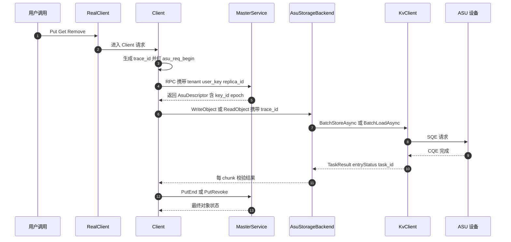


#### 2.5.1 全流程生命周期 Debug 日志

所有 ASU 日志统一使用 `key=value` 格式，首个字段为 `action`，其余字段顺序固定，便于 grep 与结构化采集。示例：

`action=asu_write_commit trace_id=... tenant=... user_key=... key_id=0x... epoch=... replica_id=... object_size=... chunk_index=... chunk_count=... phase=commit`

其中 key_id 一律以 0x 前缀的 16 位十六进制打印；chunk_index 与 chunk_count 在非 chunk 级埋点打印为 -1，缺省字段打 `-1`。各埋点使用的 `action` 名称按下方埋点表顺序固定为：`asu_init_client`（AsuClientRuntime::Create）、`asu_init_register`（AsuKvClientAdapter::Init 与 Register）、`asu_init_master`（AsuMasterRuntime::Create）、`asu_allocated`（AllocateReplicas 的 ASU 分支）、`asu_delete_enqueue`（FreeAsuReplicas 与 AsuDeleteQueue::Enqueue）、`asu_delete_submit`/`asu_delete_wait`/`asu_delete_retry`/`asu_delete_drop`（AsuGcWorker::Loop）、`asu_req_begin`（WriteObject 与 ReadObject 入口）、`asu_chunk_encode`（AsuRecordCodec::Encode）、`asu_write_commit`（chunk0 提交）、`asu_chunk_wait`（WriteObject Wait）、`asu_write_end`（WriteObject 返回）、`asu_read_wait`（ReadObject 提交与 Wait）、`asu_header_check`（AsuRecordCodec::DecodeAndValidate）、`asu_read_end`（ReadObject 返回）、`asu_query`（QueryObject 与 DeleteObject）、`asu_restore`（两处 restore）、`asu_client_decision`（Client::Put/Upsert/Get）。

| 埋点位置（文件:函数） | 日志级别 | 打印字段 | 覆盖的阶段 |
| --- | --- | --- | --- |
| mooncake-store/src/asu/asu_client_runtime.cpp: AsuClientRuntime::Create（新增） | INFO/ERROR | config_path、view_transport_count、registered_region_count、handles、arena_bytes、elapsed | Client init |
| mooncake-store/src/asu/asu_kv_adapter.cpp: AsuKvClientAdapter::Init 与 Register（新增） | VLOG(1)/WARNING | retry_count、view_empty、regions、bytes、handles、kInvalidMRHandle 命中数 | init 与内存注册 |
| mooncake-store/src/asu/asu_master_runtime.cpp: AsuMasterRuntime::Create（新增） | INFO/ERROR | master_delete、probe_key、probe_exists、delete_client_ready、gc_started | Master init |
| mooncake-store/src/master_service.cpp: AllocateReplicas 的 ASU 分支（新增，紧邻 4758-4763） | VLOG(1) | tenant、user_key、key_id、key_fingerprint、epoch、object_size、chunk_count、allocated_asu | Master 分配 |
| mooncake-store/src/master_service.cpp: FreeAsuReplicas（新增，旁挂 7583-7591） | VLOG(1)/WARNING | key_id、epoch、user_key、release_at、site、count | Master 回收入队 |
| mooncake-store/src/asu/asu_delete_queue.cpp: AsuDeleteQueue::Enqueue（新增） | VLOG(1) | key_id、epoch、user_key、release_at、reason、site | 删除入队 |
| mooncake-store/src/asu/asu_delete_queue.cpp: AsuGcWorker::Loop（新增） | VLOG(1)/ERROR | drain_count、pending、task_id、entry_status、rawResult、attempt | 延迟删除与 GC |
| mooncake-store/src/asu/asu_storage_backend.cpp: AsuStorageBackend::WriteObject 入口（新增） | VLOG(1) | trace_id、tenant、user_key、key_id、epoch、replica_id、object_size、chunk_count | 写开始 |
| mooncake-store/src/asu/asu_record.cpp: AsuRecordCodec::Encode（新增） | VLOG(2) | chunk_index、data_len、wire_len、data_offset、data_crc32c、header_crc32c | 每 chunk 编码 |
| mooncake-store/src/asu/asu_storage_backend.cpp: WriteObject 提交（新增） | VLOG(1) | task_id、chunk_index、offset、wire_len、key_id | 每 chunk 提交 |
| mooncake-store/src/asu/asu_storage_backend.cpp: WriteObject Wait（新增） | VLOG(1)/ERROR | task_id、chunk_index、entry_status、elapsed、slot_id | 等待完成 |
| mooncake-store/src/asu/asu_storage_backend.cpp: chunk0 提交（新增） | INFO/ERROR | key_id、epoch、task_id、entry_status | 提交点 |
| mooncake-store/src/asu/asu_storage_backend.cpp: WriteObject 返回（新增） | INFO/ERROR | result、bytes、chunks、first_error、elapsed | 写结束 |
| mooncake-store/src/asu/asu_storage_backend.cpp: ReadObject 入口（新增） | VLOG(1) | trace_id、key_id、epoch、object_size、requested_bytes、chunk_count | 读开始 |
| mooncake-store/src/asu/asu_storage_backend.cpp: ReadObject 提交与 Wait（新增） | VLOG(1)/ERROR | task_id、chunk_index、offset、read_len、entry_status、elapsed | 每 chunk 读传输 |
| mooncake-store/src/asu/asu_record.cpp: AsuRecordCodec::DecodeAndValidate（新增） | VLOG(2)/ERROR | 每字段 expected 与 actual、header_hex、crc_skipped_reason | 读校验 |
| mooncake-store/src/asu/asu_storage_backend.cpp: ReadObject 返回（新增） | INFO/ERROR | result、bytes、chunks、crc_skipped_chunks、first_error、elapsed | 读结束 |
| mooncake-store/src/asu/asu_storage_backend.cpp: QueryObject 与 DeleteObject（新增） | VLOG(1)/ERROR | key_ids、task_id、exists 位图、entry_status、rawResult | 物理查与删 |
| mooncake-store/src/master_service.cpp: 两处 restore 的 ASU 分支（新增，旁挂 3382-3394 与 3958-3969） | VLOG(1)/ERROR | tenant、user_key、key_id、epoch、object_size、status | HA 恢复 |
| mooncake-store/src/client_service.cpp: Client::Put、Client::Upsert、Client::Get 的 ASU 分支（新增） | VLOG(1) | replica_type、allocated_asu、successful_asu、failed_asu、trace_id、decision | Client 集成与 finalize |

日志级别约定：INFO 只打阶段边界（init 成功、写提交点、写读结束、最终 finalize 决策），默认开启；VLOG(1) 打生命周期事件与每次传输提交，默认关闭；VLOG(2) 打每 chunk 的字段级细节，仅在排障时对指定模块打开；WARNING 打降级路径（master_delete 关闭、视图为空但继续、slot 隔离、删除重试）；ERROR 打不可恢复失败与 fail-stop 校验失败。

#### 2.5.2 trace-id 与跨进程关联

Client 在每个请求入口生成一个 uint64 的 trace_id，取值由进程内递增计数器生成，只保证同一进程内单调；跨重启可能重复（`steady_clock` 重启后归零），因此跨会话关联必须依赖下面的五元组而非 trace_id。trace_id 只存在于 Client 进程：它贯穿 RealClient、Client、AsuStorageBackend、AsuStagingArena、AsuKvClientAdapter 到 KvClient 返回的每一行日志。由于 Master 不接收 trace_id，跨进程必须改用五元组关联：tenant、user_key、replica_id、asu_key_id、object_epoch。这五个字段的取值来源如下：tenant 与 user_key 来自请求，replica_id 来自 Replica 构造，asu_key_id 与 object_epoch 来自 Master 铸造的 AsuDescriptor，因此它们在 Client、Master、GC 三侧日志中天然一致。

KvClient 的 TaskId 是进程内句柄，只在 Client 侧有效。设计上要求每次 BatchStore 或 BatchLoad 提交后立即把 task_id 与该 task 覆盖的 chunk 列表（chunk_index、offset、wire_len 三元组）以 VLOG(1) 打在一行里，Wait 返回后复用同一 task_id 打结果。这样即使 SDK 内部切了子批，也能按 task_id 把「提交了哪些 chunk」与「哪些 chunk 失败了」对上。

设备侧没有应用层回调上下文，跨到设备后的锚点是 record header 里的 replica_id 与 object_epoch。任何从设备读到的 header 都能反查回 Master 日志中的同一次分配；反过来，Master 日志中的 key_id 与 epoch 可以直接喂给离线诊断工具去设备上定位记录。删除路径同理：GC 日志打 key_id 与 epoch，与当初 Put 日志的同名字段直接对齐。

#### 2.5.3 日志量控制

按 chunk 打印的日志数量与对象大小成正比，默认必须关闭。控制手段有四层：一是级别隔离，每 chunk 细节只走 VLOG(2)，生命周期只走 VLOG(1)，默认只开 INFO 及以上；二是动态调级，沿用 glog 的 `--v` 与 `--vmodule`，可只对 asu_storage_backend 与 asu_record 两个源文件临时开到 2，不必全进程放大；三是按 key 过滤，调试开关接受一个 key_id 或 user_key 前缀过滤串，命中才输出 VLOG，未命中直接返回，避免热点对象刷屏；四是采样，Wait 超时与删除重试这类可能高频的事件按「首次必打、之后每 N 次打一次」采样，同时靠计数器保留总量。上述过滤与采样只影响日志，不影响任何功能路径与错误返回。

#### 2.5.4 计数器与指标

关键指标既用于告警，也用于定位时快速判断故障阶段。写读删三类操作都按 result 维度打标签，result 至少区分 OK、TRANSFER_FAIL、TIMEOUT、CANCELED、ASU_OBJECT_TOO_LARGE、ASU_RECORD_CORRUPT、ASU_KEY_COLLISION、REPLICA_IS_GONE、ASU_SERVICE_UNAVAILABLE。

| 指标 | 类型 | 含义 | 关键标签 |
| --- | --- | --- | --- |
| asu_put_total | counter | 对象级写尝试数 | result |
| asu_put_bytes_total | counter | 成功写入的逻辑字节数 | 无 |
| asu_put_chunks_total | counter | 成功写入的 chunk 数 | 无 |
| asu_get_total | counter | 对象级读尝试数 | result |
| asu_get_bytes_total | counter | 成功读出的逻辑字节数 | 无 |
| asu_wait_timeout_total | counter | Wait 超时次数 | phase |
| asu_canceled_batch_total | counter | 预发送失败导致整批 CANCELED 的次数 | phase |
| asu_staging_quarantined_slots | gauge | 已隔离 slot 数 | 无 |
| asu_delete_enqueued_total | counter | 入队删除条目数 | reason |
| asu_delete_ok_total | counter | 删除成功条目数 | 无 |
| asu_delete_fail_total | counter | 删除失败条目数 | error |
| asu_delete_dropped_total | counter | 重试耗尽后丢弃条目数 | error |
| asu_delete_pending | gauge | 队列中待删除条目数 | 无 |
| asu_orphan_suspect_total | counter | 疑似孤儿条目数 | reason |
| asu_descriptor_restore_total | counter | restore 重建的 ASU 描述符数 | 无 |
| asu_descriptor_restore_fail | counter | restore 重建失败数 | error |
| asu_write_wait_seconds | histogram | 单批写 Wait 耗时 | chunk_count 分桶 |
| asu_read_wait_seconds | histogram | 单批读 Wait 耗时 | chunk_count 分桶 |
| asu_delete_wait_seconds | histogram | 单批删除 Wait 耗时 | 无 |

排查时先看 asu_put_total 与 asu_get_total 的 result 分布定位到阶段，再用 asu_wait_timeout_total、asu_canceled_batch_total、asu_staging_quarantined_slots 判断是超时、预发送失败还是内存隔离，最后用延迟直方图确认是设备慢还是本层排队。

#### 2.5.5 失败现场保留

失败现场的目标是「不重启、不加日志也能回答是哪一条 entry 失败、失败在哪一步」。具体保留策略如下。

第一，header 或 CRC 校验失败时，以 ERROR 打印该 512B header 的完整十六进制（只打 header，不打 payload），同时逐字段打印 expected 与 actual，并打印该次 BatchLoad 的所有 entryStatus。第二，提供可选的 dump 目录：设置后把失败的 header 按 `key_id-epoch-chunk_index.hdr` 命名落盘，便于事后离线解析；不设置则不产生任何磁盘写入。第三，Wait 超时时打印整个批次的关键信息，包括 key_id、epoch、task_id、chunk 列表、slot_id 与 timeout_ms，并把该 slot 标记为 `kQuarantined`；由于 Wait 超时后 task 结果不可再取，这行日志是该批次唯一可用的现场。第四，删除重试耗尽时以 ERROR 打印 key_id、epoch、user_key、最后一次 rawResult 与尝试次数，同时累加 asu_delete_dropped_total，保证「设备上还有残留」这件事一定留下可检索的记录。

#### 2.5.6 离线诊断工具 mooncake-asu-dump

该工具用于回答「数据到底写进去没有」，全程只读，不执行 Store 也不执行 Delete。输入可以直接从日志复制：config 路径、key_id、object_epoch、object_size、chunk_count。工具按 chunk_count 与 chunk_payload 常量派生每个 chunk 的 offset，先调用 QueryAsync 取 exists 位图，再对存在的 chunk 做仅 512B header 的 BatchLoad，逐 chunk 输出存在性、magic 与 version、header CRC 结果、key_id 与 key_fingerprint 与 epoch 与 object_size 与 chunk_index 与 chunk_count 与 data_offset 的交叉校验结果；需要时可选择整 chunk 读并校验 data_crc32c。输出结论只有四种：物理存在且记录合法、物理存在但记录损坏、物理不存在、视图不可达。这四种结论正好对应定位时的四条分叉，避免把「元数据在但物理丢失」误判成代码 bug。

#### 2.5.7 运维视图

ASU 副本必须出现在既有的介质视图与管理查询里，否则运维只能靠日志猜测。介质视图侧，KvMediaForMetadata 与 KvMediaForRemoval 把所有非 memory 副本归一到 disk 介质（master_service.cpp:11151-11213），ASU 需要加入这两处的判定，使订阅者能看到 disk 介质的出现与回收。管理查询侧，admin BatchQueryKeys 的副本类型分支当前覆盖 memory、disk、local_disk、nof（master_admin_service.cpp:1195-1216），需要增加 ASU 分支并回显 AsuDescriptor 的 key_id、epoch、object_size、chunk_count；否则接口返回 ok 为 true 但 values 为空，看起来像对象没有副本。这两处只做展示，不改变任何读写删语义。

#### 2.5.8 典型问题定位路径

**问题一：Get 返回的长度与写入长度不符。** 先看 `asu_req_begin` 中的 requested_bytes 与调用方 slices 总长是否一致；再看 `asu_allocated` 或 GetReplicaList 日志中 descriptor.object_size 与 chunk_count 是否等于写入时的值。若 descriptor 正确，进入 ReadObject 日志看 R 等于 min(slice_total, object_size) 的计算结果，R 偏小说明请求侧或 object_size 偏小。接着看 `asu_header_check` 中 object_size、chunk_index、chunk_count、data_offset 四组 expected 与 actual，任何一组不符都是 ASU_RECORD_CORRUPT。若 header 全部通过，检查 client_buffer 的 calculate_total_size 是否已经为 AsuDescriptor.object_size 增加分支（client_buffer.cpp:144-158 当前只覆盖 disk、local_disk、dfs、nof、memory）；缺少分支会落到 `else` 调 `get_memory_descriptor()` 并抛 `std::runtime_error`（不是读错长度）；因此必须为 ASU 增加 `object_size` 分支（`get_memory_descriptor` 见 replica.h:831）。最后看 asu_get_bytes_total 与 asu_get_total 的 result 分布，注意对象级 checksum 默认关闭（client_object_checksum_config.cpp:14-16），长度不符不一定会以 CHECKSUM_MISMATCH 暴露。

**问题二：Put 返回成功但随后 Get 读不到。** 先确认 `asu_write_commit` 是否出现且 entry_status 为 OK，再确认 `asu_write_end` 的 result；没有 chunk0 提交说明对象从未成为可读（对应 FMEA-34）。然后逐条看 `asu_chunk_wait`，定位是否有 chunk 在预发送阶段被整批 CANCELED。接着看 PutEnd 之后 Master 是否把副本置为 COMPLETE：is_target_replica 的 ALL 分支必须命中 is_asu_replica，否则副本会一直停在 PROCESSING。再看 Get 日志选中的 replica_type 是否为 ASU，以及 descriptor 的 key_id 与 epoch 是否与写入日志一致；不一致说明读到了另一世代或另一副本。进入 ReadObject 后若 `asu_read_wait` 返回 ENTRY_KEY_NOT_FOUND 或 ENTRY_DATA_NOT_EXIST，映射为 REPLICA_IS_GONE，说明元数据在而物理记录不在，用 mooncake-asu-dump 以写入侧 key_id 与 epoch 复核。若 dump 显示存在且合法，再检查写读之间 view 是否刷新导致路由漂移，并观察 asu_orphan_suspect_total 是否增长。

**问题三：Remove 之后确认 ASU 上是否还有残留。** 先看 `asu_delete_enqueue` 是否出现，重点看 release_at 与当前时间的差值；在宽限期内查询到残留是预期行为，不是故障。若宽限期已过仍无 `asu_delete_submit`，检查 asu_master_delete 是否为 true；为 false 时只有 WARNING 与指标，删除退化为纯元数据删除，ASU 上必然留下不可枚举孤儿。若已提交，看 `asu_delete_wait` 的 entry_status 与 rawResult，再结合 `asu_delete_retry`、`asu_delete_drop` 与 asu_delete_dropped_total 判断是否重试耗尽；DELETE 的幂等语义以 H4 真机结论为准，不要假设删除不存在的 key 会返回 ENTRY_KEY_NOT_EXIST。最后用 mooncake-asu-dump 对同一 key_id 做 QueryAsync 复核物理存在性。若 Master 在此期间重启且未启用 HA 与 oplog，内存中的删除队列已丢失，只能按历史日志里的 key_id 人工清理，这正是 FMEA-10 记录的运维代价。

## 3. shard 设计描述

按功能把 ASU 原生副本拆成 12 个 shard。前 8 个是新增实现单元，后 4 个是接入 Mooncake 既有控制面与构建系统的集成单元。所有新增文件位于 `mooncake-store/include/asu/` 与 `mooncake-store/src/asu/`，命名空间统一为 `mooncake::asu`；只有进入线格式与 Replica variant 的类型（`AsuDescriptor`、`AsuReplicaData`）放在 `mooncake::` 下。

| 小节 | shard | 主要产物 | 上下游 |
| --- | --- | --- | --- |
| 3.1 | asu_layout | `asu_layout.h` | 被 3.3/3.4/3.6/3.7/3.12 依赖 |
| 3.2 | asu_key_codec | `asu_key_codec.{h,cpp}` | 被 3.6/3.7 依赖 |
| 3.3 | asu_record | `asu_record.{h,cpp}` | 依赖 3.1/3.2，被 3.6 依赖 |
| 3.4 | asu_staging_arena | `asu_staging_arena.{h,cpp}` | 依赖 3.5，被 3.6 依赖 |
| 3.5 | asu_kv_adapter | `asu_kv_adapter.{h,cpp}` | 包装 `kv::KvClient` |
| 3.6 | asu_storage_backend | `asu_storage_backend.{h,cpp}` | 依赖 3.1/3.2/3.3/3.4/3.5 |
| 3.7 | asu_allocator | `asu_allocator.{h,cpp}` | 依赖 3.2/3.1，被 3.11 依赖 |
| 3.8 | asu_delete_queue | `asu_delete_queue.{h,cpp}` | 依赖 3.6，被 3.11 依赖 |
| 3.9 | replica.h 集成 | `AsuDescriptor` / `AsuReplicaData` / variant | 被 3.10/3.11 依赖 |
| 3.10 | Client 集成 | `AsuClientRuntime` 与 Client 写读路径 | 依赖 3.6 |
| 3.11 | Master 集成 | `AsuMasterRuntime` 与分配/回收/恢复 | 依赖 3.7/3.8 |
| 3.12 | asu_config | `asu_config.{h,cpp}`、CMake 登记 | 被全部 shard 依赖 |

统一约定：错误返回类型为 `tl::expected<T, ErrorCode>`（`<ylt/util/tl/expected.hpp>`），错误码来自 `mooncake-store/include/types.h` 的 `ErrorCode`；日志用 glog；线程同步用 `std::mutex` + `std::condition_variable`；方法命名沿用 §2.1 类图的 PascalCase（Mooncake 既有代码多用 snake_case，这一点作为风格差异记录在末尾说明）。

### 3.1 asu_layout（常量与纯函数）

**职责**

固定 ASU 的全部硬边界（512B 对齐、24-bit 长度、32-bit offset）并给出 chunk 分块公式。本 shard 是 header-only、无状态、无锁、无 I/O 的纯函数与常量集合，不负责任何缓冲区分配或 SDK 调用。Master 与 Client 编译同一份头文件，保证两端对 `chunk_count`/`chunk_payload`/offset 的理解完全一致。

**设计说明**

常量来源是 SDK 的协议约束：SQE 的 `buffer_length`/`length` 必须 512B 对齐且不超过 24-bit（`kv_semantics/src/trans/proto/kv_protocol.cc:190-214`），因此单 entry 的绝对上限是 `0xFFFFFF` 向下取 512 对齐，即 `0xFFFFE00 = 16,776,704 B`。`offset` 是 32-bit 且 512B 对齐（`kv_types.h:125` 的 `std::uint32_t offset`；协议校验见 `kv_protocol.cc:202-206`；`sqe_request.cc:187`、`:208`、`:225`、`:248` 只是把 `KVBuffer.offset` 原样搬进请求；`:190`、`:206`、`:223`、`:251` 才是 `buffer.region.size` 先 `static_cast<std::uint32_t>` 的位置）。

| 常量 | 值 | 含义 |
| --- | --- | --- |
| `kAlign` | 512 | SDK 要求的对齐粒度（`kv_types.h:42-43`） |
| `kHeaderBytes` | 512 | 每 chunk 的记录头长度 |
| `kEntryMaxBytes` | 16,776,704 | 单 entry 单次 Store/Load 上限 |
| `kChunkPayloadBytes` | 16,776,192 | 每 chunk 可承载的 payload 上限 |
| `kChunkStrideBytes` | 16,776,704 | 相邻 chunk 的 ASU offset 间距 |
| `kMaxChunks` | 256 | 单对象 chunk 数上限 |
| `kMaxObjectBytes` | 4,294,705,152 | 单对象逻辑字节上限 |
| `kBatchMaxEntries` | 110 | 单 task 提交条数上限（对齐 `batchStoreIoNum`/`batchLoadIoNum`，`kv_types.h:196-197`） |
| `kBatchMaxBytes` | 64 MiB | 单 task 提交字节上限（SDK 的 `maxInflightBytes` 只解析不生效，不能依赖） |
| `kDefaultWaitTimeoutMs` | 30000 | `Wait` 的基准超时 |

分块公式（`S` 为 `object_size`，`A = align_up(S, 512)`，`N = ChunkCount(S)`）：

- `N = ceil(A / kChunkPayloadBytes)`，取值 1..256；
- `data_len_i = min(kChunkPayloadBytes, S - i * kChunkPayloadBytes)`；
- `wire_len_i = kHeaderBytes + align_up(data_len_i, 512)`，恒 ≤ `kEntryMaxBytes`；
- `offset_i = i * kChunkStrideBytes`，恒 512B 对齐且 < 2^32。

读路径只读 `R = min(请求总长, S)` 个字节，`M = ChunkCount(R)`；由 `align_up` 的单调性，`read_len_i = 512 + align_up(need_i, 512) ≤ wire_len_i`，天然满足「请求长度不超过存储长度」的契约，不需要 over-read，也不需要独立长度索引。

**具体数字例子（40 MiB 对象）**

`S = 41,943,040 B`，`A = S`（已是 512 的倍数），`N = 3`：

| chunk | `data_len` | `wire_len` | `offset` | ASU key |
| --- | --- | --- | --- | --- |
| 0 | 16,776,192 | 16,776,704 | 0 | 同一个 `key_id` |
| 1 | 16,776,192 | 16,776,704 | 16,776,704 | 同一个 `key_id` |
| 2 | 8,390,656 | 8,391,168 | 33,553,408 | 同一个 `key_id` |

三点必须讲清：第一，**所有 chunk 共用同一个 8B ASU key**，区分靠 `offset`，这是 ASU 官方的「一个 key + 多 offset 写 tensor」用法；第二，最后一片 `33,553,408 + 8,391,168 = 41,944,576 < 2^32`，offset 不溢出；第三，写入总量等于 `N * 512 + A = 1,536 + 41,943,040 = 41,944,576 B`。

若做 20 MiB 前缀读（`R = 20,971,520`），则 `M = 2`，`need_0 = 16,776,192`、`need_1 = 4,195,328`；chunk 1 的 `need_1` 小于其已存的 `data_len_1 = 16,776,192`，属于截断读，跳过 payload CRC（见 3.6）。

**必要代码**

```cpp
// mooncake-store/include/asu/asu_layout.h
#pragma once

#include <algorithm>
#include <cstdint>

namespace mooncake::asu {

inline constexpr uint32_t kAlign = 512;
inline constexpr uint32_t kHeaderBytes = 512;
inline constexpr uint32_t kEntryMaxBytes = 16u * 1024u * 1024u - 512u;
inline constexpr uint32_t kChunkPayloadBytes = kEntryMaxBytes - kHeaderBytes;
inline constexpr uint32_t kChunkStrideBytes = kHeaderBytes + kChunkPayloadBytes;
inline constexpr uint32_t kMaxChunks = 256;
inline constexpr uint64_t kMaxObjectBytes =
    static_cast<uint64_t>(kMaxChunks) * kChunkPayloadBytes;
inline constexpr size_t kBatchMaxEntries = 110;
inline constexpr uint64_t kBatchMaxBytes = 64ull << 20;
inline constexpr uint64_t kDefaultWaitTimeoutMs = 30000;
inline constexpr uint32_t kRecordVersion = 1;
inline constexpr uint32_t kMagic = 0x31555341u;  // "ASU1" little-endian

static_assert(kEntryMaxBytes == (0xFFFFFFu & ~(kAlign - 1u)),
              "24-bit SQE length must round down to 512B alignment");
static_assert(kChunkPayloadBytes % kAlign == 0);
static_assert(kChunkStrideBytes == kEntryMaxBytes);
static_assert(static_cast<uint64_t>(kMaxChunks) * kChunkStrideBytes +
                      kHeaderBytes <
                  (1ull << 32),
              "last chunk offset + wire_len must fit in 32-bit offset");
static_assert(kMaxObjectBytes < (1ull << 32));

constexpr uint64_t AlignUp(uint64_t value, uint64_t align = kAlign) {
    return (value + align - 1) / align * align;
}

constexpr uint32_t ChunkCount(uint64_t object_size) {
    if (object_size == 0) return 0;
    return static_cast<uint32_t>((AlignUp(object_size) + kChunkPayloadBytes - 1) /
                                 kChunkPayloadBytes);
}

constexpr uint32_t ChunkDataLen(uint64_t object_size, uint32_t index) {
    const uint64_t begin = static_cast<uint64_t>(index) * kChunkPayloadBytes;
    if (object_size <= begin) return 0;
    return static_cast<uint32_t>(
        std::min<uint64_t>(kChunkPayloadBytes, object_size - begin));
}

constexpr uint32_t ChunkWireLen(uint32_t data_len) {
    return kHeaderBytes + static_cast<uint32_t>(AlignUp(data_len));
}

constexpr uint64_t ChunkOffset(uint32_t index) {
    return static_cast<uint64_t>(index) * kChunkStrideBytes;
}

constexpr bool IsValidObjectSize(uint64_t object_size) {
    return object_size > 0 && object_size <= kMaxObjectBytes;
}

}  // namespace mooncake::asu
```

### 3.2 asu_key_codec（键派生）

**职责**

把 `(scoped_key, object_epoch)` 确定性地映射成一个 8B `kv::CacheKey` 与一个 64-bit `key_fingerprint`。Master 与 Client 共用同一份实现，但**运行期只有 Master 调用 `Derive`**；Client 一律使用 `AsuDescriptor::key_id`，绝不自行重算（否则会与 `master_service.cpp:1441-1452` 的租户归一化规则冲突）。本 shard 不负责租户解析，也不负责任何 ASU I/O。

**设计说明**

`kv::CacheKey` 固定 8 字节且不可逆（`kv_types.h:39-40`），全零 key 会被 SDK 在本地拒绝（`kv_protocol.cc:216-218` 的 `IsCacheKeyAllZero` 检查；`:212-215` 是 `length` 的 24-bit 上限检查）。映射规则：

1. `scoped = TenantId::MakeScopedKey(user_key)`，tenant 与 key 以 NUL 分隔（`tenant_id.h:42-49`，分隔符 `kScopedKeySeparator = '\0'` 见 `tenant_id.h:76`）。
2. `identity = "MCASU1" + u8 version(=1) + u32_be(len(scoped)) + scoped`。
3. `canonical = identity + u64_le(object_epoch)`。
4. `key_id = XXH64(canonical, seed=0)`；若为 0 则置 1。
5. `key_fingerprint = XXH64(identity, seed=1)`。
6. `CacheKey = key_id` 的 8 字节小端展开。

`object_epoch` 由 `AsuAllocator` 铸造（见 3.7），参与哈希，所以同一逻辑 key 的每一次 PutStart 都会得到不同的物理 key。`secret` 域前缀与长度前缀避免 `("a","bc")` 与 `("ab","c")` 这类拼接歧义。XXH64 在 Mooncake 已有依赖（`Mooncake::xxhash`，见 `mooncake-store/src/nvme_kv/key_codec.cpp:44-45` 的双 seed 用法）。

碰撞处理：8B key 空间只有 64 bit，跨对象理论可碰撞。写侧无 CAS/条件写能力，所以碰撞只能在读侧 fail-stop：记录头同时携带 `key_id` 与 `key_fingerprint`，读时两者都比对；不一致返回 `ASU_KEY_COLLISION`，绝不把别人的字节交给调用方。

**必要代码**

```cpp
// mooncake-store/include/asu/asu_key_codec.h
#pragma once

#include <cstdint>
#include <string_view>

#include <kv_types.h>

namespace mooncake::asu {

struct AsuKeyMaterial {
    uint64_t key_id{0};
    uint64_t key_fingerprint{0};
    kv::CacheKey cache_key{};
};

class AsuKeyCodec final {
   public:
    // Only the Master calls Derive. Clients must use AsuDescriptor::key_id.
    static AsuKeyMaterial Derive(std::string_view scoped_key,
                                 uint64_t object_epoch);

    static kv::CacheKey ToCacheKey(uint64_t key_id);
};

}  // namespace mooncake::asu
```

```cpp
// mooncake-store/src/asu/asu_key_codec.cpp
#include "asu/asu_key_codec.h"

#include <array>
#include <cstring>
#include <string>

#include <xxhash.h>

namespace mooncake::asu {
namespace {

constexpr std::string_view kKeyDomainMagic{"MCASU1"};
constexpr uint8_t kKeyDomainVersion = 1;

void AppendLE16(std::string& out, uint16_t v) {
    out.push_back(static_cast<char>(v & 0xFF));
    out.push_back(static_cast<char>((v >> 8) & 0xFF));
}

void AppendLE64(std::string& out, uint64_t v) {
    for (int i = 0; i < 8; ++i) {
        out.push_back(static_cast<char>((v >> (8 * i)) & 0xFF));
    }
}

void AppendBE32(std::string& out, uint32_t v) {
    out.push_back(static_cast<char>((v >> 24) & 0xFF));
    out.push_back(static_cast<char>((v >> 16) & 0xFF));
    out.push_back(static_cast<char>((v >> 8) & 0xFF));
    out.push_back(static_cast<char>(v & 0xFF));
}

}  // namespace

AsuKeyMaterial AsuKeyCodec::Derive(std::string_view scoped_key,
                                   uint64_t object_epoch) {
    std::string identity;
    identity.reserve(kKeyDomainMagic.size() + 1 + 4 + scoped_key.size());
    identity.append(kKeyDomainMagic);
    identity.push_back(static_cast<char>(kKeyDomainVersion));
    AppendBE32(identity, static_cast<uint32_t>(scoped_key.size()));
    identity.append(scoped_key);
    // NOTE: scoped_key > 4 GiB is not representable; TenantId values are
    // bounded by the RPC key limit long before this point.

    std::string canonical = identity;
    AppendLE64(canonical, object_epoch);

    uint64_t key_id = XXH64(canonical.data(), canonical.size(), /*seed=*/0);
    if (key_id == 0) key_id = 1;  // all-zero CacheKey is rejected by the SDK
    const uint64_t fingerprint =
        XXH64(identity.data(), identity.size(), /*seed=*/1);

    return AsuKeyMaterial{key_id, fingerprint, ToCacheKey(key_id)};
}

kv::CacheKey AsuKeyCodec::ToCacheKey(uint64_t key_id) {
    static_assert(kv::kCacheKeySizeBytes == 8);
    kv::CacheKey key{};
    for (size_t i = 0; i < key.size(); ++i) {
        key[i] = static_cast<std::byte>((key_id >> (8 * i)) & 0xFF);
    }
    return key;
}

}  // namespace mooncake::asu
```

### 3.3 asu_record（512B 记录头编解码与 CRC）

**职责**

负责每个 chunk 前 512B 自描述头的逐字节编码、解码与字段交叉校验，以及 header CRC-32C 与 payload CRC-32C 的覆盖范围定义。本 shard 是纯函数，不持有缓冲区、不做 I/O、不做重试；「CRC 覆盖哪一段」由调用方（3.6）按本节规则执行。CRC 实现复用 `mooncake-store/include/crc32c.h` 的 `Crc32c`/`Crc32cValue`（`crc32c.h:122-142`）。

**设计说明**

每个 chunk 在 ASU 上占一段连续地址：`[ChunkOffset(i), ChunkOffset(i) + wire_len_i)`。前 512B 是 header，紧接着是 `data_len_i` 字节 payload，再零填充到 `align_up(data_len_i, 512)`。因此 **payload 起始 offset 恒为 `chunk_offset + 512`**，且整个记录长度恒为 512 的整数倍。

全小端，逐字段 `memcpy`/显式移位，禁止 `sizeof(AsuRecordHeader)` 直接落盘。

| offset | size | 字段 | 语义 | 是否承重 |
| --- | --- | --- | --- | --- |
| 0 | 4 | `magic` | 固定 `0x31555341`（`"ASU1"`），格式识别 | 是 |
| 4 | 2 | `version` | 由 `descriptor.record_version` 决定，当前恒为 `kRecordVersion = 1` | 是 |
| 6 | 2 | `header_bytes` | 固定 `512`，header 长度自描述 | 是 |
| 8 | 4 | `header_crc32c` | 计算时本字段置 0，覆盖 0..512 | 是 |
| 12 | 2 | `flags` | bit0 = 有 payload CRC | 是 |
| 14 | 2 | `reserved16` | 固定 0 | 否 |
| 16 | 8 | `key_id` | ASU 物理 key，防串读 | 是 |
| 24 | 8 | `key_fingerprint` | 64-bit key 碰撞检测 | 是 |
| 32 | 8 | `object_epoch` | 写世代号，拒绝上一世代记录 | 是 |
| 40 | 8 | `object_size` | 对象逻辑字节数，长度自描述与交叉校验 | 是 |
| 48 | 4 | `chunk_index` | 本 chunk 序号 i，防错位 | 是 |
| 52 | 4 | `chunk_count` | 对象 chunk 总数 N，防旧记录残留块 | 是 |
| 56 | 4 | `data_offset` | 恒为 `i * kChunkStrideBytes`，防写错 offset | 是 |
| 60 | 4 | `data_len` | 本 chunk 未填充的真实字节数 | 是 |
| 64 | 4 | `data_crc32c` | 覆盖前 `data_len` 字节，不含零填充 | 是 |
| 68 | 4 | `chunk_payload` | 恒为 16,776,192，常量漂移检测 | 是 |
| 72 | 8 | `replica_id` | 仅诊断与 Master 日志对账 | 否 |
| 80 | 432 | `reserved` | 全 0 | 否 |

合计 80 + 432 = 512。payload CRC 只覆盖真实数据字节，零填充不参与。CRC 必须**按地址序**对内存块一次性计算；读侧同样按地址序校验，避免写侧按 slice 顺序增量拼出与读侧不一致的值。

解码顺序（任一失败即返回错误，不返回部分数据）：`magic` → `version`/`header_bytes` → `header_crc32c` → `flags` 未知位 → `key_id` → `key_fingerprint` → `object_epoch` → `object_size`/`chunk_index`/`chunk_count`/`data_offset`/`chunk_payload` → `data_len` 与期望一致。payload CRC 由 3.6 在拷贝前单独校验。

**必要代码**

```cpp
// mooncake-store/include/asu/asu_record.h
#pragma once

#include <cstddef>
#include <cstdint>
#include <span>

#include <ylt/util/tl/expected.hpp>

#include <replica.h>
#include <types.h>

namespace mooncake::asu {

struct AsuRecordHeader {
    uint32_t magic{0};
    uint16_t version{0};
    uint16_t header_bytes{0};
    uint32_t header_crc32c{0};
    uint16_t flags{0};
    uint16_t reserved16{0};
    uint64_t key_id{0};
    uint64_t key_fingerprint{0};
    uint64_t object_epoch{0};
    uint64_t object_size{0};
    uint32_t chunk_index{0};
    uint32_t chunk_count{0};
    uint32_t data_offset{0};
    uint32_t data_len{0};
    uint32_t data_crc32c{0};
    uint32_t chunk_payload{0};
    uint64_t replica_id{0};
    uint8_t reserved[432]{};
};
static_assert(sizeof(AsuRecordHeader) == 512);

class AsuRecordCodec final {
   public:
    static void Encode(AsuRecordHeader& header, const AsuDescriptor& descriptor,
                       uint32_t chunk_index, uint32_t data_len,
                       uint32_t data_crc32c, ReplicaID replica_id);

    static tl::expected<AsuRecordHeader, ErrorCode> DecodeAndValidate(
        std::span<const std::byte, 512> raw, const AsuDescriptor& expected,
        uint32_t chunk_index);
};

}  // namespace mooncake::asu
```

```cpp
// mooncake-store/src/asu/asu_record.cpp（关键逻辑，字段读写辅助省略为注释）
#include "asu/asu_record.h"

#include <array>
#include <cstring>

#include "asu/asu_layout.h"
#include "crc32c.h"

namespace mooncake::asu {
namespace {

// StoreLE16/32/64 与 LoadLE16/32/64：逐字节显式小端读写，不依赖主机字节序。
// 例如 StoreLE32(p, v) { p[0]=v&0xFF; p[1]=(v>>8)&0xFF; ... }

constexpr size_t kMagicOff = 0;
constexpr size_t kVersionOff = 4;
constexpr size_t kHeaderBytesOff = 6;
constexpr size_t kHeaderCrcOff = 8;
constexpr size_t kFlagsOff = 12;
constexpr size_t kKeyIdOff = 16;
constexpr size_t kFingerprintOff = 24;
constexpr size_t kEpochOff = 32;
constexpr size_t kObjectSizeOff = 40;
constexpr size_t kChunkIndexOff = 48;
constexpr size_t kChunkCountOff = 52;
constexpr size_t kDataOffsetOff = 56;
constexpr size_t kDataLenOff = 60;
constexpr size_t kDataCrcOff = 64;
constexpr size_t kChunkPayloadOff = 68;
constexpr size_t kReplicaIdOff = 72;

constexpr uint16_t kFlagHasPayloadCrc = 1u << 0;

}  // namespace

void AsuRecordCodec::Encode(AsuRecordHeader& header,
                            const AsuDescriptor& descriptor,
                            uint32_t chunk_index, uint32_t data_len,
                            uint32_t data_crc32c, ReplicaID replica_id) {
    auto* raw = reinterpret_cast<std::byte*>(&header);
    std::memset(raw, 0, kHeaderBytes);

    StoreLE32(raw + kMagicOff, kMagic);
    StoreLE16(raw + kVersionOff, static_cast<uint16_t>(descriptor.record_version));
    StoreLE16(raw + kHeaderBytesOff, static_cast<uint16_t>(kHeaderBytes));
    StoreLE16(raw + kFlagsOff, kFlagHasPayloadCrc);
    StoreLE64(raw + kKeyIdOff, descriptor.key_id);
    StoreLE64(raw + kFingerprintOff, descriptor.key_fingerprint);
    StoreLE64(raw + kEpochOff, descriptor.object_epoch);
    StoreLE64(raw + kObjectSizeOff, descriptor.object_size);
    StoreLE32(raw + kChunkIndexOff, chunk_index);
    StoreLE32(raw + kChunkCountOff, descriptor.chunk_count);
    StoreLE32(raw + kDataOffsetOff,
              static_cast<uint32_t>(ChunkOffset(chunk_index)));
    StoreLE32(raw + kDataLenOff, data_len);
    StoreLE32(raw + kDataCrcOff, data_crc32c);
    StoreLE32(raw + kChunkPayloadOff, descriptor.chunk_payload);
    StoreLE64(raw + kReplicaIdOff, static_cast<uint64_t>(replica_id));

    // header_crc32c: 覆盖 0..512，计算时本字段为 0。
    const uint32_t crc = Crc32cValue(raw, kHeaderBytes);
    StoreLE32(raw + kHeaderCrcOff, crc);
}

tl::expected<AsuRecordHeader, ErrorCode> AsuRecordCodec::DecodeAndValidate(
    std::span<const std::byte, 512> raw, const AsuDescriptor& expected,
    uint32_t chunk_index) {
    if (LoadLE32(raw.data() + kMagicOff) != kMagic) {
        return tl::make_unexpected(ErrorCode::ASU_RECORD_CORRUPT);
    }
    if (LoadLE16(raw.data() + kVersionOff) !=
            static_cast<uint16_t>(expected.record_version) ||
        LoadLE16(raw.data() + kHeaderBytesOff) != kHeaderBytes) {
        return tl::make_unexpected(ErrorCode::ASU_RECORD_CORRUPT);
    }
    if ((LoadLE16(raw.data() + kFlagsOff) & ~kFlagHasPayloadCrc) != 0) {
        return tl::make_unexpected(ErrorCode::ASU_RECORD_CORRUPT);
    }

    std::array<std::byte, 512> copy{};
    std::memcpy(copy.data(), raw.data(), kHeaderBytes);
    StoreLE32(copy.data() + kHeaderCrcOff, 0);
    if (Crc32cValue(copy.data(), kHeaderBytes) !=
        LoadLE32(raw.data() + kHeaderCrcOff)) {
        return tl::make_unexpected(ErrorCode::ASU_RECORD_CORRUPT);
    }

    if (LoadLE64(raw.data() + kKeyIdOff) != expected.key_id) {
        return tl::make_unexpected(ErrorCode::ASU_KEY_COLLISION);
    }
    if (LoadLE64(raw.data() + kFingerprintOff) != expected.key_fingerprint) {
        return tl::make_unexpected(ErrorCode::ASU_KEY_COLLISION);
    }
    if (LoadLE64(raw.data() + kEpochOff) != expected.object_epoch) {
        return tl::make_unexpected(ErrorCode::ASU_RECORD_CORRUPT);
    }
    if (LoadLE64(raw.data() + kObjectSizeOff) != expected.object_size) {
        return tl::make_unexpected(ErrorCode::ASU_RECORD_CORRUPT);
    }
    if (LoadLE32(raw.data() + kChunkIndexOff) != chunk_index) {
        return tl::make_unexpected(ErrorCode::ASU_RECORD_CORRUPT);
    }
    if (LoadLE32(raw.data() + kChunkCountOff) != expected.chunk_count) {
        return tl::make_unexpected(ErrorCode::ASU_RECORD_CORRUPT);
    }
    if (LoadLE32(raw.data() + kDataOffsetOff) !=
        static_cast<uint32_t>(ChunkOffset(chunk_index))) {
        return tl::make_unexpected(ErrorCode::ASU_RECORD_CORRUPT);
    }
    if (LoadLE32(raw.data() + kChunkPayloadOff) != kChunkPayloadBytes ||
        expected.chunk_payload != kChunkPayloadBytes) {
        return tl::make_unexpected(ErrorCode::ASU_RECORD_CORRUPT);
    }
    if (LoadLE32(raw.data() + kDataLenOff) !=
        ChunkDataLen(expected.object_size, chunk_index)) {
        return tl::make_unexpected(ErrorCode::ASU_RECORD_CORRUPT);
    }

    AsuRecordHeader header;
    std::memcpy(&header, raw.data(), kHeaderBytes);
    return header;
}

}  // namespace mooncake::asu
```

> 说明：`AsuDescriptor` 含 `uint64_t object_epoch`，共 **48B**（见 §3.9）。记录头必须写入并校验承重的 `object_epoch`，而 `AsuStorageBackend` 只能从 descriptor 拿到 epoch；`key_id` 已经通过 `canonical` 承诺了 epoch，但为了让记录头能独立 fail-stop 与排障，显式携带更稳妥。

### 3.4 asu_staging_arena（已注册 staging 池）

**职责**

提供一块 512B 对齐、在 Init 时一次性 `RegisterRegions` 的常驻 pinned host 缓冲区，按 slot 出租给 3.6 做 D2H/H2D 中转。负责 slot 的分配、释放与超时隔离；**不负责** ASU 提交、不负责错误映射、**不复用** `PinnedBufferPool` 或 `FileStorage` 的任何成员。上游是 `AsuStorageBackend`，下游是 `IAsuKvClient::Register`。

**设计说明**

为什么需要 staging：`KVBuffer.buffer.region.addr` 必须是已注册的 buffer address，而 Mooncake 的 `Slice` 可能来自任意用户内存（device 或 host）。先把对象字节按 512B 对齐拷入 arena，再让 SDK 从 arena 读写，可以把「注册」与「业务内存布局」解耦，也天然满足「CRC 按地址序计算」的要求。

- 全部 slot 大小相同（`slot_bytes = kChunkStrideBytes`），一次注册整个 arena 为一个 region，所有 slot 共享同一个 `MRHandle`。
- `Acquire` 只返回 `capacity >= bytes` 的 `kFree` slot；无可用 slot 时在 condition_variable 上等待，超时返回 `BUFFER_OVERFLOW`。
- `Release` 仅对 `kInUse` 生效；`Quarantine` 把 slot 永久置为 `kQuarantined`，进程生命周期内绝不复用——这是 `Wait` 超时后设备侧 DMA 可能仍在飞时的唯一安全做法。
- **不显式 `UnregisterRegions`**：`IAsuKvClient` 接口只暴露 `Register`（见 3.5），与 `kv::KvClient` 的 `UnregisterRegions` 不对称；因此 arena 内存的释放必须在 client 析构之前、且所有 in-flight task 已经 `Wait` 完成之后。成员声明顺序保证 `arena_` 后声明先析构，`AsuStorageBackend` 在析构前先 `Shutdown` 排空。

**必要代码**

```cpp
// mooncake-store/include/asu/asu_staging_arena.h
#pragma once

#include <condition_variable>
#include <cstdint>
#include <memory>
#include <mutex>
#include <vector>

#include <ylt/util/tl/expected.hpp>

#include <asu_kv_adapter.h>
#include <types.h>

namespace mooncake::asu {

class AsuStagingArena final {
   public:
    struct Slot {
        void* addr{nullptr};
        size_t capacity{0};
        kv::MRHandle handle{kv::kInvalidMRHandle};
        enum class State { kFree, kInUse, kQuarantined };
        State state{State::kFree};
        uint64_t trace_id{0};
    };

    static tl::expected<std::unique_ptr<AsuStagingArena>, ErrorCode> Create(
        IAsuKvClient& client, size_t slot_bytes, size_t slot_count);

    ~AsuStagingArena();
    AsuStagingArena(const AsuStagingArena&) = delete;
    AsuStagingArena& operator=(const AsuStagingArena&) = delete;

    tl::expected<Slot*, ErrorCode> Acquire(size_t bytes, uint64_t trace_id);
    void Release(Slot* slot);
    void Quarantine(Slot* slot);

   private:
    AsuStagingArena(void* base, size_t bytes, size_t slot_bytes,
                    kv::MRHandle handle, std::vector<Slot> slots);

    void* base_{nullptr};
    size_t bytes_{0};
    size_t slot_bytes_{0};
    kv::MRHandle handle_{kv::kInvalidMRHandle};
    std::vector<Slot> slots_;
    mutable std::mutex mutex_;
    std::condition_variable cv_;
};

}  // namespace mooncake::asu
```

```cpp
// mooncake-store/src/asu/asu_staging_arena.cpp（关键逻辑）
#include "asu/asu_staging_arena.h"

#include <new>

#include "asu/asu_layout.h"

namespace mooncake::asu {
namespace {
constexpr auto kAcquireTimeout = std::chrono::milliseconds(30000);
}  // namespace

tl::expected<std::unique_ptr<AsuStagingArena>, ErrorCode>
AsuStagingArena::Create(IAsuKvClient& client, size_t slot_bytes,
                        size_t slot_count) {
    if (slot_count == 0 || slot_bytes == 0 || slot_bytes % kAlign != 0) {
        return tl::make_unexpected(ErrorCode::INVALID_PARAMS);
    }
    const size_t total = slot_bytes * slot_count;
    void* base = ::operator new(total, std::align_val_t{kAlign}, std::nothrow);
    if (base == nullptr) {
        return tl::make_unexpected(ErrorCode::NO_AVAILABLE_HANDLE);
    }

    const std::vector<kv::MemoryRegion> regions{kv::MemoryRegion{
        kv::MemoryType::HOST_PINNED, reinterpret_cast<uint64_t>(base),
        static_cast<uint64_t>(total), -1, -1}};
    std::vector<kv::RegisteredMemory> registered;
    const auto status = client.Register(regions, registered);
    // 视图为空时 RegisterRegions 返回 OK 但零注册（kv_client_impl.cc:337-339），
    // 必须额外校验返回的 handle。
    if (!status.has_value() || registered.size() != 1 ||
        registered.front().handle == kv::kInvalidMRHandle) {
        ::operator delete(base, std::align_val_t{kAlign});
        return tl::make_unexpected(ErrorCode::ASU_SERVICE_UNAVAILABLE);
    }

    std::vector<Slot> slots;
    slots.reserve(slot_count);
    for (size_t i = 0; i < slot_count; ++i) {
        slots.push_back(Slot{static_cast<std::byte*>(base) + i * slot_bytes,
                             slot_bytes, registered.front().handle,
                             Slot::State::kFree, 0});
    }
    return std::unique_ptr<AsuStagingArena>(
        new AsuStagingArena(base, total, slot_bytes,
                            registered.front().handle, std::move(slots)));
}

AsuStagingArena::~AsuStagingArena() {
    // 前置条件：调用方已 Wait 完所有 in-flight task，client 尚未析构。
    if (base_ != nullptr) {
        ::operator delete(base_, std::align_val_t{kAlign});
    }
}

tl::expected<AsuStagingArena::Slot*, ErrorCode> AsuStagingArena::Acquire(
    size_t bytes, uint64_t trace_id) {
    std::unique_lock<std::mutex> lock(mutex_);
    const auto has_free = [&] {
        for (auto& slot : slots_) {
            if (slot.state == Slot::State::kFree && slot.capacity >= bytes) {
                return true;
            }
        }
        return false;
    };
    if (!cv_.wait_for(lock, kAcquireTimeout, has_free)) {
        return tl::make_unexpected(ErrorCode::BUFFER_OVERFLOW);
    }
    for (auto& slot : slots_) {
        if (slot.state == Slot::State::kFree && slot.capacity >= bytes) {
            slot.state = Slot::State::kInUse;
            slot.trace_id = trace_id;
            return &slot;
        }
    }
    return tl::make_unexpected(ErrorCode::BUFFER_OVERFLOW);  // 不可达
}

void AsuStagingArena::Release(Slot* slot) {
    std::lock_guard<std::mutex> lock(mutex_);
    if (slot != nullptr && slot->state == Slot::State::kInUse) {
        slot->state = Slot::State::kFree;
        slot->trace_id = 0;
        cv_.notify_one();
    }
}

void AsuStagingArena::Quarantine(Slot* slot) {
    std::lock_guard<std::mutex> lock(mutex_);
    if (slot != nullptr) {
        slot->state = Slot::State::kQuarantined;  // 永不复用
        cv_.notify_all();
    }
}

}  // namespace mooncake::asu
```

### 3.5 asu_kv_adapter（SDK 适配层）

**职责**

把 `kv::KvClient` 的异步接口收敛成「同步等待 + 逐 entry 结果」的窄接口 `IAsuKvClient`，并集中处理三件容易出错的事：显式 `Wait` 超时、`Status`→`ErrorCode` 映射、测试替身注入点。本 shard 不关心 chunk 语义、不解析记录头、不做任何重试策略（重试属于 3.6/3.8）。

**设计说明**

SDK 的关键事实决定了这一层的形状：

- `Wait(taskId, timeoutMs, result)` 的 `timeoutMs` 是必填参数、没有默认值（`kv_client.h:54`）；`KvClientConfig::defaultWaitTimeoutMs` 默认 100ms（`kv_types.h:215`），而一个 16MiB entry 在真机上不可能 100ms 完成；`Wait` 返回后无条件 `Remove(taskId)`（`task_manager.cc:108-116`），结果不可再取。因此本层必须强制调用方传入显式 timeout，绝不使用配置默认值。
- 预发送阶段任何一个 entry 非法都会 abort **整个 transport task**，并把所有 `entryStatus` 置 `CANCELED`（`trans_task_executor.cc:226-243`）。所以调用方在提交前必须逐 entry 预检；本层不做这类校验，但会把 `CANCELED` 原样映射成失败。
- `result.status` 与 `result.entryStatus` 是两级：任务级 `PARTIAL_FAILED` 表示部分 entry 失败，此时逐 entry 结果仍然有效，必须继续看 `entryStatus`；只有任务级 `TIMEOUT`/`CANCELED`/`NOT_INITIALIZED`/`RESOURCE_BUSY` 才是「整批不可用」。
- `QueryAsync` 的存在性在 `result.queryResult->exists` 里，按调用方 key 顺序回填（`trans_task_utils.cc:143-180`）；`entryStatus` 对 QUERY 用的是 `ENTRY_KEY_EXIST`/`ENTRY_KEY_NOT_EXIST`，不能用 `ok()` 判断。
- `DeleteAsync` 对 raw result `0x00` 视为成功（`trans_task_utils.cc:55-57`）；`ENTRY_DELETE_FAILED` 可重试；**不要**假设会返回 `ENTRY_KEY_NOT_EXIST`，那是 QUERY 的语义。

接口形状：`Init/Shutdown/Register/BatchStore/BatchLoad/Query/Delete`，全部同步返回。`BatchStore`/`BatchLoad`/`Delete` 返回 `vector<AsuEntryResult>`（保留原始 `kv::StatusCode`，由 3.6 决定业务含义）；`Query` 直接返回 `exists` 位图。

**必要代码**

```cpp
// mooncake-store/include/asu/asu_kv_adapter.h
#pragma once

#include <cstdint>
#include <memory>
#include <string>
#include <vector>

#include <ylt/util/tl/expected.hpp>

#include <kv_client.h>
#include <kv_types.h>

#include <types.h>

namespace mooncake::asu {

struct AsuConfig;  // asu_config.h，这里只用 const&，避免头文件互相包含

struct AsuEntryResult {
    kv::StatusCode code{kv::StatusCode::OK};
    std::string message;
};

class IAsuKvClient {
   public:
    virtual ~IAsuKvClient() = default;

    virtual tl::expected<void, ErrorCode> Init(const AsuConfig& config) = 0;
    virtual void Shutdown() = 0;

    virtual tl::expected<void, ErrorCode> Register(
        const std::vector<kv::MemoryRegion>& regions,
        std::vector<kv::RegisteredMemory>& registered) = 0;

    virtual tl::expected<std::vector<AsuEntryResult>, ErrorCode> BatchStore(
        const std::vector<kv::KVBuffer>& entries, uint64_t timeout_ms) = 0;
    virtual tl::expected<std::vector<AsuEntryResult>, ErrorCode> BatchLoad(
        const std::vector<kv::KVBuffer>& entries, uint64_t timeout_ms) = 0;
    virtual tl::expected<std::vector<uint8_t>, ErrorCode> Query(
        const std::vector<kv::CacheKey>& keys, uint64_t timeout_ms) = 0;
    virtual tl::expected<std::vector<AsuEntryResult>, ErrorCode> Delete(
        const std::vector<kv::CacheKey>& keys, uint64_t timeout_ms) = 0;
};

class AsuKvClientAdapter final : public IAsuKvClient {
   public:
    explicit AsuKvClientAdapter(std::unique_ptr<kv::KvClient> client)
        : client_(std::move(client)) {}

    tl::expected<void, ErrorCode> Init(const AsuConfig& config) override;
    void Shutdown() override;
    tl::expected<void, ErrorCode> Register(
        const std::vector<kv::MemoryRegion>& regions,
        std::vector<kv::RegisteredMemory>& registered) override;
    tl::expected<std::vector<AsuEntryResult>, ErrorCode> BatchStore(
        const std::vector<kv::KVBuffer>& entries, uint64_t timeout_ms) override;
    tl::expected<std::vector<AsuEntryResult>, ErrorCode> BatchLoad(
        const std::vector<kv::KVBuffer>& entries, uint64_t timeout_ms) override;
    tl::expected<std::vector<uint8_t>, ErrorCode> Query(
        const std::vector<kv::CacheKey>& keys, uint64_t timeout_ms) override;
    tl::expected<std::vector<AsuEntryResult>, ErrorCode> Delete(
        const std::vector<kv::CacheKey>& keys, uint64_t timeout_ms) override;

   private:
    std::unique_ptr<kv::KvClient> client_;
};

}  // namespace mooncake::asu
```

```cpp
// mooncake-store/src/asu/asu_kv_adapter.cpp（关键逻辑）
#include "asu/asu_kv_adapter.h"

#include "asu/asu_config.h"

namespace mooncake::asu {
namespace {

ErrorCode MapStatus(kv::StatusCode code) {
    switch (code) {
        case kv::StatusCode::OK:
        case kv::StatusCode::PARTIAL_FAILED:
            return ErrorCode::OK;
        case kv::StatusCode::INVALID_ARGUMENT:
            return ErrorCode::INVALID_PARAMS;
        case kv::StatusCode::NOT_INITIALIZED:
            return ErrorCode::ASU_SERVICE_UNAVAILABLE;
        case kv::StatusCode::TIMEOUT:
            return ErrorCode::RPC_TIMEOUT;
        case kv::StatusCode::BUFFER_NOT_REGISTERED:
            return ErrorCode::NOT_REGISTERED;
        case kv::StatusCode::BUFFER_NOT_SUPPORTED:
        case kv::StatusCode::UNSUPPORTED:
            return ErrorCode::NOT_SUPPORTED;
        case kv::StatusCode::TASK_NOT_FOUND:
            return ErrorCode::INTERNAL_ERROR;
        case kv::StatusCode::RESOURCE_BUSY:
        case kv::StatusCode::CANCELED:
        case kv::StatusCode::CONNECTION_ERROR:
        case kv::StatusCode::IO_ERROR:
        case kv::StatusCode::NOT_FOUND:
        default:
            return ErrorCode::TRANSFER_FAIL;
    }
}

tl::expected<std::vector<AsuEntryResult>, ErrorCode> ToEntryResults(
    const kv::TaskResult& result) {
    if (result.status.code != kv::StatusCode::OK &&
        result.status.code != kv::StatusCode::PARTIAL_FAILED) {
        return tl::make_unexpected(MapStatus(result.status.code));
    }
    std::vector<AsuEntryResult> out;
    out.reserve(result.entryStatus.size());
    for (const auto& status : result.entryStatus) {
        out.push_back(AsuEntryResult{status.code, status.message});
    }
    return out;
}

}  // namespace

tl::expected<void, ErrorCode> AsuKvClientAdapter::Init(
    const AsuConfig& config) {
    if (!client_) return tl::make_unexpected(ErrorCode::INTERNAL_ERROR);
    const auto status = client_->Init(config.client_config_path);
    if (!status.ok()) return tl::make_unexpected(MapStatus(status.code));
    return {};
}

void AsuKvClientAdapter::Shutdown() {
    if (client_) {
        (void)client_->Shutdown();
    }
}

tl::expected<void, ErrorCode> AsuKvClientAdapter::Register(
    const std::vector<kv::MemoryRegion>& regions,
    std::vector<kv::RegisteredMemory>& registered) {
    if (!client_) return tl::make_unexpected(ErrorCode::INTERNAL_ERROR);
    const auto status = client_->RegisterRegions(regions, registered);
    if (!status.ok()) return tl::make_unexpected(MapStatus(status.code));
    if (registered.size() != regions.size()) {
        return tl::make_unexpected(ErrorCode::ASU_SERVICE_UNAVAILABLE);
    }
    return {};
}

tl::expected<std::vector<AsuEntryResult>, ErrorCode>
AsuKvClientAdapter::BatchStore(const std::vector<kv::KVBuffer>& entries,
                               uint64_t timeout_ms) {
    if (!client_) return tl::make_unexpected(ErrorCode::INTERNAL_ERROR);
    kv::TaskId task_id = kv::kInvalidTaskId;
    auto submit = client_->BatchStoreAsync(entries, task_id);
    if (!submit.ok()) return tl::make_unexpected(MapStatus(submit.code));

    kv::TaskResult result;
    auto wait = client_->Wait(task_id, timeout_ms, result);
    if (!wait.ok()) return tl::make_unexpected(MapStatus(wait.code));
    return ToEntryResults(result);
}

tl::expected<std::vector<AsuEntryResult>, ErrorCode>
AsuKvClientAdapter::BatchLoad(const std::vector<kv::KVBuffer>& entries,
                              uint64_t timeout_ms) {
    if (!client_) return tl::make_unexpected(ErrorCode::INTERNAL_ERROR);
    kv::TaskId task_id = kv::kInvalidTaskId;
    auto submit = client_->BatchLoadAsync(entries, task_id);
    if (!submit.ok()) return tl::make_unexpected(MapStatus(submit.code));

    kv::TaskResult result;
    auto wait = client_->Wait(task_id, timeout_ms, result);
    if (!wait.ok()) return tl::make_unexpected(MapStatus(wait.code));
    return ToEntryResults(result);
}

tl::expected<std::vector<uint8_t>, ErrorCode> AsuKvClientAdapter::Query(
    const std::vector<kv::CacheKey>& keys, uint64_t timeout_ms) {
    if (!client_) return tl::make_unexpected(ErrorCode::INTERNAL_ERROR);
    kv::TaskId task_id = kv::kInvalidTaskId;
    auto submit = client_->QueryAsync(keys, task_id);
    if (!submit.ok()) return tl::make_unexpected(MapStatus(submit.code));

    kv::TaskResult result;
    auto wait = client_->Wait(task_id, timeout_ms, result);
    if (!wait.ok()) return tl::make_unexpected(MapStatus(wait.code));
    if (!result.queryResult.has_value()) {
        return tl::make_unexpected(ErrorCode::INTERNAL_ERROR);
    }
    return result.queryResult->exists;
}

tl::expected<std::vector<AsuEntryResult>, ErrorCode>
AsuKvClientAdapter::Delete(const std::vector<kv::CacheKey>& keys,
                           uint64_t timeout_ms) {
    if (!client_) return tl::make_unexpected(ErrorCode::INTERNAL_ERROR);
    kv::TaskId task_id = kv::kInvalidTaskId;
    auto submit = client_->DeleteAsync(keys, task_id);
    if (!submit.ok()) return tl::make_unexpected(MapStatus(submit.code));

    kv::TaskResult result;
    auto wait = client_->Wait(task_id, timeout_ms, result);
    if (!wait.ok()) return tl::make_unexpected(MapStatus(wait.code));
    return ToEntryResults(result);
}

}  // namespace mooncake::asu
```

### 3.6 asu_storage_backend（对象级 I/O）

**职责**

把「一个对象」翻译成「同一 ASU key 上的 N 个 512B 对齐记录」，并完成写（分块 + 两段提交）、读（分块 + 校验 + 回填）、查（物理探活）、删（按 key 删除）。Client 与 Master 共用同一个类：Client 用 `register_staging=true` 做数据面，Master 用 `register_staging=false` 做 delete-only。本 shard 不解析 Mooncake 元数据、不决定副本选择、不做重试循环（GC 重试在 3.8）。

**设计说明**

写入顺序与提交点：

1. 校验 `descriptor` 与 `object_size`：`chunk_count == ChunkCount(object_size)`、`chunk_payload == kChunkPayloadBytes`，否则 `ASU_DESCRIPTOR_INVALID`。
2. 依次写 `chunk 1 .. N-1`（无特定顺序，但必须全部成功）。
3. 最后单独写 `chunk 0`。**chunk 0 是提交标记**：读端只有读到合法 chunk 0 头才认为对象可能存在；半写对象即使被读到，也会因为 chunk 0 缺失或 header 不合法而 fail-stop。
4. 任一步失败：整对象回滚只需删除该 key 一次（ASU 的删除粒度是 key，不是 offset），然后向上返回错误；上层走 `PutRevoke(ALL)`。

落盘前的逐 entry 预检（缺一不可，否则 SDK 会把整批 `CANCELED`）：`wire_len` 是 512 的倍数、`512 <= wire_len <= 16,776,704`、`offset % 512 == 0` 且 `offset < 2^32`、`buffer.region.addr % 512 == 0`、`buffer.region.size == wire_len`（不是 slot 容量）、`key_id != 0`、`handle != kInvalidMRHandle`。注意 `region.size` 在 SDK 内会先 `static_cast<uint32_t>`（`sqe_request.cc:190-193`、`:206-209`、`:223-226`、`:251-254`），所以本层必须自己禁止任何 ≥ 4 GiB 的 entry。

批量与流控（这是规范内部冲突，装配时需裁决）：SDK 只有 BATCH 系列会按 `batchStoreIoNum`/`batchLoadIoNum`（均 110，`kv_types.h:196-197`）切子批，`LOAD`/`STORE` 恒为 1 条（`io_scheduler.cc:80-90`）；`maxInflightBytes` 只解析不生效（`trans_config_utils.cc:145-146`），必须自己按字节限流。因此本 shard 把 chunk 序列切成多个 task：每个 task 同时受 `min(kBatchMaxEntries, staging_slots)` 条与 `batch_max_bytes`（默认 64 MiB）字节约束。256 个满 chunk 的对象不可能塞进一个 task，规范里「所有 chunk 一个 task」与「一次 task 最多 64 MiB」自相矛盾，本节按后者实现。

超时：`Wait` 必须显式传超时。本层用 `EstimateTimeoutMs(bytes) = wait_timeout_ms + bytes / 1 MiB` 的保守估算。任务级超时返回后整个批次的所有 slot 全部 `Quarantine`（设备侧 DMA 可能仍在飞），并按 `TRANSFER_FAIL` 上抛。

线程模型：`WriteObject`/`ReadObject`/`QueryObject`/`DeleteObject` 可被多个 Put/Get 线程并发调用；`IAsuKvClient` 与 `Arena` 内部各自同步；本类除 `arena_`/`client_` 外无可变状态。

一个容易忽略的语义：`DeleteObject` 只使用 `key_id`；ASU 的 `DeleteAsync` 以 key 为单位，删除的是该对象全部 chunk 的记录。分块只是为了绕开单 entry 上限与 offset 寻址，不改变删除粒度。

**必要代码**

```cpp
// mooncake-store/include/asu/asu_storage_backend.h
#pragma once

#include <cstdint>
#include <memory>
#include <span>

#include <ylt/util/tl/expected.hpp>

#include <asu_kv_adapter.h>
#include <asu_staging_arena.h>
#include <replica.h>
#include <types.h>

namespace mooncake::asu {

struct AsuConfig;

class AsuStorageBackend final {
   public:
    static tl::expected<std::unique_ptr<AsuStorageBackend>, ErrorCode> Create(
        const AsuConfig& config, std::unique_ptr<IAsuKvClient> client,
        bool register_staging);

    ~AsuStorageBackend();
    AsuStorageBackend(const AsuStorageBackend&) = delete;
    AsuStorageBackend& operator=(const AsuStorageBackend&) = delete;

    tl::expected<void, ErrorCode> WriteObject(const AsuDescriptor& descriptor,
                                              std::span<const Slice> slices,
                                              uint64_t trace_id);
    tl::expected<void, ErrorCode> ReadObject(const AsuDescriptor& descriptor,
                                             std::span<const Slice> slices,
                                             uint64_t trace_id);
    tl::expected<bool, ErrorCode> QueryObject(const AsuDescriptor& descriptor,
                                              uint64_t trace_id);
    tl::expected<void, ErrorCode> DeleteObject(const AsuDescriptor& descriptor,
                                               uint64_t trace_id);
    // Used by AsuGcWorker: delete several objects, batching <= deleteIoNum keys.
    tl::expected<void, ErrorCode> DeleteObjects(
        std::span<const AsuDescriptor> descriptors, uint64_t trace_id);

    bool IsReady() const;

    // Idempotent. Must be called after all in-flight calls have returned and
    // before the arena is destroyed.
    void Shutdown();

   private:
    AsuStorageBackend(const AsuConfig& config,
                      std::unique_ptr<IAsuKvClient> client);

    tl::expected<void, ErrorCode> StoreChunks(
        const AsuDescriptor& descriptor, std::span<const Slice> slices,
        std::span<const uint32_t> indices, uint64_t trace_id);
    tl::expected<void, ErrorCode> LoadChunks(
        const AsuDescriptor& descriptor, std::span<const Slice> slices,
        uint64_t read_bytes, std::span<const uint32_t> indices,
        uint64_t trace_id);
    uint64_t EstimateTimeoutMs(uint64_t bytes) const;

    const AsuConfig cfg_;
    std::unique_ptr<IAsuKvClient> client_;
    std::unique_ptr<AsuStagingArena> arena_;
    bool initialized_{false};
    bool register_staging_{false};
};

}  // namespace mooncake::asu
```

```cpp
// mooncake-store/src/asu/asu_storage_backend.cpp（关键逻辑；辅助函数只给签名）
#include "asu/asu_storage_backend.h"

#include <algorithm>
#include <cstring>
#include <numeric>
#include <vector>

#include "asu/asu_config.h"
#include "asu/asu_key_codec.h"
#include "asu/asu_layout.h"
#include "asu/asu_record.h"
#include "crc32c.h"

namespace mooncake::asu {
namespace {

uint64_t SliceBytes(std::span<const Slice> slices) { /* sum of size */ }
void CopyFromSlices(std::span<const Slice> slices, uint64_t offset,
                    std::byte* dst, size_t len) { /* cursor over slices */ }
void CopyToSlices(std::span<const Slice> slices, uint64_t offset,
                  const std::byte* src, size_t len) { /* cursor over slices */ }

ErrorCode MapEntryStatus(kv::StatusCode code, bool is_load) {
    switch (code) {
        case kv::StatusCode::OK:
            return ErrorCode::OK;
        case kv::StatusCode::ENTRY_KEY_NOT_FOUND:
        case kv::StatusCode::ENTRY_DATA_NOT_EXIST:
            return is_load ? ErrorCode::REPLICA_IS_GONE : ErrorCode::TRANSFER_FAIL;
        case kv::StatusCode::CQE_OUT_OF_CREATE_SIZE:
            return ErrorCode::ASU_OBJECT_TOO_LARGE;
        case kv::StatusCode::ENTRY_DELETE_FAILED:
        case kv::StatusCode::ENTRY_RETRY_ADVISED:
        case kv::StatusCode::CQE_KEY_ALREADY_EXISTED:
        default:
            return ErrorCode::TRANSFER_FAIL;
    }
}

bool IsAllZeroKey(const kv::CacheKey& key) {
    for (auto b : key) {
        if (b != std::byte{0}) return false;
    }
    return true;
}

bool IsValidEntry(uint32_t wire_len, uint64_t offset) {
    return wire_len >= kHeaderBytes && wire_len <= kEntryMaxBytes &&
           wire_len % kAlign == 0 && offset % kAlign == 0 &&
           offset + wire_len <= (1ull << 32);
}

// Returns OK only when the assembled entry can be submitted without the SDK
// rejecting it locally: a local reject aborts the whole transport task and
// cancels every entry in the same batch (trans_task_executor.cc:227-232).
// Size/offset violations map to ASU_OBJECT_TOO_LARGE; the remaining
// descriptor-inconsistency checks map to ASU_DESCRIPTOR_INVALID.
ErrorCode AsuEntryPrecheck(const kv::KVBuffer& e, uint32_t wire_len,
                           uint64_t offset) {
    if (!IsValidEntry(wire_len, offset)) {
        return ErrorCode::ASU_OBJECT_TOO_LARGE;
    }
    if (e.buffer.region.addr % kAlign != 0 ||
        e.buffer.region.size != wire_len || IsAllZeroKey(e.key) ||
        e.buffer.handle == kv::kInvalidMRHandle) {
        return ErrorCode::ASU_DESCRIPTOR_INVALID;
    }
    return ErrorCode::OK;
}

}  // namespace

tl::expected<std::unique_ptr<AsuStorageBackend>, ErrorCode>
AsuStorageBackend::Create(const AsuConfig& config,
                          std::unique_ptr<IAsuKvClient> client,
                          bool register_staging) {
    if (!config.Validate() || !client) {
        return tl::make_unexpected(ErrorCode::INVALID_PARAMS);
    }
    auto backend = std::unique_ptr<AsuStorageBackend>(
        new AsuStorageBackend(config, std::move(client)));
    auto init = backend->client_->Init(config);
    if (!init.has_value()) return tl::make_unexpected(init.error());
    backend->initialized_ = true;

    if (register_staging) {
        auto arena = AsuStagingArena::Create(*backend->client_,
                                             kChunkStrideBytes,
                                             config.staging_slots);
        if (!arena.has_value()) return tl::make_unexpected(arena.error());
        backend->arena_ = std::move(arena.value());
    }
    backend->register_staging_ = register_staging;
    return backend;
}

bool AsuStorageBackend::IsReady() const {
    return initialized_ && (!register_staging_ || arena_ != nullptr);
}

AsuStorageBackend::~AsuStorageBackend() { Shutdown(); }

void AsuStorageBackend::Shutdown() {
    if (initialized_ && client_) {
        client_->Shutdown();
        initialized_ = false;
    }
}

uint64_t AsuStorageBackend::EstimateTimeoutMs(uint64_t bytes) const {
    return cfg_.wait_timeout_ms + bytes / (1ull << 20);
}

tl::expected<void, ErrorCode> AsuStorageBackend::WriteObject(
    const AsuDescriptor& descriptor, std::span<const Slice> slices,
    uint64_t trace_id) {
    if (!IsReady() || arena_ == nullptr) {
        return tl::make_unexpected(ErrorCode::ASU_SERVICE_UNAVAILABLE);
    }
    if (descriptor.key_id == 0 || descriptor.object_size == 0 ||
        descriptor.chunk_payload != kChunkPayloadBytes ||
        descriptor.chunk_count != ChunkCount(descriptor.object_size) ||
        descriptor.chunk_count > kMaxChunks) {
        return tl::make_unexpected(ErrorCode::ASU_DESCRIPTOR_INVALID);
    }
    if (SliceBytes(slices) < descriptor.object_size) {
        return tl::make_unexpected(ErrorCode::INVALID_PARAMS);
    }

    const uint32_t chunk_count = descriptor.chunk_count;
    std::vector<uint32_t> tail(chunk_count > 1 ? chunk_count - 1 : 0);
    for (uint32_t i = 1; i < chunk_count; ++i) tail[i - 1] = i;

    // 1) chunks 1..N-1
    if (!tail.empty()) {
        auto stored = StoreChunks(descriptor, slices, tail, trace_id);
        if (!stored.has_value()) {
            (void)DeleteObject(descriptor, trace_id);  // best-effort rollback
            return stored;
        }
    }
    // 2) chunk 0 is the commit marker, always its own final task
    const std::vector<uint32_t> commit{0};
    auto committed = StoreChunks(descriptor, slices, commit, trace_id);
    if (!committed.has_value()) {
        (void)DeleteObject(descriptor, trace_id);
        return committed;
    }
    return {};
}

tl::expected<void, ErrorCode> AsuStorageBackend::StoreChunks(
    const AsuDescriptor& descriptor, std::span<const Slice> slices,
    std::span<const uint32_t> indices, uint64_t trace_id) {
    const size_t max_entries =
        std::min<size_t>(cfg_.batch_max_entries, cfg_.staging_slots);
    size_t cursor = 0;
    while (cursor < indices.size()) {
        std::vector<kv::KVBuffer> entries;
        std::vector<AsuStagingArena::Slot*> slots;
        uint64_t batch_bytes = 0;
        ErrorCode error = ErrorCode::OK;

        while (cursor < indices.size()) {
            const uint32_t index = indices[cursor];
            const uint32_t data_len =
                ChunkDataLen(descriptor.object_size, index);
            const uint32_t wire_len = ChunkWireLen(data_len);
            const uint64_t offset = ChunkOffset(index);
            if (!IsValidEntry(wire_len, offset)) {
                error = ErrorCode::ASU_OBJECT_TOO_LARGE;
                break;
            }
            if (!entries.empty() &&
                (entries.size() >= max_entries ||
                 batch_bytes + wire_len > cfg_.batch_max_bytes)) {
                break;
            }
            auto slot = arena_->Acquire(wire_len, trace_id);
            if (!slot.has_value()) {
                error = slot.error();
                break;
            }
            auto* dst = static_cast<std::byte*>((*slot)->addr);
            // D2H into the registered staging slot, then zero-pad to wire_len.
            CopyFromSlices(slices, static_cast<uint64_t>(index) * kChunkPayloadBytes, dst + kHeaderBytes, data_len);
            std::memset(dst + kHeaderBytes + data_len, 0,
                        wire_len - kHeaderBytes - data_len);
            // CRC must be taken in address order over the contiguous copy.
            const uint32_t data_crc = Crc32cValue(dst + kHeaderBytes, data_len);
            AsuRecordCodec::Encode(*reinterpret_cast<AsuRecordHeader*>(dst),
                                   descriptor, index, data_len, data_crc,
                                   static_cast<ReplicaID>(0));
            entries.push_back(kv::KVBuffer{
                AsuKeyCodec::ToCacheKey(descriptor.key_id),
                kv::Buffer{kv::MemoryRegion{kv::MemoryType::HOST_PINNED,
                                            reinterpret_cast<uint64_t>(dst),
                                            wire_len, -1, -1},
                           (*slot)->handle},
                static_cast<uint32_t>(offset), std::nullopt});
            const ErrorCode precheck =
                AsuEntryPrecheck(entries.back(), wire_len, offset);
            if (precheck != ErrorCode::OK) {
                error = precheck;
                break;
            }
            slots.push_back(*slot);
            batch_bytes += wire_len;
            ++cursor;
        }

        if (error != ErrorCode::OK) {
            for (auto* slot : slots) arena_->Release(slot);
            return tl::make_unexpected(error);
        }

        auto results = client_->BatchStore(entries, EstimateTimeoutMs(batch_bytes));
        if (!results.has_value()) {
            const bool uncertain = results.error() == ErrorCode::RPC_TIMEOUT;
            for (auto* slot : slots) {
                if (uncertain) {
                    arena_->Quarantine(slot);
                } else {
                    arena_->Release(slot);
                }
            }
            return tl::make_unexpected(results.error());
        }
        if (results->size() != entries.size()) {
            for (auto* slot : slots) arena_->Release(slot);
            return tl::make_unexpected(ErrorCode::INTERNAL_ERROR);
        }
        for (size_t i = 0; i < results->size(); ++i) {
            const ErrorCode mapped =
                MapEntryStatus((*results)[i].code, /*is_load=*/false);
            if (mapped != ErrorCode::OK) {
                for (auto* slot : slots) arena_->Release(slot);
                return tl::make_unexpected(mapped);
            }
        }
        for (auto* slot : slots) arena_->Release(slot);
    }
    return {};
}

tl::expected<void, ErrorCode> AsuStorageBackend::ReadObject(
    const AsuDescriptor& descriptor, std::span<const Slice> slices,
    uint64_t trace_id) {
    if (!IsReady() || arena_ == nullptr) {
        return tl::make_unexpected(ErrorCode::ASU_SERVICE_UNAVAILABLE);
    }
    if (descriptor.key_id == 0 || descriptor.object_size == 0 ||
        descriptor.chunk_payload != kChunkPayloadBytes ||
        descriptor.chunk_count != ChunkCount(descriptor.object_size)) {
        return tl::make_unexpected(ErrorCode::ASU_DESCRIPTOR_INVALID);
    }
    const uint64_t read_bytes =
        std::min<uint64_t>(SliceBytes(slices), descriptor.object_size);
    if (read_bytes == 0) return {};

    const uint32_t m = ChunkCount(read_bytes);
    std::vector<uint32_t> indices(m);
    std::iota(indices.begin(), indices.end(), 0);
    return LoadChunks(descriptor, slices, read_bytes, indices, trace_id);
}

tl::expected<void, ErrorCode> AsuStorageBackend::LoadChunks(
    const AsuDescriptor& descriptor, std::span<const Slice> slices,
    uint64_t read_bytes, std::span<const uint32_t> indices,
    uint64_t trace_id) {
    const size_t max_entries =
        std::min<size_t>(cfg_.batch_max_entries, cfg_.staging_slots);
    size_t cursor = 0;
    while (cursor < indices.size()) {
        std::vector<kv::KVBuffer> entries;
        std::vector<AsuStagingArena::Slot*> slots;
        std::vector<uint32_t> batch_indices;
        uint64_t batch_bytes = 0;
        ErrorCode error = ErrorCode::OK;

        while (cursor < indices.size()) {
            const uint32_t index = indices[cursor];
            const uint32_t need = ChunkDataLen(read_bytes, index);
            const uint32_t read_len = ChunkWireLen(need);
            const uint64_t offset = ChunkOffset(index);
            if (!IsValidEntry(read_len, offset)) {
                error = ErrorCode::ASU_OBJECT_TOO_LARGE;
                break;
            }
            if (!entries.empty() &&
                (entries.size() >= max_entries ||
                 batch_bytes + read_len > cfg_.batch_max_bytes)) {
                break;
            }
            auto slot = arena_->Acquire(read_len, trace_id);
            if (!slot.has_value()) {
                error = slot.error();
                break;
            }
            auto* dst = static_cast<std::byte*>((*slot)->addr);
            std::memset(dst, 0, read_len);
            entries.push_back(kv::KVBuffer{
                AsuKeyCodec::ToCacheKey(descriptor.key_id),
                kv::Buffer{kv::MemoryRegion{kv::MemoryType::HOST_PINNED,
                                            reinterpret_cast<uint64_t>(dst),
                                            read_len, -1, -1},
                           (*slot)->handle},
                static_cast<uint32_t>(offset), std::nullopt});
            const ErrorCode precheck =
                AsuEntryPrecheck(entries.back(), read_len, offset);
            if (precheck != ErrorCode::OK) {
                error = precheck;
                break;
            }
            slots.push_back(*slot);
            batch_indices.push_back(index);
            batch_bytes += read_len;
            ++cursor;
        }
        if (error != ErrorCode::OK) {
            for (auto* slot : slots) arena_->Release(slot);
            return tl::make_unexpected(error);
        }

        auto results = client_->BatchLoad(entries, EstimateTimeoutMs(batch_bytes));
        if (!results.has_value()) {
            const bool uncertain = results.error() == ErrorCode::RPC_TIMEOUT;
            for (auto* slot : slots) {
                if (uncertain) {
                    arena_->Quarantine(slot);
                } else {
                    arena_->Release(slot);
                }
            }
            return tl::make_unexpected(results.error());
        }
        if (results->size() != entries.size()) {
            for (auto* slot : slots) arena_->Release(slot);
            return tl::make_unexpected(ErrorCode::INTERNAL_ERROR);
        }

        for (size_t i = 0; i < slots.size(); ++i) {
            const ErrorCode mapped =
                MapEntryStatus((*results)[i].code, /*is_load=*/true);
            if (mapped != ErrorCode::OK) {
                for (auto* slot : slots) arena_->Release(slot);
                return tl::make_unexpected(mapped);
            }
            auto* raw = static_cast<std::byte*>(slots[i]->addr);
            auto header = AsuRecordCodec::DecodeAndValidate(
                std::span<const std::byte, 512>(raw, 512), descriptor,
                batch_indices[i]);
            if (!header.has_value()) {
                for (auto* slot : slots) arena_->Release(slot);
                return tl::make_unexpected(header.error());
            }
            const uint32_t need = ChunkDataLen(read_bytes, batch_indices[i]);
            if (need == header->data_len) {
                const uint32_t crc =
                    Crc32cValue(raw + kHeaderBytes, header->data_len);
                if (crc != header->data_crc32c) {
                    for (auto* slot : slots) arena_->Release(slot);
                    return tl::make_unexpected(ErrorCode::ASU_RECORD_CORRUPT);
                }
            } else {
                // Prefix read truncates the final chunk; payload CRC cannot be
                // verified because we did not read the whole chunk.
                VLOG(1) << "action=asu_partial_read_crc_skipped key_id="
                        << descriptor.key_id << " chunk_index="
                        << batch_indices[i];
            }
            CopyToSlices(slices,
                         static_cast<uint64_t>(batch_indices[i]) *
                             kChunkPayloadBytes,
                         raw + kHeaderBytes, need);
        }
        for (auto* slot : slots) arena_->Release(slot);
    }
    return {};
}

tl::expected<bool, ErrorCode> AsuStorageBackend::QueryObject(
    const AsuDescriptor& descriptor, uint64_t trace_id) {
    if (!IsReady()) return tl::make_unexpected(ErrorCode::ASU_SERVICE_UNAVAILABLE);
    const std::vector<kv::CacheKey> keys{
        AsuKeyCodec::ToCacheKey(descriptor.key_id)};
    auto exists = client_->Query(keys, EstimateTimeoutMs(0));
    if (!exists.has_value()) return tl::make_unexpected(exists.error());
    if (exists->size() != 1) return tl::make_unexpected(ErrorCode::INTERNAL_ERROR);
    return (*exists)[0] != 0;
}

tl::expected<void, ErrorCode> AsuStorageBackend::DeleteObject(
    const AsuDescriptor& descriptor, uint64_t trace_id) {
    return DeleteObjects(std::span<const AsuDescriptor>(&descriptor, 1),
                         trace_id);
}

tl::expected<void, ErrorCode> AsuStorageBackend::DeleteObjects(
    std::span<const AsuDescriptor> descriptors, uint64_t trace_id) {
    if (!IsReady()) return tl::make_unexpected(ErrorCode::ASU_SERVICE_UNAVAILABLE);
    constexpr size_t kMaxKeysPerTask = 254;  // deleteIoNum, kv_types.h:198
    size_t cursor = 0;
    while (cursor < descriptors.size()) {
        std::vector<kv::CacheKey> keys;
        const size_t end =
            std::min(descriptors.size(), cursor + kMaxKeysPerTask);
        for (size_t i = cursor; i < end; ++i) {
            if (descriptors[i].key_id == 0) {
                return tl::make_unexpected(ErrorCode::ASU_DESCRIPTOR_INVALID);
            }
            keys.push_back(AsuKeyCodec::ToCacheKey(descriptors[i].key_id));
        }
        auto results = client_->Delete(keys, EstimateTimeoutMs(0));
        if (!results.has_value()) return tl::make_unexpected(results.error());
        if (results->size() != keys.size()) {
            return tl::make_unexpected(ErrorCode::INTERNAL_ERROR);
        }
        for (const auto& entry : *results) {
            // raw 0x00 => OK; ENTRY_DELETE_FAILED is retryable but surfaced
            // as TRANSFER_FAIL so the GC can decide.
            if (MapEntryStatus(entry.code, /*is_load=*/false) != ErrorCode::OK) {
                return tl::make_unexpected(ErrorCode::TRANSFER_FAIL);
            }
        }
        cursor = end;
    }
    return {};
}

}  // namespace mooncake::asu
```

#### 3.6.1 对既有代码的改动

| 文件 | 改动 | kind |
| --- | --- | --- |
| `mooncake-store/include/types.h` | 在错误码区（`types.h:320-445` 区段）追加 `ASU_SERVICE_UNAVAILABLE = -1800`、`ASU_OBJECT_TOO_LARGE = -1801`、`ASU_KEY_COLLISION = -1802`、`ASU_RECORD_CORRUPT = -1803`、`ASU_DESCRIPTOR_INVALID = -1804` | pure-additive |
| `mooncake-store/src/types.cpp` | `toString(ErrorCode)` 映射表登记上述 5 个错误码 | pure-additive |

### 3.7 asu_allocator（Master 纯命名分配）

**职责**

在 Master 侧为一次 `PutStart`/`UpsertStart` 铸造一个 `AsuDescriptor`。它**不是**缓冲区分配器：不占 segment、不分配字节、不维护 offset 账本、不跟踪容量。它只做两件事：推进 `object_epoch`，并调用 `AsuKeyCodec::Derive` 得到 `key_id`/`key_fingerprint`。上游是 3.11 的 `AllocateReplicas`，下游是 3.2。

**设计说明**

`object_epoch` 的构造：高 32 位来自进程启动时的随机 base（`random_device` 异或 `steady_clock` 异或 pid），低 32 位是单调递增计数器。因此同一进程内 epoch 绝不重复；跨重启碰撞概率约为 2^-64。`RestoreObservedEpoch` 在 HA/oplog 恢复时把计数器推进到「观察到的 epoch 低 32 位」，避免恢复后新写入与恢复前的世代撞车。

epoch 参与哈希（见 3.2），所以每次 `PutStart` 都得到新的物理 key。这一条同时解决了两个问题：Remove 后立刻 Put 不会被迟到的 `DeleteAsync` 误删（FMEA-12）；Upsert 走 Case C 时新旧对象不会共用同一个 key。

`Allocate` 的前置条件是 `object_size` 已经过 `PrepareWriteStart` 的范围校验（1..`MaxObjectBytes`）；本类不重复做错误返回，保持 `AsuDescriptor` 的直接返回类型（与 §2.1 一致）。`MaxObjectBytes()` 供 `PrepareWriteStart` 前置拒绝使用。

> 注意：本节与 §3.3/§3.9 一致，`AsuDescriptor` 含 `object_epoch`，共 48B（见装配说明第 1 条）。

**必要代码**

```cpp
// mooncake-store/include/asu/asu_allocator.h
#pragma once

#include <mutex>
#include <string_view>

#include <asu_config.h>
#include <replica.h>
#include <tenant_id.h>

namespace mooncake::asu {

class AsuAllocator final {
   public:
    explicit AsuAllocator(AsuConfig config);

    // Precondition: object_size is within [1, MaxObjectBytes()].
    AsuDescriptor Allocate(const TenantId& tenant, std::string_view user_key,
                           uint64_t object_size);

    void RestoreObservedEpoch(uint64_t epoch);
    bool IsInitialized() const { return true; }
    uint64_t MaxObjectBytes() const;

   private:
    mutable std::mutex mutex_;
    const AsuConfig config_;
    uint64_t epoch_base_high_{0};
    uint64_t epoch_counter_{0};
};

}  // namespace mooncake::asu
```

```cpp
// mooncake-store/src/asu/asu_allocator.cpp
#include "asu/asu_allocator.h"

#include <chrono>
#include <cstdint>
#include <random>
#include <unistd.h>  // getpid; the deployment target is Linux

#include "asu/asu_key_codec.h"
#include "asu/asu_layout.h"

namespace mooncake::asu {

AsuAllocator::AsuAllocator(AsuConfig config) : config_(std::move(config)) {
    std::random_device rd;
    const uint64_t random_part =
        (static_cast<uint64_t>(rd()) << 32) ^ static_cast<uint64_t>(rd());
    const uint64_t clock_part =
        static_cast<uint64_t>(std::chrono::steady_clock::now()
                                  .time_since_epoch()
                                  .count());
    const uint64_t pid_part = static_cast<uint64_t>(::getpid());
    epoch_base_high_ = random_part ^ clock_part ^ pid_part;
}

AsuDescriptor AsuAllocator::Allocate(const TenantId& tenant,
                                     std::string_view user_key,
                                     uint64_t object_size) {
    std::lock_guard<std::mutex> lock(mutex_);
    ++epoch_counter_;
    const uint64_t object_epoch =
        (epoch_base_high_ & 0xFFFFFFFF00000000ull) |
        (epoch_counter_ & 0xFFFFFFFFull);

    const std::string scoped = tenant.MakeScopedKey(user_key);
    const AsuKeyMaterial material =
        AsuKeyCodec::Derive(scoped, object_epoch);

    AsuDescriptor descriptor;
    descriptor.key_id = material.key_id;
    descriptor.key_fingerprint = material.key_fingerprint;
    descriptor.object_epoch = object_epoch;
    descriptor.object_size = object_size;
    descriptor.chunk_payload = kChunkPayloadBytes;
    descriptor.chunk_count = ChunkCount(object_size);
    descriptor.record_version = kRecordVersion;
    descriptor.flags = 0;
    return descriptor;
}

void AsuAllocator::RestoreObservedEpoch(uint64_t epoch) {
    std::lock_guard<std::mutex> lock(mutex_);
    const uint64_t observed_low = epoch & 0xFFFFFFFFull;
    if (observed_low > epoch_counter_) {
        epoch_counter_ = observed_low;
    }
}

uint64_t AsuAllocator::MaxObjectBytes() const {
    return config_.max_object_bytes;
}

}  // namespace mooncake::asu
```

### 3.8 asu_delete_queue（延迟删除与 GC）

**职责**

Master 侧按 `key_id` 去重的延迟删除队列，加一个独立 GC 线程。`FreeAsuReplicas` 只入队（不持锁做网络 I/O），GC 线程在宽限期后执行真正的 `DeleteAsync`。本 shard 不解释副本语义、不决定宽限期；宽限期由 3.11 计算后放进 `AsuDeleteItem::release_at`。

**设计说明**

- 为什么延迟：删除必须先删元数据、后删物理；且宽限期不能小于最大读租约 TTL，否则会删掉仍被持租约读者引用的旧 key。`release_at = now + max(default_kv_lease_ttl_, asu_delete_grace_ms)` 由 Master 计算。
- 去重：同一个 `key_id` 多次入队只保留一项，`release_at` 取最早。这样重复的 `FreeAsuReplicas`（例如 HA finalizer 与常规 Erase 都触发）不会把删除无限推后。
- 批大小：`DeleteObjects` 内部已按 254 key 切批（`deleteIoNum = 254`，`kv_types.h:198`）。
- 幂等：删除不存在的 key 在 SDK 里映射为 raw `0x00` → `OK`（`trans_task_utils.cc:55-57`），所以重复删除不会报错。
- 失败策略：可重试错误（`TRANSFER_FAIL`）指数退避最多 N 次；超限打 ERROR（含 `key_id`、`object_epoch`、`user_key`）并丢弃条目，计数 `asu_delete_dropped_total`。丢弃后就是不可枚举孤儿，只能靠日志人工清理。
- 线程模型：队列自身用 mutex 保护；GC 线程按 100ms 节拍轮询最近到期项（入队延迟上界 100ms），`Stop` 用 condition_variable 唤醒。进程退出时只处理已到期项，未到期项保留在队列中并打 `asu_delete_shutdown_pending` 告警，绝不提前删除（见 FMEA-35）。

**必要代码**

```cpp
// mooncake-store/include/asu/asu_delete_queue.h
#pragma once

#include <chrono>
#include <condition_variable>
#include <cstdint>
#include <mutex>
#include <string>
#include <thread>
#include <vector>

#include <asu_config.h>
#include <asu_storage_backend.h>

namespace mooncake::asu {

struct AsuDeleteItem {
    uint64_t key_id{0};
    uint64_t object_epoch{0};
    uint64_t key_fingerprint{0};
    std::string user_key;
    std::chrono::steady_clock::time_point release_at;
};

class AsuDeleteQueue final {
   public:
    void Enqueue(AsuDeleteItem item);
    std::vector<AsuDeleteItem> DrainDue(
        std::chrono::steady_clock::time_point now, size_t max_items);
    size_t Pending() const;

   private:
    mutable std::mutex mutex_;
    std::vector<AsuDeleteItem> items_;
};

class AsuGcWorker final {
   public:
    AsuGcWorker(AsuDeleteQueue& queue, AsuStorageBackend& client,
                AsuConfig config);
    ~AsuGcWorker();
    AsuGcWorker(const AsuGcWorker&) = delete;
    AsuGcWorker& operator=(const AsuGcWorker&) = delete;

    void Start();
    void Stop();

   private:
    void Loop();
    void DeleteBatch(std::vector<AsuDeleteItem>& batch);

    AsuDeleteQueue& queue_;
    AsuStorageBackend& client_;
    const AsuConfig config_;
    std::thread thread_;
    std::mutex mutex_;
    std::condition_variable cv_;
    bool stop_{false};
};

}  // namespace mooncake::asu
```

```cpp
// mooncake-store/src/asu/asu_delete_queue.cpp（关键逻辑）
#include "asu/asu_delete_queue.h"

#include <algorithm>

#include <glog/logging.h>

namespace mooncake::asu {
namespace {
constexpr size_t kMaxDrainPerTick = 1024;
constexpr int kMaxDeleteAttempts = 5;
constexpr auto kTick = std::chrono::milliseconds(100);
}  // namespace

void AsuDeleteQueue::Enqueue(AsuDeleteItem item) {
    std::lock_guard<std::mutex> lock(mutex_);
    auto it = std::find_if(items_.begin(), items_.end(),
                           [&](const AsuDeleteItem& existing) {
                               return existing.key_id == item.key_id;
                           });
    if (it == items_.end()) {
        items_.push_back(std::move(item));
        return;
    }
    if (item.release_at < it->release_at) {
        it->release_at = item.release_at;
    }
}

std::vector<AsuDeleteItem> AsuDeleteQueue::DrainDue(
    std::chrono::steady_clock::time_point now, size_t max_items) {
    std::lock_guard<std::mutex> lock(mutex_);
    std::vector<AsuDeleteItem> due;
    std::vector<AsuDeleteItem> remaining;
    remaining.reserve(items_.size());
    for (auto& item : items_) {
        if (due.size() < max_items && item.release_at <= now) {
            due.push_back(std::move(item));
        } else {
            remaining.push_back(std::move(item));
        }
    }
    items_ = std::move(remaining);
    return due;
}

size_t AsuDeleteQueue::Pending() const {
    std::lock_guard<std::mutex> lock(mutex_);
    return items_.size();
}

AsuGcWorker::AsuGcWorker(AsuDeleteQueue& queue, AsuStorageBackend& client,
                         AsuConfig config)
    : queue_(queue), client_(client), config_(std::move(config)) {}

AsuGcWorker::~AsuGcWorker() { Stop(); }

void AsuGcWorker::Start() {
    thread_ = std::thread([this] { Loop(); });
}

void AsuGcWorker::Stop() {
    {
        std::lock_guard<std::mutex> lock(mutex_);
        stop_ = true;
    }
    cv_.notify_all();
    if (thread_.joinable()) {
        thread_.join();
    }
}

void AsuGcWorker::Loop() {
    while (true) {
        {
            std::unique_lock<std::mutex> lock(mutex_);
            if (cv_.wait_for(lock, kTick, [this] { return stop_; })) {
                break;
            }
        }
        auto due = queue_.DrainDue(std::chrono::steady_clock::now(),
                                   kMaxDrainPerTick);
        if (!due.empty()) {
            DeleteBatch(due);
        }
    }
    // Shutdown must NOT force-delete entries whose release_at is still in the
    // future: that would break the grace-period guarantee (see FMEA-35).
    auto due = queue_.DrainDue(std::chrono::steady_clock::now(),
                               kMaxDrainPerTick);
    if (!due.empty()) {
        DeleteBatch(due);
    }
    LOG(WARNING) << "asu_delete_shutdown_pending count=" << queue_.Pending();
}

void AsuGcWorker::DeleteBatch(std::vector<AsuDeleteItem>& batch) {
    for (int attempt = 0; attempt < kMaxDeleteAttempts; ++attempt) {
        std::vector<AsuDescriptor> descriptors;
        descriptors.reserve(batch.size());
        for (const auto& item : batch) {
            AsuDescriptor descriptor;
            descriptor.key_id = item.key_id;
            descriptor.key_fingerprint = item.key_fingerprint;
            descriptor.object_epoch = item.object_epoch;
            descriptors.push_back(descriptor);
        }
        auto result = client_.DeleteObjects(descriptors, /*trace_id=*/0);
        if (result.has_value()) {
            return;
        }
        LOG(WARNING) << "asu_delete_retry attempt=" << (attempt + 1)
                     << " count=" << batch.size()
                     << " error=" << result.error();
        std::this_thread::sleep_for(
            std::chrono::milliseconds(50ull << attempt));
    }
    for (const auto& item : batch) {
        LOG(ERROR) << "asu_delete_drop key_id=" << item.key_id
                   << " object_epoch=" << item.object_epoch
                   << " user_key=" << item.user_key;
    }
}

}  // namespace mooncake::asu
```

### 3.9 replica.h 集成（描述符与 visitor）

**职责**

把 ASU 副本接入 Mooncake 的副本类型系统：新增枚举值、线格式 descriptor、进程内 data variant、访问器、visitor、`get_descriptor` 分支与流输出。本 shard 只做类型接线，不含任何 I/O、分配或选择逻辑（那些在 3.10/3.11）。

**设计说明**

- `ReplicaType::ASU = 101` 只用于 RPC 参数、日志与 Master 分派，不是继承体系。追加在 `DFS = 100` 之后，不重排、不复用 0..4 或 100。
- `AsuDescriptor` 是唯一跨进程契约：随 `PutStart` 响应下发、随 `GetReplicaList` 下发、进 oplog。字段全部 `YLT_REFL`，只能追加在 `descriptor_variant` 末尾，否则会改变 struct_pack 的类型索引。
- `AsuReplicaData` 只包含一个 `AsuDescriptor`，进程内用于 Master 的副本容器。
- `AsuDescriptor` 含 `object_epoch`，因此是 48B。
- `is_available()` 对 ASU 直接返回 true：ASU 是全局寻址服务，没有 segment/owner 存活性问题；实际不可用只会在读的时候以 `REPLICA_IS_GONE` 暴露。
- `transport_endpoint()` 返回 `std::nullopt`、`get_segment_names()` 返回空 vector：ASU 不经过 TransferEngine，没有 endpoint/segment。
- 析构函数不记 `allocated_file_size`：ASU 字节不计入 Mooncake 的文件容量口径（记为已知口径缺口，不在本期写读查删范围内处理）。

**必要代码**

```cpp
// mooncake-store/include/allocator.h（追加）
enum class ReplicaType {
    MEMORY = 0,
    DISK = 1,
    LOCAL_DISK = 2,
    NOF_SSD = 3,
    ALL = 4,
    DFS = 100,
    ASU = 101,  // ASU key-value replica, native KvClient data path
};
```

```cpp
// mooncake-store/include/replica.h（新增类型，放在 DfsReplicaData 之后）
struct AsuDescriptor {
    uint64_t key_id{0};
    uint64_t key_fingerprint{0};
    uint64_t object_epoch{0};
    uint64_t object_size{0};
    uint32_t chunk_payload{0};
    uint32_t chunk_count{0};
    uint32_t record_version{1};
    uint32_t flags{0};
    YLT_REFL(AsuDescriptor, key_id, key_fingerprint, object_epoch, object_size,
             chunk_payload, chunk_count, record_version, flags);
};
static_assert(sizeof(AsuDescriptor) == 48);

struct AsuReplicaData {
    AsuDescriptor descriptor;
};
```

```cpp
// mooncake-store/include/replica.h（ReplicateConfig 追加，保持 compatible 类型码）
struct ReplicateConfig {
    // ... 既有字段 ...
    // Appended at the end; never use a bare size_t here.
    struct_pack::compatible<size_t, 4> asu_replica_num;
    // ...
};
```

```cpp
// mooncake-store/include/replica.h（DetermineReplicaWriteMode）
inline ReplicaWriteMode DetermineReplicaWriteMode(
    const ReplicateConfig& config) {
    if (config.dfs_replica_num == 0 && config.asu_replica_num.value_or(0) == 0 &&
        config.replica_num == 1 && config.nof_replica_num == 1) {
        return ReplicaWriteMode::FLEXIBLE_DUAL_REPLICA;
    }
    if (config.replica_num > 1 || config.nof_replica_num > 1 ||
        config.dfs_replica_num > 0 || config.asu_replica_num.value_or(0) > 0) {
        return ReplicaWriteMode::RELIABLE_MULTI_REPLICA;
    }
    return ReplicaWriteMode::SINGLE_REPLICA;
}
```

```cpp
// mooncake-store/include/replica.h（构造与访问器）
class Replica {
   public:
    // ... 既有构造 ...

    // asu replica constructor
    Replica(AsuDescriptor descriptor, ReplicaStatus status)
        : Replica(next_id_.fetch_add(1), std::move(descriptor), status) {}

    ~Replica() {
        if (status_ == ReplicaStatus::UNDEFINED) return;
        if (is_disk_replica()) {
            MasterMetricManager::instance().dec_allocated_file_size(
                std::get<DiskReplicaData>(data_).object_size);
        } else if (is_local_disk_replica()) {
            MasterMetricManager::instance().dec_allocated_file_size(
                std::get<LocalDiskReplicaData>(data_).object_size);
        }
        // ASU bytes are not counted in allocated_file_size on purpose.
    }

    [[nodiscard]] bool is_available() const {
        if (const auto* data = std::get_if<MemoryReplicaData>(&data_)) {
            return data->buffer && data->buffer->isAvailable();
        }
        if (const auto* data = std::get_if<NoFReplicaData>(&data_)) {
            return data->buffer && data->buffer->isAvailable();
        }
        if (const auto* data = std::get_if<LocalDiskReplicaData>(&data_)) {
            const ClientLivenessRecord* record = data->client_liveness.get();
            return record != nullptr && record->IsServing();
        }
        return true;  // ASU: reachability is discovered at read time
    }

    [[nodiscard]] bool is_asu_replica() const {
        return std::holds_alternative<AsuReplicaData>(data_);
    }

    [[nodiscard]] static bool fn_is_asu_replica(const Replica& replica) {
        return replica.is_asu_replica();
    }

    [[nodiscard]] const AsuDescriptor& get_asu_descriptor() const {
        return std::get<AsuReplicaData>(data_).descriptor;
    }

    [[nodiscard]] AsuDescriptor& get_asu_descriptor() {
        return std::get<AsuReplicaData>(data_).descriptor;
    }

    struct ReplicaTypeVisitor {
        // ... 既有重载 ...
        ReplicaType operator()(const AsuReplicaData&) const {
            return ReplicaType::ASU;
        }
    };

    struct Descriptor {
        ReplicaID id{0};
        std::variant<MemoryDescriptor, NoFDescriptor, DiskDescriptor,
                     LocalDiskDescriptor, DistributedFSDescriptor,
                     AsuDescriptor>
            descriptor_variant;
        ReplicaStatus status;
        YLT_REFL(Descriptor, id, descriptor_variant, status);

        bool is_asu_replica() noexcept {
            return std::holds_alternative<AsuDescriptor>(descriptor_variant);
        }
        bool is_asu_replica() const noexcept {
            return std::holds_alternative<AsuDescriptor>(descriptor_variant);
        }
        AsuDescriptor& get_asu_descriptor() {
            if (auto* desc = std::get_if<AsuDescriptor>(&descriptor_variant)) {
                return *desc;
            }
            throw std::runtime_error("Expected AsuDescriptor");
        }
        const AsuDescriptor& get_asu_descriptor() const {
            if (const auto* desc =
                    std::get_if<AsuDescriptor>(&descriptor_variant)) {
                return *desc;
            }
            throw std::runtime_error("Expected AsuDescriptor");
        }
    };

   private:
    // Restore-only constructor preserves the id without consuming next_id_.
    Replica(ReplicaID id, AsuDescriptor descriptor, ReplicaStatus status)
        : id_(id),
          data_(AsuReplicaData{std::move(descriptor)}),
          status_(status),
          refcnt_(0) {}

    std::variant<MemoryReplicaData, NoFReplicaData, DiskReplicaData,
                 LocalDiskReplicaData, DfsReplicaData, AsuReplicaData>
        data_;
};

inline Replica::Descriptor Replica::get_descriptor() const {
    // ... 既有分支 ...
    } else if (is_asu_replica()) {
        desc.descriptor_variant = std::get<AsuReplicaData>(data_).descriptor;
    }
    return desc;
}

inline std::optional<std::string> Replica::transport_endpoint() const {
    // ... 既有分支 ...
    // ASU intentionally falls through: it has no TransferEngine endpoint.
    return std::nullopt;
}

inline std::vector<std::optional<std::string>> Replica::get_segment_names()
    const {
    // ... 既有分支 ...
    return std::vector<std::optional<std::string>>();  // ASU has no segment
}

inline std::ostream& operator<<(std::ostream& os, const Replica& replica) {
    // ... 既有分支 ...
    } else if (replica.is_asu_replica()) {
        const auto& asu_data = std::get<AsuReplicaData>(replica.data_);
        os << "type: ASU, key_id: " << asu_data.descriptor.key_id
           << ", object_epoch: " << asu_data.descriptor.object_epoch
           << ", object_size: " << asu_data.descriptor.object_size
           << ", chunk_count: " << asu_data.descriptor.chunk_count;
    }
    os << ", refcnt: " << replica.refcnt_.load() << " }";
    return os;
}
```

#### 3.9.1 对既有代码的改动

| 文件 | 位置 | 改动 | kind |
| --- | --- | --- | --- |
| `mooncake-store/include/allocator.h` | 27-34 | `ReplicaType` 追加 `ASU = 101` | pure-additive |
| `mooncake-store/include/replica.h` | 37-51 | `replica_type_strings` 增加 `{ReplicaType::ASU, "ASU"}` | modify |
| `mooncake-store/include/replica.h` | 108-140 | `ReplicateConfig` 末尾追加 `struct_pack::compatible<size_t, 4> asu_replica_num`（禁止裸 `size_t`） | risky |
| `mooncake-store/include/replica.h` | 291-302 | `DetermineReplicaWriteMode` 的两个分支加入 asu 判定 | modify |
| `mooncake-store/include/replica.h` | 304-341 | 新增 `AsuDescriptor` 与 `AsuReplicaData` | modify |
| `mooncake-store/include/replica.h` | 367-396 | 新增公有 `Replica(AsuDescriptor, ReplicaStatus)` | modify |
| `mooncake-store/include/replica.h` | 398-407 | 析构不记 `allocated_file_size` 并加注释 | modify |
| `mooncake-store/include/replica.h` | 455-478 | `is_available`：既有 fallthrough 已 `return true`，无需改动，仅可补注释 | no-op |
| `mooncake-store/include/replica.h` | 500-565 | 新增 `is_asu_replica`、`fn_is_asu_replica`、`get_asu_descriptor` | modify |
| `mooncake-store/include/replica.h` | 722-738 | `ReplicaTypeVisitor` 增加 `AsuReplicaData` 重载 | modify |
| `mooncake-store/include/replica.h` | 740-746 | `descriptor_variant` 末尾追加 `AsuDescriptor` | risky |
| `mooncake-store/include/replica.h` | 895-930 | 新增恢复用私有构造；`data_` variant 末尾追加 `AsuReplicaData` | risky |
| `mooncake-store/include/replica.h` | 934-981 | `get_descriptor` 增加 ASU 分支 | modify |
| `mooncake-store/include/replica.h` | 983-1020 | `transport_endpoint` / `get_segment_names`：既有 fallthrough 已返回 `std::nullopt` / 空 vector，无需改动 | no-op |
| `mooncake-store/include/replica.h` | 1022-1056 | `operator<<` 增加 ASU | modify |

### 3.10 Client 集成（写、读、批量）

**职责**

把 ASU 副本接到 Client 的 Put/Upsert/Get/BatchPut/BatchGet 路径，并持有 Client 侧的 `AsuClientRuntime`。本 shard 负责「什么时候写、写失败怎么记账、读怎么选中 ASU、在哪儿拦截 TransferEngine」，不负责 descriptor 铸造（3.11）也不负责字节搬运细节（3.6）。

**设计说明**

写路径：

1. `PutOperation` 增加 `requested_asu_replicas`，由 `config.asu_replica_num.value_or(0)` 初始化并回填到 `ReplicateConfig`。
2. `ReplicaTransferSummary` 增加 `allocated_asu_replicas`/`successful_asu_transfers`/`failed_asu_transfers`，`RecordAllocatedReplica`/`RecordSuccess`/`RecordFailure` 各加一个 `ReplicaType::ASU` 分支。
3. `NonDfsTransfersSucceeded` 保持原义（只判 memory/nof），因为 ASU 的写必须在 memory/nof 成功后才进行；`AllAllocatedTransfersSucceeded` 追加 ASU 的等值判定与 `failed_asu == 0`。
4. `HasExpectedReplicaAllocation` 的第一个零值条件加入 `asu == 0`，末尾等式加入 `allocated_asu == asu_replica_num`。
5. 单 key 路径：`Client::Put` 在 DFS 块之后调用共用 helper `WriteAsuReplicasForSingle`；`Client::Upsert` 同构接入，避免复制粘贴。
6. 批量路径：新增 `SubmitAsuWrites`，在 `SubmitDfsWrites` 之后、`FinalizeBatchPut` 之前调用（对应 `client_service.cpp:3685`、`:3693` 的 BatchPut 与 `:3735` 的 BatchUpsert）。
7. `DetermineFinalizeDecision` 的结构不变；ASU 永远不产出独立的 `end_type`/`revoke_type`，全部成功走 `PutEnd(ALL)`，否则 `PutRevoke(ALL)`。`FinalizeBatchPut` 的 switch 增加防御性 `case ReplicaType::ASU -> INVALID_PARAMS`。

读路径：

1. `Client::Get` 在 `TransferRead` 之前判断 `replica.is_asu_replica()`，走 `ReadAsuReplica`。
2. `TransferRead` 的 size 分支增加 ASU 的 `object_size`，并显式拒绝 ASU，避免落入 `submitFileReadOperation`；后者在 `:2043` 调用 `get_disk_descriptor()`，对非 `DiskDescriptor` 在 `replica.h:846-851` 抛 `std::runtime_error`（`transfer_task.cpp:2039-2054`）。
3. `BatchGet` 收集 `AsuReadRequest`，在 DFS 批量读旁执行 `AsuStorageBackend` 批量读；读后仍走既有的 `VerifyObjectChecksum` 与租约检查。
4. `real_client` 的 file-backed 桶（`real_client.cpp:8469-8502`）与 session 选副本（`:550-573`）纳入 ASU；非零 `src_offset` 的 session range read 对 ASU 返回 `NOT_SUPPORTED`（`:7360-7377`）。
5. 副本选择：`FindFirstCompleteReplica` 天然接受任何 COMPLETE 副本；HCA affinity 加多副本时，兜底链要把 ASU 插在 LOCAL_DISK 之后、DFS/DISK 之前（`replica_selection.h:182-193`）。

`AsuClientRuntime` 的就绪语义：`Init` 必须等视图 transports 非空且 `RegisterRegions` 真的返回了有效 handle。SDK 在视图为空时 `RegisterRegions` 返回 OK 但零注册（`kv_client_impl.cc:330-339`），所以 `AsuStagingArena::Create` 的 handle 校验会失败；Runtime 用指数退避重试（最多 10 次，100ms→2s），全部失败则让 `Init` 明确失败，进程不进入可服务状态。

**必要代码**

```cpp
// mooncake-store/include/asu/asu_client_runtime.h
#pragma once

#include <memory>

#include <ylt/util/tl/expected.hpp>

#include <asu_config.h>
#include <asu_storage_backend.h>
#include <types.h>

namespace mooncake::asu {

class AsuClientRuntime final {
   public:
    static tl::expected<std::unique_ptr<AsuClientRuntime>, ErrorCode> Create(
        const AsuConfig& config);

    AsuStorageBackend& backend() { return *backend_; }
    bool IsReady() const { return backend_ && backend_->IsReady(); }

   private:
    explicit AsuClientRuntime(std::unique_ptr<AsuStorageBackend> backend)
        : backend_(std::move(backend)) {}

    std::unique_ptr<AsuStorageBackend> backend_;
};

}  // namespace mooncake::asu
```

```cpp
// mooncake-store/src/asu/asu_client_runtime.cpp
#include "asu/asu_client_runtime.h"

#include <chrono>
#include <memory>
#include <thread>

#include "asu/asu_kv_adapter.h"

namespace mooncake::asu {

tl::expected<std::unique_ptr<AsuClientRuntime>, ErrorCode>
AsuClientRuntime::Create(const AsuConfig& config) {
    if (!config.enable || !config.Validate()) {
        return tl::make_unexpected(ErrorCode::ASU_SERVICE_UNAVAILABLE);
    }
    constexpr int kMaxAttempts = 10;
    for (int attempt = 0; attempt < kMaxAttempts; ++attempt) {
        auto adapter =
            std::make_unique<AsuKvClientAdapter>(kv::CreateKvClient());
        auto backend = AsuStorageBackend::Create(
            config, std::move(adapter), /*register_staging=*/true);
        if (backend.has_value()) {
            return std::unique_ptr<AsuClientRuntime>(
                new AsuClientRuntime(std::move(backend.value())));
        }
        if (backend.error() != ErrorCode::ASU_SERVICE_UNAVAILABLE) {
            return tl::make_unexpected(backend.error());
        }
        // View may still be empty right after startup; back off and retry.
        std::this_thread::sleep_for(
            std::chrono::milliseconds(100ull << attempt));
    }
    return tl::make_unexpected(ErrorCode::ASU_SERVICE_UNAVAILABLE);
}

}  // namespace mooncake::asu
```

```cpp
// mooncake-store/src/client_service.cpp（差异片段）

// 1) summary
struct ReplicaTransferSummary {
    size_t allocated_memory_replicas = 0;
    size_t allocated_nof_replicas = 0;
    size_t allocated_dfs_replicas = 0;
    size_t allocated_asu_replicas = 0;
    size_t successful_memory_transfers = 0;
    size_t successful_nof_transfers = 0;
    size_t successful_dfs_transfers = 0;
    size_t successful_asu_transfers = 0;
    size_t failed_memory_transfers = 0;
    size_t failed_nof_transfers = 0;
    size_t failed_dfs_transfers = 0;
    size_t failed_asu_transfers = 0;
    ErrorCode first_error = ErrorCode::OK;

    void RecordAllocatedReplica(const Replica::Descriptor& replica) {
        // ... memory/nof/dfs ...
        if (replica.is_asu_replica()) {
            ++allocated_asu_replicas;
        }
    }

    void RecordSuccess(ReplicaType replica_type) {
        // ... memory/nof/dfs ...
        if (replica_type == ReplicaType::ASU) {
            ++successful_asu_transfers;
        }
    }

    void RecordFailure(ReplicaType replica_type, ErrorCode error) {
        // ... memory/nof/dfs ...
        if (replica_type == ReplicaType::ASU) {
            ++failed_asu_transfers;
        }
        if (first_error == ErrorCode::OK) first_error = error;
    }
};

bool AllAllocatedTransfersSucceeded(const ReplicaTransferSummary& summary) {
    return NonDfsTransfersSucceeded(summary) &&
           summary.successful_dfs_transfers == summary.allocated_dfs_replicas &&
           summary.failed_dfs_transfers == 0 &&
           summary.successful_asu_transfers == summary.allocated_asu_replicas &&
           summary.failed_asu_transfers == 0;
}

bool HasExpectedReplicaAllocation(const ReplicateConfig& config,
                                  const ReplicaTransferSummary& summary) {
    if (config.nof_replica_num == 0 && config.dfs_replica_num == 0 &&
        config.asu_replica_num.value_or(0) == 0) {
        return summary.allocated_memory_replicas > 0;
    }
    if (DetermineReplicaWriteMode(config) ==
        ReplicaWriteMode::FLEXIBLE_DUAL_REPLICA) {
        return summary.allocated_memory_replicas +
                   summary.allocated_nof_replicas >
               0;
    }
    return summary.allocated_memory_replicas == config.replica_num &&
           summary.allocated_nof_replicas == config.nof_replica_num &&
           summary.allocated_dfs_replicas == config.dfs_replica_num &&
           summary.allocated_asu_replicas == config.asu_replica_num.value_or(0);
}

// 2) trace id helper（client_service.cpp 文件内）
static uint64_t NextTraceId() {
    static std::atomic<uint64_t> counter{
        static_cast<uint64_t>(std::chrono::steady_clock::now()
                                  .time_since_epoch()
                                  .count())};
    return counter.fetch_add(1, std::memory_order_relaxed);
}

// 3) 单 key 写 helper（Put 与 Upsert 共用）
ErrorCode Client::WriteAsuReplicasForSingle(
    const std::string& key, const std::vector<Replica::Descriptor>& replicas,
    std::vector<Slice>& slices, uint64_t trace_id,
    ReplicaTransferSummary& summary) {
    if (summary.allocated_asu_replicas == 0) return ErrorCode::OK;
    if (!NonDfsTransfersSucceeded(summary)) return ErrorCode::OK;  // skipped
    if (!asu_runtime_ || !asu_runtime_->IsReady()) {
        summary.RecordFailure(ReplicaType::ASU,
                              ErrorCode::ASU_SERVICE_UNAVAILABLE);
        return ErrorCode::ASU_SERVICE_UNAVAILABLE;
    }
    for (const auto& replica : replicas) {
        if (!replica.is_asu_replica()) continue;
        auto result = asu_runtime_->backend().WriteObject(
            replica.get_asu_descriptor(), slices, trace_id);
        if (result.has_value()) {
            summary.RecordSuccess(ReplicaType::ASU);
        } else {
            summary.RecordFailure(ReplicaType::ASU, result.error());
            return result.error();
        }
    }
    return ErrorCode::OK;
}

// 4) 批量写
void Client::SubmitAsuWrites(std::vector<PutOperation>& ops) {
    if (!asu_runtime_ || !asu_runtime_->IsReady()) return;
    for (auto& op : ops) {
        if (op.transfer_summary.allocated_asu_replicas == 0) continue;
        if (!NonDfsTransfersSucceeded(op.transfer_summary)) continue;
        auto error = WriteAsuReplicasForSingle(
            op.key, op.replicas, op.slices, NextTraceId(),
            op.transfer_summary);
        if (error != ErrorCode::OK) {
            op.AppendFailureContext("Synchronous ASU write failed: " +
                                    toString(error));
        }
    }
}

// 5) 读
ErrorCode Client::ReadAsuReplica(const std::string& key,
                                 const Replica::Descriptor& descriptor,
                                 std::vector<Slice>& slices) {
    if (!descriptor.is_asu_replica()) return ErrorCode::INVALID_REPLICA;
    if (!asu_runtime_ || !asu_runtime_->IsReady()) {
        return ErrorCode::ASU_SERVICE_UNAVAILABLE;
    }
    auto result = asu_runtime_->backend().ReadObject(
        descriptor.get_asu_descriptor(), slices, NextTraceId());
    return result.has_value() ? ErrorCode::OK : result.error();
}

// 6) Get 拦截（原 DFS 分支旁）
if (replica.is_dfs_replica()) {
    err = ReadDfsReplica(object_key, replica, slices);
} else if (replica.is_asu_replica()) {
    err = ReadAsuReplica(object_key, replica, slices);
} else {
    err = TransferRead(replica, slices);
}

// 7) TransferRead 显式拒绝，防止落入 file read 分支
ErrorCode Client::TransferRead(const Replica::Descriptor& replica_descriptor,
                               std::vector<Slice>& slices,
                               TransferIntent intent) {
    if (replica_descriptor.is_asu_replica()) {
        LOG(ERROR) << "ASU reads require the AsuStorageBackend path";
        return ErrorCode::INVALID_REPLICA;
    }
    // ... 既有逻辑 ...
}
```

#### 3.10.1 对既有代码的改动

| 文件 | 位置 | 改动 | kind |
| --- | --- | --- | --- |
| `mooncake-store/include/client_service.h` | 764、1179 附近 | 新增 `SetAsuClientRuntime` 与 `std::shared_ptr<AsuClientRuntime> asu_runtime_` | pure-additive |
| `mooncake-store/src/client_service.cpp` | 275-349 | summary 增加 asu 计数；`AllAllocatedTransfersSucceeded`/`HasExpectedReplicaAllocation` 纳入 ASU | modify |
| `mooncake-store/src/client_service.cpp` | 378-431 | `DetermineFinalizeDecision` 结构不变；`FinalizeBatchPut`（3285-3313）增加防御性 `case ASU -> INVALID_PARAMS` | modify |
| `mooncake-store/src/client_service.cpp` | 2455-2530 | `PutOperation` 增加 `requested_asu_replicas`，`InitializeRequestedReplicas`/`ToReplicateConfig` 回填 | modify |
| `mooncake-store/src/client_service.cpp` | 2053-2174、2271-2410 | `Put` 与 `Upsert` 在 DFS 块后接入 ASU 同步写（共用 helper） | risky |
| `mooncake-store/src/client_service.cpp` | 3201-3259 旁 | 新增 `SubmitAsuWrites`；3685、3693、3735 调用 | pure-additive |
| `mooncake-store/src/client_service.cpp` | 1578-1604、5160-5194 | `Get` 增加 ASU 分支；`TransferRead` 增加 size 分支并显式拒绝 | modify |
| `mooncake-store/src/client_service.cpp` | 1718 起 | `BatchGet` 增加 `AsuReadRequest` 与批量读执行 | modify |
| `mooncake-store/src/client_service.cpp` | 5196-5243 旁 | 新增 `ReadAsuReplica` | pure-additive |
| `mooncake-store/src/client_buffer.cpp` | 144-190 | `calculate_total_size`/`allocateSlices` 增加 `AsuDescriptor.object_size` 分支 | modify |
| `mooncake-store/include/replica_selection.h` | 182-193 | 兜底链插入 ASU（LOCAL_DISK > ASU > DFS > DISK） | risky |
| `mooncake-store/src/transfer_task.cpp` | 1152-1154 前 | 显式拒绝 ASU，避免 `get_disk_descriptor` 抛异常 | modify |
| `mooncake-store/src/real_client.cpp` | 1594-1605 旁 | 独立创建 `AsuClientRuntime`（不依赖 `enable_ssd_offload`/`FileStorage`） | modify |
| `mooncake-store/src/real_client.cpp` | 550-573、7360-7377、8469-8502 | session 选副本、range read 拒绝、file-backed 桶纳入 ASU | modify |
| `mooncake-integration/store/store_py.cpp` | 2148-2152 | `ReplicateConfig` pybind 增加 `asu_replica_num` | pure-additive |
| `mooncake-integration/store/store_py_internal.h` | 863-866 | `is_default_replicate_config` 纳入 `asu_replica_num`（`value_or(0) == 0`） | modify |

### 3.11 Master 集成（分配、回收、恢复）

**职责**

把 ASU 接进 MasterService 的控制面：`AllocateReplicas` 的 descriptor 铸造、`PutEnd`/`PutRevoke` 的 ALL 谓词、`UpsertStart` 的 Case C 强制、全部资源回收点的入队、HA/oplog 恢复、KvMedia 视图，以及 `AsuMasterRuntime` 的生命周期。本 shard **绝不经手对象字节**；Master 侧的 ASU client 是 delete-only（只 Query/Delete，不注册数据 buffer）。

**设计说明**

分配顺序（关键）：ASU 分支必须放在 `HasExpectedReplicaAllocation` 门槛（`master_service.cpp:4876-4899`）**之前**，且在 memory/nof 分配完成之后。原因是门槛函数一旦看到 `asu_replica_num > 0` 就会要求 `allocated_asu` 等于请求值；若在门槛之后才 `emplace_back`，任何 ASU Put 都会以 `NO_AVAILABLE_HANDLE` 失败。门槛签名增加 `allocated_asu` 参数，零值条件改为「nof 为 0 且 dfs 为 0 且 asu 为 0」，末尾等式加入 `allocated_asu == asu_replica_num`。

`PrepareWriteStart`（`master_service.cpp:5047-5117`）增加：零值校验含 asu；`asu_replica_num > 1` 拒绝；`!enable` 或 runtime 未就绪返回 `ASU_SERVICE_UNAVAILABLE`；`slice_length > MaxObjectBytes` 返回 `ASU_OBJECT_TOO_LARGE`。CACHELIB 的 `kMaxSliceSize` 检查保持不变（对 ASU 同样生效）。

ALL 谓词有三处，必须全部命中 ASU，否则 `PutEnd(ALL)` 会认为目标副本集合不完整、`PutRevoke(ALL)` 会漏移除 PROCESSING 副本：

1. `PutEnd` 的 `is_target_replica`（`master_service.cpp:5300-5317`）；
2. `PutRevoke` 的 `processing_rep`（`:5621-5627`）；
3. `PutRevoke` 的 `target_pred`（`:5635-5644`）。

校验和：`PutEnd` 在 `replica_type == ALL` 时写入 checksum（`:5402-5416`），ASU 自动被覆盖，无需额外分支。

Offload 排除：`enable_offload_` 的触发条件增加 `!metadata.HasReplica(&Replica::fn_is_asu_replica)`，避免「memory + ASU」对象再被 demote 一份到 LOCAL_DISK（`:5409`）。

回收：`FreeAsuReplicas` 与 `FreeDfsReplicas` 成对出现在全部 11 个点：1753、1795、1844、1907、2110、5257、5897、6099、7080、9535、9623；实现放在 `FreeDfsReplicas`（`7583-7591`）旁边，只做入队、不做 I/O。重点：`EraseMetadata`（2054-2112）在 `kReplace` 下旧副本已在 6099 被 Pop，只挂 2110 会漏，必须逐点配对。

Upsert：含 ASU 副本或请求 `asu_replica_num > 0` 的对象强制走 Case C（新 epoch → 新 key），禁止 `UpsertStart` 的 Case B 原地复用（`master_service.cpp:5935-6040` 区域）。旧副本在 6099 处 Pop 后由 `FreeAsuReplicas` 入队；宽限期不小于最大读租约。

恢复：两处 standby/oplog descriptor 重建（`master_service.cpp:3380-3395`、`:3955-3970`）增加 `AsuDescriptor` 分支，用 `Replica(desc.id, asu_desc, desc.status)` 重建并校验 `object_size == standby_meta.size`，同时 `RestoreObservedEpoch`。ASU 没有 allocator 状态，所以不像 DFS 那样在 `enable_dfs_` 为 false 时直接拒绝恢复（`:3672-3676` 的约束不适用）。

KvMedia：`KvMediaForMetadata`/`KvMediaForRemoval`（`master_service.cpp:11151-11203`）把 `is_asu_replica` 归入 disk medium，两处都要改。admin `BatchQueryKeys`（`master_admin_service.cpp:1144-1215`）的副本类型分支也要加 ASU，否则 `ok == true` 但 `values` 为空。

关闭顺序：先 `gc_->Stop()` 再 `client_->Shutdown()` 再销毁 arena；避免 GC 线程访问已析构的 client。

**必要代码**

```cpp
// mooncake-store/include/asu/asu_master_runtime.h
#pragma once

#include <chrono>
#include <memory>
#include <string_view>

#include <ylt/util/tl/expected.hpp>

#include <asu_allocator.h>
#include <asu_config.h>
#include <asu_delete_queue.h>
#include <asu_storage_backend.h>
#include <replica.h>
#include <types.h>

namespace mooncake::asu {

class AsuMasterRuntime final {
   public:
    static tl::expected<std::unique_ptr<AsuMasterRuntime>, ErrorCode> Create(
        const AsuConfig& config);

    AsuAllocator& allocator() { return allocator_; }
    void EnqueueDelete(const AsuDescriptor& descriptor,
                       std::string_view user_key,
                       std::chrono::steady_clock::time_point release_at);
    void RestoreEpoch(uint64_t epoch) {
        allocator_.RestoreObservedEpoch(epoch);
    }
    size_t PendingDeletes() const { return delete_queue_.Pending(); }
    void Shutdown();

   private:
    explicit AsuMasterRuntime(const AsuConfig& config);

    AsuConfig config_;
    AsuAllocator allocator_;
    AsuDeleteQueue delete_queue_;
    std::unique_ptr<AsuStorageBackend> delete_client_;
    std::unique_ptr<AsuGcWorker> gc_;
};

}  // namespace mooncake::asu
```

```cpp
// mooncake-store/src/asu/asu_master_runtime.cpp
#include "asu/asu_master_runtime.h"

#include "asu/asu_kv_adapter.h"

namespace mooncake::asu {

namespace {
// Fixed, non-zero probe key used only by the Master startup probe.
constexpr uint64_t kAsuProbeKeyId = 0x4D43415355505242ULL;  // "MCASUPRB"
}  // namespace

AsuMasterRuntime::AsuMasterRuntime(const AsuConfig& config)
    : config_(config), allocator_(config) {}

tl::expected<std::unique_ptr<AsuMasterRuntime>, ErrorCode>
AsuMasterRuntime::Create(const AsuConfig& config) {
    if (!config.enable || !config.Validate()) {
        return tl::make_unexpected(ErrorCode::ASU_SERVICE_UNAVAILABLE);
    }
    std::unique_ptr<AsuMasterRuntime> runtime(
        new AsuMasterRuntime(config));

    if (config.master_delete) {
        // Delete-only: Init, but never RegisterRegions.
        auto adapter =
            std::make_unique<AsuKvClientAdapter>(kv::CreateKvClient());
        auto backend = AsuStorageBackend::Create(
            config, std::move(adapter), /*register_staging=*/false);
        if (!backend.has_value()) return tl::make_unexpected(backend.error());
        runtime->delete_client_ = std::move(backend.value());
        // Startup probe: a single QueryAsync against a fixed non-zero key
        // proves view, router and transports are usable. Whether the key
        // exists is irrelevant; only the error path matters.
        AsuDescriptor probe{};
        probe.key_id = kAsuProbeKeyId;
        auto probe_result =
            runtime->delete_client_->QueryObject(probe, /*trace_id=*/0);
        LOG(INFO) << "action=asu_master_probe probe_key=" << kAsuProbeKeyId
                  << " probe_exists="
                  << (probe_result.has_value() ? (*probe_result ? 1 : 0) : -1);
        if (!probe_result.has_value()) {
            return tl::make_unexpected(ErrorCode::ASU_SERVICE_UNAVAILABLE);
        }
        runtime->gc_ = std::make_unique<AsuGcWorker>(
            runtime->delete_queue_, *runtime->delete_client_, config);
        runtime->gc_->Start();
    }
    return runtime;
}

void AsuMasterRuntime::EnqueueDelete(
    const AsuDescriptor& descriptor, std::string_view user_key,
    std::chrono::steady_clock::time_point release_at) {
    if (!delete_client_ || !gc_) {
        LOG(WARNING) << "asu_logical_delete_only key_id=" << descriptor.key_id
                     << " user_key=" << user_key;
        return;
    }
    delete_queue_.Enqueue(AsuDeleteItem{descriptor.key_id,
                                        descriptor.object_epoch,
                                        descriptor.key_fingerprint,
                                        std::string(user_key), release_at});
}

void AsuMasterRuntime::Shutdown() {
    if (gc_) gc_->Stop();
    if (delete_client_) delete_client_->Shutdown();
}

}  // namespace mooncake::asu
```

```cpp
// mooncake-store/src/master_service.cpp（差异片段）

// 1) 分配：放在 HasExpectedReplicaAllocation 之前
auto MasterService::AllocateReplicas(const std::string& key,
                                     const TenantId& tenant_id,
                                     uint64_t value_length,
                                     const ReplicateConfig& config,
                                     const std::string& writer_host_id,
                                     bool* dfs_allocation_failed)
    -> tl::expected<std::vector<Replica>, ErrorCode> {
    // ... memory / nof 分配 ...
    size_t allocated_asu_replicas = 0;
    const size_t asu_replica_num = config.asu_replica_num.value_or(0);
    if (asu_replica_num > 0) {
        if (!asu_runtime_) {
            return tl::make_unexpected(ErrorCode::ASU_SERVICE_UNAVAILABLE);
        }
        AsuDescriptor descriptor = asu_runtime_->allocator().Allocate(
            tenant_id, key, value_length);
        replicas.emplace_back(std::move(descriptor),
                              ReplicaStatus::PROCESSING);
        allocated_asu_replicas = 1;
    }

    if (!HasExpectedReplicaAllocation(config, allocated_memory_replicas,
                                      allocated_nof_replicas,
                                      allocated_asu_replicas)) {
        // ... 既有失败处理 ...
    }
    // ...
}

bool HasExpectedReplicaAllocation(const ReplicateConfig& config,
                                  size_t allocated_memory_replicas,
                                  size_t allocated_nof_replicas,
                                  size_t allocated_asu_replicas) {
    const size_t asu_replica_num = config.asu_replica_num.value_or(0);
    if (config.nof_replica_num == 0 && config.dfs_replica_num == 0 &&
        asu_replica_num == 0) {
        return allocated_memory_replicas > 0;
    }
    if (DetermineReplicaWriteMode(config) ==
        ReplicaWriteMode::FLEXIBLE_DUAL_REPLICA) {
        return allocated_memory_replicas + allocated_nof_replicas > 0;
    }
    return allocated_memory_replicas == config.replica_num &&
           allocated_nof_replicas == config.nof_replica_num &&
           allocated_asu_replicas == asu_replica_num;
}

// 2) PutEnd 的 ALL 谓词
if (replica_type == ReplicaType::ALL) {
    return (replica.is_memory_replica() &&
            !replica.has_invalid_mem_handle()) ||
           (replica.is_nof_replica() &&
            !replica.has_invalid_nof_handle()) ||
           replica.is_dfs_replica() || replica.is_asu_replica();
}

// 3) PutRevoke 的 processing_rep 与 target_pred（两处都要加）
return (replica.is_memory_replica() || replica.is_nof_replica() ||
        replica.is_dfs_replica() || replica.is_asu_replica()) &&
       !replica.is_processing();
// ...
return r.is_memory_replica() || r.is_nof_replica() ||
       r.is_dfs_replica() || r.is_asu_replica();

// 4) offload 触发条件排除 ASU
if (replica_type != ReplicaType::DFS && enable_offload_ && !offload_on_evict_ &&
    !metadata.HasReplica(
        [](const Replica& replica) { return replica.is_asu_replica(); }) &&
    !metadata.HasReplica([](const Replica& replica) {
        return replica.is_dfs_replica() && replica.is_processing();
    })) {
    // ...
}

// 5) 回收：与 FreeDfsReplicas 逐点成对
void MasterService::FreeAsuReplicas(const std::string& key,
                                    std::span<const Replica> replicas) {
    if (!asu_runtime_) return;
    const auto release_at =
        std::chrono::steady_clock::now() +
        std::chrono::milliseconds(std::max<int64_t>(
            static_cast<int64_t>(default_kv_lease_ttl_),
            static_cast<int64_t>(asu_delete_grace_ms_)));
    for (const auto& replica : replicas) {
        if (!replica.is_asu_replica()) continue;
        asu_runtime_->EnqueueDelete(replica.get_asu_descriptor(), key,
                                    release_at);
    }
}

// 6) 恢复分支
} else if (desc.is_asu_replica()) {
    const auto& asu = desc.get_asu_descriptor();
    if (asu.object_size != standby_meta.size) {
        return tl::make_unexpected(ErrorCode::INVALID_PARAMS);
    }
    replicas.emplace_back(Replica(desc.id, asu, desc.status));
    if (asu_runtime_) asu_runtime_->RestoreEpoch(asu.object_epoch);
}
```

#### 3.11.1 对既有代码的改动

| 文件 | 位置 | 改动 | kind |
| --- | --- | --- | --- |
| `mooncake-store/include/master_service.h` | 1449 附近 | `AllocateReplicas` 声明增加 `const TenantId&`；新增 `std::unique_ptr<AsuMasterRuntime> asu_runtime_`、`uint64_t asu_delete_grace_ms_` 与 `FreeAsuReplicas` 声明 | modify |
| `mooncake-store/src/asu/asu_master_runtime.cpp` | `AsuMasterRuntime::Create`（新增文件） | 启动探测 `QueryObject(probe_key)`；失败返回 `ASU_SERVICE_UNAVAILABLE` 并使 `MasterService::Init` 失败，成功后才 `gc_->Start()` | new |
| `mooncake-store/src/master_service.cpp` | 90-102 | `HasExpectedReplicaAllocation` 增加 `allocated_asu` 参数与零值/等式条件 | modify |
| `mooncake-store/src/master_service.cpp` | 4758-4763、5035、6075 | `AllocateReplicas` 签名加 `tenant_id` 并在门槛前铸造 ASU descriptor | risky |
| `mooncake-store/src/master_service.cpp` | 5047-5117 | `PrepareWriteStart` 增加 asu 校验、上限与可用性检查 | modify |
| `mooncake-store/src/master_service.cpp` | 5300-5317 | `PutEnd` 的 ALL 谓词加 `is_asu_replica` | risky |
| `mooncake-store/src/master_service.cpp` | 5621-5627、5635-5644 | `PutRevoke` 两处 ALL 谓词加 `is_asu_replica` | risky |
| `mooncake-store/src/master_service.cpp` | 5402-5416 | checksum 已由 ALL 覆盖；offload 触发条件排除 ASU | risky |
| `mooncake-store/src/master_service.cpp` | 3380-3395、3955-3970 | 两处 restore 增加 `AsuDescriptor` 重建与 epoch 推进 | risky |
| `mooncake-store/src/master_service.cpp` | 11151-11203 | `KvMediaForMetadata`/`KvMediaForRemoval` 归入 disk medium | modify |
| `mooncake-store/src/master_service.cpp` | 1753、1795、1844、1907、2110、5257、5897、6099、7080、9535、9623 | 每个 `FreeDfsReplicas` 旁成对调用 `FreeAsuReplicas`；7583-7591 旁新增实现 | risky |
| `mooncake-store/src/master_service.cpp` | 5741-6040 | `UpsertStart` 对含 ASU 的对象强制 Case C | risky |
| `mooncake-store/src/master_admin_service.cpp` | 1144-1215 | `BatchQueryKeys` 增加 ASU 分支 | modify |

### 3.12 asu_config（配置）

**职责**

集中解析、校验 ASU 的全部开关与上限，并把所有 go/nogo 相关的边界（单对象上限、批量字节、staging slot 数、删除宽限期、等待超时）变成显式配置。Master 与 Client 共用同一个 `AsuConfig` 结构，但各自只读自己关心的字段。本 shard 不做 I/O、不创建 client。

**设计说明**

字段与默认值：

| 字段 | 默认 | 含义 |
| --- | --- | --- |
| `enable` | false | ASU 总开关；false 时 `asu_replica_num > 0` 的 PutStart 返回 `ASU_SERVICE_UNAVAILABLE` |
| `master_delete` | true | Master 是否自持 delete-only client；false 退化为逻辑删除并告警 |
| `client_config_path` | 空 | `kv::KvClient::Init` 的配置文件路径 |
| `max_object_bytes` | `kMaxObjectBytes` | 单对象逻辑字节上限；`PrepareWriteStart` 用它前置拒绝 |
| `delete_grace_ms` | 60000 | 延迟删除宽限期下限 |
| `wait_timeout_ms` | 30000 | `Wait` 基准超时 |
| `staging_slots` | 8 | Client staging slot 数，同时是单 task 的并发 entry 上限 |
| `batch_max_bytes` | 64 MiB | 单 task 提交字节上限 |
| `batch_max_entries` | 110 | 单 task 提交条数上限 |

环境变量：`MOONCAKE_ASU`（enable）、`MOONCAKE_ASU_MASTER_DELETE`、`MOONCAKE_ASU_CLIENT_CONFIG`、`MOONCAKE_ASU_MAX_OBJECT_BYTES`、`MOONCAKE_ASU_DELETE_GRACE_MS`、`MOONCAKE_ASU_WAIT_TIMEOUT_MS`、`MOONCAKE_ASU_STAGING_SLOTS`、`MOONCAKE_ASU_BATCH_MAX_BYTES`、`MOONCAKE_ASU_BATCH_MAX_ENTRIES`。

校验规则（`Validate()` 返回 false 时调用方必须让 Init 明确失败，不允许「先起来再报错」）：

- `enable == true` 时 `client_config_path` 非空；
- `1 <= max_object_bytes <= kMaxObjectBytes`；
- `staging_slots >= 1`；
- `1 <= batch_max_entries <= kBatchMaxEntries == 110`；
- `0 < batch_max_bytes <= 4 GiB`（`buffer.region.size` 在 SDK 内被 `static_cast<uint32_t>`，必须自己拦）；
- `wait_timeout_ms >= 1000`（SDK 默认 100ms 必然超时，不允许配置到过小）；
- `delete_grace_ms >= 0`；实际 release 时间还会与 `default_kv_lease_ttl_` 取 max。

**必要代码**

```cpp
// mooncake-store/include/asu/asu_config.h
#pragma once

#include <cstdint>
#include <string>

#include "asu_layout.h"

namespace mooncake::asu {

struct AsuConfig {
    bool enable{false};
    bool master_delete{true};
    std::string client_config_path;
    uint64_t max_object_bytes{kMaxObjectBytes};
    uint64_t delete_grace_ms{60000};
    uint64_t wait_timeout_ms{kDefaultWaitTimeoutMs};
    size_t staging_slots{8};
    uint64_t batch_max_bytes{kBatchMaxBytes};
    size_t batch_max_entries{kBatchMaxEntries};

    static AsuConfig FromEnvironment();
    bool Validate() const;
};

}  // namespace mooncake::asu
```

```cpp
// mooncake-store/src/asu/asu_config.cpp
#include "asu/asu_config.h"

#include <cstdlib>
#include <cstring>

#include <glog/logging.h>

namespace mooncake::asu {
namespace {

bool ReadBool(const char* name, bool fallback) {
    const char* value = std::getenv(name);
    if (value == nullptr) return fallback;
    return std::strcmp(value, "1") == 0 || std::strcmp(value, "true") == 0 ||
           std::strcmp(value, "TRUE") == 0;
}

uint64_t ReadU64(const char* name, uint64_t fallback) {
    const char* value = std::getenv(name);
    if (value == nullptr || *value == '\0') return fallback;
    return std::strtoull(value, nullptr, 10);
}

std::string ReadString(const char* name, std::string fallback) {
    const char* value = std::getenv(name);
    return value == nullptr ? std::move(fallback) : std::string(value);
}

}  // namespace

AsuConfig AsuConfig::FromEnvironment() {
    AsuConfig config;
    config.enable = ReadBool("MOONCAKE_ASU", false);
    config.master_delete = ReadBool("MOONCAKE_ASU_MASTER_DELETE", true);
    config.client_config_path =
        ReadString("MOONCAKE_ASU_CLIENT_CONFIG", std::string{});
    config.max_object_bytes =
        ReadU64("MOONCAKE_ASU_MAX_OBJECT_BYTES", kMaxObjectBytes);
    config.delete_grace_ms = ReadU64("MOONCAKE_ASU_DELETE_GRACE_MS", 60000);
    config.wait_timeout_ms =
        ReadU64("MOONCAKE_ASU_WAIT_TIMEOUT_MS", kDefaultWaitTimeoutMs);
    config.staging_slots =
        static_cast<size_t>(ReadU64("MOONCAKE_ASU_STAGING_SLOTS", 8));
    config.batch_max_bytes =
        ReadU64("MOONCAKE_ASU_BATCH_MAX_BYTES", kBatchMaxBytes);
    config.batch_max_entries = static_cast<size_t>(
        ReadU64("MOONCAKE_ASU_BATCH_MAX_ENTRIES", kBatchMaxEntries));
    return config;
}

bool AsuConfig::Validate() const {
    if (!enable) return true;
    const bool ok =
        !client_config_path.empty() && max_object_bytes > 0 &&
        max_object_bytes <= kMaxObjectBytes && staging_slots >= 1 &&
        batch_max_entries >= 1 && batch_max_entries <= kBatchMaxEntries &&
        batch_max_bytes > 0 && batch_max_bytes <= (4ull << 30) &&
        wait_timeout_ms >= 1000;
    if (!ok) {
        LOG(ERROR) << "asu_config_invalid max_object_bytes=" << max_object_bytes
                   << " staging_slots=" << staging_slots
                   << " batch_max_entries=" << batch_max_entries
                   << " batch_max_bytes=" << batch_max_bytes
                   << " wait_timeout_ms=" << wait_timeout_ms
                   << " client_config_path_empty="
                   << client_config_path.empty();
    }
    return ok;
}

}  // namespace mooncake::asu
```

#### 3.12.1 对既有代码的改动（构建登记）

新增源文件的编译登记集中在本节，3.10/3.11 不再重复列出。原则：Master 与 Client 都要用的翻译单元登记到共享源列表（`MOONCAKE_STORE_SHARED_SOURCES`，`mooncake-store/src/CMakeLists.txt:6`，其 object library 在 `:530`），两边各自独占的才登记到 master/client 列表，避免同一 `.cpp` 被编译两次产生重复符号。

| 文件 | 位置 | 改动 | kind |
| --- | --- | --- | --- |
| `mooncake-store/src/CMakeLists.txt` | 6（`MOONCAKE_STORE_SHARED_SOURCES`） | 登记 `asu/asu_key_codec.cpp`、`asu/asu_record.cpp`、`asu/asu_kv_adapter.cpp`、`asu/asu_staging_arena.cpp`、`asu/asu_storage_backend.cpp`、`asu/asu_config.cpp`（Master delete-only 与 Client 数据面共用） | pure-additive |
| `mooncake-store/src/CMakeLists.txt` | 22（`MOONCAKE_STORE_MASTER_SOURCES`） | 仅登记 `asu/asu_allocator.cpp`、`asu/asu_delete_queue.cpp`、`asu/asu_master_runtime.cpp` | pure-additive |
| `mooncake-store/src/CMakeLists.txt` | 101（`MOONCAKE_STORE_CLIENT_SOURCES`） | 仅登记 `asu/asu_client_runtime.cpp` | pure-additive |
| `mooncake-store/src/CMakeLists.txt` | 530 附近（`mooncake_store_shared_objects`）、657-660（`mooncake_store_master`）、755（`mooncake_master`） | 链接 `kv_semantics`（承载 `kv::KvClient` 与 transport provider）；共享 object library 先链，master/client 目标继承 | pure-additive |
| `mooncake-store/tests/CMakeLists.txt` | 3（`add_store_test` 宏）之后 | 登记 `asu_layout_test`、`asu_record_test`、`asu_storage_backend_test`、`asu_replica_integration_test` | pure-additive |

## 4. 开发自验证用例

本节的用例编号沿用设计规范 §2 的 `TC-01` 至 `TC-35`，并新增 `TC-36` 至 `TC-90` 补齐 init、边界值、异常、并发、恢复和删除可达性覆盖。用例编号单元格中的 `FMEA-xx` 表示该用例对应 §2.4 SFMEA 表中的故障注入方法；§2.4 中 `involved=是` 的条目均至少被一个用例覆盖，`FMEA-32` 与 `FMEA-33` 为模块边界外条目，不设用例（见 §4.4.5）。

用例按测试层级分组：`unit` 只依赖 `FakeAsuKvClient` 与纯函数，不链接 SDK、不接真机；`integration` 在进程内组合 `MasterService`、`Client` 与 `AsuStorageBackend`，默认同样使用 `FakeAsuKvClient`，可选叠加 SDK 的 `FAKE` provider；`real-hardware` 必须接 ASU 设备。全部 `unit` 与 `integration` 用例可在无真机环境跑通，方法见 §4.4。

### 4.1 单元测试（unit）

| 用例编号 | 分类 | 用例名 | 前置条件 | 步骤 | 预期结果 |
| --- | --- | --- | --- | --- | --- |
| TC-01 / FMEA-01 | init | Client Init 视图为空时失败并可重试 | `FakeAsuKvClient` 首次 `Register` 返回空 handles 且 `IsReady` 为假，第二次返回非空 handles | 调用 `AsuClientRuntime::Create` | 首次退避重试，第二次成功；`registered handles` 非空且不等于 `kInvalidMRHandle` |
| TC-02 | init | Master delete-only client 不注册数据 buffer | `master_delete=true` | 创建 `AsuMasterRuntime` 并统计 `Register` 调用次数 | `Register` 调用 0 次；`Query` 与 `Delete` 可用 |
| TC-04 | boundary | chunk 常量与边界 | 无 | 对 `S` 取 1、511、512、513、16,776,192、16,776,193、`kMaxObjectBytes`、`kMaxObjectBytes+1`，调用 `ChunkCount`、`ChunkDataLen`、`ChunkWireLen`、`ChunkOffset` | `N` 与 `wire_len` 符合公式；超上限被拒绝；`sizeof(AsuRecordHeader)==512`；`kEntryMaxBytes==16,776,704` |
| TC-05 / FMEA-02 | boundary | 16,776,704 单 entry 上限 | `S==kMaxObjectBytes` | 生成全部 chunk 并断言 `wire_len` | 全部 `wire_len<=16,776,704`；最大 `wire_len` 恰为 16,776,704 |
| TC-06 / FMEA-03 | boundary | offset 32-bit 不溢出 | `S==kMaxObjectBytes` | 计算最后 chunk 的 `offset+wire_len` | 小于 `2^32`；`offset` 为 512 的倍数 |
| TC-07 | write | 单 chunk 写读往返 | `FakeAsuKvClient` 内存 KV | `WriteObject` 写 `S=1MiB`，再 `ReadObject` | 字节完全一致；header 与 CRC 校验通过 |
| TC-08 | write | 多 chunk 写读往返 | 直接单测，绕过 CACHELIB 的 `kMaxSliceSize` | `S=40MiB`，`WriteObject` 后 `ReadObject` | `N=3`；只调用 `BatchStoreAsync` 与 `BatchLoadAsync`，不调用单条 `StoreAsync` 与 `LoadAsync`；chunk0 最后写；读回完全一致 |
| TC-09 | write | chunk0 最后写作为提交点 | `FakeAsuKvClient` 记录提交顺序与 task 分组 | `WriteObject` 写 `S=40MiB` | 恰好两次 `BatchStoreAsync`：第一次含 chunk1 与 chunk2，第二次只含 chunk0；两次均 `Wait` 后才进入下一步；提交序列为 chunk1、chunk2、chunk0 |
| TC-10 / FMEA-17 | write | 部分失败回滚 | Fake 让第 2 个 chunk 失败 | `WriteObject` | 返回错误；已成功 chunk 收到 `DeleteObject`；`failed_asu=1` |
| TC-16 / FMEA-21 | read | 前缀读不 over-read | 对象 1MiB | 直接调 `AsuStorageBackend` 请求 512KiB | 只读 chunk0 的 `512+align_up(512KiB)`；不读多余数据；目标缓冲 512KiB 之后不写 |
| TC-17 | read | 截断读跳过 payload CRC 并记录 | 多 chunk | 读前 1.5 个 chunk | 最后一 chunk 跳过 `data_crc32c`，日志含 `asu_partial_read_crc_skipped` |
| TC-18 / FMEA-20 | read | header CRC 损坏 | 篡改 header 一字节 | `ReadObject` | 返回 `ASU_RECORD_CORRUPT`；不返回任何 payload |
| TC-19 / FMEA-19 | read | payload CRC 损坏 | 篡改 payload 一字节 | `ReadObject` | 返回 `ASU_RECORD_CORRUPT`；不返回错误字节 |
| TC-20 / FMEA-20 / FMEA-23 | read | key_fingerprint 不匹配 | Fake 返回另一对象的 header | `ReadObject` | 返回 `ASU_KEY_COLLISION` 或 `ASU_RECORD_CORRUPT` |
| TC-22 | query | QueryAsync 物理探活 | Fake 提供 `exists` 位图 | `QueryObject` 查询存在与不存在的 `key_id` | 按位图返回 true 或 false；IO 错误返回 `unexpected` |
| TC-24 / FMEA-18 | remove | 删除不存在 key 幂等 | Fake 返回 DELETE raw `0x00` | GC 执行 `DeleteObject` | 视为成功；不重试 |
| TC-25 / FMEA-18 | remove | 删除失败重试与丢弃 | Fake 连续返回 `IO_ERROR` | GC 执行 | 指数退避 N 次后打 ERROR；`asu_delete_dropped_total` 加 1 |
| TC-26 | remove | 删除去重 | 同一 `key_id` 两次入队 | 检查 `AsuDeleteQueue::Pending` | 只保留一项；`release_at` 取最早值 |
| TC-28 / FMEA-02 / FMEA-38 | fault-injection | 预发送失败整批 CANCELED | Fake 按 SDK 预发送失败语义返回整批 `CANCELED` 的 `entryStatus`，并绕过本层预检 | `BatchStore` 多 chunk | `AsuStorageBackend` 把整批映射为 `TRANSFER_FAIL`；不把部分 entry 当成功；不重试脏数据；SDK 侧 `CANCELED` 填充逻辑由 `trans_task_executor.cc:229-232` 保证 |
| TC-29 / FMEA-05 / FMEA-06 | fault-injection | Wait 超时隔离 slot | Fake 在 `wait_timeout_ms` 之后返回 `TIMEOUT` | `WriteObject` | 该 staging slot 进入 `kQuarantined`；后续 `Acquire` 不复用；返回 `TRANSFER_FAIL`；记 `asu_wait_timeout_total` |
| TC-30 / FMEA-07 | fault-injection | CQE_OUT_OF_CREATE_SIZE | Fake 返回 `CQE_OUT_OF_CREATE_SIZE（0x10000\|0x712）` | `WriteObject` | 映射 `ASU_OBJECT_TOO_LARGE`；清理已写 chunk；删除半成品 |
| TC-32 / FMEA-26 | compatibility | ReplicateConfig compatible 字段 | 无 | 对比 `get_type_code<ReplicateConfig>`；旧 reader 解析新配置 | 类型码不变；旧 reader 忽略 `asu_replica_num`，读取用 `value_or(0)` |
| TC-36 | init | Init 配置路径或连接失败时明确失败 | Fake `Init` 返回 `CONNECTION_ERROR`；或配置路径不存在 | 调用 `AsuClientRuntime::Create` | 返回明确错误；`IsReady()==false`；进程不进入可服务状态；不静默降级 |
| TC-37 / FMEA-04 | init | 内存注册失败时 Init 失败 | Fake `Register` 返回 `BUFFER_NOT_SUPPORTED`，或返回空 handles | 创建 `AsuClientRuntime` | 退避重试后仍失败则 Init 失败；不创建 `AsuStagingArena`；不继续服务 |
| TC-38 | init | 能力协商不可用时 Init 失败 | Fake `Init` 或探测 `Query` 返回 `NOT_INITIALIZED` 或 `UNSUPPORTED` | 创建 `AsuClientRuntime` 与 `AsuMasterRuntime` | 返回 `ASU_SERVICE_UNAVAILABLE`；打 ERROR；不把 `IsReady` 置真；该用例只覆盖可观测的 Init 或探测失败，真实 `ServerKvCapabilities` 不足由 H1 与 H9 真机验证 |
| TC-39 / FMEA-02 | boundary | 超过单 entry 上限 1B 被预检拦截 | 构造 `wire_len=16,776,705` 的 entry | 调用 `WriteObject` | 返回 `ASU_OBJECT_TOO_LARGE`；`BatchStore` 调用次数为 0 |
| TC-40 | boundary | 恰好 512B 对齐的尺寸 | 无 | 取 payload 512、1024、16,776,192 | `wire_len` 分别为 1024、1536、16,776,704；全部为 512 的倍数 |
| TC-41 / FMEA-02 / FMEA-29 | boundary | 未对齐 payload 与未对齐地址 | payload 513；另构造 `buffer.region.addr` 非 512 倍数 | 调用 `WriteObject` | payload 513 补齐到 1024，`wire_len=1536`，填充不参与 CRC；未对齐 addr 在提交前被拒绝 |
| TC-42 | boundary | 0 长度对象被拒绝 | 无 | `S=0`，调用 `ChunkCount(0)` 与 `WriteObject` | `ChunkCount(0)==0`；`WriteObject` 返回 `INVALID_PARAMS`；不产生空 entry |
| TC-43 / FMEA-03 | boundary | 单 key 逼近 4GiB offset 上限 | `S=kMaxObjectBytes` | 计算最后一个 chunk 的 `offset`、`wire_len`、`region.size` | `offset+wire_len<2^32`；`region.size<4GiB`；`stored_total=512+align_up(S)<2^32` |
| TC-44 / FMEA-02 | fault-injection | 逐 entry 预检确实拦住整批 CANCELED | 同一批含一个超限 entry 与一个合法 entry | 调用 `AsuStorageBackend::WriteObject` | 在提交前拒绝；`FakeAsuKvClient` 捕获 0 次 `BatchStore`；不出现 `CANCELED` |
| TC-45 / FMEA-21 | read | 请求长度大于对象长度时 R=min | 对象 1MiB | 传入 2MiB 的 slices | `R=1MiB`；不 over-read；1MiB 之后的目标缓冲保持原值；不产生越界读 |
| TC-46 / FMEA-07 / FMEA-18 / FMEA-37 | fault-injection | ASU 错误码映射矩阵 | 参数化 Fake 返回不同 `StatusCode` | 逐项调用 `WriteObject`、`ReadObject`、`DeleteObject` | `NOT_INITIALIZED→ASU_SERVICE_UNAVAILABLE`；`CONNECTION_ERROR`、`IO_ERROR→TRANSFER_FAIL`；`RESOURCE_BUSY→TRANSFER_FAIL`（不重试）；`BUFFER_NOT_REGISTERED→TRANSFER_FAIL`；`TIMEOUT` 归不确定；`PARTIAL_FAILED→TRANSFER_FAIL`；`ENTRY_KEY_NOT_FOUND`、`ENTRY_DATA_NOT_EXIST→REPLICA_IS_GONE`；`ENTRY_DELETE_FAILED` 可重试；`CQE_OUT_OF_CREATE_SIZE→ASU_OBJECT_TOO_LARGE`；`CQE_KEY_ALREADY_EXISTED` 按 H3 结论处理 |
| TC-54 / FMEA-03 | boundary | region.size 大于等于 4GiB 被拒绝 | Fake 记录 `KVBuffer` | 构造 `region.size=4GiB` 与 `4GiB+1` | 在 `static_cast<uint32>` 之前拒绝；`BatchStore` 调用次数为 0 |
| TC-55 / FMEA-04 | fault-injection | 未注册 MRHandle 被预检拦截 | 传入随机 `MRHandle` | 调用 `WriteObject` | 提交前返回 `INVALID_PARAMS` 或 `TRANSFER_FAIL`；不进入 SDK 等待阶段 |
| TC-56 / FMEA-08 | fault-injection | 0x723 key 已存在 | Fake 对同一 `key_id`、同一 `offset` 返回 `0x723` | 连续两次 `WriteObject` | 按 H3 结论选择覆盖或先 `Delete` 再 `Store`；不得静默丢数据；错误可归因 |
| TC-63 / FMEA-29 | boundary | staging arena 地址 512B 对齐 | 无 | 创建 `AsuStagingArena`，检查每个 slot 的 `addr` 与 `capacity`，并抓取提交的 `KVBuffer` | `addr%512==0`；`capacity>=slot_bytes`；每次提交的 `buffer.region.size` 精确等于 `wire_len` 而不是 slot 容量；Fake 校验每次提交的 `addr` 均对齐 |
| TC-64 / FMEA-30 | boundary | key_id 为零时置 1 | 构造 XXH64 结果为 0 的输入 | 调用 `AsuKeyCodec::Derive` | `key_id` 被置 1；同一 `scoped_key+epoch` 结果确定；不同 `epoch` 得到不同 `key_id` |
| TC-65 / FMEA-31 | key-codec | descriptor 是 key 的唯一权威 | 同一 `user_key`，客户端 tenant 配置与 Master 不同 | 客户端只读 `descriptor.key_id`，不自行重算；对比 `AsuKeyCodec::Derive` | 读路径始终使用 descriptor；客户端重算只用于测试对照；不同 tenant 的 `scoped_key` 产生不同 `key_id` |
| TC-66 / FMEA-34 | recovery | 只写 chunk1、缺 chunk0 时不可读 | Fake 中只保留 chunk1 | `ReadObject` | 返回 `REPLICA_IS_GONE` 或 `ASU_RECORD_CORRUPT`；不返回部分数据；Master 元数据仍可为 COMPLETE |
| TC-67 / FMEA-35 | remove | 删除宽限期不小于读租约 TTL | 配置 `asu_delete_grace_ms` 与 `default_kv_lease_ttl_` | 计算 `release_at`；构造 grace 小于 lease 的配置 | `release_at=now+max(default_kv_lease_ttl_, asu_delete_grace_ms)`；grace 小于 lease 时归一化或拒绝启动 |
| TC-69 / FMEA-37 | fault-injection | RESOURCE_BUSY 直接失败 | Fake 返回 `RESOURCE_BUSY` | `WriteObject` | 直接返回 `TRANSFER_FAIL`，记录 `action=asu_resource_busy`；不重试、不忙等 |
| TC-70 / FMEA-38 | read | ASU 不进入 TransferEngine | 只含 `AsuDescriptor` 的 `Replica::Descriptor` | 调用 `TransferRead` 与 `transfer_task` 的读写入口 | 显式返回 `NOT_SUPPORTED` 或 `INVALID_REPLICA`；不调用 `get_disk_descriptor`；不抛 `std::runtime_error` |
| TC-71 / FMEA-20 | read | header 逐字段篡改 | 参数化篡改 `magic`、`version`、`header_bytes`、`header_crc32c`、`key_id`、`key_fingerprint`、`object_epoch`、`object_size`、`chunk_index`、`chunk_count`、`data_offset`、`chunk_payload` | 逐个字段调用 `DecodeAndValidate` | `key_id` 或 `key_fingerprint` 不一致返回 `ASU_KEY_COLLISION`；其余字段不一致返回 `ASU_RECORD_CORRUPT`；两者都不返回 payload |
| TC-72 | write | CRC 按地址序计算 | Fake 乱序完成多 chunk | 写入后读取并校验 | 写端与读端均按地址序计算 `data_crc32c`；不按完成顺序增量拼接；多 chunk 读回一致 |
| TC-73 | boundary | AsuRecordHeader 512B 布局 | 无 | 检查 `sizeof`、`reserved` 清零、字段偏移 | `sizeof(AsuRecordHeader)==512`；`reserved` 全 0；字段偏移与规范一致 |
| TC-74 / FMEA-12 | remove | DrainDue 只取到期项 | 队列含 `release_at` 在未来与已到期的两项 | 调用 `DrainDue(now, max_items)` | 只返回已到期项；未来项保持 pending；按 `key_id` 去重 |
| TC-89 | compatibility | AsuDescriptor 线格式与 Replica 构造 | 无 | `sizeof(AsuDescriptor)`；`struct_pack` 往返；`Replica(AsuDescriptor, PROCESSING)` 后取 `get_descriptor()` | 大小为 48B；往返字段一致；`is_asu_replica()==true`；`is_available()==true`；`transport_endpoint()==nullopt`；`get_segment_names()` 为空 |

### 4.2 集成测试（integration）

| 用例编号 | 分类 | 用例名 | 前置条件 | 步骤 | 预期结果 |
| --- | --- | --- | --- | --- | --- |
| TC-03 | init | enable 为 false 时 PutStart 返回 ASU_SERVICE_UNAVAILABLE | Master 未启用 ASU | `PutStart` 且 `asu_replica_num=1` | 返回 `ASU_SERVICE_UNAVAILABLE`；不创建 `AsuDescriptor` |
| TC-11 | write | Put 全链路 memory 加 ASU | 1 个 segment 加 Fake ASU | `Put(key, 1MiB, asu_replica_num=1)` | `PutEnd(ALL)` 成功；ASU 副本 COMPLETE；`Get` 从 ASU 读回一致 |
| TC-12 | write | ASU-only Put | `replica_num=0`、`nof_replica_num=0`、`asu_replica_num=1` | `Put` | 只分配 `AsuDescriptor`；`AllAllocatedTransfersSucceeded` 为真；`PutEnd(ALL)` 成功 |
| TC-13 | write | BatchPut 含 ASU | 多 key | `BatchPut` | `SubmitAsuWrites` 在 `SubmitDfsWrites` 之后执行；逐 key 成功；`end_all` 正确 |
| TC-14 / FMEA-13 | write | Upsert 接入 ASU 并强制 Case C | 已有对象 | `Upsert` 同 key，尺寸不同 | 走 Case C；新 `object_epoch` 与新 `key_id`；旧副本入删除队列；不原地覆盖 |
| TC-15 | read | 单 key Get ASU 副本 | 只含 ASU 副本 | `Get` | `FindFirstCompleteReplica` 选中 ASU；`ReadAsuReplica` 成功；`VerifyObjectChecksum` 通过 |
| TC-21 | query | IsExist 只查元数据 | Fake 统计 `Query` 次数 | `IsExist` | `Query` 次数 0；返回 Master 元数据结果；零额外 RTT |
| TC-23 | remove | Remove 入队并在宽限期后删除 | Master GC 启用，`asu_delete_grace_ms=0` | `Remove(key)` 后推进时钟或调用 `DrainDue` | 元数据先删；到期后 `DeleteAsync` 被调用；`asu_delete_ok_total` 加 1 |
| TC-27 / FMEA-12 | remove | Remove 后立即 Put 不被误删 | 手动触发 GC | `Remove` 后 `Put` 同 key，再执行 GC | 新 `key_id` 未被删除；读成功；迟到 Delete 只作用于旧 `key_id` |
| TC-31 / FMEA-25 | compatibility | Descriptor variant old/new round-trip | 旧 reader 结构 | 序列化含 `AsuDescriptor` 的 `GetReplicaListResponse`，用旧 reader 解析 | 按 H11 结论：旧 reader 对旧类型成功；对 ASU 明确失败而非误解析；不满足则阻塞发布 |
| TC-47 / FMEA-22 | concurrency | 同 key 并发写 | 两个 Client、同一 segment 与 ASU | 用 latch 同时 `Put` 同一 key | 只有一个进入可写状态；后到者按既有语义拒绝或等待；不产生撕裂数据；ASU 上最终只有一个可读世代 |
| TC-48 / FMEA-22 / FMEA-24 | concurrency | 并发读写 | 已有 COMPLETE 对象 | 一个线程 `Put` 新版本，一个线程持续 `Get` | 读者只看到旧 COMPLETE 或 `REPLICA_IS_GONE`；绝不返回新旧混合字节；CRC 校验通过 |
| TC-49 / FMEA-12 / FMEA-24 | concurrency | 并发删与读 | 对象持读租约 | 一个线程 `Remove`，一个线程 `Get` | 持租约读者在 TTL 内成功；其他读者得到 `REPLICA_IS_GONE`；不出现 use-after-free；删除等待租约 |
| TC-50 / FMEA-11 | recovery | HA 或 oplog restore 恢复 AsuDescriptor | 含 ASU key 的 snapshot 与 oplog | 构造 `StandbyObjectEntry` 后 restore | ASU 副本重建成功；`object_size` 与 standby 元数据一致；`AsuAllocator` epoch 推进；restore 期间不访问 ASU |
| TC-51 / FMEA-10 | recovery | 无 HA 或 oplog 时 Master 重启语义 | `enable_ha=false` 或 `enable_oplog=false`，ASU 启用 | 重启 Master 后检查 ASU 模式与元数据 | 按 §4.6 第 6、13 条裁决执行：启动失败、告警降级或明确文档化孤儿；不得静默产生不可枚举条目 |
| TC-52 / FMEA-16 / FMEA-18 | delete-reachability | 按 key 删除每一跳可达 | Master 与 Fake ASU 均启用 | `Remove(key)` 后检查 `AsuDeleteQueue::Pending`，到期后执行 GC | 元数据擦除；`FreeAsuReplicas` 入队 `key_id` 与 `object_epoch`；`DeleteAsync` 收到恰好一个对应 `CacheKey`；不调用 `RequestRemoveAll`、`FileStorage::RemoveAll`、`PollRemoveAll` |
| TC-53 / FMEA-16 | delete-reachability | 11 个 FreeAsuReplicas 调用点逐点配对 | 可驱动 11 个资源回收场景 | 按 `1753`、`1795`、`1844`、`1907`、`2110`、`5257`、`5897`、`6099`、`7080`、`9535`、`9623` 逐点构造场景 | 每个 ASU 副本被回收时恰好入队一次；`FreeAsuReplicas` 调用点数与 `FreeDfsReplicas` 一致；CI 加 grep 守卫防止漂移 |
| TC-57 / FMEA-09 | fault-injection | 视图刷新导致旧节点孤儿 | 写多 chunk 期间替换 view 文件 | 触发 view 刷新后重试写 | 旧节点条目记录为 `asu_orphan_suspect_total`；新写使用新视图；`object_epoch` 防止读到旧记录 |
| TC-58 / FMEA-14 | write | 同尺寸 Upsert 且存在读租约 | 对象有 `has_read_lease` | `Upsert` 同尺寸 | 返回 `OBJECT_HAS_LEASE`；不覆盖 ASU；不产生新旧混合 |
| TC-59 / FMEA-15 | fault-injection | Client 写完前崩溃 | `PutStart` 后 kill -9 client | 等 `DiscardExpiredProcessingReplicas` 过期 | PROCESSING 副本被丢弃；`FreeAsuReplicas` 入队；key 可被删除；读选择器只认 COMPLETE |
| TC-60 / FMEA-24 | concurrency | 多客户端并发读同一 ASU 副本 | 两个 Client、同一 descriptor | 同时 `Get` 同一 key | 两者均成功；各自使用独立 `AsuStagingArena`；无共享状态竞争；字节一致 |
| TC-61 / FMEA-27 | boundary | CACHELIB 默认大对象被拒 | 默认 `CACHELIB`，`kMaxSliceSize=16,777,200` | `Put` 20MiB 对象 | `PrepareWriteStart` 返回 `INVALID_PARAMS`；ASU-only 在 `kMaxSliceSize` 内的对象成功 |
| TC-62 / FMEA-28 | write | memory 加 ASU 不额外 offload 到 LOCAL_DISK | `enable_offload=true` | `Put` memory 加 ASU 副本 | offload 触发条件排除 `HasReplica(fn_is_asu_replica)`；不新增 LOCAL_DISK 副本；ASU 只写一次 |
| TC-68 / FMEA-36 | init | Client 未启用 ASU 却收到 AsuDescriptor | Master 启用 ASU，Client 关闭 ASU | `Get` 含 ASU 的响应 | 返回 `ASU_SERVICE_UNAVAILABLE` 并打 ERROR；不崩溃；部署配置不一致可定位 |
| TC-75 / FMEA-16 | delete-reachability | BatchRemove 多 key 含 ASU | 多个 ASU-only 对象 | `BatchRemove` 多个 key | 每个 key 的元数据先删；每个 ASU 副本逐 key 入队；GC 逐 key 删除；无跨 key 误删 |
| TC-80 / FMEA-17 | fault-injection | BatchPut 中单个 ASU 写失败 | 多 op，其中一个 ASU 写失败 | `BatchPut` | 仅失败 op 的 ASU 副本 revoke；其他 op 正常 `PutEnd(ALL)`；不整批回滚；失败 op 已写 chunk 被清理 |
| TC-83 | init | Client 与 Master ASU runtime 初始化成功路径 | view、transport、arena 全部就绪 | 创建 `AsuClientRuntime` 与 `AsuMasterRuntime` | `IsReady()==true`；Client handles 非空；Master delete-only 不注册数据 buffer；`Query` 与 `Delete` 冒烟通过 |
| TC-84 / FMEA-18 | delete-reachability | Master delete client 命名空间不一致 | Master 与数据 client 的 `kv_ns_id` 或 view 不同 | 启动并执行 `Remove` 后 GC | 启动时 fail-fast，或删除 miss 被 `asu_delete_dropped_total` 与 ERROR 捕获；不得把 raw `0x00` 静默当成功 |
| TC-90 | remove | asu_master_delete=false 退化为逻辑删除 | `master_delete=false`，Master 启用 ASU | `Remove(key)` 后检查 `AsuDeleteQueue` 与 `DeleteAsync` | 元数据删除；不创建 delete client；`FreeAsuReplicas` 只打 WARN 与 metric；ASU 条目成为文档化的不可枚举孤儿 |

### 4.3 真机验证（real-hardware）

| 用例编号 | 分类 | 用例名 | 前置条件 | 步骤 | 预期结果 |
| --- | --- | --- | --- | --- | --- |
| TC-33 | real-hardware | 真机单 entry 16,776,704B Store 与 Load | ASU 设备与 view 配置 | 写满一个 chunk 并读回 | 成功；记录 Init 日志中的 `singleValueMaxBytes`；与 `kEntryMaxBytes` 对比 |
| TC-34 | real-hardware | 真机单 key 累计 create size | ASU 设备 | 从 `offset=0` 顺序写多个 chunk 至 `max_object_bytes` | 确认设备自动扩展还是返回 `CQE_OUT_OF_CREATE_SIZE（0x10000\|0x712）`；冻结 `max_object_bytes`；不引入多 key 分片 |
| TC-35 | real-hardware | 真机 Delete 不存在 key | ASU 设备 | `DeleteAsync` 一个从未写过的 key | 确认 rawResult 形态；锁定幂等映射；不误判为 `ENTRY_DELETE_FAILED` |
| TC-76 | real-hardware | QueryAsync 存在性语义 | ASU 设备 | 查询存在与不存在的 key | `exists` 位图按调用方 key 顺序回填；`TaskResult.status` 为 OK 或 PARTIAL_FAILED；不升级为整任务错误 |
| TC-77 | real-hardware | 8 乘 16MB 的 512B 对齐 pinned arena 注册 | ASU 设备 | `RegisterRegions` 注册 arena 后写读一次 | 注册成功；handles 非空；写读正确；记录设备是否接受该 addr |
| TC-78 | real-hardware | BatchStore 4 个 16MiB entry | ASU 设备 | 一次 `BatchStoreAsync` 提交 4 个满 chunk | 全部 `entryStatus==OK`；确认 `batchValueMaxBytes` 与子批切分行为 |
| TC-79 | real-hardware | 真机删除已存在 key 的 raw 结果 | ASU 设备 | `DeleteAsync` 已存在 key，再重复删除一次 | 第一次成功；第二次幂等；记录 raw `0x00` 与 `ENTRY_DELETE_FAILED` 的实际形态 |
| TC-81 | real-hardware | 前缀读 1MiB 存 512KiB 读 | ASU 设备 | 存 1MiB 后读 512KiB | 设备按请求长度返回；不 over-read；最后一 chunk 截断时不校验 payload CRC 并记录 |
| TC-82 | real-hardware | 多 chunk 写期间视图稳定 | ASU 设备 | 写多 chunk 期间不刷新 view；再刷新后重试 | 同一对象 chunk 不跨节点；旧条目按 `asu_orphan_suspect_total` 诊断；`object_epoch` 防串读 |
| TC-85 | real-hardware | Init 能力日志采集 | ASU 设备 | 启动 Client 与 Master，抓取 Init 日志 | 记录 `ServerKvCapabilities.singleValueMaxBytes` 与 `batchValueMaxBytes`；与设计常量对比；不依赖公有 API |
| TC-86 | real-hardware | 同 key 同 offset 重复 Store | ASU 设备 | 对同一 key、同一 offset 连续 Store 两次 | 确认覆盖语义或 `0x723`；按 H3 结论落地；每 epoch 新 key 正常不触发 |
| TC-87 | real-hardware | Master delete-only 跨进程 Delete 与 Query | Master 节点可访问 ASU，view 与数据 client 一致 | Master 启动 delete-only client，执行 Query 与 Delete 冒烟 | Query 与 Delete 可用；不注册数据 buffer；确认 `kv_ns_id` 与 view 一致 |
| TC-88 | real-hardware | Master 重启后 epoch 不重叠 | ASU 设备 | 重启 Master，写入新对象，检查新旧 `object_epoch` 与 `key_id` | 新旧 epoch 不重叠；新 key 不与旧 key 冲突；若重叠则改为持久化 epoch 计数器 |

### 4.4 测试基础设施

#### 4.4.1 注入缝

主注入缝是本文 §2.1.2.1 类图与 §3.5 中的 `IAsuKvClient`，不是 `kv::KvClient` 本身。这样 `unit` 用例不需要 SDK、不需要 view 文件、不需要设备。`FakeAsuKvClient` 放在 `mooncake-store/tests/support/fake_asu_kv_client.h`（已登记在 §3 的 shard 文件清单），实现 `Init`、`Shutdown`、`Register`、`BatchStore`、`BatchLoad`、`Query`、`Delete` 七个虚函数，内部用 `(key_id, offset)` 到字节数组的映射模拟 ASU。

`FakeAsuKvClient` 至少提供以下注入面：

- `SetInitStatus(StatusCode)`、`SetRegisterStatus(StatusCode)`、`SetEmptyRegisteredHandles(bool)`：覆盖 TC-36、TC-37、TC-38。
- `SetEntryStatus(index 或 key_id 或 offset, StatusCode)`：覆盖 TC-28、TC-30、TC-46、TC-56、TC-69。
- `SetDelay(ms)`、`BlockUntilReleased()`：覆盖 TC-29；`Wait` 超时后测试显式 `Release` 清理线程。
- `DropChunk(index)`、`StoreOnlyChunks({1,2})`：覆盖 TC-10、TC-66、TC-80。
- `SetQueryExists(map)`、`SetDeleteStatus(StatusCode)`：覆盖 TC-22、TC-24、TC-25。
- `Capture()`：记录每次 `BatchStore`、`BatchLoad`、`Delete` 的完整 `KVBuffer`，包括 `key`、`buffer.region.addr`、`buffer.region.size`、`buffer.handle`、`offset`，供测试断言 `wire_len`、`offset`、`addr`、`region.size` 与公式一致。

手写 fake 而不是引入 gmock，原因与 `tests/client_storage_backend_test.cpp:15-24` 的 `TestableClient` 一致：接口窄、行为可控、不增加依赖。§2.4 中每个 `involved=是` 的故障注入方法都至少在一个带 `FMEA-xx` 编号的用例中复现；未标 `FMEA` 的用例是成功路径、边界或类别补充。

#### 4.4.2 目录与构建

测试文件放在 `mooncake-store/tests/`，与既有测试并列：`asu_layout_test.cpp`、`asu_record_test.cpp`、`asu_storage_backend_test.cpp`、`asu_replica_integration_test.cpp`；注入实现放在 `mooncake-store/tests/support/fake_asu_kv_client.h`。当前仓库没有 `tests/support/` 目录，需要新建并把该目录加入测试 include 路径。登记方式沿用 `add_store_test`（`mooncake-store/tests/CMakeLists.txt:3-19`）：

```cmake
add_store_test(asu_layout_test asu_layout_test.cpp)
add_store_test(asu_record_test asu_record_test.cpp)
add_store_test(asu_storage_backend_test asu_storage_backend_test.cpp)
add_store_test(asu_replica_integration_test asu_replica_integration_test.cpp)
target_link_libraries(asu_replica_integration_test PRIVATE master_service_test_dsl)
target_link_libraries(asu_storage_backend_test PRIVATE kv_client kv_transport)
target_link_libraries(asu_replica_integration_test PRIVATE kv_client kv_transport)
```

`MasterService` 场景测试参考 `master_service_dfs_scenario_test.cpp` 的 `ScopedEnvVar` 加 `MasterScenario` 写法。`MasterScenario` 与 `When(RemoveAction)`、`When(BatchRemoveAction)` 的定义在 `mooncake-store/tests/master_service/dsl/scenario.h:2144-2185`；链接 `master_service_test_dsl` 的先例在 `mooncake-store/tests/CMakeLists.txt:130-133`。`MasterServiceTestPeer` 是 `MasterService` 的 friend（`mooncake-store/include/master_service.h:104`），用于暴露 `AsuMasterRuntime`、`AsuDeleteQueue`、`AsuAllocator` 的测试访问；这些访问器只存在于测试目录，不进生产 API。

恢复用例参考 `mooncake-store/tests/master_service_restore_lifecycle_test.cpp:37-54` 的 `StandbyObjectEntry` 构造方式，把 `MemoryDescriptor` 替换为 `AsuDescriptor` 后走 restore。Client 侧注入使用设计规范新增的 `Client::SetAsuClientRuntime`；测试类可继承 `Client` 并用 `using` 暴露受保护成员，参考 `client_storage_backend_test.cpp:15-24`。

注意：`add_store_test` 只传递链接 `mooncake_store`，而 `AsuStorageBackend` 与 `AsuKvClientAdapter` 依赖 `kv_semantics` 的 `kv_client` 与 `kv_transport`。因此测试目标必须显式链接这两个库；如果 `mooncake_store` 本身包含 `asu/*.cpp`，`mooncake_store` 也必须链接 `kv_semantics`。§3.6.1/§3.9.1/§3.10.1/§3.11.1 的改动表只在 `tests/CMakeLists.txt` 写了 `add_store_test` 登记，没有写这条链接，属于实现前必须补齐的细节。

#### 4.4.3 不接真机运行 unit 与 integration

全部 `unit` 用例直接构造 `AsuStorageBackend` 或纯函数；全部 `integration` 用例默认也使用 `FakeAsuKvClient`。本文 §2.1.2.1 类图与 §3.5 第 8 项允许 `AsuStorageBackend::Create(const AsuConfig&, std::unique_ptr<IAsuKvClient>, bool register_staging)` 注入客户端，测试可以直接传入 fake。Master 与 Client 两侧还需要提供 `AsuMasterRuntime::CreateForTest(const AsuConfig&, std::unique_ptr<IAsuKvClient>)` 与 `AsuClientRuntime::CreateForTest(const AsuConfig&, std::unique_ptr<IAsuKvClient>)`，或允许 `MasterServiceTestPeer` 与 `Client::SetAsuClientRuntime` 在初始化后替换 runtime；否则集成测试无法把 fake 放进 Master 与 Client，只能退化为接 SDK `FAKE` provider 或真机。这两个注入点是测试可执行性的前置条件，已在 `notes` 中标出。

可选的 SDK 适配层集成用 `AsuKvClientAdapter(CreateKvClient())`（`kv_client.h:64`），配置 `transport.provider_type=FAKE`。SDK 的 FAKE provider 默认开启（`BUILD_KV_CLIENT_PROVIDER_FAKE=ON`，`kv_semantics/CMakeLists.txt:41`），是文件后端，配置项为 `fake_backend.path`、`fake_backend.latency_us`、`fake_backend.complete_immediately`、`fake_backend.worker_threads`（`fake_trans_provider.h:40-46`，解析在 `fake_trans_provider.cc:304-330`）。两个坑必须注意：

- `fake_backend.complete_immediately=true` 时请求绕过 fake 后端执行，且 Exist 全报不存在（`fake_trans_provider.cc:336-340`）。正确性用例必须设为 `false`；只有超时或隔离用例可以设为 `true` 或配 `latency_us`。
- FAKE provider 仍会走 `runtime::Device::Setup`（`fake_trans_provider.cc:341`）。如果构建环境没有该 runtime，测试用 `GTEST_SKIP()` 跳过；这不会影响基于 `FakeAsuKvClient` 的 `unit` 与 `integration`。

view 刷新用例把 view 文件写到每个测试独立的临时目录，测试中原子替换并等待 `KvClient` 刷新；不要复用仓库里的 `kv_test/kv_client_view.conf`，避免并行测试互相污染。时间控制用 `AsuDeleteQueue::DrainDue(now, max_items)` 的显式 `now`，测试不 sleep；需要真实 GC 线程时把 `asu_delete_grace_ms` 设为 0，调用 `AsuGcWorker::Stop()` 后手动 drain，避免 flaky。环境变量建议为 `MOONCAKE_ASU=1`、`MOONCAKE_ASU_CLIENT_CONFIG=<temp config>`、`MOONCAKE_ASU_DELETE_GRACE_MS=0`。

无真机执行：

```bash
ctest -R "asu_" --output-on-failure
```

`real-hardware` 用例用 `MOONCAKE_ASU_REAL_HW=1` 显式开启，否则 `GTEST_SKIP()`。

#### 4.4.4 确定性与隔离

`AsuKeyCodec::Derive` 使用 XXH64，本身确定；但 `object_epoch` 的随机 base 会让 `key_id` 每次运行不同。需要给 `AsuAllocator` 增加测试构造或 `RestoreObservedEpoch` 固定值；当前 §2.1.2.1 类图与 §3.5 只有 `AsuAllocator(AsuConfig)`，缺少 epoch base 注入点，测试无法写 golden key。这一点需要在实现前补。

所有 fake 状态按测试实例隔离，禁止全局单例。并发用例用 `std::barrier` 或 latch 对齐起跑，不用 sleep 猜时序。失败用例必须同时断言"没有发生"：例如 TC-44 除了断言错误码，还要断言 `FakeAsuKvClient` 的 `BatchStore` 调用次数为 0，否则只能证明 SDK 拦住了，不能证明本层预检生效。

#### 4.4.5 本层不能验证的内容

设备 `ServerKvCapabilities.singleValueMaxBytes` 与 `batchValueMaxBytes` 只在 Init 日志打印，公有 API 不暴露（`kv_client.h:33-61`），`unit` 与 `integration` 无法断言，只能由 §4.3 的 TC-85 在真机采集。create size 自动扩展、真实 `CQE_OUT_OF_CREATE_SIZE（0x10000\|0x712）`、真实 Delete raw result、真实 view 路由、真实 pinned 注册同样只能真机验证，见 §4.5。`FMEA-32`（设备侧 GC）与 `FMEA-33`（Master 脑裂）属于模块边界外，不设自动化用例。

### 4.5 真机假设与用例的映射

> 本节是「假设到测试用例」的映射视图；规范化的假设清单、验证方法与退化方案以第 5 章为准。

这些假设未验证前不应进入实现；其中 H1、H2、H5、H11 为阻塞级。

| 编号 | 假设 | 验证方法 | 若为假的退化方案 |
| --- | --- | --- | --- |
| H1 | 设备 `singleValueMaxBytes` 不小于 16,776,704B | TC-33 真机写满一个 chunk 并读回；TC-85 采集 Init 日志 | 需同时把 `kChunkPayloadBytes` 从编译期常量改为 `AsuConfig` 字段（记录头的 `chunk_payload` 用于识别旧记录），并修改 §3.1/§3.3/§3.6/§3.12；不改 key 布局 |
| H2 | 单 key 累计写满 `max_object_bytes` 时设备自动扩展 create size，而非返回 `CQE_OUT_OF_CREATE_SIZE（0x10000\|0x712）` | TC-34 单 key 顺序写多个 16MiB chunk 至配置上限 | 把 `max_object_bytes` 降到设备实测 create size；超过上限在 `PutStart` 返回 `ASU_OBJECT_TOO_LARGE`；不引入多 key 分片 |
| H3 | 对已存在 key 再 Store（同 offset）是覆盖语义，而非 `0x723` | TC-86 对同一 key 与 offset 连续 Store 两次 | 写前先 Delete 再 Store；每 epoch 新 key 时通常不会触发 |
| H4 | `DeleteAsync` 删除不存在 key 返回 raw `0x00` | TC-79 删除一个从未写过的 key 并读 `entryStatus` | 把 `ENTRY_DELETE_FAILED` 也视为幂等成功，或先 Query 再删除 |
| H5 | Master 能访问 ASU 网络与 view，delete-only client 可不 `RegisterRegions` 执行 Query 与 Delete | TC-87 在 Master 节点跑 Init 加 Delete 与 Query 冒烟 | `asu_master_delete=false` 退化为逻辑删除；或启用 `TaskType::ASU_DELETE` 加新 RPC（约 500 到 900 行，排除在 v1 外） |
| H6 | Load 请求长度不超过已存长度是合法前缀读，设备按请求长度返回 | TC-81 存 1MiB 读 512KiB | 只支持整对象读；`read_len` 固定为 `stored_len`，读后截断 |
| H7 | `QueryAsync` 对不存在 key 返回 `exists=0`，`TaskResult.status` 可为 OK 或 PARTIAL_FAILED | TC-76 查询存在与不存在的 key | 改用 header-only Load 探测（多一次 512B RTT）；Query 只用于诊断 |
| H8 | 512B 对齐的大块 pinned arena 可被 `RegisterRegions` 接受 | TC-77 注册 8 乘 16MB arena 并做一次写读 | 拆成多个较小 region；或走 device-direct 加 `deviceId` 注册 |
| H9 | `batchValueMaxBytes` 不小于 64MiB，且 SDK 内部按 110 条切子批 | TC-78 一次 BatchStore 4 个 16MiB entry | 下调 `kBatchMaxBytes` 与 `kBatchMaxEntries`（可到 1 条每 task），只影响延迟 |
| H10 | 每个 task 内的 chunk 共享同一 `viewSnapshot`，不会被路由到不同节点 | TC-82 多 chunk 写期间不刷新 view；再刷新 view 重试观察 | 写放大为每对象一个 task 加失败重建；视图变更时按 epoch 重新写全部 chunk |
| H11 | Descriptor variant 追加 alternative 后旧 reader 对旧类型仍可解析、对 ASU 明确失败 | TC-31 做 RPC 与 oplog 两条 old/new round-trip | 发布顺序改为先全量升级所有 reader 再开 `enable_asu`；不支持滚动混跑 |
| H12 | Master delete-only client 与所有数据 client 使用同一 `kv_ns_id`、同一 view、同一 `transportConfigs` | TC-84 对比两端配置并做跨进程 Delete 冒烟 | 删除打到别的 ns，全部 raw `0x00` 被当成功，孤儿无法回收；需部署门禁 |
| H13 | `object_epoch` 的随机 base 能在 Master 重启后避免与上一世代 key 冲突 | TC-88 重启 Master 后检查新 epoch 与旧日志不重叠 | 持久化 epoch 计数器（引入小状态，但仍不需要 allocator 状态恢复） |
| H14 | CACHELIB 是默认分配器，且 `kMaxSliceSize=16,777,200` 对 ASU 对象生效 | TC-61 默认配置 Put 20MiB 对象 | 若需大对象，需单独评审豁免 ASU-only 的 `kMaxSliceSize` 检查；否则文档化 16MiB 上限 |

### 4.6 测试维度发现的前提性冲突

> 本节是测试维度发现的前提性冲突；规范化裁决清单以第 6 章为准，本节第 13 条为测试维度额外的本地发现。

以下条目必须由用户拍板，本设计不擅自选择一边。

1. **Master 是否能访问 ASU（H5）**：若部署禁止，v1 是否接受物理删除降级为逻辑删除，或必须新增 `TaskType::ASU_DELETE` 加新 RPC 加 `Client::ExecuteTask` 分支（约 500 到 900 行、10 个文件）？
2. **CACHELIB 的 `kMaxSliceSize` 是否对 ASU-only 豁免**：`types.h:468-469` 与 `master_service.cpp:5111-5117` 的检查对 ASU-only 写同样生效，默认对象上限约 16MiB，多 chunk 路径几乎不可达。是否豁免需要单独评审。
3. **同步副本语义与批量 offload 裁决的冲突**：用户已裁决批量 offload 内超限 key 跳过、返回成功计数、绝不返回 `KEYS_ULTRA_LIMIT`；本设计是同步副本，设备满或超限会变成 `PutStart` 失败或整 Put revoke。请确认目标是副本还是 offload。
4. **Upsert 语义**：本规范对含 ASU 的对象强制 Case C（新 epoch、新 key、旧副本延迟删）。业务是否接受？若要求同尺寸 in-place 覆盖以省一次写，需要重新做撕裂读分析。
5. **Descriptor 线格式的滚动升级顺序**：`Descriptor` variant 同时影响 RPC 与 oplog/snapshot，`struct_pack` 没有 `compatible` 逃生口。是否接受"先升级所有 reader，再开 `enable_asu`"？
6. **恢复前提**：默认 `enable_ha=false`、`enable_oplog=false`（`master_config.h:120`、`master_config.h:128`），Master 重启即元数据全丢、ASU 条目不可枚举。是否要求 ASU 集群强制开启 HA 或 oplog？
7. **删除宽限期与读租约**：规范同时给出 `release_at=now+max(default_kv_lease_ttl_, asu_delete_grace_ms)` 和"若 lease TTL 大于 grace，可能删掉仍被持租约读者引用的旧 key"的表述，两者不一致：按 `max` 公式，lease TTL 大于 grace 时 `release_at` 会取 lease TTL。请确认是否存在超过 `default_kv_lease_ttl_` 的读租约，以及 `release_at` 是否需要额外安全边界。
8. **多 ASU 副本**：当前 `asu_replica_num` 只允许 0 或 1。是否需要在 v1 支持 2 个 ASU 副本？若需要，需要独立的多 epoch 与失败语义。
9. **命名空间一致性（H12）**：Master delete client 与数据 client 的 `kv_ns_id` 与 view 配置必须一致。是否要求启动时 fail-fast 比对？代码无法自动保证跨进程配置一致。
10. **前缀读跳过 payload CRC**：用户已裁决请求长度不超过存储长度，截断读的最后一 chunk 无法校验 `data_crc32c`。是否显式接受该残留风险，或改为总是整 chunk 读（最多多读 511B）？
11. **容量与配额可见性**：ASU 字节不计入 `allocated_file_size`，与 tenant `Grow` 解耦（`master_service.cpp:5030-5033` 只乘 `replica_num`）；容量/水位不在本期范围（见 §1.1.4）。
12. **物理存在性是否暴露到公开 API**：当前 `IsExist` 与 `Query` 只代表元数据可见性；是否新增物理探活 RPC？这属于本期范围外。
13. **本轮发现的规范内部不一致（FMEA-10 与 path_init）**：FMEA-10 的容错措施写"启动探测 probe key 不匹配则拒绝 ASU 模式"，但 `path_init` 的就绪探测只检查 transport 可用，没有定义 `enable_ha=false` 或 `enable_oplog=false` 时的判定点与错误码。请裁决 ASU 模式在无 HA 或无 oplog 时是启动失败、告警降级，还是允许并在文档中声明重启即孤儿。

## 5. 真机 go/no-go 假设

以下假设未经真机验证前不应进入实现。其中 H1、H2、H5、H11 为阻塞级；每条假设的验证细节与对应用例见 §4.3 与 §4.5。

| 编号 | 假设 | 验证方法 | 若为假的退化方案 |
| --- | --- | --- | --- |
| H1 | 设备 singleValueMaxBytes 不小于 16,776,704B（公有 API 不可见，只在 Init 日志） | 真机单 entry 写满 16,776,704B 再读回；记录 Init 日志中的 ServerKvCapabilities | 需同时把 kChunkPayloadBytes 从编译期常量改为 AsuConfig 字段（记录头的 chunk_payload 用于识别旧记录），并修改 §3.1/§3.3/§3.6/§3.12；不改 key 布局 |
| H2 | 单 key 累计写满 max_object_bytes 时设备自动扩展 create size，而非返回 CQE_OUT_OF_CREATE_SIZE（0x10000\|0x712） | 单 key 从 offset0 顺序写多个 16MiB chunk 至配置上限 | 把 max_object_bytes 降到设备实测 create size；超过上限在 PutStart 返回 ASU_OBJECT_TOO_LARGE；不引入多 key 分片（超出本设计范围） |
| H3 | 对已存在 key 再 Store（同 offset）是覆盖语义，而非 CQE_KEY_ALREADY_EXISTED 0x723 | 对同一 key 与 offset 连续 Store 两次 | 写前先 Delete 再 Store；每 epoch 新 key 时通常不会触发 |
| H4 | DeleteAsync 删除不存在 key 返回 rawResult 0x00（视为成功），而不是 ENTRY_DELETE_FAILED | Delete 一个从未写过的 key，读 entryStatus | 把 ENTRY_DELETE_FAILED 也视为幂等成功，或先 Query 再删除 |
| H5 | Master 能访问 ASU 网络与 view 配置，delete-only KvClient（不 RegisterRegions）可执行 Query 与 Delete | 部署 Master 节点跑 Init 加 Delete 与 Query 冒烟 | asu_master_delete 为 false 退化为逻辑删除；或启用 TaskType::ASU_DELETE 加新 RPC（约 500 到 900 行），明确排除在 v1 |
| H6 | Load 请求长度不超过已存长度是合法前缀读，设备按请求长度返回 | 存 1MiB，读 512KiB | 只支持整对象读；read_len 固定为 stored_len，读后截断 |
| H7 | QueryAsync 对不存在的 key 返回 exists 为 0，且 TaskResult.status 可为 PARTIAL_FAILED 或 OK，不升级为整任务错误 | Query 一个不存在的 key，读 queryResult.exists | 改用 header-only Load 探测（多一次 512B RTT）；Query 只用于诊断 |
| H8 | 512B 对齐的大块 pinned arena 可被 RegisterRegions 接受，设备容忍该 addr | 注册 8 乘 16MB arena 并做一次写读 | 拆成多个较小 region；或走 device-direct 加 deviceId 注册 |
| H9 | batchValueMaxBytes 不小于 64MiB（本设计单 task 字节预算），且 SDK 内部按 110 条切子批 | 一次 BatchStore 4 个 16MiB entry | 下调 kBatchMaxBytes 与 kBatchMaxEntries（可到 1 条每 task），只影响延迟 |
| H10 | 每个 task 内的 chunk 共享同一 viewSnapshot，不会被路由到不同节点 | 多 chunk 写期间不刷新 view；再刷新 view 重试观察 | 写放大为每对象一个 task 加失败重建；视图变更时按 epoch 重新写全部 chunk |
| H11 | Descriptor variant 追加 alternative 后旧 reader 对旧类型仍可解析、对 ASU 明确失败 | struct_pack old/new round-trip 测试（RPC 与 oplog 两条） | 发布顺序改为先全量升级所有 reader 再开 enable_asu；不支持滚动混跑 |
| H12 | Master delete-only client 与所有数据 client 使用同一 kv_ns_id、同一 view、同一 transportConfigs | 对比两端配置并做跨进程 Delete 冒烟 | 删除打到别的 ns，全部 raw 0x00 被当成功，孤儿无法回收；需部署门禁 |
| H13 | object_epoch 的随机 base 能在 Master 重启后避免与上一世代 key 冲突 | 重启 Master 后检查新 epoch 与旧日志不重叠 | 持久化 epoch 计数器（引入小状态，但仍不需要 allocator 状态恢复） |
| H14 | CACHELIB 是默认分配器且 kMaxSliceSize 等于 16,777,200 对 ASU 对象生效 | 默认配置 Put 20MiB 对象 | 若需大对象，需单独评审豁免 ASU-only 的 kMaxSliceSize 检查；否则文档化 16MiB 上限 |

## 6. 待用户裁决的前提性冲突

以下条目必须由用户拍板，本设计不擅自选择一边。§4.6 是测试维度视角的同一清单（并多出第 13 条本地发现），本章为规范化裁决入口。

1. **Master 是否能访问 ASU（H5）**：若部署禁止，物理删除只能降级为逻辑删除，或新增 TaskType::ASU_DELETE 加新 RPC 加 Client::ExecuteTask 分支（约 500 到 900 行）。请裁决 v1 是否要求真删。
2. **CACHELIB 的 kMaxSliceSize 是否对 ASU-only 豁免**：`kMaxSliceSize`（16,777,200B，types.h:468-469；master_service.cpp:5110-5117）对 ASU-only 写同样生效，导致默认部署对象上限约 16MiB、多 chunk 路径几乎不可达。是否豁免该检查需要单独评审（它是内存分配前提），本规范不擅自修改。
3. **同步副本语义与批量 offload 裁决的冲突**：用户已裁决批量 offload 内超限 key 跳过、返回成功计数、绝不返回 KEYS_ULTRA_LIMIT。本设计是同步副本，设备满或超限会变成 PutStart 失败或整 Put revoke。请确认目标是副本还是 offload；若必须保持跳过语义，需要额外的降级策略。
4. **Upsert 语义**：本规范对含 ASU 的对象强制 Case C（新 epoch 得到新 key，旧副本延迟删）。若业务要求同尺寸 in-place 覆盖以省一次写，需要重新做撕裂读分析并拍板。
5. **线格式与滚动升级顺序**：Descriptor variant 同时影响 RPC（rpc_types.h:84-105）与 oplog/snapshot；struct_pack 没有 compatible 逃生口。滚动升级顺序必须由用户确认（建议先升级所有 reader，再开 enable_asu）。
6. **恢复前提**：默认 enable_ha 为 false、enable_oplog 为 false（master_config.h:120 与 128），Master 重启即元数据全丢、ASU 条目不可枚举。是否要求 ASU 集群强制开 HA 或 oplog，或接受重启即孤儿，请裁决。
7. **删除宽限期**：release_at 等于 now 加 max(default_kv_lease_ttl_, asu_delete_grace_ms)。需要确认各部署的 lease TTL 与可接受的最长延迟；若 lease TTL 大于 grace，可能删掉仍被持租约读者引用的旧 key。
8. **多副本**：本规范 asu_replica_num 只允许 0 或 1。若需要 2 个 ASU 副本，需要多 epoch 与 key 以及独立失败语义，当前不支持。
9. **命名空间一致性**：Master delete client 与数据 client 的 kv_ns_id 与 view 配置必须一致（H12）。这是部署约束，代码无法自动保证；是否要求启动时 fail-fast 比对，请裁决。
10. **前缀读跳过 payload CRC**：用户已裁决请求长度不超过存储长度，截断读的最后一 chunk 无法校验 data CRC。该残留风险需用户显式接受，或改为总是整 chunk 读（多读最多 511B）。
11. **容量与配额可见性**：ASU 字节不计入 allocated_file_size，与 tenant Grow 解耦（master_service.cpp:5030-5033 只乘 replica_num）；容量/水位不在本期范围（见 §1.1.4）。
12. **物理存在性是否暴露到公开 API**：当前 IsExist 与 Query 只代表元数据可见性；是否新增物理探活 RPC 属于范围外，需用户裁决。
