# Mooncake ASU 原生副本（ReplicaType::ASU=101）统一设计规范 v2.3：有序写 / 择优读 / 级联删

本文设计 Mooncake Store 的一种全新副本类型 `ReplicaType::ASU = 101`。ASU 通过 UCM 的 `kv::KvClient` 以 8 字节 key 与 512B 对齐的 offset 寻址，本设计让按 key 的写、读、查、删成为副本层面的一等操作，而不是文件系统语义或批量 offload 语义的模拟。v2.0 按三条要求重构了语义：**写**是「先写 memory、再写 ASU」的两阶段有序写，ASU 只在主层全部成功后进入，主层失败时零调用；**读**由 Master 返回全部可读副本、Client 按显式档位择优，选中 ASU 时直接走 `BatchLoadAsync` 批量读；**删**拆成两个方向相反的动词——删 memory 只删 memory，删 ASU 是整对象删除且必须先删 memory。v2.3 进一步把粒度收敛为「一个对象一个 key 一条 entry、offset 恒 0」，并只使用 batch 接口。Master 只铸造 40B 的 `AsuDescriptor` 并保有元数据权威，物理删除由 Master 自持的 delete-only `KvClient` 在租约宽限期后按 key 精确执行。文档覆盖需求与场景、逻辑模型与类图、交互与时序、SFMEA 与可定位设计、12 个 shard 的实现级设计以及开发自验证用例，并集中列出未经真机验证的 go/no-go 假设与需用户裁决的前提性冲突。

## 目录

- [v2.0 变更摘要（历史）](#v20-变更摘要)
- [v2.1 变更摘要（历史）](#v21-变更摘要)
- [v2.3 变更摘要（现行）](#v23-变更摘要)
- [1. 概述](#1-概述)
  - [1.1 需求分析](#11-需求分析)
    - [1.1.1 背景与目标](#111-背景与目标)
    - [1.1.2 现有两条路线的能力缺口](#112-现有两条路线的能力缺口)
    - [1.1.3 ASU 的硬约束及其对设计的塑造](#113-asu-的硬约束及其对设计的塑造)
    - [1.1.4 本设计的范围](#114-本设计的范围)
  - [1.2 用户使用场景分析](#12-用户使用场景分析)
    - [1.2.1 场景一：LLM 推理 KV cache 首次下沉](#121-场景一llm-推理-kv-cache-首次下沉)
    - [1.2.2 场景二：缓存命中读回](#122-场景二缓存命中读回)
    - [1.2.3 场景三：内存淘汰后的容量分层复用](#123-场景三内存淘汰后的容量分层复用)
    - [1.2.4 场景四：按 key 回收的两个删除动词](#124-场景四按-key-回收的两个删除动词)
    - [1.2.5 场景五：存在性探测决定是否复用](#125-场景五存在性探测决定是否复用)
    - [1.2.6 场景六：批处理下的批量写与批量读](#126-场景六批处理下的批量写与批量读)
- [2. 设计描述](#2-设计描述)
  - [2.1 设计](#21-设计)
    - [2.1.1 模块的逻辑模型](#211-模块的逻辑模型)
    - [2.1.2 模块的类图](#212-模块的类图)
  - [2.2 业务交互流程](#22-业务交互流程)
    - [2.2.1 场景一 写入并落 ASU（两阶段有序写）](#221-场景一-写入并落-asu两阶段有序写)
    - [2.2.2 场景二 读回：Master 返回全集、Client 择优、选中 ASU 走批量读](#222-场景二-读回master-返回全集client-择优选中-asu-走批量读)
    - [2.2.3 场景三 按 key 查询后决定行为](#223-场景三-按-key-查询后决定行为)
    - [2.2.4 场景四 按 key 删除回收（两个方向相反的动词）](#224-场景四-按-key-删除回收两个方向相反的动词)
  - [2.3 运行设计](#23-运行设计)
    - [2.3.1 Init 阶段](#231-init-阶段)
    - [2.3.2 写入阶段（两阶段有序写）](#232-写入阶段两阶段有序写)
    - [2.3.3 读取阶段（Master 返回全集、Client 择优、ASU 批量读）](#233-读取阶段master-返回全集client-择优asu-批量读)
    - [2.3.4 查询阶段](#234-查询阶段)
    - [2.3.5 删除阶段（删 memory 与删 ASU 两条流程）](#235-删除阶段删-memory-与删-asu-两条流程)
    - [2.3.6 512B 对齐 长度权威 与逐 entry 预检的落点](#236-512b-对齐-长度权威-与逐-entry-预检的落点)
  - [2.4 SFMEA 分析](#24-sfmea-分析)
  - [2.5 可定位设计](#25-可定位设计)
    - [2.5.1 全流程生命周期 Debug 日志](#251-全流程生命周期-debug-日志)
    - [2.5.2 trace-id 与跨进程关联](#252-trace-id-与跨进程关联)
    - [2.5.3 日志量控制](#253-日志量控制)
    - [2.5.4 计数器与指标](#254-计数器与指标)
    - [2.5.5 失败现场保留](#255-失败现场保留)
    - [2.5.6 离线诊断工具 mooncake-asu-dump](#256-离线诊断工具-mooncake-asu-dump)
    - [2.5.7 运维视图](#257-运维视图)
    - [2.5.8 典型问题定位路径](#258-典型问题定位路径)
- [3. shard 设计描述](#3-shard-设计描述)
  - [3.1 asu_layout（常量与纯函数）](#31-asu_layout常量与纯函数)
  - [3.2 asu_key_codec（键派生）](#32-asu_key_codec键派生)
  - [3.3 asu_record（512B 记录头编解码与 CRC）](#33-asu_record512b-记录头编解码与-crc)
  - [3.4 asu_staging_arena（已注册 staging 池）](#34-asu_staging_arena已注册-staging-池)
    - [3.4.1 Init 时的一次性内存注册](#341-init-时的一次性内存注册)
  - [3.5 asu_kv_adapter（SDK 适配层）](#35-asu_kv_adaptersdk-适配层)
    - [3.5.1 Register 契约与 BuildEntry（entry 构建）](#351-register-契约与-buildentryentry-构建)
  - [3.6 asu_storage_backend（对象级 I/O）](#36-asu_storage_backend对象级-io)
    - [3.6.1 对既有代码的改动](#361-对既有代码的改动)
  - [3.7 asu_allocator（Master 纯命名分配）](#37-asu_allocatormaster-纯命名分配)
  - [3.8 asu_delete_queue（延迟删除与 GC）](#38-asu_delete_queue延迟删除与-gc)
  - [3.9 replica.h 集成（描述符、visitor 与写模式）](#39-replicah-集成描述符visitor-与写模式)
    - [3.9.1 对既有代码的改动](#391-对既有代码的改动)
  - [3.10 Client 集成（有序写、择优读、删 memory）](#310-client-集成有序写择优读删-memory)
    - [写路径：memory 全部成功后同步写 ASU](#写路径memory-全部成功后同步写-asu)
    - [终态：分层降级](#终态分层降级)
    - [读路径：Master 返回全集、Client 显式档位、选中 ASU 直接 BatchLoadAsync](#读路径master-返回全集client-显式档位选中-asu-直接-batchloadasync)
    - [AsuClientRuntime 与可用性](#asuclientruntime-与可用性)
    - [删 memory：只删 memory](#删-memory只删-memory)
    - [3.10.1 对既有代码的改动](#3101-对既有代码的改动)
  - [3.11 Master 集成（分配、终态、级联删除、恢复）](#311-master-集成分配终态级联删除恢复)
    - [分配：门槛之后、返回之前铸造](#分配门槛之后返回之前铸造)
    - [终态：ALL 谓词必须含 ASU](#终态all-谓词必须含-asu)
    - [回收：FreeAsuReplicas 挂点与 ASU 删除权收口](#回收freeasureplicas-挂点与-asu-删除权收口)
    - [删 ASU：整对象删除 + memory→ASU 有序级联](#删-asu整对象删除--memoryasu-有序级联)
    - [删 ASU：新增 BatchRemoveAsuObjects（捕获→既有 Remove→入队）](#删-asu新增-batchremoveasuobjects捕获既有-remove入队)
    - [为什么不用 EvictDiskReplica](#为什么不用-evictdiskreplica)
    - [Upsert](#upsert)
    - [恢复](#恢复)
    - [KvMedia](#kvmedia)
    - [关闭顺序](#关闭顺序)
    - [3.11.1 对既有代码的改动](#3111-对既有代码的改动)
  - [3.12 asu_config（配置）](#312-asu_config配置)
    - [3.12.1 对既有代码的改动（构建登记）](#3121-对既有代码的改动构建登记)
    - [3.12.2 本轮发现的前提性冲突与裁决归属](#3122-本轮发现的前提性冲突与裁决归属)
- [4. 开发自验证用例](#4-开发自验证用例)
  - [4.1 单元测试（unit）](#41-单元测试unit)
  - [4.2 集成测试（integration）](#42-集成测试integration)
  - [4.3 真机验证（real-hardware）](#43-真机验证real-hardware)
  - [4.4 测试基础设施](#44-测试基础设施)
    - [4.4.1 注入缝](#441-注入缝)
    - [4.4.2 目录与构建](#442-目录与构建)
    - [4.4.3 不接真机运行 unit 与 integration](#443-不接真机运行-unit-与-integration)
    - [4.4.4 阶段顺序的断言方法](#444-阶段顺序的断言方法)
    - [4.4.5 确定性与隔离](#445-确定性与隔离)
    - [4.4.6 本层不能验证的内容](#446-本层不能验证的内容)
  - [4.5 真机假设与用例的映射](#45-真机假设与用例的映射)
  - [4.6 测试维度发现的前提性冲突](#46-测试维度发现的前提性冲突)
- [5. 真机 go/no-go 假设](#5-真机-gono-go-假设)
- [6. 待用户裁决的前提性冲突](#6-待用户裁决的前提性冲突)
  - [6.1 写路径](#61-写路径)
  - [6.2 读路径](#62-读路径)
  - [6.3 删除路径](#63-删除路径)
  - [6.4 部署与兼容](#64-部署与兼容)
  - [6.5 已于 v2.0 与 v2.1 裁决，不再列为待裁决](#65-已于-v20-与-v21-裁决不再列为待裁决)

## 文档信息

| 项目 | 内容 |
| --- | --- |
| 版本 | v2.3 |
| 日期 | 2026-11-05 |
| 状态 | 待评审 |
| 适用代码基线 | Mooncake main（起始 HEAD 522b716e）；KvClient SDK 基线 `D:/xiaojun/work/DramPool/unified-cache-management/kv_semantics` |
| 文档范围 | 按 key 的写、读、查、删，以及必要的 init |
| v1.0 存档 | `asu-native-replica-design-v1.md` |

> **跨节一致性裁决（装配说明）**：以下为分节写作与装配中发现、已统一或如实保留的跨节差异，读者可据此判断各节口径。
>
> 1. **`AsuDescriptor` 线格式**：全文统一为 **40B**（`key_id`、`key_fingerprint`、`object_epoch`、`object_size`、`record_version`、`flags`，4×`uint64_t` + 2×`uint32_t`），以 §3.9 的 `static_assert(sizeof(AsuDescriptor) == 40)` 为准。v2.3 按要求删除 `chunk_payload`/`chunk_count`，不保留占位字段；v1.0/v2.1 的 48B 说法作废。
> 2. **一个对象 = 一个 key = 一条 entry**：`offset` 恒为 0，`wire_len = 512 + AlignUp(object_size, 512)`，单 entry 上限 16,776,704 B。单 task 的条数与字节上限只约束跨对象打包，绝不切开单个对象。
> 3. **删除接口**：删 memory 复用既有 `Client::Remove` / `BatchRemove` / `MasterService::RemoveObject`，一行不改（删 memory 与元数据、不触达 ASU）；删 ASU 是新增 `Client::BatchRemoveAsuObjects(keys, force)` 与 Master 同名方法，内部先捕获 `AsuDescriptor`、再调用既有 Remove、最后入队。v2.0 的 `RemoveReplica` RPC、`RemoveMemoryReplica`、`RemoveReplicaTier` 全部删除。
> 4. **物理存在性粒度**：`QueryAsync` 的 `exists` 是 key 级位图，恰好对应「该对象唯一 entry 是否存在」；它仍是诊断信息，不是 Mooncake 可见性权威。
> 5. **delete-only 就绪语义**：`IsReady() = initialized_ && (!register_staging_ || (arena_ != nullptr && arena_->IsAvailable()))`；§2.3.1 的探活用于启动探测。
> 6. **对象上限与 1,008 B 窗口**：ASU 有效对象上限是 **16,776,192 B**（= 16,776,704 − 512），比 CACHELIB 名义上限 `kMaxSliceSize = 16,777,200 B`（`types.h:468-469`）少 **1,008 B**。窗口 `(16,776,192, 16,777,200]` 由 `PrepareWriteStart` 的 ASU 校验显式拒绝为 `ASU_OBJECT_TOO_LARGE`；`S > 16,777,200` 时 CACHELIB 检查先返回 `INVALID_PARAMS`。不得写成「约 16 MiB」。
> 7. **删除宽限期**：`release_at = max(now, not_before) + max(default_kv_lease_ttl_, asu_delete_grace_ms)`；第 6 章保留「lease TTL 大于 grace」的原始张力。
> 8. **§4.5/§4.6 与第 5/6 章的关系**：§4.5 是假设到用例的映射，§4.6 是测试维度发现的前提性冲突；条目差异以第 5、6 章为准。
> 9. **批量切分的唯一实现**：§3.1 的 `PlanBatches` 纯函数是「按对象边界、按条数与字节切 task」的唯一实现；其他章节只引用它，不另写公式。
> 10. **`replica_id` 透传**：记录头含 `replica_id`，但 §3.6 的 `BatchStoreObjects` 目前以 0 填充；该字段仅作诊断与 Master 日志对账。
> 11. **写序屏障只覆盖 MEMORY / NOF**：`NonDfsTransfersSucceeded`（`client_service.cpp:321-327`）不含 DFS；`asu_replica_num > 0` 时白名单要求 `dfs_replica_num == 0`。
> 12. **`AsuDeleteQueue` 取用 API**：全文统一为 `TakeDue(now, max_items)`，返回 `std::vector<AsuDeleteItem>`。
> 13. **读择优调用面**：`SelectBestReplica` 在 `real_client.cpp` 共 6 个调用点；4 个全对象入口传 `ReadSelectionPolicy`，range 与 SSD prefetch 保持默认 `asu_available=false`。
> 14. **术语**：记录头字段叫 `key_id`，派生物理 key 叫 `asu_key_id`；ASU 固定第 5 档；`TIERED_MEMORY_THEN_ASU`、`asu_degraded`、`not_before`、`BatchRemoveAsuObjects` 为全文统一名称。内存注册术语不变。
> 15. **仅支持 batch**：写只用 `BatchStoreAsync`、读只用 `BatchLoadAsync`、查用 `QueryAsync`、删用 `DeleteAsync`；`StoreAsync`/`LoadAsync` 不出现在任何接口或调用点。适配层只暴露 `BatchStore`/`BatchLoad`（或 `SubmitLoad`+`WaitTask`）/`Query`/`Delete`，存储后端只暴露 `BatchStoreObjects`/`BatchLoadObjects`/`BatchIsExist`/`BatchRemoveObjects`；单对象调用退化为批量为 1，不另设单条分支。

## v2.0 变更摘要

v2.0 把 ASU 从 v1.0「与 memory 并行的同步副本」改为「memory 全部成功之后的第二个有序写阶段」，新增写模式 TIERED_MEMORY_THEN_ASU。为保住要求 3 的可定义性，v2 收紧配置：asu∈{0,1}，>0 时要求 replica_num>=1 且 nof==0、dfs==0，保证「有 ASU 必有 memory 主副本」。失败语义定为分层降级：主层成功而 ASU 失败 → PutEnd(MEMORY)+PutRevoke(ASU)、Put 返回成功并记 asu_degraded；主层失败 → ASU 零调用 + PutRevoke(ALL)。读侧 Master 不改（GetReadableReplicaDescriptors 已返回全部可读副本），Client 用显式 ReplicaReadRank 选择，ASU 固定第 5 档（LOCAL_DISK 之后、DFS 之前），选中后直接走 BatchLoadAsync。删除侧 v2.0 曾把「删 ASU」定义为整对象 Remove 的有序级联、把「删 memory」定义为新增 RemoveReplica(MEMORY) 严格路径——**该删除方案已在 v2.3 整体作废**（plain Remove 不复用为删 ASU，新增 BatchRemoveAsuObjects）。物理删除仍由 AsuDeleteQueue/AsuGcWorker/Master delete-only KvClient 唯一承担，EvictDiskReplica 不扩白名单。本轮修掉三个致命缺陷：PutEnd/PutRevoke 的 ALL 谓词不含 ASU、Upsert Case B 绕过 ASU 分配、ASU 方向 finalize 错误被当成整体失败。结构上不引入 end_types 向量化，并复用 CheckRemovable、is_busy、BatchReplicaClear、RegisterPooledHandlers 等既有机制。

### 本轮已裁决事项（19 项）

| # | 主题 | 裁决 | 理由 |
| --- | --- | --- | --- |
| 1 | 要求 1 的写序形态 | 同步内联：ASU 在 Put 返回前、memory 全部成功后完成，纳入同一次 finalize；否决异步。 | 异步会让 ASU 长期 PROCESSING，使 CheckRemovable 的 AllReplicas(fn_is_completed)（master_service.cpp:7248）恒假，阻塞 Remove/软 pin/动态复制；同步内联复用 SubmitDfsWrites 的两阶段范式（client_service.cpp:3201-3259），状态机闭合。 |
| 2 | 写模式 | 新增 TIERED_MEMORY_THEN_ASU，在 DetermineReplicaWriteMode（replica.h:291-302）最前面按 AsuReplicaNum()>0 返回。 | FLEXIBLE_DUAL_REPLICA 是对称的「任一侧成功即可」（client_service.cpp:403-423），会让 ASU 反向救助 memory，与要求 1 的有向语义矛盾；全仓该枚举仅 8 处引用且无 exhaustive switch。 |
| 3 | v2 配置白名单 | asu∈{0,1}；>0 时要求 replica_num>=1、nof==0、dfs==0，否则 INVALID_PARAMS；ASU-only 由 PrepareWriteStart 的全零判定（master_service.cpp:5051-5053）拒绝。 | ASU-only 或 asu+nof 下「先删 memory」无定义；asu+dfs 会让降级需要同时 end memory 与 dfs，而 FinalizeBatchPut 只有 end_all/end_memory/end_nof 三组（client_service.cpp:3267-3272）。收紧后降级恰为 end MEMORY + revoke ASU，可复用双槽 FinalizeDecision（371-376）。 |
| 4 | ASU 写失败时 Put 终态 | 分层降级：主层成功、ASU 失败 → PutEnd(MEMORY)+PutRevoke(ASU)、Put 成功并记 asu_degraded；主层失败 → ASU 零调用 + PutRevoke(ALL)、Put 失败。 | 要求 1 把 ASU 放在 memory 之后，要求 3 又把 memory 当作必须先删的浅层，共同指向 memory 必需、ASU 可选；也与既有「offload 超限跳过、绝不返回 KEYS_ULTRA_LIMIT」裁决一致。严格模式由 `AsuConfig::require_asu`（env `MOONCAKE_ASU_REQUIRED`，默认 false）开启：false 为分层降级，true 为整体失败；v2.1 已定稿，见 §3.12 与 §6.5。 |
| 5 | ReplicaType::ALL 是否含 ASU | 包含。PutEnd 的 ALL 分支（master_service.cpp:5300-5307）与 PutRevoke 的 processing_rep/target_pred ALL 分支（5620-5628、5635-5644）都追加 is_asu_replica。 | 不改则任何 end/revoke ALL 都把 ASU 永久留在 PROCESSING，对象永远 InProcessing()，Remove/软 pin/动态复制全被卡，happy 的 PutEnd(ALL) 也无法让 ASU COMPLETE。ASU 默认 0，对既有无 ASU 对象零影响。 |
| 6 | FinalizeDecision 结构 | 保持 end_type + revoke_type 双槽，不向量化、不新增 revoke_asu。三种终态映射为 {ALL,null}、{MEMORY,ASU}、{null,ALL}。 | 关闭 asu+nof/asu+dfs 后降级只需一个 end 和一个 revoke；证伪者指出向量化属自造结构，会波及 FLEXIBLE 分支与全部调用点，而 pending_finalize_actions 本就按 op 计数多动作（client_service.cpp:3273-3285）。 |
| 7 | ASU 方向 finalize RPC 失败 | 只记 metric+WARN，不写 finalize_rpc_errors、不 return error；ASU 留 PROCESSING，由 reaper 在 put_start_release_timeout 后回收。 | 单 key Put/Upsert 现在 revoke 失败即 return（client_service.cpp:2196-2203、2392-2408），FinalizeBatchPut 只要 finalize_rpc_errors 被置位就 SetTerminalError（3433-3451）。不分流则「降级但仍成功」在实现上不成立。 |
| 8 | ASU 对象与 Upsert | UpsertStart 在 Case B 判定前短路：asu>0 或已有 ASU 或没有 COMPLETE memory → 强制 Case C；同时把 5986-5995 的租约闸门从「任何非 memory 副本」收窄为 DISK/LOCAL_DISK/DFS。 | Case B（master_service.cpp:5999-6040）原地复用、不调用 AllocateReplicas，会让请求 ASU 却没有 ASU 副本的对象在 finalize 被整体回滚（证伪者 F1）；强制 Case C 恢复 v1.0 FMEA-13 的换 epoch 规则。ASU 读走 descriptor 的 key_id+epoch，替换后旧 descriptor 仍有效，故 Case C 对 ASU 安全。 |
| 9 | 读档位与 tie-break | local MEMORY(0)<local NOF(1)<remote MEMORY(2)<remote NOF(3)<LOCAL_DISK(4)<ASU(5)<DFS(6)<DISK(7)；同档平手后出现者胜出。 | ASU 读需 staging+BatchLoad+Wait+回填，胜不过直连 RDMA 的 MEMORY/NOF，也比不过 LOCAL_DISK 零拷贝 offload；只优于 DFS/DISK。last-wins 保持 tests/pybind_client_test.cpp:188-262 的既有断言，避免改测试或行为回归。 |
| 10 | ReadReplicaSelector 改造范围 | 仅当列表含 ASU、或既有 affinity+RDMA 条件成立时才走 SelectBestReplica；其余维持 FindFirstCompleteReplica。 | 真实路径上 real_client 已先做 best-select，且 FilterQueryResult 把非 memory 收缩成单元素；全局 always-best 会改变非 RDMA/affinity-off/tcp 部署行为，并给每次读加 GetLocalEndpoints() 的锁，超出要求 2 的必要范围。 |
| 11 | 批量读打包粒度 | 按对象边界把多个对象合并进同一 `BatchLoadAsync`：条数 ≤ `min(batch_max_entries=110, staging_slots)` 且字节 ≤ `batch_max_bytes=64 MiB`；超限时在对象边界切 task，绝不切开单个对象。 | 用户要求「只支持 batch」；多个对象合并可摊薄 task 开销，且每个对象只贡献一条 entry，不存在同对象跨 task。早期「每对象一个 task、不跨对象合并」的裁决作废（v2.3）。 |
| 12 | ASU 是否支持前缀/截断读 | 不支持。入口要求 slices >= object_size，否则 INVALID_PARAMS；废弃 v1.0 的截断读跳过 payload CRC 分支与 asu_partial_read_crc_skipped_total。 | 所有已接线入口都不会给 undersized slices，截断分支是死路径；保留会与 memory 副本在 TransferRead（client_service.cpp:5180-5185）的尺寸契约不一致。全对象读使 payload CRC-32C 永远可校验。 |
| 13 | staging arena 耗尽 | 区分「瞬时占满」与「永久隔离」：数据面 `Acquire` 等待、`AcquireBatch` 原子预留，超时返回 `BUFFER_OVERFLOW`；只有全部 slot 都已 quarantine 时才立即 `ASU_SERVICE_UNAVAILABLE`，并让 `IsReady()`/`AsuReadAvailable()` 变假。 | v1.0 的 slot 进程生命周期内永不复用，默认 `staging_slots=8`。若把「free slots==0」当不可恢复，默认配置下 9 个对象的 BatchGet 会让第 9 个失败；把瞬时繁忙与永久隔离分开后，批量读可以超过 slot 数，只有真正耗尽才降级。 |
| 14 | 「删 ASU」的 API 语义 | 新增 `BatchRemoveAsuObjects(keys, force)`：先捕获每个 key 的 `AsuDescriptor`，再调用既有 `Remove` / `BatchRemove`（一行不改，仍只删 memory 与元数据），最后把捕获到的 descriptor 入 `AsuDeleteQueue`。 | 用户要求「删 ASU」必须先删 memory，且现有按 key 删 memory 的路径不得改动；新函数把「捕获→现有 Remove→删 ASU」闭合在一处。v2.0 的「不新增 RemoveAsu」裁决作废。 |
| 15 | 「删 memory」的 API | 复用既有 `Client::Remove` / `BatchRemove` / `MasterService::RemoveObject`，一行不改：删 memory 与元数据、不触达 ASU。不再新增任何 RPC 或 Client 方法。 | 用户明确现有按 key 删 memory 的路径本身正确，只是没有到达后端；「删 memory 只删 memory」正是它今天的行为。v2.0 新造的 `RemoveReplica` RPC、`Client::RemoveMemoryReplica`、`MasterService::RemoveReplicaTier` 与约 130 行 RPC 样板全部删除（v2.3）。 |
| 16 | 物理删除执行者 | 保留 AsuDeleteQueue+AsuGcWorker+Master delete-only KvClient 为唯一通道；EvictDiskReplica 一行不改。 | ASU 是网络可寻址 key、无 owner，LOCAL_DISK 的「client 删文件、Master 删元数据」分工（storage_backend.cpp:996-1017、file_storage.cpp:681-719）不可平移；DeleteAsync 只需 key（kv_client.h:50）。 |
| 17 | 「先删 memory」的落点 | 既有 `Remove` / `EraseMetadata` 不捕获、不入队 ASU（plain Remove 后 ASU 成为孤儿）；只有新增 `BatchRemoveAsuObjects` 在捕获 descriptor 后调用既有 Remove，再入队 ASU。HA 在 `FinalizeRemovedReplicasAfterDurable` 内按 `enqueue_asu_deletes` 标志决定是否入队。 | 用户要求「删 memory 只删 memory」，因此 plain Remove 绝不能触发 ASU 物理删除。拥有 ASU 物理删除权的入口收口到 `BatchRemoveAsuObjects`（v2.3）。 |
| 18 | FreeAsuReplicas 挂点 | 真实丢弃 ASU 的挂点（1753、1795、1844、1907、5257、5897、6099、7080、9535、9623）与 `FreeDfsReplicas` 成对并加 `not_before`；2110（EraseMetadata）**移出**，plain Remove 不触达 ASU。 | 2110 若继续入队会让 plain Remove 误删 ASU，违反「删 memory 只删 memory」；9531-9537 与 9611-9625 不经过 1753，必须字面配对（v2.3）。 |
| 19 | object_epoch 单调性 | AsuAllocator 维护全局原子 64-bit epoch，进程启动用随机种子，每次分配自增；恢复时推进到已恢复 descriptor 最大 epoch+1，绝不回退。 | v1.0 依赖新 epoch 参与 key 派生避免迟到 Delete 误删新世代，但未规定 epoch 存在哪里；全局单调+随机种子同时解决进程内不重复与重启不重叠（H13），不引入持久化。 |

### v1.0 语义废弃与修改摘要

| v1.0 结论 | v2.0 处置 | 原因 |
| --- | --- | --- |
| ASU 是与 memory 并行的同步副本、失败即整 Put revoke | 修改 | 要求 1 改为 memory 全部成功后的第二阶段；失败语义由 `AsuConfig::require_asu` 决定：默认 false 为分层降级（主层保留、ASU revoke），true 为整体失败（v2.1 定稿，见 §3.12 与 §6.5） |
| `AllAllocatedTransfersSucceeded` 合并 ASU 判定 | 废弃 | ASU 是可选第二层，不能强迫整体成功；改由 `DetermineFinalizeDecision` 的 TIERED 分支单独判定 |
| 给 `HasExpectedReplicaAllocation` 增加 `allocated_asu` 参数 | 废弃 | ASU 在门槛之后铸造且纯命名不会失败，不参与分配期望判定；签名不动 |
| `FinalizeDecision` 的 `end_types` 向量化与 `revoke_asu` 字段 | 废弃 | 关闭 asu+nof/asu+dfs 后降级只需一个 end(MEMORY)+一个 revoke(ASU)，现有双槽足够 |
| ASU-only 写、asu+nof、asu+dfs、`asu_replica_num>1` | 废弃 | 「先删 memory」在主层缺失时无定义，降级双槽也无法表达；v2 直接 `INVALID_PARAMS` |
| `SelectSessionReplica` / session 读路径纳入 ASU | 废弃 | `get_sessions_` 只服务 range 读，ASU 不支持 range |
| 前缀/截断读跳过 payload CRC 与 `asu_partial_read_crc_skipped_total` | 废弃 | 所有接线入口都给 `object_size` 大小 slices，截断分支是死路径 |
| `TransferRead` 内新增 ASU size 分支 | 废弃 | 入口已显式拒绝 ASU，size 分支是死代码 |
| `AsuDeleteQueue` / `AsuGcWorker` / Master delete-only `KvClient` | 保留 | ASU 无 owner、网络可寻址，物理删除只能由 Master 侧 delete-only `KvClient` 执行 |
| `FreeAsuReplicas` 的挂点 | 修改 | 真实丢弃 ASU 的挂点保留并加 `not_before`；2110 移出（plain Remove 不入队）；9535/9623 为直接 `PopReplicas` 路径 |
| 含 ASU 的 Upsert 强制 Case C | 保留 | Case B 原地复用不分配 ASU 且复用旧 epoch；v2 在 Case B 判定前短路 |
| `AsuDescriptor` 40B（含 `object_epoch`，无 chunk 字段） | 修改 | v2.3 删除 `chunk_payload`/`chunk_count`，改为 4×`uint64_t` + 2×`uint32_t` = 40B；`object_epoch` 参与 key 派生与记录头校验；48B 说法作废 |
| staging slot 超时后进程生命周期内永不复用 | 修改 | 保留 quarantine，但区分「瞬时占满（等待）」与「全部隔离（不可服务）」 |
| `EvictDiskReplica` 扩展白名单承载 ASU/MEMORY 删除 | 废弃 | 纯元数据路径，缺 lease/完成度/refcnt 保护与物理删除；删 ASU 改走 `BatchRemoveAsuObjects`（先捕获→现有 Remove→入队） |


## v2.1 变更摘要

v2.1 是 v2.0 的增量修订，输入是用户本轮的四条答复，不改变 v2.0 的有序写 / 择优读 / 级联删架构。

1. **目标场景不需要 ASU-only 或 ASU+NOF**：v2.0 的配置白名单原样确认（`asu∈{0,1}`；>0 时要求 `replica_num>=1`、`nof==0`、`dfs==0`，否则 `INVALID_PARAMS`），不再作为待裁决项。
2. **新增严格/降级配置项**：`AsuConfig::require_asu`（env `MOONCAKE_ASU_REQUIRED`，默认 false）。false 为分层降级——主层成功、ASU 失败时 `PutEnd(MEMORY)` + `PutRevoke(ASU)`，Put 成功并记 `asu_degraded_total`；true 为整体失败——`PutRevoke(ALL)`，Put 返回失败，错误码取 `first_asu_error`。开关只约束 `TIERED_MEMORY_THEN_ASU` 写，`asu_replica_num == 0` 的普通 Put 不受影响。
3. **写/读前的内存注册与 entry 构建**：`RegisterRegions` 必须在任何 `BatchStoreAsync`/`BatchLoadAsync` 之前完成；`KVBuffer.mrKey` 由 SDK 在 `SubmitAsync` 中按 `buffer.handle` 解析，调用方填写会被重置；`RegisteredMemory.tokenId` 仅用于诊断。详细注册与 entry 构造规则见 §3.4.1（注册什么、四条注册判据与结果存放）与 §3.5.1（`KVBuffer` 逐字段归属、`mrKey` 由 SDK 解析、`buffer.handle` 必须取 canonical handle），另见 §2.3.1 第 10-11 条与 §4.1 的 TC-134～TC-139；本修订覆盖配置项、终态与 reg-entry。
4. **`kMaxSliceSize` 的前置约束是正确的**：不豁免。ASU 有效对象上限是 **16,776,192 B**（= 16,776,704 − 512）；CACHELIB 名义上限 `kMaxSliceSize = 16,777,200 B`，二者相差 **1,008 B**。`(16,776,192, 16,777,200]` 窗口由 `PrepareWriteStart` 的 ASU 校验显式拒绝为 `ASU_OBJECT_TOO_LARGE`，不得写成「约 16 MiB」。

## v2.3 变更摘要

v2.3 是 v2.1 的增量修订，输入是用户本轮四条纠正，不改变「有序写 / 择优读 / 级联删」架构。

1. **取消分块**：一个 Mooncake object = 一个 ASU key = 一条 entry，`offset` 恒为 0，`wire_len = 512 + AlignUp(object_size, 512)`。删除 `kChunkPayloadBytes`/`kChunkStrideBytes`/`kMaxChunks`、`AsuChunkPlanner`、descriptor 与记录头的 chunk 字段、以及「chunk 0 最后写当提交点」整套机制。单 key 最大 object = **16,776,192 B**；CACHELIB `kMaxSliceSize = 16,777,200 B`，存在 **1,008 B** 窗口，由 `PrepareWriteStart` 显式拒绝为 `ASU_OBJECT_TOO_LARGE`。
2. **删除复用现有 Remove**：`Client::Remove`/`BatchRemove`/`MasterService::RemoveObject` 一行不改；新增 `BatchRemoveAsuObjects(keys, force)`，内部先捕获 `AsuDescriptor`、再调用既有 Remove、最后入 `AsuDeleteQueue`。删除凭空造的 `RemoveReplica` RPC、`Client::RemoveMemoryReplica`、`MasterService::RemoveReplicaTier`。
3. **命名对齐 Mooncake**（现名 → 新名 → 依据）：

| 现名 | 新名 | 依据（Mooncake 既有同构符号） |
| --- | --- | --- |
| `WriteObject` | `BatchStoreObjects` | `StorageBackend::StoreObject`（storage_backend.h:437/449/461） |
| `ReadObjects` / `ReadObject` | `BatchLoadObjects`（`ReadObject` 删除） | `StorageBackend::LoadObject`（storage_backend.h:479/490） |
| `QueryObject` | `BatchIsExist` | `StorageBackendInterface::IsExist`（storage_backend.h:284）、`Client::IsExist`（client_service.h:532） |
| `DeleteObject` / `DeleteObjects` | `BatchRemoveObjects` | `Client::BatchRemove`（client_service.h:441）、`MasterService::RemoveObject`（master_service.cpp:7175） |
| `IAsuKvClient` | `AsuKvClientInterface` | `StorageBackendInterface` 的 `*Interface` 命名 |
| `AsuReadOutcome` | `AsuReadResult` | `*Result` 值类型命名 |
| `AsuStorageBackend` | 保留 | `NvmeKvStorageBackend` / `DistributedStorageBackend` |
| `AsuStagingArena` / `AsuAllocator` / `AsuDeleteQueue` / `FreeAsuReplicas` / `BuildEntry` | 保留 | `FreeDfsReplicas`、`BuildRemainingReplicaDescriptors`/`BuildBucket` 等先例 |
4. **只支持 batch**：写只用 `BatchStoreAsync`、读只用 `BatchLoadAsync`、查用 `QueryAsync`、删用 `DeleteAsync`；多个对象按对象边界合并进同一 task（条数 ≤ `batch_max_entries` 且 ≤ `staging_slots`，字节 ≤ 64 MiB），逐 entry `entryStatus` 回填到每个对象；task 级 CANCELED/超时必须整批判失败。

## 1. 概述

### 1.1 需求分析

#### 1.1.1 背景与目标

Mooncake Store 是面向 LLM 推理的分布式 KV cache 存储系统。北向是 `MooncakeDistributedStore` / `RealClient`，经 `Client` 与 `MasterService` 协作完成对象元数据与副本管理；南向由副本类型或 `StorageBackendInterface` 承担实际数据落盘。当前 `ReplicaType` 的取值为 MEMORY、DISK、LOCAL_DISK、NOF_SSD、ALL、DFS（`mooncake-store/include/allocator.h:27-34`），没有一种与键值存储同构。

本设计要接入的南向介质是 ASU：它通过 UCM 的 ASU 客户端 SDK `kv::KvClient` 访问。ASU 的原语是纯 key 粒度：

- `CacheKey` 固定 8 字节（`kv_semantics/include/kv_types.h:39-40`）；
- value 由 512B 对齐的 offset 寻址（`kv_types.h:43`、`KVBuffer` 定义见 `kv_types.h:122-128`，其中 `buffer.region.size` 同时充当 entry 长度，`offset` 是 32 位）；
- 公有 API 有 `Init` / `Shutdown`、`QueryAsync`、`BatchStoreAsync`、`BatchLoadAsync`、`DeleteAsync`、`Check`、`Wait`、`RegisterRegions` / `UnregisterRegions`（`kv_client.h:33-61`），以及工厂函数 `CreateKvClient()`（`kv_client.h:64`）。SDK 另提供单条 `StoreAsync` / `LoadAsync`，但**本设计不暴露、不调用**：`GetSqeIoNum` 对单条路径强制 1 条 SQE，与「只支持 batch」冲突（`io_scheduler.cc:80-90`）。

也就是说，ASU 没有文件、没有目录，也没有长度或 Stat 查询：`TaskResult::queryResult` 只提供 exists 位图与前缀命中数（`kv_types.h:98-101`、`:137-141`）。这与 Mooncake 现有的南向契约存在根本性的语义错配：

| 现有副本 / 后端 | 南向数据契约 | 与 ASU 的错配点 |
| --- | --- | --- |
| MEMORY、NOF_SSD | segment + offset 的内存字节 | 需要注册内存段，ASU 不接受 Mooncake segment 语义 |
| DFS | `(file_path, offset)` 的文件位置 I/O，`WriteAt` / `ReadAt`（`fs_adapter.h:113-124`） | ASU 没有文件，key 也不是路径 |
| `StorageBackendInterface` | `PutEnd` 之后由心跳驱动的整批 offload | 粒度是 per-batch，不是 per-key；没有 per-key 删除入口 |

因此只有两种选择：把 KV 语义硬塞进上述某一种旧契约，或者新增一种与 KV 语义同构的一等副本类型。本设计选择后者：新增 `ReplicaType::ASU = 101`，让按 key 的写、读、查、删成为副本层面的原生操作，而不是文件系统语义或批量 offload 语义的模拟。

> **[v2.0 变更]** v1.0 把 ASU 定位为「与 MEMORY 并行的同步副本」：Client 在 `PutEnd` 之前同时向 memory 与 ASU 扇出，ASU 失败即整个 `Put` revoke。用户本轮提出三条要求，把这套定位改成「**更深的存储层级**」——ASU 是 memory/nof 全部成功之后的**第二个有序写阶段**，而不是与之对等的副本。v2.0 的全部设计差异都从这一条目标变化推出。

**本轮三条新要求（v2.0 的设计目标）**

1. **写序：先写 memory / nof，再写 ASU。** ASU 不再与 memory 并行；主层（memory/nof）全部成功之后才进入 ASU 写入阶段。主层失败时 ASU 阶段零调用。
2. **读择优：Master 返回所有副本，Client 选择 best；若选中 ASU，则直接调用 `KvClient` 的批量读操作。** Master 只做可读性过滤、不做类型裁剪与排序；选择权在 Client，选中 ASU 后走 `BatchLoadAsync`，而不是复用 RDMA 或文件读的路径。
3. **删除语义分层：删 memory 与删 ASU 是两种不同概念。** 删 memory 只移除 memory 副本，对象与 ASU 保留；删 ASU 是整对象删除，必须先移除 memory、再移除 ASU，方向不可颠倒。

> **[v2.0 变更]** 三条要求直接决定了三组失败语义与结构选择，下面是与 v1.0 不同的定稿骨架（细节见 §2、§3，此处只列结论以便阅读后续章节时对照）。

**v2.0 的定稿骨架**

- **Master 纯命名分配（沿用 v1.0）**：`AllocateReplicas` 只铸造 40B 的 `AsuDescriptor`，其中含 `key_id`、`key_fingerprint`、`object_epoch`、`object_size`、`record_version`、`flags`；不占 segment、不分配字节、无 offset 账本、不参与 `accessor.Grow(SaturatingMultiply(value_length, config.replica_num))` 的字节记账（`master_service.cpp:5028-5030`）。ASU 副本以 PROCESSING 状态进入对象元数据，并排在副本列表末尾，避免 `FindFirstCompleteReplica` 误选。
- **key 派生（沿用 v1.0）**：`CacheKey` 只有 8 字节，因此用 XXH64 双 seed 派生——seed0 出 `asu_key_id`，seed1 出 `key_fingerprint` 做碰撞与陈旧记录 fail-stop；每次 `PutStart` 带新的 `object_epoch` 参与派生，因此新的写入总是新的物理 key，迟到的 `DeleteAsync` 不会误删新世代数据。`object_epoch` 由 `AsuAllocator` 的全局单调 64-bit 计数器生成，进程启动用随机种子，恢复时推进到已恢复 descriptor 的最大 epoch 加一。
- **记录格式（沿用 v1.0）**：一个对象 = 一个 ASU key = 一条 entry，`offset` 恒为 0，`wire_len = 512 + align_up(object_size, 512)`，单 entry 上限 16,776,704 B；entry = 512B 自描述头 `AsuRecordHeader` + payload。header CRC 与 payload CRC-32C 双校验，后者承重。**SDK 不保证单 entry 写入原子**：可见性由 Master 的 PROCESSING 状态与读端 header/CRC fail-stop 共同保证。
- **写模式（v2.0 新增）**：`ReplicaWriteMode::TIERED_MEMORY_THEN_ASU`，由 `DetermineReplicaWriteMode` 在 `Replica` 层按 `AsuReplicaNum() > 0` 最优先返回（`mooncake-store/include/replica.h:265-269`、`:291-302`）。不复用 `FLEXIBLE_DUAL_REPLICA`，因为后者是对称的「任一侧成功即可」（`client_service.cpp:403-423`），会让 ASU 反向救助 memory，与要求 1 的有向语义矛盾。
- **失败语义：由 `require_asu` 决定（v2.1 开关化）**：默认 `false` 为分层降级——主层全部成功、ASU 失败 → `PutEnd(MEMORY)` + `PutRevoke(ASU)`，`Put` 返回成功并记 `asu_degraded_total`（术语 `asu_degraded`）；`true` 为严格失败——`PutRevoke(ALL)`，`Put` 返回失败，错误码取 `first_asu_error`。两种模式下主层失败都是 ASU 阶段零调用 + `PutRevoke(ALL)`、`Put` 失败。`ReplicaType::ALL` 的语义在 `PutEnd` / `PutRevoke` 中扩展为**包含 ASU**，否则 happy 路径的 ASU 永远停在 PROCESSING。
- **读（v2.0 新增）**：Master 不改返回内容——`GetReadableReplicaDescriptors` 只经 `IsReplicaReadable` 过滤（`master_service.cpp:4487-4505`），天然返回全部可读副本。Client 用显式档位 `ReplicaReadRank` 选择：local MEMORY(0) < local NOF(1) < remote MEMORY(2) < remote NOF(3) < LOCAL_DISK(4) < ASU(5) < DFS(6) < DISK(7)，选中 ASU 后直接走 `BatchLoadAsync`；多个对象按对象边界合并进同一 task。
- **删（v2.0 新增）**：「删 memory」= 既有 `Client::Remove` / `BatchRemove`，一行不改（只删 memory 与元数据、不触达 ASU）；「删 ASU」= 新增 `BatchRemoveAsuObjects`，先捕获 `AsuDescriptor`、再调用既有 Remove、最后入队删除。
- **物理删除的执行者不变**：`AsuDeleteQueue` + `AsuGcWorker` + Master delete-only `KvClient` 是唯一通道；`EvictDiskReplica` 不扩白名单、一行不改（理由见 §1.2.4 与 §3.11）。
- **配置白名单（v2.0 收紧）**：`asu_replica_num ∈ {0,1}`；大于 0 时要求 `replica_num >= 1`、`nof_replica_num == 0`、`dfs_replica_num == 0`，否则 `INVALID_PARAMS`。ASU-only 由 `PrepareWriteStart` 的全零判定拒绝（`master_service.cpp:5051-5053`）。收紧的目的不是限制功能，而是保证「有 ASU 必有 memory 主副本」，让要求 3 的「先删 memory」始终有定义。

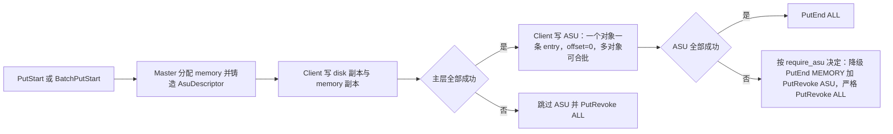

#### 1.1.2 现有两条路线的能力缺口

**（a）local_disk 路线：`KvClientStorageBackend` 挂在 `StorageBackendInterface` 下**

这条路线把 ASU 当成 `FileStorage` 的一个后端，能跑通 offload 数据面，但无法提供用户要求的 per-key 语义，原因都能在接口签名和当前 HEAD 的接线状态里找到：

- **接口粒度是 per-batch，不是 per-key。** `StorageBackendInterface::BatchOffload` 接收 `unordered_map<string, vector<Slice>>` 整批对象，回传一个整批的 `ErrorCode`（`mooncake-store/include/storage_backend.h:274-279`）；`BatchLoad` 同样是整批 map（`storage_backend.h:281-282`）。这条链路是 `PutEnd` 成功之后由心跳驱动的推式 offload，而不是 `PutStart` 下发 descriptor、Client 在 `PutEnd` 前同步写完的副本时序，两者互斥。
- **接口里没有「按 key 删除」的位置。** 唯一的删除钩子是 `virtual void RemoveAll()`（`storage_backend.h:319-321`），语义是整后端清空。local_disk 方案自己也承认需要在 backend 内新增一个**非 override** 的 `BatchRemoveKeys`，并把 `FileStorage` / Master 的接线列为「暂不做」（`Mooncake_documents/kv-client-storage-backend-review.md:10`、`:85`）。
- **当前 HEAD 上删除接线是死的。** `Client::PollRemoveAll()` 只有声明与定义（`mooncake-store/include/client_service.h:665`、`mooncake-store/src/client_service.cpp:4337-4339`），全仓库无调用者；`FileStorage::RemoveAll()` 只有定义（`mooncake-store/src/file_storage.cpp:912`），无调用者；`LocalSsdManager::RequestRemoveAll()` 只有定义与 mailbox 内部转发（`mooncake-store/src/local_ssd/manager.cpp:331-345`），仓库内无任何外部调用者；`mooncake-store/tests/local_ssd/local_ssd_test.cpp:63` 调用的是 `LocalSsdTaskMailbox::RequestRemoveAll()`（`manager.cpp:107`），不是 `LocalSsdManager` 的接口。因此「按 key 物理删除」在现有 offload 链路上没有生产入口，不改接口只能做逻辑删除。
- **查询与长度都不是对象级权威。** `IsExist` 是 backend 本地方法（`storage_backend.h:284`），`GetObjectDataSize` 是可选实现且默认返回 `std::nullopt`（`storage_backend.h:292-296`）；Master 不参与长度或物理存在性的裁决。

**（b）DFS 路线：复用 DFS 副本 + `FileSystemAdapter`，per-object 一个文件**

这条路线把 descriptor 改成「一个对象一个文件」，试图用文件名编码 object key，但仍受 DFS 语义与 ASU 未验证行为双重限制：

- **descriptor 与数据面仍是文件位置语义。** DFS 的数据面是 fd + positional I/O（`fs_adapter.h:113-124`、`mooncake-store/src/storage/distributed/distributed_storage_backend.cpp:478-495`），ASU 需要的是 8 字节 key + offset。
- **按对象物理删除仍然打不通。** `ShardAllocator::Free` 只把 extent 放回延迟回收队列（`mooncake-store/src/storage/distributed/shard_allocator.cpp:342-345`、`:586-594`），`MasterService::FreeDfsReplicas` 也只是把 descriptor 交给 `dfs_allocator_->Free`（`mooncake-store/src/master_service.cpp:7583-7591`）；对象回收路径上没有任何 `DeleteFile` 调用。`FileSystemAdapter` 虽然声明了 `DeleteFile`（`fs_adapter.h:40-41`），但 DFS 的对象回收不走它。
- **数据级 Exist 缺失。** `DistributedStorageBackend::IsExist` 在非对象存储模式下直接返回 `NOT_SUPPORTED`（`distributed_storage_backend.cpp:847-851`）。
- **依赖三个未经真机验证的 ASU 行为。** 同一 key 上按任意 offset 写入、单 key 累计写入时设备自动扩展 create size、对已存在 key 的覆盖写语义。覆盖写未验证已被明确记录为风险 `R9`（`kv-client-storage-backend-review.md:855`）；create size 与 offset 行为分别对应本设计的 go/nogo H2 与 H3。
- **改动面外溢。** 通用 DFS 代码存在直接 `std::filesystem` 硬编码（`shard_allocator.cpp:61`、`:212`），复用这些路径就必须加能力开关，修改会扩散到与 ASU 无关的 DFS 逻辑。

**（c）v1.0 自身：把 ASU 当「并行同步副本」造成的语义缺口**

> **[v2.0 变更]** 这一条是 v2.0 新增。前两条路线是「抽象选错」，v1.0 的问题则是「同一个抽象下语义选错」，三者共同构成本轮修订的动机。

- **写序不可表达。** v1.0 的 ASU 与 memory 在同一个 `Put` 内并行扇出，ASU 失败直接把整个 `Put` revoke；memory 更早失败时，ASU 上可能已经写入了数据。这既不是「先 memory 后 ASU」，也没有「主层成功、ASU 降级」这个终态。
- **删除没有方向。** v1.0 只有整对象 `Remove`，没有「只删 memory」的入口；而「删 ASU 先删 memory」在 v1.0 的擦除顺序里恰好相反：`EraseMetadata` 先 `ReleaseLocalDiskUsage` / `FreeDfsReplicas`，再 `hold.TearDown()` 释放 memory buffer（`master_service.cpp:2109-2111`）。如果沿用 v1.0 在 `FreeDfsReplicas` 旁直接把 ASU 入队的写法，ASU 会早于 memory 释放，与要求 3 相反。
- **读择优没有显式档位。** v1.0 的兜底链把 ASU 混在 LOCAL_DISK 之后，但没有「Client 能力位 + 档位表」这一层，也没有把「Master 返回全部可读副本」写成不变量，导致「Client 选择 best」无法与既有 `FindFirstCompleteReplica` 行为区分。
- **配置没有约束。** v1.0 允许 ASU-only、asu+nof、asu+dfs、asu>1。这些组合会让「先删 memory」没有定义（没有 memory 可删），也无法用一对 `end_type` / `revoke_type` 表达降级终态。

**（d）结论：抽象错位，需要新的副本类型**

两条外部路线的共同问题不是实现细节，而是承载语义的抽象错误：local_disk 把 ASU 当成「批量 offload 的后端」，DFS 把 ASU 当成「文件系统」。二者都无法把「按 key 的写 / 读 / 查 / 删」映射为系统的一等操作。本设计因此新增 `ReplicaType::ASU = 101`，主方案为 `ASUKvReplica`：

- **Master 纯命名分配**：`AllocateReplicas` 只铸造 40B `AsuDescriptor`，不占 segment、不分配字节、无 offset 账本；副本以 PROCESSING 状态进入对象元数据。
- **Client 直连 `KvClient`**：在 memory 全部成功之后，把一个对象作为一条 512B 对齐 entry（512B header + payload，offset=0）同步写入 ASU；读路径按 descriptor 的 `key_id` 与 `object_size` 用 `BatchLoadAsync` 读回。
- **Master 侧 delete-only `KvClient`**：删除只需要 key，不需要 `RegisterRegions`，因此 Master 可以持有一个只做 `QueryAsync` / `DeleteAsync` 的客户端。
- **延迟 GC**：元数据先删，物理 key 进入去重队列，宽限期后由独立线程删除，避免删掉仍被读租约引用的旧 key。

四个操作由此与 ASU 原语一一对应：写 = `BatchStoreAsync`，读 = `BatchLoadAsync`，查 = Master 元数据（`QueryAsync` 仅做物理归因），删 = `DeleteAsync`。

#### 1.1.3 ASU 的硬约束及其对设计的塑造

ASU 事实直接决定 entry 布局、批量切分与错误映射：

| 约束 | 代码事实 | 对设计的塑造 |
| --- | --- | --- |
| 单 entry 单次 Store/Load 上限 16,776,704 B | SQE 的 `length`/`buffer_length` 是 24-bit 且 512B 对齐（`kv_protocol.cc:188-215`）；0xFFFFFF 向下取整为 0xFFFE00 | `kEntryMaxBytes = 16,776,704`、`kMaxObjectBytes = 16,776,192`；一个对象一条 entry |
| 没有 per-entry size 字段 | `length` 取 `KVBuffer.buffer.region.size`（`sqe_request.cc:190`、`:206`、`:223`、`:251`） | 每条 entry 前 512B 放自描述 header，写入真实 `data_len` 与 CRC |
| 预发送失败 abort 整个 transport task | `AbortSubBatchesBeforeSend` 把全部 `entryStatus` 置 CANCELED（`trans_task_executor.cc:227-246`） | 提交前逐 entry 预检；一个 task 承载多个对象，单条非法会取消整批 |
| `offset` 32-bit、512B 对齐 | `KVBuffer::offset` 为 `uint32_t`（`kv_types.h:125`）；协议校验对齐（`kv_protocol.cc:202-206`） | 取消分块后 `offset` 恒为 0 |
| 单 key 总量受设备 create size 约束 | `CQE_OUT_OF_CREATE_SIZE = 0x10000 \| 0x712`（`kv_types.h:81`） | 是否自动扩展是 H2；`AsuConfig::max_object_bytes` 默认 16,776,192 |
| `buffer.region.size` 先 `static_cast<uint32_t>` | `sqe_request.cc:190`、`:206`、`:223`、`:251` | 本层禁止 ≥4 GiB 的 region |
| `buffer_addr` 只校验非零 | `kv_protocol.cc:186-190` | 自建 512B 对齐 pinned staging arena 并预检 addr |
| `maxInflightBytes` 只解析不生效 | `trans_config_utils.cc:145-146` | 按条数（`kBatchMaxStoreEntries`/`kBatchMaxLoadEntries`）与字节自行限流 |
| 公有 API 无长度、Stat、GetMeta | `QueryResult` 只有 exists 位图（`kv_types.h:98-101`） | 长度唯一权威是 Master 元数据 |
| `defaultWaitTimeoutMs` 默认 100ms；`Wait` 的 `timeoutMs` 必填 | `kv_types.h:215`、`kv_client.h:54` | 显式传按字节估算的 timeout；TIMEOUT 隔离 staging slot |
| 批量接口与单条接口不同源 | `GetSqeIoNum` 对 LOAD/STORE 返回 1（`io_scheduler.cc:80-92`）；BATCH 按 110 切子批 | 只允许 `BatchStoreAsync`/`BatchLoadAsync`，禁止 `StoreAsync`/`LoadAsync` |
| 删除与查询错误空间不同 | `ENTRY_DELETE_FAILED` 与 `ENTRY_KEY_NOT_EXIST`（`kv_types.h:67-73`） | 删除按 rawResult 幂等判定 |

这些约束推出四个核心决定：**每条 entry 512B 自描述头**、**一个对象一条 entry、offset 恒 0**、**逐 entry 预检 + task 级全成全败**、**ASU 写在 memory 全部成功之后**。payload CRC-32C 是承重项；Mooncake 端到端 object checksum 默认关闭（`mooncake-store/src/config/client_object_checksum_config.cpp:13-16`）。**SDK 不保证单 entry 写入原子**：可见性由 Master 侧 PROCESSING 状态与读端 header/CRC fail-stop 共同保证。

> **[v2.3 变更]** 取消分块后，「半写对象对读者不可见」只剩两层：Master 侧 ASU 副本在 `PutEnd` 前恒为 PROCESSING；读端 magic/version/header_crc/key_id/key_fingerprint/epoch/object_size/data_offset==0/data_len/data_crc32c 全字段 fail-stop。不得声称单 entry 写是原子的。

**1,008 B 窗口**：`kMaxSliceSize = Slab::kSize - 16 = 16,777,200 B`（`types.h:468-469`），而单 entry 最大 object 是 `16,776,704 - 512 = 16,776,192 B`，两者相差 **1,008 B**。窗口 `(16,776,192, 16,777,200]` 内 CACHELIB 放行但单 entry 装不下，必须在 `PrepareWriteStart` 的 ASU 校验里显式拒绝为 `ASU_OBJECT_TOO_LARGE`；`S > 16,777,200` 时 CACHELIB 检查（`master_service.cpp:5111-5117`）先返回 `INVALID_PARAMS`。已裁决不豁免（v2.1，见 §6.5）。

#### 1.1.4 本设计的范围

本设计严格限定为「按 key 的写、读、查、删 + 必要的 init」：

| 在范围内 | 对应操作 |
| --- | --- |
| `AsuClientRuntime` / `AsuMasterRuntime` 的初始化、注册、就绪判定与关闭；`asu_available` 能力位 | init |
| `Put` / `Upsert` / `BatchPut` / `BatchUpsert` 中 ASU 副本的**有序第二阶段**同步写入 | 写 |
| `Get` / `BatchGet` 中 Master 返回全部可读副本、Client 按档位择优，选中 ASU 后批量读取 | 读 |
| `IsExist` / `BatchIsExist` / `Query` 的逻辑存在性；`QueryAsync` 仅用于物理归因 | 查 |
| 「删 memory」：既有 `Client::Remove` / `BatchRemove`（删 memory 与元数据、不触达 ASU）；「删 ASU」：新增 `Client::BatchRemoveAsuObjects`，内部先调用既有 `BatchRemove`、再删 ASU | 删 |

> **[v2.3 变更]** 删除语义按用户纠正重写：现有按 key 删除 memory 的路径一行不改；新增的 `BatchRemoveAsuObjects` 才是「按 key 删 ASU」，且必须先删 memory、再删 ASU。

配置白名单：`asu_replica_num ∈ {0,1}`；大于 0 时要求 `replica_num >= 1`、`nof_replica_num == 0`、`dfs_replica_num == 0`，否则 `INVALID_PARAMS`；ASU-only 由 `PrepareWriteStart` 的全零判定拒绝（`master_service.cpp:5051-5053`）。

失败语义由 `AsuConfig::require_asu` 决定：默认 false 时 ASU 写失败只降级（Put 成功、`asu_degraded_total` 加 1）；true 时 ASU 写失败使整个 Put 失败。

以下内容不在范围内：多租户配额、QoS、分层调度、跨集群复制、缓存替换调优、性能自动调参、多 key 分片（一个对象绝不拆成多个 key 或 offset）、ASU 命中后的 promotion/回填 memory、range/session 的 ASU 读写、扩展 `EvictDiskReplica` 白名单。CRC-32C、512B 自描述头、key fingerprint、epoch 防代际串读属于承重安全项，必须保留。

### 1.2 用户使用场景分析

ASU 副本不是独立服务，而是 Mooncake Store 的一种副本形态。下面六个场景覆盖用户对写、读、查、删的主要使用方式。场景总览如下：

> **[v2.0 变更]** 场景一、二、三、四、六的「核心关注点」都因三条新要求而变化：写要体现有序两阶段与分层降级，读要体现 Master 返回全集与 Client 择优，删要体现两个方向相反的动词。

| 场景 | 覆盖操作 | 核心关注点 |
| --- | --- | --- |
| 场景一：LLM 推理 KV cache 首次下沉 | 写（降级/回滚时用删） | 写序 memory → ASU、分层降级、单 entry 上限、主层失败时 ASU 零调用 |
| 场景二：缓存命中读回 | 读 | Master 返回全集、Client 档位择优、选中 ASU 走 `BatchLoadAsync`、整对象 CRC |
| 场景三：内存淘汰后的容量分层复用 | 读 | memory 不在时 ASU 兜底、删 memory 后仍可读、不回填 memory |
| 场景四：按 key 回收的两个删除动词 | 删（配合写） | 删 memory 只删 memory、删 ASU 先删 memory、幂等与宽限期 |
| 场景五：存在性探测决定是否复用 | 查 | 逻辑存在性权威、热路径零 ASU RTT |
| 场景六：批处理下的批量写与批量读 | 写、读 | 批内错误隔离、每对象一个 `BatchLoadAsync`、流控 |

#### 1.2.1 场景一：LLM 推理 KV cache 首次下沉

- **前置条件**：ASU 视图就绪、`AsuClientRuntime::IsReady()` 为真；`asu_replica_num = 1` 且 `replica_num >= 1`、`nof_replica_num = 0`、`dfs_replica_num = 0`。非法组合在 `PrepareWriteStart` 返回 `INVALID_PARAMS`。
- **用户做什么**：调用 `Put(key, slices)` 把 prefill 产出的 KV cache 作为一个对象写入。
- **系统行为**：`MasterClient::PutStart` → `PrepareWriteStart` 校验配置与大小（`master_service.cpp:5047-5138`）→ `AllocateReplicas` 先分配 memory，最后铸造 `AsuDescriptor`（PROCESSING）→ Client 写 disk（若有）与 memory/nof → 门禁 `NonDfsTransfersSucceeded`（`client_service.cpp:321-327`）→ `SubmitAsuWrites` → `AsuStorageBackend::BatchStoreObjects` 把本批对象按对象边界切 task，每个对象编码成**一条** entry（512B header + payload，offset=0），多个对象可放入同一个 `BatchStoreAsync`，按 `entryStatus` 逐对象回填 → `DetermineFinalizeDecision` 决定终态。
- **期望结果**：happy → `PutEnd(ALL)`、Put 成功；degrade（`require_asu=false`）→ `PutEnd(MEMORY)` + `PutRevoke(ASU)`、Put 成功并记 `asu_degraded_total`；主层失败 → ASU 零调用 + `PutRevoke(ALL)`、Put 失败；strict（`require_asu=true`）→ `PutRevoke(ALL)`、Put 失败。
- **对操作的要求**：单 entry 不超过 16,776,704 B（object 不超过 16,776,192 B）、512B 对齐、逐 entry 预检、task 级全成全败；**调用方在 `Put` 返回前不得修改 `slices` 指向的 buffer**。

> **[v2.3 变更]** 取消分块：一个对象一条 entry、offset 恒 0，不再有 chunk 0 提交点，也不声称单 entry 写入原子。

#### 1.2.2 场景二：缓存命中读回

- **前置条件**：对象存在状态为 COMPLETE 的 ASU 副本（可以是唯一副本）；调用方遵守长度契约，`slices` 总长不小于 `object_size`。
- **用户做什么**：调用 `Get(key)` 或 `BatchGet`，把 KV cache 读回继续 decode。
- **系统行为**：`GetReplicaList` 由 Master 返回**全部可读副本**——`GetReadableReplicaDescriptors` 以恒真谓词遍历副本，只经 `IsReplicaReadable`（`completed && available && !IsAwaitingRemount`）过滤，不按类型裁剪也不排序（`master_service.cpp:4487-4505`、`ReadReplicaList` 4585、`BatchGetReplicaList` 4706）→ Client 的 `SelectBestReplica`（`replica_selection.h:133-194`）带 `ReadSelectionPolicy{asu_available}` 按显式档位选择：local MEMORY(0) < local NOF(1) < remote MEMORY(2) < remote NOF(3) < LOCAL_DISK(4) < **ASU(5)** < DFS(6) < DISK(7)，同档平手后出现者胜出 → 选中 ASU 后 `Client::Get` 分派到 `ReadAsuReplica`（`client_service.cpp:1578-1653`）；`BatchGet` 把 ASU 请求收集为 `AsuReadRequest`，在 DFS 批量读之后、RDMA 统一 Wait 之前调用 `BatchLoadObjects`（`client_service.cpp:1718-1997`）→ 多个对象按对象边界合批进同一 `BatchLoadAsync`，逐 entry 读 `entryStatus` 并 `DecodeAndValidate`（magic / version / header CRC / key_id / key_fingerprint / object_epoch / object_size / data_offset==0 / data_len / payload CRC-32C）→ 回填用户缓冲 → 复用既有 `VerifyObjectChecksum` 与租约检查。
- **期望结果**：返回字节与写入完全一致；header 或 payload CRC 不符时返回 `ASU_RECORD_CORRUPT`，绝不把损坏字节交给用户；元数据存在但物理 entry 丢失时映射为 `REPLICA_IS_GONE` / `OBJECT_NOT_FOUND`；同一次 Get 内不做跨副本 fallback，也不返回部分数据。
- **对操作的要求**：以读为主。关注点是整对象读取与 CRC 全量校验、`PROCESSING` 副本的双门控（Master 只返回 COMPLETE，选择器也只接受 COMPLETE）、以及物理丢失与介质损坏的错误归因。range / session 读对 ASU 明确 `NOT_SUPPORTED`。

> **[v2.0 变更]** 本场景新增「Master 返回全集 + Client 档位择优」的读路径，并把 v1.0 的前缀读改成整对象读；ASU 不再是「兜底链里的一个分支」，而是档位表里固定第 5 档。

#### 1.2.3 场景三：内存淘汰后的容量分层复用

- **前置条件**：对象最初以 MEMORY + ASU 双副本写入；随后 MEMORY 副本因容量压力被淘汰，或调用方通过「删 memory」只移除了 MEMORY 副本；ASU 副本仍为 COMPLETE；对象元数据仍在 Master。
- **用户做什么**：再次 `Get(key)`，期望命中下沉到 ASU 的副本。
- **系统行为**：`GetReplicaList` 只返回仍存在的 ASU descriptor；Client 的档位选择回落到 ASU(5)；读路径与场景二相同，全部在 Client 侧完成。同时 `PutEnd` 的 offload 触发条件显式排除含 ASU 的对象（`master_service.cpp:5409-5412`），不会把「memory + ASU」的对象再写一份 LOCAL_DISK。
- **期望结果**：内存副本不在时读取仍然成功，且不需要 Master 转发数据或感知 ASU 拓扑；读延迟主要由 ASU 读带宽与对象大小决定。
- **对操作的要求**：只要求读。关注点是副本选择器的档位顺序（LOCAL_DISK 优于 ASU 优于 DFS 优于 DISK）、读租约、ASU 副本不被额外 offload 到 LOCAL_DISK，以及**不做 promotion**：命中 ASU 后不回填 memory，现有 hot cache 只对 memory 生效（`client_service.cpp:5766`），promotion-on-hit 只认 LOCAL_DISK（`master_service.cpp:4631-4645`）。

> **[v2.0 变更]** v1.0 的场景三只描述「容量淘汰」；v2.0 把「删 memory 后仍可读」并入同一场景，因为这是要求 3 的直接后果，也是要求 2 必须存在的理由。

#### 1.2.4 场景四：按 key 回收的两个删除动词

- **前置条件**：对象不再需要；全部副本 COMPLETE（`CheckRemovable` 前置，`master_service.cpp:7236-7255`）。
- **用户做什么**：
  - **删 memory**：调用既有 `Client::Remove(key, force)` 或 `BatchRemove`。它今天的行为就是「删掉 memory 副本与对象元数据，不触达 ASU 后端」，这正是「删 memory 只删 memory」；该路径一行不改。
  - **删 ASU**：调用新增的 `Client::BatchRemoveAsuObjects(keys, force)`。它内部**首先调用**既有 `BatchRemove`（因此先删 memory 与元数据），然后用**删除前捕获**到的 `AsuDescriptor` 去删 ASU。

```mermaid
flowchart TB
    subgraph D1["删 memory：既有路径，一行不改"]
        B1["Client::Remove / BatchRemove"] --> B2["MasterService::RemoveObject / BatchRemove"]
        B2 --> B3["CheckRemovable 保护"]
        B3 --> B4["EraseMetadata：删除元数据与 memory buffer"]
        B4 --> B5["不触达 ASU：ASU entry 成为不可枚举孤儿（预期行为）"]
    end
    subgraph D2["删 ASU：新增 BatchRemoveAsuObjects"]
        C1["BatchRemoveAsuObjects(keys, force)"] --> C2["Phase 1 同一 key 写锁内捕获 AsuDescriptor"]
        C2 --> C3["Phase 2 调用既有 RemoveObject（一行不改：先删 memory 与元数据）"]
        C3 --> C4["Phase 3 仅对成功或 OBJECT_NOT_FOUND 的 key 把捕获的 descriptor 入 AsuDeleteQueue"]
        C4 --> C5["宽限期后 AsuGcWorker 按 254 切批 BatchRemoveObjects → DeleteAsync"]
    end
```

- **系统行为（删 ASU）**：`BatchRemoveAsuObjects` 在 Master 侧逐 key 执行三阶段。**Phase 1** 在 key 写锁内用只读访问器捕获 `is_asu_replica()` 的 descriptor（不授租约）；**Phase 2** 调用**既有** `RemoveObject`（一行不改，仍走 `CheckRemovable`、persist、`EraseMetadata`；`EraseMetadata` 不再捕获或入队 ASU）；**Phase 3** 仅对成功或 `OBJECT_NOT_FOUND`（stale handle）的 key 入队；`OBJECT_HAS_LEASE`/`REPLICA_IS_NOT_READY` 表示对象仍存活，跳过。捕获与删除之间若发生并发 Upsert，捕获到的旧 `key_id` 属于旧世代，迟到的删除只命中旧 key（epoch 派生隔离）。
- **期望结果**：plain `Remove` 后对象立即从元数据消失，ASU entry 成为孤儿；`BatchRemoveAsuObjects` 后对象消失，ASU entry 在 `max(default_kv_lease_ttl_, asu_delete_grace_ms)` 后物理删除。
- **对操作的要求**：删除必须与写共享 epoch/key 推导；关注幂等、失败重试、宽限期与读租约、以及「删除失败不向上层报错」。

> **[v2.3 变更]** 删除 `RemoveReplica` RPC、`Client::RemoveMemoryReplica`、`MasterService::RemoveReplicaTier`；删 memory 复用既有 Remove，删 ASU 是新增函数且内部先调 Remove。

#### 1.2.5 场景五：存在性探测决定是否复用

- **前置条件**：调用方持有一个候选 key，需要在发起昂贵读取或重新计算前判断缓存是否可用。
- **用户做什么**：调用 `IsExist(key)` / `BatchIsExist(keys)` / `Query(key)`。
- **系统行为**：Client 只向 Master 查询元数据（`MasterClient::ExistKey`），Master 按 `HasReadableReplica` 授读租约并返回结果；整条热路径不触达 ASU，零额外 RTT。若需要区分「元数据在但物理丢失」与「传输失败」，诊断路径可以额外调用 `AsuStorageBackend::BatchIsExist` → `QueryAsync`，读 `TaskResult::queryResult->exists` 位图（`kv_types.h:98-101`），但该结果不作为 Mooncake 的存在性权威，也不进入 `IsExist` / `Query` 热路径。
- **期望结果**：返回的是逻辑存在性，与 MEMORY / DFS / DISK 副本语义一致；长度直接取 `descriptor.object_size`，不再发起第二次查询。「memory 已删、只剩 ASU」的对象仍返回存在；「整对象删除、ASU 物理尚未删」的对象返回不存在。
- **对操作的要求**：只要求查。关注点是物理存在性只能用于诊断与错误归因（例如区分 `OBJECT_NOT_FOUND` 与 `TRANSFER_FAIL`），公开 API 不承诺物理存在性；ASU entry 在设备侧丢失时，`IsExist` 仍可能返回 true，读取时才暴露 `REPLICA_IS_GONE`。

> **[v2.0 变更]** 查路径本身不变，只因要求 3 明确了两条可见性规则：删 memory 不改变存在性，删 ASU 立即改变存在性。

#### 1.2.6 场景六：批处理下的批量写与批量读

- **前置条件**：一次推理批处理产生或消费多个 KV block；Client 启用 ASU。
- **用户做什么**：调用 `BatchPut` / `BatchUpsert` 写入一批对象，或 `BatchGet` 读取一批对象。
- **系统行为（写）**：批量路径在 `SubmitDfsWrites` 之后、`FinalizeBatchPut` 之前调用一次 `SubmitAsuWrites`：收集本批对象，调用一次 `BatchStoreObjects`；按对象边界切成若干 task（条数 ≤ `kBatchMaxEntries=110` 且 ≤ `staging_slots`，字节 ≤ `batch_max_bytes=64 MiB`），**绝不切开单个对象**；每个 task 一次 `BatchStoreAsync` + `Wait`，逐 entry `entryStatus` 回填到每个对象。主层失败的对象记 `asu_write_skipped_total{reason=primary_tier_failed}` 并零调用。`FinalizeBatchPut` 按对象决定终态，失败 op 不影响其它 op。
- **系统行为（读）**：`Client::BatchGet` 收集 `AsuReadRequest`，在 DFS 批量读之后、RDMA 统一 Wait 之前调用一次 `BatchLoadObjects`；多个对象可合并进同一 task（同样按对象边界与 110/64 MiB 预算切分），逐 entry 归因，`PARTIAL_FAILED` 不得早退丢掉 per-entry 结果。
- **期望结果**：同一批内某个对象的 ASU 写失败不会把其它对象标记为失败；`require_asu=false` 时失败对象按分层降级，`require_asu=true` 时该对象整体失败、其余对象仍置 COMPLETE。批量读按对象返回独立结果。
- **对操作的要求**：批内错误隔离、逐 entry `entryStatus` 判定、按条数与字节限流、staging arena 的跨对象在飞 slot 上限与 `Reserve`/`AcquireBatch` 原子预留。

> **[v2.3 变更]** 批量语义从「每对象一个 task、不跨对象合并」改为「多个对象可合并进同一 task，按对象边界切分，逐 entry 归因」。

## 2. 设计描述

### 2.1 设计

本节描述 `ReplicaType::ASU = 101` 的 ASUKvReplica 模块。它不是一个挂在现有 offload 插件下面的后端适配器，而是一个一等副本类型：Master 只铸造 40B 的 `AsuDescriptor` 并维护元数据与副本状态，不分配任何字节；Client 在 memory / nof 全部成功之后、`PutEnd` 之前，经 `kv::KvClient` 把一个对象作为一条 512B 对齐 entry（`offset=0`）同步写入 ASU；物理删除由 Master 自持的 delete-only `KvClient` 在宽限期后按 `key_id` 执行。

> **[v2.0 变更]** v1.0 把 ASU 描述为「与 memory 并行的同步副本、失败即整 Put revoke」。v2.0 依据用户的三条要求改写了模型：
> (1) 写是**两阶段有序**——memory / nof 全部成功是 ASU 阶段的门禁，ASU 不再与 memory 并行，也不反向补位；
> (2) 读由 Master 返回**全部可读副本**、由 Client 按显式档位择优，只有选中 ASU 才走 `kv::KvClient::BatchLoadAsync`；
> (3) 删除拆成两个方向相反的动词——删 memory 只删 memory，删 ASU 则**先删 memory** 再删 ASU。
> 随之改变的失败语义由 `require_asu` 决定：默认 false 为**分层降级**（主层成功、ASU 失败时 Put 仍返回成功并记 `asu_degraded`）；true 为整体失败（`PutRevoke(ALL)`，错误码取 ASU 根因）。两种模式下只有主层失败与 ASU 未被尝试才必然是 `PutRevoke(ALL)`。

#### 2.1.1 模块的逻辑模型

##### 2.1.1.1 分层与系统位置

ASU 副本模块不是一个单点组件，而是同时出现在三个层次上的对称运行时：描述层（`Replica::Descriptor` 的 `AsuDescriptor` alternative）、Client 数据面（`AsuClientRuntime`）、Master 侧删除面（`AsuMasterRuntime`）。它横跨控制面与数据面，但两端互不侵入：Master 侧绝不经手对象字节（唯一的字节无关操作是 delete-only 的 key 级 `DeleteAsync`），Client 侧绝不重建 Master 的元数据。

> **[v2.3 变更]** 与 v1.0 相比，L1 多出「有序写阶段」与「BatchRemoveAsuObjects 删 ASU 入口」，L2 多出显式读档位；删 memory 仍是既有 `Remove`，不新增层。写路径的**阶段边界**现在是一条显式的客户端门禁，而不是两侧同时扇出。

| 层 | 主要组成 | 上边界（被谁调用） | 下边界（调用谁） | 本期改动 |
| --- | --- | --- | --- | --- |
| L0 用户与 API 层 | 推理引擎、`MooncakeDistributedStore` / `store_py`、`RealClient` | Mooncake 公开 API：`Put` / `Get` / `Query` / `IsExist` / `Remove` 及其 batch 形式 | `Client` 实例 | 既有；`RealClient` 在 `Init` 中创建 `AsuClientRuntime`，并在读选择点传入 `asu_available` |
| L1 Client 控制面 | `Client`：`Put`（client_service.cpp:2053）、`Upsert`（client_service.cpp:2271）、`Get`（client_service.cpp:1578）、`BatchGet`（client_service.cpp:1718）、`Remove`（client_service.cpp:3795）、`IsExist`（client_service.cpp:4191），新增 `BatchRemoveAsuObjects` | `RealClient`；`ReplicateConfig` | `MasterClient` RPC、`Replica::Descriptor`、`AsuClientRuntime` | 改动：有序两阶段写、分层 finalize、读档位、批量读收集、删 ASU 入口（删 memory 复用既有 Remove） |
| L2 副本描述与分派层 | `Replica::Descriptor`、`replica_selection.h`（`ReplicaReadRank` / `SelectBestReplica`）、`client_buffer.cpp` | L1 的选副本与尺寸计算 | 具体数据面（TransferEngine / 文件 / ASU） | 改动：新增 ASU alternative、显式档位、尺寸分支 |
| L3 ASU 客户端数据面（新增） | `AsuClientRuntime` → `AsuStorageBackend` → `AsuStagingArena` + `AsuKvClientAdapter` → `kv::KvClient` → transport provider → ASU | `Client::SubmitAsuWrites` / `ReadAsuReplica` / `BatchGet` 在**主层成功之后**的同步调用 | `kv::KvClient` 公有异步 API 与 `Wait`（kv_client.h:33-59） | 全部新增 |
| L4 Master 控制面 | `MasterService`：`PutStart` / `PutEnd` / `PutRevoke` / `RemoveObject` / 新增 `BatchRemoveAsuObjects`、元数据与 oplog | `MasterClient` RPC | `ObjectMetadata`、oplog、`AsuMasterRuntime` | 改动：铸造 ASU、ALL 谓词、回收钩子、删 ASU（捕获→既有 Remove→入队） |
| L5 Master 侧 ASU 运行时（新增） | `AsuMasterRuntime` = `AsuAllocator` + `AsuDeleteQueue` + `AsuGcWorker` + delete-only `AsuStorageBackend` | `MasterService::AllocateReplicas`（master_service.h:1449）与 `FreeAsuReplicas` | `kv::KvClient` 的 `QueryAsync` / `DeleteAsync`，只传 key | 全部新增 |
| L6 ASU 设备（外部） | `kv::KvClient` SDK、ASU 设备与设备侧 GC | L3 / L5 的 SDK 调用 | 物理设备 | 外部，模块边界之外 |

边界说明：

- 上边界只到 `Client` 的既有公开方法（删 memory 复用 `Remove`/`BatchRemove`）与新增 `Client::BatchRemoveAsuObjects`；不新增 `TaskType`，也不复用 `TaskType` 机制做删除。
- 下边界只到 `kv::KvClient` 的公有批量 API：`QueryAsync`、`BatchLoadAsync`、`BatchStoreAsync`、`DeleteAsync`、`Wait`、`RegisterRegions`（kv_client.h:36-59）。单条 `LoadAsync`/`StoreAsync` 不暴露、不调用。
- **写路径的层次顺序由 Client 编排**：主层（MEMORY / NOF）先，`NonDfsTransfersSucceeded`（client_service.cpp:321-327）作为屏障，ASU 后；`asu_replica_num > 0` 时白名单要求 `dfs_replica_num == 0`，因此不存在 DFS 与 ASU 并存。Master 不编排顺序，只用副本状态（`PROCESSING` → `COMPLETE`）表达可见性，因此「顺序」是客户端不变量，「可见性」是服务端不变量。
- **删除路径有两条独立入口**：删 memory 复用既有 `Client::Remove` / `BatchRemove`（只删 memory 与元数据、不触达 ASU）；删 ASU 走新增 `BatchRemoveAsuObjects`（捕获 descriptor → 既有 Remove → 入队）。两者都不做物理删除，物理删除只在 L5。
- L4 / L5 绝不经手对象字节；L5 只发 keys-only 的 `QueryAsync` / `DeleteAsync`。
- L3 承担全部字节搬运、`AsuRecordHeader` 编码与 CRC 校验。
- L2 的 `AsuDescriptor` 是两端之间唯一的契约，客户端绝不自行重算 `asu_key_id`。

##### 2.1.1.2 逻辑模型图

> **[v2.3 变更]** 图 1 在 v1.0 的分层图上新增了写序屏障节点（`NonDfsTransfersSucceeded`）与 `BatchRemoveAsuObjects`；图 2 是新增的，用来把三条要求各自的「方向」画清楚：写是链式的、读的决策在 Client、删除有两个反向入口。

图 1 是分层与依赖视图：

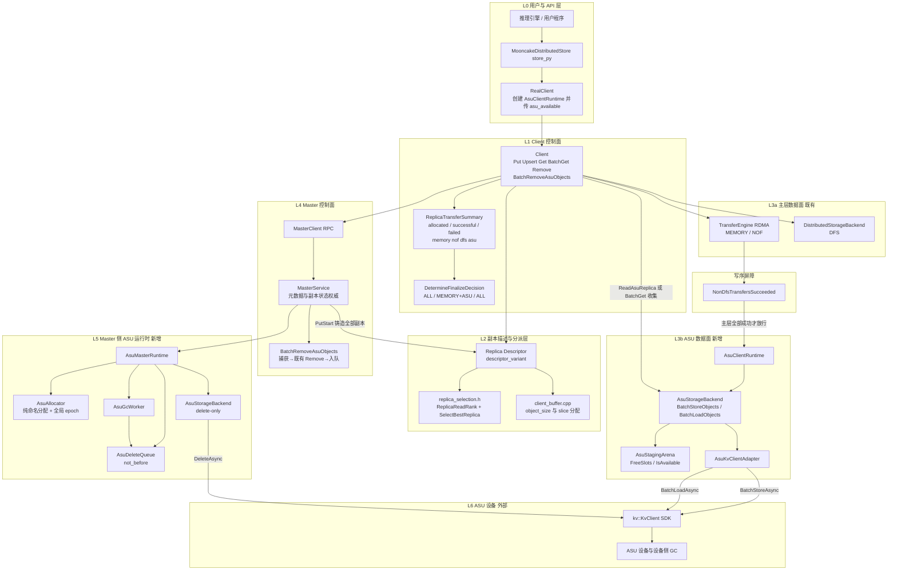

图 2 是三条要求各自的方向与顺序视图：

```mermaid
flowchart TD
    subgraph W["写 两阶段有序"]
        W1["Master PutStart<br/>memory PROCESSING + AsuDescriptor PROCESSING"]
        W2["Client 写 MEMORY NOF DFS"]
        W3{"NonDfsTransfersSucceeded"}
        W4["Client 写 ASU<br/>一个对象一条 entry offset=0 多对象可合批"]
        W5["Master finalize"]
        W6["PutEnd ALL<br/>Put 成功"]
        W7["PutEnd MEMORY + PutRevoke ASU<br/>Put 成功 记 asu_degraded"]
        W8["PutRevoke ALL<br/>Put 失败"]
        W1 --> W2 --> W3
        W3 -->|是| W4 --> W5
        W3 -->|否 ASU 零调用| W8
        W5 -->|主层与 ASU 均成功| W6
        W5 -->|主层成功 ASU 失败 且 require_asu=false| W7
        W5 -->|主层成功 ASU 失败 且 require_asu=true| W8
    end

    subgraph R["读 Master 返回全集 Client 择优"]
        R1["Master GetReplicaList<br/>返回全部可读副本"]
        R2["Client SelectBestReplica<br/>ReplicaReadRank"]
        R3["MEMORY NOF LOCAL_DISK DFS DISK<br/>既有数据面"]
        R4["AsuStorageBackend BatchLoadObjects<br/>BatchLoadAsync 逐 entry 校验"]
        R1 --> R2
        R2 -->|其它档位| R3
        R2 -->|第 5 档 ASU| R4
    end

    subgraph D["删 两个反向动词"]
        D1["Client::Remove / BatchRemove<br/>只删 memory 与元数据 不触达 ASU"]
        D2["BatchRemoveAsuObjects<br/>先捕获 descriptor"]
        D3["调用既有 RemoveObject 删 memory 与元数据"]
        D4["再用捕获的 key_id 入 AsuDeleteQueue"]
        D5["AsuGcWorker 宽限期后 DeleteAsync"]
        D2 --> D3 --> D4 --> D5
    end
```

图中实线表示调用方向，边标签标出该段承载的操作。写、读、查三条路径都从 `Client` 出发，但 v2.0 的**写**多了一个门禁：主层数据面中的 MEMORY / NOF 分支（`TT`）必须先汇入 `NonDfsTransfersSucceeded`，通过后才有指向 `AsuClientRuntime` 的边；`DFSW` 不在该屏障内，且 `asu_replica_num > 0` 时 `dfs_replica_num` 必须为 0，两者不会并存。主层失败时这条边不存在，ASU 阶段零调用。**读**的决策点在 Client 的 `ReplicaReadRank`/`SelectBestReplica`，ASU 只是第 5 档的一个选项，选中后经 `AsuStorageBackend::BatchLoadObjects` 落到 `BatchLoadAsync`。**删除**有两条互不相交的入口：`Client::Remove`/`BatchRemove` 只删 memory 与元数据、不触达 ASU；`BatchRemoveAsuObjects` 先捕获 descriptor，再调用既有 Remove，最后入队，物理删除完全绕开 `Client` 数据面，由 L5 的 `AsuGcWorker` 在宽限期后经 delete-only 后端执行。

**元数据权威与副本状态权威分别在哪一层**：

- **元数据权威在 L4 的 `MasterService`**：对象是否存在、长度、副本集合、每个副本的 `ReplicaStatus` 都只由 Master 元数据回答。`GetReplicaList` 返回的副本列表本身就是权威视图，Client 不做二次过滤，只做选择。
- **副本状态权威也在 L4**，具体是 `Replica::status_`（`PROCESSING` / `COMPLETE` / `REMOVED`）与 `IsReplicaReadable`（master_service.cpp:4502-4505）。「ASU 是否可读」不是 Client 的判断，而是 Master 只把 `COMPLETE` 副本放进响应。
- **物理记录状态不是权威**：ASU 上的 `NONE` / `PARTIAL` / `COMMITTED` / `DELETE_PENDING` / `ORPHAN` 只能通过 `QueryAsync` 的 `exists` 位图或读取失败观测，属于诊断信息。SDK 没有 Stat / 长度 API（kv_client.h:33-59，`QueryResult` 只有 `exists` 位图，kv_types.h:98-101），因此物理层永远不能取代 Master 回答可见性。
- **Client 只持有策略，不持有权威**：写阶段顺序、读档位、是否降级都在 Client，但它们都只作用于 Master 已经下发的副本集合，不能凭空创建或复活副本。

##### 2.1.1.3 各组成部分的职责与边界

> **[v2.3 变更]** 新增 `ReplicaTransferSummary` / `DetermineFinalizeDecision` / `BatchRemoveAsuObjects` 三行；`Client` 行改为「有序两阶段 + 分层 finalize + 读档位 + 删 ASU」；`MasterService` 行补 `BatchRemoveAsuObjects`、`CollectAsuDescriptors`、`EnqueueAsuDeletes`。

| 组件 | 职责 | 明确不做什么 |
| --- | --- | --- |
| `RealClient` | 进程级装配：创建 `AsuClientRuntime` 并交给 `Client`；在读选择点为每个 key 传入 `asu_available`；与 `enable_ssd_offload` 的 `FileStorage` 初始化并列但不依赖该分支（real_client.cpp:1594-1605） | 不参与单次请求的副本决策，不做写序编排 |
| `Client` | 写：主层传输 → `NonDfsTransfersSucceeded` 门禁 → `SubmitAsuWrites`；finalize：`DetermineFinalizeDecision` 的 TIERED 三分支；读：`ReadReplicaSelector` + `ReadAsuReplica` / `BatchGet` 收集；删：`BatchRemoveAsuObjects` 转发（删 memory 复用既有 `Remove`） | 不维护 `key_id` / `object_epoch`，只使用 descriptor；不在主层失败时调用 ASU |
| `ReplicaTransferSummary` | 既有结构，新增 `allocated_asu_replicas` / `successful_asu_transfers` / `failed_asu_transfers` 与三个 `Record*` 分支；`AllAllocatedTransfersSucceeded` **不含** ASU | 不把 ASU 当作主层成功条件 |
| `DetermineFinalizeDecision` | 既有双槽 `{end_type, revoke_type}`；TIERED 模式映射为 `{ALL,null,true}` / `{MEMORY,ASU,true}` / `{null,ALL,false}` | 不向量化、不新增 `revoke_asu` 字段 |
| `Replica::Descriptor` / `replica_selection.h` / `client_buffer.cpp` | 跨进程描述与本地尺寸计算；`AsuDescriptor` 是 `descriptor_variant` 的新 alternative；`ReplicaReadRank` 把 ASU 固定在第 5 档 | 不承载任何后端句柄或 fd；不做副本状态判断 |
| `AsuClientRuntime` | Client 侧 ASU 运行时的聚合根，持有一个 `AsuStorageBackend`；`IsReady()` 纳入 staging arena 可用性 | 不感知 Mooncake 对象元数据 |
| `AsuStorageBackend` | 对象级批量 I/O 唯一实现：一个对象一条 entry（offset=0），`BatchStoreObjects` 按 `PlanBatches` 跨对象打包，`BatchLoadObjects` 跨对象合批并逐 entry 校验/回填；同一类在 Master 侧以 delete-only 模式复用 | 不做副本选择，不改 Master 元数据，不缓存对象 |
| `AsuStagingArena` | 512B 对齐、Init 时一次性 `RegisterRegions` 的常驻 pinned 缓冲池；slot 状态 `FREE` / `IN_USE` / `QUARANTINED`；暴露 `FreeSlots()` / `IsAvailable()` | 不使用 `PinnedBufferPool`，不与 offload 共享缓冲 |
| `AsuKvClientAdapter` | 包装 `kv::KvClient`：显式 `Wait` 超时、逐 entry 判定、`entryStatus` 到 `ErrorCode` 的映射；`PARTIAL_FAILED` 必须进入逐 entry 归因 | 不重试有副作用的部分失败，不吞错误，不把 `PARTIAL_FAILED` 当整体失败 |
| `kv::KvClient` | ASU 的唯一下边界：异步提交与 `Wait` | 不提供长度、Stat、GetMeta API；`maxInflightBytes` 不生效 |
| `MasterService` | 元数据与副本状态唯一权威：`AsuDescriptor` 的铸造时机、`PROCESSING` → `COMPLETE`、ALL 谓词、回收、`BatchRemoveAsuObjects`（捕获→既有 Remove→入队） | 不访问 ASU 数据面、不读对象字节；不在 `master_state_mutex_` 下做网络 I/O |
| `BatchRemoveAsuObjects`（MasterService 新方法） | 逐 key 三阶段：key 写锁内只读捕获 `AsuDescriptor` → 调用既有 `RemoveObject`（一行不改）→ 对成功或 `OBJECT_NOT_FOUND` 的 key 入 `AsuDeleteQueue` | plain Remove 不捕获、不入队 ASU；不做物理删除、不绕过 refcnt 与完成度 |
| `CollectAsuDescriptors` / `EnqueueAsuDeletes` | `BatchRemoveAsuObjects` 的两个辅助：捕获 `AsuDescriptor`、把捕获集合入 `AsuDeleteQueue`；`EraseMetadata` 不再调用它们 | 不在 plain Remove 路径入队 |
| `AsuMasterRuntime` | Master 侧 ASU 运行时聚合根，组合 `AsuAllocator`、删除队列、GC 线程与 delete-only 后端 | 不做分配记账，不持有数据缓冲 |
| `AsuAllocator` | 纯命名分配：`Allocate` 返回 `AsuDescriptor`；维护**全局单调** `object_epoch`（随机种子、每次自增、恢复时推进）与 `max_object_bytes` | 不占 segment、不分配字节、无 offset 账本 |
| `AsuDeleteQueue` / `AsuGcWorker` | 按 `key_id` 去重的延迟删除队列与独立 GC 线程；元素带 `not_before`，到期后批量 `DeleteAsync`，可重试、超限丢弃并计数 | 不在 `master_state_mutex_` 或 key 锁下做网络 I/O |
| delete-only `AsuStorageBackend` | 只保留 `BatchIsExist` / `BatchRemoveObjects` 路径 | 不分配 staging、不 `RegisterRegions` |

##### 2.1.1.4 元数据权威与副本状态权威所在层

> **[v2.0 变更]** v1.0 只讨论「元数据权威」。要求 2 把读决策移到 Client 后，必须同时说明**副本状态权威**仍在 Master，否则会误读成「Client 可以自行判断某个副本可不可读」。

权威在 L4 的 `MasterService`，不在 L3 也不在 L6：

- **长度**：`ObjectPart::length_`（object_part.h:77）在 `PutStart` 由 slice 长度求和写入，并复制进 `AsuDescriptor.object_size`，随 `PutStart` 响应与 `GetReplicaListResponse`（rpc_types.h:84-105）下发。SDK 没有长度 API（kv_client.h:33-59），因此不存在第二权威；`AsuRecordHeader.object_size` 只做交叉校验。读路径要求的 `slices >= object_size` 也以这个字段为准。
- **逻辑存在性**：由 Master 元数据回答（`IsExist` 与 `Query`）。物理存在性只能由 `QueryAsync` 的 `exists` 位图观测（kv_types.h:98-101），仅用于诊断与错误归因，不是 Mooncake 可见性权威。删除 memory 后对象仍 `IsValid`（object_metadata.h:488-494），因此查询返回存在。
- **副本状态**：`Replica::status_` 是唯一权威。`GetReadableReplicaDescriptors`（master_service.cpp:4487-4500）遍历 Part 0 时用恒真谓词，只经 `IsReplicaReadable`（4502-4505，`is_completed() && is_available() && !IsAwaitingRemount`）过滤，**不按副本类型筛、不排序**——这正是要求 2「Master 返回所有副本」已经成立的原因，Master 侧不需改动。删除侧同理：`CheckRemovable` 的 `AllReplicas(&Replica::fn_is_completed)`（master_service.cpp:7248）让任何 `PROCESSING` 副本挡住删除，这是要求 1 与要求 3 的写删互斥。
- **物理记录状态**：`NONE → PARTIAL → COMMITTED → DELETE_PENDING → DELETED`，失败可落 `ORPHAN`。它只影响诊断与 GC 重试，不参与可见性判定；即使物理上 `COMMITTED`，只要 Master 里不是 `COMPLETE`，读路径也看不见。
- **分片表**：不存在。一个对象一条 entry，`offset` 恒 0；`object_size` 与 payload CRC 在自身 `AsuRecordHeader` 里。没有 per-object shard 索引或 meta entry。
- **Master 维护的状态**：`ObjectMetadata` 里的 `AsuDescriptor`（本来就要持久化）、`AsuAllocator` 的 `object_epoch` 计数器、内存删除队列。没有字节账本、容量水位或 offset 分配表。
- **Master 重启**：`MetadataPayload`（metadata_store.h:104-116）持久化 `vector<Replica::Descriptor>`，`AsuDescriptor` 可 struct_pack 序列化，restore 只需两处 descriptor 重建并推进 epoch，不访问 ASU、不需要 allocator 状态。

把权威按「谁回答什么」归纳：

| 问题 | 权威 | 观测手段 | 是否允许由 client 决定 |
| --- | --- | --- | --- |
| 对象存在吗 | Master 元数据 | `IsExist` / `Query` | 否 |
| 对象多长 | Master 元数据 + `AsuDescriptor.object_size` | `GetReplicaList` | 否 |
| 有哪些副本、各自什么状态 | Master `Replica::status_` | `GetReplicaList` | 否 |
| 这次读选哪个副本 | Client 的策略（`ReplicaReadRank`） | 同上，输入是 Master 的全集 | 是，但只做选择 |
| ASU 上物理还在不在 | ASU 设备 | `QueryAsync` 的 `exists` 位图 | 否，仅诊断 |

##### 2.1.1.5 四条路径穿过的层次

> **[v2.0 变更]** 写行拆成主层与 ASU 两阶段；读行补上「全副本 + Client 档位」；删行拆成「删 memory」与「删 ASU」两行。查行不变。

| 操作 | 用户可见入口 | L1 / L2 | L3 | L4 | L5 | L6 |
| --- | --- | --- | --- | --- | --- | --- |
| 写（主层） | `Put` / `Upsert` / `BatchPut` / `BatchUpsert` | 请求 `asu_replica_num=1`；`PutStart` 拿回含 `AsuDescriptor` 的副本列表；`SubmitTransfers` + `WaitForTransfers` 写 MEMORY / NOF / DFS | 不参与 | 只铸 descriptor 与改副本状态 | 不参与 | 不参与 |
| 写（ASU 第二阶段） | 同上，无新增入口 | `SubmitAsuWrites`：门禁 `NonDfsTransfersSucceeded`，然后逐对象 `BatchStoreObjects` | 编码、`BatchStoreAsync`、`Wait`、逐 entry 归因 | 只接收 finalize | 不参与 | `BatchStoreAsync` |
| 读 | `Get` / `BatchGet` | Master 返回全部可读副本；Client 按档位选中 ASU 后 `ReadAsuReplica` 或收集进 `BatchLoadObjects` | 合批 `BatchLoadAsync`、校验 header 与 CRC、回填 | `GetReplicaList` 只查元数据并授租约 | 不参与 | `BatchLoadAsync` |
| 查 | `IsExist` / `BatchIsExist` / `Query` | 直接走 Master RPC，零额外 RTT | 不参与（诊断路径除外） | 元数据回答 | 不参与 | 不参与（物理探活时才 `QueryAsync`） |
| 删 memory | `Remove` / `BatchRemove` | `Client` 只转发既有 RPC | 不参与 | `RemoveObject`：删 memory 与元数据、不触达 ASU | 不参与 | 不参与 |
| 删 ASU | `BatchRemoveAsuObjects` | `Client` 转发新增 RPC | 不参与 | 捕获 ASU descriptor → 既有 `RemoveObject` → 入队；HA 下按 `enqueue_asu_deletes` 标志 | 宽限期后 `DeleteAsync` | `DeleteAsync` |

##### 2.1.1.6 与 DFS 路线、local_disk 路线的位置差异

> **[v2.3 变更]** 「写入时机」改为「memory 全部成功之后」；新增「删除语义」一行说明两个方向；「按 key 删除」补上 `BatchRemoveAsuObjects` 先调既有 Remove 的语义。

| 维度 | DFS 路线 | local_disk 路线 | 本方案 ASUKvReplica |
| --- | --- | --- | --- |
| 副本类型 | 复用 `ReplicaType::DFS = 100` | 不是副本类型，只是一个 `StorageBackendInterface` 插件 | 新增 `ReplicaType::ASU = 101` |
| 模块位置 | L2 描述层 + `DistributedStorageBackend` / `FileSystemAdapter`（fs_adapter.h:34、distributed_storage_backend.h:40-49） | L1 之后的 offload 线程 → `StorageBackendInterface::BatchOffload`（storage_backend.h:263、274） | L2 一等 descriptor + L3 客户端数据面 + L5 Master 删除运行时 |
| 写入时机 | `PutEnd` 前由 `TransferWrite` 交给 DFS 后端，与 MEMORY 并行 | `PutEnd` 之后由心跳驱动的推式 `BatchOffload`，带 `complete_handler` | **两阶段**：MEMORY / NOF 全部成功（屏障 `NonDfsTransfersSucceeded`）后、`PutEnd` 前同步 `BatchStoreObjects`；主层失败则零调用 |
| 失败语义 | 计入 `AllAllocatedTransfersSucceeded`，失败即整 Put revoke | 异步，失败不影响 Put | **按 `require_asu`**：默认 false 为分层降级（主层成功 + ASU 失败 → `PutEnd(MEMORY)` + `PutRevoke(ASU)`，Put 成功）；true 为整体失败（`PutRevoke(ALL)`） |
| 长度权威 | `DistributedFSDescriptor.object_size`（replica.h:329-337） | 后端没有长度权威（`GetObjectDataSize` 默认返回 `std::nullopt`） | `AsuDescriptor.object_size`，来自 Master 元数据 |
| 按 key 删除 | `FreeDfsReplicas` 只把 extent 交还 `dfs_allocator_`（master_service.cpp:7583-7593），不是按 key 删后端对象 | 接口没有 per-key 删除，只有整后端清空的 `RemoveAll`（storage_backend.h:321） | Master 自持 delete-only `KvClient` + 延迟 GC，按 `key_id` 精确删除 |
| 删除语义 | 整对象删除时 Free extent | client 删本地文件、Master 删元数据（storage_backend.cpp:996-1017、file_storage.cpp:681-719） | 两个反向动词：删 memory 只摘 MEMORY；删 ASU 先摘 MEMORY 再摘 ASU |
| Master 侧依赖 | 必须与数据面共享同一份 DFS 视图 / 挂载路径 | 不需要 | 只需网络与 delete-only `KvClient`；不注册数据 buffer、不碰字节 |
| 恢复 | `enable_dfs_` 为真时直接拒绝 standby restore（master_service.cpp:3672-3676） | 不涉及 | descriptor 是 `YLT_REFL` 值类型，两处 restore 重建即可 |
| 数据通路 | 文件 positional I/O / TransferEngine | 心跳任务 + `BatchOffload` | 客户端直连 `kv::KvClient`，不进 TransferEngine |

新位置更好的原因：

1. 时序同构且更严格。ASU 与 MEMORY / NOF 副本一样在 `PutStart` 拿到 descriptor、在 `PutEnd` 之前写完，`DetermineFinalizeDecision`（client_service.cpp:378-431）与 ALL group 语义原样复用；区别只是 ASU 被门禁挡在主层之后。local_disk 路线是 `PutEnd` 之后的推式 offload，与副本的同步写时序互斥。
2. 长度权威单一。长度在 L4 的 `ObjectPart::length_`，经 descriptor 下发；offload 插件形态没有这个权威，DFS 形态的权威则绑定在文件描述符上。
3. 删得有主。物理删除由 L5 在宽限期后按 key 执行；DFS 的 `Free` 只做 extent 记账，`StorageBackendInterface` 只有 `RemoveAll`。当前 HEAD 上 `PollRemoveAll` 接线已死，不能指望既有 offload 路径补上按 key 删除。
4. Master 不碰字节。L5 的 `AsuStorageBackend` 是 delete-only 模式：不创建 `AsuStagingArena`、不 `RegisterRegions`，只发 `QueryAsync` / `DeleteAsync`，因此 Master 不需要与 Client 共享任何数据面缓冲或挂载。`EvictDiskReplicaImpl` 那条「client 删文件、Master 删元数据」的分工（master_service.cpp:6215-6241、6326-6334）依赖「文件只在 client 本地」，无法平移到网络可寻址的 ASU key，因此本方案不扩展它。
5. 恢复代价低。`AsuDescriptor` 随 `MetadataPayload` 持久化，restore 只重建 descriptor 与推进 epoch；DFS 在 master_service.cpp:3672-3676 直接拒绝 restore，这是位置差异带来的系统性代价。
6. 读路径不借道 TransferEngine。`Client::Get` 在 `TransferRead` 之前拦截 ASU（client_service.cpp:1599-1603 是 DFS 的同类拦截），否则会落入 `transfer_task.cpp:1152-1154` 的 else 分支，转调 `submitFileReadOperation`（`:2039-2054`）；后者在 `:2043` 调用 `get_disk_descriptor()`，对非 `DiskDescriptor` 在 `replica.h:846-851` 抛 `std::runtime_error`。

#### 2.1.2 模块的类图

##### 2.1.2.1 类图

图中 `ReplicaDescriptor` 是既有嵌套类型 `Replica::Descriptor` 的图内简写，`KvClient` 是外部 SDK 类型 `kv::KvClient`。为可读性，图中省略 `tl::expected<..., ErrorCode>` 外壳、只保留成功值的类型名（失败即 `tl::unexpected`），泛型用 mermaid 的 `~T~` 记法；**容器与指针不省略**。真实签名见 §3 各 shard 的代码。标注 `new` 为新增类，`modified` 为既有类的小改动，`existing` / `external` 为对照项。

> **[v2.0 变更]** 新增 `ReplicaReadRank`、`ReadSelectionPolicy`、`AsuReadRequest`、`AsuReadResult`、`ReplicaSelection`（自由函数集合）、`ReplicaTransferSummary`、`ReplicaWriteMode`；`Client` 增加 `WriteAsuReplicaForSingle` / `AsuReadAvailable` / `BatchRemoveAsuObjects`；`MasterService` 增加 `BatchRemoveAsuObjects` / `CollectAsuDescriptors` / `EnqueueAsuDeletes` 并改 `AllocateReplicas` / `FreeAsuReplicas` 签名；`AsuStorageBackend` 只暴露对象级批量方法 `BatchStoreObjects` / `BatchLoadObjects` / `BatchIsExist` / `BatchRemoveObjects`。**`AsuDeleteQueue` / `AsuGcWorker` / delete-only `AsuStorageBackend` 在 v2.0 是保留项，不从图中删除。**

```mermaid
classDiagram
    direction LR

    class Replica {
        <<modified>>
        -ReplicaID id_
        -ReplicaStatus status_
        +Replica(AsuDescriptor descriptor, ReplicaStatus status)
        +type() ReplicaType
        +is_asu_replica() bool
        +get_asu_descriptor() AsuDescriptor
        +is_busy() bool
        +is_available() bool
        +get_descriptor() ReplicaDescriptor
    }

    class ReplicaDescriptor {
        <<modified>>
        +ReplicaID id
        +variant descriptor_variant
        +ReplicaStatus status
        +is_asu_replica() bool
        +get_asu_descriptor() AsuDescriptor
    }

    class AsuDescriptor {
        <<new>>
        +uint64_t key_id
        +uint64_t key_fingerprint
        +uint64_t object_epoch
        +uint64_t object_size
        +uint32_t record_version
        +uint32_t flags
    }

    class AsuReplicaData {
        <<new>>
        +AsuDescriptor descriptor
    }

    class AsuKeyMaterial {
        <<new>>
        +uint64_t key_id
        +uint64_t key_fingerprint
        +CacheKey cache_key
    }

    class AsuKeyCodec {
        <<new>>
        +Derive(scoped_key, object_epoch) AsuKeyMaterial
        +ToCacheKey(key_id) CacheKey
    }

    class AsuRecordHeader {
        <<new>>
        +uint32_t magic
        +uint16_t version
        +uint16_t header_bytes
        +uint32_t header_crc32c
        +uint16_t flags
        +uint16_t reserved16
        +uint64_t key_id
        +uint64_t key_fingerprint
        +uint64_t object_epoch
        +uint64_t object_size
        +uint32_t data_offset
        +uint32_t data_len
        +uint32_t data_crc32c
        +uint64_t replica_id
    }

    class AsuRecordCodec {
        <<new>>
        +Encode(header, descriptor, data_len, data_crc32c, replica_id) void
        +DecodeAndValidate(raw, expected) ErrorCode
    }

    class AsuConfig {
        <<new>>
        +bool enable
        +bool master_delete
        +bool require_asu
        +string client_config_path
        +uint64_t max_object_bytes
        +uint64_t wait_base_ms
        +uint64_t evaluate_timeout_ms
        +size_t staging_slots
        +size_t batch_max_entries
        +uint64_t batch_max_bytes
        +uint64_t asu_delete_grace_ms
        +uint32_t asu_delete_max_attempts
        +uint32_t asu_gc_idle_ms
        +FromEnvironment() AsuConfig
        +Validate() bool
    }

    class AsuStagingSlot {
        <<new>>
        +void addr
        +size_t capacity
        +MRHandle handle
        +SlotState state
        +uint64_t trace_id
    }

    class AsuStagingArena {
        <<new>>
        +Create(client, slot_bytes, slot_count) AsuStagingArena
        +Acquire(bytes, trace_id, mode) Slot
        +AcquireBatch(sizes, trace_id) SlotList
        +Release(slot) void
        +Quarantine(slot) void
        +FreeSlots() size_t
        +InUseSlots() size_t
        +QuarantinedCount() size_t
        +Handle() MRHandle
        +TokenId() uint32_t
        +IsAvailable() bool
    }

    class AsuEntryResult {
        <<new>>
        +StatusCode code
        +string message
    }

    class AsuKvClientInterface {
        <<interface>>
        +Init(config) ErrorCode
        +Shutdown() void
        +Register(regions, registered) ErrorCode
        +BatchStore(entries, timeout_ms) vector~AsuEntryResult~
        +BatchLoad(entries, timeout_ms) vector~AsuEntryResult~
        +SubmitLoad(entries) tl::expected~TaskId~
        +WaitTask(task_id, timeout_ms) tl::expected~TaskResult~
        +Query(keys, timeout_ms) ByteVector
        +Delete(keys, timeout_ms) vector~AsuEntryResult~
    }

    class AsuKvClientAdapter {
        <<new>>
        +Init(config) ErrorCode
        +Shutdown() void
        +Register(regions, registered) ErrorCode
        +BatchStore(entries, timeout_ms) vector~AsuEntryResult~
        +BatchLoad(entries, timeout_ms) vector~AsuEntryResult~
        +SubmitLoad(entries) tl::expected~TaskId~
        +WaitTask(task_id, timeout_ms) tl::expected~TaskResult~
        +Query(keys, timeout_ms) ByteVector
        +Delete(keys, timeout_ms) vector~AsuEntryResult~
    }

    class AsuReadRequest {
        <<new>>
        +string key
        +AsuDescriptor descriptor
        +span slices
    }

    class AsuReadResult {
        <<new>>
        +ErrorCode error
        +uint64_t bytes
    }

    class AsuStorageBackend {
        <<new>>
        +Create(config, client, register_staging) AsuStorageBackend
        +BatchStoreObjects(requests, trace_id) vector~ErrorCode~
        +BatchLoadObjects(requests, trace_id) vector~AsuReadResult~
        +BatchIsExist(descriptors, trace_id) vector~bool~
        +BatchRemoveObjects(descriptors, trace_id) ErrorCode
        +IsReady() bool
        +Shutdown() void
    }

    class AsuAllocator {
        <<new>>
        +Allocate(tenant, user_key, object_size) AsuDescriptor
        +NextEpoch() uint64_t
        +RestoreObservedEpoch(epoch) void
        +IsInitialized() bool
        +MaxObjectBytes() uint64_t
    }

    class AsuDeleteItem {
        <<new>>
        +uint64_t key_id
        +uint64_t object_epoch
        +uint64_t key_fingerprint
        +string user_key
        +time_point release_at
        +uint32_t attempt
    }

    class AsuDeleteQueue {
        <<new>>
        +Enqueue(item) void
        +TakeDue(now, max_items) vector~AsuDeleteItem~
        +Requeue(item, next_at) void
        +Size() size_t
        +DroppedCount() uint64_t
    }

    class AsuGcWorker {
        <<new>>
        +Start() void
        +Stop() void
    }

    class AsuMasterRuntime {
        <<new>>
        +Create(config) AsuMasterRuntime
        +allocator() AsuAllocator
        +EnqueueDelete(descriptor, user_key, not_before, lease_ttl_ms) void
        +RestoreEpoch(epoch) void
        +Shutdown() void
    }

    class AsuClientRuntime {
        <<new>>
        +Create(config) AsuClientRuntime
        +backend() AsuStorageBackend
        +IsReady() bool
        +require_asu() bool
    }

    class ReplicaWriteMode {
        <<modified>>
        SINGLE_REPLICA
        FLEXIBLE_DUAL_REPLICA
        RELIABLE_MULTI_REPLICA
        TIERED_MEMORY_THEN_ASU
    }

    class ReplicaTransferSummary {
        <<modified>>
        +size_t allocated_memory_replicas
        +size_t allocated_nof_replicas
        +size_t allocated_dfs_replicas
        +size_t allocated_asu_replicas
        +size_t successful_asu_transfers
        +size_t failed_asu_transfers
        +ErrorCode first_error
        +ErrorCode first_asu_error
        +RecordAllocatedReplica(replica) void
        +RecordSuccess(type) void
        +RecordFailure(type, error) void
    }

    class FinalizeDecision {
        <<existing>>
        +optional~ReplicaType~ end_type
        +optional~ReplicaType~ revoke_type
        +bool success
        +ErrorCode error
    }

    class ReplicaReadRank {
        <<new>>
        kLocalMemory
        kLocalNof
        kRemoteMemory
        kRemoteNof
        kLocalDisk
        kAsu
        kDfs
        kDisk
        kNotReadable
    }

    class ReadSelectionPolicy {
        <<new>>
        +bool asu_available
    }

    class ReplicaSelection {
        <<modified>>
        +SelectBestReplica(replicas, endpoints, hcas, policy) ReplicaDescriptor
        +ClassifyReplicaForRead(replica, local_endpoints, asu_available) ReplicaReadRank
        +HasCompleteAsuReplica(replicas) bool
        +NoReplicaError(replicas) ErrorCode
    }

    class Client {
        <<modified>>
        +Put(key, slices, config) ErrorCode
        +Upsert(key, slices, config) ErrorCode
        +Get(key, query_result, slices) ErrorCode
        +IsExist(key) bool
        +Remove(key, force) ErrorCode
        +BatchGet(object_keys, query_results, slices, group_by_target) ResultList
        +SubmitAsuWrites(ops) void
        +WriteAsuReplicaForSingle(op) ErrorCode
        +ReadAsuReplica(key, descriptor, slices) ErrorCode
        +AsuReadAvailable() bool
        +BatchRemoveAsuObjects(keys, force) ResultList
    }

    class MasterService {
        <<modified>>
        +PutStart(client_id, key, tenant_id, slice_length, config) DescriptorList
        +AllocateReplicas(tenant_id, key, value_length, config, writer_host_id, dfs_allocation_failed) ReplicaList
        +PutEnd(client_id, key, tenant_id, replica_type) ErrorCode
        +PutRevoke(client_id, key, tenant_id, replica_type) ErrorCode
        +RemoveObject(key, tenant_id, force, allow_managed_weight) ErrorCode
        +BatchRemoveAsuObjects(keys, tenant_ids, force) ResultList
        +CollectAsuDescriptors(metadata) vector~AsuDescriptor~
        +EnqueueAsuDeletes(key, descriptors, not_before) void
        +FreeAsuReplicas(key, replicas, not_before) void
        +EvictDiskReplica(client_id, key, tenant_id, replica_type) void
        +EvictDiskReplicaIfCurrent(client_id, key, tenant_id, replica_type, expected_replica_id) bool
    }

    class BufferAllocatorBase {
        <<existing>>
        +Allocate(size) Buffer
        +Free(handle) void
    }

    class StorageBackendInterface {
        <<existing>>
        +BatchOffload(batch, complete_handler) int64_t
        +BatchLoad(batched_slices) void
        +IsEnableOffloading() bool
        +RemoveAll() void
    }

    class KvClient {
        <<external>>
        +Init(config) Status
        +BatchStoreAsync(entries, task_id) Status
        +BatchLoadAsync(entries, task_id) Status
        +QueryAsync(keys, task_id) Status
        +DeleteAsync(keys, task_id) Status
        +Wait(task_id, timeout_ms, result) Status
        +RegisterRegions(regions, registered) Status
        +UnregisterRegions(handles) Status
    }

    Client *-- AsuClientRuntime : 持有
    Client ..> ReplicaDescriptor : 读副本选择
    Client ..> ReplicaTransferSummary : 写计数
    Client ..> FinalizeDecision : 终态决策
    Client ..> ReplicaSelection : 读档位
    MasterService *-- AsuMasterRuntime : 持有
    MasterService ..> Replica : 分配与回收
    MasterService ..> ReplicaDescriptor : 铸造并下发
    MasterService ..> ReplicaWriteMode : 分配期望
    Replica o-- AsuReplicaData : data_ variant
    ReplicaDescriptor o-- AsuDescriptor : descriptor_variant
    AsuReplicaData *-- AsuDescriptor
    AsuClientRuntime *-- AsuStorageBackend
    MasterService ..> ReplicaTransferSummary
    AsuMasterRuntime *-- AsuAllocator
    AsuMasterRuntime *-- AsuDeleteQueue
    AsuMasterRuntime *-- AsuGcWorker
    AsuMasterRuntime o-- AsuStorageBackend : delete-only
    AsuGcWorker --> AsuDeleteQueue
    AsuGcWorker --> AsuStorageBackend
    AsuStorageBackend *-- AsuKvClientInterface
    AsuStorageBackend o-- AsuStagingArena
    AsuStorageBackend ..> AsuRecordCodec
    AsuStorageBackend ..> AsuConfig
    AsuStorageBackend ..> AsuReadRequest
    AsuStorageBackend ..> AsuReadResult
    AsuStagingArena *-- AsuStagingSlot
    AsuStagingArena --> AsuKvClientInterface : RegisterRegions
    AsuKvClientAdapter ..|> AsuKvClientInterface
    AsuKvClientAdapter --> KvClient
    AsuKvClientInterface ..> AsuEntryResult
    AsuRecordCodec ..> AsuRecordHeader
    AsuRecordCodec ..> AsuDescriptor
    AsuKeyCodec ..> AsuKeyMaterial
    AsuAllocator ..> AsuKeyCodec
    AsuAllocator ..> AsuConfig
    AsuDeleteQueue *-- AsuDeleteItem
    AsuGcWorker ..> AsuConfig
    ReplicaSelection ..> ReplicaReadRank
    ReplicaSelection ..> ReadSelectionPolicy
    ReplicaSelection ..> ReplicaDescriptor

    note for BufferAllocatorBase "AsuAllocator 无字节账本 不继承此基类"
    note for StorageBackendInterface "ASU 副本不复用此接口"
    note for ReplicaWriteMode "既有枚举 新增第四个值"
    note for FinalizeDecision "双槽保留 不向量化"
    note for ReplicaSelection "replica_selection.h 的自由函数集合"
    note for MasterService "EvictDiskReplica 系列一行不改 不承载 ASU 删除"
```

##### 2.1.2.2 逐类简介

> **[v2.0 变更]** 新增 `ReplicaWriteMode`、`ReplicaTransferSummary`、`FinalizeDecision`、`ReplicaReadRank`、`ReadSelectionPolicy`、`ReplicaSelection`、`AsuReadRequest`、`AsuReadResult` 八行；`AsuStorageBackend` / `AsuStagingArena` / `AsuAllocator` / `AsuDeleteItem` / `AsuDeleteQueue` / `AsuConfig` / `Client` / `MasterService` 的方法列按 v2 更新。

> **[v2.1 变更]** 新增 `BuildEntry`（`asu_entry.h` 的自由函数，Store/Load 的唯一 entry 构造点）与 `AsuStagingArena::Handle()` / `TokenId()` / `InUseSlots()`；`KvClient` 外部类补 `UnregisterRegions`。

| 类 | 类型 | 职责 | 关键方法 | 交互对象 | 生命周期 |
| --- | --- | --- | --- | --- | --- |
| `AsuDescriptor` | 新增，`replica.h` 中纯数据 struct | 40B 线格式：`key_id`、`key_fingerprint`、`object_epoch`、`object_size`、`record_version`、`flags`，`YLT_REFL` | 无成员函数 | 被 `AsuReplicaData` 与 `Replica::Descriptor` 组合；随 RPC 与 oplog 跨进程 | 值类型，随副本生灭 |
| `AsuReplicaData` | 新增，纯数据 struct | `Replica::data_` 的新 alternative，只含一个 `AsuDescriptor` | 无 | 被 `Replica` 聚合 | 与 `Replica` 同生命周期 |
| `AsuKeyCodec` | 新增，静态类 | 由 `scoped_key`（含 tenant）、`user_key` 与 `object_epoch` 推导 `key_id`、`key_fingerprint`、`CacheKey`；Master 与客户端共用同一实现 | `Derive`、`ToCacheKey` | `AsuAllocator`；客户端只消费 descriptor 里的 `key_id` | 无状态 |
| `AsuKeyMaterial` | 新增，值类型 | `Derive` 的三元组返回值 | 无 | `AsuKeyCodec` | 调用期栈上 |
| `AsuRecordCodec` | 新增，静态类 | `AsuRecordHeader` 的逐字段编解码、header CRC 与 payload CRC 计算、字段交叉校验 | `Encode`、`DecodeAndValidate` | `AsuStorageBackend` | 无状态 |
| `AsuRecordHeader` | 新增，值类型 | 每条 entry 开头 512B 自描述头（一个对象一条 entry） | 无 | `AsuRecordCodec` | 调用期栈上 |
| `asu_layout.h` | 新增，命名空间而非类 | 编译期常量：`kAlign`、`kHeaderBytes`、`kEntryMaxBytes`、`kMaxObjectBytes`、`kBatchMaxEntries`、`kBatchMaxBytes`、`kDefaultWaitTimeoutMs`，以及 `static_assert` 边界断言、`AlignUp`、`WireLen`、`IsValidEntry`、`IsValidObjectSize` 与 `PlanBatches` 等 constexpr 纯函数 | 仅编译期 | `AsuStorageBackend`、`AsuConfig` | 无状态 |
| `AsuConfig` | 新增 | 环境变量解析与校验；所有 go/nogo 相关上限集中在此；v2 增加删除宽限期、GC 退避、staging slots、批量上下限与跨对象开关 | `FromEnvironment`、`Validate` | 两个 runtime、`AsuStorageBackend`、`AsuGcWorker` | 进程生命周期，只读 |
| `AsuStagingArena` | 新增 | 512B 对齐、Init 时一次性 `RegisterRegions` 的常驻 pinned 池；slot 分配、释放与超时隔离；暴露 `FreeSlots()` / `IsAvailable()`，全部 slot 被 quarantine 时读路径不可服务，瞬时占满则等待 | `Create`、`Acquire`、`AcquireBatch`、`Release`、`Quarantine`、`FreeSlots`、`IsAvailable` | `AsuKvClientInterface`（注册）、`AsuStorageBackend` | 随 runtime，进程生命周期 |
| `AsuStagingSlot` | 新增，内嵌 `AsuStagingArena::Slot` | 记录 `addr`、`capacity`、`handle`、`state`、`trace_id` | 无 | `AsuStagingArena` | 随 Arena |
| `AsuKvClientInterface` | 新增，抽象接口 | 隔离 SDK：显式 `Wait` 超时、逐 entry 判定、错误映射；只暴露批量形态（`BatchStore`/`BatchLoad`，其中 load 可拆为 `SubmitLoad`+`WaitTask` 以支持跨对象流水线）；测试用 `FakeAsuKvClient` 实现同一接口 | `Init`、`Shutdown`、`Register`、`BatchStore`、`BatchLoad`、`SubmitLoad`、`WaitTask`、`Query`、`Delete` | `AsuKvClientAdapter`、`AsuStagingArena`、`AsuStorageBackend` | 随 runtime |
| `AsuKvClientAdapter` | 新增 | 组合 `unique_ptr<kv::KvClient>`，做参数转换、显式 `Wait` 超时与任务级 `result.status` 到 `ErrorCode` 的映射；`OK` 与 `PARTIAL_FAILED` 都进入逐 entry 归因，只有整任务级错误才把全部 entry 置同一错误 | 同 `AsuKvClientInterface` | `kv::KvClient` | 随 `AsuStorageBackend` |
| `AsuEntryResult` | 新增，值类型 | 单个 entry 的 `StatusCode` 与 `message` | 无 | `AsuKvClientAdapter`、`AsuStorageBackend` | 调用期 |
| `AsuReadRequest` | 新增，值类型 | 批量读的单个对象请求：`key`、`AsuDescriptor`、目标 slices | 无 | `Client::BatchGet`、`AsuStorageBackend` | 调用期 |
| `AsuReadResult` | 新增，值类型 | 批量读的单个对象结果：错误码、已读字节 | 无 | `AsuStorageBackend`、`Client::BatchGet` | 调用期 |
| `AsuStorageBackend` | 新增 | 对象级批量 I/O 唯一实现：一个对象一条 entry（offset=0），`BatchStoreObjects` 按 `PlanBatches` 跨对象打包；`BatchLoadObjects` 同样跨对象合批并逐 entry 校验/回填；`BatchIsExist` 物理探活；`BatchRemoveObjects` 按 254 key 切批；Master 侧以 delete-only 模式复用同一类 | `Create`、`BatchStoreObjects`、`BatchLoadObjects`、`BatchIsExist`、`BatchRemoveObjects`、`IsReady`、`Shutdown` | `AsuStagingArena`、`AsuKvClientInterface`、`AsuRecordCodec` | 每个 runtime 一个实例 |
| `AsuAllocator` | 新增 | 纯命名分配：铸造 `AsuDescriptor`；维护全局原子 64-bit `object_epoch`（随机种子起步、每次自增、恢复时推进到已恢复最大值 + 1）与 `max_object_bytes` | `Allocate`、`NextEpoch`、`RestoreObservedEpoch`、`IsInitialized`、`MaxObjectBytes` | `AsuKeyCodec`、`MasterService` | Master 进程生命周期 |
| `AsuDeleteQueue` | 新增（v1 保留项） | 按 `key_id` 去重的延迟删除队列；元素带 `release_at`，由 `not_before` 与宽限期共同计算 | `Enqueue`、`TakeDue`、`Requeue`、`Size`、`DroppedCount` | `FreeAsuReplicas`、`AsuGcWorker` | Master 进程生命周期，内存态 |
| `AsuDeleteItem` | 新增，值类型 | 入队项：`key_id`、`object_epoch`、`key_fingerprint`、`user_key`、`release_at`、`attempt`；`not_before` 只用于计算 `release_at` | 无 | `AsuDeleteQueue` | 入队到删除或丢弃 |
| `AsuGcWorker` | 新增（v1 保留项） | 独立线程按最早 `release_at` 等待，到期逐个 `DeleteAsync`，失败指数退避重入队，超限丢弃并计数 | `Start`、`Stop` | `AsuDeleteQueue`、delete-only `AsuStorageBackend` | Master 进程；`Shutdown` 先停 GC |
| `AsuMasterRuntime` | 新增，聚合根 | Master 侧 ASU 运行时：分配器、删除队列、GC 线程、delete-only 后端 | `Create`、`allocator`、`EnqueueDelete`、`RestoreEpoch`、`Shutdown` | `MasterService` 与上述组件 | `MasterService::Init` 创建，`Shutdown` 释放 |
| `AsuClientRuntime` | 新增，聚合根 | Client 侧 ASU 运行时：持有唯一 `AsuStorageBackend`；`IsReady()` 同时要求 Init 就绪与 staging arena 仍有未 quarantine 的 slot | `Create`、`backend`、`IsReady` | `RealClient`、`Client`、`AsuStorageBackend` | Client 进程生命周期 |
| `Replica` | 既有，改动（risky） | `data_` variant 追加 `AsuReplicaData`；新增公有构造；`is_available` 对 ASU 显式返回 true；新增访问器 | `is_asu_replica`、`get_asu_descriptor`、`get_descriptor` | `Client`、`MasterService`、`Descriptor` | 既有 |
| `Replica::Descriptor` | 既有，改动（risky） | `descriptor_variant` 末尾追加 `AsuDescriptor`；新增 const 与非 const 访问器；`transport_endpoint` 返回 `nullopt`、`get_segment_names` 返回空；`get_descriptor` 的 ASU 分支与尾部显式 fail-fast | `is_asu_replica`、`get_asu_descriptor` | RPC、oplog、`Client`、`client_buffer.cpp` | 既有 |
| `ReplicateConfig` | 既有，改动（risky） | 追加 `struct_pack::compatible<size_t, 4> asu_replica_num` 与 `AsuReplicaNum()`，禁止裸 `size_t` | 无 | `PutStart`、Python 绑定 | 既有 |
| `ReplicaWriteMode` | 既有，改动 | 追加第四值 `TIERED_MEMORY_THEN_ASU`；`DetermineReplicaWriteMode`（replica.h:291-302）最前面按 `AsuReplicaNum() > 0` 返回 | 无 | `DetermineFinalizeDecision`、Master 分配期望 | 既有 |
| `ReplicaTransferSummary` | 既有，改动 | 增加 `allocated_asu_replicas` / `successful_asu_transfers` / `failed_asu_transfers` 与三个 `Record*` 分支；`AllAllocatedTransfersSucceeded` 保持不含 ASU | `RecordAllocatedReplica`、`RecordSuccess`、`RecordFailure` | `Client`、`DetermineFinalizeDecision` | 既有，每次 Put 一份 |
| `FinalizeDecision` | 既有，结构不变 | 双槽 `{end_type, revoke_type, success, error}`；三种终态 `{ALL,null}`、`{MEMORY,ASU}`、`{null,ALL}` | 无 | `DetermineFinalizeDecision`、`FinalizeBatchPut` / `FinalizeBatchUpsert` | 既有，调用期 |
| `ReplicaReadRank` | 新增，enum class | 读档位：local MEMORY(0) < local NOF(1) < remote MEMORY(2) < remote NOF(3) < LOCAL_DISK(4) < ASU(5) < DFS(6) < DISK(7)，`kNotReadable=0xFF` | 无 | `ReplicaSelection` | 无状态 |
| `ReadSelectionPolicy` | 新增，值类型 | 客户端能力策略，当前只有 `asu_available`；默认 false，未启用 ASU 的 Client 永不选 ASU | 无 | `ReplicaSelection`、`ReadReplicaSelector` | 调用期 |
| `ReplicaSelection` | 既有头文件，改动（risky） | `replica_selection.h` 的自由函数集合：`SelectBestReplica` 加第 4 参 policy，保留 memory/nof/HCA 逻辑，兜底链改为显式 min-rank；同档平手后出现者胜出，保持既有 LOCAL_DISK 语义 | `SelectBestReplica`、`ClassifyReplicaForRead`、`HasCompleteAsuReplica`、`NoReplicaError` | `Client`、`RealClient`、`Replica::Descriptor` | 无状态 |
| `Client` | 既有，改动 | 有序两阶段写、分层 finalize、读档位与批量读、删 ASU 入口 | `SubmitAsuWrites`、`WriteAsuReplicaForSingle`、`ReadAsuReplica`、`AsuReadAvailable`、`BatchRemoveAsuObjects` | `AsuStorageBackend`、`MasterService` | 既有 |
| `MasterService` | 既有，改动（risky） | 分配 ASU 副本、ALL 谓词、回收钩子、两处 restore、offload 排除、`BatchRemoveAsuObjects`（捕获→现有 Remove→入队） | `AllocateReplicas`、`PutEnd`、`PutRevoke`、`RemoveObject`、`BatchRemoveAsuObjects`、`CollectAsuDescriptors`、`EnqueueAsuDeletes`、`FreeAsuReplicas` | `AsuMasterRuntime`、`ObjectMetadata` | 既有 |
| `EvictDiskReplica` 系列 | 既有，**无改动** | 对照项：纯元数据通知路径，只接受 `DISK` / `LOCAL_DISK`（master_service.cpp:6236-6241），没有 lease、完成度、refcnt 保护；不承载 ASU 或 MEMORY 删除 | `EvictDiskReplica`、`EvictDiskReplicaIfCurrent`、`BatchEvictDiskReplica` | client 侧删除本地文件 | 既有 |
| `BufferAllocatorBase` | 既有，无改动 | 对照项：ASU 不实现 allocator，无字节账本 | 无 | 无 | 无 |
| `StorageBackendInterface` | 既有，不复用 | 对照项：offload 插件面，本方案不经它 | 无 | 无 | 无 |

##### 2.1.2.3 新增类与既有改动类的划分

所有新增类放在 `mooncake-store/include/asu/` 与 `src/asu/`，命名空间为 `asu`。唯一的例外是 `AsuDescriptor` 与 `AsuReplicaData`：它们必须放进 `replica.h`，因为要进入 RPC 与 oplog 的线格式。

> **[v2.0 变更]** v1.0 只分「新增 / 既有改动」两类。v2.0 把「复用既有机制」与「明确不复用」单独列出，因为要求 1 与要求 2 的实现主要不是新增类，而是把 ASU 挂进既有的 write-mode、transfer-summary、finalize-decision 与 replica-selection 机制；同时明确 `EvictDiskReplica` 系列**不扩白名单**（见 §2.1.1.6 第 4 条与 §3.11）。

| kind | 类 / 位置 | 内容 |
| --- | --- | --- |
| 新增（pure-additive 新建文件） | `asu/` 下 12 个头文件与实现、`tests/support/fake_asu_kv_client.h` | `AsuKeyCodec`、`AsuRecordCodec`、`AsuStagingArena`、`AsuKvClientInterface`、`AsuKvClientAdapter`、`AsuStorageBackend`、`AsuAllocator`、`AsuDeleteQueue`、`AsuGcWorker`、`AsuMasterRuntime`、`AsuClientRuntime`、`AsuConfig`、`AsuReadRequest`、`AsuReadResult` |
| 新增（放进既有头文件） | `replica.h` | `AsuDescriptor`、`AsuReplicaData`、`is_asu_replica` / `get_asu_descriptor` / `fn_is_asu_replica`；`ReplicaReadRank` / `ReadSelectionPolicy` 放在 `replica_selection.h` |
| 复用既有机制（改一处或加一个分支） | `ReplicaWriteMode`（replica.h:265-269 + 291-302）、`ReplicaTransferSummary`（client_service.cpp:275-319）、`DetermineFinalizeDecision`（378-431）、`SelectBestReplica`（replica_selection.h:133-194）、`CheckRemovable`（master_service.cpp:7236-7255）、`Replica::fn_is_busy`（replica.h:504-507）、`BatchReplicaClear`（client_service.cpp:1570）、`RegisterPooledHandlers`（rpc_service.cpp:2058-2144） | 要求 1 复用前四个做写序与终态；要求 2 复用第五个与选择器；要求 3 复用第五、六、七个做删除保护；新 RPC 复用第八个注册 |
| pure-additive（既有文件追加） | allocator.h:27-34 | 只追加 `ReplicaType::ASU = 101`，不重排、不复用 0 到 4 或 100 |
| pure-additive（既有文件追加） | types.h 错误码区、types.cpp `toString` | 5 个错误码：`ASU_SERVICE_UNAVAILABLE`、`ASU_OBJECT_TOO_LARGE`、`ASU_KEY_COLLISION`、`ASU_RECORD_CORRUPT`、`ASU_DESCRIPTOR_INVALID` |
| modify | `Client`、`Replica` 访问器、`client_buffer.cpp:144-191`、`master_admin_service.cpp`、`transfer_task.cpp`、`real_client.cpp`、`store_py.cpp` / `store_py_internal.h` | 分支接入与显式拒绝，不改变既有类型语义 |
| risky | `Replica::data_` / `Replica::Descriptor::descriptor_variant` / `ReplicateConfig`（replica.h:108、742、925）、`master_service.cpp` 的 ALL 谓词与 `FreeAsuReplicas` 挂点与两处 restore、`UpsertStart` 强制 Case C、`replica_selection.h:182-193` 兜底链 | 触碰线格式、副本生命周期与跨进程兼容性 |
| **明确不复用 / 不修改** | `EvictDiskReplica` / `EvictDiskReplicaIfCurrent` / `BatchEvictDiskReplica`（master_service.cpp:6215-6372）、`StorageBackendInterface`、`BufferAllocatorBase`、`PinnedBufferPool` | ASU 删除不走 eviction 通知路径；ASU 没有本地文件 owner，也没有字节账本；删除机制只有 `BatchRemoveAsuObjects`（捕获→现有 Remove→入队）+ `AsuDeleteQueue` 一套 |

两个结构性说明：

- `AsuAllocator` 与 `BufferAllocatorBase` 之间没有继承或组合关系。`Allocate` 返回的是 `AsuDescriptor` 而不是 buffer：它不占 segment、不分配字节、没有 offset 账本，因此 Master 侧不存在 allocator 状态需要恢复，这也是 ASU 不与 standby restore 互斥的原因（对照 DFS 在 master_service.cpp:3672-3676 的拒绝）。`object_epoch` 是唯一的持久化相关状态，但它只是「推进到观察到的最大值 + 1」，不构成分配账本。
- `AsuStorageBackend` 同时服务两个方向，靠构造参数 `register_staging` 区分：Client 侧为 true，创建 `AsuStagingArena` 并一次性 `RegisterRegions`；Master 侧为 false，不创建 arena、不注册数据 buffer，只保留 `BatchIsExist` / `BatchRemoveObjects`。同一个类在两端的错误映射与日志格式完全一致，便于跨进程对账。`BatchLoadObjects` 只在 Client 侧使用，Master 侧的 delete-only 实例即使链接到同一实现也不会走到该路径。

### 2.2 业务交互流程

本节给出四个端到端业务场景的粗粒度流程。参与者固定为：U 用户或应用、C Client、M Master、A AsuStorageBackend、K KvClient SDK、D ASU 设备。A 即新副本模块的数据面类，客户端侧由 AsuClientRuntime 持有并使用完整读写能力，Master 侧由 AsuMasterRuntime 以 delete-only 模式持有；A 内部还使用 AsuStagingArena 与 AsuRecordCodec。

> **[v2.0 变更]** v1.0 把 ASU 描述为「与 memory 并行的同步副本」。v2.0 改为**有序的第二层**：先写 memory/nof，全部成功后才写 ASU；读侧 Master 返回全部可读副本、由 Client 按显式档位择优；删除拆成「只删 memory」与「删 ASU 即整对象级联、先删 memory 再删 ASU」两个方向相反的动词。因此场景四给出两条方向相反的流程。

#### 2.2.1 场景一 写入并落 ASU（两阶段有序写）

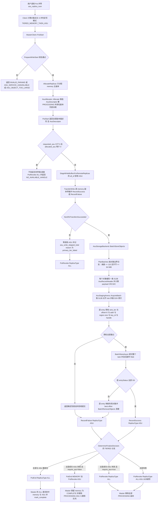

关键决策点：

- **写模式先于参数校验生效**。`DetermineReplicaWriteMode`（replica.h:291-302）在最前面按 `AsuReplicaNum() > 0` 返回 `TIERED_MEMORY_THEN_ASU`，优先级高于 `FLEXIBLE_DUAL_REPLICA`（replica.h:291-302 现有的 nof/dfs 判定）与 `RELIABLE_MULTI_REPLICA`。这样「memory 成功即可、ASU 不反向补位」的有向语义不会被对称的 FLEXIBLE 分支吃掉。
- `PrepareWriteStart`（master_service.cpp:5047-5138）仍是全部参数校验的唯一入口，顺序是：先跑既有的 `kMaxSliceSize` 检查（master_service.cpp:5111-5117），再做 ASU 六条新校验——`asu_replica_num > 1`、`asu > 0 && dfs_replica_num > 0`、`asu > 0 && nof_replica_num > 0`、`asu > 0 && replica_num == 0`、runtime 未就绪（`ASU_SERVICE_UNAVAILABLE`）、`S > MaxObjectBytes`（`ASU_OBJECT_TOO_LARGE`）。非法组合一律 `INVALID_PARAMS`。
- **ASU 不参与分配门槛**。`AllocateReplicas` 在 `use_disk_replica_` 块（master_service.cpp:4916-4920）与 DFS 块（4923-4947）之后、`return replicas`（4950）之前铸造 descriptor 并 `emplace_back` 到列表末尾，因此位置在 `HasExpectedReplicaAllocation` 门槛（master_service.cpp:4876-4898）**之后**；`HasExpectedReplicaAllocation` 的签名与判据都不改，`accessor.Grow` 仍只按 `SaturatingMultiply(value_length, config.replica_num)` 记账（master_service.cpp:5029-5030）。ASU 不占 segment、不分配字节、无 offset 账本，纯命名不会失败。排在末尾还有一个作用：`FindFirstCompleteReplica` 与旧兜底链在无显式档位时不会优先撞上 ASU。
- **客户端必须二次校验分配结果**。Master 允许在纯命名层面「请求了 ASU 但没造出来」只发生在 runtime 异常路径，但 Client 不能在 finalize 阶段才发现：`Client::Put`/`StartBatchPut` 在拿到 PutStart 响应后立即检查 `requested_asu > 0 && allocated_asu == 0`，为真则不发起任何传输，直接 `PutRevoke(ReplicaType::ALL)` 并返回 `NO_AVAILABLE_HANDLE`。否则 `DetermineFinalizeDecision` 会把「没有 ASU」误判成降级成功。
- **门禁是 memory 而非整体**。`SubmitAsuWrites` 只在 `NonDfsTransfersSucceeded`（client_service.cpp:321-327）为真时执行；memory 失败时 ASU 阶段零调用，记 `asu_write_skipped_total{reason=primary_tier_failed}`，最终 `PutRevoke(ALL)`。这与「ASU 在 memory 之后」的要求是同一条约束的两种表述。
- **一个对象一条 entry，offset 恒 0**。`BatchStoreObjects` 把一个对象编码成一条 512B header + payload 的 entry，多个对象按对象边界合批进同一 `BatchStoreAsync`；单 task 条数受 `min(batch_max_entries=110, staging_slots)` 与 `batch_max_bytes` 约束，**绝不切开单个对象**。SDK 不保证单 entry 写入原子，半写对象对读者的不可见性由 Master 侧 PROCESSING 状态与读端 header/CRC fail-stop 共同保证。
- **失败是否回滚主层由 `require_asu` 决定**。ASU 阶段失败（含 task 级 CANCELED/超时导致同批全部对象失败）只让 `failed_asu_transfers > 0`；`require_asu=false` 时 `DetermineFinalizeDecision` 走降级分支，不改变已经成功的 memory 终态；`require_asu=true` 时改为整体失败并 `PutRevoke(ALL)`，已成功的 memory 也一并撤销。

终态由 `DetermineFinalizeDecision`（client_service.cpp:378-431）的 TIERED 分支唯一决定（v2.1 起分 `require_asu` 两模式，共四种映射）：

| 主层 memory 传输 | ASU 阶段 | end_type | revoke_type | Put 返回 | ASU 物理残留处理 |
| --- | --- | --- | --- | --- | --- |
| 全部成功 | 全部对象 entry 成功 | `ALL` | 无 | 成功 | 无 |
| 全部成功 | 失败或部分失败（`require_asu=false`） | `MEMORY` | `ASU` | 成功，记 `asu_degraded_total` | 已写对象 best-effort `BatchRemoveObjects` 清理，descriptor 移除后由 `FreeAsuReplicas` 入队兜底 |
| 全部成功 | 失败或部分失败（`require_asu=true`） | 无 | `ALL` | 失败，返回 `first_asu_error` | 已写 memory 与 ASU 一并撤销；memory 记账由 `EraseReplicasWithCacheTotalAccounting`（1731-1754）回收，ASU 入队由 `FreeAsuReplicas` 兜底 |
| 任一失败 | 未被调用 | 无 | `ALL` | 失败，返回 `first_error` 或 `TRANSFER_FAIL` | 无 |

> **[v2.0 变更]** 第三种终态取代了 v1.0「任一失败即 `PutRevoke(ALL)`」。第一、二种终态让 `PutEnd` 的 `ALL` 谓词必须包含 ASU，否则 happy 路径的 ASU 永远停在 PROCESSING；这正是 v2 的承重修复 FMEA-42。
>
> **[v2.1 变更]** 新增第四种映射：`require_asu=true` 时「主层成功 + ASU 失败」不再降级，而是 `PutRevoke(ALL)` 整体失败；该分支同样依赖 FMEA-42 的 ALL 谓词修复，否则失败路径会留下永久 PROCESSING 的 ASU（FMEA-59）。

- `PutEnd` 的 `is_target_replica` ALL 分支（master_service.cpp:5300-5307）与 `PutRevoke` 的 `processing_rep`（master_service.cpp:5620-5628）和 `target_pred`（master_service.cpp:5635-5644）都必须追加 `is_asu_replica`。不改则任何 end/revoke ALL 都漏掉 ASU：happy 路径的 ASU 永不 COMPLETE，失败路径的 ASU 永久 PROCESSING，进而让对象永远 `InProcessing()`，`CheckRemovable` 的 `AllReplicas(fn_is_completed)`（master_service.cpp:7248）恒假，删除、软 pin、动态复制全部被卡。
- `PutEnd` 的 offload 触发条件（master_service.cpp:5409-5412）必须追加 `!metadata.HasReplica(&Replica::fn_is_asu_replica)`。含 ASU 的对象若再被 demote 到 LOCAL_DISK，会造成同一份数据的双份写与存储放大（FMEA-51）。
- `StageWriteBuffersForRemoteReplicas` 的 `all_of(CanUseLocalMemcpy)`（client_service.cpp:3626-3647）必须排除 ASU descriptor。否则「本地 memory + ASU」会被判成非本地副本，触发整对象 host staging，再叠加 arena 拷贝成为双重拷贝（FMEA-53）。

#### 2.2.2 场景二 读回：Master 返回全集、Client 择优、选中 ASU 走批量读

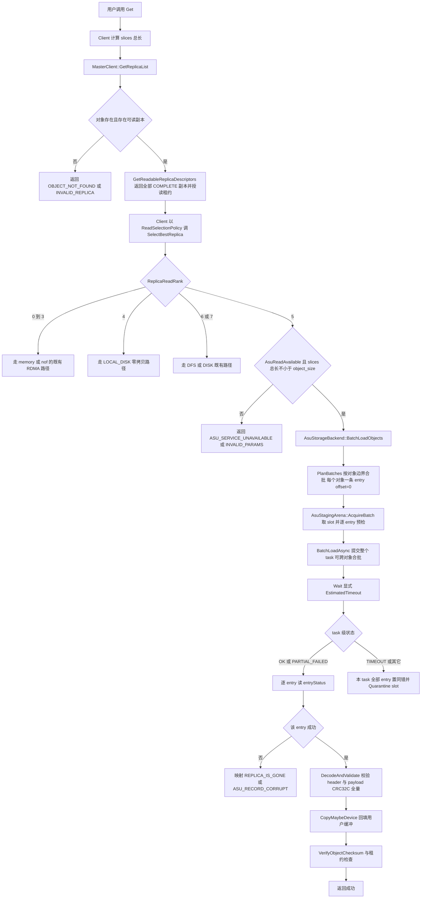

> **[v2.0 变更]** v1.0 的读侧只有「选中 ASU 就 `ReadObject`」一条路径，选择发生在既有的 `FindFirstCompleteReplica`/`SelectBestReplica` 兜底链里，档位隐式。v2.0 把要求 2 落成两件显式的事：Master 侧确认「返回全部可读副本」已成立、不改代码；Client 侧新增 `ReplicaReadRank` 与 `ReadSelectionPolicy`，把 ASU 固定为第 5 档，并在选中 ASU 后改走 `BatchLoadObjects` 的批量读。同时把「读请求长度必须不小于 `object_size`」写成入口硬约束，使 payload CRC 永远可全量校验。

档位定义（`ReplicaReadRank`，replica_selection.h 新增）：

| rank | 副本 | 说明 |
| --- | --- | --- |
| 0 | `kLocalMemory` | 本机 MEMORY，RDMA 直连 |
| 1 | `kLocalNof` | 本机 NOF_SSD |
| 2 | `kRemoteMemory` | 远端 MEMORY，可按 `ReplicaScorer` 打分择优（replica_selection.h:95-124） |
| 3 | `kRemoteNof` | 远端 NOF_SSD |
| 4 | `kLocalDisk` | LOCAL_DISK，零拷贝 offload |
| 5 | `kAsu` | ASU，需 staging、批量读、Wait 与回填 |
| 6 | `kDfs` | DFS |
| 7 | `kDisk` | DISK |

关键决策点：

- **Master 不改返回内容**。`GetReadableReplicaDescriptors`（master_service.cpp:4487-4500）以恒真谓词遍历 Part 0，只经 `IsReplicaReadable`（master_service.cpp:4502-4505 = `is_completed() && is_available() && !IsAwaitingRemount`）过滤，不按类型筛、不排序。ASU 只要是 COMPLETE 就自然出现在返回里，「返回所有副本」这一条在当前 HEAD 已经成立，不需要新增 RPC 或改返回结构。
- **择优只在需要时发生**。`ReadReplicaSelector::operator()`（client_service.cpp:675-700）的短路条件改为：`replicas.size() <= 1`，或「列表里没有 ASU 且 既有 affinity/RDMA 条件不成立」时仍走 `FindFirstCompleteReplica`；否则走 `SelectBestReplica(replicas, GetLocalEndpoints(), hcas, policy)`。全局 always-best 会改变非 RDMA/affinity 关闭/tcp 部署的既有行为，并给每次读加一次 `GetLocalEndpoints()` 的锁，超出要求 2 的必要范围。
- **ASU 排第 5 档是实测前的保守选择**。ASU 读要付 staging 拷贝、`BatchLoadAsync`、显式 Wait 与回填，胜不过 RDMA 直连的 MEMORY/NOF，也比不过 LOCAL_DISK 的零拷贝；只应优于 DFS 与 DISK。档位高低可用 H21/TC-114 的实测结果只改一个枚举值，不需要新增配置。
- **平手规则是后出现者胜出**。`rank <= best_rank` 才覆盖，保持 tests/pybind_client_test.cpp:188-262 对「最后一个 LOCAL_DISK 胜出」的既有断言，避免改测试或行为回归。
- **`asu_available=false` 的 Client 永不选 ASU**。`ReadSelectionPolicy` 默认 `asu_available=false`，未启用 ASU 的部署即使 Master 返回了 AsuDescriptor 也不会选中它，兼容性由默认值兜住。
- **选中 ASU 才走批量读**。`AsuStorageBackend::BatchLoadObjects(span<const AsuReadRequest>, trace_id)` 是唯一读入口；默认把多个对象按对象边界合并进同一 `BatchLoadAsync`（条数 ≤ `min(batch_max_entries=110, staging_slots)`，字节 ≤ 64 MiB），逐 entry `entryStatus` 归因回每个对象。**绝不切开单个对象**，但允许把多个对象放进同一 task。task 级 CANCELED/超时使同 task 内全部对象失败。
- **读请求尺寸契约收紧为整对象**。入口要求 `CalculateSliceSize(slices) >= object_size`，否则 `INVALID_PARAMS`。所有已接线入口（`get_buffer` / `batch_get_buffer` / `batch_get_into` / `batch_get_into_multi_buffers`）都按 `object_size` 分配 slices，不会给 undersized slices。这条契约让 payload CRC-32C 永远可以全量校验，也废弃了 v1.0 的「截断读跳过 payload CRC」分支。
- **不做同一次读内的跨副本 fallback**。选中 ASU 后 `BatchLoadAsync` 失败即该对象读失败，已写入的部分字节绝不按成功返回。这与 DFS 的现有行为一致；注意 LOCAL_DISK 实际有 heal-and-retry，文档不得再写「与 LOCAL_DISK 一致」。
- **arena 耗尽必须区分瞬时与永久**。`AsuStagingArena` 增加 `FreeSlots()`/`IsAvailable()`/`QuarantinedCount()` 与 `AcquireBatch`；只有在**全部 slot 都已 quarantine** 时 `Acquire` 才立即 `ASU_SERVICE_UNAVAILABLE`、`IsReady()` 才变假。瞬时占满时数据面等待，`AcquireBatch` 为一个 task 原子预留全部 entry，跨 task 的总在飞 slot 数由 `PlanBatches` 的条数上限约束。v1.0 的「超时 slot 永不复用且无恢复」会让读路径被两次超时永久静默打死（FMEA-50）。

#### 2.2.3 场景三 按 key 查询后决定行为

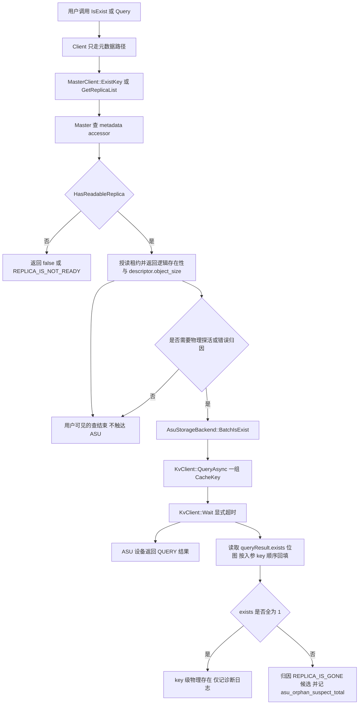

关键决策点：

- 用户可见的查只走元数据，零额外 RTT。逻辑存在性由 Master 元数据回答，`IsExist` 到 `ExistKey` 的路径见 client_service.cpp:4191-4194，Master 侧见 master_service.cpp:2824-2861。
- **「ASU 尚在写」这一中间态在查询上的表现**：ASU 副本出生即 PROCESSING，`IsReplicaReadable` 要求 `is_completed()`，所以它不参与 `HasReadableReplica`。同一对象此时若已有 COMPLETE 的 memory，查询返回 true；若唯一副本是 PROCESSING 的 ASU（v1.0 的并行写里可能出现在主层尚未成功的短窗口），查询返回 false 或 `REPLICA_IS_NOT_READY`。v2.0 把 ASU 挪到 memory 全部成功之后，这一窗口不再存在，「有 ASU 但主层未成功」的对象不可能出现，实际只剩「有 memory 可读」或「整体未提交」两种取值。
- **「memory 已删、只剩 ASU」的对象仍然存在**。删 memory 后对象 `IsValid()` 仍为真（object_metadata.h:488-494 只要还有至少一个非 invalid 副本），查询返回 true，读经由场景二可继续。这是要求 3 与要求 2 闭合的关键点。
- ASU 设备丢失 entry 时 Master 的 `IsExist` 仍返回 true 并下发读不到的 `AsuDescriptor`，读时才暴露 `REPLICA_IS_GONE`。这与 DFS/DISK 同类，必须写进对外契约。
- `QueryAsync` 的 `exists` 是 key 级位图，恰好对应「该对象唯一 entry 是否存在」，不存在 per-offset 粒度的问题。
- 物理查询只用于删除前后一致性诊断、错误归因、开发自验证与运维探活，不放在 `IsExist` 或 `Query` 热路径，不作为 Mooncake 存在性权威。
- 不新增公开的物理查询 RPC。

> **[v2.0 变更]** 查询流程本身未变。唯一变化是状态机含义：v2 不允许「ASU 写入成功但主层不存在」的对象出现，因此查询不会看到「只有 ASU、且物理已提交、但元数据说不可读」的组合。

#### 2.2.4 场景四 按 key 删除回收（两个方向相反的动词）

> **[v2.0 变更]** v1.0 只有一条「整对象删除」流程。v2.0 按用户要求把它拆成两个语义不同的动词：**删 memory** 只移除 memory 副本，对象与 ASU 原样保留；**删 ASU** 是整对象删除，并在同一 key 写锁事务内按「先 memory、后 ASU」级联。两者的物理执行者相同：ASU 的物理删除永远只由 Master 侧 delete-only KvClient 经 `AsuDeleteQueue`/`AsuGcWorker` 执行。

##### 2.2.4.1 删 memory：只删 memory（既有路径，一行不改）

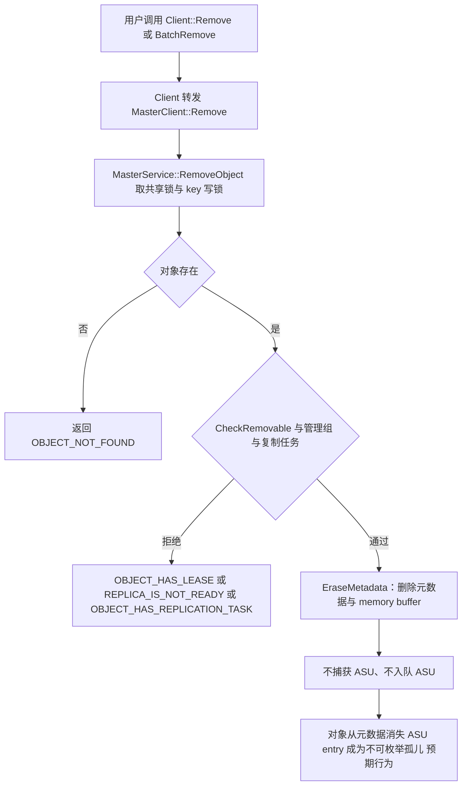

##### 2.2.4.2 删 ASU：新增 BatchRemoveAsuObjects（捕获→既有 Remove→入队）

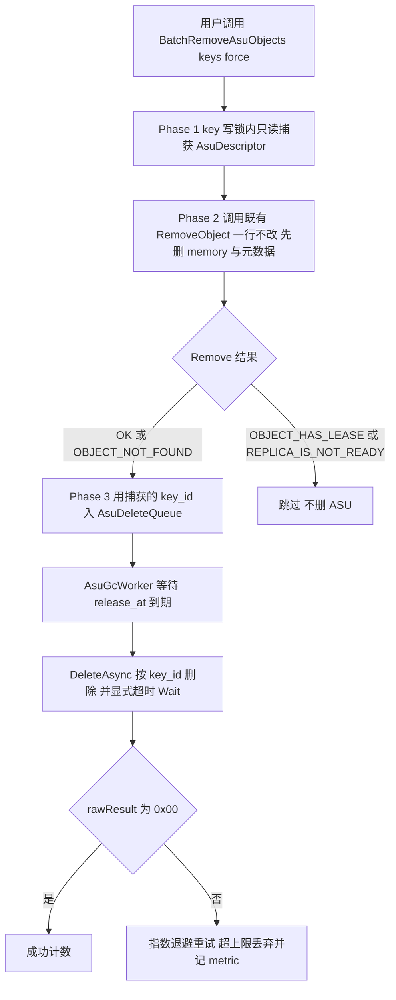

关键决策点：

- **删 memory 复用既有路径，一行不改**。`Client::Remove` / `BatchRemove` → `MasterService::RemoveObject`（`master_service.cpp:7175-7204`）今天的行为就是「删 memory 副本与对象元数据、不触达 ASU 后端」，这正是用户要求的「删 memory 只删 memory」。它继续走 `master_state_mutex_` 共享锁 + `MetadataAccessorRW` + `CheckRemovable`（`master_service.cpp:7236-7255`），本设计不新增任何 RPC 或 Client 方法。
- **`EraseMetadata` 不再捕获或入队 ASU**。plain Remove / `RemoveAll` / `RemoveByRegex` / `BatchReplicaClear` 等所有 `accessor.Erase()` 路径都不拥有 ASU 物理删除权，因此 ASU entry 成为孤儿（预期行为）。删除 ASU 只能由 `BatchRemoveAsuObjects` 发起。
- **新函数的三阶段与顺序陷阱**。`BatchRemoveAsuObjects` **首先**在 key 写锁内用只读访问器捕获 `is_asu_replica()` 的 descriptor（`AsuDescriptor` 随对象元数据一起被 Remove 删除，所以必须**先捕获**）；**其次**调用既有 `RemoveObject`（一行不改，先删 memory 与元数据）；**最后**用捕获到的 `key_id` 入 `AsuDeleteQueue`。若 Remove 返回 `OBJECT_HAS_LEASE`/`REPLICA_IS_NOT_READY`，对象仍存活，不入队。
- **捕获与删除之间的并发由 epoch 兜底**。若期间发生并发 Upsert，捕获到的旧 `key_id` 属于旧世代，迟到的 `DeleteAsync` 只命中旧 key，不会误删新世代（`object_fingerprint`/`object_epoch` 派生隔离）。
- **物理删除唯一执行者不变**。`AsuDeleteQueue` + `AsuGcWorker` + Master delete-only `KvClient` 仍是唯一通道。ASU 是网络可寻址 key、无 owner，LOCAL_DISK 的「client 删文件、Master 删元数据」分工不可平移；`DeleteAsync` 只需 key（`kv_client.h:50`）。`EvictDiskReplica` 一行不改。
- **宽限期与 `not_before`**。`release_at = max(now, not_before) + max(default_kv_lease_ttl_, asu_delete_grace_ms)`，`default_kv_lease_ttl_` 默认 10000ms（types.h:94-95）、`asu_delete_grace_ms` 默认 60000ms。`not_before` 用于被丢弃的 PROCESSING ASU：取 `put_start_time + put_start_release_timeout_sec_`（默认 600s，types.h:140-141），等待可能仍在飞的 DMA 落定。
- **崩溃窗口是要求 3 的关键收益**。memory 已删、ASU 未入队时崩溃，对象只剩 ASU，仍可读、可重试删除；反过来（先删 ASU 再删 memory）则会出现「memory 可读但 ASU 已物理删除」的不一致，且无法通过重试修复。
- **删除失败不向上层报错**。元数据已不可逆删除，向上报错只会诱导重试一个不存在的对象；重试到上限后丢弃并记 `master_asu_delete_dropped_total`，孤儿属于运维问题。

### 2.3 运行设计

本节按 init、write、read、query、remove-memory、remove-asu 六个阶段给出时序图。六张图使用同一套参与者：

| 标识 | 参与者 | 说明 |
| --- | --- | --- |
| U | 用户或应用 | MooncakeDistributedStore 或 RealClient 的调用方 |
| C | Client | Client 控制面，含 AsuClientRuntime |
| M | Master | MasterService 控制面，含 AsuMasterRuntime、AsuAllocator、AsuDeleteQueue、AsuGcWorker |
| A | AsuStorageBackend | 新副本模块的数据面类；客户端侧持有完整读写，Master 侧为 delete-only；内部使用 AsuStagingArena 与 AsuRecordCodec |
| K | KvClient SDK | kv::KvClient 及其 transport |
| D | ASU 设备 | 外部键值存储 |

> **[v2.0 变更]** v1.0 是 init/write/read/query/remove 五张图。v2.0 把 remove 拆成 remove-memory 与 remove-asu（级联）两张，共六张；write 图改为两阶段有序写，read 图改为「Master 返回全集 + Client 档位择优 + ASU 批量读」。

#### 2.3.1 Init 阶段

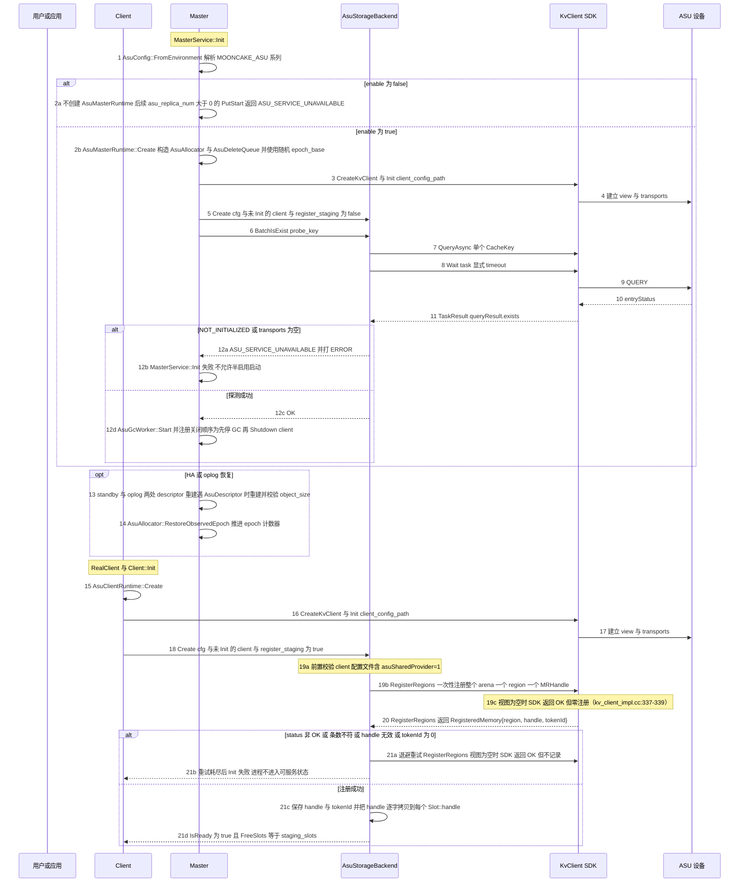

时序简介：

1. Master 入口先解析 `AsuConfig`。`enable=false` 时不创建 `AsuMasterRuntime`，之后 `asu_replica_num>0` 的 `PutStart` 返回 `ASU_SERVICE_UNAVAILABLE`。这正是用户裁决的「IsEnableOffloading：kReady 后返回 true，未就绪返回错误让 Init 明确失败，不读计数、不查容量」。
2. `AsuMasterRuntime::Create` 构造 `AsuAllocator` 与 `AsuDeleteQueue`。`AsuAllocator` 用 `random_device`、`steady_clock`、`pid` 混合出随机 `epoch_base`，避免 Master 重启后与上一世代的 key 冲突；`AsuDeleteQueue` 只是内存队列。
3. Master 先 `CreateKvClient` 并 `Init(client_config_path)`，KvClient 建立 view 与 transports。
4. 再以 `register_staging=false` 创建 `AsuStorageBackend`。delete-only 模式不分配 staging arena、不调用 `RegisterRegions`，因为 Delete 与 Query 只需要 key（kv_client_impl.cc:292-297、493-507）。
5. 就绪探测走 `BatchIsExist({probe_key})`，最终是单 key 的 `QueryAsync` 加显式 `Wait`。SDK 在 snapshot、router、transports 任一为空时返回 `NOT_INITIALIZED`。
6. 探测失败必须让 `MasterService::Init` 明确失败，不允许 Master 以「配置启用但后端不可用」的半启用状态启动。
7. 探测成功后才启动 `AsuGcWorker` 线程。关闭顺序必须先 `Stop` GC 再 `Shutdown` KvClient，避免 GC 线程访问已销毁的 client。
8. HA/oplog 恢复时，两处 descriptor 重建遇到 `AsuDescriptor` 用 `Replica(desc.id, asu_desc, desc.status)` 重建并校验 `object_size`，随后推进 `AsuAllocator` 的 epoch 计数器。恢复过程不访问 ASU，因此不与 HA 互斥。
9. Client 侧先 `CreateKvClient` 并 `Init`，再以 `register_staging=true` 创建 `AsuStorageBackend`。顺序不可交换：`RegisterRegionsOnce` 在 `!snapshot` 时返回 `NOT_INITIALIZED`（kv_client_impl.cc:334-335），而未注册的 entry 要到 `Wait` 才以 `BUFFER_NOT_REGISTERED` 暴露（sqe_request.cc:45-55）。
10. `RegisterRegions` 的**四条成功判据**（缺一不可，任一失败即释放 arena 并让 `Client::Init` 明确失败）：① `status.code == OK`（必须在 `MapStatus` 之前判，`MapStatus(PARTIAL_FAILED)` 返回 `OK`，见 §3.5.1）；② 返回条数等于请求条数（SDK 所有失败路径都会 `clear` 输出，kv_client_impl.cc:337、408-411）；③ `handle != kInvalidMRHandle`（视图为空时返回 OK 但零注册，kv_client_impl.cc:337-339）；④ `tokenId != 0`（AICPU 取不到 UB `tokenValue` 或 RDMA `rkey` 时 `GetMemTokenId` 返回 `UNSUPPORTED`，aicpu_trans_provider.cc:1839-1844、1966-1970）。失败带退避重试，不允许先接受写再报错。
11. arena 大小等于 `staging_slots` 乘单 entry 上限 `kEntryMaxBytes`（默认 8 × 16,776,704 = 134,213,632 B），基址 512B 对齐，**一个 region、一个 `MRHandle`**，所有 slot 共享该 handle；`RegisteredMemory.tokenId` 只存为诊断字段，不进入 entry、不得当 handle 用。
    - 前置条件是客户端 `kv_client` 配置文件含 `asuSharedProvider=1`（或 `asu_shared_provider=1`，config_utils.cc:159-160）。默认 `SharedProviderMode::INDEPENDENT` 会为每个 ASU 节点各建一个 provider，并在注册时把全部已注册区域 `BindMemory` 过去（kv_client_impl.cc:687-702、719-731），而 AICPU 的 `BindMemory` 只接受 `MEM_DEVICE`（aicpu_trans_provider.cc:1691-1699）；因此非空 view 下缺该配置会让注册必然 `PARTIAL_FAILED`。该门禁只在 `register_staging == true` 时生效（Master 的 delete-only client 不注册，不受约束），失败即 Init 失败，不允许降级启动。
12. 能力协商：SDK 公有 API 不暴露 `ServerKvCapabilities`，本设计不读取、不 clamp，固定按 `kEntryMaxBytes` 校验单 entry；设备真实上限只能从 Init 日志观察并实测确认。

> **[v2.0 变更]** 两处变化。(1) `AsuClientRuntime::IsReady()` 从「Init 就绪」扩展为「Init 就绪 且 staging arena 未全部 quarantine」，因此第 21c 步同时要求 `FreeSlots() == staging_slots`；运行期全部 slot 被 timeout 隔离后 `IsReady()` 会变假，读选择器随之改选其它副本（对应 FMEA-50、FMEA-36）。瞬时的 slot 占满只让数据面等待，不会改变 `IsReady()`。(2) `AsuAllocator` 的 epoch 语义明确为「全局原子 64 位、随机种子、恢复时推进到已恢复 descriptor 最大 epoch + 1」，用于满足「新 PutStart 必得新物理 key」这一承重前提。其余 init 逻辑与 v1.0 完全相同。

#### 2.3.2 写入阶段（两阶段有序写）

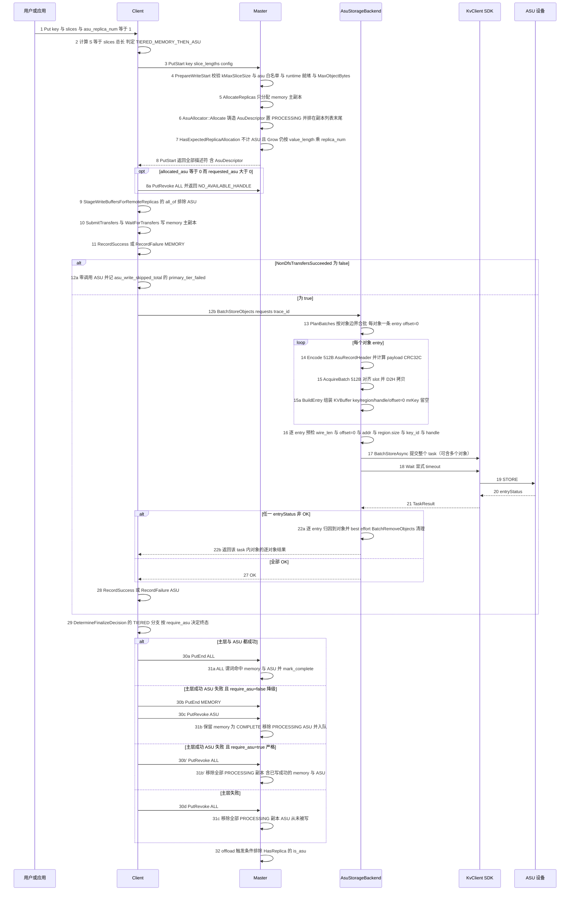

> **[v2.0 变更]** 写路径由「memory 与 ASU 并行扇出、任一失败即整体 revoke」改为链式两阶段：`StartBatchPut` → `SubmitTransfers` → `WaitForTransfers` →（DFS）→ `SubmitAsuWrites` → `FinalizeBatchPut`。ASU 的调用只在 memory 全部成功后出现；主层失败时该调用不存在，而不是「调用了再失败」。终态从二值变成四种映射（三种 end/revoke 组合：`{ALL,null}`、`{MEMORY,ASU}`、`{null,ALL}`；严格失败与主层失败同属 `{null,ALL}`），`FinalizeDecision` 仍是 `end_type` + `revoke_type` 双槽。

时序简介：

1. Client 计算 `S` 只用于请求与本地分块，真正的长度权威在 Master。
2. 写模式在 `DetermineReplicaWriteMode`（replica.h:291-302）最前面按 `AsuReplicaNum() > 0` 返回 `TIERED_MEMORY_THEN_ASU`。`ReplicateConfig` 追加 `struct_pack::compatible<size_t, 4> asu_replica_num` 与 `AsuReplicaNum()`，沿用 replica.h:133-139 的 compatible 范式，禁止裸 `size_t`（否则破坏 RPC 线格式兼容）。
3. `PrepareWriteStart`（master_service.cpp:5047-5138）是唯一参数校验入口。`kMaxSliceSize` 检查（master_service.cpp:5111-5117）保持在最前且对所有副本类型生效；其后的 ASU 六条校验见 2.2.1。
4. `AllocateReplicas` 先分配 memory（`replica_num >= 1` 已由白名单保证），在 `use_disk_replica_` 与 DFS 块之后、`return replicas` 之前 `emplace_back` 一个 PROCESSING 的 AsuDescriptor（因此位于 `HasExpectedReplicaAllocation` 门槛 master_service.cpp:4876-4898 之后）。`AllocateReplicas` 需要新增 `const TenantId&` 参数并透传 `AllocateAndInsertMetadata`/`InsertMetadata`；`accessor.Grow` 的记账公式（master_service.cpp:5029-5030）不变，ASU 不占字节。
5. `AsuDescriptor` 的 40B 线格式（含 `object_epoch`）在 PutStart 响应中原样返回。客户端只使用其中的 `key_id` 与 `object_size`，绝不自行重算 key；`object_epoch` 参与 key 推导，每次 PutStart 得到新物理 key，因此 Remove 后立刻 Put 不会被迟到的 Delete 误删。
6. 客户端在拿到 PutStart 响应后立即校验 `requested_asu > 0` 时 `allocated_asu > 0`。为假说明服务端纯命名没造出 ASU，此时不发起传输、直接 `PutRevoke(ALL)` 并返回 `NO_AVAILABLE_HANDLE`。这一步不能省：让 `allocated_asu == 0` 流进 finalize 会被 `HasExpectedReplicaAllocation` 与 TIERED 分支误判。
7. `StageWriteBuffersForRemoteReplicas`（client_service.cpp:3626-3647）的 `all_of(CanUseLocalMemcpy)` 必须排除 ASU descriptor，否则本地 memory + ASU 的组合会被整对象 staging，与 arena 拷贝叠加。
8. 主层传输：单 key 在 client_service.cpp:2115-2139 逐 memory/nof 副本 `TransferWrite` 并 `RecordSuccess/RecordFailure`；批量走 `SubmitTransfers` 与 `WaitForTransfers`（client_service.cpp:3682-3684）。磁盘副本仍先写（client_service.cpp:2115-2126），但 v2 白名单禁止 asu 与 dfs 同存。
9. 门禁是 `NonDfsTransfersSucceeded`（client_service.cpp:321-327）。为假时 `SubmitAsuWrites` 记 `asu_write_skipped_total{reason=primary_tier_failed}` 并零调用 `BatchStoreObjects`；这是要求 1 的逆序断言点（FMEA-41）。
10. `AsuStorageBackend::BatchStoreObjects` 的输入是 `op.slices`，不回读 memory。契约是「Put 返回前调用方不得修改 buffer」。
11. 每个对象一条 entry，`wire_len = 512 + align_up(object_size, 512)`，`offset` 恒为 0。`S=0` 或 `S > 16,776,192` 直接拒绝（后者含 1,008 B 窗口）。
12. 512B 对齐由三处共同保证：header 固定 512B；`wire_len` 等于 512 加 `align_up(object_size, 512)`；`offset` 恒为 0（512B 的整数倍）。arena 基址与 slot 也强制 512B 对齐。SDK 只校验 length 与 offset 的对齐，不校验 addr。
13. staging 与 entry 组装：device 指针的 slice 先 D2H 拷入已注册 pinned slot；每个对象一个 slot，slot 不可在 Wait 返回前复用。随后在提交前用 `BuildEntry(descriptor, dst, slot->handle, wire_len)` 组装 `kv::KVBuffer`：`key` 取 `AsuKeyCodec::ToCacheKey(descriptor.key_id)`，`buffer.region.addr` 取 slot 地址，`buffer.region.size` 取 `wire_len`（不是 slot 容量），`buffer.handle` 取注册返回的 canonical handle，`offset` 恒为 0，`mrKey` 必须留 `std::nullopt`（由 `KvClient::SubmitAsync` 按 handle 回填，调用方传入的值会被无条件重置）。字段归属见 §3.5.1。
14. 逐 entry 预检在 `BatchStoreAsync` 之前完成，检查 `wire_len` 是 512 的整数倍且落在 512 到 16,776,704 之间、`offset == 0`、`buffer.region.addr` 是 512 的倍数、`buffer.region.size` 精确等于 `wire_len`、`key` 非全零且非空、`buffer.handle` **精确等于** arena 的 canonical handle（只判 `!= kInvalidMRHandle` 拦不住「非 0 但未注册」，那种错误要到 `Wait` 才以 `BUFFER_NOT_REGISTERED` 暴露）、`mrKey` 必须为空。原因是 SDK 在预发送阶段失败会 abort 整个 transport task 并把所有 `entryStatus` 置 CANCELED（trans_task_executor.cc:227-246），不存在只失败一条。
15. `region.size` 在 SDK 内部先被 `static_cast<uint32_t>`（sqe_request.cc:190、206、223、251），所以本层禁止任何 entry 大于等于 4GiB；`kMaxObjectBytes` 与 `wire_len` 双重断言。
16. `Wait` 必须显式传 timeout。`KvClientConfig` 的 `defaultWaitTimeoutMs` 默认 100ms（kv_types.h:215），16MiB entry 必然超时；Wait 超时后 task 被无条件 Remove（task_manager.cc:108-116），结果不可再取，该 task 的全部 slot 进 quarantine。
17. 提交批次：按 `PlanBatches` 把本批对象按对象边界切成若干 task（条数 ≤ `min(batch_max_entries=110, staging_slots)`，字节 ≤ `batch_max_bytes=64 MiB`），每个 task 一次 `BatchStoreAsync` + 显式 `Wait`；一个对象只贡献一条 entry，绝不切开单个对象。
18. 任一 entry 失败则按 `entryStatus` 映射到对应对象，best-effort `BatchRemoveObjects` 清理失败对象，再 `RecordFailure(ASU)`；task 级 CANCELED/超时使该 task 内全部对象失败。注意这里**不** revoke 主层：ASU 阶段的失败只交给 `DetermineFinalizeDecision`；`require_asu=false` 进入降级，`true` 由 finalize 统一 revoke ALL。
19. `DetermineFinalizeDecision`（client_service.cpp:378-431）在非 FLEXIBLE 分支之前插入 TIERED 判定：`primary_ok = HasExpectedReplicaAllocation && NonDfsTransfersSucceeded`，`asu_ok = allocated_asu > 0 && successful_asu == allocated_asu && failed_asu == 0`。四种组合映射为 `{ALL, null, true}`（主层与 ASU 都成功）、`{MEMORY, ASU, true}`（`require_asu=false` 降级）、`{null, ALL, false}`（`require_asu=true` 严格失败，错误码取 `first_asu_error`）、`{null, ALL, false}`（主层失败，ASU 从未写）。`FinalizeDecision` 结构保持 `end_type` + `revoke_type` 双槽，不向量化——白名单关掉 asu+nof/asu+dfs 后，降级只需一个 end 和一个 revoke。
20. **ASU 写阶段在 PutEnd 之前**。这是必然的：ASU 副本出生即 PROCESSING，只有 `PutEnd` 能把 COMPLETE 态写进元数据；若先 PutEnd 再写物理数据，就会出现「元数据 COMPLETE 而物理未提交」的可读假象。同步内联（而不是异步后台写）的理由同样落在这里：异步会让 ASU 长期 PROCESSING，使 `CheckRemovable` 的 `AllReplicas(fn_is_completed)`（master_service.cpp:7248）恒假，阻塞 Remove、软 pin 与动态复制。
21. 单 key 终态顺序保持「先 end 后 revoke」（client_service.cpp:2186-2203、2392-2408），只改错误处理：`revoke_type == ASU` 失败时仅记 `asu_finalize_rpc_failed_total` 与 WARN，不写 `finalize_rpc_errors`、不 return。原因是 `FinalizeBatchPut` 只要 `finalize_rpc_errors` 被置位就 `SetTerminalError`（client_service.cpp:3441-3444），不分流则「降级但仍成功」在实现上不成立（FMEA-44）。`require_asu=true` 时严格失败只产出 `revoke_type == ALL`，绝不落入该豁免；`ignore_errors` 的判据必须是「副本类型 == ASU」而不是「写模式 == TIERED」（FMEA-60）。end 为空、仅发 revoke 时，revoke 失败只记录（该作用域没有 PutOperation/failure_context），随后返回 `finalize_decision.error`（ASU 根因），不要用 revoke 的错误覆盖它（client_service.cpp:2196-2203、2401-2408）。
22. 批量路径：`SubmitAsuWrites` 插在 `SubmitDfsWrites` 之后、`FinalizeBatchPut`/`FinalizeBatchUpsert` 之前（client_service.cpp:3685、3735）；单 key `Put` 插在 client_service.cpp:2174 与 2183 之间，`Upsert` 插在 2381 与 2390 之间。`FinalizeBatchPut`（client_service.cpp:3261-3462）新增 `revoke_asu_group` 与 `case ASU`，`process_revoke_group` 增加 `ignore_errors` 供 ASU 方向使用。`FinalizeBatchUpsert`（client_service.cpp:3464-3583）的成功判据改为 `primary_ok && asu_ok`，happy 路径用 `BatchUpsertEnd`（内部硬编码 ALL，master_service.cpp:6203-6207），降级子集改调 `BatchPutEnd(metas, MEMORY)` + `BatchPutRevoke(keys, ASU)`（现成 RPC，master_client.h:298-318）。
23. 含 ASU 的 Upsert 强制 Case C。`UpsertStart` 在 Case B 判定（master_service.cpp:5999-6038）之前短路：`asu > 0` 或已有 ASU 或没有 COMPLETE memory 时直接走 Case C。同时把租约闸门（master_service.cpp:5986-5994）从「任何非 memory 副本」收窄为 DISK/LOCAL_DISK/DFS，否则 ASU 副本会让持租约的 Upsert 被误挡。Case B 原地复用不调用 `AllocateReplicas`，会让「请求了 ASU 却没有 ASU 副本」的对象在 finalize 被整体回滚（FMEA-43）。
24. `PutEnd(ALL)` 时 Master 的 ALL 分支命中 memory 与 ASU 并 mark_complete；`PutRevoke(ALL)` 时 `processing_rep` 与 `target_pred` 两处 ALL 分支都命中 ASU。`AllReplicas(fn_is_completed)` 成立才 `EraseFromProcessing`（master_service.cpp:5438-5441）。
25. **「ASU 尚在写」这个中间态在写路径上的唯一性**：它只可能存在于 Put 调用内部。此时 `is_processing=true`（master_service.cpp:5011），`IsReplicaReadable` 要求 `is_completed()`，读路径完全看不见；`CheckRemovable` 要求全部副本 COMPLETE，删除路径也看不见。写完成后要么全部 COMPLETE，要么 ASU 被移除，不存在「memory PROCESSING + ASU COMPLETE」的组合。
26. 性能提示：v1.0 的并行副本延迟约为 `max(memory, ASU)`，v2 变成近似 `memory + ASU` 之和。必须由 H21 量化 16MiB 对象 Put 的 P50/P99 回归，并作为 `require_asu` 取值的量化依据；若回归不可接受，可切 `require_asu=true` 让失败更早暴露或下调 `max_object_bytes`，回退并行将推翻要求 1、须用户确认，不能由实现偷偷改回。

#### 2.3.3 读取阶段（Master 返回全集、Client 择优、ASU 批量读）

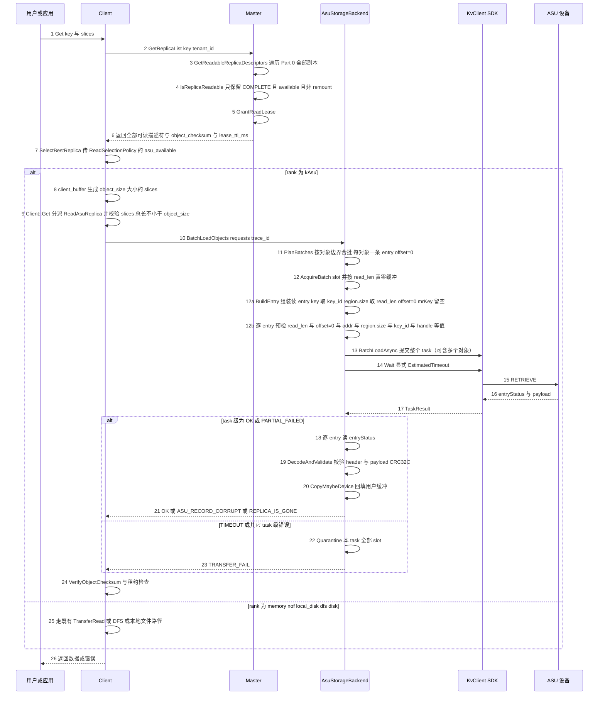

> **[v2.0 变更]** 读路径的改动集中在 Client：Master 只被确认「原本就返回全部可读副本」；Client 用显式档位替代隐式兜底链，并在选中 ASU 后走 `BatchLoadObjects` 批量读而不是逐对象 `ReadObject`。另一个承重修复是适配层的 `PARTIAL_FAILED` 早退——不改则逐 entry 归因在实现上不成立。

时序简介：

1. `GetReplicaList` 只查元数据并授读租约，Master 不触达 ASU（master_service.cpp:4561-4583）。**Master 侧不需要任何改动**：`GetReadableReplicaDescriptors`（master_service.cpp:4487-4500）本来就返回全部可读副本，`ReadReplicaList`（master_service.cpp:4585-4660）与 `BatchGetReplicaList`（master_service.cpp:4705-4733）都复用它。可选的唯一小改是在命中指标（master_service.cpp:4611-4620）补一个 ASU 分支，便于观测，不改返回内容。
2. 返回 `AsuDescriptor`、`object_checksum`、`lease_ttl_ms`（rpc_types.h:84-105）。长度权威是 `descriptor.object_size`，原始来源是 `ObjectPart::length_`（object_part.h:77），在 PutStart 时由 `slice_lengths` 求和并复制进 descriptor。SDK 没有任何取长度的 API，不存在第二权威。
3. 选择器：`ReadReplicaSelector::operator()`（client_service.cpp:675-700）的短路条件改为 `replicas.size() <= 1 || (无 ASU 且 非 affinity/RDMA)`，其余走 `SelectBestReplica(replicas, GetLocalEndpoints(), hcas, {.asu_available=client_->AsuReadAvailable()})`。`hcas` 仅在 `StoreHcaAffinityEnabled()` 且 `protocol_ == "rdma"` 时由 context 推断，否则为空。选择结果为空时用 `NoReplicaError` 统一映射：列表里有 COMPLETE ASU 则 `ASU_SERVICE_UNAVAILABLE`，否则 `INVALID_REPLICA`。
4. `SelectBestReplica`（replica_selection.h:133-194）保留 137-180 的 memory/nof/HCA 逻辑，只把 182-193 的兜底链改为按 `ReplicaReadRank` 取最小的显式档位。`rank <= best_rank` 才覆盖即「后出现者胜出」，保持 tests/pybind_client_test.cpp:188-262 的既有断言。
5. 若选中 memory/nof/local_disk/dfs/disk，完全走既有路径，不经过任何 ASU 代码。
6. 若选中 ASU：`client_buffer.cpp` 的 `calculate_total_size`（client_buffer.cpp:144-159）在最后 `else` 前加 ASU 分支返回 `object_size`；`allocateSlices`（client_buffer.cpp:161-191）加 ASU 分支生成单个 `Slice{buffer_ptr, object_size}`。这一步必须做，否则 ASU 会落到既有 `else` 的默认计算。
7. `Client::Get`（client_service.cpp:1578-1653）在 1599-1603 的 DFS 分支旁加 `else if (replica.is_asu_replica()) err = ReadAsuReplica(...)`。入口要求 `CalculateSliceSize(slices) >= object_size`，否则 `INVALID_PARAMS`——与 memory 在 `TransferRead`（client_service.cpp:5160-5185）的尺寸契约一致。`TransferRead` 入口再显式 `if (is_asu_replica) return INVALID_REPLICA` 兜底，`transfer_task.cpp` 的 `submitFileReadOperation` 之前也加防御性拒绝，避免落到 `get_disk_descriptor()` 抛 `std::runtime_error`。
8. 后置校验原样保留：`VerifyObjectChecksum`（client_service.cpp:1622-1624）、hot cache（1637）、租约检查（1641）。hot cache 只在 `is_memory_replica` 时生效，`ProcessSlicesAsync` 因 5766 的 memory 门控会跳过 ASU。
9. 读不做分块：入口已保证 `slices >= object_size`，每个对象一次完整 entry 读取，`read_len = 512 + AlignUp(object_size, 512)`，`offset = 0`。`data_len == object_size`，payload CRC-32C 永远全量校验。
10. 打包：`BatchLoadObjects` 把多个对象按对象边界合并进同一 `BatchLoadAsync`（条数 ≤ `min(batch_max_entries=110, staging_slots)`，字节 ≤ `batch_max_bytes`，默认 64MiB）。**绝不切开单个对象**；task 级错误波及本 task 内全部对象，`PARTIAL_FAILED` 逐 entry 归因。跨对象在飞 slot 总数受 `staging_slots` 约束，每个 task 用 `AcquireBatch` 原子预留。
11. 逐 entry 预检与写侧同规则：`read_len` 是 512 的倍数且落在 512 到 16,776,704 之间、`read_off == 0`、addr 是 512 的倍数、`region.size` 精确等于 `read_len`、`key` 非全零、`buffer.handle` 精确等于 arena 的 canonical handle、`mrKey` 必须为空。读侧 entry 与写侧同构，唯一差异是 `buffer.region.size` 取 `read_len`，且 slot 在组装前按 `read_len` 置零；没有 header 编码步骤。预发送失败同样会整批 CANCELED。
12. **适配层必须修复的早退缺陷**：`Status::ok()` 只对 `OK` 为真（kv_types.h:88-93），v1.0 的 `if (!wait.ok())` 会把 `PARTIAL_FAILED` 误判成整体失败并丢掉全部 per-entry 结果。v2 改为 `if (code != OK && code != PARTIAL_FAILED) return unexpected(MapStatus(code));` 再交 `ToEntryResults` 逐条映射。`BatchStore`/`BatchLoad` 两侧都要改。
13. `Wait` 必须显式传 `EstimateTimeoutMs`（基于字节数与基线估算）。超时后 task 被无条件 Remove（task_manager.cc:108-116），本 task 的全部 slot 进 quarantine 且不复用；当**全部** slot 都被 quarantine 时 runtime 变为不可服务（`IsAvailable()==false`），仅瞬时占满不改变可服务性。
14. 结果判定：task 级 `OK` 与 `PARTIAL_FAILED` 都继续读 `entryStatus` 逐条映射；只有 `TIMEOUT`/`NOT_FOUND`/`NOT_INITIALIZED`/`CONNECTION_ERROR`/`IO_ERROR` 才把本 task 全部 entry 置同一错误。LOAD 的 `ENTRY_KEY_NOT_FOUND` 或 `ENTRY_DATA_NOT_EXIST` 映射 `REPLICA_IS_GONE`。
15. header 校验是 fail-stop：magic、version、header_bytes、header_crc32c、flags 未知位、`key_id`（asu_key_id）、`key_fingerprint`、`object_epoch`、`object_size`、`data_offset==0`、`data_len`（== object_size）、`data_crc32c`，任一不符返回 `ASU_RECORD_CORRUPT` 或 `ASU_KEY_COLLISION`，绝不交出别人的字节。
16. **payload CRC-32C 在 v2 中永不跳过**。因为入口强制整对象读，每个对象的 entry 完整读到，`data_crc32c` 全量可校验。这是承重项：Mooncake 端到端 CRC-64 默认关闭，若这里再跳过就只剩 header CRC。CRC 必须按地址序对内存计算。
17. 回填用 `CopyMaybeDevice`（batch_read_fanout.h:57-66），host 缓冲 memcpy、device 缓冲 H2D。成功或已确定的错误 → `Release(slot)`；task 级超时 → `Quarantine(slot)`。
18. 批量读接线在 `Client::BatchGet`（client_service.cpp:1718-1997）：在 1758-1759 的 DFS 请求容器旁新增 `asu_read_requests`/`asu_indices`；在 1802-1816 的 DFS 分支旁加 `else if (is_asu_replica())`：runtime 未就绪则 `results[i] = ASU_SERVICE_UNAVAILABLE`，否则收集并 `continue`。在 DFS 同步批量读（client_service.cpp:1889-1955）之后、RDMA 统一 Wait（client_service.cpp:1957-1997）之前执行一次 `BatchLoadObjects`，逐 outcome 映射并复用 `VerifyObjectChecksum`（1978-1985）。
19. real_client 侧四个全对象选择点必须传 policy：`get_buffer_internal`（real_client.cpp:4036）、`batch_get_buffer_internal`（4425）、`batch_get_into_internal`（6776）、`batch_get_into_multi_buffers_internal`（8440）；`nullptr` 分支统一走 `NoReplicaError`，避免与 `ReadReplicaSelector` 的错误码不一致。multi-buffer 的 `if (replica.is_memory_replica() || replica.is_nof_replica())`（real_client.cpp:8464）要扩展为 `|| replica.is_asu_replica()`，否则会落到 real_client.cpp:8498 的 `Unsupported replica type`。
20. range 与 session range 对 ASU 显式 `NOT_SUPPORTED`；`SelectSessionReplica`（real_client.cpp:550-571）不纳入 ASU。`MakeReadReplicaSelector(bool allow_asu = true)` 的 range 调用点（client_service.cpp:1661、4907）传 `false`。
21. 失败语义：选择阶段无 COMPLETE 副本 → `INVALID_REPLICA`；只有 ASU 且 `AsuReadAvailable() == false` → `ASU_SERVICE_UNAVAILABLE`。单对象失败即失败，不做同一次 Get 内的跨副本 fallback，不返回部分数据。批量每对象结果独立；task 级错误波及本 task 内的全部对象，`PARTIAL_FAILED` 逐 entry 归因，但一个对象只占一条 entry，不存在同对象跨 task。
22. 明确不做：回填 memory/promotion（hot cache 只在 client_service.cpp:5766 对 memory 生效，promotion-on-hit 只认 LOCAL_DISK，master_service.cpp:4631-4645）、range/session 读、扩展 `RetainMemoryReadCandidates`（replica_selection.h:199-218 是未来 fallback 的唯一落点，登记为已知扩展点）。

#### 2.3.4 查询阶段

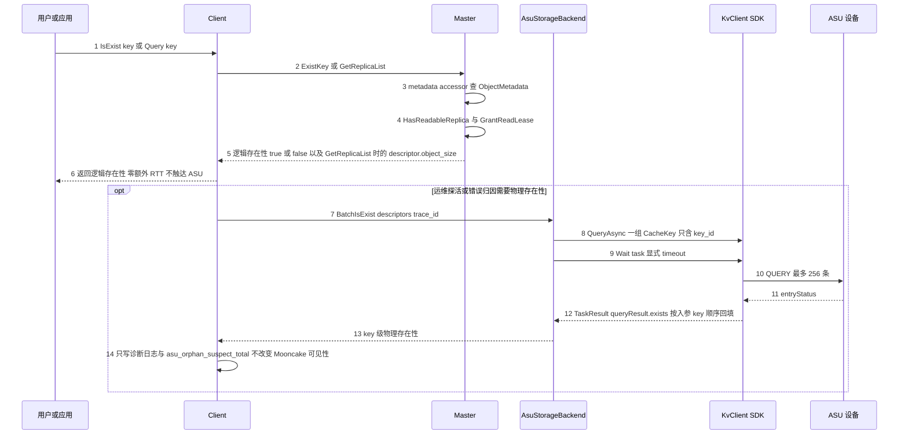

时序简介：

1. `IsExist`、`BatchIsExist`、`Query` 只走元数据，零额外 RTT。Client 侧见 client_service.cpp:4191-4194，Master 侧查 metadata accessor，按 `HasReadableReplica` 决定可见性并授租约（master_service.cpp:2824-2861）。
2. 返回的长度是 `descriptor.object_size`。SDK 没有长度、Stat、GetMeta API（kv_client.h:33-61），不存在第二权威。
3. 物理存在性只能由 `QueryAsync` 的 `exists` 位图观测，按入参 key 顺序回填（trans_task_utils.cc:169-180）。取消分块后每个对象只有一个 entry，key 级位图恰好对应「该对象 entry 是否存在」。
4. 因此物理查询只用于删除前后一致性诊断、错误归因、开发自验证与运维探活；不放在 `IsExist` 或 `Query` 热路径，不作为 Mooncake 存在性权威。
5. 语义边界：ASU entry 丢失时 Master 的 `IsExist` 仍返回 true 并下发读不到的 descriptor，读时才暴露 `REPLICA_IS_GONE`。这与 DFS/DISK 同类，必须写进对外契约。
6. 不新增公开的物理查询 RPC。

> **[v2.0 变更]** 查询阶段零改动。v2 只补充两条状态机含义：ASU 在 Put 调用内部为 PROCESSING 时不参与 `HasReadableReplica`；memory 被单独删除后 ASU 仍 COMPLETE，对象继续返回存在。

#### 2.3.5 删除阶段（删 memory 与删 ASU 两条流程）

> **[v2.0 变更]** v1.0 只有一张 remove 图。v2.0 拆成两张，对应两个方向相反的动词。两张图共享同一个不变量：**ASU 的物理删除永远只由 Master 侧 delete-only KvClient 执行**，`FreeAsuReplicas` 只入队、不做 IO。

##### 2.3.5.1 删 memory：既有 Remove，一行不改

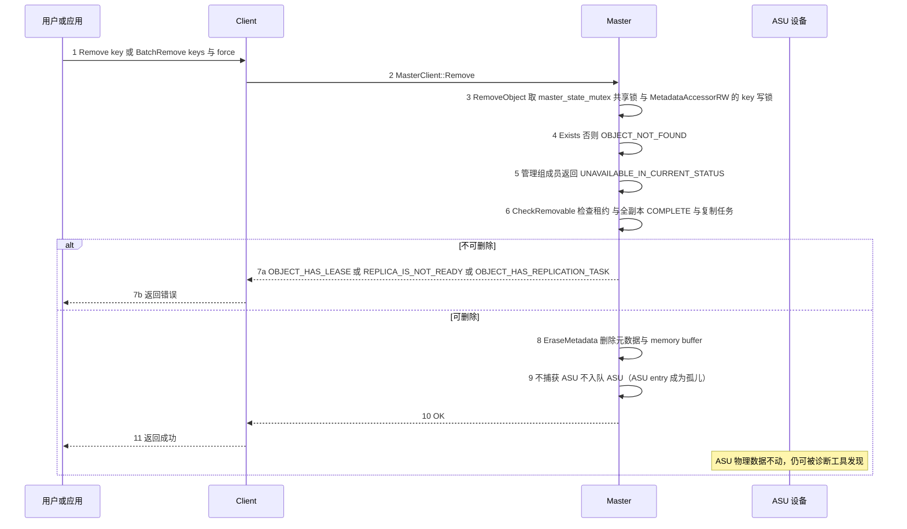

时序简介：

1. 删 memory 直接复用现有 `Client::Remove` / `BatchRemove` → `MasterClient::Remove` → `MasterService::RemoveObject`（`master_service.cpp:7175-7204`），一行不改；不新增 RPC、不新增 Client 方法。
2. `RemoveObject` 取 `master_state_mutex_` 共享锁（`master_service.cpp:7179`），`MetadataAccessorRW` 取 key 写锁；不存在返回 `OBJECT_NOT_FOUND`，管理组成员返回 `UNAVAILABLE_IN_CURRENT_STATUS`。
3. `CheckRemovable`（`master_service.cpp:7236-7255`）的三项检查原样复用：lease 未过期且非 force → `OBJECT_HAS_LEASE`；`AllReplicas(fn_is_completed)` 不成立 → `REPLICA_IS_NOT_READY`；有 `replication_task` → `OBJECT_HAS_REPLICATION_TASK`。
4. `EraseMetadata` 只删除元数据与 memory buffer，**不捕获、不入队 ASU**。这是用户明确要求的「删 memory 只删 memory」；ASU entry 成为不可枚举孤儿（预期行为），只能由 `BatchRemoveAsuObjects` 回收。
5. 错误语义：对象不存在 → `OBJECT_NOT_FOUND`；有 PROCESSING 副本 → `REPLICA_IS_NOT_READY`（写删互斥）。

##### 2.3.5.2 删 ASU：新增 BatchRemoveAsuObjects（捕获→既有 Remove→入队）

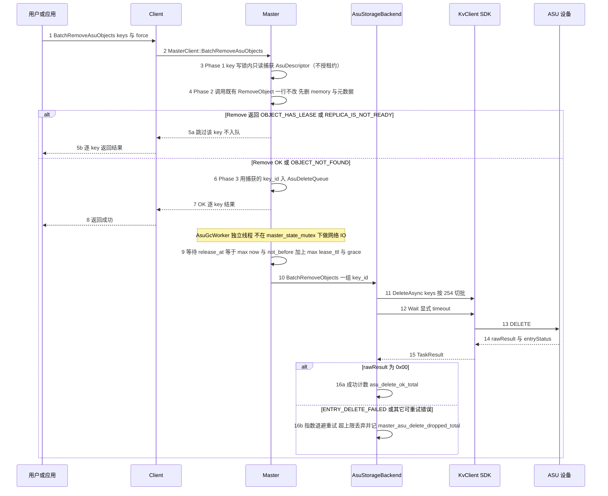

时序简介：

1. 「删 ASU」是新增的 `BatchRemoveAsuObjects(keys, force)`。它内部**首先**在 key 写锁内用只读访问器捕获每个 key 的 `AsuDescriptor`（因为随后的 `RemoveObject` 会把 descriptor 连同元数据一起删除），**然后**调用既有 `RemoveObject`（`master_service.cpp:7175-7204`，一行不改），**最后**用捕获的 `key_id` 入 `AsuDeleteQueue`。
2. 既有 `RemoveObject` 取 `master_state_mutex_` 共享锁，`MetadataAccessorRW` 取 key 写锁；不存在返回 `OBJECT_NOT_FOUND`，管理组成员返回 `UNAVAILABLE_IN_CURRENT_STATUS`。
3. `CheckRemovable`（`master_service.cpp:7236-7255`）承担写删互斥：任何 PROCESSING 副本（包括正在写的 ASU）都会让删除返回 `REPLICA_IS_NOT_READY`，此时跳过该 key、不入队。
4. `EraseMetadata`（`master_service.cpp:2054-2116`）不再捕获或入队 ASU；plain Remove 后 ASU 成为孤儿。只有本函数在 Remove 返回成功或 `OBJECT_NOT_FOUND` 后，才把**捕获前**的 descriptor 入队，闭合「删 ASU 先删 memory」。
5. `EnqueueAsuDeletes` 只持 `AsuDeleteQueue` 自身的 mutex，绝不在 `master_state_mutex_` 或 key 锁下做网络 IO。
6. `release_at = max(now, not_before.value_or(now)) + max(default_kv_lease_ttl_, asu_delete_grace_ms)`。`not_before` 在 `AsuMasterRuntime::EnqueueDelete` 内做**唯一一次** system_clock→steady_clock 换算并钳到 `>= now`。
7. `AsuGcWorker` 是独立单线程，按 `release_at` 取到期项，`BatchRemoveObjects` 按 254 key 切批 `DeleteAsync` 后显式超时 `Wait`。失败指数退避重入队，超过 `asu_delete_max_attempts` 丢弃并记 `master_asu_delete_dropped_total`。
8. DELETE 的成功语义是 `rawResult == 0x00`；`ENTRY_DELETE_FAILED`（0x0201）可重试；不要假设 DELETE 会返回 `ENTRY_KEY_NOT_EXIST`，那是 QUERY 的语义。删除不存在的 key 按 H4 视为幂等成功。
9. 一个对象一个 ASU key、一条 entry，物理删除是每对象一次 key 删除；`DeleteAsync` 以 key 为单位，不需要 offset 展开（v2.3 取消分块后 H15 退役）。
10. 崩溃窗口：memory 已删、ASU 未入队时崩溃，对象只剩 ASU，仍可读、可重试删除。每个写世代有独立 `object_epoch` 并参与 key 推导，删除队列只删入队时的 `key_id`。
11. 删除失败不向上层报错：元数据已不可逆删除，向上报错只会诱导重试不存在的对象；孤儿属运维问题，记 metric + WARN。
12. `EvictDiskReplica` 不扩白名单、不加 ASU/MEMORY 分支、一行不改。

#### 2.3.6 512B 对齐 长度权威 与逐 entry 预检的落点

| 关注点 | 发生位置 | 依据 |
| --- | --- | --- |
| 单 entry 布局 | 写路径 §2.3.2 第 11 步；读路径 §2.3.3 第 9 步 | 一个对象一条 entry，`wire_len = 512 + AlignUp(object_size, 512)`，`offset = 0`；常量见 asu_layout.h |
| 512B 对齐 | header 固定 512B；`wire_len = 512 + align_up(object_size, 512)`；`offset` 恒 0；staging slot 基址 512B 对齐 | asu_layout.h 的 `kAlign`、`kHeaderBytes`、`kEntryMaxBytes` 与 static_assert |
| 长度权威 | 写：PutStart 时 `ObjectPart::length_` 复制进 `AsuDescriptor.object_size`，见 2.3.2 第 5 步；读：`descriptor.object_size` 决定整对象读长度，见 2.3.3 第 9 步 | object_part.h:77、rpc_types.h:84-105 |
| 逐 entry 预检 | 写入阶段 §2.3.2 第 14 步、读取阶段 §2.3.3 第 11 步；删除无 entry 长度问题 | SDK 预发送失败会 abort 整个 task 并置全部 entryStatus 为 CANCELED，见 trans_task_executor.cc:227-246 |
| 有序写的落点 | ASU 阶段在 `PutEnd` 之前、`NonDfsTransfersSucceeded` 之后；单 key 在 client_service.cpp:2174-2183，批量在 3685、3735 | 见 2.3.2 第 20 步；门禁为 client_service.cpp:321-327 |
| 可见性 | 读端只认 header 全字段合法且 payload CRC 匹配的 entry；单 entry 写入不被声称原子 | 见 2.3.2 第 17-18 步；半写对象对读者不可见 |

> **[v2.0 变更]** 对齐、长度权威两条的落点与 v1.0 相同。新增两行承重项：(1) 有序写的落点必须精确到「memory 全部成功之后、PutEnd 之前」，这是要求 1 在代码上的唯一定义；(2) 读侧因入口强制整对象读，payload CRC 全量可校验。取消分块后「提交点」一行被删除，单 entry 的可见性由 header/CRC fail-stop 保证。

### 2.4 SFMEA 分析

> **[v2.0 变更]** v2.0 把 ASU 从「与 memory 并行的同步副本」改为「memory 全部成功之后的第二个有序写阶段」，读路径新增了会真正选中 ASU 的择优决策，删除路径拆成「删 memory」与「删 ASU」两个方向相反的动词。这三处变化共同改变了本节的故障模型：写侧的失败不再是「整 Put revoke」而是「分层降级」，读侧多了一个可能选错副本的决策节点，删侧多了「级联顺序」和「只删 memory 而误删 ASU」两类新故障。因此本节在保留 v1.0 全部 FMEA-01 至 FMEA-39 的基础上，按 v2.0 修订受影响行，并追加 FMEA-40 至 FMEA-57；v2.1 再追加 FMEA-58 至 FMEA-66（FMEA-58/59/60 为 `require_asu` 严格模式；FMEA-61 至 FMEA-65 为内存注册与 entry 构建；FMEA-66 为 provider 模式）。

本节按 SFMEA 方法对 `ReplicaType::ASU` 副本的 init、写、读、查、删五条路径逐项分析。下表的「是否涉及」表示本模块是否承担该故障模式的检测或容错责任；填「否」的项在「备注」中说明职责边界。

| 用例编号 | 故障模式 | 是否涉及 | 故障影响 | 容错措施 | 故障注入方法 | 备注 |
| --- | --- | --- | --- | --- | --- | --- |
| FMEA-01 | Client Init 时 ASU 视图 transports 为空 | 是 | RegisterRegions 返回 OK 但零注册，运行期全部 entry 报 BUFFER_NOT_REGISTERED（kv_client_impl.cc:337-339） | Init 校验返回的 handles 非空且不等于 kInvalidMRHandle；视图为空则退避重试，超时后 Init 失败 | 配置不存在的 view 文件启动 client，使 snapshot transports 为空 | 承重前置：必须在进入可服务状态前失败 |
| FMEA-02 | 单 entry 超过 16,776,704B 或未 512B 对齐 | 是 | SDK 预发送阶段 abort 整个 transport task，同批所有 entryStatus 被置 CANCELED（trans_task_executor.cc:227-246） | 提交前逐 entry 预检 wire_len、offset==0、addr、region.size；超限在 BatchStoreObjects 前返回 ASU_OBJECT_TOO_LARGE | 单测构造 wire_len 等于 16,776,705 或 offset 等于 513 的 KVBuffer 提交 | 不能指望只失败超限的一条 |
| FMEA-03 | buffer.region.size 大于等于 4GiB 被 static_cast 到 uint32 截断 | 是 | SDK 静默截断后按错误长度读写（sqe_request.cc:190、206、223、251） | 本层禁止任何 entry 大于等于 4GiB；kMaxObjectBytes 与 wire_len 双重断言 | FakeAsuKvClient 传入 region.size 等于 1 左移 32 的 KVBuffer | 截断发生在 SDK 内部，本层必须自己设防 |
| FMEA-04 | buffer.handle 未注册 | 是 | 提交时不报错，Wait 时整条 entry 报 BUFFER_NOT_REGISTERED | 所有 KVBuffer 只引用 AsuStagingArena 的已注册区间；提交前断言 handle 命中注册表 | 把 KVBuffer.handle 设为随机未注册的 MRHandle | 错误暴露很晚，必须在提交前拦截 |
| FMEA-05 | Wait 使用 `KvClientConfig::defaultWaitTimeoutMs` 的 100ms 超时 | 是 | 16MiB entry 必然超时；Wait 超时后无条件 Remove task，结果不可再取（task_manager.cc:108-116） | 显式传按字节估算的 timeout；TIMEOUT 归为不确定，隔离 slot 并走失败或 degrade | FakeAsuKvClient 延迟 200ms 返回，触发 100ms 超时（kv_types.h:215） | 默认值来自 KvClientConfig.defaultWaitTimeoutMs；`Wait` 的 timeoutMs 本身是必填参数 |
| FMEA-06 | staging slot 在 Wait 超时后被复用 | 是 | 设备侧仍在飞的 DMA 写穿新数据 | TIMEOUT 后 Quarantine 该 slot，进程生命周期内不复用 | 超时后立即发起第二次写并让 Fake 记录同一 slot 被再次写入 | 内存安全承重项；v2.0 另加 FreeSlots 计数见 FMEA-50 |
| FMEA-07 | 设备返回 CQE_OUT_OF_CREATE_SIZE（0x10000\|0x712） | 是 | 该 key 写失败；若未预检可能整批失败 | PrepareWriteStart 按 `AsuConfig::max_object_bytes`（env `MOONCAKE_ASU_MAX_OBJECT_BYTES`）前置拒绝，且只在 asu>0 时返回 ASU_OBJECT_TOO_LARGE；同时拒绝非法 asu 配置（asu>1、asu+nof、asu+dfs、asu 且 replica_num==0）；kMaxSliceSize 检查仍在最前；写失败只归因当前 key 并删除半成品 | FakeAsuKvClient 返回 StatusCode::CQE_OUT_OF_CREATE_SIZE；另以 asu=2、asu=1+nof=1、asu=1+dfs=1、asu=1+replica_num=0 四组调 PutStart 断言 INVALID_PARAMS | H2 的 go/nogo 项 `[v2.0 修订]` 配置白名单与 ASU_OBJECT_TOO_LARGE 的触发条件在 v2.0 收紧 |
| FMEA-08 | 对已存在 key 再 Store 返回 CQE_KEY_ALREADY_EXISTED 0x723 | 是 | 重试或覆盖写失败 | 按 H3 实测结果选择覆盖或先 Delete 再 Store；当前设计每 epoch 新 key，正常不撞旧 key | FakeAsuKvClient 返回 StatusCode::CQE_KEY_ALREADY_EXISTED | H3 的 go/nogo 项 |
| FMEA-09 | 视图刷新后同一 key 路由到新节点 | 是 | 旧节点数据查不到也删不掉，成为永久孤儿 | 一个对象只有一条 entry，同一 task 内的 entry 共享同一 viewSnapshot（kv_client_impl.cc:445-463）；跨 task 时各 task 各自捕获 viewSnapshot，视图变化时按 epoch 重写（见 H10/H22）；孤儿记 asu_orphan_suspect_total | 在 BatchStore 提交前后替换 view 文件，使同一 key 路由变化 | SDK 无迁移或双写能力；v2.0 的 memory 与 ASU 两阶段之间同样可能刷新 view，见 H22 |
| FMEA-10 | Master 重启且无 HA 或 oplog | 是 | 元数据全丢，ASU 条目不可枚举、不可回收 | 部署要求 ASU 集群强制 enable_ha 与 enable_oplog；无 HA/oplog 时的启动行为按 §6.3 第 4 条裁决执行（启动失败或显式告警降级） | kill -9 master 后以默认配置重启（master_config.h:559、master_config.h:128 均为 false） | 本设计已知最大运维代价 |
| FMEA-11 | 有 oplog 但 restore 缺 AsuDescriptor 分支 | 是 | 一条 ASU key 进快照就让整次 restore 返回 INVALID_PARAMS（master_service.cpp:3388-3393、3964-3969） | 两处 restore（ConstructLegacyStandbyReplicas、RestoreFromStandbyStateCore）都加 ASU 分支并校验 object_size、推进 epoch；补快照与 oplog 往返测试 | 构造含 ASU key 的 snapshot 或 oplog 做 RestoreFromStandbySnapshot | 硬阻塞级 |
| FMEA-12 | Remove 后立即 Put 同一逻辑 key，迟到的 DeleteAsync 命中新数据 | 是 | 新对象被误删，元数据仍 COMPLETE，读永久失败 | 每次 PutStart 新 object_epoch 得到新 key_id；删除队列只删入队时的 key_id；宽限期不小于 lease TTL | Remove 后立刻 Put 同 key，并手动提前触发 GC | 承重设计；与 FMEA-56 的并发版本区分 |
| FMEA-13 | Upsert 走 Case B 原地覆盖但未重新分配 ASU | 是 | 同一物理 key 被改写，持租约读者读到新旧混合；请求了 ASU 却得到 allocated_asu=0，finalize 误判并整体回滚刚写成功的主层 | 强制 Case C 的判据扩展为「asu>0 或已有 ASU 或没有 COMPLETE memory」，在 Case B 判定（master_service.cpp:5999-6040）之前短路；同时把租约闸门（5986-5995）从「任何非 memory 副本」收窄为 DISK/LOCAL_DISK/DFS；新 epoch 得到新 key，旧副本入删除队列 | 先 Put 1MiB 再 Upsert 2MiB；另对 asu=0 写入的对象发起 asu=1 的 Upsert，断言返回的 descriptor 列表含 AsuDescriptor 且 epoch 变化 | 证伪者 F1 `[v2.0 修订]` 判据与租约闸门均与 v1.0 不同 |
| FMEA-14 | 同尺寸 Upsert 且存在读租约 | 是 | file-backed 副本无法保留旧版本 | 租约闸门收窄为 DISK/LOCAL_DISK/DFS 后，ASU 不再被「非 memory」判定误挡；ASU 读走 descriptor 的 key_id 与 epoch，Case C 替换后旧 descriptor 仍指向旧物理 key，故对 ASU 安全 | 持读租约时对 asu=1 的对象发起同尺寸 Upsert，断言走 Case C 且不返回 OBJECT_HAS_LEASE | `[v2.0 修订]` v1.0 的实现是 ASU 属非 memory 被直接挡住，v2.0 改为可安全 Upsert |
| FMEA-15 | client 写完前崩溃，留下 PROCESSING 副本 | 是 | 对象卡 processing，CheckRemovable 拒绝删除 | DiscardExpiredProcessingReplicas 过期丢弃时调用 FreeAsuReplicas，并传 not_before 等于 put_start_time 加 put_start_release_timeout_sec_；读选择器只认 COMPLETE | PutStart 后 kill -9 client，等待 processing 超时后检查 AsuDeleteQueue 是否收到条目 | `[v2.3 修订]` 真实丢弃 ASU 的挂点与 FreeAsuReplicas 配对；2110 不再入队 |
| FMEA-16 | HA finalizer 路径漏挂 FreeAsuReplicas | 是 | HA 切换后 ASU 条目永久泄漏 | 在 1753、1795、1844、1907、2110、5257、5897、6099、7080、9535、9623 全部与 FreeDfsReplicas 成对调用；其中 9531-9537 与 9611-9625 是直接 PopReplicas 路径、不经过 1753，必须字面配对；加单测守卫 | 构造 HA remove 流程，逐点检查 AsuDeleteQueue 是否收到条目 | `[v2.0 修订]` 更正 v1.0「由 1753 自动覆盖」的错误结论 |
| FMEA-17 | 单 entry 写失败（同 task 内其它对象可能成功） | 是 | 失败对象在设备上残留或不完整 | 按 entryStatus 逐 entry 映射到对象；对失败对象 best-effort `BatchRemoveObjects` 清理；随后按 `require_asu` 决定终态：false 走 degrade（PutEnd(MEMORY) 加 PutRevoke(ASU)），true 走严格失败（PutRevoke(ALL)）；task 级 CANCELED/超时使同 task 内全部对象失败 | FakeAsuKvClient 让某对象的 entry 返回 IO_ERROR，分别在 `require_asu=false/true` 下断言该对象降级/整体失败，同批其它对象不受影响 | `[v2.3 修订]` 单 entry 无 chunk 拆分，不存在「部分 chunk 成功」 |
| FMEA-18 | 删除时 ASU 不可达 | 是 | 元数据已删、物理残留 | 指数退避重试 N 次；超限打 ERROR 并累加 master_asu_delete_dropped_total；提供 key_id 人工清理 runbook | iptables DROP 到 ASU 的链路，或 FakeAsuKvClient 连续返回 IO_ERROR | 不可枚举孤儿 |
| FMEA-19 | payload CRC 不匹配 | 是 | 介质损坏或新旧代数据混合 | 整对象 entry 读时校验 data_crc32c，返回 ASU_RECORD_CORRUPT，绝不返回错误字节 | 直接改写 ASU 上 payload 的一个字节，或用 Fake 注入篡改数据 | 对象级 checksum 默认关闭（client_object_checksum_config.cpp:14-16），payload CRC 是常态兜底；v2.0 整对象读使该 CRC 永不跳过 |
| FMEA-20 | header 字段与 descriptor 不一致 | 是 | 串读别的对象或旧世代记录 | 逐字段校验 key_id、key_fingerprint、object_epoch、object_size、data_offset==0、data_len、data_crc32c | 篡改 record header 的 data_offset 或 epoch 后触发 BatchLoadObjects | fail-stop，不允许返回部分数据 |
| FMEA-21 | 读请求长度小于已存长度 | 是 | 截断读无法校验被截断部分的 payload CRC，且与 memory 副本的尺寸契约不一致 | 入口要求调用方 slices 总长大于等于 object_size，否则 INVALID_PARAMS；payload CRC 永远全量校验 | 直接调 backend 传入总长小于 object_size 的 slices，断言 INVALID_PARAMS | `[v2.0 修订]` v1.0 允许前缀读并跳过 CRC，v2.0 直接拒绝，关闭该残留风险 |
| FMEA-22 | 并发同 key 写 | 是 | 后写覆盖前写或对象卡 PROCESSING | Master 对象级锁加每写新 epoch；后到者看到 PROCESSING 走现有拒绝或抢占路径 | 两个 client 同时 Put 同一 key | 沿用既有语义，不新增并发控制；与 FMEA-56 的删除交织版本区分 |
| FMEA-23 | 跨对象 64-bit key 碰撞 | 是 | 读到别的对象数据 | descriptor 与 record header 的 key_fingerprint 比对，不一致返回 ASU_KEY_COLLISION | Fake codec 强制两个对象产生相同 key_id 但不同 fingerprint | 写侧无 CAS，只能读侧 fail-stop |
| FMEA-24 | 多客户端并发读同一 ASU 副本 | 是 | 读者之间互相干扰 | ASU 是全局寻址服务，读只依赖 descriptor；每客户端独立 staging arena | 两个 client 同时 Get 同一 key | 无 owner 概念 |
| FMEA-25 | Descriptor 线格式与旧 client 混跑 | 是 | 旧 reader 无法解析 AsuDescriptor | 只追加 variant 末尾；发布顺序为先全量升级所有 reader 再在 Master 打开 enable_asu；补 old/new round-trip 测试 | 用旧版本 client 解析新 master 的 GetReplicaList 响应 | RPC 与 oplog 双线格式 |
| FMEA-26 | ReplicateConfig 使用裸 size_t 字段 | 是 | 改变 struct_pack 类型码，滚动升级失败 | 必须用 struct_pack::compatible 追加末尾，读取用 value_or(0)；先例见 replica.h:133-139 | 对 ReplicateConfig 做 get_type_code 前后对比，模拟旧 reader 解析 | 兼容性硬约束；v2.0 的 asu_replica_num 按同一范式追加 |
| FMEA-27 | CACHELIB 下大对象被 PutStart 拒绝 | 是 | 名义上限 16,777,200B；ASU 有效上限 16,776,192B，存在 1,008B 拒绝窗口 | `AsuConfig::max_object_bytes` 默认等于 `kMaxObjectBytes = 16,776,192`；`PrepareWriteStart` 对 `asu>0 && S > 16,776,192` 返回 `ASU_OBJECT_TOO_LARGE`，`S > 16,777,200` 由 CACHELIB 检查先返回 `INVALID_PARAMS`；已裁决不豁免（v2.1，见 §6.5） | 默认 CACHELIB 配置下 Put 16,776,191 / 16,776,192 / 16,776,193 / 16,777,200 / 20MiB 且 asu=1 的对象，断言边界结果 | `[v2.3 修订]` 精确到 16,776,192 与 1,008 B 窗口，不再写「约 16 MiB」 |
| FMEA-28 | memory 加 ASU 对象被额外 offload 到 LOCAL_DISK | 是 | 双份写与 offload 队列压力 | PutEnd 的 offload 触发条件（master_service.cpp:5409-5412）追加 `!metadata.HasReplica(&Replica::fn_is_asu_replica)` | enable_offload 下 Put 一个同时含 memory 与 ASU 副本的对象，断言对象没有 LOCAL_DISK 副本 | `[v2.0 修订]` 从「设计意图」变为必改代码点 |
| FMEA-29 | buffer_addr 非 512B 对齐 | 是 | 设备行为未知，可能失败或出现性能悬崖 | arena 强制 512B 对齐，提交前预检 addr 是 512 的倍数 | FakeAsuKvClient 校验传入 addr 是否 512B 对齐并断言 | SDK 只校验非零（kv_protocol.cc:185-187），不校验对齐 |
| FMEA-30 | key_id 计算结果为全零 | 是 | SDK 本地拒绝全零 key | key_id 为 0 时置 1 | 构造 XXH64 输出为 0 的输入，或让 Fake codec 直接返回 0 | key 校验见 kv_protocol.cc:216-218 |
| FMEA-31 | Client 与 Master 的租户解析不一致 | 是 | 自算 key 会删错或读失败 | descriptor 是 key 唯一权威，客户端绝不重算；确需 tenant 时从 resolved_tenant_id 取 | enable_multi_tenants 为 false 时用非 default tenant 发起 Put 与读 | 归一化行为见既有租户解析路径 |
| FMEA-32 | ASU 设备侧 GC 与容量回收 | 否 | 设备容量可能不自动回收，本模块无法观测设备 GC 进度 | 本模块不控制设备 GC；用 best-effort Delete 加 asu_orphan_suspect_total 加人工 runbook | 在设备侧模拟 GC 延迟，观察 Delete 后物理空间未释放 | 不涉及：设备侧 GC 无公开 API，属 ASU 设备或 UCM SDK 边界；本模块只保证按 key 的 DeleteAsync 发出并确认，不承诺设备立即释放物理空间 |
| FMEA-33 | Master 脑裂或双主 | 否 | 两个 Master 以不同 epoch 写同一 ns，可能产生重复条目 | 由 HA 与租约子系统负责；epoch 不同只保证不串读，不保证不产生孤儿 | 双 master 同时写同一 key 集合 | 不涉及：脑裂检测与选主属 HA 子系统；本模块只保证 epoch 参与 key 推导，不同 epoch 的记录不会互相串读，但会产生孤儿 |
| FMEA-34 | 进程在单 entry 写完前崩溃 | 是 | 半写对象 | 单 entry 写入不被声称原子；读端 header 全字段校验（含 data_offset==0、data_len、payload CRC）失败即 fail-stop；Master 侧 PROCESSING 不可读；过期后回收 | 写 entry 中途 kill -9 进程，再尝试 BatchLoadObjects | 可见性由 header/CRC + PROCESSING 双门控保证，不依赖 commit marker |
| FMEA-35 | 删除宽限期小于读租约 TTL | 是 | 删掉仍被持租约读者引用的旧 key | release_at 等于 max(now, not_before) 加 max(default_kv_lease_ttl_, asu_delete_grace_ms)；被丢弃的 PROCESSING ASU 的 not_before 取 put_start_time 加 put_start_release_timeout_sec_ | 把 asu_delete_grace_ms 设为 0，并让一个读者持有租约后再删除 | `[v2.0 修订]` release_at 公式新增 not_before 维度 |
| FMEA-36 | Client 未启用 ASU 却收到 AsuDescriptor | 是 | 写或读无法执行 | runtime 可用性判定为「Init 已就绪 且 staging arena 未全部 quarantine」，不满足返回 ASU_SERVICE_UNAVAILABLE 并打 ERROR；瞬时 slot 占满只等待，不算不可服务 | 关闭 client 的 ASU 开关但 Master 开启并下发 AsuDescriptor；或把全部 staging_slots 隔离后再读 | `[v2.0 修订]` 判定从「Init 未就绪」扩展为含 arena 永久可用性 |
| FMEA-37 | 高并发导致 SDK 队列 RESOURCE_BUSY | 是 | 提交失败 | 按对象串行、按字节与条数限流；ASU 写路径的 RESOURCE_BUSY 在 `require_asu=false` 时归入 degrade（主层保留、ASU revoke），`require_asu=true` 时整体失败，不再无条件成功；新增 asu_write_failures_total{code} | FakeAsuKvClient 返回 StatusCode::RESOURCE_BUSY，分别在 false/true 下断言 Put 成功且 asu_degraded_total 增长 / Put 失败且 asu_required_failures_total 增长 | `[v2.0 修订]` 失败语义由 `require_asu` 决定（默认分层降级、严格整体失败）；maxInflightTasks 默认 1024（kv_types.h:214） |
| FMEA-38 | 读写路径误入 TransferEngine | 是 | `get_disk_descriptor()` 抛 `std::runtime_error`（replica.h:808-813 与 :846-851），由 transfer_task.cpp:1153 的 submitFileReadOperation（内部 2043 行调用）触发 | 除 Client::Get 与 BatchGet 前置拦截外，TransferRead 入口（client_service.cpp:5160-5194）与 transfer_task 的 submitFileReadOperation 前都加显式 ASU 拒绝 | 构造只含 ASU 副本的 GetReplicaList 响应并走默认 TransferEngine 路径 | `[v2.0 修订]` 新增 TransferRead 与 transfer_task 两道防御性拒绝 |
| FMEA-39 | QueryAsync 超时、exists 位图顺序错乱或 queryResult 缺失 | 是 | 物理归因错误或误判孤儿 | 先判 result.status，再按入参 key 顺序回填 exists；queryResult 缺失返回 INTERNAL_ERROR；TIMEOUT 只记诊断日志，不影响 Mooncake 可见性 | Fake 乱序返回位图、清空 queryResult、返回 TIMEOUT | 仅诊断路径；TC-22、TC-76 |
| FMEA-40 | memory 或 nof 成功但 ASU 写失败（IO、TIMEOUT、超限、设备满） | 是 | 对象只有 memory；若误把 ASU 标 COMPLETE，后续读会选中物理不存在的副本 | require_asu=false（默认）时 degrade：PutEnd(MEMORY) 加 PutRevoke(ASU)，Put 返回成功并记 asu_degraded_total；require_asu=true 时按 FMEA-59 走严格分支：PutRevoke(ALL)、Put 返回失败并记 asu_required_failures_total，绝不降级；两种模式都绝不用 PutEnd(ALL) | FakeAsuKvClient 让 BatchStore 返回 IO_ERROR 或 CQE_OUT_OF_CREATE_SIZE；分两种模式断言：false 时 Master 中 ASU 被移除、memory 为 COMPLETE；true 时 memory 与 ASU 均被撤销、对象不存在 | 要求 1 的核心失败路径 `[v2.0 新增]` |
| FMEA-41 | memory 失败但 ASU 被写（顺序违规或误接线） | 是 | 浪费 ASU 容量，且对象可能只剩 ASU 而主层缺失 | SubmitAsuWrites 的门禁是 NonDfsTransfersSucceeded，主层失败时零调用；随后 PutRevoke(ALL) | 让 memory 传输返回 TRANSFER_FAIL，断言 FakeAsuKvClient 的 BatchStore 调用计数为 0、AsuDeleteQueue 为空 | 必须用逆序断言钉住 `[v2.0 新增]` |
| FMEA-42 | PutEnd 或 PutRevoke 的 ALL 谓词未含 ASU | 是 | ASU 永久 PROCESSING，对象永远 InProcessing，Remove、软 pin、动态复制全被卡；happy 路径 ASU 永不 COMPLETE | PutEnd 的 ALL 分支（master_service.cpp:5300-5307）与 PutRevoke 的 processing_rep（5620-5628）及 target_pred（5635-5644）全部追加 is_asu_replica | 主层失败后检查 ASU 副本状态；happy Put 后检查 GetReplicaList 是否含 ASU 且状态 COMPLETE | 本轮致命修复 `[v2.0 新增]` |
| FMEA-43 | Upsert Case B 原地复用但未分配 ASU | 是 | 请求了 ASU 却 allocated_asu=0，finalize 误判并整体回滚刚写成功的主层 | asu>0 或已有 ASU 或无 COMPLETE memory 时强制 Case C；Client 在拿到 PutStart 响应后校验 requested_asu>0 时 allocated_asu>0，否则立即 PutRevoke(ALL) 并返回 NO_AVAILABLE_HANDLE | 对 asu=0 写入的对象发起 asu=1 的 Upsert；断言返回 descriptor 含 AsuDescriptor，且传输前 allocated_asu 校验生效 | 证伪者 F1 `[v2.0 新增]` |
| FMEA-44 | degrade 的 PutRevoke(ASU) RPC 失败 | 是 | ASU 停在 PROCESSING 至 put_start_release_timeout 默认 600s（types.h:140-141），对象不可删；若被当整体失败则与降级成功矛盾 | ASU 方向的 finalize 错误分流：不写 finalize_rpc_errors、不 return error，只记 asu_finalize_rpc_failed_total 与 WARN；由 reaper 兜底 | Fake MasterClient 让 BatchPutRevoke(ASU) 返回 RPC_FAIL，断言 Put 仍成功、ASU 最终被 reaper 回收 | 证伪者 F3 `[v2.0 新增]` |
| FMEA-45 | ASU 写在飞时发起删除，Wait 超时后 DMA 仍飞到已入队的 key | 是 | 元数据已删而物理晚到写入，产生不可枚举孤儿 | 超时 slot Quarantine；PROCESSING ASU 的 not_before 取 put_start_time 加 put_start_release_timeout_sec_；Delete 不存在 key 按 H4 视为幂等成功 | Fake 延迟 2 倍 timeout 完成写入并触发 PutRevoke(ASU)，再推进 GC 到 due；随后 Query 该 key 检查是否复活 | 概率性保证，H16 `[v2.0 新增]` |
| FMEA-46 | 级联删除在 memory 已删、ASU 未入队时崩溃 | 是 | 对象只剩 ASU，但可读、可重试删除 | 顺序固定为 memory 到 ASU，ASU 入队是最后一步；重试幂等 | 在 hold.TearDown() 之后、EnqueueAsuDeletes 之前 kill -9 Master，重启后重试 Remove | 要求 3 的关键收益 `[v2.0 新增]` |
| FMEA-47 | plain Remove 时 offload 或 promotion 持有 source refcnt | 是 | buffer 被释放而 RDMA 仍在读，数据损坏或 UAF | 复用既有 `RemoveObject` 的保护（`CheckRemovable` + 既有 task/promotion 清理），本设计**不修改**该路径；`BatchRemoveAsuObjects` 的 Phase 2 同样走这条既有路径 | 让 offload task 持有 source refcnt 时调用 `Client::Remove`，断言既有保护仍生效且 ASU 未被误删 | 既有路径，不因 v2.3 改变 `[v2.3 回归]` |
| FMEA-48 | 读择优选中 PROCESSING 的 ASU 副本 | 是 | 读到半写对象或物理不存在的数据 | 双门控：Master 的 GetReadableReplicaDescriptors 只经 IsReplicaReadable（master_service.cpp:4502-4505）返回 COMPLETE；Client 的 ClassifyReplicaForRead 跳过非 COMPLETE 与非可用副本 | 构造 status 为 PROCESSING 的 AsuDescriptor 混入列表，断言选择器不选它且 NoReplicaError 返回 INVALID_REPLICA | 要求 2 与要求 1 的交叉 `[v2.0 新增]` |
| FMEA-49 | 选中 ASU 但 BatchLoadAsync 失败或超时 | 是 | 该对象读失败；同一 task 内其它对象可能被 task 级错误波及 | 按对象边界打包进同一 task（绝不切开单个对象）；task 级 OK 与 PARTIAL_FAILED 都进入逐 entry 归因；task 级 CANCELED/TIMEOUT 使同 task 内全部对象失败并逐对象上报；超时 quarantine slot；不返回部分数据、不做同一次 Get 内跨副本 fallback | Fake 返回 TIMEOUT、ENTRY_KEY_NOT_FOUND 或整批 CANCELED，断言 task 内对象全部失败、其它 task 对象不受影响、不出现 unexpected(OK) | `[v2.3 修订]` 同 task 多对象整批失败是明确语义 |
| FMEA-50 | staging arena 被超时永久隔离耗尽 | 是 | 该 client 之后所有 ASU 读静默失败，且无恢复路径 | 记录 quarantined 计数并暴露 FreeSlots；**全部 slot** 被 quarantine 时 Acquire 返回 ASU_SERVICE_UNAVAILABLE、IsAvailable 变假；瞬时占满时等待，`AcquireBatch` 原子预留，跨 task 的在飞 slot 由 `PlanBatches` 上限约束 | 设 `staging_slots=2`，连续制造两次 Wait 超时后再发起读，断言立即失败且 `IsReady()` 为 false；另一组只占满 slot（不 quarantine）时断言读仍成功 | 替代 v1.0 的「永不复用且无恢复」`[v2.0 新增]` |
| FMEA-51 | 含 ASU 的对象被额外 offload 到 LOCAL_DISK | 是 | 双份写与存储放大 | PutEnd 的 offload 触发条件排除 `HasReplica(&Replica::fn_is_asu_replica)` | enable_offload 加 asu=1 执行 Put，断言对象无 LOCAL_DISK 副本、offload 队列为空 | master_service.cpp:5409-5412 `[v2.0 新增]` |
| FMEA-52 | KvMedia 分类漏 ASU | 是 | 订阅方看不到 disk 媒体；删除事件不 retract | KvMediaForMetadata（master_service.cpp:11151-11178）与 KvMediaForRemoval（11180-11203）加 is_asu_replica，归入 disk | 构造只含 ASU 的 metadata 调两函数，断言返回 disk 介质；删 memory 后断言媒体从 cpu 加 disk 变为 disk | `[v2.0 新增]` |
| FMEA-53 | 批量写因 ASU 进入 replicas 触发全量 host staging 双重拷贝 | 是 | 写延迟与内存放大 | StageWriteBuffersForRemoteReplicas（client_service.cpp:3626-3647）的 all_of(CanUseLocalMemcpy) 排除 ASU descriptor | device 指针多 buffer Put 加 asu=1，断言 stager 未被调用 | `[v2.0 新增]` |
| FMEA-54 | ASU-only、asu+nof、asu+dfs、asu>1 配置 | 是 | 要求 3 的级联方向无定义；降级终态无法用双槽表达 | PrepareWriteStart 一律返回 INVALID_PARAMS；ASU-only 由 PrepareWriteStart 的全零判定（master_service.cpp:5051-5053）拒绝 | 分别构造四种非法配置调用 PutStart，断言不产生任何副本与元数据 | 范围纪律 `[v2.0 新增]` |
| FMEA-55 | Master 重启且无 HA，已入队 ASU 删除丢失 | 是 | ASU 上留下不可枚举孤儿 | 文档化运维代价加 asu_orphan_suspect_total；要求 ASU 集群强制 HA 或 oplog（open issue） | kill -9 Master 后以默认配置重启，检查 AsuDeleteQueue 是否为空且物理 key 仍在 | 与 FMEA-10 同源 `[v2.0 新增]` |
| FMEA-56 | 同 key 并发 Put 的不同 epoch 与并发 delete 交织 | 是 | 迟到的 DeleteAsync 命中新世代，或读租约仍在而物理已被删 | 每次 PutStart 新 object_epoch 派生新 key_id；PROCESSING 副本让 CheckRemovable 的 AllReplicas(fn_is_completed)（master_service.cpp:7248）拒绝删除；删除侧 not_before 加 release_at；Delete 幂等 | 两个 client 并发 Put 同 key，第三个线程同时 Remove，循环 1000 次后断言最新 epoch 对象可读、旧 key 最终被删、无对象卡 PROCESSING | 与 FMEA-12 的区别是并发窗口而非顺序重放 `[v2.0 新增]` |
| FMEA-57 | 删 ASU 时未先删 memory，或删 memory 误删 ASU | 是 | 方向颠倒导致 memory 可读但 ASU 已删，或反之 | `BatchRemoveAsuObjects` 固定「捕获 descriptor → 既有 Remove → 入队」；plain Remove/EraseMetadata 不触达 ASU；HA finalize 由 `enqueue_asu_deletes` 标志区分 | 对象有 memory+ASU 时分别调 `Client::Remove`（断言不入队、ASU 可读）与 `BatchRemoveAsuObjects`（断言捕获后入队、memory 先消失） | 要求 3 的方向性守卫 `[v2.3 修订]` |
| FMEA-58 | `require_asu` 只接到部分 finalize 入口 | 是 | 同一进程内 Put 严格、BatchPut/BatchUpsert 却降级（或反之），ASU 实际失败却被判成功，调用方以为已持久化 | `DetermineFinalizeDecision` 增加必填 `bool require_asu`（无默认值，编译即改三处既有调用点 `client_service.cpp:2184`、`2391`、`3340`，以及 `FinalizeBatchUpsert` 的新调用点，见 §3.10 差异片段 1（约 4952 行，`DetermineFinalizeDecision` 签名）与差异片段 4（约 5146 行，`FinalizeBatchUpsert` 降级））；Client 由 `AsuRequired()` 暴露，finalize 热路径不重复读 env | 设 `require_asu=true`，分别用 Put / Upsert / BatchPut / BatchUpsert 触发同一 ASU 失败，断言四个入口都失败且 `asu_required_failures_total` 各加 1 | v2.1 新增 |
| FMEA-59 | 严格模式 ASU 失败后 memory 与 ASU 未完全回收 | 是 | 对象残留 COMPLETE memory 或永久 PROCESSING ASU，调用方已收到失败，后续 Remove 被 `CheckRemovable` 拒绝 | 严格分支只产出 `{null, ALL, false}`，复用 `PutRevoke(ALL)`/`BatchUpsertRevoke`；依赖裁决 #5 把 PutRevoke 的 `processing_rep`（5620-5627）与 `target_pred`（5635-5643）的 ALL 谓词补 `is_asu_replica`；memory 段记账由 `EraseReplicasWithCacheTotalAccounting`（1731-1754）回收，ASU 物理删除由 `FreeAsuReplicas` + `AsuDeleteQueue` 兜底 | `require_asu=true` 且 ASU 返回 IO_ERROR 后查 `GetReplicaList` 为 OBJECT_NOT_FOUND、`AsuDeleteQueue` 最终清空、无 PROCESSING 残留 | v2.1 新增 |
| FMEA-60 | 严格模式的 finalize RPC 错误被 ASU 方向豁免吞掉 | 是 | `PutRevoke(ALL)` 的 RPC 失败未被记入 `finalize_rpc_errors`，对象可能残留 COMPLETE memory 与 PROCESSING ASU 且 `failure_context` 缺失，排障只能靠推断 | ASU 方向 `ignore_errors` 的判据必须是「副本类型 == ASU」而不是「写模式 == TIERED」；严格模式只产出 revoke ALL，不进 ASU 组；`add_finalize_action` 按 `revoke_type` 决定分组 | 严格模式下让 Fake MasterClient 的 `BatchPutRevoke(ALL)` 返回 RPC_FAIL，断言该 op 仍被判失败、`finalize_rpc_errors` 被置位且 `SetTerminalError` 生效 | v2.1 新增 |
| FMEA-61 | `KVBuffer.buffer.handle` 非 0 但未注册（误填 tokenId 或旧 handle） | 是 | 提交阶段不报错，`Wait` 时整条 entry 报 `BUFFER_NOT_REGISTERED`，且同 task 其余 entry 一并失败 | 所有 entry 的 `buffer.handle` 必须等于 `AsuStagingArena::Handle()`；`AsuEntryPrecheck` 做等值比较而非「非 0」判断；tokenId 禁止进入 entry | 把 entry 的 `buffer.handle` 设为 `RegisteredMemory.tokenId` 或上一次 Init 的旧 handle，断言提交前被 `ASU_DESCRIPTOR_INVALID` 拦截 | `kv_client_impl.cc:456-457` 是精确等值查表 `[v2.1 新增]` |
| FMEA-62 | 宿主 staging arena 注册失败：INDEPENDENT 模式 bind 被 AICPU 拒绝，或取不到 tokenId | 是 | `RegisterRegions` 返回 `PARTIAL_FAILED` 或 `tokenId==0`，Init 失败 | 部署门禁：`register_staging` 为 true 时 client 配置文件必须含 `asuSharedProvider=1`；四条注册判据（status/条数/handle/tokenId）全过才继续；失败即 Init 失败并打 ERROR | 用不含 `asuSharedProvider` 的配置启动，断言 `RegisterRegions` 失败且 Init 不进入可服务状态；另用 Fake 返回 `tokenId=0` 断言 Init 失败 | `aicpu_trans_provider.cc:1691-1699`、`1839-1844`、`kv_client_impl.cc:687-731`、`config_utils.cc:159-160` `[v2.1 新增]` |
| FMEA-63 | entry 的 `addr` 未 512B 对齐或 `region.size` 与实际长度不符 | 是 | 协议只校验 length/offset 对齐与 24-bit 上限，不校验 addr；长度错会读写越界或截断 | arena 基址与 slot 强制 512B 对齐；`region.size` 写取 `wire_len`、读取 `read_len`，均不等于 slot 容量；提交前预检双重断言 | 构造 `addr+1`、`region.size=slot 容量` 或 `region.size=wire_len+512` 的 entry，断言被预检拒绝且 `BatchStore` 调用 0 次 | `kv_protocol.cc:183-230`、`509-546` `[v2.1 新增]` |
| FMEA-64 | `UnregisterRegions`/arena 释放与 in-flight task 冲突（UAF） | 是 | 设备 DMA 仍写到已释放的宿主内存 | 不显式 Unregister；`Shutdown` 前要求所有 task 已 `Wait`；`Shutdown` 断言 `arena_->InUseSlots()==0`；成员顺序保证 arena 先于 client 释放 | 让一个 BatchStore 挂起后调用 `Shutdown`，断言 `InUseSlots()` 非 0 且打 ERROR、不释放 arena | `kv_client.h:58-59`、`kv_client_impl.cc:187-240` `[v2.1 新增]` |
| FMEA-65 | `RegisteredMemory.tokenId` 被当作 `MRHandle` 或写入 `mrKey` | 是 | `registeredRegions_` 查不到 tokenId，entry 的 `mrKey` 为空（或错误），读到错误内存/整条失败 | `tokenId` 只存为诊断字段；`BuildEntry` 的 `mrKey` 恒为 `std::nullopt`；预检断言 `e.mrKey.has_value()==false`；代码评审 grep 禁止 tokenId 出现在 entry 构造 | 单测构造 `mrKey=tokenId` 的 entry，断言预检返回 `ASU_DESCRIPTOR_INVALID`；并断言 `BuildEntry` 结果 `!mrKey.has_value()` | `kv_client_impl.cc:452-458` 会无条件重置调用方值 `[v2.1 新增]` |
| FMEA-66 | 视图新增 ASU 节点后注册/绑定失败 | 是 | 新节点不可用，写读报 `ASU_SERVICE_UNAVAILABLE` | SHARED 模式复用同一 `memoryProvider_`，注册时不再对新节点 `BindMemory`；若走 INDEPENDENT，新节点注册必然失败 | 运行中替换 view 增加一个 ASU 节点，再写读，断言仍成功 | `kv_client_impl.cc:687-716` `[v2.1 新增]` |

**分析结论**

> **[v2.0 变更]** 结论按三条新要求重组：写侧的风险中心从「批量原子性」移到「终态分层是否正确」，读侧新增「择优决策正确性」一类，删侧新增「级联方向」一类。

v2.0 下风险最高的是四类故障。第一类是写侧终态一致性，FMEA-40、FMEA-42、FMEA-43、FMEA-44 构成一条链：ASU 写失败必须降级而不是整体失败（40），降级必须伴随 ALL 谓词正确（42），降级前必须确认 ASU 真的被分配（43），降级后的 revoke 失败不能反过来毒化整个 Put（44）。这四条里任意一条写错，表现都是「Put 返回成功但读不到数据」或「对象永远不可删」，且都不会在 happy path 测试中暴露，必须以故障注入用例钉住。第二类是读择优正确性，FMEA-48 与 FMEA-49 决定「会不会读到半写数据」和「一次读失败会不会被误报成成功」；其中 PARTIAL_FAILED 被 `Status::ok()` 早退丢弃 per-entry 结果是 v1.0 适配层的真实缺陷，属承重修复。第三类是删除方向与内存安全，FMEA-46、FMEA-47、FMEA-56、FMEA-57 分别覆盖级联中断、refcnt 悬空、并发世代交织和「只删 memory 误删 ASU」；其中 FMEA-47 的 UAF 是全部新增项里后果最严重的一条。第四类是恢复与孤儿，FMEA-10、FMEA-11、FMEA-55 的结论与 v1.0 一致，未因 v2.0 的写序变化而缓解。

覆盖缺口有三处，其中一处是 v2.0 新引入的。其一，物理存在性仍无权威来源：SDK 没有 Stat 或取长度 API，QueryResult 只有 exists 位图，IsExist 与 Query 只回答元数据可见性；ASU 上的 entry 丢失时 Master 仍返回可读描述，只能在读失败时暴露。其二，删除仍是 best-effort：ASU 不可达时最终丢弃条目并计数，孤儿没有自动回收通道，且默认无 HA 时重启即丢失队列。其三，`require_asu=false`（默认）时 ASU 写失败的 degrade 在公开 API 上仍不可感知，只体现为 metric 与 WARN；这是用户显式选择的降级语义，不再是未决缺口。需要感知的部署应设 `require_asu=true`，此时 ASU 失败直接使 Put 失败并通过既有错误码返回 `first_asu_error`（v2.1）。

被范围纪律有意排除的缺口有三项：FMEA-32 的设备侧 GC 与容量回收没有公开 API，属于 ASU 设备或 UCM SDK 边界；FMEA-33 的脑裂检测与选主属于 HA 子系统，本模块只用 epoch 保证不串读；FMEA-54 的 ASU-only、asu+nof、asu+dfs、asu>1 组合被 PrepareWriteStart 直接拒绝，因为要求 3 的级联方向与降级双槽表达在这些组合下无定义。v1.0 记录的「前缀读截断无法校验 payload CRC」缺口已由 v2.0 关闭（FMEA-21 改为入口拒绝小于 object_size 的请求），不再列为残留风险。FMEA-14、FMEA-22、FMEA-27 属于既有路径或既有约束，本设计不重复实现；其中 FMEA-27 的 CACHELIB 名义上限是 16,777,200 B，ASU 有效对象上限是 16,776,192 B，二者相差 1,008 B，该窗口由 `PrepareWriteStart` 显式拒绝（已裁决不豁免，v2.1，见 §6.5）。

### 2.5 可定位设计

> **[v2.0 变更]** 可定位设计新增三件事：写路径必须能证明「ASU 阶段是否执行、为什么没执行」，读路径必须能证明「选了哪个副本、为什么选它」，删路径必须能证明「memory 与 ASU 的移除顺序」。v1.0 的 trace 六字段扩展为十字段，并新增 asu_status、write_mode、replica_rank 三个判定维度。

ASU 副本横跨用户调用、Client、Master 元数据、KvClient 传输与 ASU 设备五个位置，且 key 不可逆、SDK 不提供长度与元数据查询。可定位设计的核心仍是两件事：用统一的 trace 关联键把跨进程日志串起来，用 512B 自描述 record header 把设备上的物理状态变成可离线解读的事实。v2.0 在其上补一层「决策事实」：每次写是否进入 ASU 阶段、每次读为什么选中某个副本、每次删除按什么顺序移除，都必须留下可检索的一行。

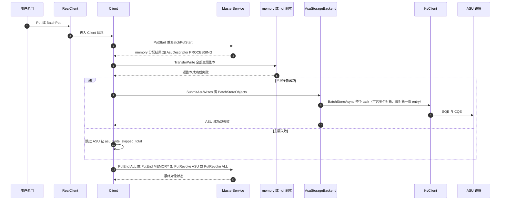

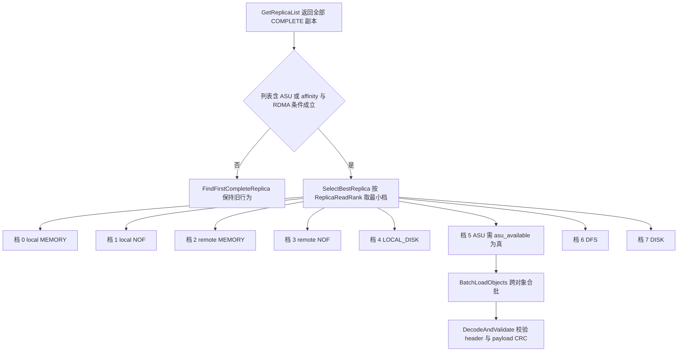

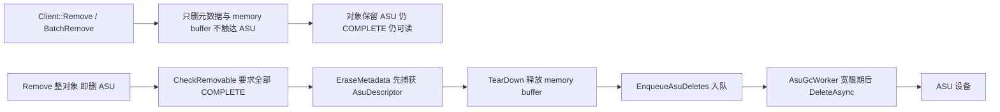

#### 2.5.1 全流程生命周期 Debug 日志

所有 ASU 日志统一使用 `key=value` 格式，首个字段为 `action`，其余字段顺序固定，便于 grep 与结构化采集。示例：

`action=asu_write_commit trace_id=... tenant=... user_key=... key_id=0x... epoch=... replica_id=... object_size=... batch_entries=... phase=commit`

其中 key_id 一律以 0x 前缀的 16 位十六进制打印；缺省字段打 `-1`。各埋点使用的 `action` 名称按下方埋点表顺序固定，v2.0 新增的 action 用粗体标出：`asu_init_client`、`asu_init_register`、`asu_init_master`、**`asu_master_probe`**、`asu_allocated`、**`asu_write_start_validate`**、**`asu_finalize_decision`**、`asu_req_begin`、`asu_entry_encode`、`asu_write_commit`、`asu_batch_wait`、`asu_write_cleanup`、`asu_write_end`、**`asu_finalize_rpc_failed`**、**`asu_read_select`**、**`asu_read_batch_begin`**、**`asu_read_entry`**、`asu_read_wait`、`asu_header_check`、`asu_read_end`、**`asu_read_undersized`**、`asu_query`、**`asu_delete_capture`**、`asu_delete_enqueue`、`asu_delete_submit`、`asu_delete_wait`、`asu_delete_retry`、`asu_delete_drop`、`asu_restore`。

| 埋点位置（文件:函数） | 日志级别 | 打印字段 | 覆盖的阶段 |
| --- | --- | --- | --- |
| mooncake-store/src/asu/asu_client_runtime.cpp: AsuClientRuntime::Create（新增） | INFO/ERROR | config_path、view_transport_count、registered_region_count、handles、arena_bytes、staging_slots、elapsed | Client init |
| mooncake-store/src/asu/asu_kv_adapter.cpp: AsuKvClientAdapter::Init 与 Register（新增） | VLOG(1)/WARNING | retry_count、view_empty、regions、bytes、handles、kInvalidMRHandle 命中数 | init 与内存注册 |
| mooncake-store/src/asu/asu_master_runtime.cpp: AsuMasterRuntime::Create（新增） | INFO/ERROR | master_delete、probe_key、probe_exists、delete_client_ready、gc_started | Master init |
| mooncake-store/src/master_service.cpp: PrepareWriteStart 的 ASU 校验（新增，紧邻 5111-5117） | VLOG(1)/ERROR | key、tenant、asu、nof、dfs、replica_num、check_name、result | 写前校验 |
| mooncake-store/src/master_service.cpp: AllocateReplicas 的 ASU 分支（新增，return 之前） | VLOG(1) | tenant、user_key、key_id、key_fingerprint、epoch、object_size、allocated_asu、replica_index | Master 分配 |
| mooncake-store/src/client_service.cpp: SubmitAsuWrites 门禁（新增） | VLOG(1)/WARNING | key、write_mode、allocated_asu、non_dfs_ok、stage、reason、trace_id | 第二阶段门禁 |
| mooncake-store/src/client_service.cpp: DetermineFinalizeDecision 的 TIERED 分支（新增，旁挂 378-431） | VLOG(1) | key、require_asu、primary_ok、asu_ok、allocated_asu、successful_asu、failed_asu、first_asu_error、end_type、revoke_type、asu_status（OK/DEGRADED/STRICT_FAILED/SKIPPED_PRIMARY_FAILED/ABSENT） | finalize 决策 |
| mooncake-store/src/asu/asu_config.cpp: AsuConfig::FromEnvironment（新增；v2.1 增加 require_asu 与 semantic 日志，见 §3.12） | INFO | require_asu、semantic（degrade 或 strict）、enable、client_config_path | 启动期配置快照 |
| mooncake-store/src/client_service.cpp: Client::Put 与 Upsert 的终态（改动，2183-2206、2391-2410） | INFO/WARNING | key、revoke_type、asu_error、metric、elapsed | 单对象终态 |
| mooncake-store/src/asu/asu_storage_backend.cpp: BatchStoreObjects 入口（新增） | VLOG(1) | trace_id、tenant、user_key、key_id、epoch、replica_id、object_size、batch_entries、write_mode | 写开始 |
| mooncake-store/src/asu/asu_record.cpp: AsuRecordCodec::Encode（新增） | VLOG(2) | data_len、wire_len、data_offset、data_crc32c、header_crc32c | 每 entry 编码 |
| mooncake-store/src/asu/asu_storage_backend.cpp: BatchStoreObjects 每 task 提交（新增） | VLOG(1) | task_id、entry_index、offset、wire_len、key_id | 每 task 提交 |
| mooncake-store/src/asu/asu_storage_backend.cpp: BatchStoreObjects Wait（新增） | VLOG(1)/ERROR | task_id、entry_index、entry_status、timeout_ms、elapsed、slot_id | 等待完成 |
| mooncake-store/src/asu/asu_storage_backend.cpp: BatchStoreObjects 返回（新增） | INFO/ERROR | result、bytes、entries、first_error、asu_status、elapsed | 写结束 |
| mooncake-store/include/replica_selection.h: ClassifyReplicaForRead 与 SelectBestReplica（新增/改动，133-194） | VLOG(1) | candidate_count、每个候选的 replica_type、status、is_local、rank、affinity_tier、score、chosen_rank、chosen_index | 择优决策 |
| mooncake-store/src/client_service.cpp: ReadReplicaSelector::operator()（改动，675-700） | VLOG(1)/WARNING | key、policy_as_available、replicas_size、path（first 或 best）、selected_type、selected_rank、error | Client 读选择 |
| mooncake-store/src/client_service.cpp: Client::Get 的 ReadAsuReplica 分派（新增，1599-1603） | VLOG(1)/ERROR | key、rank、object_size、slices_bytes、runtime_ready、arena_free_slots | 单对象读入口 |
| mooncake-store/src/asu/asu_storage_backend.cpp: BatchLoadObjects 入口（新增） | VLOG(1) | trace_id、request_count、每对象的 key_id 与 epoch、object_size、requested_bytes | 批量读开始 |
| mooncake-store/src/asu/asu_storage_backend.cpp: BatchLoadObjects 提交与 Wait（新增） | VLOG(1)/ERROR | task_id、entry_index、offset、read_len、entry_status、timeout_ms、elapsed | 每 task 与每 entry 读传输 |
| mooncake-store/src/asu/asu_storage_backend.cpp: BatchLoadObjects 返回（新增） | INFO/ERROR | result、outcome_count、bytes、first_error、quarantined_slots、elapsed | 批量读结束 |
| mooncake-store/src/asu/asu_record.cpp: AsuRecordCodec::DecodeAndValidate（新增） | VLOG(2)/ERROR | 每字段 expected 与 actual、header_hex、payload_crc_result | 读校验 |
| mooncake-store/src/real_client.cpp: 四个全对象选择点（改动，4036、4425、6776、8440） | VLOG(1) | key、asu_available、selected_type、selected_rank、candidate_count | RealClient 选择 |
| mooncake-store/src/asu/asu_storage_backend.cpp: BatchIsExist 与 BatchRemoveObjects（新增） | VLOG(1)/ERROR | key_ids、task_id、exists 位图、entry_status、rawResult | 物理查与删 |
| mooncake-store/src/master_service.cpp: BatchRemoveAsuObjects（新增） | INFO/WARNING | key、tenant、captured_asu、remove_result、enqueue_count、result | 删 ASU：捕获→Remove→入队 |
| mooncake-store/src/master_service.cpp: EraseMetadata（改动，2054-2116） | VLOG(1)/INFO | key、teardown_done、asu_enqueued（恒 false） | plain Remove 不触达 ASU |
| mooncake-store/src/master_service.cpp: FreeAsuReplicas（新增，旁挂 7583-7591） | VLOG(1)/WARNING | key_id、epoch、user_key、release_at、not_before、site、count | Master 回收入队 |
| mooncake-store/src/asu/asu_delete_queue.cpp: AsuDeleteQueue::Enqueue（新增） | VLOG(1) | key_id、epoch、user_key、release_at、not_before、reason、site | 删除入队 |
| mooncake-store/src/asu/asu_delete_queue.cpp: AsuGcWorker::Loop（新增） | VLOG(1)/ERROR | drain_count、pending、free_slots、task_id、entry_status、rawResult、attempt、next_at | 延迟删除与 GC |
| mooncake-store/src/master_service.cpp: 两处 restore 的 ASU 分支（新增，旁挂 3382-3394 与 3958-3969） | VLOG(1)/ERROR | tenant、user_key、key_id、epoch、object_size、status | HA 恢复 |

日志级别约定：INFO 只打阶段边界（init 成功、写提交点、写读结束、最终 finalize 决策、删除入队与 GC 结果），默认开启；VLOG(1) 打生命周期事件、择优决策与每次传输提交，默认关闭；VLOG(2) 打每 entry 的字段级细节，仅在排障时对指定模块打开；WARNING 打降级路径（asu_degraded、master_delete 关闭、视图为空但继续、slot 隔离、删除重试）；ERROR 打不可恢复失败与 fail-stop 校验失败。

> **[v2.0 变更]** 新增 `asu_read_select` 这一行是要求 2 的可定位核心：它必须同时打出全部候选的 rank、affinity 与 score 以及最终选中项，否则线上无法回答「为什么这次读走了 ASU 而不是 memory」。新增 `asu_finalize_decision` 与指标 `asu_write_skipped_total` 是要求 1 的可定位核心，新增 `asu_delete_capture` 是要求 3 的可定位核心；`asu_master_probe`、`asu_read_undersized`、`asu_finalize_rpc_failed` 对应 §3.6/§3.10/§3.11 代码中实际出现的日志。v2.3 删除 `remove_memory_tier`、`asu_chunk_encode`/`asu_chunk_wait` 与所有 chunk 字段。

#### 2.5.2 trace-id 与跨进程关联

> **[v2.0 变更]** trace 元组从 v1.0 的六字段扩展为十字段，并补充读路径的 task_id 与 entry_index、删除路径的 release_at 与 attempt。

**十字段 trace 元组**为：`trace_id`、`user_key`、`key_id`、`object_epoch`、`entry_index`、`op`、`phase`、`write_mode`、`asu_status`、`replica_rank`。其中 `phase` 取值为 `PRIMARY_WRITE`、`ASU_WRITE`、`FINALIZE`、`READ_SELECT`、`READ_ASU`、`REMOVE_MEMORY`、`REMOVE_ASU`；`write_mode` 取值为 `SINGLE`、`FLEXIBLE`、`RELIABLE`、`TIERED`；`asu_status` 取值为 `OK`、`DEGRADED`、`STRICT_FAILED`、`SKIPPED_PRIMARY_FAILED`、`ABSENT`；其中 `STRICT_FAILED` 表示 ASU 阶段已尝试写、但 `require_asu=true` 使整体失败，仅由 `DetermineFinalizeDecision` 的严格分支产生；`replica_rank` 取值为 0 至 7。读路径另带 `task_id` 与 `entry_index`，删除路径另带 `release_at` 与 `attempt`。这四组新增字段让「顺序、选择、方向」三条要求都能从单条日志还原。

Client 在每个请求入口生成一个 uint64 的 trace_id，取值由进程内递增计数器生成，只保证同一进程内单调；跨重启可能重复（`steady_clock` 重启后归零），因此跨会话关联必须依赖下面的跨进程键而非 trace_id。trace_id 只存在于 Client 进程：它贯穿 RealClient、Client、AsuStorageBackend、AsuStagingArena、AsuKvClientAdapter 到 KvClient 返回的每一行日志。

由于 Master 不接收 trace_id，跨进程必须改用五元组关联：tenant、user_key、replica_id、asu_key_id、object_epoch。这五个字段的取值来源如下：tenant 与 user_key 来自请求，replica_id 来自 Replica 构造，asu_key_id 与 object_epoch 来自 Master 铸造的 AsuDescriptor，因此它们在 Client、Master、GC 三侧日志中天然一致。

v2.0 新增的四个字段分两类。`phase` 与 `write_mode` 是 Client 侧派生字段：`write_mode` 由 ReplicateConfig 经 DetermineReplicaWriteMode（replica.h:291-302）得出，Master 侧只要知道 asu_replica_num 就能复算；`asu_status` 是 Client 在 finalize 时判定的终态，Master 侧对应的事实是「PutEnd 用了哪个 replica_type、PutRevoke 用了哪个 replica_type」。因此跨进程对齐规则是：Client 的 `asu_status=OK` 必然对应 Master 见到 PutEnd(ALL)；`DEGRADED` 必然对应 PutEnd(MEMORY) 加 PutRevoke(ASU)；`STRICT_FAILED` 必然对应 PutRevoke(ALL) 且此前确有 ASU 写请求；`SKIPPED_PRIMARY_FAILED` 必然对应从未收到任何 ASU 写请求且随后 PutRevoke(ALL)。`replica_rank` 只在 Client 侧有意义，Master 不参与选择。

KvClient 的 TaskId 是进程内句柄，只在 Client 侧有效。设计上要求每次 `BatchStore` 或 `BatchLoad` 提交后立即把 task_id 与该 task 覆盖的 entry 列表（entry_index、offset、read_len 或 wire_len 三元组）以 VLOG(1) 打在一行里，Wait 返回后复用同一 task_id 打结果。这样即使 SDK 内部切了子批，也能按 task_id 把「提交了哪些 entry」与「哪些 entry 失败了」对上；v2.3 因为一个对象只对应一条 entry，task 内的 entry_index 与 user_key 之间是稳定的一对一映射，使跨对象批量读的归因不必依赖下标推断。

设备侧没有应用层回调上下文，跨到设备后的锚点是 record header 里的 replica_id 与 object_epoch。任何从设备读到的 header 都能反查回 Master 日志中的同一次分配；反过来，Master 日志中的 key_id 与 epoch 可以直接喂给离线诊断工具去设备上定位记录。删除路径同理：GC 日志打 key_id、epoch、release_at 与 attempt，与当初 Put 日志的同名字段直接对齐，且 attempt 让「第一次就删掉」与「重试 N 次后丢掉」在单行日志里可区分。

#### 2.5.3 日志量控制

按 entry 打印的日志数量与批大小成正比，默认必须关闭。控制手段有四层：一是级别隔离，每 entry 细节只走 VLOG(2)，生命周期只走 VLOG(1)，默认只开 INFO 及以上；二是动态调级，沿用 glog 的 `--v` 与 `--vmodule`，可只对 asu_storage_backend 与 asu_record 两个源文件临时开到 2，不必全进程放大；三是按 key 过滤，调试开关接受一个 key_id 或 user_key 前缀过滤串，命中才输出 VLOG，未命中直接返回，避免热点对象刷屏；四是采样，Wait 超时、删除重试与 `asu_read_select`（每次读都会打）这类可能高频的事件按「首次必打、之后每 N 次打一次」采样，同时靠计数器保留总量。`asu_write_skipped` 与 `asu_finalize_decision` 是低频决策点，不做采样。上述过滤与采样只影响日志，不影响任何功能路径与错误返回。

#### 2.5.4 计数器与指标

> **[v2.0 变更]** 指标按「写阶段、读择优、删除级联」三组重组；v1.0 的通用读写指标保留，新增 degrade、择优与队列维度。

关键指标既用于告警，也用于定位时快速判断故障阶段。写读删三类操作都按 result 维度打标签，result 至少区分 OK、TRANSFER_FAIL、TIMEOUT、CANCELED、ASU_OBJECT_TOO_LARGE、ASU_RECORD_CORRUPT、ASU_KEY_COLLISION、REPLICA_IS_GONE、ASU_SERVICE_UNAVAILABLE。

| 指标 | 类型 | 含义 | 关键标签 |
| --- | --- | --- | --- |
| asu_put_total | counter | 对象级 ASU 写尝试数 | result |
| asu_write_bytes | counter | 成功写入 ASU 的逻辑字节数 | 无 |
| asu_write_latency_us | histogram | ASU 写阶段耗时，不含主层 | write_mode 分桶 |
| asu_write_skipped_total | counter | 主层失败导致 ASU 阶段被跳过的次数 | reason |
| asu_write_failures_total | counter | ASU 写失败次数 | code |
| asu_degraded_total | counter | 主层成功但 ASU 失败、按降级处理的对象数；仅在 `require_asu=false` 时累加 | 无 |
| asu_required_failures_total | counter | `require_asu=true` 时因 ASU 写失败导致整体失败的对象数 | code（取 `first_asu_error`） |
| asu_required_enabled | gauge | 当前进程的 `require_asu` 取值（1=严格，0=降级） | 无 |
| asu_finalize_rpc_failed_total | counter | ASU 方向 finalize RPC 失败次数 | direction |
| asu_alloc_missing_total | counter | 请求了 ASU 但 Master 未分配的次数 | 无 |
| asu_get_total | counter | 对象级 ASU 读尝试数 | result |
| asu_get_bytes_total | counter | 成功读出的逻辑字节数 | 无 |
| asu_read_objects_total | counter | BatchLoadObjects 处理的对象数 | result |
| asu_read_batch_tasks_total | counter | 提交的 BatchLoadAsync task 数 | batch_entries 分桶 |
| asu_read_latency_us | histogram | ASU 读阶段耗时 | batch_entries 分桶 |
| asu_slot_exhausted_total | counter | 全部 staging slot 被 quarantine 导致不可服务的次数 | 无 |
| asu_wait_timeout_total | counter | Wait 超时次数 | phase |
| asu_canceled_batch_total | counter | 预发送失败导致整批 CANCELED 的次数 | phase |
| asu_staging_quarantined_slots | gauge | 已隔离 slot 数 | 无 |
| asu_staging_free_slots | gauge | 当前空闲 slot 数；瞬时接近 0 表示排队，只有全部 slot quarantine 才不可服务 | 无 |
| asu_delete_enqueued_total | counter | 入队删除条目数 | reason |
| asu_delete_ok_total | counter | 删除成功条目数 | 无 |
| asu_delete_fail_total | counter | 删除失败条目数 | error |
| master_asu_delete_dropped_total | counter | 重试耗尽后丢弃条目数 | error |
| master_asu_delete_queue_depth | gauge | 队列中待删除条目数 | 无 |
| asu_orphan_suspect_total | counter | 疑似孤儿条目数 | reason |
| asu_descriptor_restore_total | counter | restore 重建的 ASU 描述符数 | 无 |
| asu_descriptor_restore_fail | counter | restore 重建失败数 | error |
| asu_write_wait_seconds | histogram | 单批写 Wait 耗时 | batch_entries 分桶 |
| asu_read_wait_seconds | histogram | 单批读 Wait 耗时 | batch_entries 分桶 |
| asu_delete_wait_seconds | histogram | 单批删除 Wait 耗时 | 无 |

排查时先看三条主线的入口计数：写侧看 `asu_write_skipped_total` 与 `asu_put_total` 之和是否等于带 asu 配置的 Put 次数，不等说明门禁接线错误（要求 1）；`asu_degraded_total` 与 `asu_required_failures_total` 是 `asu_put_total{result!=OK}` 的细分子集，不参与该恒等式，避免重复计数；两者互斥，`require_asu=false` 只累加前者，`true` 只累加后者；读侧看 `asu_read_objects_total` 的 result 分布与 `asu_read_select` 日志的 rank 分布，若 ASU 命中率异常高而 memory 副本存在，优先怀疑 policy 或 rank 表（要求 2）；删侧看 `master_asu_delete_queue_depth` 是否单调增长，增长说明 GC 卡住或 ASU 不可达（要求 3）。之后再用 `asu_wait_timeout_total`、`asu_canceled_batch_total`、`asu_staging_quarantined_slots` 判断是超时、预发送失败还是内存隔离，最后用延迟直方图确认是设备慢还是本层排队。

#### 2.5.5 失败现场保留

失败现场的目标是「不重启、不加日志也能回答是哪一条 entry 失败、失败在哪一步」。具体保留策略如下。

第一，header 或 CRC 校验失败时，以 ERROR 打印该 512B header 的完整十六进制（只打 header，不打 payload），同时逐字段打印 expected 与 actual，并打印该次 BatchLoad 的**全部** entryStatus（含 OK 条目），因为 PARTIAL_FAILED 场景下失败条目与成功条目的下标对应关系是归因的关键。第二，提供可选的 dump 目录：设置后把失败的 header 按 `key_id-epoch.hdr` 命名落盘，便于事后离线解析；不设置则不产生任何磁盘写入。第三，Wait 超时时打印整个批次的 key_id、epoch、task_id、entry 列表、slot_id 与 timeout_ms，并把该 slot 标记为 `kQuarantined`；由于 Wait 超时后 task 结果不可再取，这行日志是该批次唯一可用的现场，同时必须更新 `asu_staging_free_slots` 与 `asu_slot_exhausted_total`。第四，ASU 写失败进入 degrade 时，以 WARNING 打印该对象的 entry 与 first_error，并打印 best-effort 删除的结果。第五，删除重试耗尽时以 ERROR 打印 key_id、epoch、user_key、not_before、release_at、最后一次 rawResult 与尝试次数，同时累加 master_asu_delete_dropped_total。

#### 2.5.6 离线诊断工具 mooncake-asu-dump

该工具用于回答「数据到底写进去没有」，全程只读，不执行 Store 也不执行 Delete。输入可以直接从日志复制：config 路径、key_id、object_epoch、object_size。工具先调用 `QueryAsync` 取 exists 位图，再对存在的 key 做仅 512B header 的 `BatchLoad`（512B 本身是合法 entry，不违反入口尺寸契约），输出存在性、magic 与 version、header CRC 结果、key_id 与 key_fingerprint 与 epoch 与 object_size 与 data_offset（必须为 0）与 data_len 的交叉校验结果；需要时可选择整 entry 读并校验 data_crc32c。输出结论只有四种：物理存在且记录合法、物理存在但记录损坏、物理不存在、视图不可达。这四种结论正好对应定位时的四条分叉，避免把「元数据在但物理丢失」误判成代码 bug。

#### 2.5.7 运维视图

ASU 副本必须出现在既有的介质视图与管理查询里，否则运维只能靠日志猜测。介质视图侧，KvMediaForMetadata 与 KvMediaForRemoval 把所有非 memory 副本归一到 disk 介质（master_service.cpp:11151-11203），ASU 需要加入这两处的判定，使订阅者能看到 disk 介质的出现与回收；**v2.0 新增的可见变化是「删 memory」**：对象从 `{cpu, disk}` 变为 `{disk}` 而对象本身仍存在，订阅方必须据此区分「降级为只剩 ASU」与「整对象被删」。管理查询侧，admin BatchQueryKeys 的副本类型分支当前覆盖 memory、disk、local_disk、nof（master_admin_service.cpp:1195-1216），需要增加 ASU 分支并回显 AsuDescriptor 的 key_id、epoch、object_size；否则接口返回 ok 为 true 但 values 为空，看起来像对象没有副本。这两处只做展示，不改变任何读写删语义。

#### 2.5.8 典型问题定位路径

> **[v2.0 变更]** 问题集按 v2.0 的三条新要求重写：新增「Put 成功但 ASU 无数据」「删 memory 后 ASU 仍在是否预期」「级联删除卡在哪一步」「读走 ASU 且慢是决策还是设备」四个核心场景，保留长度不符场景并改写为全对象读契约下的版本。

**问题一：Put 返回成功但 ASU 上没有数据。** 先看 `asu_finalize_decision` 的 `asu_status`：`DEGRADED` 说明主层成功、ASU 失败，Put 成功是预期行为（仅 `require_asu=false`；若 `require_asu=true` 仍看到 `DEGRADED`，即为接线错误，见 FMEA-58）；`require_asu=true` 时 ASU 失败应表现为 `STRICT_FAILED` 且 Put 返回失败，此时按 `asu_write_failures_total{code}` 判断失败原因，并用 mooncake-asu-dump 以日志中的 key_id 与 epoch 确认该对象的 entry 是否真的未提交。若 `asu_status=OK` 而 GetReplicaList 没有 ASU，问题在 Master：检查 PutEnd 的 replica_type 是否为 ALL，以及 is_target_replica 的 ALL 分支（master_service.cpp:5300-5307）是否命中 is_asu_replica；ASU 停在 PROCESSING 是典型症状（FMEA-42）。若 `asu_status=SKIPPED_PRIMARY_FAILED`，则是主层失败触发了正确的门禁，不需要查 ASU；此时 Put 本应返回失败，若返回成功说明 finalize 判定接线错误（FMEA-44）。若日志里完全没有 `asu_write_start_validate`，先确认 requested_asu_replicas 是否被 InitializeRequestedReplicas 正确读取，再看 Master 是否真的分配了 ASU；`asu_alloc_missing_total` 增长说明请求了但 Master 没给，客户端应在传输前就以 NO_AVAILABLE_HANDLE 失败（FMEA-43）。最后看 `asu_write_commit` 与 `asu_write_end`：没有成功提交说明对象 entry 未落地（FMEA-34），有提交但 `asu_write_end` 失败说明 finalize 阶段出错。

**问题二：删了 memory 但 ASU 还在，是否预期。** 先确认调用的是哪个入口。调用 `Client::Remove` / `BatchRemove` 时，ASU 仍在是**预期且必须**的结果（plain Remove 不触达 ASU）：对象已从元数据消失，ASU entry 成为孤儿，审计日志里不应出现 `asu_delete_capture`/`asu_delete_enqueue`。若期望的是删除 ASU，应调用 `BatchRemoveAsuObjects`，日志顺序为 `asu_delete_capture` → 既有 Remove → `asu_delete_enqueue`。若在 plain Remove 后仍看到 `asu_delete_enqueue`，说明 `EraseMetadata`/HA finalize 又错误地捕获并入队了 ASU（FMEA-57），重点查 `enqueue_asu_deletes` 标志是否被置真、`FreeAsuReplicas` 是否被接回 `EraseMetadata`。若 `BatchRemoveAsuObjects` 的 result 是 REPLICA_IS_NOT_READY，说明还有副本处于 PROCESSING，即写删并发（FMEA-42 的永久 PROCESSING 残留）；`OBJECT_HAS_LEASE` 表示对象仍持有读租约，该 key 被跳过、不入队。

**问题三：删除链路卡在哪一步。** plain Remove 的正确日志是只有 `EraseMetadata` teardown，不出现 `asu_delete_capture`/`asu_delete_enqueue`；若出现即为误接线。`BatchRemoveAsuObjects` 的正确顺序是 `asu_delete_capture`（捕获 descriptor）→ 既有 RemoveObject 执行 → `asu_delete_enqueue`，且入队只发生在 Remove 返回 OK 或 `OBJECT_NOT_FOUND` 之后。若只看到 `asu_delete_capture` 而没有 `asu_delete_enqueue`，检查 Remove 是否返回 `OBJECT_HAS_LEASE`/`REPLICA_IS_NOT_READY`（该 key 被跳过）或 persist 失败。若对象在 Master 已不可见而 ASU 仍在、且队列非空，说明在宽限期内，用 `release_at` 与当前时间比较即可。若 `asu_delete_submit` 出现但 `entry_status` 非 OK，看 `asu_delete_retry` 的 attempt 与 next_at 判断退避是否生效，超过 asu_delete_max_attempts 后应出现 `asu_delete_drop` 且 master_asu_delete_dropped_total 增长。HA 路径下 `FinalizeRemovedReplicasAfterDurable` 只在 `enqueue_asu_deletes=true` 时入队，plain Remove 传 false。

**问题四：读走了 ASU 而且慢，是择优决策还是设备慢。** 先看 `asu_read_select` 的候选快照：若候选里本来就没有 COMPLETE 的 local MEMORY 或 LOCAL_DISK（例如它们已被删或处于非 COMPLETE），ASU 被选中是**正确决策**，慢是设备或传输问题，转下一步；若候选里有 rank 更小的副本却没被选中，是选择器缺陷，重点查 ClassifyReplicaForRead 对 is_local 与 status 的判定，以及 `asu_available` 是否错误地为 true 或 false（FMEA-48）。确认决策正确后，看 `asu_read_batch_begin` 的 entries 与 task_id、`asu_read_entry` 的 entry_status，以及 `asu_read_latency_us` 的分位数；若 `asu_read_latency_us` 升高且 `asu_staging_free_slots` 接近 0，说明在排队而非失败；只有**全部 slot 被 quarantine** 时 `Acquire` 才返回 `ASU_SERVICE_UNAVAILABLE` 并让 `asu_slot_exhausted_total` 增长（FMEA-50）。若 `asu_read_wait` 频繁 TIMEOUT，先核对 timeout_ms 是否由 `EstimateTimeoutMs` 显式传入而不是 100ms 默认值（FMEA-05）。若 task 数远大于对象数，说明打包逻辑错误（一个对象只应贡献一条 entry）。最后用 asu_read_bytes 与对象大小核对是否有 over-read：v2.3 的 read_len 恒为 512 加 align_up(object_size)，出现更大的值说明切片尺寸错误。

**问题五：Get 返回的长度与写入长度不符。** 先看 `asu_req_begin` 中的 requested_bytes 与调用方 slices 总长是否一致；v2 要求 slices 总长大于等于 object_size，小于则在入口返回 INVALID_PARAMS，因此若进入了 BatchLoadObjects 就说明尺寸契约已满足。接着看 descriptor.object_size 是否等于写入时的值；若 descriptor 正确，进入 `asu_header_check` 看 object_size、data_offset（必须为 0）、data_len（必须等于 object_size）三组 expected 与 actual，任何一组不符都是 ASU_RECORD_CORRUPT，且 payload CRC 此时必然被校验过，不会出现「CRC 跳过所以没发现」的情况。若 header 全部通过而长度仍不符，检查 client_buffer 的 calculate_total_size 是否已经为 AsuDescriptor.object_size 增加分支（client_buffer.cpp:144-159 当前只覆盖 disk、local_disk、dfs、nof、memory）；缺少分支会落到 `else` 调 `get_memory_descriptor()` 并抛 `std::runtime_error`（不是读错长度），因此必须为 ASU 增加 `object_size` 分支（`get_memory_descriptor` 见 replica.h:831）。最后看 asu_get_bytes_total 与 asu_get_total 的 result 分布，注意对象级 checksum 默认关闭（client_object_checksum_config.cpp:14-16），长度不符不一定会以 CHECKSUM_MISMATCH 暴露。

## 3. shard 设计描述

按功能把 ASU 原生副本拆成 12 个 shard。前 8 个是新增实现单元，后 4 个是接入 Mooncake 既有控制面与构建系统的集成单元。所有新增文件位于 `mooncake-store/include/asu/` 与 `mooncake-store/src/asu/`，命名空间统一为 `mooncake::asu`；只有进入线格式与 Replica variant 的类型（`AsuDescriptor`、`AsuReplicaData`）放在 `mooncake::` 下。

| 小节 | shard | 主要产物 | 上下游 |
| --- | --- | --- | --- |
| 3.1 | asu_layout | `asu_layout.h` | 被 3.3/3.4/3.6/3.7/3.12 依赖 |
| 3.2 | asu_key_codec | `asu_key_codec.{h,cpp}` | 被 3.6/3.7 依赖 |
| 3.3 | asu_record | `asu_record.{h,cpp}` | 依赖 3.1/3.2，被 3.6 依赖 |
| 3.4 | asu_staging_arena | `asu_staging_arena.{h,cpp}` | 依赖 3.5，被 3.6 依赖 |
| 3.5 | asu_kv_adapter | `asu_kv_adapter.{h,cpp}` | 包装 `kv::KvClient` |
| 3.6 | asu_storage_backend | `asu_storage_backend.{h,cpp}` | 依赖 3.1/3.2/3.3/3.4/3.5；写是 Put 的第二阶段，读是 `BatchLoadObjects` 批量读 |
| 3.7 | asu_allocator | `asu_allocator.{h,cpp}` | 依赖 3.2/3.1，被 3.11 依赖 |
| 3.8 | asu_delete_queue | `asu_delete_queue.{h,cpp}` | 依赖 3.6，被 3.11 依赖；Master 侧物理删除的唯一执行者 |
| 3.9 | replica.h 集成 | `AsuDescriptor` / `AsuReplicaData` / variant / 写模式 | 被 3.10/3.11 依赖 |
| 3.10 | Client 集成 | `AsuClientRuntime` 与 Client 有序写、择优读、删 memory 路径 | 依赖 3.6 |
| 3.11 | Master 集成 | `AsuMasterRuntime` 与分配/终态/级联删除/恢复 | 依赖 3.7/3.8 |
| 3.12 | asu_config | `asu_config.{h,cpp}`、CMake 登记 | 被全部 shard 依赖 |

> **[v2.3 变更]** 本章按 v2.3 的修订要求逐 shard 修改。三条要求的落点：要求 1（写序）→ 3.6 写入口语义 + 3.9 的 `ReplicaWriteMode::TIERED_MEMORY_THEN_ASU` + 3.10 的 `SubmitAsuWrites` + 3.11 的 `AllocateReplicas`/`PutEnd`；要求 2（读择优）→ 3.6 `BatchLoadObjects` + 3.10 `ReadAsuReplica` 与批量收集 + 3.10 的 `ReplicaReadRank` 接线；要求 3（删除分层）→ 3.11 `BatchRemoveAsuObjects`（捕获→既有 Remove→入队）+ 3.8 的 `not_before`。3.1 常量与纯函数、3.3 记录头与 CRC 已按「一个对象一条 entry」重写。

统一约定：错误返回类型为 `tl::expected<T, ErrorCode>`（`<ylt/util/tl/expected.hpp>`），错误码来自 `mooncake-store/include/types.h` 的 `ErrorCode`；日志用 glog；线程同步用 `std::mutex` + `std::condition_variable`；方法命名沿用 §2.1 类图的 PascalCase（Mooncake 既有代码多用 snake_case，这一点作为风格差异记录在末尾说明）。

### 3.1 asu_layout（常量与纯函数）

**职责**

固定 ASU 的全部硬边界（512B 对齐、24-bit 长度、32-bit offset）并给出「一个对象一条 entry」与跨对象合批的纯函数。本 shard 是 header-only、无状态、无锁、无 I/O 的纯函数与常量集合，不负责任何缓冲区分配或 SDK 调用。Master 与 Client 编译同一份头文件，保证两端对 `object_size`/`offset`/批量切分的理解完全一致。

**设计说明**

常量来源是 SDK 的协议约束：SQE 的 `buffer_length`/`length` 必须 512B 对齐且不超过 24-bit（`kv_semantics/src/trans/proto/kv_protocol.cc:188-215`），因此单 entry 的绝对上限是 `0xFFFFFF` 向下取 512 对齐，即 `0xFFFFE00 = 16,776,704 B`。`offset` 是 32-bit 且 512B 对齐（`kv_types.h:125`）；取消分块后 `offset` 恒为 0。

| 常量 | 值 | 含义 |
| --- | --- | --- |
| `kAlign` | 512 | SDK 要求的对齐粒度（`kv_types.h:42-43`） |
| `kHeaderBytes` | 512 | 每条 entry 的记录头长度 |
| `kEntryMaxBytes` | 16,776,704 | 单 entry 单次 Store/Load 上限 |
| `kMaxObjectBytes` | 16,776,192 | 单对象逻辑字节上限 = `kEntryMaxBytes - kHeaderBytes` |
| `kAsuMaxObjectBytes` | 同 `kMaxObjectBytes` | ASU 对象上限的语义别名，供 `PrepareWriteStart` 与 `AsuConfig` 引用 |
| `kBatchMaxEntries` | 110 | 单 task 提交条数上限（对齐 `batchStoreIoNum`/`batchLoadIoNum`，`kv_types.h:196-197`） |
| `kBatchMaxBytes` | 64 MiB | 单 task 提交字节上限（SDK 的 `maxInflightBytes` 只解析不生效，不能依赖） |
| `kDefaultWaitTimeoutMs` | 30000 | `Wait` 的基准超时 |

> **[v2.3 变更]** 删除 `kChunkPayloadBytes`、`kChunkStrideBytes`、`kMaxChunks` 与全部 chunk 公式；`kMaxObjectBytes` 从错误的 4,294,705,152 修正为 **16,776,192**。新增 `WireLen` 与 `PlanBatches`：前者定义单 entry 线上长度，后者是「按对象边界、按条数与字节切 task」的唯一实现。

单 entry 布局与公式（`S` 为 `object_size`）：

- `wire_len = kHeaderBytes + AlignUp(S, 512)`，恒 ≤ `kEntryMaxBytes`；
- `offset = 0`；
- `data_len = S`，零填充到 `wire_len` 不参与 CRC。

**1,008 B 边界（必须精确，不得含糊成「约 16 MiB」）**

`kEntryMaxBytes = 16,776,704`，减去 512B header 后单 key 最大 object = **16,776,192 B**。CACHELIB 的 `kMaxSliceSize = Slab::kSize - 16 = 16,777,200 B`（`mooncake-store/include/types.h:468-469`），比 16,776,192 大 **1,008 B**。因此窗口 `(16,776,192, 16,777,200]` 内 CACHELIB 放行但单 entry 装不下，必须由 `PrepareWriteStart` 的 ASU 校验显式拒绝为 `ASU_OBJECT_TOO_LARGE`；`S > 16,777,200` 时 CACHELIB 检查先返回 `INVALID_PARAMS`。

**跨对象合批（`PlanBatches`）**

多个对象按对象边界打包进同一 task：条数 ≤ `min(kBatchMaxEntries, staging_slots)`，字节 ≤ `kBatchMaxBytes`（默认 64 MiB）。超过任一上限时在对象边界切 task，**绝不切开单个对象**。一个对象始终只贡献一条 entry。

**必要代码**

```cpp
// mooncake-store/include/asu/asu_layout.h
#pragma once

#include <algorithm>
#include <cstdint>
#include <span>
#include <vector>

namespace mooncake::asu {

inline constexpr uint32_t kAlign = 512;
inline constexpr uint32_t kHeaderBytes = 512;
// 0xFFFFFF rounded down to 512B alignment.
inline constexpr uint32_t kEntryMaxBytes = 16u * 1024u * 1024u - 512u;
// One object = one ASU key = one entry: 512B header + payload.
inline constexpr uint64_t kMaxObjectBytes = kEntryMaxBytes - kHeaderBytes;
inline constexpr uint64_t kAsuMaxObjectBytes = kMaxObjectBytes;
inline constexpr size_t kBatchMaxEntries = 110;
inline constexpr uint64_t kBatchMaxBytes = 64ull << 20;
inline constexpr uint64_t kDefaultWaitTimeoutMs = 30000;
inline constexpr uint32_t kRecordVersion = 1;
inline constexpr uint32_t kMagic = 0x31555341u;  // "ASU1" little-endian

static_assert(kEntryMaxBytes == (0xFFFFFFu & ~(kAlign - 1u)),
              "24-bit SQE length must round down to 512B alignment");
static_assert(kMaxObjectBytes == 16776192ull);
static_assert(kMaxObjectBytes < (1ull << 32));

constexpr uint64_t AlignUp(uint64_t value, uint64_t align = kAlign) {
    return (value + align - 1) / align * align;
}

// Full wire length of the single entry that represents one object.
constexpr uint32_t WireLen(uint64_t object_size) {
    return static_cast<uint32_t>(kHeaderBytes + AlignUp(object_size));
}

// Cross-object batching by object boundary. Each object contributes exactly
// one entry; the plan never splits a single object across tasks.
struct BatchSpan {
    size_t begin{0};
    size_t count{0};
    uint64_t bytes{0};
};

inline std::vector<BatchSpan> PlanBatches(std::span<const uint64_t> object_sizes,
                                          size_t max_entries,
                                          uint64_t max_bytes) {
    std::vector<BatchSpan> batches;
    size_t i = 0;
    while (i < object_sizes.size()) {
        BatchSpan b{.begin = i, .count = 0, .bytes = 0};
        while (i < object_sizes.size() && b.count < max_entries) {
            const uint64_t wire = WireLen(object_sizes[i]);
            if (b.count > 0 && b.bytes + wire > max_bytes) break;
            b.bytes += wire;
            ++b.count;
            ++i;
        }
        if (b.count == 0) {  // a single object larger than max_bytes is not split
            b.bytes = WireLen(object_sizes[i]);
            b.count = 1;
            ++i;
        }
        batches.push_back(b);
    }
    return batches;
}

// Single-entry submit gate. A violation here is rejected locally by the SDK
// during PackSqe, which aborts the whole transport task and cancels every
// entry in the batch (trans_task_executor.cc:227-232). Callers must check it
// before BatchStoreAsync / BatchLoadAsync.
constexpr bool IsValidEntry(uint32_t wire_len, uint64_t offset) {
    return wire_len % kAlign == 0 && wire_len >= kHeaderBytes &&
           wire_len <= kEntryMaxBytes && offset == 0;
}

constexpr bool IsValidObjectSize(uint64_t object_size) {
    return object_size > 0 && object_size <= kMaxObjectBytes;
}

}  // namespace mooncake::asu
```

### 3.2 asu_key_codec（键派生）

**职责**

把 `(scoped_key, object_epoch)` 确定性地映射成一个 8B `kv::CacheKey` 与一个 64-bit `key_fingerprint`。Master 与 Client 共用同一份实现，但**运行期只有 Master 调用 `Derive`**；Client 一律使用 `AsuDescriptor::key_id`，绝不自行重算（否则会与租户归一化规则冲突）。本 shard 不负责租户解析，也不负责任何 ASU I/O。

**设计说明**

`kv::CacheKey` 固定 8 字节且不可逆（`kv_types.h:39-40`；本轮已在 `/d/xiaojun/work/DramPool/unified-cache-management/kv_semantics/include/kv_types.h:39-40` 复核），全零 key 会被 SDK 在本地拒绝（`kv_protocol.cc:216-218` 的 `IsCacheKeyAllZero` 检查；`:211-215` 是 `length` 的 24-bit 上限检查）。映射规则：

1. `scoped = tenant.MakeScopedKey(user_key)`，tenant 与 key 以 NUL 分隔（`tenant_id.h:42-49`，分隔符 `kScopedKeySeparator = '\0'` 见 `tenant_id.h:76`）。
2. `identity = "MCASU1" + u8 version(=1) + u32_be(len(scoped)) + scoped`。
3. `canonical = identity + u64_le(object_epoch)`。
4. `key_id = XXH64(canonical, seed=0)`；若为 0 则置 1。
5. `key_fingerprint = XXH64(identity, seed=1)`。
6. `CacheKey = key_id` 的 8 字节小端展开。

`object_epoch` 由 `AsuAllocator` 铸造（见 3.7），参与哈希，所以同一逻辑 key 的每一次 PutStart 都会得到不同的物理 key。`secret` 域前缀与长度前缀避免 `("a","bc")` 与 `("ab","c")` 这类拼接歧义。XXH64 在 Mooncake 已有依赖（`Mooncake::xxhash`，见 `mooncake-store/src/nvme_kv/key_codec.cpp:44-45` 的双 seed 用法）。

碰撞处理：8B key 空间只有 64 bit，跨对象理论可碰撞。写侧无 CAS/条件写能力，所以碰撞只能在读侧 fail-stop：记录头同时携带 `key_id` 与 `key_fingerprint`，读时两者都比对；不一致返回 `ASU_KEY_COLLISION`，绝不把别人的字节交给调用方。

> **[v2.0 变更]** 派生算法、seed 分配、`ToCacheKey` 与 fingerprint 语义均不变。v2 只补充两点归属约定：(a) `object_epoch` 的唯一生产者是 `AsuAllocator`（3.7），派生函数不生成 epoch，只消费它；(b) `key_fingerprint` 在写序变更后仍是读侧陈旧记录与新世代隔离的唯一依据，属于承重字段，不得裁剪。

**必要代码**

```cpp
// mooncake-store/include/asu/asu_key_codec.h
#pragma once

#include <cstdint>
#include <string_view>

#include <kv_types.h>

namespace mooncake::asu {

struct AsuKeyMaterial {
    uint64_t key_id{0};
    uint64_t key_fingerprint{0};
    kv::CacheKey cache_key{};
};

class AsuKeyCodec final {
   public:
    // Only the Master calls Derive. Clients must use AsuDescriptor::key_id.
    static AsuKeyMaterial Derive(std::string_view scoped_key,
                                 uint64_t object_epoch);

    static kv::CacheKey ToCacheKey(uint64_t key_id);
};

}  // namespace mooncake::asu
```

```cpp
// mooncake-store/src/asu/asu_key_codec.cpp
#include "asu/asu_key_codec.h"

#include <array>
#include <cstring>
#include <string>

#include <xxhash.h>

namespace mooncake::asu {
namespace {

constexpr std::string_view kKeyDomainMagic{"MCASU1"};
constexpr uint8_t kKeyDomainVersion = 1;

void AppendLE16(std::string& out, uint16_t v) {
    out.push_back(static_cast<char>(v & 0xFF));
    out.push_back(static_cast<char>((v >> 8) & 0xFF));
}

void AppendLE64(std::string& out, uint64_t v) {
    for (int i = 0; i < 8; ++i) {
        out.push_back(static_cast<char>((v >> (8 * i)) & 0xFF));
    }
}

void AppendBE32(std::string& out, uint32_t v) {
    out.push_back(static_cast<char>((v >> 24) & 0xFF));
    out.push_back(static_cast<char>((v >> 16) & 0xFF));
    out.push_back(static_cast<char>((v >> 8) & 0xFF));
    out.push_back(static_cast<char>(v & 0xFF));
}

}  // namespace

AsuKeyMaterial AsuKeyCodec::Derive(std::string_view scoped_key,
                                   uint64_t object_epoch) {
    std::string identity;
    identity.reserve(kKeyDomainMagic.size() + 1 + 4 + scoped_key.size());
    identity.append(kKeyDomainMagic);
    identity.push_back(static_cast<char>(kKeyDomainVersion));
    AppendBE32(identity, static_cast<uint32_t>(scoped_key.size()));
    identity.append(scoped_key);

    std::string canonical = identity;
    AppendLE64(canonical, object_epoch);

    uint64_t key_id = XXH64(canonical.data(), canonical.size(), /*seed=*/0);
    if (key_id == 0) key_id = 1;  // all-zero CacheKey is rejected by the SDK
    const uint64_t fingerprint =
        XXH64(identity.data(), identity.size(), /*seed=*/1);

    return AsuKeyMaterial{key_id, fingerprint, ToCacheKey(key_id)};
}

kv::CacheKey AsuKeyCodec::ToCacheKey(uint64_t key_id) {
    static_assert(kv::kCacheKeySizeBytes == 8);
    kv::CacheKey key{};
    for (size_t i = 0; i < key.size(); ++i) {
        key[i] = static_cast<std::byte>((key_id >> (8 * i)) & 0xFF);
    }
    return key;
}

}  // namespace mooncake::asu
```

### 3.3 asu_record（512B 记录头编解码与 CRC）

**职责**

负责每条 entry 前 512B 自描述头的逐字节编码、解码与字段交叉校验，以及 header CRC-32C 与 payload CRC-32C 的覆盖范围定义。本 shard 是纯函数，不持有缓冲区、不做 I/O、不做重试；「CRC 覆盖哪一段」由调用方（3.6）按本节规则执行。CRC 实现复用 `mooncake-store/include/crc32c.h` 的 `Crc32c`/`Crc32cValue`（`crc32c.h:122-142`）。

**设计说明**

每条 entry 在 ASU 上占一段连续地址：`[0, wire_len)`。前 512B 是 header，紧接着是 `data_len` 字节 payload，再零填充到 `align_up(data_len, 512)`。取消分块后 `offset` 恒为 0，**payload 起始 offset 恒为 512**，且整个记录长度恒为 512 的整数倍。

全小端，逐字段 `memcpy`/显式移位，禁止 `sizeof(AsuRecordHeader)` 直接落盘。

| offset | size | 字段 | 语义 | 是否承重 |
| --- | --- | --- | --- | --- |
| 0 | 4 | `magic` | 固定 `0x31555341`（`"ASU1"`），格式识别 | 是 |
| 4 | 2 | `version` | 由 `descriptor.record_version` 决定，当前恒为 `kRecordVersion = 1` | 是 |
| 6 | 2 | `header_bytes` | 固定 `512`，header 长度自描述 | 是 |
| 8 | 4 | `header_crc32c` | 计算时本字段置 0，覆盖 0..512 | 是 |
| 12 | 2 | `flags` | bit0 = 有 payload CRC | 是 |
| 14 | 2 | `reserved16` | 固定 0 | 否 |
| 16 | 8 | `key_id` | ASU 物理 key，防串读 | 是 |
| 24 | 8 | `key_fingerprint` | 64-bit key 碰撞检测 | 是 |
| 32 | 8 | `object_epoch` | 写世代号，拒绝上一世代记录 | 是 |
| 40 | 8 | `object_size` | 对象逻辑字节数，长度自描述与交叉校验 | 是 |
| 48 | 4 | `data_offset` | **恒为 0**（取消分块），防写错 offset | 是 |
| 52 | 4 | `data_len` | 本 entry 的真实字节数，恒等于 `object_size` | 是 |
| 56 | 4 | `data_crc32c` | 覆盖前 `data_len` 字节，不含零填充 | 是 |
| 60 | 4 | `reserved32` | 固定 0 | 否 |
| 64 | 8 | `replica_id` | 仅诊断与 Master 日志对账 | 否 |
| 72 | 440 | `reserved` | 全 0 | 否 |

合计 72 + 440 = 512。payload CRC 只覆盖真实数据字节，零填充不参与。CRC 必须**按地址序**对内存块一次性计算；读侧同样按地址序校验。

解码顺序（任一失败即返回错误，不返回部分数据）：`magic` → `version`/`header_bytes` → `header_crc32c` → `flags` 未知位 → `key_id` → `key_fingerprint` → `object_epoch` → `object_size`/`data_offset==0`/`data_len==object_size`/`data_crc32c`。payload CRC 由 3.6 在拷贝前单独校验。

> **[v2.3 变更]** 删除 `chunk_index`、`chunk_count`、`chunk_payload`；`data_offset` 固定 0，`data_len` 恒等于 `object_size`。记录头布局、双 CRC 与交叉校验其余不变；payload CRC-32C 在全部公开读路径上都必须校验。

**必要代码**

```cpp
// mooncake-store/include/asu/asu_record.h
#pragma once

#include <cstddef>
#include <cstdint>
#include <span>

#include <ylt/util/tl/expected.hpp>

#include <replica.h>
#include <types.h>

namespace mooncake::asu {

struct AsuRecordHeader {
    uint32_t magic{0};
    uint16_t version{0};
    uint16_t header_bytes{0};
    uint32_t header_crc32c{0};
    uint16_t flags{0};
    uint16_t reserved16{0};
    uint64_t key_id{0};
    uint64_t key_fingerprint{0};
    uint64_t object_epoch{0};
    uint64_t object_size{0};
    uint32_t data_offset{0};  // always 0 (one object = one entry)
    uint32_t data_len{0};     // always == object_size
    uint32_t data_crc32c{0};
    uint32_t reserved32{0};
    uint64_t replica_id{0};
    uint8_t reserved[440]{};
};
static_assert(sizeof(AsuRecordHeader) == 512);

class AsuRecordCodec final {
   public:
    static void Encode(AsuRecordHeader& header, const AsuDescriptor& descriptor,
                       uint32_t data_len, uint32_t data_crc32c,
                       ReplicaID replica_id);

    static tl::expected<AsuRecordHeader, ErrorCode> DecodeAndValidate(
        std::span<const std::byte, 512> raw, const AsuDescriptor& expected);
};

}  // namespace mooncake::asu
```

```cpp
// mooncake-store/src/asu/asu_record.cpp（关键逻辑，字段读写辅助省略为注释）
#include "asu/asu_record.h"

#include <array>
#include <cstring>

#include "asu/asu_layout.h"
#include "crc32c.h"

namespace mooncake::asu {
namespace {

// StoreLE16/32/64 与 LoadLE16/32/64：逐字节显式小端读写，不依赖主机字节序。
// 例如 StoreLE32(p, v) { p[0]=v&0xFF; p[1]=(v>>8)&0xFF; ... }

constexpr size_t kMagicOff = 0;
constexpr size_t kVersionOff = 4;
constexpr size_t kHeaderBytesOff = 6;
constexpr size_t kHeaderCrcOff = 8;
constexpr size_t kFlagsOff = 12;
constexpr size_t kKeyIdOff = 16;
constexpr size_t kFingerprintOff = 24;
constexpr size_t kEpochOff = 32;
constexpr size_t kObjectSizeOff = 40;
constexpr size_t kDataOffsetOff = 48;
constexpr size_t kDataLenOff = 52;
constexpr size_t kDataCrcOff = 56;
constexpr size_t kReplicaIdOff = 64;

constexpr uint16_t kFlagHasPayloadCrc = 1u << 0;

}  // namespace

void AsuRecordCodec::Encode(AsuRecordHeader& header,
                            const AsuDescriptor& descriptor,
                            uint32_t data_len, uint32_t data_crc32c,
                            ReplicaID replica_id) {
    auto* raw = reinterpret_cast<std::byte*>(&header);
    std::memset(raw, 0, kHeaderBytes);

    StoreLE32(raw + kMagicOff, kMagic);
    StoreLE16(raw + kVersionOff, static_cast<uint16_t>(descriptor.record_version));
    StoreLE16(raw + kHeaderBytesOff, static_cast<uint16_t>(kHeaderBytes));
    StoreLE16(raw + kFlagsOff, kFlagHasPayloadCrc);
    StoreLE64(raw + kKeyIdOff, descriptor.key_id);
    StoreLE64(raw + kFingerprintOff, descriptor.key_fingerprint);
    StoreLE64(raw + kEpochOff, descriptor.object_epoch);
    StoreLE64(raw + kObjectSizeOff, descriptor.object_size);
    StoreLE32(raw + kDataOffsetOff, 0);  // one object = one entry
    StoreLE32(raw + kDataLenOff, data_len);
    StoreLE32(raw + kDataCrcOff, data_crc32c);
    StoreLE64(raw + kReplicaIdOff, static_cast<uint64_t>(replica_id));

    // header_crc32c: 覆盖 0..512，计算时本字段为 0。
    const uint32_t crc = Crc32cValue(raw, kHeaderBytes);
    StoreLE32(raw + kHeaderCrcOff, crc);
}

tl::expected<AsuRecordHeader, ErrorCode> AsuRecordCodec::DecodeAndValidate(
    std::span<const std::byte, 512> raw, const AsuDescriptor& expected) {
    if (LoadLE32(raw.data() + kMagicOff) != kMagic) {
        return tl::make_unexpected(ErrorCode::ASU_RECORD_CORRUPT);
    }
    if (LoadLE16(raw.data() + kVersionOff) !=
            static_cast<uint16_t>(expected.record_version) ||
        LoadLE16(raw.data() + kHeaderBytesOff) != kHeaderBytes) {
        return tl::make_unexpected(ErrorCode::ASU_RECORD_CORRUPT);
    }
    if ((LoadLE16(raw.data() + kFlagsOff) & ~kFlagHasPayloadCrc) != 0) {
        return tl::make_unexpected(ErrorCode::ASU_RECORD_CORRUPT);
    }

    std::array<std::byte, 512> copy{};
    std::memcpy(copy.data(), raw.data(), kHeaderBytes);
    StoreLE32(copy.data() + kHeaderCrcOff, 0);
    if (Crc32cValue(copy.data(), kHeaderBytes) !=
        LoadLE32(raw.data() + kHeaderCrcOff)) {
        return tl::make_unexpected(ErrorCode::ASU_RECORD_CORRUPT);
    }

    if (LoadLE64(raw.data() + kKeyIdOff) != expected.key_id) {
        return tl::make_unexpected(ErrorCode::ASU_KEY_COLLISION);
    }
    if (LoadLE64(raw.data() + kFingerprintOff) != expected.key_fingerprint) {
        return tl::make_unexpected(ErrorCode::ASU_KEY_COLLISION);
    }
    if (LoadLE64(raw.data() + kEpochOff) != expected.object_epoch) {
        return tl::make_unexpected(ErrorCode::ASU_RECORD_CORRUPT);
    }
    if (LoadLE64(raw.data() + kObjectSizeOff) != expected.object_size) {
        return tl::make_unexpected(ErrorCode::ASU_RECORD_CORRUPT);
    }
    if (LoadLE32(raw.data() + kDataOffsetOff) != 0) {
        return tl::make_unexpected(ErrorCode::ASU_RECORD_CORRUPT);
    }
    if (LoadLE32(raw.data() + kDataLenOff) != expected.object_size) {
        return tl::make_unexpected(ErrorCode::ASU_RECORD_CORRUPT);
    }
    // data_crc32c is validated by the caller against the payload bytes.
    AsuRecordHeader header;
    std::memcpy(&header, raw.data(), kHeaderBytes);
    return header;
}

}  // namespace mooncake::asu
```

> 说明：`AsuDescriptor` 含 `uint64_t object_epoch`，共 **40B**（见 §3.9）。记录头必须写入并校验承重的 `object_epoch`，而 `AsuStorageBackend` 只能从 descriptor 拿到 epoch；`key_id` 已经通过 `canonical` 承诺了 epoch，但为了让记录头能独立 fail-stop 与排障，显式携带更稳妥。

### 3.4 asu_staging_arena（已注册 staging 池）

**职责**

提供一块 512B 对齐、在 Init 时一次性 `RegisterRegions` 的常驻 pinned host 缓冲区，按 slot 出租给 3.6 做 D2H/H2D 中转。负责 slot 的分配、释放、超时隔离与可用性上报；**不负责** ASU 提交、不负责错误映射、**不复用** `PinnedBufferPool` 或 `FileStorage` 的任何成员。上游是 `AsuStorageBackend`，下游是 `AsuKvClientInterface::Register`。

**设计说明**

为什么需要 staging：`KVBuffer.buffer.region.addr` 必须是已注册的 buffer address，而 Mooncake 的 `Slice` 可能来自任意用户内存（device 或 host）。先把对象字节按 512B 对齐拷入 arena，再让 SDK 从 arena 读写，可以把「注册」与「业务内存布局」解耦，也天然满足「CRC 按地址序计算」的要求。

- 全部 slot 大小相同（`slot_bytes = kEntryMaxBytes`，即单 entry 上限 16,776,704 B），一次注册整个 arena 为一个 region，所有 slot 共享同一个 `MRHandle`。`RegisteredMemory` 的三个字段归属是：`region` 是注册时的原样回显（仅诊断）、`handle` 是 entry 唯一可用的凭证、`tokenId` 是设备侧凭证编号（UB `tokenValue` 或 RDMA `rkey`），**只用于日志对账，不进入 `KVBuffer`，也不得与 `handle` 混用**。SDK 把 `HOST` 与 `HOST_PINNED` 都折叠成 `MEM_HOST`（kv_client_impl.cc:350-354），`deviceId` / `numaNode` 不参与注册，因此 `-1/-1` 是惰性字段、没有任何 NUMA 亲和效果。
- `Acquire` 分两种模式：`kWait`（数据面默认）在 slot 被瞬时占满时在 condition_variable 上等待，超时返回 `BUFFER_OVERFLOW`；`kFailFast`（读选择器等控制面）在没有任何空闲 slot 时立即返回 `ASU_SERVICE_UNAVAILABLE`。**唯一不等待的不可恢复条件是「全部 slot 都已 quarantine」**：此时任何模式都立即返回 `ASU_SERVICE_UNAVAILABLE`。把「瞬时占满」与「永久隔离」分开是要求 2 的前提——默认 `staging_slots=8` 时，一个含 9 个对象的 BatchGet 不能因为前 8 个对象占满 slot 就让第 9 个失败。
- `AcquireBatch(sizes)` 是数据面的原子预留：一次性等到 `sizes.size()` 个满足容量要求的空闲 slot 后全部置 `kInUse`，避免「逐个 Acquire 时持有部分 slot 再阻塞」造成的跨线程死锁（FMEA-50/要求 2）。
- `Release` 仅对 `kInUse` 生效并归还 free 计数；`Quarantine` 把 slot 永久置为 `kQuarantined`，进程生命周期内绝不复用——这是 `Wait` 超时后设备侧 DMA 可能仍在飞时的唯一安全做法。被隔离的 slot 不计入 free。
- `FreeSlots()` / `IsAvailable()` / `QuarantinedCount()` 对上层暴露可用性；`IsAvailable()` 的语义是「至少还有一个未被 quarantine 的 slot」，而不是「当前有空闲 slot」——后者会把瞬时繁忙误报成不可服务。`AsuClientRuntime::IsReady()` 纳入该判据，使读选择器只在 arena **永久**耗尽时改选其它副本。
- **不显式 `UnregisterRegions`**：`AsuKvClientInterface` 接口只暴露 `Register`（见 3.5），与 `kv::KvClient` 的 `UnregisterRegions` 不对称；因此 arena 内存的释放必须在 client 析构之前、且所有 in-flight task 已经 `Wait` 完成之后。成员声明顺序保证 `arena_` 后声明先析构，`AsuStorageBackend` 在析构前先 `Shutdown` 排空。SDK 的 `Shutdown` 只用 `defaultWaitTimeoutMs`（默认 100ms）排空，超时后仍会继续注销（kv_client_impl.cc:187-240），不替我们兜底；因此 `AsuStorageBackend::Shutdown()` 必须断言 `arena_->InUseSlots() == 0`（不满足打 ERROR，不允许静默释放），这就是 `kv_client.h:58-59`「handles referenced by queued or in-flight tasks must remain registered」在本层的兑现方式。

> **[v2.0 变更]** v1.0 的 slot 一旦超时被隔离，在进程生命周期内永不复用，且没有任何可用性上报：默认 `staging_slots=8`，读路径连续两次超时就会让该 client 的 ASU 读永久静默失败。v2 保留「隔离后不复用」，新增 `FreeSlots()`/`IsAvailable()`/`QuarantinedCount()`，并把「瞬时占满（等待）」与「全部隔离（fail-fast）」分开：只有后者才让 `IsReady()` 变假。`AcquireBatch` 保证一个读 task 的多个 entry 原子预留，配合 §3.6 的跨对象在飞上限，使默认 8 slot 能承载任意大小的 BatchGet（FMEA-50）。

**必要代码**

```cpp
// mooncake-store/include/asu/asu_staging_arena.h
#pragma once

#include <condition_variable>
#include <cstdint>
#include <memory>
#include <mutex>
#include <span>
#include <vector>

#include <ylt/util/tl/expected.hpp>

#include <asu_kv_adapter.h>
#include <types.h>

namespace mooncake::asu {

class AsuStagingArena final {
   public:
    struct Slot {
        void* addr{nullptr};
        size_t capacity{0};
        kv::MRHandle handle{kv::kInvalidMRHandle};
        enum class State { kFree, kInUse, kQuarantined };
        State state{State::kFree};
        uint64_t trace_id{0};
    };

    static tl::expected<std::unique_ptr<AsuStagingArena>, ErrorCode> Create(
        AsuKvClientInterface& client, size_t slot_bytes, size_t slot_count);

    ~AsuStagingArena();
    AsuStagingArena(const AsuStagingArena&) = delete;
    AsuStagingArena& operator=(const AsuStagingArena&) = delete;

    enum class AcquireMode { kWait, kFailFast };

    tl::expected<Slot*, ErrorCode> Acquire(
        size_t bytes, uint64_t trace_id, AcquireMode mode = AcquireMode::kWait);
    // Atomically reserves one slot per entry once *all* of them are available.
    tl::expected<std::vector<Slot*>, ErrorCode> AcquireBatch(
        std::span<const size_t> sizes, uint64_t trace_id);
    void Release(Slot* slot);
    void Quarantine(Slot* slot);

    size_t FreeSlots() const;
    size_t QuarantinedCount() const;
    bool IsAvailable() const;
    size_t InUseSlots() const;
    kv::MRHandle Handle() const;
    uint32_t TokenId() const;

   private:
    AsuStagingArena(void* base, size_t bytes, size_t slot_bytes,
                    kv::MRHandle handle, uint32_t token_id,
                    std::vector<Slot> slots);

    void* base_{nullptr};
    size_t bytes_{0};
    size_t slot_bytes_{0};
    kv::MRHandle handle_{kv::kInvalidMRHandle};
    uint32_t token_id_{0};
    std::vector<Slot> slots_;
    size_t free_slots_{0};
    size_t quarantined_{0};
    mutable std::mutex mutex_;
    std::condition_variable cv_;
};

}  // namespace mooncake::asu
```

```cpp
// mooncake-store/src/asu/asu_staging_arena.cpp（关键逻辑）
#include "asu/asu_staging_arena.h"

#include <new>

#include "asu/asu_layout.h"

namespace mooncake::asu {
namespace {
constexpr auto kAcquireTimeout = std::chrono::milliseconds(30000);
}  // namespace

tl::expected<std::unique_ptr<AsuStagingArena>, ErrorCode>
AsuStagingArena::Create(AsuKvClientInterface& client, size_t slot_bytes,
                        size_t slot_count) {
    if (slot_count == 0 || slot_bytes == 0 || slot_bytes % kAlign != 0) {
        return tl::make_unexpected(ErrorCode::INVALID_PARAMS);
    }
    const size_t total = slot_bytes * slot_count;
    void* base = ::operator new(total, std::align_val_t{kAlign}, std::nothrow);
    if (base == nullptr) {
        return tl::make_unexpected(ErrorCode::NO_AVAILABLE_HANDLE);
    }

    const std::vector<kv::MemoryRegion> regions{kv::MemoryRegion{
        kv::MemoryType::HOST_PINNED, reinterpret_cast<uint64_t>(base),
        static_cast<uint64_t>(total), -1, -1}};
    std::vector<kv::RegisteredMemory> registered;
    const auto status = client.Register(regions, registered);
    // 视图为空时 RegisterRegions 返回 OK 但零注册（kv_client_impl.cc:337-339），
    // 四条成功判据（缺一不可）：
    // 1) status.has_value()（适配层已在 MapStatus 之前判过原始 StatusCode）
    // 2) 返回条数等于请求条数（SDK 所有失败路径都会 clear 输出，kv_client_impl.cc:337、408-411）
    // 3) handle != kInvalidMRHandle（视图为空时返回 OK 但零注册，kv_client_impl.cc:337-339）
    // 4) tokenId != 0（AICPU 取不到 UB tokenValue / RDMA rkey 时 HcommMemGetTokenInfo 不会写 token）
    if (!status.has_value() || registered.size() != regions.size() ||
        registered.front().handle == kv::kInvalidMRHandle ||
        registered.front().tokenId == 0) {
        ::operator delete(base, std::align_val_t{kAlign});
        return tl::make_unexpected(ErrorCode::ASU_SERVICE_UNAVAILABLE);
    }

    std::vector<Slot> slots;
    slots.reserve(slot_count);
    for (size_t i = 0; i < slot_count; ++i) {
        slots.push_back(Slot{static_cast<std::byte*>(base) + i * slot_bytes,
                             slot_bytes, registered.front().handle,
                             Slot::State::kFree, 0});
    }
    return std::unique_ptr<AsuStagingArena>(
        new AsuStagingArena(base, total, slot_bytes,
                            registered.front().handle,
                            registered.front().tokenId, std::move(slots)));
}

AsuStagingArena::~AsuStagingArena() {
    // 前置条件：调用方已 Wait 完所有 in-flight task，client 尚未析构。
    if (base_ != nullptr) {
        ::operator delete(base_, std::align_val_t{kAlign});
    }
}

tl::expected<AsuStagingArena::Slot*, ErrorCode> AsuStagingArena::Acquire(
    size_t bytes, uint64_t trace_id, AcquireMode mode) {
    std::unique_lock<std::mutex> lock(mutex_);
    // Only "every slot is quarantined" is unrecoverable. A transiently full
    // arena must wait: a BatchGet larger than staging_slots is normal.
    if (quarantined_ == slots_.size()) {
        return tl::make_unexpected(ErrorCode::ASU_SERVICE_UNAVAILABLE);
    }
    if (mode == AcquireMode::kFailFast && free_slots_ == 0) {
        return tl::make_unexpected(ErrorCode::ASU_SERVICE_UNAVAILABLE);
    }
    const auto has_free = [&] {
        for (const auto& slot : slots_) {
            if (slot.state == Slot::State::kFree && slot.capacity >= bytes) {
                return true;
            }
        }
        return false;
    };
    if (!cv_.wait_for(lock, kAcquireTimeout, has_free)) {
        return tl::make_unexpected(ErrorCode::BUFFER_OVERFLOW);
    }
    for (auto& slot : slots_) {
        if (slot.state == Slot::State::kFree && slot.capacity >= bytes) {
            slot.state = Slot::State::kInUse;
            slot.trace_id = trace_id;
            --free_slots_;
            return &slot;
        }
    }
    return tl::make_unexpected(ErrorCode::BUFFER_OVERFLOW);  // 不可达
}

tl::expected<std::vector<AsuStagingArena::Slot*>, ErrorCode>
AsuStagingArena::AcquireBatch(std::span<const size_t> sizes,
                              uint64_t trace_id) {
    std::unique_lock<std::mutex> lock(mutex_);
    if (quarantined_ == slots_.size()) {
        return tl::make_unexpected(ErrorCode::ASU_SERVICE_UNAVAILABLE);
    }
    // Reserve the whole set atomically so we never hold a partial set while
    // blocking on the next entry (cross-thread deadlock otherwise).
    const auto has_all = [&] {
        size_t matched = 0;
        for (const auto& slot : slots_) {
            if (matched == sizes.size()) break;
            if (slot.state == Slot::State::kFree &&
                slot.capacity >= sizes[matched]) {
                ++matched;
            }
        }
        return matched == sizes.size();
    };
    if (!cv_.wait_for(lock, kAcquireTimeout, has_all)) {
        return tl::make_unexpected(ErrorCode::BUFFER_OVERFLOW);
    }
    std::vector<Slot*> out;
    out.reserve(sizes.size());
    size_t want = 0;
    for (auto& slot : slots_) {
        if (want == sizes.size()) break;
        if (slot.state == Slot::State::kFree && slot.capacity >= sizes[want]) {
            slot.state = Slot::State::kInUse;
            slot.trace_id = trace_id;
            --free_slots_;
            out.push_back(&slot);
            ++want;
        }
    }
    return out;
}

void AsuStagingArena::Release(Slot* slot) {
    std::lock_guard<std::mutex> lock(mutex_);
    if (slot != nullptr && slot->state == Slot::State::kInUse) {
        slot->state = Slot::State::kFree;
        slot->trace_id = 0;
        ++free_slots_;
        cv_.notify_one();
    }
}

void AsuStagingArena::Quarantine(Slot* slot) {
    std::lock_guard<std::mutex> lock(mutex_);
    if (slot != nullptr && slot->state != Slot::State::kQuarantined) {
        // Never returns to the free list; DMA may still be in flight.
        slot->state = Slot::State::kQuarantined;
        ++quarantined_;
        cv_.notify_all();
    }
}

size_t AsuStagingArena::FreeSlots() const {
    std::lock_guard<std::mutex> lock(mutex_);
    return free_slots_;
}

size_t AsuStagingArena::InUseSlots() const {
    std::lock_guard<std::mutex> lock(mutex_);
    // Count kInUse explicitly: Quarantine() may be applied to an acquired slot,
    // so total - free - quarantined is not a safe identity.
    size_t in_use = 0;
    for (const auto& slot : slots_) {
        if (slot.state == Slot::State::kInUse) ++in_use;
    }
    return in_use;
}

kv::MRHandle AsuStagingArena::Handle() const { return handle_; }  // immutable after Create

uint32_t AsuStagingArena::TokenId() const { return token_id_; }   // diagnostics only

size_t AsuStagingArena::QuarantinedCount() const {
    std::lock_guard<std::mutex> lock(mutex_);
    return quarantined_;
}

bool AsuStagingArena::IsAvailable() const {
    std::lock_guard<std::mutex> lock(mutex_);
    // Transiently busy is still available; permanently quarantined is not.
    return quarantined_ < slots_.size();
}

}  // namespace mooncake::asu
```

#### 3.4.1 Init 时的一次性内存注册

**前置条件（缺一不可）**：

1. `KvClient::Init` 已成功：`RegisterRegionsOnce` 在 `!snapshot` 时返回 `NOT_INITIALIZED`（kv_client_impl.cc:334-335）。
2. view 已重建出至少一个 transport：`snapshot->transports.empty()` 时 SDK 返回 `OK` 但零注册（kv_client_impl.cc:338）。
3. 仅当 `register_staging == true`（数据面 client）时，客户端 `kv_client` 配置文件必须含 `asuSharedProvider=1`（或 `asu_shared_provider=1`，config_utils.cc:159-160）。原因：默认 `INDEPENDENT` 模式会为每个 ASU 节点各建一个 provider，并在注册时把全部已注册区域 `BindMemory` 过去（kv_client_impl.cc:687-702、719-731），而 AICPU 的 `BindMemory` 只接受 `MEM_DEVICE`（aicpu_trans_provider.cc:1691-1699）。缺该项时非空 view 下注册必然 `PARTIAL_FAILED`。`AsuStorageBackend::Create` 在 `backend->client_->Init(config)` 成功之后、`AsuStagingArena::Create` 之前，若 `register_staging == true` 则调用 `PreflightSharedProvider(config.client_config_path)`；失败返回 `ASU_SERVICE_UNAVAILABLE` 并打 ERROR，`AsuClientRuntime::Create` 只透传错误码。Master 的 delete-only client 不注册、不受该门禁约束。

`PreflightSharedProvider` 放在 `asu_config.h` / `asu_config.cpp`：配置 shard 的职责，且 `asu_storage_backend.cpp` 已经包含 `asu_config.h`，不引入新的头文件依赖。

```cpp
// mooncake-store/include/asu/asu_config.h
ErrorCode PreflightSharedProvider(const std::string& config_path);

// mooncake-store/src/asu/asu_config.cpp
#include <fstream>

// SDK 没有回读 KvClientConfig 的公有 API，只能按同一键名扫描配置文件。
ErrorCode PreflightSharedProvider(const std::string& config_path) {
    std::ifstream in(config_path);
    if (!in) return ErrorCode::ASU_SERVICE_UNAVAILABLE;
    std::string line;
    while (std::getline(in, line)) {
        const auto pos = line.find('=');
        if (pos == std::string::npos) continue;
        auto key = line.substr(0, pos);
        key.erase(0, key.find_first_not_of(" \t"));
        key.erase(key.find_last_not_of(" \t") + 1);
        if (key != "asuSharedProvider" && key != "asu_shared_provider") continue;
        auto value = line.substr(pos + 1);
        value.erase(0, value.find_first_not_of(" \t"));
        value.erase(value.find_last_not_of(" \t") + 1);
        if (value == "1" || value == "true" || value == "TRUE") {
            return ErrorCode::OK;
        }
        return ErrorCode::ASU_SERVICE_UNAVAILABLE;
    }
    return ErrorCode::ASU_SERVICE_UNAVAILABLE;
}
```

**注册规格**：一个 region、一个 `MRHandle`，`tokenId` 仅诊断。

```cpp
const size_t slot_bytes = kEntryMaxBytes;            // 16,776,704
const size_t total = slot_bytes * staging_slots;    // 默认 8 -> 134,213,632
void* base = ::operator new(total, std::align_val_t{kAlign}, std::nothrow);
if (base == nullptr) return tl::make_unexpected(ErrorCode::NO_AVAILABLE_HANDLE);
const std::vector<kv::MemoryRegion> regions{kv::MemoryRegion{
    kv::MemoryType::HOST_PINNED, reinterpret_cast<uint64_t>(base),
    static_cast<uint64_t>(total), /*deviceId=*/-1, /*numaNode=*/-1}};
std::vector<kv::RegisteredMemory> out;
const auto st = client.Register(regions, out);  // AsuKvClientInterface&，返回 expected<void, ErrorCode>
if (!st.has_value() || out.size() != regions.size() ||
    out.front().handle == kv::kInvalidMRHandle || out.front().tokenId == 0) {
    ::operator delete(base, std::align_val_t{kAlign});
    return tl::make_unexpected(ErrorCode::ASU_SERVICE_UNAVAILABLE);
}
```

**成/败判据（四条全过才算成功，任一失败即释放 `base` 并返回 `ASU_SERVICE_UNAVAILABLE`）**：

1. `st.has_value()`：适配层已在 `MapStatus` 之前判过原始 `StatusCode`，`PARTIAL_FAILED` 不会到这里。
2. `out.size() == regions.size()`：SDK 所有失败路径都会 `clear` 输出（kv_client_impl.cc:337、408-411）。
3. `out.front().handle != kv::kInvalidMRHandle`。
4. `out.front().tokenId != 0`：AICPU 只有拿到 UB `tokenValue` 或 RDMA `rkey` 才认为注册成功（aicpu_trans_provider.cc:1839-1844、1966-1970）。

**注册结果的存放**：`AsuStagingArena` 只保留 `handle_` 与 `token_id_`。`handle_` 逐字拷贝到每个 `Slot::handle`，并提供 `Handle()` 只读访问器供预检做等值比较；`token_id_` 只用于 VLOG 对账，提供 `TokenId()` 但不得进入 `KVBuffer`。不支持多 region（一个有界 arena，一个 handle）。

**顺序与生命周期**：

1. `KvClient::Init` → `RegisterRegions` → 任何 `BatchStoreAsync`/`BatchLoadAsync`。顺序不可交换：未初始化时 Register 返回 `NOT_INITIALIZED`；未注册时 Store/Load 会在 `Wait` 得到 `BUFFER_NOT_REGISTERED`。
2. Init 与 Register 天然串行：`BuildSnapshot` 持 `memoryMu_` 建连（kv_client_impl.cc:685），`RegisterRegionsOnce` 也取 `memoryMu_`（kv_client_impl.cc:341、kv_client_impl.h:178-179），不存在「注册时 provider 还没建好」的竞态。
3. entry 构建是纯值语义，可在提交前任意时刻做；唯一硬约束是 `buffer.region.addr` 落在已注册 arena 内、`buffer.handle` 等于 `Handle()`，且 `AcquireBatch` 之后到 `Wait` 返回之前 slot 不得 `Release`/复用。
4. 不显式 `UnregisterRegions`（保持本节「不显式 UnregisterRegions」的裁决），但 `AsuStorageBackend::Shutdown()` 必须先 `Wait` 完所有 in-flight，并断言 `arena_->InUseSlots() == 0`；成员顺序 `client_ → arena_` 保证 arena 先于 client 析构。

### 3.5 asu_kv_adapter（SDK 适配层）

**职责**

把 `kv::KvClient` 的异步接口收敛成「同步等待 + 逐 entry 结果」的窄接口 `AsuKvClientInterface`，并集中处理四件容易出错的事：显式 `Wait` 超时、`Status`→`ErrorCode` 映射、`PARTIAL_FAILED` 不得早退、测试替身注入点。为支持 3.6 的「多对象分批 submit 再逐个 Wait」，本层额外暴露 `SubmitLoad`/`WaitTask` 一对，`BatchLoad` 退化为二者的同步包装。本 shard 不关心对象字节语义、不解析记录头、不做任何重试策略（重试属于 3.6/3.8）。

**设计说明**

SDK 的关键事实决定了这一层的形状：

- `Wait(taskId, timeoutMs, result)` 的 `timeoutMs` 是必填参数、没有默认值（`kv_client.h:54`）；`KvClientConfig::defaultWaitTimeoutMs` 默认 100ms（`kv_types.h:215`；本轮已复核为 `{100}`），而一个 16MiB entry 在真机上不可能 100ms 完成；`Wait` 返回后无条件 `Remove(taskId)`（`task_manager.cc:108-116`），结果不可再取。因此本层必须强制调用方传入显式 timeout。
- 预发送阶段任何一个 entry 非法都会 abort **整个 transport task**，并把所有 `entryStatus` 置 `CANCELED`（`trans_task_executor.cc:227-246`）。所以调用方在提交前必须逐 entry 预检；本层不做这类校验，但会把 `CANCELED` 原样映射成失败。
- **`Status::ok()` 只对 `StatusCode::OK` 为真**（`kv_types.h:88-92`，本轮复核）。`TaskResult.status` 与逐 entry 结果是两级：任务级 `PARTIAL_FAILED` 表示部分 entry 失败，此时逐 entry 结果仍然有效，必须继续看 `entryStatus`。因此 `WaitTask` 的判据必须是 `code != OK && code != PARTIAL_FAILED`，绝不能用 `if (!wait.ok())` —— 后者会把 `PARTIAL_FAILED` 当作整批失败，丢掉全部 per-entry 归因，且 `MapStatus(PARTIAL_FAILED)` 返回 `OK`，最终 `unexpected(OK)` 是一个自相矛盾的值。这是 v1.0 适配层的实现缺陷，v2 必须修掉。
- `QueryAsync` 的存在性在 `result.queryResult->exists` 里，按调用方 key 顺序回填（`trans_task_utils.cc:143-180`）；`entryStatus` 对 QUERY 用的是 `ENTRY_KEY_EXIST`/`ENTRY_KEY_NOT_EXIST`，不能用 `ok()` 判断。`QueryResult` 只有 `exists` 位图（`kv_types.h:98-101`），没有长度/大小字段。
- `DeleteAsync` 对 raw result `0x00` 视为成功（`trans_task_utils.cc:55-57`）；`ENTRY_DELETE_FAILED` 可重试；**不要**假设会返回 `ENTRY_KEY_NOT_EXIST`，那是 QUERY 的语义。

接口形状：`Init/Shutdown/Register/SubmitLoad/WaitTask/BatchLoad/BatchStore/Query/Delete`，全部同步返回（`SubmitLoad` 只提交，返回 task id）。`BatchStore`/`BatchLoad`/`Delete` 返回 `vector<AsuEntryResult>`（保留原始 `kv::StatusCode`，由 3.6 决定业务含义）；`Query` 直接返回 `exists` 位图。

> **[v2.0 变更]** 三处修改：(1) 修复 `PARTIAL_FAILED` 早退（`WaitTask` 显式白名单 OK 与 PARTIAL_FAILED）；(2) 新增 `SubmitLoad`/`WaitTask`，让 3.6 的批量读可以把多个对象的 task 先提交再逐个等待；(3) 统一定义 `EstimateTimeoutMs` 的基准来源为 `AsuConfig::wait_base_ms`（v1.0 叫 `wait_timeout_ms`），并明确 Delete 复用同一 Wait 语义。

**必要代码**

```cpp
// mooncake-store/include/asu/asu_kv_adapter.h
#pragma once

#include <cstdint>
#include <memory>
#include <string>
#include <vector>

#include <ylt/util/tl/expected.hpp>

#include <kv_client.h>
#include <kv_types.h>

#include <types.h>

namespace mooncake::asu {

struct AsuConfig;  // asu_config.h，这里只用 const&，避免头文件互相包含

struct AsuEntryResult {
    kv::StatusCode code{kv::StatusCode::OK};
    std::string message;
};

class AsuKvClientInterface {
   public:
    virtual ~AsuKvClientInterface() = default;

    virtual tl::expected<void, ErrorCode> Init(const AsuConfig& config) = 0;
    virtual void Shutdown() = 0;

    virtual tl::expected<void, ErrorCode> Register(
        const std::vector<kv::MemoryRegion>& regions,
        std::vector<kv::RegisteredMemory>& registered) = 0;

    // Non-blocking load submit. The caller owns the returned task id and must
    // pair it with exactly one WaitTask.
    virtual tl::expected<kv::TaskId, ErrorCode> SubmitLoad(
        const std::vector<kv::KVBuffer>& entries) = 0;
    // Waits for one task. OK and PARTIAL_FAILED are both returned as a valid
    // TaskResult; every other status becomes an ErrorCode.
    virtual tl::expected<kv::TaskResult, ErrorCode> WaitTask(
        kv::TaskId task_id, uint64_t timeout_ms) = 0;

    virtual tl::expected<std::vector<AsuEntryResult>, ErrorCode> BatchStore(
        const std::vector<kv::KVBuffer>& entries, uint64_t timeout_ms) = 0;
    virtual tl::expected<std::vector<AsuEntryResult>, ErrorCode> BatchLoad(
        const std::vector<kv::KVBuffer>& entries, uint64_t timeout_ms) = 0;
    virtual tl::expected<std::vector<uint8_t>, ErrorCode> Query(
        const std::vector<kv::CacheKey>& keys, uint64_t timeout_ms) = 0;
    virtual tl::expected<std::vector<AsuEntryResult>, ErrorCode> Delete(
        const std::vector<kv::CacheKey>& keys, uint64_t timeout_ms) = 0;
};

class AsuKvClientAdapter final : public AsuKvClientInterface {
   public:
    explicit AsuKvClientAdapter(std::unique_ptr<kv::KvClient> client)
        : client_(std::move(client)) {}

    tl::expected<void, ErrorCode> Init(const AsuConfig& config) override;
    void Shutdown() override;
    tl::expected<void, ErrorCode> Register(
        const std::vector<kv::MemoryRegion>& regions,
        std::vector<kv::RegisteredMemory>& registered) override;
    tl::expected<kv::TaskId, ErrorCode> SubmitLoad(
        const std::vector<kv::KVBuffer>& entries) override;
    tl::expected<kv::TaskResult, ErrorCode> WaitTask(
        kv::TaskId task_id, uint64_t timeout_ms) override;
    tl::expected<std::vector<AsuEntryResult>, ErrorCode> BatchStore(
        const std::vector<kv::KVBuffer>& entries, uint64_t timeout_ms) override;
    tl::expected<std::vector<AsuEntryResult>, ErrorCode> BatchLoad(
        const std::vector<kv::KVBuffer>& entries, uint64_t timeout_ms) override;
    tl::expected<std::vector<uint8_t>, ErrorCode> Query(
        const std::vector<kv::CacheKey>& keys, uint64_t timeout_ms) override;
    tl::expected<std::vector<AsuEntryResult>, ErrorCode> Delete(
        const std::vector<kv::CacheKey>& keys, uint64_t timeout_ms) override;

   private:
    std::unique_ptr<kv::KvClient> client_;
};

}  // namespace mooncake::asu
```

```cpp
// mooncake-store/src/asu/asu_kv_adapter.cpp（关键逻辑）
#include "asu/asu_kv_adapter.h"

#include "asu/asu_config.h"

namespace mooncake::asu {
namespace {

ErrorCode MapStatus(kv::StatusCode code) {
    switch (code) {
        case kv::StatusCode::OK:
        case kv::StatusCode::PARTIAL_FAILED:
            return ErrorCode::OK;
        case kv::StatusCode::INVALID_ARGUMENT:
            return ErrorCode::INVALID_PARAMS;
        case kv::StatusCode::NOT_INITIALIZED:
            return ErrorCode::ASU_SERVICE_UNAVAILABLE;
        case kv::StatusCode::TIMEOUT:
            return ErrorCode::RPC_TIMEOUT;
        case kv::StatusCode::BUFFER_NOT_REGISTERED:
            return ErrorCode::NOT_REGISTERED;
        case kv::StatusCode::BUFFER_NOT_SUPPORTED:
        case kv::StatusCode::UNSUPPORTED:
            return ErrorCode::NOT_SUPPORTED;
        case kv::StatusCode::TASK_NOT_FOUND:
            return ErrorCode::INTERNAL_ERROR;
        case kv::StatusCode::RESOURCE_BUSY:
        case kv::StatusCode::CANCELED:
        case kv::StatusCode::CONNECTION_ERROR:
        case kv::StatusCode::IO_ERROR:
        case kv::StatusCode::NOT_FOUND:
        default:
            return ErrorCode::TRANSFER_FAIL;
    }
}

// Must be called only with a TaskResult whose task status is OK or
// PARTIAL_FAILED. PARTIAL_FAILED is valid input: per-entry status is the
// authoritative signal and must not be discarded.
std::vector<AsuEntryResult> ToEntryResults(const kv::TaskResult& result) {
    std::vector<AsuEntryResult> out;
    out.reserve(result.entryStatus.size());
    for (const auto& status : result.entryStatus) {
        out.push_back(AsuEntryResult{status.code, status.message});
    }
    return out;
}

}  // namespace

tl::expected<void, ErrorCode> AsuKvClientAdapter::Init(
    const AsuConfig& config) {
    if (!client_) return tl::make_unexpected(ErrorCode::INTERNAL_ERROR);
    const auto status = client_->Init(config.client_config_path);
    if (!status.ok()) return tl::make_unexpected(MapStatus(status.code));
    return {};
}

void AsuKvClientAdapter::Shutdown() {
    if (client_) {
        (void)client_->Shutdown();
    }
}

tl::expected<void, ErrorCode> AsuKvClientAdapter::Register(
    const std::vector<kv::MemoryRegion>& regions,
    std::vector<kv::RegisteredMemory>& registered) {
    if (!client_) return tl::make_unexpected(ErrorCode::INTERNAL_ERROR);
    registered.clear();
    const auto status = client_->RegisterRegions(regions, registered);
    // PARTIAL_FAILED maps to OK in MapStatus, so check the raw code first.
    if (status.code != kv::StatusCode::OK) {
        return tl::make_unexpected(MapStatus(status.code));
    }
    if (registered.size() != regions.size()) {
        return tl::make_unexpected(ErrorCode::ASU_SERVICE_UNAVAILABLE);
    }
    for (const auto& item : registered) {
        if (item.handle == kv::kInvalidMRHandle || item.tokenId == 0) {
            return tl::make_unexpected(ErrorCode::ASU_SERVICE_UNAVAILABLE);
        }
    }
    return {};
}

tl::expected<kv::TaskId, ErrorCode> AsuKvClientAdapter::SubmitLoad(
    const std::vector<kv::KVBuffer>& entries) {
    if (!client_) return tl::make_unexpected(ErrorCode::INTERNAL_ERROR);
    kv::TaskId task_id = kv::kInvalidTaskId;
    auto submit = client_->BatchLoadAsync(entries, task_id);
    if (!submit.ok()) return tl::make_unexpected(MapStatus(submit.code));
    return task_id;
}

tl::expected<kv::TaskResult, ErrorCode> AsuKvClientAdapter::WaitTask(
    kv::TaskId task_id, uint64_t timeout_ms) {
    if (!client_) return tl::make_unexpected(ErrorCode::INTERNAL_ERROR);
    kv::TaskResult result;
    const auto wait = client_->Wait(task_id, timeout_ms, result);
    // v2: PARTIAL_FAILED must reach per-entry attribution. Using ok() here
    // would turn it into unexpected(OK) and drop every entryStatus.
    if (wait.code != kv::StatusCode::OK &&
        wait.code != kv::StatusCode::PARTIAL_FAILED) {
        return tl::make_unexpected(MapStatus(wait.code));
    }
    return result;
}

tl::expected<std::vector<AsuEntryResult>, ErrorCode>
AsuKvClientAdapter::BatchStore(const std::vector<kv::KVBuffer>& entries,
                               uint64_t timeout_ms) {
    if (!client_) return tl::make_unexpected(ErrorCode::INTERNAL_ERROR);
    kv::TaskId task_id = kv::kInvalidTaskId;
    auto submit = client_->BatchStoreAsync(entries, task_id);
    if (!submit.ok()) return tl::make_unexpected(MapStatus(submit.code));
    auto result = WaitTask(task_id, timeout_ms);
    if (!result.has_value()) return tl::make_unexpected(result.error());
    return ToEntryResults(*result);
}

tl::expected<std::vector<AsuEntryResult>, ErrorCode>
AsuKvClientAdapter::BatchLoad(const std::vector<kv::KVBuffer>& entries,
                              uint64_t timeout_ms) {
    auto task_id = SubmitLoad(entries);
    if (!task_id.has_value()) return tl::make_unexpected(task_id.error());
    auto result = WaitTask(*task_id, timeout_ms);
    if (!result.has_value()) return tl::make_unexpected(result.error());
    return ToEntryResults(*result);
}

tl::expected<std::vector<uint8_t>, ErrorCode> AsuKvClientAdapter::Query(
    const std::vector<kv::CacheKey>& keys, uint64_t timeout_ms) {
    if (!client_) return tl::make_unexpected(ErrorCode::INTERNAL_ERROR);
    kv::TaskId task_id = kv::kInvalidTaskId;
    auto submit = client_->QueryAsync(keys, task_id);
    if (!submit.ok()) return tl::make_unexpected(MapStatus(submit.code));
    auto result = WaitTask(task_id, timeout_ms);
    if (!result.has_value()) return tl::make_unexpected(result.error());
    if (!result->queryResult.has_value()) {
        return tl::make_unexpected(ErrorCode::INTERNAL_ERROR);
    }
    return result->queryResult->exists;
}

tl::expected<std::vector<AsuEntryResult>, ErrorCode>
AsuKvClientAdapter::Delete(const std::vector<kv::CacheKey>& keys,
                           uint64_t timeout_ms) {
    if (!client_) return tl::make_unexpected(ErrorCode::INTERNAL_ERROR);
    kv::TaskId task_id = kv::kInvalidTaskId;
    auto submit = client_->DeleteAsync(keys, task_id);
    if (!submit.ok()) return tl::make_unexpected(MapStatus(submit.code));
    auto result = WaitTask(task_id, timeout_ms);
    if (!result.has_value()) return tl::make_unexpected(result.error());
    return ToEntryResults(*result);
}

}  // namespace mooncake::asu
```

> 说明：`AsuKvClientInterface` 新增的 `SubmitLoad`/`WaitTask` 是 v2 为「多对象先提交再逐个等待」引入的；`BatchLoad` 保持同步签名以兼容 §2.1 类图与既有测试替身。§2.1 的 `AsuKvClientInterface` / `AsuKvClientAdapter` 类图已列出这两个方法。

#### 3.5.1 Register 契约与 BuildEntry（entry 构建）

`Register` 是 arena 与 SDK 之间唯一的注册入口，`BuildEntry` 是所有 Store/Load entry 的唯一构造点。本小节回答「entry 的每个字段由谁填、哪些不能填」。

**Register 的校验顺序**：`MapStatus(PARTIAL_FAILED)` 返回 `OK`（见本节前文 `MapStatus`），所以必须先判原始 `status.code == kv::StatusCode::OK`，再 `MapStatus`；否则「一个或多个 provider bind 失败」会被静默当成成功。实现即本节前文 `AsuKvClientAdapter::Register`，判据与 §2.3.1 第 10 条、§3.4.1 一致：① 原始 `Status.code == OK`；② `registered.size() == regions.size()`；③ 每项 `handle != kInvalidMRHandle`；④ 每项 `tokenId != 0`。本层另做 `registered.clear()`，不依赖 SDK 的清空实现细节，避免同一段代码出现第二份实现而漂移。

**`BuildEntry` 的归属**：放在新头文件 `mooncake-store/include/asu/asu_entry.h`，只依赖 `kv_types.h`、`asu_layout.h`、`asu_key_codec.h` 与 `replica.h`；arena 与 adapter 都不感知它，避免 `asu_staging_arena.h` 与 `asu_kv_adapter.h` 循环包含。

```cpp
// mooncake-store/include/asu/asu_entry.h
#pragma once

#include <cstdint>
#include <optional>

#include <kv_types.h>

#include "asu_key_codec.h"
#include "asu_layout.h"
#include <replica.h>

namespace mooncake::asu {

// Precondition: slot_addr is 512B-aligned and lies inside the region whose
// canonical handle is slot_handle; the slot stays owned by this entry until
// the task carrying it has been Wait()-ed (kv_client.h:58-59).
inline kv::KVBuffer BuildEntry(const AsuDescriptor& descriptor, void* slot_addr,
                               kv::MRHandle slot_handle, uint32_t entry_len) {
    return kv::KVBuffer{
        AsuKeyCodec::ToCacheKey(descriptor.key_id),  // 8B; must not be all zero
        kv::Buffer{kv::MemoryRegion{
                       kv::MemoryType::HOST_PINNED,  // SDK folds it to MEM_HOST
                       reinterpret_cast<std::uint64_t>(slot_addr),
                       static_cast<std::uint64_t>(entry_len),  // entry length, not slot capacity
                       /*deviceId=*/-1, /*numaNode=*/-1},
                   slot_handle},  // canonical handle from RegisterRegions
        /*offset=*/0,           // one object = one entry
        std::nullopt};  // mrKey MUST stay empty; SubmitAsync resolves it
}

}  // namespace mooncake::asu
```

**逐字段归属**（写与读完全一致，只有 `region.size` 的取值不同）：

| `KVBuffer` 字段 | 谁填 | 本设计的取值 | 是否下发 SQE | 约束 |
| --- | --- | --- | --- | --- |
| `key` | 调用方 | `AsuKeyCodec::ToCacheKey(descriptor.key_id)` | 是（`key`） | 8B，禁止全零（kv_protocol.cc:216-218、509-521） |
| `buffer.region.memoryType` | 调用方 | `kv::MemoryType::HOST_PINNED` | 否（仅注册时消费） | SDK 折叠为 `MEM_HOST`（kv_client_impl.cc:350-354） |
| `buffer.region.addr` | 调用方 | `reinterpret_cast<uint64_t>(slot->addr)` | 是（`buffer_addr`） | 512B 对齐且落在已注册 region 内；远端不保存该地址 |
| `buffer.region.size` | 调用方 | 写 = `wire_len`；读 = `read_len` | 是（`buffer_length` 与 `length`） | 精确等于本次 entry 长度，不是 slot 容量；SDK 先 `static_cast<uint32_t>`（sqe_request.cc:190、206、223、251） |
| `buffer.region.deviceId` / `numaNode` | 调用方 | `-1` / `-1` | 否 | 惰性字段，无 NUMA 语义 |
| `buffer.handle` | 调用方 | `slot->handle`（== `RegisteredMemory.handle` == `arena->Handle()`） | 否（只用于查 `tokenId`） | 精确等值；所有 slot 共享同一个 handle |
| `offset` | 调用方 | 恒 `0` | 是（`offset`） | 一个对象一条 entry；取消分块后不再有 ASU 侧 value 内偏移 |
| `mrKey` | **`KvClient::SubmitAsync`** | `std::nullopt` | 是（`mr_key`） | 调用方传入的任何值都会被无条件 `reset()` 后按 handle 重查（kv_client_impl.cc:452-458） |

三条硬约束：

1. `RegisteredMemory.tokenId` 只是设备侧凭证编号（UB `tokenValue` 或 RDMA `rkey`），**不得**写入 `mrKey`、**不得**当作 `MRHandle` 使用；它只用于日志与对账。
2. `buffer.handle` 必须与注册返回的 canonical handle 逐字相等；「地址落在已注册区间内」或「非 0」都不够（SDK 以 `unordered_map<MRHandle, RegisteredMemory>` 精确查表，kv_client_impl.cc:456-457）。
3. slot 在携带它的 task `Wait` 返回前不得 `Release`/复用；`Query`/`Delete` 只携带 `CacheKey`、不需要 buffer，因此 Master 的 delete-only client 不注册任何区域（kv_client.h:50）。

### 3.6 asu_storage_backend（对象级 I/O）

**职责**

把「一个对象」翻译成「同一 ASU key 上的一条 512B 对齐 entry」，并完成批量写、批量读（逐 entry 校验 + 回填）、批量物理探活与批量按 key 删除。Client 与 Master 共用同一个类：Client 用 `register_staging=true` 做数据面，Master 用 `register_staging=false` 做 delete-only。本 shard 不解析 Mooncake 元数据、不决定副本选择、不做重试循环（GC 重试在 3.8）。

**设计说明**

写入：本类只提供 `BatchStoreObjects(span<const AsuStoreRequest>, trace_id)`，它是「有序写第二阶段」的执行体。是否调用由 3.10 的 `SubmitAsuWrites` 决定，门禁是主层（memory/nof）已全部成功；本类不读回 memory，也不感知 memory 副本，数据源就是调用方传入的 `slices`。

1. 每个请求校验 `descriptor` 与 `object_size`：`object_size > 0`、`object_size <= kMaxObjectBytes`、`slices` 总长 ≥ `object_size`，否则 `ASU_DESCRIPTOR_INVALID`/`INVALID_PARAMS`。
2. 用 `PlanBatches` 按对象边界把本批对象切成若干 task（条数 ≤ `min(batch_max_entries, staging_slots)`，字节 ≤ `batch_max_bytes`）；每个对象只编码**一条** entry：`wire_len = WireLen(object_size)`、`offset = 0`。
3. 每个 task 一次 `BatchStoreAsync` + 显式 `Wait`。提交前对该 task 内**每个 entry** 做逐条预检，把可预防的错误挡在提交之前。
4. 提交后按 `entryStatus` **逐 entry** 映射回每个对象；task 级 `CANCELED`/超时表示本 task 内**全部对象**失败。失败对象 best-effort `BatchRemoveObjects` 清理，上层按 `require_asu` 处理。
5. 绝不切开单个对象；多个对象可以合并进同一 task。

落盘前的逐 entry 预检（缺一不可，否则 SDK 会把整批 `CANCELED`）：`IsValidEntry(wire_len, /*offset=*/0)`、`buffer.region.addr % 512 == 0`、`buffer.region.size == wire_len`（不是 slot 容量）、`key` 非全零、`buffer.region.memoryType == kv::MemoryType::HOST_PINNED`、`buffer.handle` **精确等于** `arena_->Handle()`（不是「非 0」——非 0 但未注册的 handle 在提交阶段不报错，要到 `Wait` 才以 `BUFFER_NOT_REGISTERED` 暴露，sqe_request.cc:45-55）、`mrKey` 必须为空。注意 `region.size` 在 SDK 内会先 `static_cast<uint32_t>`（`sqe_request.cc:190-193`、`:206-209`、`:223-226`、`:251-254`），所以本层必须自己禁止任何 ≥ 4 GiB 的 entry。

entry 的构建位置固定为「`AcquireBatch` 成功之后、预检与提交之前」：写侧在 D2H 拷贝与 header 编码之后，读侧在 slot 按 `read_len` 置零之后。两处都调用 §3.5.1 的 `BuildEntry`，字段来源只有 descriptor 与 arena slot，禁止调用方自行拼装 `kv::KVBuffer`。

批量与流控：SDK 只有 BATCH 系列会按 `batchStoreIoNum`/`batchLoadIoNum`（均 110，`kv_types.h:196-197`）切子批，`LOAD`/`STORE` 恒为 1 条（`io_scheduler.cc:80-90`）；`maxInflightBytes` 只解析不生效（`trans_config_utils.cc:145-146`），必须自己按字节限流。因此每个 task 同时受 `min(kBatchMaxEntries, staging_slots)` 条与 `batch_max_bytes`（默认 64 MiB）字节约束，且一个 task 的全部 entry 必须用 `AcquireBatch` 原子预留。

读取（唯一批量入口）：

- `BatchLoadObjects(span<const AsuReadRequest>, trace_id)` 是唯一入口；按同样的 `PlanBatches` 把多个对象合并进同一 `BatchLoadAsync`，逐 entry 归因回每个对象。没有单对象 `ReadObject` 分支。
- 入口要求 `CalculateSliceSize(slices) >= descriptor.object_size`，否则该对象 `INVALID_PARAMS`。每个对象读一整条 entry：`read_len = WireLen(object_size)`、`offset = 0`，payload CRC-32C 永远全量校验。
- 逐 entry 预检同写入。
- `PARTIAL_FAILED` 继续逐 entry 归因；task 级 `TIMEOUT`/`NOT_FOUND`/`NOT_INITIALIZED`/`CONNECTION_ERROR`/`IO_ERROR`/`CANCELED` 才把本 task 内全部 entry 置同一错误。task 级超时后该 task 的全部 slot 进 quarantine。
- 单个对象失败不影响其它 task 的对象；**同一 task 内的对象在 task 级错误下一起失败**，这是明确语义，不能靠「只让坏的那条失败」（SDK 不支持）。

超时：`Wait` 必须显式传超时。本层用 `EstimateTimeoutMs(bytes) = cfg_.wait_base_ms + bytes / 1 MiB` 的保守估算。任务级超时返回后整个批次的所有 slot 全部 `Quarantine`（设备侧 DMA 可能仍在飞），并按 `TRANSFER_FAIL` 上抛。

线程模型：`BatchStoreObjects`/`BatchLoadObjects`/`BatchIsExist`/`BatchRemoveObjects` 可被多个 Put/Get/GC 线程并发调用；`AsuKvClientInterface` 与 `Arena` 内部各自同步；本类除 `arena_`/`client_` 外无可变状态。

一个容易忽略的语义：`BatchRemoveObjects` 只使用 `key_id`；ASU 的 `DeleteAsync` 以 key 为单位。取消分块后一个对象只有一条 entry，不存在按 offset 展开的删除。

> **[v2.3 变更]** 写路径从 `WriteObject` 单对象 + 两段 chunk 提交改为 `BatchStoreObjects` 跨对象合批、每对象一条 entry；读路径从 `ReadObjects`+`ReadObject` 改为唯一入口 `BatchLoadObjects`；删除从 `DeleteObject(s)` 改为 `BatchRemoveObjects`；新增 `AsuStoreRequest`，`AsuReadOutcome` 改名 `AsuReadResult` 并去掉 chunk 计数。前缀/截断读分支与 `asu_partial_read_crc_skipped_total` 保持废弃。

**必要代码**

```cpp
// mooncake-store/include/asu/asu_storage_backend.h
#pragma once

#include <cstdint>
#include <memory>
#include <span>
#include <string>
#include <vector>

#include <ylt/util/tl/expected.hpp>

#include <asu_kv_adapter.h>
#include <asu_staging_arena.h>
#include <replica.h>
#include <types.h>

namespace mooncake::asu {

struct AsuConfig;

struct AsuStoreRequest {
    std::string key;
    AsuDescriptor descriptor;
    std::span<const Slice> slices;
};

struct AsuReadRequest {
    std::string key;
    AsuDescriptor descriptor;
    std::span<const Slice> slices;
};

struct AsuReadResult {
    ErrorCode error{ErrorCode::OK};
    uint64_t bytes{0};
};

class AsuStorageBackend final {
   public:
    static tl::expected<std::unique_ptr<AsuStorageBackend>, ErrorCode> Create(
        const AsuConfig& config, std::unique_ptr<AsuKvClientInterface> client,
        bool register_staging);

    ~AsuStorageBackend();
    AsuStorageBackend(const AsuStorageBackend&) = delete;
    AsuStorageBackend& operator=(const AsuStorageBackend&) = delete;

    // Ordered second write stage. Caller guarantees the primary tier already
    // succeeded; this method never reads back memory. Returns per-object status
    // aligned with `requests`; a top-level error means the backend is unusable.
    tl::expected<std::vector<ErrorCode>, ErrorCode> BatchStoreObjects(
        std::span<const AsuStoreRequest> requests, uint64_t trace_id);
    // Batch read primary entry. Per-object errors are reported inside the
    // returned vector; only a non-serviceable backend is a top-level error.
    tl::expected<std::vector<AsuReadResult>, ErrorCode> BatchLoadObjects(
        std::span<const AsuReadRequest> requests, uint64_t trace_id);
    // Physical existence per descriptor (diagnostics only).
    tl::expected<std::vector<bool>, ErrorCode> BatchIsExist(
        std::span<const AsuDescriptor> descriptors, uint64_t trace_id);
    // Used by BatchRemoveAsuObjects / AsuGcWorker: delete several objects,
    // batching <= deleteIoNum keys.
    tl::expected<void, ErrorCode> BatchRemoveObjects(
        std::span<const AsuDescriptor> descriptors, uint64_t trace_id);

    bool IsReady() const;

    // Idempotent. Must be called after all in-flight calls have returned and
    // before the arena is destroyed.
    void Shutdown();

   private:
    AsuStorageBackend(const AsuConfig& config,
                      std::unique_ptr<AsuKvClientInterface> client);

    uint64_t EstimateTimeoutMs(uint64_t bytes) const;

    const AsuConfig cfg_;
    std::unique_ptr<AsuKvClientInterface> client_;
    std::unique_ptr<AsuStagingArena> arena_;
    bool initialized_{false};
    bool register_staging_{false};
};

}  // namespace mooncake::asu
```

```cpp
// mooncake-store/src/asu/asu_storage_backend.cpp（关键逻辑；辅助函数只给签名）
#include "asu/asu_storage_backend.h"

#include <algorithm>
#include <cstring>
#include <deque>
#include <numeric>
#include <vector>

#include "asu/asu_config.h"
#include "asu/asu_key_codec.h"
#include "asu/asu_layout.h"
#include "asu/asu_record.h"
#include "batch_read_fanout.h"  // CopyMaybeDevice
#include "crc32c.h"

namespace mooncake::asu {
namespace {

uint64_t SliceBytes(std::span<const Slice> slices) { /* sum of size */ }
void CopyFromSlices(std::span<const Slice> slices, uint64_t offset,
                    std::byte* dst, size_t len) { /* cursor over slices */ }

// Host or device destination: one CopyMaybeDevice per slice segment.
tl::expected<void, ErrorCode> CopyToSlices(std::span<const Slice> slices,
                                           uint64_t object_offset,
                                           const std::byte* src, size_t len) {
    size_t src_pos = 0;
    uint64_t dst_pos = 0;
    for (const auto& slice : slices) {
        if (src_pos >= len) break;
        if (object_offset >= dst_pos + slice.size) {
            dst_pos += slice.size;
            continue;
        }
        const uint64_t in_slice = object_offset > dst_pos
                                      ? object_offset - dst_pos
                                      : 0;
        const size_t n = static_cast<size_t>(std::min<uint64_t>(
            len - src_pos, slice.size - in_slice));
        auto copied = CopyMaybeDevice(static_cast<std::byte*>(slice.ptr) + in_slice,
                                      src + src_pos, n, "asu_read_backfill");
        if (!copied.has_value()) return copied;
        src_pos += n;
        dst_pos += slice.size;
    }
    return src_pos == len ? tl::expected<void, ErrorCode>{}
                          : tl::make_unexpected(ErrorCode::INVALID_PARAMS);
}

ErrorCode MapEntryStatus(kv::StatusCode code, bool is_load) {
    switch (code) {
        case kv::StatusCode::OK:
            return ErrorCode::OK;
        case kv::StatusCode::ENTRY_KEY_NOT_FOUND:
        case kv::StatusCode::ENTRY_DATA_NOT_EXIST:
            return is_load ? ErrorCode::REPLICA_IS_GONE : ErrorCode::TRANSFER_FAIL;
        case kv::StatusCode::CQE_OUT_OF_CREATE_SIZE:
            return ErrorCode::ASU_OBJECT_TOO_LARGE;
        case kv::StatusCode::ENTRY_DELETE_FAILED:
        case kv::StatusCode::ENTRY_RETRY_ADVISED:
        case kv::StatusCode::CQE_KEY_ALREADY_EXISTED:
        default:
            return ErrorCode::TRANSFER_FAIL;
    }
}

bool IsAllZeroKey(const kv::CacheKey& key) {
    for (auto b : key) {
        if (b != std::byte{0}) return false;
    }
    return true;
}

// Returns OK only when the assembled entry can be submitted without the SDK
// rejecting it locally: a local reject aborts the whole transport task and
// cancels every entry in the same batch (trans_task_executor.cc:227-232).
// arena_handle is the canonical handle of the single registered region; an
// unregistered-but-nonzero handle only surfaces at Wait() as
// BUFFER_NOT_REGISTERED (sqe_request.cc:45-55), so compare by equality.
ErrorCode AsuEntryPrecheck(const kv::KVBuffer& e, uint32_t wire_len,
                           uint64_t offset, kv::MRHandle arena_handle) {
    if (!IsValidEntry(wire_len, offset)) {
        return ErrorCode::ASU_OBJECT_TOO_LARGE;
    }
    if (e.buffer.region.addr % kAlign != 0 ||
        e.buffer.region.size != wire_len || IsAllZeroKey(e.key) ||
        e.buffer.region.memoryType != kv::MemoryType::HOST_PINNED ||
        e.buffer.handle != arena_handle || e.mrKey.has_value()) {
        return ErrorCode::ASU_DESCRIPTOR_INVALID;
    }
    return ErrorCode::OK;
}

bool IsValidDescriptor(const AsuDescriptor& d) {
    return d.key_id != 0 && d.object_size > 0 &&
           d.object_size <= kMaxObjectBytes;
}

}  // namespace

tl::expected<std::unique_ptr<AsuStorageBackend>, ErrorCode>
AsuStorageBackend::Create(const AsuConfig& config,
                          std::unique_ptr<AsuKvClientInterface> client,
                          bool register_staging) {
    if (!config.Validate() || !client) {
        return tl::make_unexpected(ErrorCode::INVALID_PARAMS);
    }
    auto backend = std::unique_ptr<AsuStorageBackend>(
        new AsuStorageBackend(config, std::move(client)));
    auto init = backend->client_->Init(config);
    if (!init.has_value()) return tl::make_unexpected(init.error());
    backend->initialized_ = true;

    if (register_staging) {
        const ErrorCode preflight =
            PreflightSharedProvider(config.client_config_path);
        if (preflight != ErrorCode::OK) return tl::make_unexpected(preflight);
        auto arena = AsuStagingArena::Create(*backend->client_,
                                             kEntryMaxBytes,
                                             config.staging_slots);
        if (!arena.has_value()) return tl::make_unexpected(arena.error());
        backend->arena_ = std::move(arena.value());
    }
    backend->register_staging_ = register_staging;
    return backend;
}

bool AsuStorageBackend::IsReady() const {
    // v2: an exhausted staging arena makes the data plane unserviceable even
    // though the KvClient is still initialized.
    return initialized_ &&
           (!register_staging_ || (arena_ != nullptr && arena_->IsAvailable()));
}

AsuStorageBackend::~AsuStorageBackend() { Shutdown(); }

void AsuStorageBackend::Shutdown() {
    if (initialized_ && client_) {
        if (arena_ && arena_->InUseSlots() != 0) {
            LOG(ERROR) << "asu_shutdown_inflight_slots="
                       << arena_->InUseSlots();
            return;  // arena must outlive any in-flight DMA
        }
        client_->Shutdown();
        initialized_ = false;
    }
}

uint64_t AsuStorageBackend::EstimateTimeoutMs(uint64_t bytes) const {
    return cfg_.wait_base_ms + bytes / (1ull << 20);
}

tl::expected<std::vector<ErrorCode>, ErrorCode>
AsuStorageBackend::BatchStoreObjects(
    std::span<const AsuStoreRequest> requests, uint64_t trace_id) {
    if (!IsReady() || arena_ == nullptr) {
        return tl::make_unexpected(ErrorCode::ASU_SERVICE_UNAVAILABLE);
    }
    std::vector<ErrorCode> status(requests.size(), ErrorCode::OK);
    std::vector<uint64_t> sizes;
    sizes.reserve(requests.size());
    for (size_t i = 0; i < requests.size(); ++i) {
        const auto& req = requests[i];
        if (!IsValidDescriptor(req.descriptor)) {
            status[i] = ErrorCode::ASU_DESCRIPTOR_INVALID;
            sizes.push_back(0);
            continue;
        }
        if (SliceBytes(req.slices) < req.descriptor.object_size) {
            status[i] = ErrorCode::INVALID_PARAMS;
            sizes.push_back(0);
            continue;
        }
        sizes.push_back(req.descriptor.object_size);
    }

    // Pack by object boundary; a single object is never split.
    const size_t max_entries =
        std::min<size_t>(cfg_.batch_max_entries, cfg_.staging_slots);
    const auto batches = PlanBatches(sizes, max_entries, cfg_.batch_max_bytes);
    for (const auto& batch : batches) {
        std::vector<size_t> indices;
        std::vector<size_t> wire_lens;
        uint64_t batch_bytes = 0;
        for (size_t k = 0; k < batch.count; ++k) {
            const size_t i = batch.begin + k;
            if (status[i] != ErrorCode::OK) continue;
            const uint32_t wire_len =
                WireLen(requests[i].descriptor.object_size);
            if (!IsValidEntry(wire_len, /*offset=*/0)) {
                status[i] = ErrorCode::ASU_OBJECT_TOO_LARGE;
                continue;
            }
            indices.push_back(i);
            wire_lens.push_back(wire_len);
            batch_bytes += wire_len;
        }
        if (indices.empty()) continue;

        auto slots_result = arena_->AcquireBatch(wire_lens, trace_id);
        if (!slots_result.has_value()) {
            return tl::make_unexpected(slots_result.error());
        }
        std::vector<AsuStagingArena::Slot*>& slots = *slots_result;
        std::vector<kv::KVBuffer> entries;
        entries.reserve(indices.size());
        ErrorCode precheck = ErrorCode::OK;
        for (size_t k = 0; k < indices.size(); ++k) {
            const size_t i = indices[k];
            const auto& req = requests[i];
            const uint32_t wire_len = static_cast<uint32_t>(wire_lens[k]);
            auto* slot = slots[k];
            auto* dst = static_cast<std::byte*>(slot->addr);
            CopyFromSlices(req.slices, 0, dst + kHeaderBytes,
                           static_cast<size_t>(req.descriptor.object_size));
            std::memset(dst + kHeaderBytes + req.descriptor.object_size, 0,
                        wire_len - kHeaderBytes - req.descriptor.object_size);
            const uint32_t data_crc =
                Crc32cValue(dst + kHeaderBytes, req.descriptor.object_size);
            AsuRecordCodec::Encode(*reinterpret_cast<AsuRecordHeader*>(dst),
                                   req.descriptor,
                                   static_cast<uint32_t>(req.descriptor.object_size),
                                   data_crc, static_cast<ReplicaID>(0));
            entries.push_back(
                BuildEntry(req.descriptor, dst, slot->handle, wire_len));
            precheck = AsuEntryPrecheck(entries.back(), wire_len, 0,
                                        arena_->Handle());
            if (precheck != ErrorCode::OK) break;
        }
        if (precheck != ErrorCode::OK) {
            for (auto* acquired : slots) arena_->Release(acquired);
            for (size_t i : indices) status[i] = precheck;
            continue;
        }
        auto results =
            client_->BatchStore(entries, EstimateTimeoutMs(batch_bytes));
        if (!results.has_value()) {
            // Task-level failure (CANCELED / TIMEOUT / IO): every object in
            // this task fails. SDK cannot fail just one entry.
            const bool uncertain = results.error() == ErrorCode::RPC_TIMEOUT;
            for (auto* slot : slots) {
                if (uncertain) {
                    arena_->Quarantine(slot);
                } else {
                    arena_->Release(slot);
                }
            }
            for (size_t i : indices) status[i] = results.error();
            continue;
        }
        if (results->size() != entries.size()) {
            for (auto* slot : slots) arena_->Release(slot);
            for (size_t i : indices) status[i] = ErrorCode::INTERNAL_ERROR;
            continue;
        }
        std::vector<AsuDescriptor> failed;
        for (size_t k = 0; k < results->size(); ++k) {
            const ErrorCode mapped =
                MapEntryStatus((*results)[k].code, /*is_load=*/false);
            status[indices[k]] = mapped;
            if (mapped != ErrorCode::OK) failed.push_back(requests[indices[k]].descriptor);
        }
        for (auto* slot : slots) arena_->Release(slot);
        if (!failed.empty()) {
            (void)BatchRemoveObjects(failed, trace_id);  // best-effort cleanup
        }
    }
    return status;
}

tl::expected<std::vector<AsuReadResult>, ErrorCode>
AsuStorageBackend::BatchLoadObjects(
    std::span<const AsuReadRequest> requests, uint64_t trace_id) {
    if (!IsReady() || arena_ == nullptr) {
        return tl::make_unexpected(ErrorCode::ASU_SERVICE_UNAVAILABLE);
    }
    std::vector<AsuReadResult> results(requests.size());
    std::vector<uint64_t> sizes;
    std::vector<bool> valid(requests.size(), false);
    sizes.reserve(requests.size());
    for (size_t i = 0; i < requests.size(); ++i) {
        const auto& req = requests[i];
        if (!IsValidDescriptor(req.descriptor)) {
            results[i].error = ErrorCode::ASU_DESCRIPTOR_INVALID;
            sizes.push_back(0);
            continue;
        }
        if (SliceBytes(req.slices) < req.descriptor.object_size) {
            results[i].error = ErrorCode::INVALID_PARAMS;
            sizes.push_back(0);
            continue;
        }
        sizes.push_back(req.descriptor.object_size);
        valid[i] = true;
    }

    const size_t max_entries =
        std::min<size_t>(cfg_.batch_max_entries, cfg_.staging_slots);
    const auto batches = PlanBatches(sizes, max_entries, cfg_.batch_max_bytes);
    for (const auto& batch : batches) {
        std::vector<size_t> indices;
        std::vector<size_t> read_lens;
        uint64_t bytes = 0;
        for (size_t k = 0; k < batch.count; ++k) {
            const size_t i = batch.begin + k;
            if (!valid[i]) continue;
            const uint32_t read_len =
                WireLen(requests[i].descriptor.object_size);
            if (!IsValidEntry(read_len, /*offset=*/0)) {
                results[i].error = ErrorCode::ASU_OBJECT_TOO_LARGE;
                continue;
            }
            indices.push_back(i);
            read_lens.push_back(read_len);
            bytes += read_len;
        }
        if (indices.empty()) continue;

        auto slots_result = arena_->AcquireBatch(read_lens, trace_id);
        if (!slots_result.has_value()) {
            return tl::make_unexpected(slots_result.error());
        }
        std::vector<AsuStagingArena::Slot*>& slots = *slots_result;
        std::vector<kv::KVBuffer> entries;
        entries.reserve(indices.size());
        ErrorCode precheck = ErrorCode::OK;
        for (size_t k = 0; k < indices.size(); ++k) {
            const auto& req = requests[indices[k]];
            const uint32_t read_len = static_cast<uint32_t>(read_lens[k]);
            auto* slot = slots[k];
            auto* dst = static_cast<std::byte*>(slot->addr);
            std::memset(dst, 0, read_len);
            entries.push_back(
                BuildEntry(req.descriptor, dst, slot->handle, read_len));
            precheck =
                AsuEntryPrecheck(entries.back(), read_len, 0, arena_->Handle());
            if (precheck != ErrorCode::OK) break;
        }
        if (precheck != ErrorCode::OK) {
            for (auto* acquired : slots) arena_->Release(acquired);
            for (size_t i : indices) results[i].error = precheck;
            continue;
        }
        auto task = client_->SubmitLoad(entries);
        if (!task.has_value()) {
            for (auto* slot : slots) arena_->Release(slot);
            for (size_t i : indices) results[i].error = task.error();
            continue;
        }
        auto waited = client_->WaitTask(*task, EstimateTimeoutMs(bytes));
        if (!waited.has_value()) {
            // Task-level failure: every object in this task fails.
            const bool uncertain = waited.error() == ErrorCode::RPC_TIMEOUT;
            for (auto* slot : slots) {
                if (uncertain) {
                    arena_->Quarantine(slot);
                } else {
                    arena_->Release(slot);
                }
            }
            for (size_t i : indices) results[i].error = waited.error();
            continue;
        }
        if (waited->entryStatus.size() != entries.size()) {
            for (auto* slot : slots) arena_->Release(slot);
            for (size_t i : indices) results[i].error = ErrorCode::INTERNAL_ERROR;
            continue;
        }
        for (size_t k = 0; k < indices.size(); ++k) {
            const size_t i = indices[k];
            const ErrorCode mapped =
                MapEntryStatus(waited->entryStatus[k].code, /*is_load=*/true);
            if (mapped != ErrorCode::OK) {
                results[i].error = mapped;
                continue;
            }
            auto* raw = static_cast<std::byte*>(slots[k]->addr);
            auto header = AsuRecordCodec::DecodeAndValidate(
                std::span<const std::byte, 512>(raw, 512),
                requests[i].descriptor);
            if (!header.has_value()) {
                results[i].error = header.error();
                continue;
            }
            // One object = one entry; data_len must equal object_size and the
            // payload CRC is always verified.
            if (header->data_len != requests[i].descriptor.object_size ||
                Crc32cValue(raw + kHeaderBytes, header->data_len) !=
                    header->data_crc32c) {
                results[i].error = ErrorCode::ASU_RECORD_CORRUPT;
                continue;
            }
            auto copied = CopyToSlices(requests[i].slices, 0, raw + kHeaderBytes,
                                       header->data_len);
            if (!copied.has_value()) {
                results[i].error = copied.error();
                continue;
            }
            results[i].error = ErrorCode::OK;
            results[i].bytes = header->data_len;
        }
        for (auto* slot : slots) arena_->Release(slot);
    }
    return results;
}


tl::expected<std::vector<bool>, ErrorCode> AsuStorageBackend::BatchIsExist(
    std::span<const AsuDescriptor> descriptors, uint64_t trace_id) {
    if (!IsReady()) return tl::make_unexpected(ErrorCode::ASU_SERVICE_UNAVAILABLE);
    std::vector<kv::CacheKey> keys;
    keys.reserve(descriptors.size());
    for (const auto& descriptor : descriptors) {
        if (descriptor.key_id == 0) {
            return tl::make_unexpected(ErrorCode::ASU_DESCRIPTOR_INVALID);
        }
        keys.push_back(AsuKeyCodec::ToCacheKey(descriptor.key_id));
    }
    std::vector<bool> out;
    constexpr size_t kMaxKeysPerTask = 256;  // queryIoNum
    size_t cursor = 0;
    while (cursor < keys.size()) {
        const size_t end = std::min(keys.size(), cursor + kMaxKeysPerTask);
        const std::vector<kv::CacheKey> key_batch(keys.begin() + cursor,
                                                  keys.begin() + end);
        auto exists = client_->Query(key_batch, EstimateTimeoutMs(0));
        if (!exists.has_value()) return tl::make_unexpected(exists.error());
        if (exists->size() != key_batch.size()) {
            return tl::make_unexpected(ErrorCode::INTERNAL_ERROR);
        }
        for (auto bit : *exists) out.push_back(bit != 0);
        cursor = end;
    }
    return out;
}

tl::expected<void, ErrorCode> AsuStorageBackend::BatchRemoveObjects(
    std::span<const AsuDescriptor> descriptors, uint64_t trace_id) {
    if (!IsReady()) return tl::make_unexpected(ErrorCode::ASU_SERVICE_UNAVAILABLE);
    constexpr size_t kMaxKeysPerTask = 254;  // deleteIoNum, kv_types.h:198
    size_t cursor = 0;
    while (cursor < descriptors.size()) {
        std::vector<kv::CacheKey> keys;
        const size_t end =
            std::min(descriptors.size(), cursor + kMaxKeysPerTask);
        for (size_t i = cursor; i < end; ++i) {
            if (descriptors[i].key_id == 0) {
                return tl::make_unexpected(ErrorCode::ASU_DESCRIPTOR_INVALID);
            }
            keys.push_back(AsuKeyCodec::ToCacheKey(descriptors[i].key_id));
        }
        auto results = client_->Delete(keys, EstimateTimeoutMs(0));
        if (!results.has_value()) return tl::make_unexpected(results.error());
        if (results->size() != keys.size()) {
            return tl::make_unexpected(ErrorCode::INTERNAL_ERROR);
        }
        for (const auto& entry : *results) {
            // raw 0x00 => OK; ENTRY_DELETE_FAILED is retryable but surfaced
            // as TRANSFER_FAIL so the GC can decide.
            if (MapEntryStatus(entry.code, /*is_load=*/false) != ErrorCode::OK) {
                return tl::make_unexpected(ErrorCode::TRANSFER_FAIL);
            }
        }
        cursor = end;
    }
    return {};
}

}  // namespace mooncake::asu
```

#### 3.6.1 对既有代码的改动

| 文件 | 改动 | kind |
| --- | --- | --- |
| `mooncake-store/include/types.h` | 在错误码区（`types.h:320-445` 区段）追加 `ASU_SERVICE_UNAVAILABLE = -1800`、`ASU_OBJECT_TOO_LARGE = -1801`、`ASU_KEY_COLLISION = -1802`、`ASU_RECORD_CORRUPT = -1803`、`ASU_DESCRIPTOR_INVALID = -1804` | pure-additive |
| `mooncake-store/src/types.cpp` | `toString(ErrorCode)` 映射表登记上述 5 个错误码 | pure-additive |
| `mooncake-store/include/asu/asu_layout.h` | 新增 `kMaxObjectBytes = 16,776,192`、`kAsuMaxObjectBytes`、`WireLen`、`IsValidEntry`、`IsValidObjectSize`、`PlanBatches` | pure-additive |
| Client 侧接线（`Client::ReadAsuReplica`、`BatchGet` 的 ASU 收集、`TransferRead` 拒绝、`client_buffer` 两个分支、`real_client` 四个调用点与 multi-buffer 分支） | 全部在 **3.10.1** 统一登记，本节不重复 | modify |

### 3.7 asu_allocator（Master 纯命名分配）

**职责**

在 Master 侧为一次 `PutStart`/`UpsertStart` 铸造一个 `AsuDescriptor`。它**不是**缓冲区分配器：不占 segment、不分配字节、不维护 offset 账本、不跟踪容量。它只做两件事：推进 `object_epoch`，并调用 `AsuKeyCodec::Derive` 得到 `key_id`/`key_fingerprint`。上游是 3.11 的 `AllocateReplicas`，下游是 3.2。

**设计说明**

`object_epoch` 的构造：高 32 位来自进程启动时的随机 base（`random_device` 异或 `steady_clock` 异或 pid），低 32 位是单调递增计数器。`NextEpoch()` 用原子自增，同进程内 epoch 绝不重复；跨重启碰撞概率约为 2^-64。`RestoreObservedEpoch` 在 HA/oplog 恢复时把计数器推进到「观察到的 epoch 低 32 位」，且只前进不回退，避免恢复后新写入与恢复前的世代撞车。

epoch 参与哈希（见 3.2），所以每次 `PutStart` 都得到新的物理 key。这一条同时解决了两个问题：Remove 后立刻 Put 不会被迟到的 `DeleteAsync` 误删（FMEA-12）；Upsert 走 Case C 时新旧对象不会共用同一个 key。

`Allocate` 的前置条件是 `object_size` 已经过 `PrepareWriteStart` 的范围校验（1..`MaxObjectBytes`）；本类不重复做错误返回，保持 `AsuDescriptor` 的直接返回类型（与 §2.1 一致）。`MaxObjectBytes()` 供 `PrepareWriteStart` 前置拒绝使用。

> **[v2.0 变更]** v1.0 只规定「epoch 由本类铸造」，但没规定存储形态与恢复推进的原子性。v2 定为：`std::atomic<uint64_t> next_epoch_` 承担 `NextEpoch()`，`RestoreObservedEpoch` 用 CAS 取 max，`Allocate` 内部调用 `NextEpoch()` 后派生 key。仍然不占 segment、不记账、不改 `HasExpectedReplicaAllocation`（v1.0「给两侧门槛增加 allocated_asu 参数」的设想已被 v2 废弃）。

**必要代码**

```cpp
// mooncake-store/include/asu/asu_allocator.h
#pragma once

#include <atomic>
#include <string_view>

#include <asu_config.h>
#include <replica.h>
#include <tenant_id.h>

namespace mooncake::asu {

class AsuAllocator final {
   public:
    explicit AsuAllocator(AsuConfig config);

    // Precondition: object_size is within [1, MaxObjectBytes()].
    AsuDescriptor Allocate(const TenantId& tenant, std::string_view user_key,
                           uint64_t object_size);

    // Global monotonic epoch. First call returns epoch_base | 1.
    uint64_t NextEpoch();
    // Advance to at least `epoch`; never moves backwards.
    void RestoreObservedEpoch(uint64_t epoch);
    bool IsInitialized() const { return true; }
    uint64_t MaxObjectBytes() const;

   private:
    const AsuConfig config_;
    uint64_t epoch_base_high_{0};
    std::atomic<uint64_t> next_low_{0};
};

}  // namespace mooncake::asu
```

```cpp
// mooncake-store/src/asu/asu_allocator.cpp
#include "asu/asu_allocator.h"

#include <chrono>
#include <cstdint>
#include <random>
#include <unistd.h>  // getpid; the deployment target is Linux

#include "asu/asu_key_codec.h"
#include "asu/asu_layout.h"

namespace mooncake::asu {

AsuAllocator::AsuAllocator(AsuConfig config) : config_(std::move(config)) {
    std::random_device rd;
    const uint64_t random_part =
        (static_cast<uint64_t>(rd()) << 32) ^ static_cast<uint64_t>(rd());
    const uint64_t clock_part =
        static_cast<uint64_t>(std::chrono::steady_clock::now()
                                  .time_since_epoch()
                                  .count());
    const uint64_t pid_part = static_cast<uint64_t>(::getpid());
    epoch_base_high_ = random_part ^ clock_part ^ pid_part;
}

uint64_t AsuAllocator::NextEpoch() {
    const uint64_t low = next_low_.fetch_add(1, std::memory_order_relaxed) + 1;
    return (epoch_base_high_ & 0xFFFFFFFF00000000ull) | (low & 0xFFFFFFFFull);
}

AsuDescriptor AsuAllocator::Allocate(const TenantId& tenant,
                                     std::string_view user_key,
                                     uint64_t object_size) {
    const uint64_t object_epoch = NextEpoch();
    const std::string scoped = tenant.MakeScopedKey(user_key);
    const AsuKeyMaterial material =
        AsuKeyCodec::Derive(scoped, object_epoch);

    AsuDescriptor descriptor;
    descriptor.key_id = material.key_id;
    descriptor.key_fingerprint = material.key_fingerprint;
    descriptor.object_epoch = object_epoch;
    descriptor.object_size = object_size;
    descriptor.record_version = kRecordVersion;
    descriptor.flags = 0;
    return descriptor;
}

void AsuAllocator::RestoreObservedEpoch(uint64_t epoch) {
    const uint64_t observed_low = epoch & 0xFFFFFFFFull;
    uint64_t current = next_low_.load(std::memory_order_relaxed);
    while (observed_low > current &&
           !next_low_.compare_exchange_weak(current, observed_low,
                                            std::memory_order_relaxed)) {
    }
}

uint64_t AsuAllocator::MaxObjectBytes() const {
    return config_.max_object_bytes;
}

}  // namespace mooncake::asu
```

### 3.8 asu_delete_queue（延迟删除与 GC）

**职责**

Master 侧按 `key_id` 去重的延迟删除队列，加一个独立 GC 线程。`FreeAsuReplicas` 只入队（不持锁做网络 I/O），GC 线程在宽限期后执行真正的 `DeleteAsync`。本 shard 不解释副本语义、不决定宽限期；宽限期由 3.11 用 `not_before` 与 lease TTL 计算后放进 `AsuDeleteItem::release_at`。

**设计说明**

- 为什么延迟：删除必须先删元数据、后删物理；且宽限期不能小于最大读租约 TTL，否则会删掉仍被持租约读者引用的旧 key。`release_at = max(now, not_before.value_or(now)) + max(default_kv_lease_ttl_, asu_delete_grace_ms)`。
- `not_before` 的用途：被 `DiscardExpiredProcessingReplicas`、`PutStart` 陈旧清理、`Upsert` 抢占丢弃的 PROCESSING ASU，其 `Wait` 可能已经超时但 DMA 仍在飞；此时 `not_before = put_start_time + put_start_release_timeout_sec_`，让物理删除落在在飞写之后。COMPLETE ASU 的整对象删除传 `nullopt`。
- 去重：同一个 `key_id` 多次入队只保留一项，`release_at` 取最早。这样重复的 `FreeAsuReplicas`（例如 HA finalizer 与常规 Erase 都触发）不会把删除无限推后。
- 批大小：`BatchRemoveObjects` 内部已按 254 key 切批（`deleteIoNum = 254`，`kv_types.h:198`）。
- 幂等：删除不存在的 key 在 SDK 里映射为 raw `0x00` → `OK`（`trans_task_utils.cc:55-57`），所以重复删除不会报错。
- 失败策略：可重试错误（`TRANSFER_FAIL`）指数退避最多 `asu_delete_max_attempts` 次；超限打 ERROR（含 `key_id`、`object_epoch`、`user_key`），`DroppedCount()` 自增并丢弃条目。丢弃后就是不可枚举孤儿，只能靠日志与 runbook 人工清理。
- 线程模型：队列自身用 mutex 保护；GC 线程按 `asu_gc_idle_ms` 节拍轮询最近到期项（入队延迟上界即该节拍），`Stop` 用 condition_variable 唤醒。进程退出时只处理已到期项，未到期项保留在队列中并打 `asu_delete_shutdown_pending` 告警，绝不提前删除（见 FMEA-35）。

> **[v2.0 变更]** v1.0 的删除设计整体保留（`AsuDeleteQueue` + `AsuGcWorker` + Master delete-only `KvClient` 仍是唯一物理删除通道）。v2 的三点修改：(1) `AsuDeleteItem` 增加 `not_before` 维度，入队时由 `AsuMasterRuntime::EnqueueDelete` 折算成 `release_at`；(2) 队列 API 明确为 `TakeDue(now, max_items)` / `Requeue(item, next_at)` / `Size()` / `DroppedCount()`；(3) 明确记录「评估过 `EvictDiskReplica` 路线后否决」——它是纯元数据通知路径，无 lease/完成度/refcnt 保护，也没有物理删除能力，不适合承载 ASU 删除（详见 3.11 与 §6）。
>
> 队列 API 与早期草案里的 `TakeDue(now, timeout)` 形状略有差异：timeout 属于 GC 线程的条件变量等待，不属于队列；队列只按 `now` 取到期项，故这里用 `max_items`，全文以本节为准。

**必要代码**

```cpp
// mooncake-store/include/asu/asu_delete_queue.h
#pragma once

#include <chrono>
#include <condition_variable>
#include <cstdint>
#include <mutex>
#include <optional>
#include <string>
#include <thread>
#include <vector>

#include <asu_config.h>
#include <asu_storage_backend.h>

namespace mooncake::asu {

struct AsuDeleteItem {
    uint64_t key_id{0};
    uint64_t object_epoch{0};
    uint64_t key_fingerprint{0};
    std::string user_key;
    // Steady clock: release_at only ever compared against steady_clock::now().
    // The system_clock not_before (same source as put_start_time) is converted
    // once inside AsuMasterRuntime::EnqueueDelete.
    std::chrono::steady_clock::time_point release_at;
    uint32_t attempt{0};
};

class AsuDeleteQueue final {
   public:
    void Enqueue(AsuDeleteItem item);
    std::vector<AsuDeleteItem> TakeDue(
        std::chrono::steady_clock::time_point now, size_t max_items);
    void Requeue(AsuDeleteItem item,
                 std::chrono::steady_clock::time_point next_at);
    size_t Size() const;
    uint64_t DroppedCount() const;
    void RecordDropped();

   private:
    mutable std::mutex mutex_;
    std::vector<AsuDeleteItem> items_;
    uint64_t dropped_{0};
};

class AsuGcWorker final {
   public:
    AsuGcWorker(AsuDeleteQueue& queue, AsuStorageBackend& client,
                AsuConfig config);
    ~AsuGcWorker();
    AsuGcWorker(const AsuGcWorker&) = delete;
    AsuGcWorker& operator=(const AsuGcWorker&) = delete;

    void Start();
    void Stop();

   private:
    void Loop();
    void DeleteBatch(std::vector<AsuDeleteItem>& batch);

    AsuDeleteQueue& queue_;
    AsuStorageBackend& client_;
    const AsuConfig config_;
    std::thread thread_;
    std::mutex mutex_;
    std::condition_variable cv_;
    bool stop_{false};
};

}  // namespace mooncake::asu
```

```cpp
// mooncake-store/src/asu/asu_delete_queue.cpp（关键逻辑）
#include "asu/asu_delete_queue.h"

#include <algorithm>

#include <glog/logging.h>

namespace mooncake::asu {
namespace {
constexpr size_t kMaxDrainPerTick = 1024;
}  // namespace

void AsuDeleteQueue::Enqueue(AsuDeleteItem item) {
    std::lock_guard<std::mutex> lock(mutex_);
    auto it = std::find_if(items_.begin(), items_.end(),
                           [&](const AsuDeleteItem& existing) {
                               return existing.key_id == item.key_id;
                           });
    if (it == items_.end()) {
        items_.push_back(std::move(item));
        return;
    }
    if (item.release_at < it->release_at) {
        it->release_at = item.release_at;
    }
}

std::vector<AsuDeleteItem> AsuDeleteQueue::TakeDue(
    std::chrono::steady_clock::time_point now, size_t max_items) {
    std::lock_guard<std::mutex> lock(mutex_);
    std::vector<AsuDeleteItem> due;
    std::vector<AsuDeleteItem> remaining;
    remaining.reserve(items_.size());
    for (auto& item : items_) {
        if (due.size() < max_items && item.release_at <= now) {
            due.push_back(std::move(item));
        } else {
            remaining.push_back(std::move(item));
        }
    }
    items_ = std::move(remaining);
    return due;
}

void AsuDeleteQueue::Requeue(AsuDeleteItem item,
                             std::chrono::steady_clock::time_point next_at) {
    ++item.attempt;
    item.release_at = next_at;
    Enqueue(std::move(item));
}

size_t AsuDeleteQueue::Size() const {
    std::lock_guard<std::mutex> lock(mutex_);
    return items_.size();
}

uint64_t AsuDeleteQueue::DroppedCount() const {
    std::lock_guard<std::mutex> lock(mutex_);
    return dropped_;
}

void AsuDeleteQueue::RecordDropped() {
    std::lock_guard<std::mutex> lock(mutex_);
    ++dropped_;
}

AsuGcWorker::AsuGcWorker(AsuDeleteQueue& queue, AsuStorageBackend& client,
                         AsuConfig config)
    : queue_(queue), client_(client), config_(std::move(config)) {}

AsuGcWorker::~AsuGcWorker() { Stop(); }

void AsuGcWorker::Start() {
    thread_ = std::thread([this] { Loop(); });
}

void AsuGcWorker::Stop() {
    {
        std::lock_guard<std::mutex> lock(mutex_);
        stop_ = true;
    }
    cv_.notify_all();
    if (thread_.joinable()) {
        thread_.join();
    }
}

void AsuGcWorker::Loop() {
    const auto tick = std::chrono::milliseconds(config_.asu_gc_idle_ms);
    while (true) {
        {
            std::unique_lock<std::mutex> lock(mutex_);
            if (cv_.wait_for(lock, tick, [this] { return stop_; })) {
                break;
            }
        }
        auto due = queue_.TakeDue(std::chrono::steady_clock::now(),
                                  kMaxDrainPerTick);
        if (!due.empty()) {
            DeleteBatch(due);
        }
    }
    // Shutdown must NOT force-delete entries whose release_at is still in the
    // future: that would break the grace-period guarantee (see FMEA-35).
    auto due = queue_.TakeDue(std::chrono::steady_clock::now(),
                              kMaxDrainPerTick);
    if (!due.empty()) {
        DeleteBatch(due);
    }
    LOG(WARNING) << "asu_delete_shutdown_pending count=" << queue_.Size();
}

void AsuGcWorker::DeleteBatch(std::vector<AsuDeleteItem>& batch) {
    std::vector<AsuDescriptor> descriptors;
    descriptors.reserve(batch.size());
    for (const auto& item : batch) {
        AsuDescriptor descriptor;
        descriptor.key_id = item.key_id;
        descriptor.key_fingerprint = item.key_fingerprint;
        descriptor.object_epoch = item.object_epoch;
        descriptors.push_back(descriptor);
    }
    auto result = client_.BatchRemoveObjects(descriptors, /*trace_id=*/0);
    if (result.has_value()) {
        return;
    }
    LOG(WARNING) << "asu_delete_retry count=" << batch.size()
                 << " error=" << result.error();
    const auto now = std::chrono::steady_clock::now();
    for (auto& item : batch) {
        if (item.attempt + 1 >= config_.asu_delete_max_attempts) {
            LOG(ERROR) << "asu_delete_drop key_id=" << item.key_id
                       << " object_epoch=" << item.object_epoch
                       << " user_key=" << item.user_key;
            queue_.RecordDropped();
            continue;
        }
        const auto backoff =
            std::chrono::milliseconds(50ull << std::min<uint32_t>(item.attempt, 8));
        queue_.Requeue(std::move(item), now + backoff);
    }
}

}  // namespace mooncake::asu
```

### 3.9 replica.h 集成（描述符、visitor 与写模式）

**职责**

把 ASU 副本接入 Mooncake 的副本类型系统：新增枚举值、线格式 descriptor、进程内 data variant、访问器、visitor、`get_descriptor` 分支与流输出；同时把「先 memory 后 ASU」的写模式落到 `ReplicaWriteMode` 与 `DetermineReplicaWriteMode`。本 shard 只做类型接线，不含任何 I/O、分配或选择逻辑（那些在 3.10/3.11）。

**设计说明**

- `ReplicaType::ASU = 101` 只用于 RPC 参数、日志与 Master 分派，不是继承体系。追加在 `DFS = 100` 之后，不重排、不复用 0..4 或 100。`ALL = 4` 的语义在本期扩展为「含 ASU 的全部同步副本」，注释必须同步更新。
- `AsuDescriptor` 是唯一跨进程契约：随 `PutStart` 响应下发、随 `GetReplicaList` 下发、进 oplog payload（`MetadataPayload::replicas`，`metadata_store.h:104-115`）。字段全部 `YLT_REFL`，只能追加在 `descriptor_variant` 末尾，否则会改变 struct_pack 的类型索引。
- `AsuDescriptor` 含 `object_epoch` 但不含任何 chunk 字段，因此是 **40B**（4×`uint64_t` + 2×`uint32_t`：8+8+8+8+4+4）。
- `AsuReplicaData` 只包含一个 `AsuDescriptor`，进程内用于 Master 的副本容器。
- `is_available()` 对 ASU 直接返回 true：ASU 是全局寻址服务，没有 segment/owner 存活性问题；实际不可用只会在读的时候以 `REPLICA_IS_GONE` 或 `ASU_SERVICE_UNAVAILABLE` 暴露。
- `transport_endpoint()` 返回 `std::nullopt`、`get_segment_names()` 返回空 vector：ASU 不经过 TransferEngine，没有 endpoint/segment。
- 析构函数不记 `allocated_file_size`：ASU 字节不计入 Mooncake 的文件容量口径（记为已知口径缺口，不在本期写读查删范围内处理）。
- `get_descriptor()` 在 HEAD 上是显式 `if/else if` 链，最后一个是 `is_dfs_replica()`，**没有尾 else**；未命中时 `desc` 是默认构造的 `Descriptor`，其 variant 落在第一个 alternative（`MemoryDescriptor`），会静默返回一个假 memory descriptor。v2 加 ASU 分支的同时必须补显式 fail-fast else。

写模式：

- `ReplicaWriteMode` 追加 `TIERED_MEMORY_THEN_ASU`。它表达「memory 全部成功后才写 ASU，且 ASU 不参与反向补位」，与 `FLEXIBLE_DUAL_REPLICA` 的对称「任一侧成功即可」相反。
- `DetermineReplicaWriteMode` 的**最前面**按 `config.AsuReplicaNum() > 0` 返回 TIERED。v1.0 曾把 asu 判定塞进 FLEXIBLE/RELIABLE 的尾部条件里，那会让 `{replica_num=1, nof=0, asu=1}` 落到 SINGLE，且让 `{1,1,asu=1}` 落到 FLEXIBLE，两种都错误。
- `ReplicateConfig` 追加 `struct_pack::compatible<size_t, 4> asu_replica_num`（既有 compatible 的编号是 session_ids=1、preferred_hca_names=2、per_key_preferred_hca_names=3，`replica.h:133-139`），并提供 `AsuReplicaNum()` 读取 `value_or(0)`。禁止裸 `size_t`，否则破坏线格式兼容。

副本状态机（不新增枚举，复用 `ReplicaStatus`）：

- `PROCESSING`：`AllocateReplicas` 铸造时的初始状态。v2 是同步内联写，ASU 只在 Put 调用内部停留于此。
- `COMPLETE`：仅由 `PutEnd(ALL)`（happy）或 `PutEnd(ASU)`（显式单副本 end，本设计不主动使用）转移。
- `REMOVED`：`PutRevoke(ALL/ASU)`、`PutStart` 陈旧清理、`Upsert` 抢占、`DiscardExpiredProcessingReplicas`。
- 观测规则：`GetReadableReplicaDescriptors` 只返回 COMPLETE（`IsReplicaReadable = completed && available && !IsAwaitingRemount`，`master_service.cpp:4502-4505`），所以「ASU 尚在写」对读路径完全不可见；`CheckRemovable` 的 `AllReplicas(fn_is_completed)`（`master_service.cpp:7248`）让删除路径也看不见它。任何 PROCESSING ASU 都会让 `Remove`/`BatchRemove`/`BatchRemoveAsuObjects` 返回 `REPLICA_IS_NOT_READY`，这正是要求 1 与要求 3 的写删互斥。

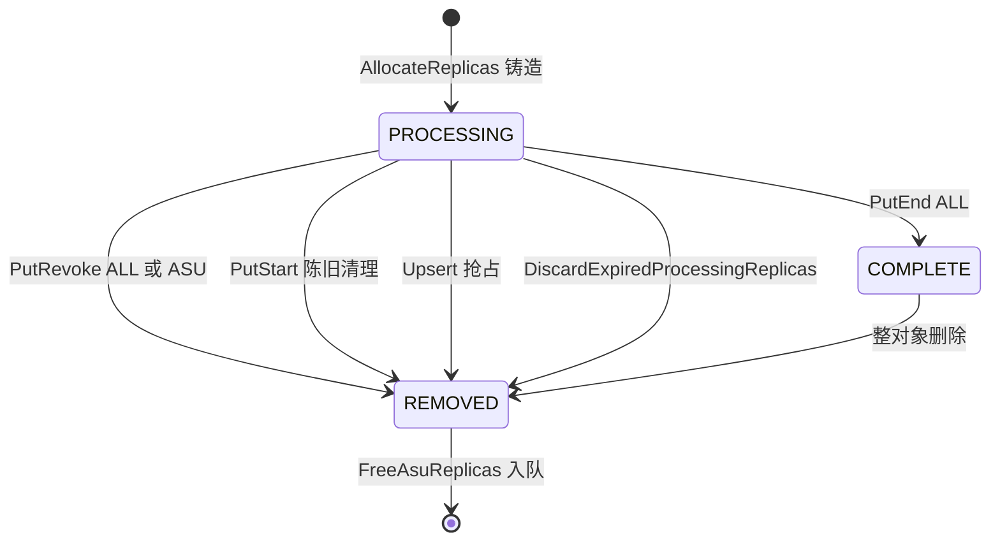

> **[v2.0 变更]** 与 v1.0 的差异：(1) `DetermineReplicaWriteMode` 改为最前面返回 TIERED，并撤销 v1.0 把 asu 混入 FLEXIBLE/RELIABLE 条件的写法；(2) 明确 `ALL` 语义扩展为含 ASU；(3) `get_descriptor` 增加 ASU 分支与尾 else fail-fast；(4) 状态机只复用既有 `ReplicaStatus`，不新增状态，新增的是「ASU 出生即 PROCESSING、只能经 PutEnd(ALL) 转 COMPLETE」这条约束；(5) 明确 ASU 的 `kMaxSliceSize` 上限同样生效（H14）。

**必要代码**

```cpp
// mooncake-store/include/allocator.h（追加）
enum class ReplicaType {
    MEMORY = 0,
    DISK = 1,
    LOCAL_DISK = 2,
    NOF_SSD = 3,
    ALL = 4,  // All synchronous replicas in the put finalize path, incl. ASU
    DFS = 100,
    ASU = 101,  // ASU key-value replica, native KvClient data path
};
```

```cpp
// mooncake-store/include/replica.h（新增类型，放在 DfsReplicaData 之后）
struct AsuDescriptor {
    uint64_t key_id{0};
    uint64_t key_fingerprint{0};
    uint64_t object_epoch{0};
    uint64_t object_size{0};
    uint32_t record_version{1};
    uint32_t flags{0};
    YLT_REFL(AsuDescriptor, key_id, key_fingerprint, object_epoch, object_size,
             record_version, flags);
};
static_assert(sizeof(AsuDescriptor) == 40);

struct AsuReplicaData {
    AsuDescriptor descriptor;
};
```

```cpp
// mooncake-store/include/replica.h（ReplicateConfig 追加，放在 per_key_preferred_hca_names 之后）
struct ReplicateConfig {
    // ... 既有字段与 compatible<...,1..3> ...
    // Appended at the end; never use a bare size_t here.
    struct_pack::compatible<size_t, 4> asu_replica_num;

    size_t AsuReplicaNum() const { return asu_replica_num.value_or(0); }
    // ...
};
```

```cpp
// mooncake-store/include/replica.h（写模式）
enum class ReplicaWriteMode {
    SINGLE_REPLICA,
    FLEXIBLE_DUAL_REPLICA,
    RELIABLE_MULTI_REPLICA,
    TIERED_MEMORY_THEN_ASU,  // memory first, ASU is the optional second stage
};

inline ReplicaWriteMode DetermineReplicaWriteMode(
    const ReplicateConfig& config) {
    if (config.AsuReplicaNum() > 0) {
        return ReplicaWriteMode::TIERED_MEMORY_THEN_ASU;
    }
    if (config.dfs_replica_num == 0 && config.replica_num == 1 &&
        config.nof_replica_num == 1) {
        return ReplicaWriteMode::FLEXIBLE_DUAL_REPLICA;
    }
    if (config.replica_num > 1 || config.nof_replica_num > 1 ||
        config.dfs_replica_num > 0) {
        return ReplicaWriteMode::RELIABLE_MULTI_REPLICA;
    }
    return ReplicaWriteMode::SINGLE_REPLICA;
}
```

```cpp
// mooncake-store/include/replica.h（构造与访问器）
class Replica {
   public:
    // ... 既有构造 ...

    // asu replica constructor
    Replica(AsuDescriptor descriptor, ReplicaStatus status)
        : Replica(next_id_.fetch_add(1), std::move(descriptor), status) {}

    ~Replica() {
        if (status_ == ReplicaStatus::UNDEFINED) return;
        if (is_disk_replica()) {
            MasterMetricManager::instance().dec_allocated_file_size(
                std::get<DiskReplicaData>(data_).object_size);
        } else if (is_local_disk_replica()) {
            MasterMetricManager::instance().dec_allocated_file_size(
                std::get<LocalDiskReplicaData>(data_).object_size);
        }
        // ASU bytes are not counted in allocated_file_size on purpose.
    }

    [[nodiscard]] bool is_available() const {
        if (const auto* data = std::get_if<MemoryReplicaData>(&data_)) {
            return data->buffer && data->buffer->isAvailable();
        }
        if (const auto* data = std::get_if<NoFReplicaData>(&data_)) {
            return data->buffer && data->buffer->isAvailable();
        }
        if (const auto* data = std::get_if<LocalDiskReplicaData>(&data_)) {
            const ClientLivenessRecord* record = data->client_liveness.get();
            return record != nullptr && record->IsServing();
        }
        return true;  // ASU: reachability is discovered at read time
    }

    [[nodiscard]] bool is_asu_replica() const {
        return std::holds_alternative<AsuReplicaData>(data_);
    }

    [[nodiscard]] static bool fn_is_asu_replica(const Replica& replica) {
        return replica.is_asu_replica();
    }

    [[nodiscard]] const AsuDescriptor& get_asu_descriptor() const {
        return std::get<AsuReplicaData>(data_).descriptor;
    }

    [[nodiscard]] AsuDescriptor& get_asu_descriptor() {
        return std::get<AsuReplicaData>(data_).descriptor;
    }

    struct ReplicaTypeVisitor {
        // ... 既有重载 ...
        ReplicaType operator()(const AsuReplicaData&) const {
            return ReplicaType::ASU;
        }
    };

    struct Descriptor {
        ReplicaID id{0};
        std::variant<MemoryDescriptor, NoFDescriptor, DiskDescriptor,
                     LocalDiskDescriptor, DistributedFSDescriptor,
                     AsuDescriptor>
            descriptor_variant;
        ReplicaStatus status;
        YLT_REFL(Descriptor, id, descriptor_variant, status);

        bool is_asu_replica() noexcept {
            return std::holds_alternative<AsuDescriptor>(descriptor_variant);
        }
        bool is_asu_replica() const noexcept {
            return std::holds_alternative<AsuDescriptor>(descriptor_variant);
        }
        AsuDescriptor& get_asu_descriptor() {
            if (auto* desc = std::get_if<AsuDescriptor>(&descriptor_variant)) {
                return *desc;
            }
            throw std::runtime_error("Expected AsuDescriptor");
        }
        const AsuDescriptor& get_asu_descriptor() const {
            if (const auto* desc =
                    std::get_if<AsuDescriptor>(&descriptor_variant)) {
                return *desc;
            }
            throw std::runtime_error("Expected AsuDescriptor");
        }
    };

   private:
    // Restore-only constructor preserves the id without consuming next_id_.
    Replica(ReplicaID id, AsuDescriptor descriptor, ReplicaStatus status)
        : id_(id),
          data_(AsuReplicaData{std::move(descriptor)}),
          status_(status),
          refcnt_(0) {}

    std::variant<MemoryReplicaData, NoFReplicaData, DiskReplicaData,
                 LocalDiskReplicaData, DfsReplicaData, AsuReplicaData>
        data_;
};

inline Replica::Descriptor Replica::get_descriptor() const {
    // ... 既有分支 ...
    } else if (is_asu_replica()) {
        desc.descriptor_variant = std::get<AsuReplicaData>(data_).descriptor;
    } else {
        // v2: fail fast instead of silently returning a default-constructed
        // MemoryDescriptor when a new replica type forgets its branch.
        LOG(ERROR) << "get_descriptor: unhandled replica type, id=" << id_;
    }
    return desc;
}
```

#### 3.9.1 对既有代码的改动

| 文件 | 位置 | 改动 | kind |
| --- | --- | --- | --- |
| `mooncake-store/include/allocator.h` | 27-34 | `ReplicaType` 追加 `ASU = 101`；`ALL` 注释扩展为含 ASU | pure-additive |
| `mooncake-store/include/replica.h` | 40-51 | `replica_type_strings` 增加 `{ReplicaType::ASU, "ASU"}` | modify |
| `mooncake-store/include/replica.h` | 108-140 | `ReplicateConfig` 末尾追加 `struct_pack::compatible<size_t, 4> asu_replica_num` 与 `AsuReplicaNum()`（禁止裸 `size_t`） | risky |
| `mooncake-store/include/replica.h` | 265-269 | `ReplicaWriteMode` 追加 `TIERED_MEMORY_THEN_ASU` | modify |
| `mooncake-store/include/replica.h` | 291-302 | `DetermineReplicaWriteMode` 最前面按 `AsuReplicaNum() > 0` 返回 TIERED | risky |
| `mooncake-store/include/replica.h` | 304-341 | 新增 `AsuDescriptor` 与 `AsuReplicaData` | modify |
| `mooncake-store/include/replica.h` | 367-396 | 新增公有 `Replica(AsuDescriptor, ReplicaStatus)` | modify |
| `mooncake-store/include/replica.h` | 398-407 | 析构不记 `allocated_file_size` 并加注释 | modify |
| `mooncake-store/include/replica.h` | 460-471 | `is_available` 既有 fallthrough 已 `return true`，无需改动，仅补注释 | no-op |
| `mooncake-store/include/replica.h` | 500-565 | 新增 `is_asu_replica`、`fn_is_asu_replica`、`get_asu_descriptor` | modify |
| `mooncake-store/include/replica.h` | 722-738 | `ReplicaTypeVisitor` 增加 `AsuReplicaData` 重载 | modify |
| `mooncake-store/include/replica.h` | 740-746 | `descriptor_variant` 末尾追加 `AsuDescriptor` | risky |
| `mooncake-store/include/replica.h` | 895-930 | 新增恢复用私有构造；`data_` variant 末尾追加 `AsuReplicaData` | risky |
| `mooncake-store/include/replica.h` | 934-981 | `get_descriptor` 增加 ASU 分支与尾 else fail-fast | risky |
| `mooncake-store/include/replica.h` | 983-1020 | `transport_endpoint` / `get_segment_names` 既有 fallthrough 已返回 `std::nullopt` / 空 vector，无需改动 | no-op |
| `mooncake-store/include/replica.h` | 1022-1056 | `operator<<` 增加 ASU | modify |
| `mooncake-integration/store/store_py.cpp` | `ReplicateConfig` pybind 绑定 | 增加 `asu_replica_num`（默认 0） | pure-additive |
| `mooncake-integration/store/store_py_internal.h` | `is_default_replicate_config` | 纳入 `asu_replica_num`（`value_or(0) == 0`） | modify |

### 3.10 Client 集成（有序写、择优读、删 memory）

> 说明：3.10 代码中的 `GetAsuMetricPtr()` 返回新增的 `AsuClientMetrics` 指针，承载 `asu_write_skipped_total{reason}`、`asu_write_failures_total{code}`、`asu_write_latency_us`、`asu_write_bytes`、`asu_degraded_total`、`asu_required_failures_total{code}`、`asu_required_enabled`、`asu_finalize_rpc_failed_total`、`asu_alloc_missing_total`、`asu_read_objects_total{result}`、`asu_read_batch_tasks_total`、`asu_read_latency_us`、`asu_slot_exhausted_total`；其中 `asu_required_failures_total` 只在 `DetermineFinalizeDecision` 返回严格失败（`primary_ok && !asu_ok && require_asu`）且 ASU 阶段确实尝试过写时自增，`asu_required_enabled` 在 `AsuClientRuntime::Create` 读取 `config_.require_asu` 后置位（1=strict，0=degrade）；名字与 §2.5 指标表一致，实现放在 client_service 的 metrics 聚合处，不引入新的全局单例。

**职责**

把 ASU 副本接到 Client 的 Put/Upsert/BatchPut/BatchUpsert/Get/BatchGet 路径，并持有 Client 侧的 `AsuClientRuntime`。本 shard 负责「什么时候写、失败怎么记账、读怎么选中 ASU、在哪儿拦截 TransferEngine、如何只删 memory」，不负责 descriptor 铸造（3.11）也不负责字节搬运细节（3.6）。

**设计说明**

#### 写路径：memory 全部成功后同步写 ASU

1. `PutOperation` 增加 `requested_asu_replicas`，由 `config.AsuReplicaNum()` 初始化并回填到 `ReplicateConfig`。
2. `ReplicaTransferSummary` 增加 `allocated_asu_replicas`/`successful_asu_transfers`/`failed_asu_transfers`，`RecordAllocatedReplica`/`RecordSuccess`/`RecordFailure` 各加一个 `ReplicaType::ASU` 分支。
3. `NonDfsTransfersSucceeded` 保持原义（只判 memory/nof），它是 ASU 阶段的门禁；`AllAllocatedTransfersSucceeded` **不纳入 ASU**（v1.0 曾纳入，v2 撤销：ASU 是可选第二层，不能强迫整体成功）。
4. `HasExpectedReplicaAllocation` **不改**（两侧都不加 allocated_asu）。ASU 在门槛之后铸造、纯命名不会失败，不参与分配期望判定。
5. 新增 `SubmitAsuWrites`（结构照抄 `SubmitDfsWrites`，`client_service.cpp:3201-3259`）：跳过 `IsResolved` 或 `allocated_asu == 0`；`!NonDfsTransfersSucceeded` 时记 `asu_write_skipped_total{reason=primary_tier_failed}` 并**零调用**；找不到 ASU descriptor 记 `INVALID_REPLICA`；runtime 未就绪记 `ASU_SERVICE_UNAVAILABLE`；否则 `BatchStoreObjects(requests, trace_id)` 并逐对象 `RecordSuccess/Failure(ASU)`。
6. 单 key 路径：`Client::Put` 在 DFS 块之后、finalize 之前调 `WriteAsuReplicaForSingle`；`Client::Upsert` 同构，避免复制粘贴。
7. 批量路径：`BatchPut` 在 `SubmitDfsWrites(ops)` 之后、`FinalizeBatchPut(ops)` 之前插入 `SubmitAsuWrites(ops)`（`client_service.cpp:3685`、`:3693` 一带）；`BatchUpsert` 同理（`:3735` 一带）。
8. 数据源是 `op.slices`，不读回 memory；契约是 Put 返回前调用方不得修改 buffer。
9. `StageWriteBuffersForRemoteReplicas`（`client_service.cpp:3626-3647`）的 `all_of(CanUseLocalMemcpy)` 必须排除 ASU descriptor，否则「本地 memory + ASU」会被强制整对象 host staging，与 arena 拷贝叠加成双重拷贝（FMEA-53）。
10. session 写路径（`batch_put_session_start`，`real_client.cpp:7867-7903`）在 NoF 拒绝旁对 `AsuReplicaNum() > 0` 返回 `INVALID_PARAMS`。

#### 终态：分层降级

> **[v2.1 变更]** 终态由配置项 `require_asu` 决定：false（默认）走下面的分层降级分支；true 时 `primary_ok && !asu_ok` 直接映射为 `{null, ALL, false}`（整体失败）。两种模式下 `asu_ok` 分支与 `!primary_ok` 分支完全相同，因此只需在 TIERED 分支内加一个判断，不新增 RPC 或数据结构。

`DetermineFinalizeDecision` 在非 FLEXIBLE 分支前插入 TIERED 分支：

- `primary_ok = HasExpectedReplicaAllocation(...) && NonDfsTransfersSucceeded(summary)`；
- `asu_ok = allocated_asu > 0 && successful_asu == allocated_asu && failed_asu == 0`；
- `primary_ok && asu_ok` → `{ALL, null, true}`；
- `primary_ok && !asu_ok && !require_asu` → `{MEMORY, ASU, true}`（**degrade**：Put 成功、记 `asu_degraded_total`）；
- `primary_ok && !asu_ok && require_asu` → `{null, ALL, false}`（**strict**：整体失败，错误码取 `first_asu_error`，已写成功的 memory 与 ASU 一并撤销）；
- `!primary_ok` → `{null, ALL, false}`（ASU 从未写）。

`FinalizeDecision` 保持 `end_type` + `revoke_type` 双槽，不向量化、不新增 `revoke_asu`：关闭 asu+nof/asu+dfs 后降级恰为一个 end 和一个 revoke。

为保证「请求了 ASU 但没分到」不被静默当成成功，`Client::Put` / `StartBatchPut` 在拿到 PutStart 响应后立即校验 `requested_asu > 0 && allocated_asu == 0` → 不发起传输，直接 `PutRevoke(ALL)` 并返回 `NO_AVAILABLE_HANDLE`（FMEA-43 的兜底）。该早退与 `require_asu` 无关：两种模式下它都是硬失败；`require_asu` 只改变「ASU 数据面已尝试但写入失败」的终态。

单 key 终态顺序保持「先 end 后 revoke」，只改错误处理：`revoke_type == ASU` 失败只记 `asu_finalize_rpc_failed_total` + WARN，不 return error（FMEA-44）。`require_asu=true` 时 TIERED 分支只产出 `revoke_type == ALL`，绝不会落入该「吞掉 ASU revoke 错误」的豁免；实现判据必须是「副本类型 == ASU」而不是「写模式 == TIERED」，否则会把严格模式的 `PutRevoke(ALL)` RPC 失败也吞掉（FMEA-60）。`end_type` 为空、仅发 revoke 时，revoke 失败只记录到日志并计入 metric（`Client::Put` / `Upsert` 的作用域没有 `PutOperation`，因此没有 `failure_context`），随后返回 `finalize_decision.error`（ASU 根因），不要用 revoke 的错误覆盖它（`client_service.cpp:2196-2203`、`2401-2408`）。

`FinalizeBatchPut`：新增 `revoke_asu_group` 与 `case ReplicaType::ASU`（仅 revoke，end 分支防御性报错）；`process_revoke_group` 增加 `ignore_errors` 参数，ASU 组传 true。`FinalizeBatchUpsert`：成功集判据改为 `primary_ok && asu_ok`；happy 用 `BatchUpsertEnd`（其 master 实现硬编码 `ReplicaType::ALL`，`master_service.cpp:6206`）；degrade 子集改调 `BatchPutEnd(metas, MEMORY)` + `BatchPutRevoke(keys, ASU)`（现成 RPC）；失败集仍用 `BatchUpsertRevoke`。

```mermaid
sequenceDiagram
    participant RC as RealClient
    participant C as Client
    participant M as Master
    participant MEM as MEMORY Replica
    participant A as ASU
    C->>M: PutStart
    M-->>C: memory PROCESSING + AsuDescriptor PROCESSING
    C->>MEM: TransferWrite 全部 memory
    alt 主层失败
        C->>M: PutRevoke ALL
    else 主层成功
        C->>A: BatchStoreObjects 一个对象一条 entry 多对象可合批
        alt ASU 成功
            C->>M: PutEnd ALL
        else ASU 失败 且 require_asu=false（默认）
            C->>M: PutEnd MEMORY
            C->>M: PutRevoke ASU
        else ASU 失败 且 require_asu=true（严格）
            C->>M: PutRevoke ALL
        end
    end
```

**严格模式（`require_asu=true`）的批量分流**：`FinalizeBatchPut` 中严格失败 op 的 `revoke_type` 恒为 `ALL`，进入既有 `revoke_all_group`，绝不进入 `revoke_asu_group`；`process_revoke_group(revoke_asu_group, ..., ignore_errors=true)` 的豁免只按「副本类型 == ASU」生效，不按「写模式 == TIERED」。`FinalizeBatchUpsert` 中 `decision.success == false` 的 op 一律进 `failed_keys` 并走 `BatchUpsertRevoke`（默认 `ReplicaType::ALL`，`master_service.h:477-479`），且必须用 `decision.error`（严格模式即 `first_asu_error`）调用 `SetTerminalError`，不能退回 `transfer_summary.first_error`（`client_service.cpp:3488-3494` 的旧判据在 ASU 失败时会给出 `TRANSFER_FAIL`）；因此降级分区在严格模式下不可达。分区顺序必须严格为 ALL → degraded → failed，避免严格模式的失败 op 落入 degrade 桶（FMEA-58）。

#### 读路径：Master 返回全集、Client 显式档位、选中 ASU 直接 BatchLoadAsync

- Master 不改：`GetReadableReplicaDescriptors`（`master_service.cpp:4487-4500`）以恒真谓词遍历 Part 0，只经 `IsReplicaReadable`（`master_service.cpp:4502-4505` = `completed && available && !IsAwaitingRemount`）过滤，不按类型筛、不排序；`ReadReplicaList`（`master_service.cpp:4585-4660`）与 `BatchGetReplicaList`（`:4705-4733`）复用。
- `replica_selection.h` 新增 `ReplicaReadRank` 与 `ReadSelectionPolicy`；`ClassifyReplicaForRead` 把 ASU 归入第 5 档；`SelectBestReplica` 的兜底链改为显式 min-rank，平手后出现者胜出（`rank <= best_rank` 才覆盖），保持 `tests/pybind_client_test.cpp:188-262` 的「最后一个 LOCAL_DISK 胜出」。默认 `policy.asu_available = false`，未启用 ASU 的 Client 永不选 ASU。
- `SelectBestReplica` 的 memory/nof/HCA 前半段（`replica_selection.h:137-180`）不动；只替换兜底循环（`:182-193`）。
- `ReadReplicaSelector::operator()`（`client_service.cpp:675-700`）的短路条件改为：`replicas.size() <= 1`，或「无 ASU 且 非 affinity/RDMA」时走 `FindFirstCompleteReplica`；含 ASU 时走 `SelectBestReplica(replicas, GetLocalEndpoints(), hcas, {.asu_available = allow_asu_ && client_->AsuReadAvailable()})`。selected 为空返回 `NoReplicaError`。
- `ReadReplicaSelector` 增加 `allow_asu_` 与 `MakeReadReplicaSelector(bool allow_asu = true)`；**range 调用点必须传 false**：`Client::Get(..., src_offset)`（`client_service.cpp:1661`）、`BatchTransferReadRanges`（`:4907`）、`RealClient` 的 get_into_ranges（`real_client.cpp:5261`）。早期草案只列了前两个，第三个是同类 range 入口，v2 一并纳入（见前提性冲突 P-4）。
- `real_client` 的四个全对象选择点必须传 policy：`get_buffer_internal:4036`、`batch_get_buffer_internal:4425`、`batch_get_into_internal:6776`、`batch_get_into_multi_buffers_internal:8440`。`nullptr` 分支统一用 `NoReplicaError`，避免与 `ReadReplicaSelector` 的错误码不一致。
- `batch_get_into_multi_buffers_internal` 的 `if (replica.is_memory_replica() || replica.is_nof_replica())`（`real_client.cpp:8464`）扩展 `|| replica.is_asu_replica()`，否则落到 `real_client.cpp:8498` 的 `Unsupported replica type`。
- range 与 session range 对 ASU 显式 `NOT_SUPPORTED`；`SelectSessionReplica`（`real_client.cpp:550-571`）不纳入 ASU（v1.0 的 session 接入作废）。
- `client_buffer.cpp` 的 `calculate_total_size`（`:144-159`）与 `allocateSlices`（`:161-191`）增加 ASU 分支，放在最后 else 之前：总长取 `object_size`，slices 为单个 `Slice{buffer_ptr, object_size}`。
- `Client::Get`（`client_service.cpp:1578-1653`）在 DFS 分支旁增加 `else if (replica.is_asu_replica()) err = ReadAsuReplica(...)`。`ReadAsuReplica` 入口要求 `CalculateSliceSize(slices) >= object_size`，否则 `INVALID_PARAMS`（与 memory 在 `TransferRead` 的尺寸契约一致），因此永远整对象读、payload CRC-32C 全量校验。后置 `VerifyObjectChecksum`、hot cache、租约原样；`ProcessSlicesAsync` 因 `is_memory_replica` 门控跳过 ASU。
- `TransferRead`（`client_service.cpp:5160-5194`）入口显式 `if (is_asu_replica) return INVALID_REPLICA`；不新增 size 分支（v1.0 的 size 分支作废，否则会落入 file-read 分支）。
- `Client::BatchGet`（`client_service.cpp:1718-1997`）：在 DFS 分支旁收集 `AsuReadRequest`，在 DFS 同步批量读（`:1889-1955`）之后、RDMA 统一 Wait（`:1957-1997`）之前调一次 `BatchLoadObjects`；逐 outcome 映射并复用 `VerifyObjectChecksum`。

#### `AsuClientRuntime` 与可用性

`Init` 必须等视图 transports 非空且 `RegisterRegions` 真的返回有效 handle。SDK 在视图为空时 `RegisterRegions` 返回 OK 但零注册（`kv_client_impl.cc:330-339`），所以 `AsuStagingArena::Create` 的 handle 校验会失败；Runtime 用指数退避重试（最多 10 次，100ms→2s），全部失败则让 `Init` 明确失败。`IsReady()` 纳入 arena 的**永久**可用性（全部 slot 未 quarantine，3.4）；瞬时占满不算不可服务。v2 新增 `AsuReadAvailable()`：`asu_runtime_ && asu_runtime_->IsReady()`。v2.1 新增 `Client::AsuRequired()`：`asu_runtime_ && asu_runtime_->require_asu()`，供 finalize 调用点透传；Client 不在 finalize 热路径重复读 env。

#### 删 memory：只删 memory

新增 `Client::BatchRemoveAsuObjects(keys, force = false)`，Master 侧同名。Phase 1 在 key 写锁内只读捕获 `AsuDescriptor`；Phase 2 调用**既有** `RemoveObject`（一行不改，先删 memory 与元数据）；Phase 3 用捕获的 key_id 入 `AsuDeleteQueue`。删 memory 仍复用既有 `Client::Remove` / `BatchRemove`，不新增任何 RPC。

**必要代码**

```cpp
// mooncake-store/include/asu/asu_client_runtime.h
#pragma once

#include <memory>

#include <ylt/util/tl/expected.hpp>

#include <asu_config.h>
#include <asu_storage_backend.h>
#include <types.h>

namespace mooncake::asu {

class AsuClientRuntime final {
   public:
    static tl::expected<std::unique_ptr<AsuClientRuntime>, ErrorCode> Create(
        const AsuConfig& config);

    AsuStorageBackend& backend() { return *backend_; }
    bool IsReady() const { return backend_ && backend_->IsReady(); }

    // v2.1: single read point for the strictness switch.
    bool require_asu() const { return config_.require_asu; }

   private:
    AsuClientRuntime(std::unique_ptr<AsuStorageBackend> backend,
                     AsuConfig config)
        : backend_(std::move(backend)), config_(std::move(config)) {}

    std::unique_ptr<AsuStorageBackend> backend_;
    AsuConfig config_;
};

}  // namespace mooncake::asu
```

```cpp
// mooncake-store/src/asu/asu_client_runtime.cpp
#include "asu/asu_client_runtime.h"

#include <chrono>
#include <memory>
#include <thread>

#include "asu/asu_kv_adapter.h"

namespace mooncake::asu {

tl::expected<std::unique_ptr<AsuClientRuntime>, ErrorCode>
AsuClientRuntime::Create(const AsuConfig& config) {
    if (!config.enable || !config.Validate()) {
        return tl::make_unexpected(ErrorCode::ASU_SERVICE_UNAVAILABLE);
    }
    constexpr int kMaxAttempts = 10;
    for (int attempt = 0; attempt < kMaxAttempts; ++attempt) {
        auto adapter =
            std::make_unique<AsuKvClientAdapter>(kv::CreateKvClient());
        auto backend = AsuStorageBackend::Create(
            config, std::move(adapter), /*register_staging=*/true);
        if (backend.has_value()) {
            return std::unique_ptr<AsuClientRuntime>(
                new AsuClientRuntime(std::move(backend.value()), config));
        }
        if (backend.error() != ErrorCode::ASU_SERVICE_UNAVAILABLE) {
            return tl::make_unexpected(backend.error());
        }
        // View may still be empty right after startup; back off and retry.
        std::this_thread::sleep_for(
            std::chrono::milliseconds(100ull << attempt));
    }
    return tl::make_unexpected(ErrorCode::ASU_SERVICE_UNAVAILABLE);
}

}  // namespace mooncake::asu
```

```cpp
// mooncake-store/src/client_service.cpp（差异片段 1：summary 与 finalize）

// ASU write stage is tracked only for metrics/logging; it is never persisted.
enum class AsuWriteStage : uint8_t {
    kIdle = 0,
    kPrimaryInFlight,
    kPrimaryOk,
    kPrimaryFailed,
    kAsuInFlight,
    kAsuOk,
    kAsuFailed,
    kFinalizedAll,
    kFinalizedDegraded,
    kFinalizedStrictFailed,
    kRevoked,
};
// v2.1 finalize -> stage mapping (single assignment point, used by metrics/log):
//   {ALL, nullopt, true}                         -> kFinalizedAll
//   {MEMORY, ASU, true}                          -> kFinalizedDegraded
//   {nullopt, ALL, false} && ASU was attempted   -> kFinalizedStrictFailed
//   {nullopt, ALL, false} && ASU never attempted -> kRevoked

struct ReplicaTransferSummary {
    size_t allocated_memory_replicas = 0;
    size_t allocated_nof_replicas = 0;
    size_t allocated_dfs_replicas = 0;
    size_t allocated_asu_replicas = 0;
    size_t successful_memory_transfers = 0;
    size_t successful_nof_transfers = 0;
    size_t successful_dfs_transfers = 0;
    size_t successful_asu_transfers = 0;
    size_t failed_memory_transfers = 0;
    size_t failed_nof_transfers = 0;
    size_t failed_dfs_transfers = 0;
    size_t failed_asu_transfers = 0;
    ErrorCode first_error = ErrorCode::OK;
    // v2.1: ASU failures are recorded separately so the primary-tier error
    // and the strict-mode return code never get polluted by each other.
    ErrorCode first_asu_error = ErrorCode::OK;

    void RecordAllocatedReplica(const Replica::Descriptor& replica) {
        // ... memory/nof/dfs ...
        if (replica.is_asu_replica()) {
            ++allocated_asu_replicas;
        }
    }

    void RecordSuccess(ReplicaType replica_type) {
        // ... memory/nof/dfs ...
        if (replica_type == ReplicaType::ASU) {
            ++successful_asu_transfers;
        }
    }

    void RecordFailure(ReplicaType replica_type, ErrorCode error) {
        // ... memory/nof/dfs ...
        if (replica_type == ReplicaType::ASU) {
            ++failed_asu_transfers;
            if (first_asu_error == ErrorCode::OK) first_asu_error = error;
            return;
        }
        if (first_error == ErrorCode::OK) first_error = error;
    }
};

// v2.1: ASU failure degrades by default; with require_asu=true it fails the whole put (revoke ALL).
bool AllAllocatedTransfersSucceeded(const ReplicaTransferSummary& summary) {
    return NonDfsTransfersSucceeded(summary) &&
           summary.successful_dfs_transfers == summary.allocated_dfs_replicas &&
           summary.failed_dfs_transfers == 0;
}

FinalizeDecision DetermineFinalizeDecision(
    const ReplicateConfig& config, const ReplicaTransferSummary& summary,
    bool require_asu) {
    const auto write_mode = DetermineReplicaWriteMode(config);
    const bool allocation_satisfied =
        HasExpectedReplicaAllocation(config, summary);

    // v2: ordered two-stage semantics.
    if (write_mode == ReplicaWriteMode::TIERED_MEMORY_THEN_ASU) {
        const bool primary_ok =
            allocation_satisfied && NonDfsTransfersSucceeded(summary);
        const bool asu_ok =
            summary.allocated_asu_replicas > 0 &&
            summary.successful_asu_transfers ==
                summary.allocated_asu_replicas &&
            summary.failed_asu_transfers == 0;
        if (primary_ok && asu_ok) {
            return {.end_type = ReplicaType::ALL,
                    .revoke_type = std::nullopt,
                    .success = true,
                    .error = ErrorCode::OK};
        }
        if (primary_ok && !require_asu) {
            // degrade (default): keep memory, revoke the failed ASU replica.
            return {.end_type = ReplicaType::MEMORY,
                    .revoke_type = ReplicaType::ASU,
                    .success = true,
                    .error = ErrorCode::OK};
        }
        if (primary_ok) {
            // require_asu=true: the whole Put fails; revoke ALL. The error
            // carries the ASU root cause, never the revoke error.
            return {.end_type = std::nullopt,
                    .revoke_type = ReplicaType::ALL,
                    .success = false,
                    .error = summary.first_asu_error == ErrorCode::OK
                                 ? ErrorCode::TRANSFER_FAIL
                                 : summary.first_asu_error};
        }
        return {.end_type = std::nullopt,
                .revoke_type = ReplicaType::ALL,
                .success = false,
                .error = allocation_satisfied
                             ? (summary.first_error == ErrorCode::OK
                                    ? ErrorCode::TRANSFER_FAIL
                                    : summary.first_error)
                             : ErrorCode::NO_AVAILABLE_HANDLE};
    }

    // ... 既有 FLEXIBLE / reliable 分支保持不变 ...
}

// 2) trace id helper（client_service.cpp 文件内）
static uint64_t NextTraceId() {
    static std::atomic<uint64_t> counter{
        static_cast<uint64_t>(std::chrono::steady_clock::now()
                                  .time_since_epoch()
                                  .count())};
    return counter.fetch_add(1, std::memory_order_relaxed);
}
```

```cpp
// mooncake-store/src/client_service.cpp（差异片段 2：有序写）

// Shared by single-key Put/Upsert and by SubmitAsuWrites.
ErrorCode Client::WriteAsuReplicaForSingle(
    const std::string& key, const std::vector<Replica::Descriptor>& replicas,
    std::vector<Slice>& slices, uint64_t trace_id,
    ReplicaTransferSummary& summary) {
    if (summary.allocated_asu_replicas == 0) return ErrorCode::OK;
    // Gate: the primary tier must be fully successful. This is what makes
    // "memory first, ASU second" an ordered stage instead of a parallel fanout.
    if (!NonDfsTransfersSucceeded(summary)) {
        if (auto* m = GetAsuMetricPtr()) {
            m->RecordWriteSkipped("primary_tier_failed");
        }
        return ErrorCode::OK;
    }
    // Writes also stage through the arena, so readiness (init + free slots)
    // is the correct gate here, not the read-specific availability helper.
    if (asu_runtime_ == nullptr || !asu_runtime_->IsReady()) {
        summary.RecordFailure(ReplicaType::ASU,
                              ErrorCode::ASU_SERVICE_UNAVAILABLE);
        return ErrorCode::ASU_SERVICE_UNAVAILABLE;
    }
    const auto asu_it = std::find_if(
        replicas.begin(), replicas.end(),
        [](const Replica::Descriptor& r) { return r.is_asu_replica(); });
    if (asu_it == replicas.end()) {
        summary.RecordFailure(ReplicaType::ASU, ErrorCode::INVALID_REPLICA);
        return ErrorCode::INVALID_REPLICA;
    }
    const auto started = std::chrono::steady_clock::now();
    const AsuStoreRequest request{key, asu_it->get_asu_descriptor(), slices};
    auto result = asu_runtime_->backend().BatchStoreObjects(
        std::span<const AsuStoreRequest>(&request, 1), trace_id);
    if (!result.has_value()) {
        summary.RecordFailure(ReplicaType::ASU, result.error());
        if (auto* m = GetAsuMetricPtr()) {
            m->RecordWriteFailure(toString(result.error()));
        }
        return result.error();
    }
    if (result->size() != 1) {
        summary.RecordFailure(ReplicaType::ASU, ErrorCode::INTERNAL_ERROR);
        return ErrorCode::INTERNAL_ERROR;
    }
    const ErrorCode error = (*result)[0];
    if (error == ErrorCode::OK) {
        summary.RecordSuccess(ReplicaType::ASU);
        if (auto* m = GetAsuMetricPtr()) {
            m->ObserveWrite(elapsed_us_since(started),
                            asu_it->get_asu_descriptor().object_size);
        }
        return ErrorCode::OK;
    }
    summary.RecordFailure(ReplicaType::ASU, error);
    if (auto* m = GetAsuMetricPtr()) {
        m->RecordWriteFailure(toString(error));
    }
    return error;
}

void Client::SubmitAsuWrites(std::vector<PutOperation>& ops) {
    for (auto& op : ops) {
        if (op.IsResolved() || op.transfer_summary.allocated_asu_replicas == 0) {
            continue;
        }
        auto error = WriteAsuReplicaForSingle(
            op.key, op.replicas, op.slices, NextTraceId(),
            op.transfer_summary);
        if (error != ErrorCode::OK) {
            op.AppendFailureContext("Synchronous ASU write failed: " +
                                    toString(error));
        }
    }
}

// BatchPut (after SubmitDfsWrites, before FinalizeBatchPut)
SubmitDfsWrites(ops);
SubmitAsuWrites(ops);
FinalizeBatchPut(ops);
```

```cpp
// mooncake-store/src/client_service.cpp（差异片段 3：finalize RPC 分流）

// Single-key Put/Upsert: end first, then revoke. An ASU revoke failure is
// non-fatal: the ASU replica stays PROCESSING and the reaper collects it.
if (finalize_decision.end_type.has_value()) {
    auto end_result = master_client_.PutEnd(
        ObjectMeta{key, object_checksum}, *finalize_decision.end_type);
    if (!end_result) return tl::unexpected(end_result.error());
}
if (finalize_decision.revoke_type.has_value()) {
    auto revoke_result =
        master_client_.PutRevoke(key, *finalize_decision.revoke_type);
    if (!revoke_result) {
        if (*finalize_decision.revoke_type == ReplicaType::ASU) {
            LOG(WARNING) << "asu_finalize_rpc_failed action=revoke key=" << key
                         << " error=" << toString(revoke_result.error());
            if (auto* m = GetAsuMetricPtr()) {
                m->RecordFinalizeRpcFailed();
            }
        } else {
            return tl::unexpected(revoke_result.error());
        }
    }
}

// FinalizeBatchPut: add the ASU revoke group.
BatchFinalizeGroup revoke_asu_group;
auto add_finalize_action = [&](const std::optional<ReplicaType>& replica_type,
                               bool is_end, const std::string& key,
                               size_t index) {
    if (!replica_type.has_value()) return;
    switch (*replica_type) {
        // ... ALL / MEMORY / NOF_SSD 既有分支 ...
        case ReplicaType::ASU:
            if (is_end) {
                // No end action for ASU: happy path uses PutEnd(ALL) and the
                // degraded path uses PutEnd(MEMORY).
                finalize_rpc_errors[index] = ErrorCode::INVALID_PARAMS;
                break;
            }
            add_group_entry(revoke_asu_group, key, index);
            ++pending_finalize_actions[index];
            break;
        default:
            finalize_rpc_errors[index] = ErrorCode::INVALID_PARAMS;
            break;
    }
};
// process_revoke_group gains an ignore_errors flag.
auto process_revoke_group = [&](BatchFinalizeGroup& group,
                                ReplicaType replica_type,
                                bool ignore_errors = false) {
    // ... on per-key failure:
    //     if (!ignore_errors) finalize_rpc_errors[op_idx] = responses[i].error();
    //     complete_finalize_action(op_idx);
};
process_revoke_group(revoke_asu_group, ReplicaType::ASU,
                     /*ignore_errors=*/true);
```

```cpp
// mooncake-store/src/client_service.cpp（差异片段 4：FinalizeBatchUpsert 降级）

// Success set now requires both tiers. The degraded subset cannot use
// BatchUpsertEnd (its master implementation hardcodes ReplicaType::ALL).
std::vector<ObjectMeta> degraded_object_metas;
std::vector<size_t> degraded_indices;
std::vector<std::string> degraded_keys;
for (size_t i = 0; i < ops.size(); ++i) {
    auto& op = ops[i];
    if (op.IsResolved() || op.replicas.empty()) continue;
    const auto decision =
        DetermineFinalizeDecision(op.ToReplicateConfig(), op.transfer_summary,
                                  AsuRequired());
    if (decision.success && decision.end_type == ReplicaType::ALL) {
        successful_object_metas.emplace_back(
            ObjectMeta{op.key, op.object_checksum});
        successful_indices.emplace_back(i);
    } else if (decision.success) {
        // degrade: end MEMORY, then best-effort revoke ASU.
        degraded_object_metas.emplace_back(
            ObjectMeta{op.key, op.object_checksum});
        degraded_indices.emplace_back(i);
        // Must be appended in the same branch as degraded_object_metas so the
        // two RPCs carry the same key set; otherwise the ASU replica stays
        // PROCESSING and the object can never be removed.
        degraded_keys.emplace_back(op.key);
    } else {
        failed_keys.emplace_back(op.key);
        failed_indices.emplace_back(i);
        // v2.1: strict mode must surface the ASU root cause. The legacy
        // 3488-3494 path derives the code from transfer_summary.first_error,
        // which only tracks the primary tier and would degrade to TRANSFER_FAIL.
        op.SetTerminalError(
            decision.error == ErrorCode::OK ? ErrorCode::TRANSFER_FAIL
                                            : decision.error,
            PutOperationState::TRANSFER_FAILED,
            "Batch upsert finalization failed");
    }
}
if (!degraded_object_metas.empty()) {
    auto end_responses =
        master_client_.BatchPutEnd(degraded_object_metas, ReplicaType::MEMORY);
    auto revoke_responses = master_client_.BatchPutRevoke(degraded_keys,
                                                          ReplicaType::ASU);
    // ASU revoke failures are logged and counted, never terminal. Both
    // responses are indexed by the same degraded_indices order; write the
    // terminal state back per op before advancing the cursor.
    for (size_t k = 0; k < degraded_indices.size(); ++k) {
        const size_t op_idx = degraded_indices[k];
        // ... set op terminal state from end_responses[k]; ASU revoke failure
        // only increments asu_finalize_rpc_failed_total ...
    }
}
```

```cpp
// mooncake-store/src/client_service.cpp（差异片段 5：读）

ErrorCode Client::ReadAsuReplica(const std::string& key,
                                 const Replica::Descriptor& descriptor,
                                 std::vector<Slice>& slices) {
    if (!descriptor.is_asu_replica()) return ErrorCode::INVALID_REPLICA;
    if (!AsuReadAvailable()) return ErrorCode::ASU_SERVICE_UNAVAILABLE;
    const auto& asu = descriptor.get_asu_descriptor();
    if (CalculateSliceSize(slices) < asu.object_size) {
        LOG(ERROR) << "asu_read_undersized key=" << key
                   << " required=" << asu.object_size
                   << " provided=" << CalculateSliceSize(slices);
        return ErrorCode::INVALID_PARAMS;
    }
    const AsuReadRequest request{key, asu, slices};
    auto result = asu_runtime_->backend().BatchLoadObjects(
        std::span<const AsuReadRequest>(&request, 1), NextTraceId());
    if (result.has_value() && result->size() == 1) {
        return (*result)[0].error;
    }
    return result.has_value() ? ErrorCode::INTERNAL_ERROR : result.error();
}

// Client::Get dispatch
if (replica.is_dfs_replica()) {
    err = ReadDfsReplica(object_key, replica, slices);
} else if (replica.is_asu_replica()) {
    err = ReadAsuReplica(object_key, replica, slices);
} else {
    err = TransferRead(replica, slices);
}

// Client::BatchGet: collect ASU requests next to the DFS branch.
std::vector<AsuReadRequest> asu_read_requests;
std::vector<size_t> asu_read_indices;
// ... in the selection loop ...
} else if (replica.is_asu_replica()) {
    if (!AsuReadAvailable()) {
        results[i] = tl::unexpected(ErrorCode::ASU_SERVICE_UNAVAILABLE);
        continue;
    }
    asu_read_requests.push_back(
        AsuReadRequest{key, replica.get_asu_descriptor(), slices_it->second});
    asu_read_indices.push_back(i);
    continue;
}
// ... after the DFS batch read block, before the RDMA wait loop ...
if (!asu_read_requests.empty()) {
    auto outcomes =
        asu_runtime_->backend().BatchLoadObjects(asu_read_requests, NextTraceId());
    if (!outcomes.has_value()) {
        for (size_t index : asu_read_indices) {
            results[index] = tl::unexpected(outcomes.error());
        }
    } else if (outcomes->size() != asu_read_requests.size()) {
        for (size_t index : asu_read_indices) {
            results[index] = tl::unexpected(ErrorCode::INTERNAL_ERROR);
        }
    } else {
        for (size_t i = 0; i < outcomes->size(); ++i) {
            const size_t index = asu_read_indices[i];
            if ((*outcomes)[i].error != ErrorCode::OK) {
                results[index] = tl::unexpected((*outcomes)[i].error);
                continue;
            }
            auto checksum_result = VerifyObjectChecksum(
                asu_read_requests[i].key, asu_read_requests[i].slices,
                asu_read_requests[i].descriptor.object_size,
                query_results[index].object_checksum);
            results[index] = checksum_result.has_value()
                                 ? tl::expected<void, ErrorCode>{}
                                 : tl::make_unexpected(checksum_result.error());
        }
    }
}

// TransferRead: explicit reject before the size switch.
if (replica_descriptor.is_asu_replica()) {
    LOG(ERROR) << "ASU reads require the AsuStorageBackend path";
    return ErrorCode::INVALID_REPLICA;
}

// BatchRemoveAsuObjects
tl::expected<void, ErrorCode> Client::BatchRemoveAsuObjects(
    const std::vector<ObjectKey>& keys, bool force) {
    return master_client_.BatchRemoveAsuObjects(keys, force);
}

bool Client::AsuReadAvailable() const {
    return asu_runtime_ != nullptr && asu_runtime_->IsReady();
}
```

```cpp
// mooncake-store/include/replica_selection.h（v2 新增）

enum class ReplicaReadRank : uint8_t {
    kLocalMemory = 0,
    kLocalNof = 1,
    kRemoteMemory = 2,
    kRemoteNof = 3,
    kLocalDisk = 4,
    kAsu = 5,
    kDfs = 6,
    kDisk = 7,
    kNotReadable = 0xFF,
};

struct ReadSelectionPolicy {
    bool asu_available{false};
};

inline ReplicaReadRank ClassifyReplicaForRead(
    const Replica::Descriptor& replica,
    const std::unordered_set<std::string>& local_endpoints,
    bool asu_available) {
    if (replica.status != ReplicaStatus::COMPLETE) {
        return ReplicaReadRank::kNotReadable;
    }
    if (replica.is_memory_replica()) {
        return local_endpoints.count(
                   replica.get_memory_descriptor()
                       .buffer_descriptor.transport_endpoint_)
                   ? ReplicaReadRank::kLocalMemory
                   : ReplicaReadRank::kRemoteMemory;
    }
    if (replica.is_nof_replica()) {
        return local_endpoints.count(
                   replica.get_nof_descriptor()
                       .buffer_descriptor.transport_endpoint_)
                   ? ReplicaReadRank::kLocalNof
                   : ReplicaReadRank::kRemoteNof;
    }
    if (replica.is_local_disk_replica()) return ReplicaReadRank::kLocalDisk;
    if (replica.is_asu_replica()) {
        return asu_available ? ReplicaReadRank::kAsu
                             : ReplicaReadRank::kNotReadable;
    }
    if (replica.is_dfs_replica()) return ReplicaReadRank::kDfs;
    if (replica.is_disk_replica()) return ReplicaReadRank::kDisk;
    return ReplicaReadRank::kNotReadable;
}

inline bool HasCompleteAsuReplica(
    const std::vector<Replica::Descriptor>& replicas) {
    return std::any_of(replicas.begin(), replicas.end(),
                       [](const Replica::Descriptor& r) {
                           return r.status == ReplicaStatus::COMPLETE &&
                                  r.is_asu_replica();
                       });
}

inline ErrorCode NoReplicaError(
    const std::vector<Replica::Descriptor>& replicas) {
    return HasCompleteAsuReplica(replicas)
               ? ErrorCode::ASU_SERVICE_UNAVAILABLE
               : ErrorCode::INVALID_REPLICA;
}

inline const Replica::Descriptor* SelectBestReplica(
    const std::vector<Replica::Descriptor>& replicas,
    const std::unordered_set<std::string>& local_endpoints,
    const std::vector<std::string>& preferred_hcas = {},
    ReadSelectionPolicy policy = {}) {
    // ... 137-180 行既有 memory/nof/HCA 逻辑完全保留 ...
    // local_memory / local_nof / first_memory / first_nof 的返回顺序不变 ...
    if (local_memory) return local_memory;
    if (local_nof) return local_nof;
    if (first_memory &&
        (!preferred_hcas.empty() || RemoteReplicaScoringEnabled())) {
        if (const auto* scored = PickBestRemoteMemory(
                replicas, local_endpoints, preferred_hcas)) {
            return scored;
        }
    }
    if (first_memory) return first_memory;
    if (first_nof) return first_nof;

    // v2: explicit ranks replace the hard-coded LOCAL_DISK > DFS > DISK chain.
    // Ties keep last-wins, preserving the existing LOCAL_DISK behaviour.
    const Replica::Descriptor* best = nullptr;
    ReplicaReadRank best_rank = ReplicaReadRank::kNotReadable;
    for (const auto& replica : replicas) {
        const auto rank = ClassifyReplicaForRead(
            replica, local_endpoints, policy.asu_available);
        if (rank == ReplicaReadRank::kNotReadable) continue;
        if (rank == ReplicaReadRank::kLocalMemory ||
            rank == ReplicaReadRank::kLocalNof ||
            rank == ReplicaReadRank::kRemoteMemory ||
            rank == ReplicaReadRank::kRemoteNof) {
            continue;  // already resolved above
        }
        if (best == nullptr || rank <= best_rank) {
            best = &replica;
            best_rank = rank;
        }
    }
    return best;
}
```

```cpp
// mooncake-store/src/client_service.cpp（ReadReplicaSelector）
ErrorCode Client::ReadReplicaSelector::operator()(
    const std::vector<Replica::Descriptor>& replicas,
    std::span<const Slice> destinations, Replica::Descriptor& result) {
    const bool has_asu = HasCompleteAsuReplica(replicas);
    const bool affinity_path = StoreHcaAffinityEnabled() &&
                               client_->protocol_ == "rdma";
    if (replicas.size() <= 1 || (!has_asu && !affinity_path)) {
        const auto err = client_->FindFirstCompleteReplica(replicas, result);
        if (err != ErrorCode::OK) return err;
        if (!allow_asu_ && result.is_asu_replica()) {
            return ErrorCode::NOT_SUPPORTED;
        }
        return ErrorCode::OK;
    }
    if (!initialized_) {
        initialized_ = true;
        if (auto infer = client_->MakeHcaAffinity()) {
            context_ = std::make_unique<Context>(std::move(infer),
                                                 client_->GetLocalEndpoints());
        }
    }
    std::vector<std::string> hcas;
    if (context_) {
        hcas = context_->infer(destinations);
    }
    const auto endpoints =
        context_ ? context_->endpoints : client_->GetLocalEndpoints();
    const ReadSelectionPolicy policy{
        .asu_available = allow_asu_ && client_->AsuReadAvailable()};
    const auto* selected =
        SelectBestReplica(replicas, endpoints, hcas, policy);
    if (!selected) return NoReplicaError(replicas);
    result = *selected;
    return ErrorCode::OK;
}
```

```cpp
// mooncake-store/src/client_buffer.cpp（差异片段）
uint64_t calculate_total_size(const Replica::Descriptor& replica) {
    // ... 既有分支 ...
    } else if (replica.is_asu_replica()) {
        return replica.get_asu_descriptor().object_size;
    } else {
        return replica.get_memory_descriptor().buffer_descriptor.size_;
    }
}

int allocateSlices(std::vector<Slice>& slices,
                   const Replica::Descriptor& replica, void* buffer_ptr) {
    // ... 既有分支 ...
    } else if (replica.is_asu_replica()) {
        slices.emplace_back(Slice{buffer_ptr,
                                  replica.get_asu_descriptor().object_size});
    } else {
        // ... memory ...
    }
    return 0;
}
```

```cpp
// mooncake-store/src/client_service.cpp（StageWriteBuffersForRemoteReplicas）
if (op.IsResolved() || op.replicas.empty() ||
    std::all_of(op.replicas.begin(), op.replicas.end(),
                [this](const Replica::Descriptor& replica) {
                    // v2: ASU copies through its own registered arena; staging
                    // the whole object for it would duplicate that copy.
                    return replica.is_asu_replica() ||
                           CanUseLocalMemcpy(replica);
                })) {
    continue;
}
```

#### 3.10.1 对既有代码的改动

| 文件 | 位置 | 改动 | kind |
| --- | --- | --- | --- |
| `mooncake-store/include/client_service.h` | 90-108 | `ReadReplicaSelector` 增加 `allow_asu_`；`MakeReadReplicaSelector(bool allow_asu = true)` | modify |
| `mooncake-store/include/client_service.h` | 764、1179 附近 | 新增 `SetAsuClientRuntime`、`std::shared_ptr<AsuClientRuntime> asu_runtime_`、`AsuReadAvailable()`、`AsuRequired()`、`BatchRemoveAsuObjects`、`SubmitAsuWrites`、`WriteAsuReplicaForSingle`、`ReadAsuReplica` 声明 | pure-additive |
| `mooncake-store/include/asu/asu_client_runtime.h` | `AsuClientRuntime` private | 保存 `AsuConfig config_` 并新增 `bool require_asu() const` 只读访问器（v2.1） | modify |
| `mooncake-store/src/client_service.cpp` | 275-319 | summary 增加 ASU 三计数、`first_asu_error` 与 `Record*` 分支；`RecordFailure(ASU)` 只写 `first_asu_error`，不污染 `first_error`（v2.1）；`AllAllocatedTransfersSucceeded` 保持不含 ASU | modify |
| `mooncake-store/src/client_service.cpp` | 378-431 | `DetermineFinalizeDecision` 新增 TIERED 四分支（含 `require_asu` 严格映射）；签名增加 `bool require_asu`（无默认值）；`FinalizeDecision` 结构不变 | modify |
| `mooncake-store/include/client_service.h` + `mooncake-store/src/client_service.cpp` | 275-431 移出 | **测试缝**：把 `ReplicaTransferSummary`、`NonDfsTransfersSucceeded`、`AllAllocatedTransfersSucceeded`、`HasExpectedReplicaAllocation`、`FinalizeDecision`、`DetermineFinalizeDecision` 从匿名命名空间上提到新头文件 `mooncake-store/include/replica_finalize.h`（只依赖 `replica.h` 与 `types.h`，全部 inline），否则 TC-91/93/95 无法链接 | modify |
| `mooncake-store/include/client_service.h` | 78 起 | **测试缝**：增加 `friend class test::ClientTestPeer`，暴露 `SubmitAsuWrites`/`WriteAsuReplicaForSingle`/`ReadAsuReplica` 与 `AsuClientRuntime`（替代放宽为 protected），支撑 TC-94/119/122 | modify |
| `mooncake-store/src/client_service.cpp` | 675-700 | `ReadReplicaSelector` 增加含 ASU 的 best-select 分支、`allow_asu_` 与 `NoReplicaError` 映射 | risky |
| `mooncake-store/src/client_service.cpp` | 1578-1653 | `Client::Get` 增加 `ReadAsuReplica` 分派 | modify |
| `mooncake-store/src/client_service.cpp` | 1661 | range 读的 `MakeReadReplicaSelector()` 传 `false` | modify |
| `mooncake-store/src/client_service.cpp` | 1718-1997 | `Client::BatchGet` 收集 `AsuReadRequest` 并在 DFS 批量读后、RDMA Wait 前调 `BatchLoadObjects`；复用 `VerifyObjectChecksum` | modify |
| `mooncake-store/src/client_service.cpp` | 2105-2203、2315-2408 | `Put`/`Upsert` 在 PutStart/UpsertStart 后校验 allocated ASU，主层后调用 ASU 写；`revoke_type==ASU` 失败只记 metric | risky |
| `mooncake-store/src/client_service.cpp` | 2433-2539 | `PutOperation` 增加 `requested_asu_replicas`；`InitializeRequestedReplicas`/`ToReplicateConfig` 同步 | modify |
| `mooncake-store/src/client_service.cpp` | 3201-3259 旁 | 新增 `SubmitAsuWrites` 与 `WriteAsuReplicaForSingle` | pure-additive |
| `mooncake-store/src/client_service.cpp` | 3261-3462 | `FinalizeBatchPut` 增加 `revoke_asu_group`、`case ReplicaType::ASU`、`process_revoke_group(ignore_errors)` | risky |
| `mooncake-store/src/client_service.cpp` | 3464-3583 | `FinalizeBatchUpsert` 拆分降级子集，改调 `BatchPutEnd(MEMORY)` + `BatchPutRevoke(ASU)`；严格模式下失败 op 走 `BatchUpsertRevoke`（ALL）并用 `decision.error` 调用 `SetTerminalError`（替换 3488-3494 的 first_error 旧判据） | risky |
| `mooncake-store/src/client_service.cpp` | 3626-3647 | `StageWriteBuffersForRemoteReplicas` 的 `all_of` 排除 ASU descriptor | modify |
| `mooncake-store/src/client_service.cpp` | 4907 | `BatchTransferReadRanges` 的 selector 传 `false` | modify |
| `mooncake-store/src/client_service.cpp` | 5160-5194 | `TransferRead` 入口显式拒绝 ASU；不新增 size 分支 | modify |
| `mooncake-store/src/client_service.cpp` | 5196-5243 旁 | 新增 `ReadAsuReplica` | pure-additive |
| `mooncake-store/src/client_service.cpp` | 新增 | 新增 `BatchRemoveAsuObjects`、`AsuReadAvailable` | pure-additive |
| `mooncake-store/include/replica_selection.h` | 39-90、133-194 | 新增 `ReplicaReadRank`/`ReadSelectionPolicy`/`ClassifyReplicaForRead`/`HasCompleteAsuReplica`/`NoReplicaError`；`SelectBestReplica` 加第 4 参与显式 min-rank | risky |
| `mooncake-store/src/client_buffer.cpp` | 144-191 | `calculate_total_size`/`allocateSlices` 增加 ASU 分支 | modify |
| `mooncake-store/src/real_client.cpp` | 4036、4425、6776、8440 | 四个全对象 `SelectBestReplica` 调用点传 `ReadSelectionPolicy` 与统一错误映射 | modify |
| `mooncake-store/src/real_client.cpp` | 5261 | get_into_ranges 的 selector 传 `false` | modify |
| `mooncake-store/src/real_client.cpp` | 8464 | multi-buffer 的 memory/nof 分支扩展 `\|\| is_asu_replica()` | modify |
| `mooncake-store/src/real_client.cpp` | 550-571、7229-7247 | session 选副本不纳入 ASU；range/session range 对 ASU 返回 `NOT_SUPPORTED` | modify |
| `mooncake-store/src/real_client.cpp` | 1594-1605 旁 | 独立创建 `AsuClientRuntime`（不依赖 `enable_ssd_offload`/`FileStorage`）并 `SetAsuClientRuntime` | modify |
| `mooncake-store/src/real_client.cpp` | 7893 附近 | `batch_put_session_start` 对 `AsuReplicaNum() > 0` 返回 `INVALID_PARAMS` | modify |
| `mooncake-store/src/transfer_task.cpp` | `submitFileReadOperation` 前 | 防御性 ASU 拒绝，避免 `get_disk_descriptor` 抛异常 | modify |
| `mooncake-integration/store/store_py.cpp` | 2148-2152 | `ReplicateConfig` pybind 增加 `asu_replica_num` | pure-additive |
| `mooncake-integration/store/store_py_internal.h` | 863-866 | `is_default_replicate_config` 纳入 `asu_replica_num` | modify |

### 3.11 Master 集成（分配、终态、级联删除、恢复）

**职责**

把 ASU 接进 MasterService 的控制面：`AllocateReplicas` 的 descriptor 铸造、`PrepareWriteStart` 的白名单校验、`PutEnd`/`PutRevoke` 的 ALL 谓词、offload 排除、资源回收点的入队、`BatchRemoveAsuObjects`（捕获→既有 Remove→入队）、HA finalize 的 `enqueue_asu_deletes` 标志、`UpsertStart` 的 Case C 强制、KvMedia 视图，以及 `AsuMasterRuntime` 的生命周期。plain `Remove`/`EraseMetadata` **不拥有 ASU 物理删除权**。本 shard **绝不经手对象字节**；Master 侧的 ASU client 是 delete-only（只 Query/Delete，不注册数据 buffer）。

**设计说明**

#### 分配：门槛之后、返回之前铸造

ASU 分支放在 `AllocateReplicas` 的 DFS 块之后、`return replicas` 之前，位置在 `HasExpectedReplicaAllocation` 门槛判断**之后**（`master_service.cpp:4876-4898`；`use_disk_replica_` 块在 4916、DFS 块在 4923-4947、`return replicas` 在 4950）。v1.0 曾要求放在门槛之前并给门槛增加 `allocated_asu` 参数；v2 废弃该方案：ASU 是纯命名、不会失败，不需要参与「分配是否满足期望」的判定，`HasExpectedReplicaAllocation`（两侧签名）保持不变。铸造出的 ASU 以 `ReplicaStatus::PROCESSING` 追加到 `replicas` **末尾**，避免 `FindFirstCompleteReplica` 在同一个列表里先选中尚未写入的 ASU。

`AllocateReplicas` 增加 `const TenantId&`（声明 `master_service.h:1449`），用于 `AsuKeyCodec::Derive` 的租户归一化；调用点 `master_service.cpp:5035`（经 `AllocateAndInsertMetadata`）与 `:6075`（Upsert Case C）透传，`AllocateAndInsertMetadata`/`InsertMetadata` 不需要额外改动签名（前者从 `accessor.GetTenantId()` 取，后者不参与分配）。`accessor.Grow(SaturatingMultiply(value_length, config.replica_num))`（`master_service.cpp:5029-5030`）保持原样：ASU 不占字节。

`PrepareWriteStart` 在 `kMaxSliceSize` 检查（`master_service.cpp:5111-5117`）之后新增六条校验：`asu > 1`、`asu > 0 && dfs > 0`、`asu > 0 && nof > 0`、`asu > 0 && replica_num == 0`、`asu > 0 && runtime 未就绪`（`ASU_SERVICE_UNAVAILABLE`）、`asu > 0 && slice_length > max_object_bytes`（`ASU_OBJECT_TOO_LARGE`）。`kMaxSliceSize` 检查保持原样，对 ASU 同样生效（H14）。

白名单的理由：要求 3 的「先删 memory」在 ASU-only 时无定义；asu+nof/asu+dfs 会让降级需要同时 end memory 与其它层，而 `FinalizeBatchPut` 只有 end_all/end_memory/end_nof 三组（`client_service.cpp:3267-3272`）；asu>1 无法用双槽表达。

#### 终态：ALL 谓词必须含 ASU

ALL 谓词有三处，必须全部命中 ASU，否则 `PutEnd(ALL)` 会认为目标副本集合不完整、`PutRevoke(ALL)` 会漏移除 PROCESSING 副本：

1. `PutEnd` 的 `is_target_replica`（`master_service.cpp:5300-5307`）；
2. `PutRevoke` 的 `processing_rep`（`:5620-5628`）；
3. `PutRevoke` 的 `target_pred`（`:5635-5644`）。

不改的后果是致命的：ASU 永久停在 PROCESSING，对象永远 `InProcessing()`，Remove/软 pin/动态复制全被卡，happy 路径下 ASU 也永不 COMPLETE（FMEA-42）。ASU 默认 0，对既有无 ASU 对象零影响。

校验和：`PutEnd` 在 `replica_type == ALL` 或 `MEMORY`/`NOF_SSD` 时写入 checksum（`master_service.cpp:5402-5407`），ASU 不需要额外分支；degrade 走 `PutEnd(MEMORY)`，checksum 同样写入。

Offload 排除：`enable_offload_` 的触发条件增加 `!metadata.HasReplica(&Replica::fn_is_asu_replica)`（`:5409-5412`），避免「memory + ASU」对象再被 demote 一份到 LOCAL_DISK（FMEA-51）。

ASU 副本出生即 PROCESSING，只能经 `PutEnd(ALL)` 转 COMPLETE、经 `PutRevoke` 移除、或被 `DiscardExpiredProcessingReplicas` 按 `fn_is_processing` 丢弃。

#### 回收：`FreeAsuReplicas` 挂点与 ASU 删除权收口

签名 `void FreeAsuReplicas(const std::string& key, std::span<const Replica> replicas, std::optional<std::chrono::system_clock::time_point> not_before = std::nullopt)`，只遍历传入集合、只对 `is_asu_replica` 入队，绝不读 `GetAllReplicas`。`EraseReplicasWithCacheTotalAccounting` 现有的第三个参数已经是 `std::vector<ReplicaID>* erased_replica_ids`（`master_service.h:1297-1299`、`master_service.cpp:1731-1734`），因此 `not_before` 必须作为**第四个**可选参数追加（`std::optional<std::chrono::system_clock::time_point> not_before = std::nullopt`），默认值不改变任何既有调用；1753 的 `FreeAsuReplicas(metadata.user_key, erased_replicas, not_before)` 使用它。

> **「plain Remove 不触达 ASU」的真实机制**：`EraseMetadata` 与 `FinalizeRemovedReplicasAfterDurable` 都只在 `enqueue_asu_deletes == true` 时捕获/入队 ASU；既有 `RemoveObject` / `RemoveAll` / `RemoveByRegex` / `BatchReplicaClear` 全部传 `false`，因此删 memory 只删 memory，ASU entry 成为孤儿（预期行为）。拥有 ASU 物理删除权的唯一入口是 `BatchRemoveAsuObjects`：它先捕获 descriptor，再调用既有 `RemoveObject`（`enqueue_asu_deletes=false`），最后自己入队。必须用单测钉住（对象有 memory+ASU 时调 `Client::Remove`，断言 `AsuDeleteQueue.Size()==0`、ASU 仍 COMPLETE 可读），并加 grep/静态守卫禁止把 `EraseMetadata` 重新接回 `FreeAsuReplicas`（FMEA-57）。

| 挂点 | 上下文 | ASU 入队裁决 |
| --- | --- | --- |
| 1753 | `EraseReplicasWithCacheTotalAccounting` | 保留配对；仅作用于传入集合（`is_asu_replica` 过滤）。未被 plain Remove/EraseMetadata 调用 |
| 1795 | HA `FinalizeRemovedReplicasAfterDurable` | **由 `enqueue_asu_deletes` 标志门控**：plain Remove 传 `false`，不捕获、不入队；`BatchRemoveAsuObjects` 自己负责入队 |
| 1844 | 过期 processing 副本 | 保留，`ttl`（这是真正丢弃 PROCESSING ASU，不属 plain Remove） |
| 1907 | 复制过期 | 保留，`ttl` |
| 2110 | `EraseMetadata` 整对象 teardown | **不捕获、不入队**（plain Remove 不拥有 ASU 删除权）；`EraseMetadata` 保持只删 memory 与元数据 |
| 5257 | `PutStart` 陈旧清理 | 保留，`metadata.put_start_time + put_start_release_timeout_sec_` |
| 5897 | `Upsert` 抢占 | 保留，`now + put_start_release_timeout_sec_` |
| 6099 | `Upsert` Case C 旧副本 | 保留，该处已算好的 `release_at` |
| 7080 | 复制 source | 保留配对（ASU 场景为 no-op） |
| 9535 | `DiscardExpiredProcessingReplicas` 非 HA 直 pop | 保留，该循环的 `ttl` |
| 9623 | 复制 targets | 保留配对（ASU 场景为 no-op） |

关键更正（v2.3）：`2110` 曾经是 ASU 入队挂点，这会让 plain `Remove` 误删 ASU，直接违反「删 memory 只删 memory」。v2.3 把它移出：只有 `BatchRemoveAsuObjects` 在捕获 descriptor 后入队。`9531-9537` 与 `9611-9625` 是直接 `PopReplicasWithCacheTotalAccounting` + `FreeDfsReplicas` 的路径，**不经过 1753**，仍需字面配对。

#### 删 ASU：新增 `BatchRemoveAsuObjects`（捕获→既有 Remove→入队）

「删 ASU」是新增的 `Client::BatchRemoveAsuObjects(keys, force)` 与 `MasterService::BatchRemoveAsuObjects(keys, tenants, force)`。既有 `Client::Remove` / `MasterService::RemoveObject`（`master_service.cpp:7175-7204`）**一行不改**，plain Remove 只删 memory 与元数据、不触达 ASU。

每个 key 三阶段：

1. **Phase 1 捕获**：在 key 写锁内用只读访问器捕获 `is_asu_replica()` 的 `AsuDescriptor`（不授租约）。必须**先捕获**，因为 Phase 2 会把 descriptor 连同元数据一起删除。
2. **Phase 2 调既有 Remove**：调用 `RemoveObject`（`master_service.cpp:7175-7204`，一行不改；`EraseMetadata` 不再捕获/入队 ASU）。
3. **Phase 3 入队**：仅对 Remove 成功或返回 `OBJECT_NOT_FOUND` 的 key，把捕获的 descriptor 入 `AsuDeleteQueue`；`OBJECT_HAS_LEASE`/`REPLICA_IS_NOT_READY` 表示对象仍存活，跳过。

并发与顺序：捕获与 Remove 之间若发生并发 Upsert，捕获到的旧 `key_id` 属于旧世代，迟到的 `DeleteAsync` 只命中旧 key（epoch 派生隔离）。物理删除的入队顺序仍是「memory 先（Remove 内已完成）、ASU 后（Phase 3）」。

`EnqueueAsuDeletes` 只持 `AsuDeleteQueue` 自身的 mutex，绝不在 `master_state_mutex_` 或 key 锁下做网络 IO。

> **[v2.3 变更]** 删除 v2.0/v2.1 的 `RemoveReplica` RPC、`Client::RemoveMemoryReplica`、`MasterService::RemoveReplicaTier` 与约 130 行 RPC 样板；删除 `EraseMetadata` 的 ASU 捕获/入队；删 memory 完全复用既有 Remove。

#### 为什么不用 `EvictDiskReplica`

`EvictDiskReplicaImpl`（`master_service.cpp:6215-6336`）是纯元数据通知路径：只调 `EraseReplicasWithCacheTotalAccounting`（`:6326-6328`）与 `!IsValid` 时的 `accessor.Erase()`（`:6332-6334`），全程无物理删除、无 lease 检查、无 `master_state_mutex_`、无 delayed release、无 task/promotion 清理；其 `target_pred` 依赖 LOCAL_DISK 的 `client_id`。LOCAL_DISK 的物理文件由 client 在通知成功后删（`storage_backend.cpp:996-1017`、`file_storage.cpp:681-719`），该分工针对「文件只在 client 本地」，不适用于网络可寻址的 ASU key。因此 v2 明确：**不扩白名单、不加 ASU/MEMORY 分支、一行不改**，只补注释说明职责边界；删除机制只有一套（`AsuDeleteQueue` + `AsuGcWorker` + Master delete-only `KvClient`）。

#### Upsert

含 ASU 的对象或请求 `asu_replica_num > 0` 时强制走 Case C（新 epoch → 新 key），禁止 `UpsertStart` 的 Case B 原地复用（`master_service.cpp:5999-6040`）。判据在 Case B 条件前短路：

```
force_case_c = config.AsuReplicaNum() > 0
            || metadata.HasReplica(&Replica::fn_is_asu_replica)
            || !metadata.HasReplica([](const Replica& replica) {
           return replica.is_completed() && replica.is_memory_replica();
       });
```

同时把 5986-5995 的租约闸门从「任何非 memory 副本」收窄为 `DISK`/`LOCAL_DISK`/`DFS`（`has_read_lease && HasReplica(file-backed)` → `OBJECT_HAS_LEASE`）。ASU 读走 descriptor 的 `key_id + object_epoch`，替换后旧 descriptor 仍有效，故 Case C 对 ASU 安全（FMEA-13/14）。旧副本在 6099 处 pop 后由 `FreeAsuReplicas` 以该处 `release_at` 入队。

#### 恢复

`MetadataPayload::replicas`（`metadata_store.h:104-115`）是 `std::vector<Replica::Descriptor>`，随 oplog payload 序列化，standby 原样保存（`mooncake-store/src/ha/oplog/oplog_applier.cpp:181-210` 的 `ApplyPutEnd`）。因此 variant 追加 `AsuDescriptor` 是线格式变更，受 H11 约束（先全量升级 reader）。

HEAD 上有两处 descriptor→Replica 重建，都必须补 ASU 分支，否则含 ASU 的 standby 快照或 oplog 会让整次 restore 返回 `INVALID_PARAMS`：

1. `MasterService::ConstructLegacyStandbyReplicas`（master_service.cpp:3296 起）：memory 分支 3323、local_disk 分支 3374，未知副本类型落到 3388-3393 的 `else`（日志在 3389）并以 `INVALID_PARAMS` 拒绝。
2. `MasterService::RestoreFromStandbyStateCore`（master_service.cpp:3665 起）：memory 分支 3842、local_disk 分支 3948，未知副本类型落到 3964-3969 的 `else`（日志在 3965）并以 `INVALID_PARAMS` 拒绝。

补分支时用 `Replica(desc.id, asu_desc, desc.status)` 重建并校验 `object_size`，随后调用 `AsuAllocator::RestoreObservedEpoch` 把全局 epoch 推进到已恢复 descriptor 的最大值加一。恢复过程不访问 ASU，因此不与 HA 互斥。

ASU 没有 allocator 状态，所以不像 DFS 那样在 `enable_dfs_` 为 false 时直接拒绝恢复。

#### KvMedia

`KvMediaForMetadata`（`master_service.cpp:11151-11178`）与 `KvMediaForRemoval`（`:11180-11203`）把 `is_asu_replica` 归入 disk medium，两处都要改。否则「删 memory 后只剩 ASU」的对象在订阅方看来会失去 disk 媒体，删除事件也不 retract。admin `BatchQueryKeys`（`master_admin_service.cpp:1144-1215`）的副本类型分支也要加 ASU。

#### 关闭顺序

先 `gc_->Stop()` 再 `delete_client_->Shutdown()` 再销毁 arena；避免 GC 线程访问已析构的 client。

> **[v2.3 变更]** 与 v1.0 的差异汇总：(1) `AllocateReplicas` 增 `TenantId` 并在门槛之后铸造，撤销 v1.0「门槛之前 + allocated_asu 参数」；(2) `PrepareWriteStart` 六条白名单校验；(3) ALL 三处谓词加 ASU；(4) offload 排除 ASU 从设计意图变为必改代码点；(5) `FreeAsuReplicas` 挂点保留 `not_before`，2110 移出（plain Remove 不触达 ASU），9535/9623 直接 pop 路径字面配对；(6) `EraseMetadata` 只删 memory 与元数据；(7) HA finalize 由 `enqueue_asu_deletes` 门控；(8) Upsert 强制 Case C + 租约闸门收窄；(9) 新增 `BatchRemoveAsuObjects`，删 memory 复用既有 `RemoveObject`，明确不扩 `EvictDiskReplica`。

**必要代码**

```cpp
// mooncake-store/include/asu/asu_master_runtime.h
#pragma once

#include <chrono>
#include <memory>
#include <optional>
#include <string_view>

#include <ylt/util/tl/expected.hpp>

#include <asu_allocator.h>
#include <asu_config.h>
#include <asu_delete_queue.h>
#include <asu_storage_backend.h>
#include <replica.h>
#include <types.h>

namespace mooncake::asu {

class AsuMasterRuntime final {
   public:
    static tl::expected<std::unique_ptr<AsuMasterRuntime>, ErrorCode> Create(
        const AsuConfig& config);

    AsuAllocator& allocator() { return allocator_; }
    // Computes release_at and enqueues; never does I/O.
    void EnqueueDelete(
        const AsuDescriptor& descriptor, std::string_view user_key,
        std::optional<std::chrono::system_clock::time_point> not_before,
        uint64_t lease_ttl_ms);
    void RestoreEpoch(uint64_t epoch) {
        allocator_.RestoreObservedEpoch(epoch);
    }
    size_t PendingDeletes() const { return delete_queue_.Size(); }
    uint64_t DroppedDeletes() const { return delete_queue_.DroppedCount(); }
    void Shutdown();

   private:
    explicit AsuMasterRuntime(const AsuConfig& config);

    AsuConfig config_;
    AsuAllocator allocator_;
    AsuDeleteQueue delete_queue_;
    std::unique_ptr<AsuStorageBackend> delete_client_;
    std::unique_ptr<AsuGcWorker> gc_;
};

}  // namespace mooncake::asu
```

```cpp
// mooncake-store/src/asu/asu_master_runtime.cpp
#include "asu/asu_master_runtime.h"

#include <algorithm>

#include "asu/asu_kv_adapter.h"

namespace mooncake::asu {

namespace {
// Fixed, non-zero probe key used only by the Master startup probe.
constexpr uint64_t kAsuProbeKeyId = 0x4D43415355505242ULL;  // "MCASUPRB"
}  // namespace

AsuMasterRuntime::AsuMasterRuntime(const AsuConfig& config)
    : config_(config), allocator_(config) {}

tl::expected<std::unique_ptr<AsuMasterRuntime>, ErrorCode>
AsuMasterRuntime::Create(const AsuConfig& config) {
    if (!config.enable || !config.Validate()) {
        return tl::make_unexpected(ErrorCode::ASU_SERVICE_UNAVAILABLE);
    }
    std::unique_ptr<AsuMasterRuntime> runtime(new AsuMasterRuntime(config));

    if (config.master_delete) {
        // Delete-only: Init, but never RegisterRegions.
        auto adapter =
            std::make_unique<AsuKvClientAdapter>(kv::CreateKvClient());
        auto backend = AsuStorageBackend::Create(
            config, std::move(adapter), /*register_staging=*/false);
        if (!backend.has_value()) return tl::make_unexpected(backend.error());
        runtime->delete_client_ = std::move(backend.value());
        // Startup probe: a single QueryAsync against a fixed non-zero key
        // proves view, router and transports are usable.
        AsuDescriptor probe{};
        probe.key_id = kAsuProbeKeyId;
        auto probe_result = runtime->delete_client_->BatchIsExist(
            std::span<const AsuDescriptor>(&probe, 1), /*trace_id=*/0);
        LOG(INFO) << "action=asu_master_probe probe_key=" << kAsuProbeKeyId
                  << " probe_exists="
                  << (probe_result.has_value() && !probe_result->empty()
                          ? ((*probe_result)[0] ? 1 : 0)
                          : -1);
        if (!probe_result.has_value()) {
            return tl::make_unexpected(ErrorCode::ASU_SERVICE_UNAVAILABLE);
        }
        runtime->gc_ = std::make_unique<AsuGcWorker>(
            runtime->delete_queue_, *runtime->delete_client_, config);
        runtime->gc_->Start();
    }
    return runtime;
}

void AsuMasterRuntime::EnqueueDelete(
    const AsuDescriptor& descriptor, std::string_view user_key,
    std::optional<std::chrono::system_clock::time_point> not_before,
    uint64_t lease_ttl_ms) {
    if (!delete_client_ || !gc_) {
        LOG(WARNING) << "asu_logical_delete_only key_id=" << descriptor.key_id
                     << " user_key=" << user_key;
        return;
    }
    // not_before 与 metadata.put_start_time 同源，都是 system_clock；队列内部
    // 只使用 steady_clock，因此在这里做唯一一次换算，并把负值钳到 0。
    const auto now_steady = std::chrono::steady_clock::now();
    auto base = now_steady;
    if (not_before.has_value()) {
        const auto delta = *not_before - std::chrono::system_clock::now();
        base += std::max<std::chrono::steady_clock::duration>(
            std::chrono::steady_clock::duration::zero(), delta);
    }
    const auto grace = std::chrono::milliseconds(
        std::max<uint64_t>(lease_ttl_ms, config_.asu_delete_grace_ms));
    delete_queue_.Enqueue(AsuDeleteItem{
        descriptor.key_id, descriptor.object_epoch, descriptor.key_fingerprint,
        std::string(user_key), base + grace, /*attempt=*/0});
}

void AsuMasterRuntime::Shutdown() {
    if (gc_) gc_->Stop();
    if (delete_client_) delete_client_->Shutdown();
}

}  // namespace mooncake::asu
```

```cpp
// mooncake-store/src/master_service.cpp（差异片段 1：分配）
auto MasterService::AllocateReplicas(const TenantId& tenant_id,
                                     const std::string& key,
                                     uint64_t value_length,
                                     const ReplicateConfig& config,
                                     const std::string& writer_host_id,
                                     bool* dfs_allocation_failed)
    -> tl::expected<std::vector<Replica>, ErrorCode> {
    // ... memory / nof 分配（不变） ...
    // ... DFS 块（不变） ...

    // v2: ASU is minted after the allocation threshold and appended last.
    // It consumes no segment, no allocator bytes and no offset.
    if (config.AsuReplicaNum() > 0) {
        if (asu_runtime_ == nullptr) {
            return tl::make_unexpected(ErrorCode::ASU_SERVICE_UNAVAILABLE);
        }
        AsuDescriptor descriptor = asu_runtime_->allocator().Allocate(
            tenant_id, key, value_length);
        replicas.emplace_back(std::move(descriptor),
                              ReplicaStatus::PROCESSING);
    }

    return replicas;
}
```

```cpp
// mooncake-store/src/master_service.cpp（差异片段 2：PrepareWriteStart）
// After the existing kMaxSliceSize check (5111-5117):
if (config.AsuReplicaNum() > 1) {
    return tl::make_unexpected(ErrorCode::INVALID_PARAMS);
}
if (config.AsuReplicaNum() > 0) {
    if (config.dfs_replica_num > 0 || config.nof_replica_num > 0 ||
        config.replica_num == 0) {
        LOG(ERROR) << "key=" << key << ", asu requires replica_num>=1 and "
                   << "nof==0 and dfs==0";
        return tl::make_unexpected(ErrorCode::INVALID_PARAMS);
    }
    if (asu_runtime_ == nullptr) {
        return tl::make_unexpected(ErrorCode::ASU_SERVICE_UNAVAILABLE);
    }
    if (slice_length > asu_runtime_->allocator().MaxObjectBytes()) {
        return tl::make_unexpected(ErrorCode::ASU_OBJECT_TOO_LARGE);
    }
}
```

```cpp
// mooncake-store/src/master_service.cpp（差异片段 3：ALL 谓词与 offload）

// PutEnd is_target_replica
if (replica_type == ReplicaType::ALL) {
    return (replica.is_memory_replica() &&
            !replica.has_invalid_mem_handle()) ||
           (replica.is_nof_replica() && !replica.has_invalid_nof_handle()) ||
           replica.is_dfs_replica() || replica.is_asu_replica();
}

// PutRevoke processing_rep
if (replica_type == ReplicaType::ALL) {
    return (replica.is_memory_replica() || replica.is_nof_replica() ||
            replica.is_dfs_replica() || replica.is_asu_replica()) &&
           !replica.is_processing();
}

// PutRevoke target_pred
if (replica_type == ReplicaType::ALL) {
    return r.is_memory_replica() || r.is_nof_replica() ||
           r.is_dfs_replica() || r.is_asu_replica();
}

// PutEnd offload trigger
if (replica_type != ReplicaType::DFS && enable_offload_ && !offload_on_evict_ &&
    !metadata.HasReplica([](const Replica& replica) {
        return replica.is_asu_replica();
    }) &&
    !metadata.HasReplica([](const Replica& replica) {
        return replica.is_dfs_replica() && replica.is_processing();
    })) {
    // ...
}
```

```cpp
// mooncake-store/src/master_service.cpp（差异片段 4：FreeAsuReplicas）
void MasterService::FreeAsuReplicas(
    const std::string& key, std::span<const Replica> replicas,
    std::optional<std::chrono::system_clock::time_point> not_before) {
    if (asu_runtime_ == nullptr) return;
    for (const auto& replica : replicas) {
        if (!replica.is_asu_replica()) continue;
        asu_runtime_->EnqueueDelete(replica.get_asu_descriptor(), key,
                                    not_before, default_kv_lease_ttl_);
    }
}

void MasterService::EnqueueAsuDeletes(
    const std::string& key, std::span<const AsuDescriptor> descriptors,
    std::optional<std::chrono::system_clock::time_point> not_before) {
    if (asu_runtime_ == nullptr) return;
    for (const auto& descriptor : descriptors) {
        asu_runtime_->EnqueueDelete(descriptor, key, not_before,
                                   default_kv_lease_ttl_);
    }
}

std::vector<AsuDescriptor> MasterService::CollectAsuDescriptors(
    const ObjectMetadata& metadata) {
    std::vector<AsuDescriptor> descriptors;
    metadata.VisitReplicas(
        &Replica::fn_is_asu_replica,
        [&descriptors](const Replica& replica) {
            descriptors.push_back(replica.get_asu_descriptor());
        });
    return descriptors;
}
```

```cpp
// mooncake-store/src/master_service.cpp（差异片段 5：EraseMetadata 不触达 ASU）
void MasterService::EraseMetadata(metadata::Namespace& ns,
                                  const route::WriteGuard& hold,
                                  EraseMode erase_mode,
                                  const std::vector<std::string>&
                                      previous_media_hint,
                                  bool enqueue_asu_deletes) {
    auto& metadata = hold.metadata();
    const std::string& key = hold.key();
    // ... BeforeTearDown / KvRemovalSnapshot / PublishKvRemoved（不变） ...

    // v2.3: plain Remove does NOT own ASU physical deletion. There is no
    // CollectAsuDescriptors / EnqueueAsuDeletes on this path at all.
    // ... offloading_task / replication_task / promotion 清理（不变） ...

    ReleaseLocalDiskUsage(metadata.GetAllReplicas());
    FreeDfsReplicas(key, metadata.GetAllReplicas());
    AccountCacheTotalRemoval(metadata);
    // ... soft pin index removal（不变） ...
    hold.TearDown();  // memory buffers are released here
    // ASU entries become enumerable-only orphans by design.
    (void)enqueue_asu_deletes;  // always false on this path
}
```

```cpp
// mooncake-store/src/master_service.cpp（差异片段 6：HA finalize 的 ASU 入队门控）
void MasterService::FinalizeRemovedReplicasAfterDurable(
    const OpLogEntry& durable_entry, const std::vector<ReplicaID>& replica_ids,
    bool enqueue_asu_deletes) {
    // ... accessor / ids（不变） ...
    auto& metadata = accessor.Get();
    const auto previous_media = KvRemovalSnapshot(metadata);

    std::vector<ReplicaID> erased_replica_ids;
    auto rest = PopReplicasWithCacheTotalAccounting(
        metadata, [&replica_ids](const Replica& replica) {
            return replica.status() == ReplicaStatus::REMOVED &&
                   std::find(replica_ids.begin(), replica_ids.end(),
                             replica.id()) != replica_ids.end();
        });
    if (rest.empty() && erased_replica_ids.empty()) return;
    for (const auto& replica : rest) {
        erased_replica_ids.push_back(replica.id());
    }
    dynamic_replication_.RecordReplicaRemoval(metadata, erased_replica_ids);
    ReleaseLocalDiskUsage(rest);
    FreeDfsReplicas(metadata.user_key, rest);
    // v2.3: only the explicit delete-asu path enqueues ASU. Plain Remove
    // passes false, so the ASU entries remain orphans.
    if (enqueue_asu_deletes) {
        FreeAsuReplicas(metadata.user_key, rest, std::nullopt);
    }
    // ... CancelPromotionTask / Erase / SyncKvObjectState（不变） ...
}
```

```cpp
// mooncake-store/src/master_service.cpp（差异片段 7：Upsert 强制 Case C）
const bool force_case_c =
    config.AsuReplicaNum() > 0 ||
    metadata.HasReplica(&Replica::fn_is_asu_replica) ||
    !metadata.HasReplica([](const Replica& replica) {
        return replica.is_completed() && replica.is_memory_replica();
    });

// Lease gate: narrow "any non-memory replica" to file-backed replicas only.
const bool has_read_lease = !metadata.IsLeaseExpired(now);
if (has_read_lease &&
    metadata.HasReplica([](const Replica& replica) {
        return replica.is_disk_replica() ||
               replica.is_local_disk_replica() ||
               replica.is_dfs_replica();
    })) {
    return tl::make_unexpected(ErrorCode::OBJECT_HAS_LEASE);
}

// Case B condition gains !force_case_c.
if (metadata.TotalLength() == slice_length && !has_read_lease &&
    !has_bucket_dfs_replica && !restore_missing_bucket_dfs && !force_case_c) {
    // ... in-place reuse ...
}
```

```cpp
// mooncake-store/src/master_service.cpp（差异片段 8：BatchRemoveAsuObjects）
tl::expected<std::vector<ErrorCode>, ErrorCode>
MasterService::BatchRemoveAsuObjects(
    const std::vector<std::string>& keys,
    const std::vector<TenantId>& tenant_ids, bool force) {
    std::vector<ErrorCode> results(keys.size(), ErrorCode::OK);
    for (size_t i = 0; i < keys.size(); ++i) {
        const auto object_id =
            MakeObjectIdentityForRequest(keys[i], tenant_ids[i]);
        // Phase 1: capture ASU descriptors (read-only, no lease granted).
        std::vector<AsuDescriptor> captured;
        {
            std::shared_lock<std::shared_mutex> shared(master_state_mutex_);
            MetadataAccessorRW accessor(this, object_id);
            if (accessor.Exists()) {
                captured = CollectAsuDescriptors(accessor.Get());
            }
        }
        // Phase 2: reuse the existing RemoveObject unchanged; it deletes
        // memory + metadata only and never enqueues ASU.
        auto removed = RemoveObject(keys[i], tenant_ids[i], force,
                                    /*allow_managed_weight=*/false);
        const bool gone = removed.has_value() ||
                          removed.error() == ErrorCode::OBJECT_NOT_FOUND;
        if (!gone) {
            results[i] = removed.error();
            continue;  // object still alive (lease / processing): keep ASU
        }
        // Phase 3: only now enqueue the captured physical ASU deletes.
        EnqueueAsuDeletes(keys[i], captured, std::nullopt);
    }
    return results;
}
```


```cpp
// mooncake-store/src/master_service.cpp（差异片段 9：KvMedia）
// KvMediaForMetadata: completed 分支
} else if (replica.is_disk_replica() || replica.is_local_disk_replica() ||
           replica.is_dfs_replica() || replica.is_asu_replica()) {
    has_disk = true;
}
// KvMediaForRemoval: REMOVED/PROCESSING 分支
} else if (replica.is_nof_replica() || replica.is_disk_replica() ||
           replica.is_local_disk_replica() || replica.is_dfs_replica() ||
           replica.is_asu_replica()) {
    has_disk = true;
}
```

#### 3.11.1 对既有代码的改动

| 文件 | 位置 | 改动 | kind |
| --- | --- | --- | --- |
| `mooncake-store/include/master_service.h` | 1449 附近 | `AllocateReplicas` 声明增加 `const TenantId&`；新增 `asu_runtime_`、`FreeAsuReplicas`、`EnqueueAsuDeletes`、`CollectAsuDescriptors`、`BatchRemoveAsuObjects` 声明 | modify |
| `mooncake-store/src/master_service.cpp` | 4758-4948 | `AllocateReplicas` 增 `TenantId`，DFS 块后铸造 ASU（PROCESSING，排末尾）；`HasExpectedReplicaAllocation` 不变 | risky |
| `mooncake-store/src/master_service.cpp` | 5016-5041 | `AllocateAndInsertMetadata` 透传 `accessor.GetTenantId()` | modify |
| `mooncake-store/src/master_service.cpp` | 5047-5138 | `PrepareWriteStart` 新增六条 ASU 校验；`kMaxSliceSize` 检查不变 | modify |
| `mooncake-store/src/master_service.cpp` | 5300-5307 | `PutEnd` 的 ALL 谓词加 `is_asu_replica` | risky |
| `mooncake-store/src/master_service.cpp` | 5620-5628、5635-5644 | `PutRevoke` 两处 ALL 谓词加 `is_asu_replica` | risky |
| `mooncake-store/src/master_service.cpp` | 5409-5412 | offload 触发条件排除 `fn_is_asu_replica` | risky |
| `mooncake-store/src/master_service.cpp` | 1731-1755 | `EraseReplicasWithCacheTotalAccounting` 在 `erased_replica_ids` 之后新增第四个可选参数 `not_before` 并透传；1753 保留 `FreeAsuReplicas`（只作用于传入集合） | risky |
| `mooncake-store/src/master_service.cpp` | 1757-1807 | HA finalize 增加 `bool enqueue_asu_deletes` 参数；plain Remove 传 false，不捕获/不入队 ASU | risky |
| `mooncake-store/src/master_service.cpp` | 1844、1907、5257、5897、6099、7080、9535、9623 | 每个 `FreeDfsReplicas` 旁配对 `FreeAsuReplicas` 并传对应 `not_before` | risky |
| `mooncake-store/src/master_service.cpp` | 2054-2116 | `EraseMetadata` **不捕获、不入队 ASU**；只删 memory 与元数据（plain Remove 保持原语义） | risky |
| `mooncake-store/src/master_service.cpp` | 5999-6040 | `UpsertStart` 在 Case B 前短路强制 Case C | risky |
| `mooncake-store/src/master_service.cpp` | 5986-5995 | 租约闸门从任意非 memory 收窄为 DISK/LOCAL_DISK/DFS | risky |
| `mooncake-store/src/master_service.cpp` | 11151-11203 | `KvMediaForMetadata`/`KvMediaForRemoval` 加 `is_asu_replica` 归入 disk | modify |
| `mooncake-store/src/master_service.cpp` | 7583 旁 | 新增 `FreeAsuReplicas`、`EnqueueAsuDeletes`、`CollectAsuDescriptors` | pure-additive |
| `mooncake-store/src/master_service.cpp` | 7175-7204 旁 | 新增 `BatchRemoveAsuObjects`（捕获→既有 `RemoveObject`→入队） | pure-additive |
| `mooncake-store/src/master_service.cpp` | 5035、6075 | `AllocateReplicas` 调用点透传 `object_id.tenant_id`（5035 经 `AllocateAndInsertMetadata`，tenant 取自 `accessor.GetTenantId()`） | modify |
| `mooncake-store/src/master_admin_service.cpp` | 1144-1215 | `BatchQueryKeys` 增加 ASU 分支 | modify |
| `mooncake-store/include/rpc_service.h` + `src/rpc_service.cpp` | `WrappedMasterService::BatchRemoveAsuObjects` | 新增转发与实现；`RegisterPooledHandlers` 实参列表（`rpc_service.cpp:2076-2144`）追加 `&WrappedMasterService::BatchRemoveAsuObjects` | pure-additive |
| `mooncake-store/include/master_client.h` + `src/master_client.cpp` | `MasterClient::BatchRemoveAsuObjects` | 新增方法、`invoke_rpc` 封装与 `RpcNameTraits` 特化（`:353-364` 旁） | pure-additive |
| `mooncake-store/src/asu/asu_master_runtime.cpp` | `AsuMasterRuntime::EnqueueDelete` | `not_before`（system_clock）→ `release_at`（steady_clock）唯一一次换算；max(default_kv_lease_ttl_, grace) | pure-additive |
| `mooncake-store/include/master_config.h` | builder | 新增 `asu_delete_grace_ms`、`asu_delete_max_attempts`、`asu_gc_idle_ms` 并接入 builder（见 3.12） | pure-additive |

### 3.12 asu_config（配置）

**职责**

集中解析、校验 ASU 的全部开关与上限，并把所有 go/nogo 相关的边界（单对象上限、批量字节、staging slot 数、等待超时、删除宽限期与重试）变成显式配置。Master 与 Client 共用同一个 `AsuConfig` 结构，但各自只读自己关心的字段。本 shard 不做 I/O、不创建 client。

**设计说明**

字段与默认值：

| 字段 | 默认 | 含义 |
| --- | --- | --- |
| `enable` | false | ASU 总开关；false 时 `asu_replica_num > 0` 的 PutStart 返回 `ASU_SERVICE_UNAVAILABLE` |
| `master_delete` | true | Master 是否自持 delete-only client；false 退化为逻辑删除并告警 |
| `require_asu` | false | ASU 层严格性开关。false：主层成功而 ASU 失败只 revoke ASU，Put 仍成功并记 `asu_degraded_total`；true：ASU 失败使整个 Put 失败（`PutRevoke(ALL)`，错误码取 ASU 根因）。仅约束 `TIERED_MEMORY_THEN_ASU` 写，`asu_replica_num == 0` 的 Put 不受影响（v2.1 新增） |
| `client_config_path` | 空 | `kv::KvClient::Init` 的配置文件路径 |
| `max_object_bytes` | `kAsuMaxObjectBytes`（= 16,776,192） | 单对象逻辑字节上限；`PrepareWriteStart` 用它前置拒绝，含 1,008 B 窗口 |
| `staging_slots` | 8 | Client staging slot 数；同时是单 task 的 entry 上限与跨对象在飞 slot 上限，一个 BatchGet 可以包含任意多对象（逐对象排空） |
| `batch_max_entries` | 110 | 单 task 提交条数上限 |
| `batch_max_bytes` | 64 MiB | 单 task 提交字节上限 |
| `wait_base_ms` | 1000 | `Wait` 基准超时；实际超时 = base + bytes/MiB |
| `evaluate_timeout_ms` | 30000 | 单次读/写评估的整体超时上界（诊断与日志用） |
| `asu_delete_grace_ms` | 60000 | 延迟删除宽限期下限 |
| `asu_delete_max_attempts` | 5 | GC 重试上限，超过即丢弃并计数 |
| `asu_gc_idle_ms` | 100 | GC 线程轮询节拍（入队延迟上界） |

> **[v2.1 变更]** 新增 `require_asu`（env `MOONCAKE_ASU_REQUIRED`，默认 false），只作用于 `TIERED_MEMORY_THEN_ASU` 的终态判定，与配置白名单正交：白名单（`asu∈{0,1}`、`replica_num>=1`、`nof==0`、`dfs==0`）仍在 `PrepareWriteStart` 前置拒绝非法组合，两种模式下都不放宽；`require_asu=true` 且 `asu_replica_num==0` 的普通 Put 照常成功（开关不强制每个 Put 都带 ASU）。`require_asu=true` 而 `enable=false` 是配置矛盾，`Validate()` 返回 false 使 Init 明确失败。

删除宽限期的 lease 项**不使用** `AsuConfig` 的副本：`AsuMasterRuntime::EnqueueDelete` 的 `lease_ttl_ms` 参数由 `MasterService` 在调用点传入实际生效的 `default_kv_lease_ttl_`（`master_config.h:853`），从而保证 `release_at` 始终覆盖当前部署的读租约。

环境变量：`MOONCAKE_ASU`（enable）、`MOONCAKE_ASU_MASTER_DELETE`、`MOONCAKE_ASU_CLIENT_CONFIG`、`MOONCAKE_ASU_MAX_OBJECT_BYTES`、`MOONCAKE_ASU_STAGING_SLOTS`、`MOONCAKE_ASU_BATCH_MAX_BYTES`、`MOONCAKE_ASU_BATCH_MAX_ENTRIES`、`MOONCAKE_ASU_WAIT_BASE_MS`、`MOONCAKE_ASU_EVALUATE_TIMEOUT_MS`、`MOONCAKE_ASU_DELETE_GRACE_MS`、`MOONCAKE_ASU_DELETE_MAX_ATTEMPTS`、`MOONCAKE_ASU_GC_IDLE_MS`、`MOONCAKE_ASU_REQUIRED`（`require_asu`，默认 false=降级）。

部署覆盖规则：`master_config.h` 的 builder 增加同名三项删除配置，Master 构造 `AsuMasterRuntime` 时用它们覆盖 `AsuConfig` 的对应字段；环境变量与 builder 同时设置时以 builder 为准（避免两套默认值互相打架）。lease TTL 不进入 `AsuConfig`，由 `MasterService` 每次调用 `EnqueueDelete` 时传入。

校验规则（`Validate()` 返回 false 时调用方必须让 Init 明确失败，不允许「先起来再报错」）：

- `enable == true` 时 `client_config_path` 非空；
- `require_asu == true` 时 `enable` 必须为 true；否则 `Validate()` 返回 false 并打 LOG(ERROR)（配置矛盾，不允许静默全成功）；
- `1 <= max_object_bytes <= kAsuMaxObjectBytes == 16,776,192`；任何大于该值的配置在启动时被拒绝，运行期由 `PrepareWriteStart` 返回 `ASU_OBJECT_TOO_LARGE`；
- `staging_slots >= 1`；
- `1 <= batch_max_entries <= kBatchMaxEntries == 110`；
- `0 < batch_max_bytes < (1ull << 32)`（即严格小于 4 GiB；`buffer.region.size` 在 SDK 内被 `static_cast<uint32_t>`，等于 4 GiB 会截断为 0，必须自己拦）；
- `wait_base_ms >= 1000`（SDK 默认 100ms 必然超时，不允许配置到过小）；
- `evaluate_timeout_ms >= wait_base_ms`；
- `asu_delete_grace_ms >= 0`；实际 release 时间还会与 `default_kv_lease_ttl_` 取 max；
- `asu_delete_max_attempts >= 1`；
- `asu_gc_idle_ms >= 10`。
- **客户端部署门禁（不由 `Validate()` 承担）**：`client_config_path` 指向的 SDK 配置文件必须含 `asuSharedProvider=1`（或 `asu_shared_provider=1`，config_utils.cc:159-160）。`Validate()` 看不到该文件，因此由 `AsuStorageBackend::Create` 在 `backend->client_->Init(config)` 成功之后、`AsuStagingArena::Create` 之前、且仅当 `register_staging == true` 时调用 `PreflightSharedProvider(config.client_config_path)`；缺失或值为 0 时返回 `ASU_SERVICE_UNAVAILABLE` 并打 ERROR，不允许降级启动。原因与失败链见 §3.4.1。

> **[v2.0 变更]** v1.0 的 `wait_timeout_ms` 改名 `wait_base_ms` 并明确“基准 + 字节数/MiB”的估算公式；新增 `evaluate_timeout_ms`、`asu_delete_grace_ms`、`asu_delete_max_attempts`、`asu_gc_idle_ms`；新增部署覆盖规则，避免 `AsuConfig` 与 `MasterServiceConfig` 出现两套不同的删除宽限期默认值。`wait_base_ms` 的默认值、env 回退与 `Validate()` 的下限必须一致为 1000，否则「只设 `MOONCAKE_ASU` + config 路径」时 Init 必然失败。不新增容量水位、配额或 QoS 配置（范围纪律）。

**必要代码**

```cpp
// mooncake-store/include/asu/asu_config.h
#pragma once

#include <cstdint>
#include <string>

#include <types.h>

#include "asu_layout.h"

namespace mooncake::asu {

struct AsuConfig {
    bool enable{false};
    bool master_delete{true};
    // v2.1: false = degrade (memory succeeds, ASU failure only revokes ASU);
    //       true  = strict  (ASU failure fails the whole Put).
    bool require_asu{false};
    std::string client_config_path;
    uint64_t max_object_bytes{kAsuMaxObjectBytes};
    size_t staging_slots{8};
    size_t batch_max_entries{kBatchMaxEntries};
    uint64_t batch_max_bytes{kBatchMaxBytes};
    uint64_t wait_base_ms{1000};
    uint64_t evaluate_timeout_ms{30000};
    uint64_t asu_delete_grace_ms{60000};
    uint32_t asu_delete_max_attempts{5};
    uint32_t asu_gc_idle_ms{100};

    static AsuConfig FromEnvironment();
    bool Validate() const;
};

ErrorCode PreflightSharedProvider(const std::string& config_path);

}  // namespace mooncake::asu
```

```cpp
// mooncake-store/src/asu/asu_config.cpp
#include "asu/asu_config.h"

#include <cstdlib>
#include <cstring>

#include <glog/logging.h>

namespace mooncake::asu {
namespace {

bool ReadBool(const char* name, bool fallback) {
    const char* value = std::getenv(name);
    if (value == nullptr) return fallback;
    return std::strcmp(value, "1") == 0 || std::strcmp(value, "true") == 0 ||
           std::strcmp(value, "TRUE") == 0;
}

uint64_t ReadU64(const char* name, uint64_t fallback) {
    const char* value = std::getenv(name);
    if (value == nullptr || *value == '\0') return fallback;
    return std::strtoull(value, nullptr, 10);
}

std::string ReadString(const char* name, std::string fallback) {
    const char* value = std::getenv(name);
    return value == nullptr ? std::move(fallback) : std::string(value);
}

}  // namespace

AsuConfig AsuConfig::FromEnvironment() {
    AsuConfig config;
    config.enable = ReadBool("MOONCAKE_ASU", false);
    config.master_delete = ReadBool("MOONCAKE_ASU_MASTER_DELETE", true);
    config.require_asu = ReadBool("MOONCAKE_ASU_REQUIRED", false);
    LOG(INFO) << "asu_config require_asu=" << config.require_asu
              << " semantic="
              << (config.require_asu ? "strict" : "degrade");
    config.client_config_path =
        ReadString("MOONCAKE_ASU_CLIENT_CONFIG", std::string{});
    config.max_object_bytes =
        ReadU64("MOONCAKE_ASU_MAX_OBJECT_BYTES", kAsuMaxObjectBytes);
    config.staging_slots =
        static_cast<size_t>(ReadU64("MOONCAKE_ASU_STAGING_SLOTS", 8));
    config.batch_max_entries = static_cast<size_t>(
        ReadU64("MOONCAKE_ASU_BATCH_MAX_ENTRIES", kBatchMaxEntries));
    config.batch_max_bytes =
        ReadU64("MOONCAKE_ASU_BATCH_MAX_BYTES", kBatchMaxBytes);
    config.wait_base_ms = ReadU64("MOONCAKE_ASU_WAIT_BASE_MS", 1000);
    config.evaluate_timeout_ms =
        ReadU64("MOONCAKE_ASU_EVALUATE_TIMEOUT_MS", 30000);
    config.asu_delete_grace_ms =
        ReadU64("MOONCAKE_ASU_DELETE_GRACE_MS", 60000);
    config.asu_delete_max_attempts = static_cast<uint32_t>(
        ReadU64("MOONCAKE_ASU_DELETE_MAX_ATTEMPTS", 5));
    config.asu_gc_idle_ms =
        static_cast<uint32_t>(ReadU64("MOONCAKE_ASU_GC_IDLE_MS", 100));
    return config;
}

bool AsuConfig::Validate() const {
    if (!enable) {
        if (require_asu) {
            LOG(ERROR) << "asu_config_invalid require_asu=true but enable=false";
            return false;
        }
        return true;
    }
    const bool ok =
        !client_config_path.empty() && max_object_bytes > 0 &&
        max_object_bytes <= kAsuMaxObjectBytes && staging_slots >= 1 &&
        batch_max_entries >= 1 && batch_max_entries <= kBatchMaxEntries &&
        batch_max_bytes > 0 && batch_max_bytes < (1ull << 32) &&
        wait_base_ms >= 1000 && evaluate_timeout_ms >= wait_base_ms &&
        asu_delete_max_attempts >= 1 && asu_gc_idle_ms >= 10;
    if (!ok) {
        LOG(ERROR) << "asu_config_invalid max_object_bytes=" << max_object_bytes
                   << " staging_slots=" << staging_slots
                   << " batch_max_entries=" << batch_max_entries
                   << " batch_max_bytes=" << batch_max_bytes
                   << " wait_base_ms=" << wait_base_ms
                   << " evaluate_timeout_ms=" << evaluate_timeout_ms
                   << " asu_delete_max_attempts=" << asu_delete_max_attempts
                   << " asu_gc_idle_ms=" << asu_gc_idle_ms
                   << " client_config_path_empty="
                   << client_config_path.empty();
    }
    return ok;
}

}  // namespace mooncake::asu
```

#### 3.12.1 对既有代码的改动（构建登记）

新增源文件的编译登记集中在本节，3.10/3.11 不再重复列出。原则：Master 与 Client 都要用的翻译单元登记到共享源列表（`MOONCAKE_STORE_SHARED_SOURCES`，`mooncake-store/src/CMakeLists.txt:6`，其 object library 在 `:530`），两边各自独占的才登记到 master/client 列表，避免同一 `.cpp` 被编译两次产生重复符号。

| 文件 | 位置 | 改动 | kind |
| --- | --- | --- | --- |
| `mooncake-store/src/CMakeLists.txt` | 6（`MOONCAKE_STORE_SHARED_SOURCES`） | 登记 `asu/asu_key_codec.cpp`、`asu/asu_record.cpp`、`asu/asu_kv_adapter.cpp`、`asu/asu_staging_arena.cpp`、`asu/asu_storage_backend.cpp`、`asu/asu_config.cpp`（Master delete-only 与 Client 数据面共用） | pure-additive |
| `mooncake-store/src/CMakeLists.txt` | 22（`MOONCAKE_STORE_MASTER_SOURCES`） | 仅登记 `asu/asu_allocator.cpp`、`asu/asu_delete_queue.cpp`、`asu/asu_master_runtime.cpp` | pure-additive |
| `mooncake-store/src/CMakeLists.txt` | 101（`MOONCAKE_STORE_CLIENT_SOURCES`） | 仅登记 `asu/asu_client_runtime.cpp` | pure-additive |
| `mooncake-store/src/CMakeLists.txt` | 530 附近（`mooncake_store_shared_objects`）、657-660（`mooncake_store_master`）、755（`mooncake_master`） | 链接 `kv_semantics`（承载 `kv::KvClient` 与 transport provider）；共享 object library 先链，master/client 目标继承。注意这是 Master 侧首次 `#include <kv_client.h>`（`asu_master_runtime.cpp` 经 `asu_kv_adapter.h` 引入），构建链需要接入 SDK 头文件与库 | pure-additive |
| `mooncake-store/include/master_config.h` | builder | 新增 `asu_delete_grace_ms`、`asu_delete_max_attempts`、`asu_gc_idle_ms` 三个字段与 setter，并接入 `MasterServiceConfig` 构造 | pure-additive |
| `mooncake-store/tests/CMakeLists.txt` | 3（`add_store_test` 宏）之后 | 登记 `asu_layout_test`、`asu_record_test`、`asu_storage_backend_test`、`asu_replica_integration_test` | pure-additive |

#### 3.12.2 本轮发现的前提性冲突与裁决归属

以下五条是跨章节一致性说明；P-1 与 P-3 已于 v2.0/v2.1/v2.3 裁决（见 §6.5），P-2/P-4/P-5 为已核实的实现约束，均不再提交 §6 裁决：

- **P-1 同步副本 vs 降级（已裁决）**：要求 1 把 ASU 放在 memory 之后，要求 3 又把 memory 当作必须先删的浅层，两者共同指向「memory 必需、ASU 可选」。v2 已定稿为**分层降级**（主层成功 + ASU 失败 → `PutEnd(MEMORY)` + `PutRevoke(ASU)`、Put 成功并记 `asu_degraded`），不再作为待裁决项；v2.1 把失败语义落为配置项 `require_asu`：默认 false 保持**分层降级**；true 时 ASU 失败即整体失败（`PutRevoke(ALL)`，错误码取 ASU 根因）。两种模式均不再列为待裁决，见 §6.5。
- **P-2 `AsuKvClientInterface` 形状**：3.5 新增 `SubmitLoad`/`WaitTask` 以支撑 3.6 的「多对象先提交再逐个等待」。它们是批量形态，不是单条 `StoreAsync`/`LoadAsync`；§2.1 的类图已同步补齐这两个方法。
- **P-3 一个对象一条 entry 与跨对象合批**：一个对象只贡献一条 entry，`offset` 恒 0；`PlanBatches` 按对象边界把多个对象合并进同一 task，条数 ≤ 110 且字节 ≤ 64 MiB，绝不切开单个对象。对象上限 16,776,192 B，`(16,776,192, 16,777,200]` 窗口由 `PrepareWriteStart` 显式拒绝。v2.1 已裁决不豁免 `kMaxSliceSize`（见 §6.5）。
- **P-4 range 入口清单**：早期草案列了 `client_service.cpp:1661` 与 `:4907` 两个 range 调用点必须传 `allow_asu=false`；实读发现 `real_client.cpp:5261`（get_into_ranges）是第三个同类入口，v2 一并纳入。
- **P-5 restore 路径已核实存在**：v1.0 引用的 `master_service.cpp:3380-3395`、`:3955-3970` 对应 `ConstructLegacyStandbyReplicas`（3296 起）与 `RestoreFromStandbyStateCore`（3665 起）中的 descriptor→Replica 重建，未知副本类型分别在 3388-3393、3964-3969 的 `else` 以 `INVALID_PARAMS` 拒绝。v2.0 必须在这两处补 ASU 分支（详见 3.11「恢复」），否则含 ASU 的恢复会整体失败（FMEA-11）。

## 4. 开发自验证用例

用例编号沿用 v1.0 的 `TC-01` 至 `TC-90`，v2.0 新增 `TC-91` 至 `TC-127`，v2.1 新增 `TC-128` 至 `TC-139`。编号单元格中的 `FMEA-xx` 表示该用例对应 §2.4 SFMEA 表中的故障注入方法；`involved=是` 的条目均至少被一个用例覆盖（§2.4 新增的 FMEA-40 至 FMEA-66 在本章逐条有对应用例）。v1.0 中因三条新要求而失效的用例不删除，直接在用例名与预期结果里标注 `（v2.0 废弃）` 并指向替代用例，便于 review diff。

用例按测试层级分组：`unit` 只依赖 `FakeAsuKvClient` 与纯函数，不链接 SDK、不接真机；`integration` 在进程内组合 `MasterService`、`Client` 与 `AsuStorageBackend`，默认同样使用 `FakeAsuKvClient`，可选叠加 SDK 的 `FAKE` provider；`real-hardware` 必须接 ASU 设备。全部 `unit` 与 `integration` 用例可在无真机环境跑通，方法见 §4.4。

> **[v2.0 变更]** §4 的重心从「ASU 作为并行副本是否正确」转为「三条新要求的语义是否被钉住」：写序（memory 成功后才写 ASU）、读择优（Master 返回全集、Client 按档位选择、选中 ASU 走 `BatchLoadAsync`）、删除分层（删 memory 只删 memory，删 ASU 先删 memory）。v2.0 的用例必须能证明「没有发生」的反向事实（例如主层失败时 `BatchStore` 调用次数为 0），而不只是断言错误码。

下表把三条要求映射到本章用例，便于自检覆盖是否完整：

| 要求 | 必须证明的事实 | 覆盖用例 |
| --- | --- | --- |
| 要求 1 写序 | memory 全部成功后才调用 `BatchStore`；主层失败时 ASU 零调用；ASU 失败走 degrade；BatchUpsert 降级子集正确 revoke ASU；两阶段之间崩溃可恢复 | TC-91、TC-92、TC-93、TC-94、TC-95、TC-106、TC-107、TC-108、TC-119、TC-126 |
| 要求 2 读择优 | Master 返回全部可读副本；有 memory 时不选 ASU、只有 ASU 时选 ASU；选中 ASU 走 `BatchLoadAsync` 且对象到 entry 映射正确；多对象批量读互不污染且可超过 staging_slots；ASU 读失败不回退 | TC-15、TC-96、TC-97、TC-98、TC-99、TC-100、TC-111、TC-122、TC-123、TC-125、TC-127 |
| 要求 3 删除分层 | 删 memory 只删 memory 且 ASU 仍可读；删 ASU 先删 memory；删 memory 失败时 ASU 不动；删 ASU 失败时 memory 已删、重试幂等；并发新 epoch 不误删 | TC-101、TC-102、TC-103、TC-104、TC-105、TC-112、TC-113、TC-120、TC-121、TC-124 |
| 交叉 | ASU 尚在写时不参与读、不允许删 | TC-104、TC-125 |
| 内存注册与 entry 构建 | Init 注册一次成功且四条判据齐全；entry 字段全部来自 descriptor/arena，`mrKey` 恒空、`handle` 恒为 canonical handle | TC-01、TC-37、TC-63、TC-134、TC-135、TC-136、TC-137、TC-138、TC-139 |
| 配置项 `require_asu` | `require_asu=false` 时 ASU 失败只降级、Put 成功且 `asu_degraded_total` 加 1；`true` 时 ASU 失败使整体失败、对象完全擦除、memory 与 ASU 一并撤销；两种模式都不吞掉 ALL 方向的 finalize RPC 错误 | TC-128、TC-129、TC-130、TC-131、TC-132、TC-133 |

### 4.1 单元测试（unit）

| 用例编号 | 分类 | 用例名 | 前置条件 | 步骤 | 预期结果 |
| --- | --- | --- | --- | --- | --- |
| TC-01 / FMEA-01 | init | Client Init 视图为空时失败并可重试 | `FakeAsuKvClient` 首次 `Register` 返回空 handles 且 `IsReady` 为假，第二次返回非空 handles 且 `tokenId != 0` | 调用 `AsuClientRuntime::Create` | 首次退避重试，第二次成功；`registered handles` 非空且不等于 `kInvalidMRHandle`；`tokenId` 非 0 |
| TC-02 | init | Master delete-only client 不注册数据 buffer | `master_delete=true` | 创建 `AsuMasterRuntime` 并统计 `Register` 调用次数 | `Register` 调用 0 次；`Query` 与 `Delete` 可用 |
| TC-04 | boundary | 单 entry 常量与边界 | 无 | 对 `S` 取 1、511、512、513、16,776,191、16,776,192、16,776,193、16,777,200，调用 `WireLen`、`IsValidEntry`、`IsValidObjectSize`、`PlanBatches` | `wire_len = 512 + AlignUp(S,512)`；16,776,192 合法、16,776,193 与 16,777,200 被拒；`sizeof(AsuRecordHeader)==512`；`kEntryMaxBytes==16,776,704` |
| TC-05 / FMEA-02 | boundary | 16,776,704 单 entry 上限 | `S==16,776,192` | 断言 `wire_len` | `wire_len == 16,776,704`；`offset == 0` |
| TC-06 / FMEA-03 | boundary | offset 恒为 0 | 多个不同 `S` | 断言 `BuildEntry` 与 header 的 `data_offset` | entry `offset==0`；header `data_offset==0`；不存在多 offset 分片 |
| TC-07 | write | 单 entry 写读往返 | `FakeAsuKvClient` 内存 KV | `BatchStoreObjects` 写一个 1MiB 对象，再 `BatchLoadObjects` | 字节完全一致；header 与 payload CRC 校验通过 |
| TC-08 | write | 跨对象合批写读往返 | 直接单测，绕过 CACHELIB 的 `kMaxSliceSize` | 5 个 1MiB 对象一次 `BatchStoreObjects`，再一次 `BatchLoadObjects` | 只调用 `BatchStoreAsync` 与 `BatchLoadAsync`；`PlanBatches` 把它们合并进同一 task；每个对象恰好一条 entry、`offset=0`；读回完全一致 |
| TC-09 | write | 任务级 CANCELED 使同 task 全部对象失败 | `FakeAsuKvClient` 让某 task 预发送失败，返回整批 CANCELED | `BatchStoreObjects` 提交多个对象 | 同 task 内全部对象的结果为失败；其它 task 的对象不受影响；不把部分 entry 当成功 |
| TC-10 / FMEA-17 | write | 单 entry 失败逐对象归因 | Fake 让某对象的 entry 失败 | `BatchStoreObjects` | 只有该对象失败；同 task 其它对象按 `entryStatus` 成功；失败对象收到 best-effort `BatchRemoveObjects`；调用方按 degrade 处理（TC-107） |
| TC-16 / FMEA-21 | read | 请求长度小于 object_size 被拒绝 | 对象 1MiB | 直接调 `AsuStorageBackend::BatchLoadObjects`，slices 只有 512KiB | 入口返回 `INVALID_PARAMS`；不发起 `BatchLoad`；不产生截断读 |
| TC-17 / FMEA-21 | read | 截断读跳过 payload CRC（v2.0 废弃） | 对象 1MiB | 读前 512KiB | v2.0 不再支持截断读；由 TC-16 覆盖。payload CRC-32C 在任何读路径都不跳过 |
| TC-18 / FMEA-20 | read | header CRC 损坏 | 篡改 header 一字节 | `BatchLoadObjects` | 返回 `ASU_RECORD_CORRUPT`；不返回任何 payload |
| TC-19 / FMEA-19 | read | payload CRC 损坏 | 篡改 payload 一字节 | `BatchLoadObjects` | 返回 `ASU_RECORD_CORRUPT`；不返回错误字节 |
| TC-20 / FMEA-20 / FMEA-23 | read | key_fingerprint 不匹配 | Fake 返回另一对象的 header | `BatchLoadObjects` | 返回 `ASU_KEY_COLLISION` 或 `ASU_RECORD_CORRUPT` |
| TC-22 | query | QueryAsync 物理探活 | Fake 提供 `exists` 位图 | `BatchIsExist` 查询存在与不存在的 `key_id` | 按位图返回 true 或 false；IO 错误返回 `unexpected` |
| TC-24 / FMEA-18 | remove | 删除不存在 key 幂等 | Fake 返回 DELETE raw `0x00` | GC 执行 `BatchRemoveObjects` | 视为成功；不重试 |
| TC-25 / FMEA-18 | remove | 删除失败重试与丢弃 | Fake 连续返回 `IO_ERROR` | GC 执行 | 指数退避至 `asu_delete_max_attempts` 后打 WARN；`master_asu_delete_dropped_total` 加 1 |
| TC-26 | remove | 删除去重 | 同一 `key_id` 两次入队 | 检查 `AsuDeleteQueue::Size` 与内部表 | 只保留一项；`release_at` 取最早值 |
| TC-28 / FMEA-02 / FMEA-38 | fault-injection | 预发送失败整批 CANCELED | Fake 按 SDK 预发送失败语义返回整批 `CANCELED` 的 `entryStatus`，并绕过本层预检 | `BatchStoreObjects` 多对象 | 同 task 内全部对象映射为失败；不把部分 entry 当成功；不重试脏数据 |
| TC-29 / FMEA-05 / FMEA-06 | fault-injection | Wait 超时隔离 slot | Fake 在 `wait_base_ms` 之后返回 `TIMEOUT` | `BatchStoreObjects` | 该 staging slot 进入 quarantine；后续 `Acquire` 不复用；返回 `TRANSFER_FAIL`；`FreeSlots()` 减 1 |
| TC-30 / FMEA-07 | fault-injection | CQE_OUT_OF_CREATE_SIZE | Fake 返回 `CQE_OUT_OF_CREATE_SIZE（0x712）` | `BatchStoreObjects` | 映射 `ASU_OBJECT_TOO_LARGE`；清理该对象 entry |
| TC-32 / FMEA-26 | compatibility | ReplicateConfig compatible 字段 | 无 | 对比 `get_type_code<ReplicateConfig>`；旧 reader 解析新配置 | 类型码不变；旧 reader 忽略 `asu_replica_num`，读取用 `value_or(0)` |
| TC-36 | init | Init 配置路径或连接失败时明确失败 | Fake `Init` 返回 `CONNECTION_ERROR`；或配置路径不存在 | 调用 `AsuClientRuntime::Create` | 返回明确错误；`IsReady()==false`；进程不进入可服务状态；不静默降级 |
| TC-37 / FMEA-04 / FMEA-62 / FMEA-65 | init | 内存注册失败时 Init 失败 | Fake `Register` 分别返回 `BUFFER_NOT_SUPPORTED`、空 handles、条数不符、`tokenId=0`；另用缺 `asuSharedProvider` 的真实配置文件 | 创建 `AsuClientRuntime` | 四种返回都按失败处理；退避重试后仍失败则 Init 失败；不创建 `AsuStagingArena`；不继续服务 |
| TC-38 | init | 能力协商不可用时 Init 失败 | Fake `Init` 或探测 `Query` 返回 `NOT_INITIALIZED` 或 `UNSUPPORTED` | 创建 `AsuClientRuntime` 与 `AsuMasterRuntime` | 返回 `ASU_SERVICE_UNAVAILABLE`；打 ERROR；不把 `IsReady` 置真；真实 `ServerKvCapabilities` 不足由 H1 与 H9 真机验证 |
| TC-39 / FMEA-02 | boundary | 超过单 entry 上限 1B 被预检拦截 | 构造 `wire_len=16,776,705` 的 entry | 调用 `BatchStoreObjects` | 返回 `ASU_OBJECT_TOO_LARGE`；`BatchStore` 调用次数为 0 |
| TC-40 | boundary | 恰好 512B 对齐的尺寸 | 无 | 取 payload 512、1024、16,776,192 | `wire_len` 分别为 1024、1536、16,776,704；全部为 512 的倍数 |
| TC-41 / FMEA-02 / FMEA-29 | boundary | 未对齐 payload 与未对齐地址 | payload 513；另构造 `buffer.region.addr` 非 512 倍数 | 调用 `BatchStoreObjects` | payload 513 补齐到 1024，`wire_len=1536`，填充不参与 CRC；未对齐 addr 在提交前被拒绝 |
| TC-42 | boundary | 0 长度对象被拒绝 | 无 | `S=0`，调用 `IsValidObjectSize(0)` 与 `BatchStoreObjects` | `IsValidObjectSize(0)==false`；返回 `INVALID_PARAMS`；不产生空 entry |
| TC-43 / FMEA-03 | boundary | 最大对象不触碰 4GiB | `S=16,776,192` | 计算 `wire_len`、`region.size` | `wire_len=16,776,704<4GiB`；`region.size<4GiB`；`offset==0` |
| TC-44 / FMEA-02 | fault-injection | 逐 entry 预检确实拦住整批 CANCELED | 同一批含一个超限 entry 与一个合法 entry | 调用 `AsuStorageBackend::BatchStoreObjects` | 超限对象在提交前被拒绝；`FakeAsuKvClient` 捕获 0 次 `BatchStore`；不出现 `CANCELED` |
| TC-45 / FMEA-21 | read | 请求长度大于对象长度时只读 object_size | 对象 1MiB | 传入 2MiB 的 slices | 入口合法；只读 1MiB；1MiB 之后的目标缓冲保持原值；不越界写 |
| TC-46 / FMEA-07 / FMEA-18 / FMEA-37 | fault-injection | ASU 错误码映射矩阵 | 参数化 Fake 返回不同 `StatusCode` | 逐项调用 `BatchStoreObjects`、`BatchLoadObjects`、`BatchRemoveObjects` | `NOT_INITIALIZED→ASU_SERVICE_UNAVAILABLE`；`CONNECTION_ERROR`、`IO_ERROR→TRANSFER_FAIL`；`RESOURCE_BUSY→TRANSFER_FAIL`；`BUFFER_NOT_REGISTERED→TRANSFER_FAIL`；`TIMEOUT` 归不确定；`PARTIAL_FAILED` 进入逐 entry 归因；`ENTRY_KEY_NOT_FOUND`、`ENTRY_DATA_NOT_EXIST→REPLICA_IS_GONE`；`ENTRY_DELETE_FAILED` 可重试；`CQE_OUT_OF_CREATE_SIZE→ASU_OBJECT_TOO_LARGE`；`CQE_KEY_ALREADY_EXISTED` 按 H3 结论处理 |
| TC-54 / FMEA-03 | boundary | region.size 大于等于 4GiB 被拒绝 | Fake 记录 `KVBuffer` | 构造 `region.size=4GiB` 与 `4GiB+1` | 在 `static_cast<uint32>` 之前拒绝；`BatchStore` 调用次数为 0 |
| TC-55 / FMEA-04 / FMEA-61 | fault-injection | 未注册 MRHandle 被预检拦截 | 传入随机 `MRHandle` | 调用 `BatchStoreObjects` | 提交前返回 `ASU_DESCRIPTOR_INVALID`（与 `AsuEntryPrecheck` 及 TC-134 一致）；不进入 SDK 等待阶段，不出现 `BUFFER_NOT_REGISTERED` |
| TC-56 / FMEA-08 | fault-injection | 0x723 key 已存在 | Fake 对同一 `key_id`、同一 `offset=0` 返回 `0x723` | 连续两次 `BatchStoreObjects` | 按 H3 结论选择覆盖或先 `BatchRemoveObjects` 再 `Store`；不得静默丢数据；错误可归因 |
| TC-63 / FMEA-29 / FMEA-63 | boundary | staging arena 地址与 entry 字段对齐 | 无 | 创建 `AsuStagingArena`，检查每个 slot 的 `addr`、`capacity`、`handle`，并抓取提交的 `KVBuffer` | `addr%512==0`；`capacity>=slot_bytes`；每个 slot 的 `handle == arena.Handle()`；每次提交的 `buffer.region.size` 精确等于 `read_len` 或 `wire_len` 而不是 slot 容量；`buffer.handle == arena.Handle()`；`!mrKey.has_value()`；`FreeSlots()` 初值等于 `staging_slots` |
| TC-64 / FMEA-30 | boundary | key_id 为零时置 1 | 构造 XXH64 结果为 0 的输入 | 先 `tenant.MakeScopedKey(user_key)`，再调用 `AsuKeyCodec::Derive(scoped_key, epoch)` | `key_id` 被置 1；同一 `scoped_key+epoch` 结果确定；不同 `epoch` 得到不同 `key_id`；不同 tenant 得到不同 `key_id` |
| TC-65 / FMEA-31 | key-codec | descriptor 是 key 的唯一权威 | 同一 `user_key`，客户端 tenant 配置与 Master 不同 | 客户端只读 `descriptor.key_id`，不自行重算；对比 `AsuKeyCodec::Derive` | 读路径始终使用 descriptor；客户端重算只用于测试对照；不同 tenant 的 `scoped_key` 产生不同 `key_id` |
| TC-66 / FMEA-34 | recovery | 单 entry 残缺时不可读 | Fake 中把对象 entry 的 header 或 payload 截断 | `BatchLoadObjects` | 返回 `REPLICA_IS_GONE` 或 `ASU_RECORD_CORRUPT`；不返回部分数据；Master 元数据仍可为 COMPLETE |
| TC-67 / FMEA-35 | remove | 删除宽限期不小于读租约 TTL | 配置 `asu_delete_grace_ms` 与 `default_kv_lease_ttl_` | 计算 `release_at`；构造 grace 小于 lease 的配置 | `release_at=max(now, not_before)+max(DEFAULT_DEFAULT_KV_LEASE_TTL, asu_delete_grace_ms)`；grace 小于 lease 时归一化或拒绝启动 |
| TC-69 / FMEA-37 | fault-injection | RESOURCE_BUSY 归入降级 | Fake 返回 `RESOURCE_BUSY` | `BatchStoreObjects` 后走 finalize | 该对象记录 `TRANSFER_FAIL` 归因；`require_asu=false` 时 `DetermineFinalizeDecision` 返回 degrade 而不是整 Put 失败、记 `asu_write_failures_total{code=RESOURCE_BUSY}` 与 `asu_degraded_total`；`require_asu=true` 时返回严格失败（`{nullopt, ALL, false}`），Put 失败且记 `asu_required_failures_total` |
| TC-70 / FMEA-38 | read | ASU 不进入 TransferEngine | 只含 `AsuDescriptor` 的 `Replica::Descriptor` | 调用 `TransferRead` 与 `transfer_task` 的读写入口 | 显式返回 `NOT_SUPPORTED` 或 `INVALID_REPLICA`；不调用 `get_disk_descriptor`；不抛 `std::runtime_error` |
| TC-71 / FMEA-20 | read | header 逐字段篡改 | 参数化篡改 `magic`、`version`、`header_bytes`、`header_crc32c`、`key_id`、`key_fingerprint`、`object_epoch`、`object_size`、`data_offset`、`data_len`、`data_crc32c` | 逐个字段调用 `DecodeAndValidate` | `key_id` 或 `key_fingerprint` 不一致返回 `ASU_KEY_COLLISION`；其余字段不一致（含 `data_offset!=0`）返回 `ASU_RECORD_CORRUPT`；两者都不返回 payload |
| TC-72 | write | CRC 按地址序计算 | Fake 乱序完成多个对象的 entry | 写入后读取并校验 | 写端与读端均按地址序计算 `data_crc32c`；读回一致 |
| TC-73 | boundary | AsuRecordHeader 512B 布局 | 无 | 检查 `sizeof`、`reserved` 清零、字段偏移 | `sizeof(AsuRecordHeader)==512`；`reserved` 全 0；字段偏移与规范一致 |
| TC-74 / FMEA-12 | remove | TakeDue 只取到期项 | 队列含 `release_at` 在未来与已到期的两项 | 调用 `TakeDue(now, max_items)` | 只返回已到期项；未来项保持 pending；按 `key_id` 去重 |
| TC-89 | compatibility | AsuDescriptor 线格式与 Replica 构造 | 无 | `sizeof(AsuDescriptor)`；`struct_pack` 往返；`Replica(AsuDescriptor, PROCESSING)` 后取 `get_descriptor()` | 大小为 40B；往返字段一致；`is_asu_replica()==true`；`is_available()==true`；`transport_endpoint()==nullopt`；`get_segment_names()` 为空 |
| TC-91 | write-order | DetermineReplicaWriteMode 新增 TIERED 判定 | 纯函数测试 | `{replica_num=1,nof=1,dfs=0,asu=1}`、`{1,0,0,asu=1}`、`{1,0,0,asu=0}`、`{2,0,0,asu=1}` | 前两者返回 `TIERED_MEMORY_THEN_ASU`（不被 FLEXIBLE/RELIABLE/SINGLE 吃掉）；第三者返回 `SINGLE_REPLICA`；第四者返回 `TIERED_MEMORY_THEN_ASU` |
| TC-92 | write-order | 非法 ASU 配置被 PrepareWriteStart 拒绝 | Master 起服，ASU runtime 就绪 | 分别以 `asu=2`、`asu=1+nof=1`、`asu=1+dfs=1`、`asu=1+replica_num=0` 调 `PutStart` | 全部 `INVALID_PARAMS`；不产生任何副本与元数据；`AllocateReplicas` 调用次数为 0 |
| TC-93 | write-order | DetermineFinalizeDecision 四分支 | 构造 `ReplicaTransferSummary`，调用显式传 `require_asu` | ① primary ok / asu ok ② primary ok / asu fail / require_asu=false ③ primary ok / asu fail / require_asu=true ④ primary fail | ① `{end_type=ALL, revoke_type=nullopt, success=true}` ② `{end_type=MEMORY, revoke_type=ASU, success=true}` ③ `{end_type=nullopt, revoke_type=ALL, success=false, error=first_asu_error}` ④ `{end_type=nullopt, revoke_type=ALL, success=false}`；四种情况都不得退化为 `AllAllocatedTransfersSucceeded` 的整体判定 |
| TC-94 | write-order | SubmitAsuWrites 的双向门禁与调用顺序 | 手工构造 `PutOperation` 列表；Fake 记录调用序列 | ① summary 为 memory 失败 ② summary 为 memory 全部成功 | ① `BatchStore` 调用 0 次；`asu_write_skipped_total{reason=primary_tier_failed}` 加 1；② `BatchStore` 被调用，且首个 `BatchStore` 的序列号大于最后一个 memory 传输成功的序列号；`RecordSuccess(ASU)` 生效 |
| TC-95 | write-order | ASU 计数与 Record 分支 | unit | 对 ASU 调 `RecordAllocatedReplica` / `RecordSuccess` / `RecordFailure` | 三个 ASU 计数各自正确；ASU 失败只写 `first_asu_error`，不污染 `first_error`（v2.1）；`AllAllocatedTransfersSucceeded` 完全不受 ASU 计数影响（ASU 不参与该判据） |
| TC-96 | read-select | 档位与 last-wins tie-break | 构造 memory / nof / local_disk / asu / dfs / disk 的 COMPLETE 列表 | `SelectBestReplica` 分别传 `asu_available=true` 与 `false` | 档位顺序为 local MEMORY 0、local NOF 1、remote MEMORY 2、remote NOF 3、LOCAL_DISK 4、ASU 5、DFS 6、DISK 7；`asu_available=false` 时永不选 ASU；两个 LOCAL_DISK 并列时仍取列表中最后一个（`tests/pybind_client_test.cpp:188-262` 不回归） |
| TC-97 | read-select | NoReplicaError 映射 | 列表只有 COMPLETE ASU 且 `asu_available=false`；另一组列表无 ASU | 调 `NoReplicaError` / `ReadReplicaSelector` | 前者 `ASU_SERVICE_UNAVAILABLE`；后者 `INVALID_REPLICA`；错误码与 `real_client` 四个调用点一致 |
| TC-98 | read-select | BatchLoadObjects 跨对象合批与 entry 回填 | Fake 记录每次 `BatchLoadAsync` 的 entries | 两个对象各 1 entry 的批量读；再构造 120 个对象 | 默认按对象边界合并进同一 task（条数 ≤ 110）；超 110 时切成多个 task 且绝不切开单个对象；`entryStatus` 按输入下标回填到各自 `AsuReadResult`，不串对象 |
| TC-99 | read-select | PARTIAL_FAILED 逐 entry 归因 | Fake 返回 task `PARTIAL_FAILED` 且部分 entry 为 `IO_ERROR` | `BatchLoadObjects` | 成功 entry 正常回填并通过 CRC；失败对象返回对应错误；其余对象不受影响；适配层不得因 `Status::ok()` 只对 OK 为真而早退丢掉 per-entry 结果 |
| TC-100 | read-select | arena 永久隔离耗尽 | `staging_slots=2`，制造两次 `Wait` 超时使两个 slot 都 quarantine | 再发起一次 ASU 读 | `Acquire`/`AcquireBatch` 立即返回 `ASU_SERVICE_UNAVAILABLE`；`FreeSlots()==0`；`AsuClientRuntime::IsReady()==false`；`AsuReadAvailable()==false`；有 memory 副本时选择器改选 memory |
| TC-140 | boundary | 1,008 B 窗口被显式拒绝 | 默认 CACHELIB | 对 `S=16,776,191 / 16,776,192 / 16,776,193 / 16,777,200 / 16,777,201` 调 `PutStart(asu=1)` | 前两者成功；16,776,193 与 16,777,200 返回 `ASU_OBJECT_TOO_LARGE`；16,777,201 由 CACHELIB 检查先返回 `INVALID_PARAMS`；`kMaxObjectBytes==16,776,192` |
| TC-141 | remove | BatchRemoveAsuObjects 的捕获→Remove→入队顺序 | 对象有 memory+ASU | 调 `BatchRemoveAsuObjects`，用钩子观察阶段 | 先捕获 descriptor；随后既有 Remove 删除 memory 与元数据；最后才入队；`release_at=max(now, not_before)+max(lease, grace)`；Remove 返回 `OBJECT_HAS_LEASE` 时该 key 不入队 |
| TC-142 | remove | plain Remove 不误删 ASU | 对象有 memory+ASU 且均 COMPLETE | 调 `Client::Remove` | 对象元数据与 memory 消失；`AsuDeleteQueue.Size()==0`；ASU 仍 COMPLETE，`Get` 仍成功（孤儿可诊断） |
| TC-143 | write | 空批与重复 key | 空 `BatchStoreObjects`；同一批含两个相同 `key_id` | 调 `BatchStoreObjects` / `BatchLoadObjects` | 空批返回空结果且 0 次 SDK 调用；重复 key 逐对象返回结果，不崩溃；同一次 `DeleteAsync` 的重复 key 去重 |
| TC-119 | recovery | 两阶段之间进程崩溃的恢复 | 两种崩溃点：(a) memory 已 COMPLETE、ASU 尚未写；(b) ASU 已物理提交、finalize 前崩溃 | `PutStart` 后 kill -9 client，等 `DiscardExpiredProcessingReplicas` 到期，再重试 Put | 两种情形下 ASU 副本均为 PROCESSING 并在过期后被丢弃；`FreeAsuReplicas` 入队且 `not_before=put_start_time+put_start_release_timeout_sec_`；重试 Put 使用新 `object_epoch` 得到新 `key_id`；旧 `key_id` 的迟到 Delete 不命中新世代（H16） |
| TC-124 | remove | 重复删除幂等 | 对象有 memory+ASU，第一次 Remove 成功 | 立即再次 `Remove(key)` | 第二次返回 `OBJECT_NOT_FOUND`；`AsuDeleteQueue` 无重复条目；不重复调用 `DeleteAsync` |
| TC-125 | read-select | PROCESSING 的 ASU 不参与读 | 列表含 PROCESSING 的 `AsuDescriptor` + COMPLETE DFS；另一组只有 PROCESSING ASU | 调 `SelectBestReplica` 与 `NoReplicaError` | 第一组选 DFS（PROCESSING ASU 被跳过）；第二组返回 `INVALID_REPLICA` 而不是 `ASU_SERVICE_UNAVAILABLE`（无 COMPLETE ASU）；Master 侧 `GetReadableReplicaDescriptors` 也不返回 PROCESSING ASU |
| TC-127 | read-select | 批量读超过 staging_slots 不失败 | `staging_slots=2`，4 个各 1 entry 的 ASU 对象 | 一次 `BatchGet` 4 个对象 | 4 个对象全部成功；任一 task 的 entry 数不超过 2；`AcquireBatch` 原子预留；不出现 `ASU_SERVICE_UNAVAILABLE`/`BUFFER_OVERFLOW`；逐对象结果与 CRC 正确 |
| TC-134 / FMEA-61 / FMEA-65 | init / entry | entry 的 handle 必须是注册返回的 canonical handle | `FakeAsuKvClient` 返回 handle=`0x1234`、tokenId=`0x99` | 分别构造 `buffer.handle=0x1234`、`buffer.handle=0x99`（tokenId）、`buffer.handle=0`、`buffer.handle=0x9999`（未注册）四种 entry 调 `BatchStoreObjects` | 仅 `0x1234` 通过预检；其余返回 `ASU_DESCRIPTOR_INVALID`；`BatchStore` 调用次数为 0（错误在提交前暴露，不落到 `BUFFER_NOT_REGISTERED`） |
| TC-135 / FMEA-63 | entry | entry 字段与 `BuildEntry` 公式一致 | 1MiB 对象，`slot.addr` 已 512B 对齐 | 调 `BuildEntry(descriptor, slot.addr, slot.handle, wire_len)` | `buffer.region.addr==slot.addr`；`buffer.region.size==wire_len`（不是 slot 容量）；`buffer.region.memoryType==HOST_PINNED`；`buffer.handle==slot.handle`；`offset==0`；`!mrKey.has_value()`；`key==AsuKeyCodec::ToCacheKey(key_id)` |
| TC-136 / FMEA-65 | entry | 调用方填写 mrKey 会被丢弃、SDK 按 handle 重新解析 | `ResolvingFakeAsuKvClient` 模拟 `SubmitAsync` 的 reset+查表语义 | 手工构造 `mrKey=tokenId` 的 `KVBuffer` 提交；再用 `BuildEntry` 产出的 entry 提交 | 前者预检直接拒绝（`ASU_DESCRIPTOR_INVALID`）；后者 fake 解析出的 `mrKey` 等于该 handle 注册的 `tokenId`，且不等于调用方传入值 |
| TC-137 / FMEA-62 | init | 缺 asuSharedProvider 时 Init 失败 | client 配置文件不含 `asuSharedProvider` 或值为 0；view 含至少一个 ASU 节点 | 调用 `AsuClientRuntime::Create`；再把配置改为 `asuSharedProvider=1` 重试 | 第一次 `PreflightSharedProvider` 返回失败、Init 不进入可服务状态、`RegisterRegions` 不被调用；第二次成功 |
| TC-138 / FMEA-64 | lifecycle | Shutdown 与 in-flight 的边界 | 一个 `BatchStore` 被 `GateNextBatchStore` 挂起 | 调用 `AsuStorageBackend::Shutdown`，再 `ReleaseGate` 并 `Wait` 后重试 | 第一次 `arena_->InUseSlots() != 0`，打 ERROR 且不释放 arena；第二次成功且 `InUseSlots()==0` |
| TC-128 / FMEA-58 | config | `require_asu` 两种模式的三态映射 | 纯函数测试 | 对同一 `primary_ok && asu_fail` 的 summary 分别传 `require_asu=false/true`；另构造 `primary_ok && asu_ok` 与 `!primary_ok` | false → `{MEMORY, ASU, true, OK}`；true → `{nullopt, ALL, false}` 且 `error == first_asu_error`；`asu_ok` → `{ALL, nullopt, true}`；`!primary_ok` → `{nullopt, ALL, false}`（错误推导不变）；三处既有调用点与 FinalizeBatchUpsert 的新调用点传参一致 |
| TC-129 | config | `require_asu` 与 enable 的配置校验 | 无 | `FromEnvironment` 后分别构造 `{enable=false, require_asu=true}`、`{enable=true, require_asu=true}`、`{enable=true, require_asu=false}` | 第一种 `Validate()==false` 且打 LOG(ERROR) 说明配置矛盾；后两种 `true`；启动日志打印 `require_asu` 与 semantic；`MOONCAKE_ASU_REQUIRED` 未设时默认 false |
| TC-130 | config | 两种模式的指标分流 | Fake 记录指标 | 同一 ASU 失败分别在 `require_asu=false` 与 `true` 下走 finalize | false：`asu_degraded_total` 加 1、`asu_required_failures_total` 不变；true：`asu_degraded_total` 不变、`asu_required_failures_total{code}` 加 1；`asu_required_enabled` 反映当前模式 |

### 4.2 集成测试（integration）

| 用例编号 | 分类 | 用例名 | 前置条件 | 步骤 | 预期结果 |
| --- | --- | --- | --- | --- | --- |
| TC-03 | init | enable 为 false 时 PutStart 返回 ASU_SERVICE_UNAVAILABLE | Master 未启用 ASU | `PutStart` 且 `asu_replica_num=1` | 返回 `ASU_SERVICE_UNAVAILABLE`；不创建 `AsuDescriptor` |
| TC-11 | write | Put 全链路 memory 加 ASU | 1 个 segment 加 Fake ASU | `Put(key, 1MiB, asu_replica_num=1)` | 先 memory 成功、再 ASU 成功；`PutEnd(ALL)` 成功；ASU 副本 COMPLETE；`Get` 由档位选中 memory 读回一致；`GetReplicaList` 含两个 COMPLETE 副本 |
| TC-12 | write | ASU-only Put 被拒绝（v2.0 语义反转） | `replica_num=0`、`nof_replica_num=0`、`asu_replica_num=1` | `Put` | `PrepareWriteStart` 返回 `INVALID_PARAMS`；不分配任何副本；不铸造 `AsuDescriptor`。v1.0 的「ASU-only 成功」已废弃 |
| TC-13 | write | BatchPut 含 ASU | 多 key | `BatchPut` | `SubmitAsuWrites` 在 `SubmitDfsWrites` 与 memory 传输完成之后执行；逐 key 记录 ASU 计数；`end_all` 只在主层与 ASU 都成功时使用 |
| TC-14 / FMEA-13 | write | Upsert 接入 ASU 并强制 Case C | 已有对象 | 分别做同尺寸与不同尺寸的 `Upsert`（`asu=1`） | 两种尺寸都走 Case C；新 `object_epoch` 与新 `key_id`；旧副本延迟释放并入删除队列；不原地覆盖 |
| TC-15 | read | 单 key Get 只有 ASU 副本 | 只含 COMPLETE ASU 副本 | `Get` | `SelectBestReplica` 选中 ASU（档位 5）；`ReadAsuReplica` 走 `BatchLoadAsync`；`VerifyObjectChecksum` 通过；不经过 `TransferRead` |
| TC-21 | query | IsExist 只查元数据 | Fake 统计 `Query` 次数 | `IsExist` | `Query` 次数 0；返回 Master 元数据结果；零额外 RTT；只剩 ASU 的对象仍返回存在 |
| TC-23 | remove | BatchRemoveAsuObjects 入队并在宽限期后删除 | Master GC 启用，`asu_delete_grace_ms=0` | `BatchRemoveAsuObjects(keys)` 后推进时钟或调用 `TakeDue` | 先调既有 Remove 删 memory 与元数据；到期后 `DeleteAsync` 被调用 |
| TC-27 | remove | Remove 后立即 Put 不被误删 | 手动触发 GC | `Remove` 后 `Put` 同 key，再执行 GC | 新 `key_id` 未被删除；读成功；迟到 Delete 只作用于旧 `key_id` |
| TC-31 / FMEA-25 | compatibility | Descriptor variant old/new round-trip | 旧 reader 结构 | 序列化含 `AsuDescriptor` 的 `GetReplicaListResponse`，用旧 reader 解析 | 按 H11 结论：旧 reader 对旧类型成功；对 ASU 明确失败而非误解析；不满足则阻塞发布 |
| TC-47 / FMEA-22 | concurrency | 同 key 并发写 | 两个 Client、同一 segment 与 ASU | 用 latch 同时 `Put` 同一 key | 只有一个进入可写状态；后到者按既有语义拒绝或等待；不产生撕裂数据；ASU 上最终只有一个可读世代 |
| TC-48 / FMEA-22 / FMEA-24 | concurrency | 并发读写 | 已有 COMPLETE 对象 | 一个线程 `Put` 新版本，一个线程持续 `Get` | 读者只看到旧 COMPLETE 或 `REPLICA_IS_GONE`；绝不返回新旧混合字节；CRC 校验通过 |
| TC-49 / FMEA-12 / FMEA-24 | concurrency | 并发删与读 | 对象持读租约 | 一个线程 `Remove`，一个线程 `Get` | 持租约读者在 TTL 内成功；其他读者得到 `REPLICA_IS_GONE`；不出现 use-after-free；删除等待租约 |
| TC-50 / FMEA-11 | recovery | HA 或 oplog restore 恢复 AsuDescriptor | 含 ASU key 的 snapshot 与 oplog | 构造 `StandbyObjectEntry` 后 restore | ASU 副本重建成功；`object_size` 与 standby 元数据一致；`AsuAllocator` epoch 推进；restore 期间不访问 ASU |
| TC-51 / FMEA-10 | recovery | 无 HA 或 oplog 时 Master 重启语义 | `enable_ha=false` 或 `enable_oplog=false`，ASU 启用 | 重启 Master 后检查 ASU 模式与元数据 | 按 §6.3 第 4 条的裁决执行：启动失败、告警降级或明确文档化孤儿；不得静默产生不可枚举条目 |
| TC-52 / FMEA-16 / FMEA-18 | delete-reachability | 按 key 删除每一跳可达 | Master 与 Fake ASU 均启用 | `BatchRemoveAsuObjects({key})` 后检查 `AsuDeleteQueue`，到期后执行 GC | 先经既有 Remove 擦除元数据；`EnqueueAsuDeletes` 入队 `key_id` 与 `object_epoch`；`DeleteAsync` 收到恰好一个对应 `CacheKey`；不调用 `RequestRemoveAll`、`FileStorage::RemoveAll`、`PollRemoveAll`；`EvictDiskReplica` 调用 0 次 |
| TC-53 / FMEA-16 | delete-reachability | FreeAsuReplicas 挂点逐点裁决 | 可驱动各资源回收场景 | 按 `1753`、`1795`、`1844`、`1907`、`2110`、`5257`、`5897`、`6099`、`7080`、`9535`、`9623` 逐点构造场景 | `2110`（EraseMetadata）**不入队**；`1795` 仅在 `enqueue_asu_deletes=true` 时入队；其余真实丢弃路径恰好入队一次；CI 加 grep 守卫防止把 ASU 入队接回 plain Remove |
| TC-57 / FMEA-09 | fault-injection | 视图刷新导致旧节点孤儿 | 写对象期间替换 view 文件 | 触发 view 刷新后重试写 | 旧节点条目记录为 `asu_orphan_suspect_total`；新写使用新视图；`object_epoch` 防止读到旧记录 |
| TC-58 | write | 同尺寸 Upsert 且存在读租约 | 对象有 `has_read_lease`，且含 ASU | 同尺寸 `Upsert`（`asu=1`） | 不再返回 `OBJECT_HAS_LEASE`（ASU 读走 descriptor 的 `key_id` 与 `object_epoch`，替换后旧 descriptor 仍有效）；强制 Case C；旧副本延迟释放。v1.0 的「返回 OBJECT_HAS_LEASE」已被 FMEA-14 修订 |
| TC-59 / FMEA-15 | fault-injection | Client 写完前崩溃 | 分别在 memory 阶段与 ASU 阶段 kill -9 client | 等 `DiscardExpiredProcessingReplicas` 过期 | PROCESSING 副本被丢弃；`FreeAsuReplicas` 入队；key 可被删除；读选择器只认 COMPLETE；与 TC-119 互为补充 |
| TC-60 / FMEA-24 | concurrency | 多客户端并发读同一 ASU 副本 | 两个 Client、同一 descriptor | 同时 `Get` 同一 key | 两者均成功；各自使用独立 `AsuStagingArena`；无共享状态竞争；字节一致 |
| TC-61 / FMEA-27 | boundary | CACHELIB 与 ASU 上限的 1,008 B 窗口 | 默认 `CACHELIB`，`kMaxSliceSize = 16,777,200` | `Put` 16,776,192 / 16,776,193 / 16,777,200 / 20MiB 对象（`asu=1`） | 16,776,192 成功；16,776,193 与 16,777,200 返回 `ASU_OBJECT_TOO_LARGE`；20MiB 返回 `INVALID_PARAMS`；不得写成「约 16 MiB」 |
| TC-62 / FMEA-28 | write | memory 加 ASU 不额外 offload 到 LOCAL_DISK | `enable_offload=true` | `Put` memory 加 ASU 副本 | offload 触发条件排除 `HasReplica(fn_is_asu_replica)`（`master_service.cpp:5409-5412`）；不新增 LOCAL_DISK 副本；ASU 只写一次 |
| TC-68 / FMEA-36 | init | Client 未启用 ASU 却收到 AsuDescriptor | Master 启用 ASU，Client 关闭 ASU | 分别 `Get` 一个 memory+ASU 对象与一个只有 ASU 的对象 | 前者选中 memory 并成功（不因 ASU 失败）；后者返回 `ASU_SERVICE_UNAVAILABLE` 并打 ERROR；不崩溃；部署配置不一致可定位 |
| TC-75 / FMEA-16 | delete-reachability | BatchRemoveAsuObjects 多 key 含 ASU | 多个含 ASU 的对象 | `BatchRemoveAsuObjects` 多个 key | 每个 key 先经既有 Remove 删 memory 与元数据；捕获到的 ASU descriptor 逐 key 入队；GC 逐 key 删除；无跨 key 误删；plain `BatchRemove` 不产生任何 ASU 入队 |
| TC-80 / FMEA-17 | fault-injection | BatchPut 中单个 ASU 写失败 | 多 op，其中一个 ASU 写失败 | `BatchPut` | 失败 op 按 `require_asu` 决定终态：false 走 degrade；true 走 `PutRevoke(ALL)`；两种模式下其他 op 均正常 `PutEnd(ALL)`；不整批回滚；失败对象的 entry 被 best-effort 清理 |
| TC-83 | init | Client 与 Master ASU runtime 初始化成功路径 | view、transport、arena 全部就绪 | 创建 `AsuClientRuntime` 与 `AsuMasterRuntime` | `IsReady()==true`；Client handles 非空；Master delete-only 不注册数据 buffer；`Query` 与 `Delete` 冒烟通过 |
| TC-84 / FMEA-18 | delete-reachability | Master delete client 命名空间不一致 | Master 与数据 client 的 `kv_ns_id` 或 view 不同 | 启动并执行 `BatchRemoveAsuObjects` 后 GC | 启动时 fail-fast，或删除 miss 被 `master_asu_delete_dropped_total` 与 ERROR 捕获；不得把 raw `0x00` 静默当成功 |
| TC-90 | remove | asu_master_delete=false 退化为逻辑删除 | `master_delete=false`，Master 启用 ASU（H5 为假时的降级形态） | `BatchRemoveAsuObjects(keys)` 后检查 `AsuDeleteQueue` 与 `DeleteAsync` | 既有 Remove 正常删除 memory 与元数据；不创建 delete client；`FreeAsuReplicas` 只打 WARN 与 metric；ASU 条目成为文档化的不可枚举孤儿 |
| TC-101 / FMEA-46 | remove | 删 memory 只删 memory | 对象有 memory+ASU 且均 COMPLETE | `Client::Remove(key)` | 对象元数据与 memory 消失；`AsuDeleteQueue` 无新条目；ASU 仍 COMPLETE（孤儿），`Get` 不再命中（对象已删） |
| TC-102 / FMEA-47 | remove | 删除入队的保护条件 | 三种前置：offload task 持有 source refcnt；对象持未过期 lease 且 `force=false`；对象只有 ASU | 分别 `BatchRemoveAsuObjects` | 前两者返回 `OBJECT_REPLICA_BUSY`/`OBJECT_HAS_LEASE` 且该 key 不入队；只有 ASU 的对象也能被删 ASU（Phase 1 捕获后 Remove 删元数据）；三种情况下不产生第二条队列项 |
| TC-103 / FMEA-46 | remove | 删 ASU 的顺序与入队 | 对象有 memory+ASU | `BatchRemoveAsuObjects` 并用钩子观察阶段 | 先捕获 descriptor，再既有 Remove 删除 memory 与元数据，最后入队；`release_at=max(now, not_before)+max(lease, grace)`；若物理删除失败，重试 `BatchRemoveAsuObjects` 对已删对象返回 `OBJECT_NOT_FOUND` 且不产生第二条队列项 |
| TC-104 | remove | PROCESSING ASU 写删互斥 | 对象处于 Put 调用内部（ASU PROCESSING） | 并发 `Client::Remove` 与 `BatchRemoveAsuObjects` | 两者均返回 `REPLICA_IS_NOT_READY`（`CheckRemovable` 的 `AllReplicas(fn_is_completed)`，`master_service.cpp:7248`）；写完成后重试成功 |
| TC-105 | remove | 对象无 ASU 时 Remove 仍正常 | `asu=0` 的普通对象 | `Remove(key)` 与 `BatchRemoveAsuObjects({key})` | plain Remove 行为与 v1.0 完全一致；`BatchRemoveAsuObjects` 捕获为空、Remove 成功、入队 0 条；不调用 `RemoveReplicaTier`（该符号不存在） |
| TC-106 / FMEA-42 | write | happy Put 的顺序与读可见性 | `asu=1`，ASU Fake 正常 | Put 后 `GetReplicaList` 并 `Get` | 顺序断言：最后一个 memory 传输成功早于首个 ASU `BatchStore`；`PutEnd` 使用 `ALL` 且同时命中 memory 与 ASU；两副本均 COMPLETE；读选中 memory |
| TC-107 / FMEA-40 | write | degrade Put 后读可见性 | ASU Fake 返回 `IO_ERROR`，`require_asu=false` | Put 后 `GetReplicaList` 并 `Get` | Put 返回成功；`DetermineFinalizeDecision` 为 `{MEMORY,ASU,true}`；只有 memory COMPLETE，无 ASU 描述符；`asu_degraded_total=1`；后续 `BatchRemoveAsuObjects` 的入队次数为 0（物理数据已在写失败时清理） |
| TC-108 / FMEA-41 | write | 主层失败后无残留 ASU | memory 传输失败（例如 segment 已释放） | Put；检查 ASU Fake 的 `BatchStore` 次数与元数据 | 0 次 `BatchStore`；`asu_write_skipped_total{primary_tier_failed}=1`；对象不存在；无 `AsuDeleteQueue` 条目 |
| TC-109 / FMEA-43 | write | ASU Upsert 强制 Case C | 已有 asu=1 对象 | 同尺寸 `Upsert`（`asu=1`） | Case C：新 epoch / 新 key_id；旧 descriptor 入队；`UpsertEnd(ALL)` 后新副本 COMPLETE；不得出现「请求 ASU 但 allocated_asu=0」 |
| TC-110 / FMEA-14 | write | ASU 在租约下也可 Upsert | 对象持未过期读租约 | `Upsert`（`asu=1`） | 不返回 `OBJECT_HAS_LEASE`；走 Case C；旧副本延迟释放；新 key 的读在租约期内仍指向旧 descriptor 且不撕裂 |
| TC-111 | read-select | 批量读混合 memory 与 ASU | 两个 key，一个有 memory+ASU、一个只有 ASU | `BatchGet` | 前者从 memory 读；后者走 `BatchLoadObjects`（`BatchLoadAsync`）；两者都成功；对象级 checksum 均通过；不出现把 ASU key 混入 RDMA 批的错误 |
| TC-112 | remove | HA 删除顺序 | `enable_ha`+oplog，对象有 memory+ASU | `BatchRemoveAsuObjects` 并等待 durable finalize | `FinalizeRemovedReplicasAfterDurable` 收到 `enqueue_asu_deletes=true` 后入队；对象最终消失；无遗留队列条目；plain `Remove` 同路径传 false，不入队 |
| TC-113 | remove | 删除失败重试与丢弃 | Fake 连续返回 `IO_ERROR` | GC 执行 `DeleteAsync` | 指数退避至 `asu_delete_max_attempts`；`master_asu_delete_dropped_total` 加 1；不向上层报错；队列深度回落到 0 |
| TC-120 / FMEA-45 | remove | 删 ASU 与并发新 epoch Put 交织 | 对象有 memory+ASU | ① 先 `BatchRemoveAsuObjects` 再并发 `Put` 新值 ② 先 `PutStart` 再并发 `BatchRemoveAsuObjects` | ① 旧世代被删、新世代用新 epoch 写入，迟到 Delete 只命中旧 key_id；② `BatchRemoveAsuObjects` 在 ASU PROCESSING 期间返回 `REPLICA_IS_NOT_READY`，写完成后再删只命中新世代；两种顺序都不误删 |
| TC-121 | remove | 无 memory 副本时 plain Remove | 对象只含 ASU（plain Remove 已使 ASU 成为孤儿） | `Client::Remove(key)` | 返回 `OBJECT_NOT_FOUND`（元数据已不存在）；ASU 孤儿不变；`BatchRemoveAsuObjects({key})` 对 stale key 返回 `OBJECT_NOT_FOUND` 但捕获为空、不入队；随后 `BatchIsExist` 仍显示物理存在 |
| TC-122 | read-select | ASU 读失败不回退 | 对象有 ASU(5) 与 DFS(6)，无 memory/nof/local_disk；Fake 让 `BatchLoadAsync` 返回 `IO_ERROR` | `Get` | ASU 被选中后读失败即返回错误；不尝试 DFS；不返回部分数据；记 `asu_read_objects_total{result=error}` |
| TC-123 | read-select | Master 返回全部可读副本 | 对象有 memory+ASU 均 COMPLETE；另一对象 ASU 为 PROCESSING | `GetReplicaList` / `BatchGetReplicaList` | 前者返回 2 个 descriptor（含 ASU），顺序不作保证；后者不返回 PROCESSING ASU；`IsReplicaReadable` 仍要求 completed && available && !AwaitingRemount（`master_service.cpp:4502-4505`） |
| TC-126 | write | BatchUpsert 降级子集必须 revoke ASU | 多 op 的 `BatchUpsert`，其中一个 op 主层成功、ASU 失败 | 走 `FinalizeBatchUpsert` 的降级分支 | `degraded_keys` 含该 op 的 key；`BatchPutEnd(degraded_object_metas, MEMORY)` 与 `BatchPutRevoke(degraded_keys, ASU)` 使用同一批 key；该 op 的 ASU 副本被移除而非残留 PROCESSING；对象可被 Remove（`CheckRemovable` 的 `AllReplicas(fn_is_completed)` 为真）；`asu_degraded_total` 加 1 |
| TC-131 / FMEA-59 | config | 严格模式 Put 失败后对象完全擦除 | 对象原本不存在；ASU Fake 返回 `IO_ERROR`；`require_asu=true` | `Put(key, 1MiB, asu_replica_num=1)` 后 `GetReplicaList` | Put 返回失败（错误码为 ASU 的 `first_asu_error`）；memory 与 ASU 均被撤销；`GetReplicaList` 为 OBJECT_NOT_FOUND；`Get` 不命中；`asu_degraded_total=0`；`asu_required_failures_total=1`；无 PROCESSING 残留 |
| TC-132 | config | 严格模式批量不整批回滚 | 多 op 的 `BatchPut`，其中一个 op 的 ASU 失败；`require_asu=true` | `BatchPut` 与 `BatchUpsert` 各一次 | 失败 op 走 `PutRevoke(ALL)` / `BatchUpsertRevoke(ALL)` 并对调用方返回失败，错误码为 `first_asu_error`（不得退化为 `TRANSFER_FAIL`）；其余 op 仍 `PutEnd(ALL)` 成功；不整批回滚；失败 op 无残留 |
| TC-133 / FMEA-60 | config | 严格模式下 finalize RPC 失败不被吞掉 | `require_asu=true`；Fake MasterClient 让 `BatchPutRevoke(ALL)` 返回 RPC_FAIL | 触发 ASU 写失败后走 `FinalizeBatchPut` | 该 op 仍被判失败；`finalize_rpc_errors` 被置位且 `failure_context` 保留（不因 ASU 方向 `ignore_errors` 翻成成功）；无 PROCESSING 残留 |
| TC-139 / FMEA-66 | integration | 视图新增 ASU 节点后仍可写读 | SHARED 模式（`asuSharedProvider=1`），初始 view 一个 ASU | 写入并读回后，替换 view 增加第二个 ASU，再写读 | 两次写读均成功；`RegisterRegions` 对新增节点不再 `BindMemory`；无 `PARTIAL_FAILED` |

### 4.3 真机验证（real-hardware）

| 用例编号 | 分类 | 用例名 | 前置条件 | 步骤 | 预期结果 |
| --- | --- | --- | --- | --- | --- |
| TC-33 | real-hardware | 真机单 entry 16,776,704B Store 与 Load | ASU 设备与 view 配置 | 写满一条 entry 并读回 | 成功；记录 Init 日志中的 `singleValueMaxBytes`；与 `kEntryMaxBytes` 对比（H1） |
| TC-34 | real-hardware | 真机单 entry 对象上限 | ASU 设备 | 依次写 16,776,192B 与 16,776,193B 对象 | 前者成功；后者被 `PrepareWriteStart` 拒绝为 `ASU_OBJECT_TOO_LARGE`；不引入多 key 分片（H2 退役） |
| TC-35 | real-hardware | 真机 Delete 不存在 key | ASU 设备 | `DeleteAsync` 一个从未写过的 key | 确认 rawResult 形态；锁定幂等映射；不误判为 `ENTRY_DELETE_FAILED`（H4） |
| TC-76 | real-hardware | QueryAsync 存在性语义 | ASU 设备 | 查询存在与不存在的 key | `exists` 位图按调用方 key 顺序回填；`TaskResult.status` 为 OK 或 PARTIAL_FAILED；不升级为整任务错误（H7） |
| TC-77 / FMEA-62 / FMEA-64 | real-hardware | 8 乘 16MB 的 512B 对齐 pinned arena 注册与 entry 解析 | ASU 设备，client 配置含 `asuSharedProvider=1` | `RegisterRegions` 注册 arena，断言 `handle != kInvalidMRHandle` 且 `tokenId != 0`；再写读一次；另用不含 `asuSharedProvider` 的配置重复注册 | 前者注册成功、写读正确、设备接受该 addr；后者 `RegisterRegions` 返回 `PARTIAL_FAILED`、Init 失败（H8/§6.4 第 6 条） |
| TC-78 | real-hardware | BatchStore 4 个 16MiB entry | ASU 设备 | 一次 `BatchStoreAsync` 提交 4 条满 entry（4 个对象） | 全部 `entryStatus==OK`；确认 `batchValueMaxBytes` 与子批切分行为（H9） |
| TC-79 | real-hardware | 真机删除已存在 key 的 raw 结果 | ASU 设备 | `DeleteAsync` 已存在 key，再重复删除一次 | 第一次成功；第二次幂等；记录 raw `0x00` 与 `ENTRY_DELETE_FAILED` 的实际形态（H4/H19） |
| TC-81 | real-hardware | 整对象读回不 over-read | ASU 设备 | 存 1MiB 后按 object_size 读回 | 设备按请求长度返回；不 over-read；不产生截断读 |
| TC-82 | real-hardware | 单 entry 写期间视图稳定 | ASU 设备 | 写对象期间不刷新 view；再刷新后重试 | 同一对象只有一条 entry，不存在跨节点分片；旧条目按 `asu_orphan_suspect_total` 诊断；`object_epoch` 防串读（H10/H22） |
| TC-85 | real-hardware | Init 能力日志采集 | ASU 设备 | 启动 Client 与 Master，抓取 Init 日志 | 记录 `ServerKvCapabilities.singleValueMaxBytes` 与 `batchValueMaxBytes`；与设计常量对比；不依赖公有 API（H1/H9） |
| TC-86 | real-hardware | 同 key 同 offset 重复 Store | ASU 设备 | 对同一 key、`offset=0` 连续 Store 两次 | 确认覆盖语义或 `0x723`；按 H3 结论落地；每 epoch 新 key 正常不触发 |
| TC-87 | real-hardware | Master delete-only 跨进程 Delete 与 Query | Master 节点可访问 ASU，view 与数据 client 一致 | Master 启动 delete-only client，执行 Query 与 Delete 冒烟 | Query 与 Delete 可用；不注册数据 buffer；确认 `kv_ns_id` 与 view 一致（H5/H12） |
| TC-88 | real-hardware | Master 重启后 epoch 不重叠 | ASU 设备 | 重启 Master，写入新对象，检查新旧 `object_epoch` 与 `key_id` | 新旧 epoch 不重叠；新 key 不与旧 key 冲突；若重叠则改为持久化 epoch 计数器（H13） |
| TC-114 / FMEA-40 / FMEA-50 | real-hardware | 16MiB 写读往返与 Put 延迟回归 | 真机 ASU，默认 CACHELIB | 分别测 memory-only Put 与 memory+ASU Put，再各读 1000 次；统计 staging slot 瞬时占满与永久隔离 | 写入可读回、CRC 通过；给出 Put P50/P99 增量（H21）与 ASU 读 P50/P99；瞬时占满时读仍成功，永久隔离时才改选其它副本 |
| TC-115 / FMEA-46 | real-hardware | DeleteAsync 的 key 级语义 | 对象一条 entry、`offset=0` | `DeleteAsync({key})` 后 `BatchIsExist` 与 `BatchLoadObjects` | 仅该 key 被删；相邻 key 不受影响；H15 退役为「key 级删除」的确认项 |
| TC-116 | real-hardware | 批量读多对象单 task | 多个对象各一条 entry | 一次 `BatchLoadAsync` 提交多个对象 | 设备接受并按 entry 正确返回；`entryStatus` 逐条对应；H23 退役 |
| TC-117 / FMEA-45 | real-hardware | 在飞 Store 与 Delete 竞争 | 大块写超时后仍可能落盘 | `Wait` 超时后立刻触发删除，再观察 key | 不出现「删完又出现」；若出现则 H16 为假，需要写屏障；`not_before` 只是概率缓解 |
| TC-118 | real-hardware | 设备 create-size 耗尽时按 entry 报错 | 接近满的设备 | 多对象批量写，其中一个超 create size | `entryStatus` 精确定位失败对象；不整批 `CANCELED`（H2） |

### 4.4 测试基础设施

#### 4.4.1 注入缝

主注入缝是 §3.5 的 `AsuKvClientInterface`，不是 `kv::KvClient` 本身。这样 `unit` 用例不需要 SDK、不需要 view 文件、不需要设备。`FakeAsuKvClient` 放在 `mooncake-store/tests/support/fake_asu_kv_client.h`（当前仓库没有 `tests/support/` 目录，需要新建并加入测试 include 路径），实现 `Init`、`Shutdown`、`Register`、`SubmitLoad`、`WaitTask`、`BatchStore`、`BatchLoad`、`Query`、`Delete` 九个虚函数，内部用 `(key_id, offset)` 到字节数组的映射模拟 ASU。

v1.0 的注入面全部保留：

- `SetInitStatus(StatusCode)`、`SetRegisterStatus(StatusCode)`、`SetEmptyRegisteredHandles(bool)`：覆盖 TC-36、TC-37、TC-38。
- `SetEntryStatus(index 或 key_id 或 offset, StatusCode)`：覆盖 TC-28、TC-30、TC-46、TC-56、TC-69。
- `SetDelay(ms)`、`BlockUntilReleased()`：覆盖 TC-29；`Wait` 超时后测试显式 `Release` 清理线程。
- `DropChunk(index)`、`StoreOnlyChunks({1,2})`：覆盖 TC-10、TC-66、TC-80。
- `SetQueryExists(map)`、`SetDeleteStatus(StatusCode)`：覆盖 TC-22、TC-24、TC-25。
- `Capture()`：记录每次 `BatchStore`、`BatchLoad`、`Delete` 的完整 `KVBuffer`，包括 `key`、`buffer.region.addr`、`buffer.region.size`、`buffer.region.memoryType`、`buffer.handle`、`offset`、`mrKey.has_value()`，供测试断言 `wire_len`、`offset`、`addr`、`region.size`、handle 等值与公式一致。
- `ResolvingFakeAsuKvClient`（新增）：按 `KvClientImpl::SubmitAsync` 的语义实现——无条件 `reset()` 调用方传入的 `mrKey`，再按 `buffer.handle` 查注册表回填 `tokenId`（kv_client_impl.cc:452-458）；用于 TC-136 证明「调用方填 `mrKey` 无效、`buffer.handle` 才是唯一凭证」。

> **[v2.0 变更]** 三条新要求都需要「观测调用顺序」和「控制阶段顺序」，仅有按 entry 注入失败已经不够。`FakeAsuKvClient` 在 v2.0 必须再提供以下三组能力，否则要求 1/2/3 的顺序语义无法被自动化证明。

1. **有序调用日志**：`Capture()` 返回的每条记录带单调递增的 `seq` 与 `op`（`BatchStore`/`BatchLoad`/`Delete`）。`CallLog()` 返回只读快照。TC-94、TC-106 用它断言「首个 `BatchStore` 的 `seq` 大于最后一个 memory 传输成功的 `seq`」，而不是靠时间戳或 sleep。
2. **阶段闸门**：`GateNextBatchStore()` 让下一次 `BatchStore` 阻塞在 `Wait` 之前，直到测试调用 `ReleaseGate()`。这让测试可以在 ASU 阶段挂起时注入删除（TC-104）或并发读（TC-125），把「ASU 尚在写」这个窗口变成可控状态。
3. **阶段内失败注入**：`FailBatchStoreAtCall(n)`、`FailEntryAt(index)`，以及 `SetTaskStatus(StatusCode)` 单独控制 task 级状态，用于区分 `PARTIAL_FAILED`（必须逐 entry 归因，TC-99）与整 task 错误（TIMEOUT 等，TC-29）。

**纯函数测试缝**（v2.0 新增的硬前置）：`ReplicaTransferSummary`、`NonDfsTransfersSucceeded`、`AllAllocatedTransfersSucceeded`、`HasExpectedReplicaAllocation`、`FinalizeDecision`、`DetermineFinalizeDecision` 目前都定义在 `mooncake-store/src/client_service.cpp:275-431` 的匿名命名空间内，测试目标无法链接，TC-91、TC-93、TC-95 直接写不出来。必须二选一：(a) 把这组纯函数上提到新头文件（例如 `mooncake-store/include/replica_finalize.h`，只依赖 `replica.h` 与 `types.h`，全部 inline），`client_service.cpp` 改为包含它；(b) 在 `client_service.cpp` 里加 `#ifdef MOONCAKE_STORE_TESTING` 的导出包装。推荐 (a)：无测试宏污染，且这组函数本来就与传输实现无关。该改动需要同步登记到 §3.10.1。

`SubmitAsuWrites`、`WriteAsuReplicaForSingle`、`ReadAsuReplica` 是 `Client` 的私有成员（`mooncake-store/include/client_service.h:78` 起，当前没有 `friend` 测试类）。为让 TC-94、TC-119、TC-122 能以构造好的 `PutOperation` 直接驱动，需要仿照 `MasterServiceTestPeer`（`mooncake-store/include/master_service.h:104` 的 `friend class test::MasterServiceTestPeer`）增加 `test::ClientTestPeer` 并把这三个方法与 `AsuClientRuntime` 暴露给它；或者把 `SubmitAsuWrites` 放进 `protected`，测试类用 `using` 曝光（与 `client_storage_backend_test.cpp:15-24` 的 `TestableClient` 同款）。推荐前者，避免为测试放宽生产可见性。

```mermaid
flowchart LR
    A[TestableClient 或 ClientTestPeer] --> B[SubmitAsuWrites]
    A --> C[ReadAsuReplica]
    A --> D[BatchGet ASU 收集]
    B --> E[AsuStorageBackend]
    C --> E
    D --> E
    E --> F[AsuKvClientInterface]
    F --> G[FakeAsuKvClient]
    F --> H[AsuKvClientAdapter]
    H --> I[kv KvClient]
    A --> J[MasterClient stub]
    J --> K[MasterService]
    K --> L[AsuMasterRuntime]
    K --> M[AsuDeleteQueue]
    M --> N[AsuGcWorker]
    N --> O[delete-only AsuKvClientAdapter]
```

#### 4.4.2 目录与构建

测试文件放在 `mooncake-store/tests/`，与既有测试并列：`asu_layout_test.cpp`、`asu_record_test.cpp`、`asu_storage_backend_test.cpp`、`asu_replica_integration_test.cpp`；v2.0 新增纯函数测试目标 `asu_finalize_decision_test.cpp`（TC-91/93/95 与 TC-96/97 的档位表），避免把所有单元断言塞进集成目标。注入实现放在 `mooncake-store/tests/support/fake_asu_kv_client.h`。登记方式沿用 `add_store_test`（`mooncake-store/tests/CMakeLists.txt:3-19`）：

```cmake
add_store_test(asu_layout_test asu_layout_test.cpp)
add_store_test(asu_record_test asu_record_test.cpp)
add_store_test(asu_storage_backend_test asu_storage_backend_test.cpp)
add_store_test(asu_finalize_decision_test asu_finalize_decision_test.cpp)
add_store_test(asu_replica_integration_test asu_replica_integration_test.cpp)
target_link_libraries(asu_replica_integration_test PRIVATE master_service_test_dsl)
target_link_libraries(asu_storage_backend_test PRIVATE kv_client kv_transport)
target_link_libraries(asu_replica_integration_test PRIVATE kv_client kv_transport)
```

`MasterService` 场景测试参考 `master_service_dfs_scenario_test.cpp` 的 `ScopedEnvVar` 加 `MasterScenario` 写法；`MasterScenario` 定义在 `mooncake-store/tests/master_service/dsl/scenario.h:2144` 起，链接 `master_service_test_dsl` 的先例在 `mooncake-store/tests/CMakeLists.txt:130-133`。`MasterServiceTestPeer` 是 `MasterService` 的 friend（`mooncake-store/include/master_service.h:104`），用于暴露 `AsuMasterRuntime`、`AsuDeleteQueue`、`AsuAllocator` 的测试访问；这些访问器只存在于测试目录，不进生产 API。

恢复用例参考 `mooncake-store/tests/master_service_restore_lifecycle_test.cpp:37-54` 的 `StandbyObjectEntry` 构造方式（`MakeStandbyEntry` 里把 `MemoryDescriptor` 替换为 `AsuDescriptor`）后走 restore。

注意：`add_store_test` 只传递链接 `mooncake_store`，而 `AsuStorageBackend` 与 `AsuKvClientAdapter` 依赖 SDK 的 `kv_client` 与 `kv_transport`。因此测试目标必须显式链接这两个库；如果 `mooncake_store` 本身包含 `asu/*.cpp`，`mooncake_store` 也必须链接 `kv_semantics`。§3.10.1/§3.11.1/§3.12.1 的改动表若只在 `tests/CMakeLists.txt` 写了 `add_store_test` 登记而没有写这条链接，属于实现前必须补齐的细节。

还须注意：`kv_semantics` 不在本仓库工作树内（本轮核对时 `mooncake-store/` 下不存在 `kv_semantics/`，SDK 在独立检出中）。因此 CI 里的 `unit`/`integration` 目标必须不依赖它；只有可选的 SDK `FAKE` provider 集成目标才 `target_link_libraries` 到 SDK，并用 CMake 选项守卫，否则无 SDK 的环境会整体构建失败。

#### 4.4.3 不接真机运行 unit 与 integration

全部 `unit` 用例直接构造 `AsuStorageBackend` 或纯函数；全部 `integration` 用例默认也使用 `FakeAsuKvClient`。`AsuStorageBackend::Create(const AsuConfig&, std::unique_ptr<AsuKvClientInterface>, bool register_staging)` 允许注入客户端。Master 与 Client 两侧还需要 `AsuMasterRuntime::CreateForTest(const AsuConfig&, std::unique_ptr<AsuKvClientInterface>)` 与 `AsuClientRuntime::CreateForTest(const AsuConfig&, std::unique_ptr<AsuKvClientInterface>)`，或允许 `MasterServiceTestPeer` 与 `Client::SetAsuClientRuntime` 在初始化后替换 runtime；否则集成测试无法把 fake 放进 Master 与 Client。这两个注入点是测试可执行性的前置条件。

可选的 SDK 适配层集成用 `AsuKvClientAdapter(CreateKvClient())`（`kv_client.h:64`），配置 `transport.provider_type=FAKE`。SDK 的 FAKE provider 默认开启（`BUILD_KV_CLIENT_PROVIDER_FAKE=ON`）。两个坑必须注意：

- `fake_backend.complete_immediately=true` 时请求绕过 fake 后端执行，且 Exist 全报不存在。正确性用例必须设为 `false`；只有超时或隔离用例可以设为 `true` 或配 `latency_us`。
- FAKE provider 仍会走 `runtime::Device::Setup`。如果构建环境没有该 runtime，测试用 `GTEST_SKIP()` 跳过；这不影响基于 `FakeAsuKvClient` 的 `unit` 与 `integration`。

view 刷新用例把 view 文件写到每个测试独立的临时目录，测试中原子替换并等待 `KvClient` 刷新；不要复用仓库里的 `kv_test/kv_client_view.conf`，避免并行测试互相污染。时间控制用 `AsuDeleteQueue::TakeDue(now, max_items)` 的显式 `now`，测试不 sleep；需要真实 GC 线程时把 `asu_delete_grace_ms` 设为 0，调用 `AsuGcWorker::Stop()` 后手动 drain，避免 flaky。环境变量建议为 `MOONCAKE_ASU=1`、`MOONCAKE_ASU_CLIENT_CONFIG=<temp config>`、`MOONCAKE_ASU_DELETE_GRACE_MS=0`。

无真机执行：

```bash
ctest -R "asu_" --output-on-failure
```

`real-hardware` 用例用 `MOONCAKE_ASU_REAL_HW=1` 显式开启，否则 `GTEST_SKIP()`。

#### 4.4.4 阶段顺序的断言方法

> **[v2.3 变更]** v1.0 只需断言单次写内部 chunk0 最后写；v2.3 要断言跨阶段顺序（memory 全部成功 → ASU 写 → finalize）以及单 entry、offset=0。禁止用 sleep 或墙钟时间推断顺序，统一用可观测的序列号。

- **写序**：`FakeAsuKvClient::CallLog()` 提供 `seq`；memory 传输侧用 `ClientTestPeer` 暴露的 `ReplicaTransferSummary` 或测试注入的 `RecordSuccess` 计数作为「memory 完成」标记。断言 `first_batch_store_seq > last_memory_success_seq`。反向断言（主层失败）只需 `BatchStore` 计数为 0。
- **读择优**：断言走 `SelectBestReplica` 返回的 descriptor 类型，不靠日志；选中 ASU 后断言 `FakeAsuKvClient` 收到 `BatchLoad` 且 `Capture()` 的 `offset==0`/`region.size == WireLen(object_size)`。
- **删除分层**：用 `MasterServiceTestPeer` 在 `EraseMetadata` 前后抓取副本快照；断言「快照中 memory 消失时 ASU 仍在」且「`AsuDeleteQueue::Size()` 增加发生在 memory 快照消失之后」。同时断言 `EvictDiskReplica` 调用计数为 0。
- **并发**：用 `std::barrier` 或 latch 对齐起跑，`FakeAsuKvClient::GateNextBatchStore` 把 ASU 阶段挂起，再发起删除/读，最后 `ReleaseGate`。失败用例必须同时断言「没有发生」，例如 TC-108 除了错误码还要断言 `BatchStore` 调用次数为 0。

#### 4.4.5 确定性与隔离

`AsuKeyCodec::Derive` 使用 XXH64，本身确定；但 `object_epoch` 的随机 base 会让 `key_id` 每次运行不同。`AsuAllocator` 必须提供测试构造或 `RestoreObservedEpoch(uint64_t)` 固定 epoch base（§3.7 已把 `RestoreObservedEpoch` 纳入签名），否则 TC-64/TC-65 写不了 golden key。测试中禁用一个进程内的全局 epoch 单例跨测试复用；每个测试实例独立构造 `AsuAllocator`。

所有 fake 状态按测试实例隔离，禁止全局单例。并发用例用 `std::barrier` 或 latch 对齐起跑，不用 sleep 猜时序。

#### 4.4.6 本层不能验证的内容

设备 `ServerKvCapabilities.singleValueMaxBytes` 与 `batchValueMaxBytes` 只在 Init 日志打印，公有 API 不暴露（`kv_client.h:33-64`），`unit` 与 `integration` 无法断言，只能由 §4.3 的 TC-85 在真机采集。create size 自动扩展、真实 `CQE_OUT_OF_CREATE_SIZE`、真实 Delete raw result、真实 view 路由、真实 pinned 注册、Delete 对多 offset 的语义同样只能真机验证，见 §4.6 与第 5 章。`FMEA-32`（设备侧 GC）与 `FMEA-33`（Master 脑裂）属于模块边界外，不设自动化用例。

### 4.5 真机假设与用例的映射

> 本节是「假设到测试用例」的映射视图；规范化的假设清单、验证方法与退化方案以第 5 章为准。

这些假设未验证前不应进入实现；v2.3 的阻塞级为 H1、H5、H11、H16、H21、H24（H2/H15/H23 已因「一个对象一条 entry」退役）。

| 编号 | 假设 | 验证方法 | 若为假的退化方案 |
| --- | --- | --- | --- |
| H1（v2.3，阻塞） | 设备 `singleValueMaxBytes` 不小于 16,776,704B | TC-33 真机写满一条 entry 并读回；TC-85 采集 Init 日志 | 把 `kEntryMaxBytes`/`kMaxObjectBytes` 改为 `AsuConfig` 字段；不改 key 布局 |
| H2（v2.3 退役，单 entry 无累计写） | 单对象一条 entry，不再有「单 key 累计写满 create size」路径 | TC-34 验证 16,776,192B 单 entry | 无；上限由 `PrepareWriteStart` 保证 |
| H3（v2 不变） | 对已存在 key 再 Store（同 offset）是覆盖语义，而非 `0x723` | TC-86 对同一 key 与 offset 连续 Store 两次 | 写前先 Delete 再 Store；每 epoch 新 key 时通常不会触发 |
| H4（v2 不变） | `DeleteAsync` 删除不存在 key 返回 raw `0x00` | TC-79 删除一个从未写过的 key 并读 `entryStatus` | 把 `ENTRY_DELETE_FAILED` 也视为幂等成功，或先 Query 再删除 |
| H5（v2 不变，阻塞） | Master 能访问 ASU 网络与 view，delete-only client 可不 `RegisterRegions` 执行 Query 与 Delete | TC-87 在 Master 节点跑 Init 加 Delete 与 Query 冒烟 | `asu_master_delete=false` 退化为逻辑删除（TC-90）；不新增 TaskType/RPC |
| H6（v2.0 不再依赖） | Load 请求长度不超过已存长度是合法前缀读 | v2.0 公开路径要求 slices 不小于 object_size，不再依赖前缀读；仅作 SDK 行为观察 | 无影响；`R=min` 只保留为后端内部不变量 |
| H7（v2 不变） | `QueryAsync` 对不存在 key 返回 `exists=0`，`TaskResult.status` 可为 OK 或 PARTIAL_FAILED | TC-76 查询存在与不存在的 key | 改用 header-only Load 探测；Query 只用于诊断 |
| H8（v2 强化） | 512B 对齐的大块 pinned arena 可被 `RegisterRegions` 接受，且 `tokenId` 非 0；宿主 region 可被 provider 复用（`asuSharedProvider=1`） | TC-77 注册 8 乘 16MB arena、断言 `handle` 与 `tokenId` 非 0，并做一次写读；TC-137 验证缺少 `asuSharedProvider` 时 Init 失败 | 拆成多个较小 region；或走 device-direct 加 `deviceId` 注册；若 `BindMemory` 限制无法绕过，改 DEVICE 内存（§6.4 第 6 条） |
| H9（v2 不变） | `batchValueMaxBytes` 不小于 64MiB，且 SDK 内部按 110 条切子批 | TC-78 一次 BatchStore 4 个 16MiB entry | 下调 `batch_max_bytes` 与 `batch_max_entries`，只影响延迟 |
| H10（v2.3） | 同一 task 内的 entry 共享同一 `viewSnapshot`，不会被路由到不同节点 | TC-82 写对象期间不刷新 view；再刷新 view 重试观察 | 按 epoch 重写单 entry，或失败重建 |
| H11（v2 不变，阻塞） | Descriptor variant 追加 alternative 后旧 reader 对旧类型仍可解析、对 ASU 明确失败 | TC-31 做 RPC 与 oplog 两条 old/new round-trip | 发布顺序改为先全量升级所有 reader 再开 `enable_asu`；不支持滚动混跑 |
| H12（v2 不变） | Master delete-only client 与所有数据 client 使用同一 `kv_ns_id`、同一 view、同一 `transportConfigs` | TC-84 对比两端配置并做跨进程 Delete 冒烟 | 删除打到别的 ns，全部 raw `0x00` 被当成功，孤儿无法回收；需部署门禁 |
| H13（v2 强化） | `object_epoch` 的随机种子加全局单调能在 Master 重启后避免与上一世代 key 冲突 | TC-88 重启 Master 后检查新 epoch 与旧日志不重叠 | 持久化 epoch 计数器（引入小状态，但仍不需要 allocator 状态恢复） |
| H14（v2.3） | CACHELIB 是默认分配器，且 `kMaxSliceSize = 16,777,200` 对 ASU 对象同样生效 | TC-61 默认配置 Put 16,776,192 / 16,776,193 / 16,777,200 对象 | 已裁决不豁免（v2.1，见 §6.5）；ASU 有效上限 16,776,192，1,008 B 窗口显式拒绝 |
| H15（v2.3 退役） | 单 entry、`offset=0` 后不存在「同 key 多 offset 分片」；Delete 的 key 级语义由 H4/H17 覆盖 | TC-115 验证 key 级删除 | 无；`DeleteAsync` 以 key 为单位 |
| H16（v2 新增，阻塞） | Delete 之后到达的 Store 不被设备接受，或 Delete 与 Store 并发无害 | TC-117 `Wait` 超时后立刻删除，再观察 key 是否复活 | `not_before` 只是概率缓解，需要写屏障（client 确认取消或世代 tombstone） |
| H17（v2 新增） | 删除后同 key 同 epoch 重建可成功，且 Delete 按键精确匹配而非前缀/范围 | 删除后立即用同 key 写；再检查相邻 key 是否被误删 | epoch 派生不足以隔离，需要 tombstone 或代际校验 |
| H18（v2 新增） | `DeleteAsync` 的吞吐/延迟上界可被单线程 GC 覆盖，宽限期能覆盖排队延迟 | 在 TC-113 的 GC 路径上扩大到 10k 条目的压测，记录 Delete P99 与队列积压；TC-118 只覆盖 create-size 耗尽，不覆盖吞吐 | 多线程 worker 或按字节/条数限流；加大 `asu_delete_grace_ms` |
| H19（v2 新增） | Delete 的 `Wait` 超时后 task 不继续执行，或重试与在飞删除无害 | TC-79 超时后重复删除并观察 `entryStatus` | 加大 settle 窗口，或要求设备侧取消语义 |
| H20（v2 新增） | `staging_slots=8` 在并发批读下不触发 RESOURCE_BUSY，`AcquireBatch` 等待可接受 | TC-114 16 线程并发读 16MiB 对象 10 分钟，统计 BUFFER_OVERFLOW 与 P99（TC-127 覆盖单次超量批读） | 调大 `staging_slots` 或每 task 缩小 entry 数；瞬时占满已改为等待、永久隔离才 fail-fast（TC-100） |
| H21（v2 新增，阻塞） | 16MiB 对象 memory+ASU 串行写的 Put 延迟回归可接受 | TC-114 对比 memory-only 与 memory+ASU 的 Put P50/P99 | 切 `require_asu=true` 让失败更早暴露，或下调 `max_object_bytes`；回退并行将推翻要求 1，须用户确认 |
| H22（v2.3） | 同一 Put 跨 memory/ASU 两阶段时 view 刷新可恢复 | TC-82 两阶段之间替换 view 文件并观察 ASU 写 | 按 epoch 重写单 entry 或失败重建 |
| H23（v2.3 退役） | 单 entry、`offset=0` 后不存在「同 key 多 offset entry」；跨对象合批由 `PlanBatches` 覆盖 | TC-116 多对象一次 BatchLoad 读回并校验 | 无；一个对象只贡献一条 entry |
| H24（v2.1 新增，阻塞） | SHARED 模式下 view 运行中新增 ASU 节点后无需重新 `BindMemory` 即可继续写读 | TC-139 真机替换 view 增加节点并写读 | 退化为按节点重建 provider / `INDEPENDENT`，或要求滚动重启 |

### 4.6 测试维度发现的前提性冲突

> 本节是测试维度发现的前提性冲突；规范化裁决清单以第 6 章为准。测试维度不再单独引入新编号，直接引用 §6 的条目号。

1. 写序的失败终态由 `require_asu` 决定：默认 false 为分层降级（§3.12.2 P-1），true 为整体失败；TC-93/TC-107 按降级编写，TC-128/TC-131 按严格编写，不再作为待裁决项。
2. 降级是否需要被调用方感知：已由 `require_asu` 配置项解决（§6.5）。默认降级只记 metric，TC-107 覆盖；需要 API 感知的部署设 `require_asu=true`，由 TC-131/TC-133 覆盖。
3. `SubmitAsuWrites` 与 `ReplicaTransferSummary` 的测试缝（把纯函数上提、增加 `ClientTestPeer`）会改动 `client_service.cpp` 的可见性与文件结构，属 §3.10.1 范围，需要与那一节同步（§4.4.1 已说明）。
4. `real_client.cpp` 的 `SelectBestReplica` 调用点比 §3.10.1 列出的四个多两个（`real_client.cpp:5635` 的 ranged read metadata 与 `real_client.cpp:8333` 的 SSD prefetch kick）。若第 4 个参数带默认值 `asu_available=false`，这两处保持默认即可；若实现改为必填参数，两处必须显式传 `false`，否则 range 读与 prefetch 会尝试选 ASU。
5. 批量读是否跨对象合并进同一 `BatchLoadAsync`：**已裁决为必须合并**（按对象边界、条数 ≤ 110、字节 ≤ 64 MiB），不在 §6 保留。
6. ASU 与 LOCAL_DISK 的读延迟排序（§6.2 第 1 条）。TC-96 目前按 LOCAL_DISK 4、ASU 5 编写；实测后若调整档位，只需改枚举值，用例断言同步。
7. `asu_master_delete=false` 的降级形态（§6.3/§6.4）是否保留。TC-90 按保留编写；若 H5 为真且不保留该开关，TC-90 删除。
8. 无 HA/oplog 时的启动语义（§6.3 第 4 条）。TC-51 目前不断言具体行为，只要求「不静默产生不可枚举条目」；裁决后需把预期结果写死。
9. ASU 读失败不 fallback 是 v2.0 的明确取舍（§6.2 第 2 条）。TC-122 断言「不回退到 DFS」；若用户要求同一次 Get 内 fallback，该用例反转，且 `RetainMemoryReadCandidates` 需要扩展。

## 5. 真机 go/no-go 假设

以下假设未经真机验证前不应进入实现。v2.3 的阻塞级为 H1、H5、H11、H16、H21、H24（H2/H15/H23 已因「一个对象一条 entry」退役；H24 见 §4.5 表）。每条假设的验证细节与对应用例见 §4.3 与 §4.5。

> **[v2.0 变更]** v1.0 的 H1-H14 全部保留，其中 H6 因「v2.0 不再支持前缀读」而降级为不依赖假设，H13 因 `object_epoch` 改为「随机种子 + 全局单调 + 恢复推进」而强化。新增 H15-H23，覆盖删除的物理语义（多 offset、并发删除/写）、删除吞吐、staging 容量与串行写的延迟回归——这三类正是 v2.0 三条要求引入的新风险面；v2.1 新增 H24（SHARED 模式下视图动态扩容）。

| 编号 | 假设 | 验证方法 | 若为假的退化方案 |
| --- | --- | --- | --- |
| H1（阻塞） | 设备 `singleValueMaxBytes` 不小于 16,776,704B；公有 API 不暴露，只在 Init 日志 | 真机单 entry 写满 16,776,704B 再读回；记录 Init 日志中的 `ServerKvCapabilities`（TC-33/TC-85） | 把 `kEntryMaxBytes`/`kMaxObjectBytes` 改为 `AsuConfig` 字段；不改 key 布局 |
| H2（v2.3 退役，单 entry 无累计写） | 单对象一条 entry，不再有「单 key 累计写满 create size」路径 | TC-34 验证 16,776,192B 单 entry | 无；上限由 `PrepareWriteStart` 的 16,776,192 保证 |
| H3 | 对已存在 key 再 Store（同 `offset=0`）是覆盖语义，而非 `0x723` | 对同一 key 与 offset 连续 Store 两次（TC-86） | 写前先 Delete 再 Store；每 epoch 新 key 时通常不触发 |
| H4 | `DeleteAsync` 删除不存在 key 返回 rawResult `0x00`（视为成功） | Delete 一个从未写过的 key，读 `entryStatus`（TC-79） | 把 `ENTRY_DELETE_FAILED` 也视为幂等成功，或先 Query 再删除 |
| H5（阻塞） | Master 能访问 ASU 网络与 view，delete-only `KvClient`（不 `RegisterRegions`）可执行 Query 与 Delete | 部署 Master 节点跑 Init 加 Delete 与 Query 冒烟（TC-87） | `asu_master_delete=false` 退化为逻辑删除（TC-90）；不新增 TaskType/RPC |
| H6（v2.0 不再依赖） | Load 请求长度不超过已存长度是合法前缀读 | 仅作 SDK 行为观察；v2.0 公开读路径要求 slices 不小于 object_size | 无影响；前缀读能力只保留为后端内部不变量 |
| H7 | `QueryAsync` 对不存在的 key 返回 `exists=0`，`TaskResult.status` 可为 OK 或 PARTIAL_FAILED | Query 一个不存在的 key，读 `queryResult.exists`（TC-76） | 改用 header-only Load 探测（多一次 512B RTT）；Query 只用于诊断 |
| H8 | 512B 对齐的大块 pinned arena 可被 `RegisterRegions` 接受且 `tokenId` 非 0；宿主 region 可被 provider 复用（`asuSharedProvider=1`） | 注册 8 乘 16MB arena，断言 handle/tokenId 非 0 并做一次写读（TC-77）；缺 `asuSharedProvider` 的配置断言 Init 失败（TC-137） | 拆成多个较小 region；或走 device-direct 加 `deviceId`；或改 DEVICE 内存（§6.4 第 6 条） |
| H9 | `batchValueMaxBytes` 不小于 64MiB（单 task 字节预算），且 SDK 内部按 110 条切子批 | 一次 `BatchStore` 4 个 16MiB entry（TC-78） | 下调 `batch_max_bytes` 与 `batch_max_entries`（可到 1 条每 task），只影响延迟 |
| H10 | 同一 task 内的 entry 共享同一 `viewSnapshot`，不会被路由到不同节点 | 写对象期间不刷新 view；再刷新重试观察（TC-82） | 视图变更时按 epoch 重写单 entry；孤儿按 `asu_orphan_suspect_total` 诊断 |
| H11（阻塞） | Descriptor variant 追加 alternative 后旧 reader 对旧类型仍可解析、对 ASU 明确失败 | `struct_pack` old/new round-trip（RPC 与 oplog 两条，TC-31） | 发布顺序改为先全量升级所有 reader 再开 `enable_asu`；不支持滚动混跑 |
| H12 | Master delete-only client 与所有数据 client 使用同一 `kv_ns_id`、同一 view、同一 `transportConfigs` | 对比两端配置并做跨进程 Delete 冒烟（TC-84） | 删除打到别的 ns，全部 raw `0x00` 被当成功，孤儿无法回收；需部署门禁 |
| H13 | `object_epoch` 的随机种子加全局单调能在 Master 重启后避免与旧世代 key 冲突 | 重启 Master 后检查新 epoch 与旧日志不重叠（TC-88） | 持久化 epoch 计数器（引入小状态，但仍不需要 allocator 状态恢复） |
| H14 | CACHELIB 是默认分配器且 `kMaxSliceSize = 16,777,200` 对 ASU 对象生效 | 默认配置 Put 16,776,192 / 16,776,193 / 16,777,200 / 20MiB 对象（`asu=1`，TC-61） | 已裁决不豁免（v2.1，见 §6.5）；ASU 有效上限 16,776,192，1,008 B 窗口显式拒绝 |
| H15（v2.3 退役） | 单 entry、`offset=0` 后不存在「同 key 多 offset 分片」；Delete 的 key 级语义由 H4/H17 覆盖 | TC-115 验证 key 级删除 | 无；`DeleteAsync` 以 key 为单位 |
| H16（v2 新增，阻塞） | Delete 之后到达的 Store 不被设备接受，或 Delete 与 Store 并发无害 | `Wait` 超时后立刻删除，再观察 key 是否复活（TC-117） | `not_before` 只是概率缓解，需要写屏障（client 确认取消或世代 tombstone） |
| H17（v2 新增） | 删除后同 key 同 epoch 重建可成功，且 Delete 按键精确匹配而非前缀/范围 | 删除后立即用同 key 写；再检查相邻 key 是否被误删 | epoch 派生不足以隔离，需要 tombstone 或代际校验 |
| H18（v2 新增） | `DeleteAsync` 的吞吐/延迟上界可被单线程 GC 覆盖，宽限期能覆盖排队延迟 | 在 TC-113 的 GC 路径上扩大到 10k 条目的压测，记录 Delete P99 与队列积压（TC-118 只覆盖 create-size 耗尽） | 多线程 worker 或按字节/条数限流；加大 `asu_delete_grace_ms` |
| H19（v2 新增） | Delete 的 `Wait` 超时后 task 不继续执行，或重试与在飞删除无害 | 超时后重复删除并观察 `entryStatus`（TC-79） | 加大 settle 窗口，或要求设备侧取消语义 |
| H20（v2 新增） | `staging_slots=8` 在并发批读下不触发 RESOURCE_BUSY，`AcquireBatch` 等待非常态 | 16 线程并发读 16MiB 对象 10 分钟，统计 BUFFER_OVERFLOW 与 P99（TC-114） | 调大 `staging_slots` 或每 task 缩小 entry 数；瞬时占满已改为等待（TC-127），永久隔离才 fail-fast |
| H21（v2 新增，阻塞） | 16MiB 对象 memory+ASU 串行写的 Put 延迟回归可接受 | 对比 memory-only 与 memory+ASU 的 Put P50/P99（TC-114） | 切 `require_asu=true` 让失败更早暴露，或下调 `max_object_bytes`；回退并行将推翻要求 1，须用户确认 |
| H22（v2 新增） | 同一 Put 跨 memory/ASU 两阶段时 view 刷新可恢复 | 两阶段之间替换 view 文件并观察 ASU 写（TC-82） | 按 epoch 重写单 entry 或失败重建 |
| H23（v2.3 退役） | 单 entry、`offset=0` 后不存在「同 key 多 offset entry」；批量读的跨对象合批由 `PlanBatches` 与 TC-98/TC-116 覆盖 | TC-116 多对象一次 BatchLoad | 无；一个对象只贡献一条 entry |
| H24（v2.1 新增，阻塞） | SHARED 模式下 view 运行中新增 ASU 节点后无需重新 `BindMemory` 即可继续写读 | 真机替换 view 增加节点并写读（TC-139） | 退化为按节点重建 provider / `INDEPENDENT`，或要求滚动重启 |

## 6. 待用户裁决的前提性冲突

> **[v2.0 变更]** v1.0 的第 3、4、8、10、11、12 条已由本轮修订裁决，移到 §6.5「已于 v2.0 裁决」并不再要求用户重复决策。以下仅列仍然开放、必须由用户拍板的议题。每条写成「议题 → 选项 A / 选项 B → 推荐 + 理由」，可直接勾选。

### 6.1 写路径

> 本节已无开放议题。原第 1、2 条已裁决，见 §6.5。


### 6.2 读路径

1. **ASU 与 LOCAL_DISK 的读延迟排序**
   - **选项 A（v2 默认）**：`LOCAL_DISK=4`、`ASU=5`，ASU 排在 LOCAL_DISK 之后、DFS 之前。
   - **选项 B**：ASU 更高（排在 LOCAL_DISK 之前）。**选项 C**：做成可配置。
   - **推荐 A 先落地**。ASU 读需要 staging + `BatchLoad` + `Wait` + 回填，胜不过 LOCAL_DISK 的零拷贝 offload；用 H21/TC-114 实测后若 ASU 更快，只改一个枚举值，不新增配置。

2. **同一次 Get 内是否允许跨副本 fallback**
   - **选项 A（v2 默认）**：不允许。选中 ASU 后读失败即返回错误；不静默改读 DFS/DISK。
   - **选项 B**：允许 fallback（需要扩展 `RetainMemoryReadCandidates` 或新增候选链）。
   - **推荐 A**。与 DFS 的现有行为一致；fallback 会把「读到旧世代」变成正常路径，且 LOCAL_DISK 已有 heal-and-retry 的独立语义，不应被混为一谈。

3. **range/session 读是否支持 ASU**
   - **选项 A（v2 默认）**：显式 `NOT_SUPPORTED`；`SelectSessionReplica` 不纳入 ASU。
   - **选项 B**：支持对象内偏移读（与「一个对象一条 entry」冲突，不推荐）。
   - **推荐 A**。B 会产生无法校验 payload CRC 的字节区间，破坏与 memory 的尺寸契约，且 session 只服务 range 读。

### 6.3 删除路径

1. **既有 `Remove`（删 memory）与新增 `BatchRemoveAsuObjects`（删 ASU）的可见性与归属校验**
   - **选项 A（v2 默认）**：删 memory 完全复用既有 `Client::Remove` / `BatchRemove`，一行不改；删 ASU 仅 `BatchRemoveAsuObjects`，其 Phase 2 也调用既有 Remove，force 语义沿用既有路径。
   - **选项 B**：只允许对象写入者调用 `BatchRemoveAsuObjects`。**选项 C**：暴露到 Python。**选项 D**：为 `BatchRemoveAsuObjects` 增加可选 `expected_replica_id`。
   - **推荐 A 先落地**（钩子留空）；B 的 5 行校验可随时加；D 在出现按副本回收需求时再加；Python 暴露等要求 2 稳定后另评。

2. **`force` 对 MEMORY 的语义**
   - **选项 A（v2 默认）**：只绕过 lease，不绕过 refcnt 与完成度。
   - **选项 B**：完全绕过（包括 refcnt 与 PROCESSING）。
   - **推荐 A**。绕过 refcnt 会让 RDMA 读到已释放 buffer（FMEA-47）；若必须强删，应先取消 offload/promotion 再 pop。

3. **删除失败的终态与孤儿处理**
   - **选项 A（v2 默认）**：有限重试后丢弃 + metric + runbook。
   - **选项 B**：无限重试。**选项 C**：tombstone 持久化。
   - **推荐 A**。元数据已不可逆删除，向上报错只会诱导重试不存在的对象；C 会把范围扩大到元数据持久化。

4. **无 HA/oplog 时的启动语义（合并 v1.0 第 6 与第 13 条）**
   - **选项 A（默认建议）**：ASU 启用时强制要求 `enable_ha` 或 `enable_oplog`，否则启动失败。
   - **选项 B**：允许启动但显式 WARN，接受「重启即不可枚举孤儿」。
   - **推荐 A**。默认 `enable_ha=false`、`enable_oplog=false`（`master_config.h:559/128`），Master 重启即元数据全丢；若不强制，必须在启动时 WARN 并依赖 `asu_orphan_suspect_total`。

### 6.4 部署与兼容

1. **Master 是否能访问 ASU，以及 delete-only `KvClient` 的构建/部署成本（H5/H12）**
   - **选项 A（v2 默认）**：Master 自持 delete-only client；启动时比对 `kv_ns_id` 与 view，不一致 fail-fast。
   - **选项 B**：client 代删后回 Master 走 `EvictDiskReplica`。**选项 C**：只逻辑删除。
   - **推荐 A**。B 把删除存活性绑到某个 client；C 稳定泄漏。需注意仓内 master 侧目前无文件 include `kv_client.h`，构建链需要接入 SDK。


2. **Descriptor variant 的线格式与滚动升级顺序（H11）**
   - **选项 A（v2 默认）**：先升级所有 reader，再开 `enable_asu`。
   - **选项 B**：版本协商/降级协议。
   - **推荐 A**。variant alternative 无法用 `struct_pack::compatible` 包版本；B 成本高，先以部署顺序规避。

3. **删除宽限期与读租约 TTL 的关系**
   - **选项 A（v2 默认）**：`release_at=max(now, not_before)+max(default_kv_lease_ttl_, asu_delete_grace_ms)`，`default_kv_lease_ttl_` 由 `MasterService` 在调用 `EnqueueDelete` 时传入实际生效值（`master_config.h:853` 的 builder 字段），不使用 `AsuConfig` 的默认值副本。
   - **选项 B**：允许配置 grace 小于 lease。
   - **推荐 A**。公式本身取 max，因此 grace 小于 lease 也不会让物理删除早于读租约到期；`default_kv_lease_ttl_` 默认 10000ms（`types.h:94-95` 的 `DEFAULT_DEFAULT_KV_LEASE_TTL`），grace 默认 60000ms。运维调大 lease 不需要同步调大 grace，因为 max 会跟随实际 lease TTL。

4. **`object_epoch` 是否需要持久化**
   - **选项 A（v2 默认）**：随机种子 + 全局单调 + 恢复时推进到已恢复 descriptor 最大 epoch+1。
   - **选项 B**：持久化计数器。
   - **推荐 A**。默认无 HA 时元数据本就全丢，持久化收益低；HA 场景靠 restore 推进即可（H13）。

5. **是否把 ASU 命中计入 Master cache hit 指标**
   - **选项 A（v2 默认）**：在 `ReadReplicaList` 的命中指标补一个 ASU 分支。
   - **选项 B**：不改。
   - **推荐 A**。成本几行，避免「删 memory 后只剩 ASU」的命中在监控上完全不可见。

6. **宿主 staging arena 与 SDK 的 provider 模式（v2.1 新增）**
   - **选项 A（v2.1 推荐）**：要求 client 配置文件 `asuSharedProvider=1`，数据面 Init 时硬校验；所有 ASU 节点共享 `memoryProvider_`，注册时不再对新节点 `BindMemory`。
   - **选项 B**：把 arena 改成 DEVICE 内存（`aclrtMalloc` 等），绕开 AICPU `BindMemory` 只接受 `MEM_DEVICE` 的限制，但引入设备内存与 `deviceId` 语义，超出 host staging 定位。
   - **选项 C**：推动 SDK 让 AICPU `BindMemory` 接受 `MEM_HOST`。语义最干净，但跨团队、版本依赖，不能作为落地前提。
   - **推荐 A**。AICPU `BindMemory` 明确拒绝非 DEVICE（aicpu_trans_provider.cc:1691-1699），默认 `INDEPENDENT` 模式会为每个 ASU 节点各建 provider 并 bind 全部已注册区域（kv_client_impl.cc:687-702、719-731）。A 不改 SDK、不占设备内存，只多一行部署配置；代价是所有 ASU 节点共用 Init 时由 `transportConfigs.front()` 创建的 provider，若各节点 provider 参数不同会被静默忽略，需在部署侧保证同构配置。

### 6.5 已于 v2.0 与 v2.1 裁决，不再列为待裁决

以下条目在 v1.0 / v2.1 曾要求用户拍板，已按 v2.0/v2.1 修订要求定稿，只作记录，不再重复决策：

| 原议题 | 裁决（v2.0 / v2.1） |
| --- | --- |
| 同步副本语义与批量 offload 「跳过」裁决的冲突 | 改为「memory 成功后再写 ASU」的分层模型；ASU 失败默认降级（v2.0 已定稿，见 §3.12.2 P-1） |
| Upsert 是否接受强制 Case C | 接受。含 ASU 的对象在 Case B 判定前短路强制 Case C，并把租约闸门收窄为 DISK/LOCAL_DISK/DFS |
| 是否支持 ASU-only 写 | 不支持，`PrepareWriteStart` 返回 `INVALID_PARAMS`（要求 3 的「先删 memory」在无 memory 时无定义） |
| 是否支持 `asu+nof` / `asu+dfs` / 多个 ASU 副本 | 不支持。`asu∈{0,1}`；>0 时要求 `replica_num>=1`、`nof==0`、`dfs==0`，`asu_replica_num>1` 同样返回 `INVALID_PARAMS`（v2.1 确认） |
| 前缀读/截断读是否跳过 payload CRC | 不跳过。v2.0 只做整对象读，入口要求 slices 不小于 object_size；payload CRC-32C 永远全量校验 |
| 容量与配额是否可见 | 不在本期范围（见 §1.1.4）；ASU 字节不参与 `allocated_file_size` 与 tenant `Grow` |
| 物理存在性是否暴露到公开 API | 不暴露。SDK 无 Stat/长度 API，`QueryResult` 只有 `exists` 位图；Master 元数据是唯一权威 |
| 是否扩展 `EvictDiskReplica` 承载 ASU/MEMORY 删除 | 不扩展，一行不改。删 memory 复用既有 `Remove`；删 ASU 走新增 `BatchRemoveAsuObjects`（捕获→现有 Remove→入队） |
| ASU 写失败是否导致整体失败 | 由 `AsuConfig::require_asu`（env `MOONCAKE_ASU_REQUIRED`，默认 false）选择：false 为分层降级（Put 成功 + `asu_degraded_total`），true 为整体失败（`PutRevoke(ALL)`，错误码取 `first_asu_error`）。仅 Client 生效，Master 与线格式零改动（v2.1） |
| 降级是否需要在公开 API 可感知 | 不新增 `asu_status` 字段。默认 false 时只记 metric/WARN；需要感知的部署设 `require_asu=true`，用既有错误码表达（v2.1） |
| `kMaxSliceSize` 是否对 ASU 豁免 | 不豁免。ASU 有效对象上限 16,776,192 B，CACHELIB 名义上限 16,777,200 B，二者相差 1,008 B；`(16,776,192, 16,777,200]` 窗口由 `PrepareWriteStart` 返回 `ASU_OBJECT_TOO_LARGE`，不得写成「约 16 MiB」（v2.3 精确化） |
