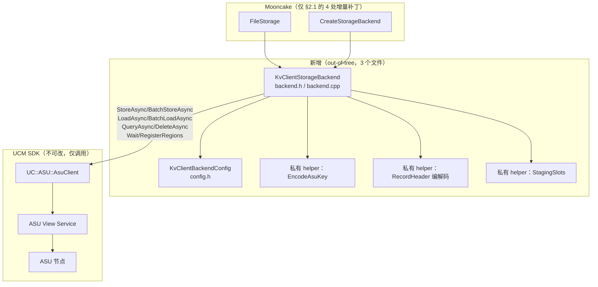
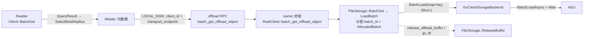

# KvClientStorageBackend 最终版方案（最小可接入）

> 本文是对 `kv-client-storage-backend.md`（Draft v1）的评审结论与重写版。
> 原方案按代码实测存在 **10 个阻塞项 / 11 个严重项**，其中 4 个会导致按文档写的代码
> 一行都编译不过，3 个会导致运行时数据损坏或功能静默失效。
> 本文按「最小可接入」原则重写：**只实现 写 / 读 / 查 / 删 / Init / IsEnableOffloading**。

- 状态：Final v1
- 代码基线：Mooncake `522b716e`；UCM `unified-cache-management-feature_26h1`
- 接口基线：`mooncake-store/include/storage_backend.h:263-331`
- 参照实现：`NvmeKvStorageBackend`（同样只 override 6 个纯虚函数）

---

## 0. 评审结论摘要

### 0.1 必须先裁决的两个前提冲突

原方案自我定位为「最小实现」，但 §6.1 自己列出 **修改 Mooncake 文件约 14 个、总计 4,300–6,450 行**。
这与「Mooncake 不可更改」「只通过实现 StorageBackendInterface 接入」直接矛盾。评审确认了两处**硬性不可调和**：

| # | 冲突 | 实测证据 | 裁决 |
| --- | --- | --- | --- |
| 1 | **后端无法被实例化** | `FileStorage` 通过自由函数 `CreateStorageBackend(config_)` 构造后端（`file_storage.cpp:79`）；`storage_backend_` 是私有成员且**无 setter**（`file_storage.h:291`）；`StorageBackendType` 是封闭 5 值枚举（`storage_backend.h:166-172`）；descriptor 是固定 if/else 链（`file_storage_config.cpp:55-68`）；全仓无插件/注册表/dlsym/weak symbol 机制 | **允许约 10 行纯增量适配补丁**（见 §2.1），其余全部 out-of-tree |
| 2 | **按 key 删除没有任何入口** | `StorageBackendInterface` 无 per-key 删除方法（`storage_backend.h:263-331`）；`Client::Remove`/`BatchRemove` 只删 Master 元数据，物理删除调用已被注释；Master→client 只有一个 `PollRemoveAll` **布尔位**，没有按 key 队列 | **删除退化为 `RemoveAll()`**（见 §0.2、§3.7） |

### 0.2 ⚠️ 重要变更：`RemoveAll()` 在当前 HEAD 已不可达

评审期间仓库被更新到 `522b716e`，其中 commit **`2e533c97`**（2026-10-26，
*「[Store] Add managed weight group lifecycle and RPC APIs (#4313)」*）**删除了心跳里的
`client_->PollRemoveAll()` → `RemoveAll()` 调用**，并在原位置留下注释：

```
// Generic removal reclaims files through metadata-checked eviction, not a
// backend-wide wipe that could remove managed objects or another tenant.
```

实测结果：

- `FileStorage::RemoveAll()` 全仓 **零调用者**（`file_storage.cpp:912-921`），已成为死代码；
- 其函数注释也从「Safe for the global RemoveAll(force)」改写为
  「**Generic Client::RemoveAll must not request it**」；
- Master 侧 `MasterService::PollRemoveAll` / `local_ssd_manager_.ConsumeRemoveAll` 仍存在，
  但**已无客户端消费**该信号。

**结论**：在「不额外改 Mooncake」的前提下，**按 key 删除与全量删除在当前 HEAD 都无法被触发**。

处理方式（本文采用）：仍然 override `RemoveAll()`——它零成本、零 Mooncake 改动，
且一旦上游恢复心跳接线即自动生效；但在 §3.7 与 §6 明确标注「当前不可达」，
**不得对外宣称删除功能可用**。

### 0.3 阻塞项清单（原方案 → 本文处置）

| ID | 原方案 | 实测事实 | 处置 |
| --- | --- | --- | --- |
| B1 | 全文使用 `kv::KvClient` / `CreateKvClient()` / `KvClientConfig` | 真实类是 `UC::ASU::AsuClient`，工厂 `CreateAsuClient()`，配置 `AsuClientConfig`（`asu_client.h:33,49,79-81`）。UCM 仓内**不存在** namespace `kv` | 全量改名（§3.2） |
| B2 | `KVBuffer{key, Buffer{...}, offset, std::optional<uint32_t> mrKey}`；`KVBuffer.region.size` 是传输长度 | 真实为 `KVBuffer{CacheKey key; Buffer buffer; uint32_t offset;}`，**无 mrKey**（`types.h:164-168`）；传输长度路径是 `buffer.region.size`（`sqe_request.cpp:220`）；`mr_key` 由 SDK 内部按 `buffer.handle` 解析（`asu_client_impl.cpp:354-362`） | 修正类型面（§3.2） |
| B3 | 默认 `max_payload_bytes = 16 MiB` | 协议线格式 length 是 **24-bit**：`entry.length > 0xFFFFFF` 直接 `INVALID_ARGUMENT`（`kv_protocol.cpp:538-543`）。16 MiB + 头 → 16,777,728 > 16,777,215，**默认配置下所有满尺寸写全部失败** | 硬上限 `payload ≤ 16,776,672`；默认 2 MiB（§3.3） |
| B4 | Wait 超时后「释放 slot」「ASU 侧可能稍后完成形成孤儿对象」 | `Wait` 超时**总会把 task 从 manager 删除**（`client_task_manager.cpp:96-104`），此后 `Check()` 返回 true、二次 `Wait` 返回 `TASK_NOT_FOUND`，**完成与否不可观测**；client 侧从不调用 `Cancel`；`Cancel` 自身注释为「does not interrupt underlying UB/RoCE IO」（`asu_transport.h:117-118`）→ 超时后复用 slot 是 **use-after-free** | slot 永久隔离，不复用不注销（§3.4） |
| B5 | §4.5 按 key 删除 + Master→owner 路由「必须」 | 需改 `storage_backend.h`/`file_storage.{h,cpp}`/`local_ssd/manager.{h,cpp}`/`master_service.cpp`/`client_service.cpp`，另需新增 RPC（`rpc_service.h` + `master_client.cpp` + `RpcNameTraits`），实测约 **500–900 行 / 10 个文件**；且 HA/oplog 路径必须在 `EraseMetadata` **之前**捕获 owner，原方案顺序写反了 | 整节删除（§3.7） |
| B6 | 新增 `StorageBackendType::kKvClient` 等却宣称不改 Mooncake | 见 §0.1 冲突 1 | 收敛为 4 文件约 10 行（§2.1） |
| B7 | `BatchOffload` 空间不足时返回错误码 | `IsPerBucketSoftOffloadError` 只放行 `INVALID_READ` / `OBJECT_ALREADY_EXISTS`（`file_storage.cpp:352-355`）；返回其它任何错误都会 `abort_error` + `break` **中断整个心跳周期**；`KEYS_ULTRA_LIMIT` 更会 `enable_offloading_ = false` **永久关闭 offload**（`file_storage.cpp:612-625`） | 可恢复情形一律返回 `expected(count)`（§3.5.2） |
| B8 | `slice.size` == Master 权威全长；不等则 `INVALID_PARAMS` | Mooncake **确实发起前缀读**：非 pinned 的 LOCAL_DISK ranged read 传 `src_offset + size`（`real_client.cpp:5109-5138`），`get_into_ranges` 是公开 API 且被 EngramStore 使用 → 原规则会让**合法 ranged read 全部失败**并触发 dangling-replica 修复路径 | 支持前缀读（§3.5.3） |
| B9 | `ReferenceKvClient` 参考实现 + `KvClientImplType{kUcm,kReference}` + env 选择 | SDK 无可继承的 `kv::KvClient` 接口；真正的测试缝是 `CreateAsuClient(TransportFactory, TransProviderFactory)`（`asu_client.h:75-81`）。第二套实现会与真实 ASU 语义漂移，且可被 env 选进生产 | 删除；改用 fake `AsuTransport`（§5.1） |
| B10 | `PayloadSizeIndex` 作为独立子系统参与写/读/查/删 | 读的权威长度来自 Master 的 `slice.size`；查以 ASU `QueryResult.exists` 为准；索引重启即空且不影响正确性 → 文档自己也承认「索引可选」 | 删除；`IsEnableOffloading` 不依赖计数（§3.5.5） |

另有 **API 面错误**：错误码表使用无前缀的 `ENTRY_*`/`CQE_*`，真实枚举全部带 `ASU_` 前缀
（`types.h:87-105`），而通用传输码（`NOT_FOUND`/`TIMEOUT`/`PARTIAL_FAILED` 等）**不带**前缀
（`types.h:69-84`）——原表把两类混为一谈，照抄无法编译。见 §3.6。

### 0.4 裁剪结果

| 项 | 原方案 | 本文 |
| --- | --- | --- |
| 修改 Mooncake 文件 | ~14 个 | **4 个（约 10 行，纯增量）** |
| 新增源文件 | ~20 个 | **3 个**（backend.h / backend.cpp / config.h） |
| 新增测试文件 | 7 个 | **2 个**（backend_test.cpp / fake_asu_transport.h） |
| 代码量 | 4,300–6,450 行 | **约 900–1,300 行**（含测试） |
| 记录头 | 40 B | **32 B** |
| 独立子系统 | StagingArena / PayloadSizeIndex / KeyCodec / RecordCodec / Factory / ReferenceKvClient | **全部内联为 backend.cpp 私有 helper** |
| 删除 | 按 key（Master→owner 路由） | **`RemoveAll()`（当前不可达，如实标注）** |
| FMEA / 测试用例 | 39 FM / 38 TC | **15 FM / 17 TC** |

---

## 1. 背景

### 1.1 目标

Mooncake Store 通过 `StorageBackendInterface` 把 KV cache 对象下沉到本地 tier，内存 miss 时按
`LOCAL_DISK` 副本读回。本方案新增一个后端实现，把该数据面从「本地文件 / 本地块设备」改为
**通过 UCM 的 ASU 客户端 SDK 落到 ASU**。

默认模式是**写完即下沉**，而非「因淘汰而 offload」：`PutEnd` 成功后 Master 立即把对象放入
owner 的 offload 队列并对源 `MEMORY` 副本 `inc_refcnt`，`refcnt > 0` 期间不可淘汰；下一次心跳
由 `FileStorage` 调 `BatchOffload` 写入；`NotifyOffloadSuccess` 成功后才 `dec_refcnt`。
`offload_on_evict=true` 时下沉推迟到淘汰时刻（默认 `false`）。**本后端不感知触发时机，两种模式都适用。**

### 1.2 现有后端与定位

| 后端 | 数据面 | 恢复方式 | 删除能力 |
| --- | --- | --- | --- |
| `StorageBackendAdaptor` | 每 key 一个本地文件 | 目录扫描 `ScanMeta` | `RemoveAll` |
| `BucketStorageBackend` | bucket 数据 + 元数据文件 | 内存索引 + 持久化元数据 | `RemoveAll` / 水位淘汰 |
| `OffsetAllocatorStorageBackend` | 单数据文件 + extent 分配器 | allocator checkpoint | `RemoveAll` / 水位淘汰 |
| `NvmeKvStorageBackend` | 本地 NVMe-KV 设备 | **无**（`ScanMeta` 空实现） | **无** |
| **`KvClientStorageBackend`（本文）** | **ASU（`UC::ASU::AsuClient`）** | **无**（`ScanMeta` 空实现） | **`RemoveAll()`，当前不可达** |

本后端在「不恢复、不删除」这两点上与 `NvmeKvStorageBackend` 同类，后者是**最贴切的参照**：
它同样只 override 6 个纯虚函数（`nvme_kv/backend.h:26-44`），`ScanMeta` 是返回 OK 的空实现
（`nvme_kv/backend.cpp:1516-1525`），且不 override 任何带默认实现的方法。

### 1.3 范围

**实现（6 项 + 1 个强制 stub）**：

| 操作 | 入口 | 说明 |
| --- | --- | --- |
| Init | `Init()` | 创建 `AsuClient` → `Init(configPath)` → `RegisterRegions(staging)`；三态 CAS；失败全回滚 |
| 写 | `BatchOffload()` | 编码进已注册 staging，`BatchStoreAsync` + `Wait`，逐 entry 判定，只上报成功 key |
| 读 | `BatchLoad()` | `BatchLoadAsync` + `Wait`，校验记录头，支持**前缀读**，拷入调用方 Slice |
| 查 | `IsExist()` | `QueryAsync` + `Wait`，读 `QueryResult.exists[i]` |
| 删 | `RemoveAll()` | 覆写基类钩子；**当前 HEAD 不可达**（§0.2、§3.7） |
| 配额 | `IsEnableOffloading()` | `kReady` 即返回 true；不发 RPC、不查 ASU |
| 强制 stub | `ScanMeta()` | 纯虚必须实现；返回 OK 且不调用 handler |

**明确不实现、不在本文出现**：按 key 删除、`RemoveByRegex`、水位淘汰、ASU GC 对接、
恢复 manifest、`ScanMeta` 枚举、chunk 分片、多副本、压缩/加密/TTL、零拷贝、批量查询、
`PayloadSizeIndex`、`ReferenceKvClient`、独立工厂/编解码子系统、可观测性新增指标、性能基准。

**不 override（沿用基类默认，一律不出现）**：`ResetScanIterator()`、`SetTestFailurePredicate()`、
`EvictAboveDiskWatermark()`。

### 1.4 语义不统一点（Mooncake ↔ ASU SDK）

| 关注点 | Mooncake 侧 | ASU SDK 侧 | 本文处理 |
| --- | --- | --- | --- |
| 调用模型 | 同步，返回 `tl::expected` | 异步 task：`XxxAsync` 返回 `TaskId`，`Wait` 取结果 | 每批 submit + `Wait`；**`Wait` 期间不持任何锁** |
| `Wait` 超时 | — | task 被移除、**完成不可观测**、`Cancel` 不停 IO | slot **永久隔离**，不复用不注销（§3.4） |
| `Wait(id, 0)` | — | 0 表示「用 `defaultWaitTimeoutMs`(100ms)」，**不是无限等** | 必须显式传 `wait_timeout_ms` |
| 失败/部分成功 | 逐 key 部分成功，返回成功数 | 聚合 `status` + 逐 `entryStatus`；`PARTIAL_FAILED` | 先看聚合 `status`，再逐 entry；只上报成功 key |
| BatchOffload 返回错误 | `IsPerBucketSoftOffloadError` 只放行 `INVALID_READ`/`OBJECT_ALREADY_EXISTS`；其它错误中断整个心跳周期；`KEYS_ULTRA_LIMIT` 永久关闭 offload | — | **可恢复情形一律返回 `expected(count)`**，绝不返回 `KEYS_ULTRA_LIMIT` |
| 批量上限 | 一次一个 map；非 bucket 后端会把**全部** drained key 放进单批（`file_storage.cpp:413-420`） | store/load 110、delete 254、query 256（`asu_transport.h:85-88`）；delete 线格式硬限 `[1,254]` | 后端内部按 `batch_size`（默认 32）切块 |
| 单值上限 | — | length 是 **24-bit**：`≤ 0xFFFFFF` 且 512B 对齐（`kv_protocol.cpp:532-543`） | 硬校验 `transfer_size ≤ 16,776,704`，超限 key 跳过 |
| key | 变长 `scoped_key`（`tenant\0local_key`） | 8 字节 `CacheKey`；**全零 key 被拒**（`kv_protocol.cpp:517-521`） | `XXH64` 派生；结果为 0 时重映射 |
| 长度 | `slice.size` 可能是**前缀**（ranged read） | Query 只有存在性，无长度 | 记录头存 `payload_size`；支持前缀读（§3.5.3） |
| value/内存 | `Slice` 任意内存，无需注册 | `KVBuffer` 必须引用已注册内存；offset/length 512B 对齐 | staging arena 注册；读写都经 staging |
| 完整性 | 端到端 CRC-64-ECMA **默认关闭**（`MOONCAKE_STORE_CHECKSUM=false`）且 ranged read 跳过 | 无 per-value checksum | **payload CRC-32C 是必需的**（§3.3） |
| 能力发现 | — | `ServerKvCapabilities` 存在但**公有 `AsuClient` 未暴露**（client 公有/impl 头无 `Capabilit*`） | 只依赖静态已知线格式限制；其余逐 entry 失败反馈 |
| 错误码 | `ErrorCode` | `StatusCode`：通用码无前缀，entry/CQE 码带 `ASU_` 前缀 | backend 内映射，不外透（§3.6） |
| 生命周期 | 只有 `Init`，无 `Shutdown`；二次 Init 失败 | `Init`/`Shutdown`；`Shutdown` 只是**有界 drain** | 析构先隔离在途 slot 再 `Shutdown`；三态 CAS |

---

## 2. 设计

### 2.1 接入方式：最小适配补丁（4 文件 / 约 10 行）

「只实现子类」无法被运行时选中（§0.1）。经裁决采用**最小纯增量补丁**：不改任何现有后端行为、
不改 `Validate()`、不改 `environment_variables.h`、不加 RPC。

| # | 文件 | 改动 | 行数 |
| --- | --- | --- | --- |
| 1 | `mooncake-store/include/storage_backend.h` | `StorageBackendType` 枚举尾部加 `kKvClient` | +1 |
| 2 | `mooncake-store/src/config/file_storage_config.cpp` | descriptor if/else 链尾加 `kv_client_storage_backend` → `kKvClient` 分支 | +2 |
| 3 | `mooncake-store/src/storage_backend.cpp` | `#include "kv_client/backend.h"`；`CreateStorageBackend` 加 `case StorageBackendType::kKvClient:` | +4 |
| 4 | `mooncake-store/src/CMakeLists.txt` | 源文件加入 `MOONCAKE_STORE_CLIENT_SOURCES`；UCM include 路径与链接 | +3~6 |

补丁形态（示意）：

```cpp
// storage_backend.h
enum class StorageBackendType {
    kFilePerKey, kBucket, kOffsetAllocator, kDistributed, kNvmeKv,
    kKvClient,          // + 唯一新增
};

// file_storage_config.cpp :: FromEnvironment()
} else if (storage_backend_descriptor == "kv_client_storage_backend") {
    config.storage_backend_type = StorageBackendType::kKvClient;
}

// storage_backend.cpp :: CreateStorageBackend()
case StorageBackendType::kKvClient:
    return std::make_shared<KvClientStorageBackend>(config);
```

**两处刻意不做的事**：

1. **不改 `FileStorageConfig::Validate()`。** 它无条件调用 `ValidatePath(storage_filepath)`，
   要求绝对路径 + 目录存在（`file_storage_config.cpp:146-158, 207-210`），且该检查在
   `CreateStorageBackend` **之前**执行（`file_storage.cpp:52-54` 会 throw）。
   → 部署要求把 `MOONCAKE_OFFLOAD_FILE_STORAGE_PATH` 指向一个**已存在的占位目录**，
   后端不读它。这与 `NvmeKvStorageBackend` 的处境完全相同（它写设备却同样要通过 `ValidatePath`），
   是有先例的做法，且省下第 5 处补丁。
2. **不改 `environment_variables.h`。** `MOONCAKE_OFFLOAD_KV_CLIENT_*` 由本后端自己的
   out-of-tree 配置解析器直接 `getenv` 读取。

**未打补丁时的失败模式（必须写进部署文档）**：`MOONCAKE_OFFLOAD_STORAGE_BACKEND_DESCRIPTOR=
kv_client_storage_backend` 会走到 else 分支只打一条 `LOG(ERROR) << "Unknown storage backend."`，
`storage_backend_type` **静默保持默认值 `kBucket`**（`storage_backend.h:208`）——
即悄悄退回本地文件后端，不报错、不崩溃。

### 2.2 模块结构与依赖



依赖规则：

- UCM 头文件**只在 `kv_client/backend.cpp` 中包含**；`backend.h` 只前置声明
  `namespace UC::ASU { class AsuClient; }`，避免 UCM 头进入 Mooncake 公共头。
- `EncodeAsuKey` / `RecordHeader` / `StagingSlots` 都是 `backend.cpp` 内的私有 helper，
  **不是独立子系统、不是独立文件**（原方案拆成 5 个文件 + 5 套测试，属过度设计）。
- staging 的注册句柄只在析构时、且只对**未被隔离**的区域调用 `UnregisterRegions`。

### 2.3 线程模型与锁纪律

| 线程 | 入口 | 与本后端的关系 |
| --- | --- | --- |
| Heartbeat 线程 | `Heartbeat()` → `OffloadObjects` → `BatchOffload` | 写（串行） |
| RPC worker（多） | `batch_get_offload_object` → `BatchGet` → `BatchLoad` | 读（**并发**） |
| dangling replica probe | `FileStorage::Exists` → `IsExist` | 查（低频并发） |
| 重注册 | `FileStorage::Init` → `ScanMeta` | 空实现直接返回 |
| SDK worker | `AsuClientImpl` 内部 | 提交/等待；不回调 Mooncake |

锁纪律（只有两把锁）：

1. `write_mutex_`：串行化 `BatchOffload` 与 `RemoveAll`，保护 staging 写侧分配顺序。
   **读路径不取这把锁**（并发读是常态）。
2. `slots_mutex_`：只保护 slot 的空闲/隔离集合增删，**绝不覆盖 `Wait`**。
3. 加锁顺序固定 `write_mutex_` → `slots_mutex_`。
4. **任何 ASU `Wait` 期间不持有任何锁**；`complete_handler` 回调期间也不持锁
   （约定 handler 不得重入本后端）。
5. 无 `metadata_mutex_`——因为无索引（B10 已裁）。

### 2.4 读路径定位



对本后端的四条约束：

1. **唯一读入口是 `BatchLoad(map<scoped_key, Slice>)`**，输入只有 key 与 `slice.size`，
   没有 value 定位信息。所以长度必须由后端自己记录（§3.3 的 `payload_size`）。
2. **`slice.size` 不保证等于对象全长**：非 pinned 的 LOCAL_DISK ranged read 传
   `src_offset + size`（`real_client.cpp:5109-5138`），即**前缀**。必须支持（§3.5.3）。
3. `slice.ptr` 由调用方预分配，**后端不得改写**（与 `BucketStorageBackend` 的 O_DIRECT
   路径不同，那条路径会调整 `slice.ptr`）。
4. `batch_id` 由 owner 分配、reader 归还，本后端不接触。

---

## 3. 实现设计

### 3.1 类结构

```cpp
// mooncake-store/include/kv_client/backend.h
#pragma once
#include <atomic>
#include <memory>
#include <mutex>
#include <string>
#include <vector>

#include "storage_backend.h"

namespace UC::ASU { class AsuClient; }   // 只前置声明，不含 UCM 头

namespace mooncake {

class KvClientStorageBackend : public StorageBackendInterface {
   public:
    // 测试注入缝：默认调用 UC::ASU::CreateAsuClient()
    using ClientFactory = std::function<std::unique_ptr<UC::ASU::AsuClient>()>;

    explicit KvClientStorageBackend(const FileStorageConfig& config);
    // 测试用重载
    KvClientStorageBackend(const FileStorageConfig& config, ClientFactory factory);
    ~KvClientStorageBackend() override;

    // ===== 六个操作 + 强制 stub =====
    tl::expected<void, ErrorCode> Init() override;

    tl::expected<int64_t, ErrorCode> BatchOffload(
        const std::unordered_map<std::string, std::vector<Slice>>& batch_object,
        std::function<ErrorCode(const std::vector<std::string>&,
                                std::vector<StorageObjectMetadata>&)> complete_handler,
        EvictionHandler eviction_handler = nullptr) override;

    tl::expected<void, ErrorCode> BatchLoad(
        std::unordered_map<std::string, Slice>& batched_slices) override;

    tl::expected<bool, ErrorCode> IsExist(const std::string& key) override;

    tl::expected<bool, ErrorCode> IsEnableOffloading() override;

    void RemoveAll() override;                    // 当前 HEAD 不可达，见 §3.7

    tl::expected<void, ErrorCode> ScanMeta(       // 纯虚，必须实现
        const std::function<ErrorCode(const std::vector<std::string>&,
                                      std::vector<StorageObjectMetadata>&)>& handler) override;

    // 不 override：ResetScanIterator / SetTestFailurePredicate / EvictAboveDiskWatermark

   private:
    enum class InitState { kUninit, kInitializing, kReady };

    // ---- 私有 helper（backend.cpp 内，非独立子系统）----
    struct StagingSlots;                 // 已注册内存 + 空闲/隔离集合
    struct PreparedEntry;                // 局部结构，不进头文件公共面

    UC::ASU::CacheKey EncodeAsuKey(const std::string& scoped_key) const;
    bool EncodeRecord(const std::string& scoped_key, const std::vector<Slice>& slices,
                      char* slot, size_t slot_size, uint32_t* payload_size,
                      uint32_t* transfer_size);
    ErrorCode ValidateRecord(const char* slot, size_t got, const UC::ASU::CacheKey& expect_key,
                             size_t want, uint32_t* payload_size);

    KvClientBackendConfig config_;
    ClientFactory client_factory_;
    std::unique_ptr<UC::ASU::AsuClient> client_;
    std::unique_ptr<StagingSlots> slots_;
    std::atomic<InitState> initialized_{InitState::kUninit};
    std::mutex write_mutex_;
    std::mutex slots_mutex_;
};

}  // namespace mooncake
```

### 3.2 真实 SDK 接口面（全部实测校准）

```cpp
// namespace UC::ASU  —— asu_client.h:33,49-81
using TaskId   = std::uint64_t;
using MRHandle = std::uint64_t;
using CacheKey = std::array<std::byte, 8>;              // types.h:40-41
constexpr std::size_t kCacheKeySizeBytes = 8;
constexpr std::uint32_t kAsuAlignmentBytes = 512;        // types.h:66
constexpr TaskId   kInvalidTaskId   = 0;
constexpr MRHandle kInvalidMRHandle = 0;

struct KVBuffer {          // types.h:164-168  ★ 无 mrKey
    CacheKey       key;
    Buffer         buffer;    // Buffer{ MemoryRegion region; MRHandle handle; }  types.h:159-162
    std::uint32_t  offset{0};
};

struct QueryResult {       // types.h:140-143
    std::vector<std::uint8_t> exists;   // ★ vector，长度恒等于查询 key 数，值 0/1
    std::uint32_t prefixHitKeys{0};
};

struct TaskResult {        // types.h:177-181
    Status status;                      // 聚合状态
    std::vector<Status> entryStatus;    // 逐 entry，长度 == 提交 entry 数
    std::optional<QueryResult> queryResult;
};

std::unique_ptr<AsuClient> CreateAsuClient(       // asu_client.h:79-81
    TransportFactory = CreateAsuTransport,        // ★ 测试注入缝
    TransProviderFactory = CreateTransProvider);
```

后端使用的 API：

| 用途 | 真实签名 |
| --- | --- |
| 创建 | `CreateAsuClient()`（两参数都有默认值，无参调用合法） |
| 初始化 | `Status Init(const AsuClientConfig&)` / `Status Init(const std::string& configPath)` |
| 注册内存 | `Status RegisterRegions(const std::vector<MemoryRegion>&, std::vector<RegisteredMemory>&)` |
| 注销内存 | `Status UnregisterRegions(const std::vector<MRHandle>&)` |
| 写 | `Status BatchStoreAsync(const std::vector<KVBuffer>&, TaskId&)` / `StoreAsync` |
| 读 | `Status BatchLoadAsync(const std::vector<KVBuffer>&, TaskId&)` / `LoadAsync` |
| 查 | `Status QueryAsync(const std::vector<CacheKey>&, TaskId&)` |
| 删 | `Status DeleteAsync(const std::vector<CacheKey>&, TaskId&)` |
| 等待 | `bool Check(TaskId)` / `Status Wait(TaskId, uint64_t timeoutMs, TaskResult&)` |
| 关停 | `Status Shutdown()` |

**四条必须遵守的构造规则**：

1. **传输长度写在 `kv.buffer.region.size`**，不是 `kv.region.size`
   （`sqe_request.cpp:220`：`entry.length = entries[index].buffer.region.size`）。
   同时必须设置 `kv.buffer.region.addr` 与 `kv.buffer.handle`。
2. **不要试图提供 `mr_key`**：它由 SDK 在 `SubmitAsync` 内按 `entry.buffer.handle`
   查 `registeredRegions_` 得到 `tokenId`（`asu_client_impl.cpp:354-362`），调用方无从传入。
3. **`offset` 与 `length` 都必须 512B 对齐**（`kv_protocol.cpp:511-516, 532-537`）；
   本后端一律 `offset = 0`，每 entry 独占一个 slot。
4. **`Wait(id, 0)` 不是无限等**，而是退回 `defaultWaitTimeoutMs`（默认 100 ms，
   `asu_client_impl.cpp:214-224`）。必须显式传 `config_.wait_timeout_ms`。

**批量与单值上限**（`asu_transport.h:85-88`、`kv_protocol.h:56`）：

| 操作 | 配置项 | 默认 | 线格式硬限 |
| --- | --- | --- | --- |
| BatchStore | `asuBatchStoreIoNum` | 110 | length ≤ `0xFFFFFF` |
| BatchLoad | `asuBatchLoadIoNum` | 110 | length ≤ `0xFFFFFF` |
| Delete | `asuDeleteIoNum` | 254 | `batch_number ∈ [1, 254]` |
| Query | `asuQueryIoNum` | 256 | — |

这些配置在 `TransportConfig` 里，由 `AsuClientConfig.transportConfigs` 传入；
**`ServerKvCapabilities`（含 `singleValueMaxBytes`）未经公有 `AsuClient` 暴露**
（client 公有头与 impl 头均无 `Capabilit*` 符号），因此后端**无法运行时发现**服务端更紧的限制，
只能：静态守住 24-bit/512B，其余靠逐 entry 失败反馈跳过。

### 3.3 Key 与记录布局

**`asu_key` 派生**

```text
asu_key = XXH64(key_namespace + '\0' + scoped_key, seed = 0)     // 小端写入 8 字节
if (asu_key == 0) asu_key = XXH64(..., seed = 1)                 // 全零 key 被协议拒绝
```

- `scoped_key` 即 `TenantId::MakeScopedKey(tenant, key)` = `tenant_id + '\0' + local_key`，
  是 `BatchOffload`/`BatchLoad` 收到的 key（`file_storage.cpp:367-368`）。
- **全零 `CacheKey` 会被拒**：`IsCacheKeyAllZero` → `INVALID_ARGUMENT`
  （`kv_protocol.cpp:517-521`）。必须重映射，原方案未提及。
- `key_namespace` 参与哈希做域隔离，与 Master 的 `TenantId` 无关
  （租户隔离已由 `scoped_key` 前缀表达）。
- 64-bit 碰撞概率约 `N²/2^65`；1 亿对象约 `5e-4`。碰撞由记录头 `fingerprint` 检出（见下）。
- 用 Mooncake 已有的 `xxhash`（`nvme_kv/key_codec.cpp:5,44-45` 有同款用法先例）。

**记录布局（32 B 头 + payload）**

```text
偏移  字段                 说明
0     u32 magic            0x4B564331 ("KVC1")
4     u16 version          1
6     u16 flags            bit0 = has_payload_crc（本版恒为 1）
8     u64 fingerprint      XXH64(key_namespace + '\0' + scoped_key, seed = 1)
16    u32 payload_size     不含头
20    u32 payload_crc32c   只覆盖 payload，不含 512B 补齐
24    u32 header_crc32c    覆盖 [0,24)，本字段按 0 参与
28    u32 reserved         0
32    ...  payload         各 Slice 按序拼接，无补齐
```

```text
record_size   = 32 + payload_size
transfer_size = align_up(record_size, 512)
硬约束        transfer_size ≤ 16,776,704  (= 32767 × 512 = 0xFFFF00 ≤ 0xFFFFFF)
             ⇒ payload_size ≤ 16,776,672
```

- `KVBuffer`：`key = asu_key`、`offset = 0`、`buffer.region.addr = slot 基址`、
  **`buffer.region.size = transfer_size`**、`buffer.handle = slot 注册句柄`。
- 上报 Master 的 `data_size = payload_size`（不含头）。
- **32 B 而非原方案的 40 B**：原方案的 `fingerprint_hi`（第二个 64-bit）裁掉——
  单个 64-bit fingerprint 已把上述 `5e-4` 的碰撞率降到「未检出误认」≈ `2⁻¹² × 2⁻⁶⁴`，
  多 8 字节无实质收益。
- **`header_crc32c` 必须保留**：它原本只在「`payload_size` 与 `slice.size` 严格相等」时才冗余，
  而本文**支持前缀读**（§3.5.3），`slice.size` 不再能交叉校验 `payload_size`，
  于是头 CRC 成为防止「按错误长度拷贝」的唯一保护。
- **`payload_crc32c` 必须保留**：Mooncake 的端到端校验是 CRC-64-ECMA，
  **默认关闭**（`MOONCAKE_STORE_CHECKSUM=false`，`client_object_checksum_config.cpp:13-17`），
  且 ranged read 会跳过校验；ASU 公共 API 无 per-value checksum。
  → 这是唯一的 at-rest 完整性检查，**不可裁剪**。
  用 Mooncake 自带 `crc32c.h`（`Crc32c` 类，含 SSE4.2 加速路径，`crc32c.h:73,109-130`）。
- 读校验顺序：`got ≥ 32` → magic → version → flags → 头 CRC → fingerprint →
  `payload_size ≤ got - 32` → `payload_size ≥ slice.size` → payload CRC（**仅全长读**）。

**单值上限**：`max_payload_bytes` 的绝对硬上限是 **16,776,672 B**
（原方案默认的 16 MiB 会撞 B3）。本文默认取 **2 MiB**，理由见下方耦合约束。
`Validate()` 必须拒绝 `align_up(32 + max_payload_bytes, 512) > 16,776,704` 的配置。

**★ 三个参数的耦合（原方案漏了，默认值本身就不自洽）**：

```
slot_size = align_up(32 + max_payload_bytes, 512)
n_slots   = staging_bytes / slot_size          （向下取整）
必须满足   n_slots ≥ batch_size
```

不满足时**不会报错**，而是每批静默跳过 `batch_size - n_slots` 个 key（slot 取不到就走跳过分支），
表现为「offload 一直只做一半」，极难定位。实测原方案默认值的后果：

| `max_payload_bytes` | `staging_bytes` | `slot_size` | `n_slots` | `batch_size=32` 是否够 |
| --- | --- | --- | --- | --- |
| 8 MiB | 128 MiB | 8,389,120 | **15** | ❌ 每批静默丢 17 个 key |
| 8 MiB | 256 MiB | 8,389,120 | **31** | ❌ 差 1 个（对齐导致） |
| 8 MiB | 512 MiB | 8,389,120 | 63 | ✅ 但注册内存开销大 |
| **2 MiB** | **128 MiB** | 2,097,664 | **63** | ✅ **本文默认** |

因此 `Validate()` 增加第 4 条硬检查：

```cpp
const int64_t slot_size = AlignUp(32 + max_payload_bytes, 512);
if (staging_bytes / slot_size < (int64_t)batch_size) return false;   // fail-fast，不留到运行时静默降级
```

本文默认值取 `max_payload_bytes = 2 MiB` / `staging_bytes = 128 MiB` / `batch_size = 32`
（→ 63 slots）。需要更大单对象时按上表同比放大 `staging_bytes`；
`Validate()` 会在启动时直接拒绝不自洽的组合。

### 3.4 Staging 与 slot 生命周期（安全关键）

ASU 的 `KVBuffer` 必须引用已注册内存，所以读写都要过 staging。**这是唯一必须保留的额外机制。**

```
Init:  slot_size = align_up(32 + max_payload_bytes, 512)
       n_slots   = staging_bytes / slot_size      （向下取整；Validate 已保证 ≥ batch_size）
       分配 512B 对齐内存 → RegisterRegions → 记录每个 slot 的 MRHandle
```

**回收规则（修正 B4，与原方案相反）**：

| `Wait` 结果 | slot 处置 |
| --- | --- |
| 聚合 `status.ok()` 且该 entry `entryStatus[i].ok()` | **回收到空闲集** |
| 聚合 `status == TIMEOUT` / `TASK_NOT_FOUND` | **永久隔离** |
| entry `status ∈ {TIMEOUT, IO_ERROR, CONNECTION_ERROR, CANCELED}` | **永久隔离** |
| entry `status == NOT_FOUND`（读路径） | 回收（无在途 DMA 写入） |
| entry 其它失败（`RESOURCE_BUSY` / `OUT_OF_CREATE_SIZE` / `KEY_*`） | 回收 |
| `BatchStoreAsync`/`BatchLoadAsync` **提交本身**失败（未拿到 TaskId） | 回收 |

**为什么必须永久隔离**：`Wait` 超时后 SDK 会把 task 从 manager 删除
（`client_task_manager.cpp:96-104` 的 `(void)Remove(taskId)`），此后 `Check()` 返回 true、
二次 `Wait` 返回 `TASK_NOT_FOUND`——**传输是否完成已不可观测**；client 侧从不调用 `Cancel`，
而 `Cancel` 本身「does not interrupt underlying UB/RoCE IO」（`asu_transport.h:117-118`）。
因此超时后复用该内存 = 在途 DMA 可能写入已被别人使用的缓冲区 = **use-after-free / 跨对象数据损坏**。

同理：

- **隔离的区域在进程退出前不得 `UnregisterRegions`**（`Shutdown` 只是有界 drain）。
- **读路径同样适用**（原方案只在写路径提到 slot 释放）。
- 隔离集是**单调增长**的：超时多 → 空闲 slot 耗尽 → 后续写跳过该 key 并返回
  `expected(已成功数)` + WARNING，**绝不返回 `KEYS_ULTRA_LIMIT`**（会永久关闭 offload）。
- 「等待完成后再复用」和「可证明取消后再复用」两条路都不可行——公有 `AsuClient` 两者都不提供；
  若要更强保证只能改 SDK，违反约束 2。这一权衡必须写进文档而不是掩盖。

析构顺序：`write_mutex_` 上锁 → 不再提交新 task → 对**未隔离**区域 `UnregisterRegions` →
`client_->Shutdown()` → `client_.reset()`。

### 3.5 六个操作的契约

#### 3.5.1 `Init()`

```cpp
tl::expected<void, ErrorCode> KvClientStorageBackend::Init() {
    InitState expected = InitState::kUninit;
    if (!initialized_.compare_exchange_strong(expected, InitState::kInitializing)) {
        return tl::make_unexpected(ErrorCode::INTERNAL_ERROR);   // 已就绪 / 正在初始化
    }
    if (!config_.Validate()) {
        initialized_.store(InitState::kUninit);
        return tl::make_unexpected(ErrorCode::INVALID_PARAMS);
    }
    client_ = client_factory_ ? client_factory_() : UC::ASU::CreateAsuClient();
    if (!client_) { /* 回滚 */ return tl::make_unexpected(ErrorCode::INTERNAL_ERROR); }

    auto st = client_->Init(config_.asu_config_path);
    if (!st.ok()) { /* Shutdown + reset + 回滚 kUninit */ return tl::make_unexpected(MapStatus(st.code)); }

    slots_ = std::make_unique<StagingSlots>();
    auto sr = slots_->Init(*client_, config_.staging_bytes, SlotSize(config_));
    if (!sr) { /* 注销已注册部分 + Shutdown + reset + 回滚 kUninit */ return sr; }

    initialized_.store(InitState::kReady, std::memory_order_release);
    return {};
}
```

要点：

- **三态 `InitState` 而非 `bool`**：只有 `kReady` 才对外服务，`kInitializing` 期间并发进入一律失败。
- **不打开设备、不建线程池**：ASU 连接、view 路由、task worker、transport 线程全由 SDK 内部管理。
  后端只持有 staging slot 池。（原方案 §4.6.2.1 这点是对的，保留。）
- 任一步失败都要 `Shutdown` + `reset` + 回滚 `kUninit`，允许部署侧重试，不留半初始化状态。
- `Init` 在 `FileStorage::Init` 中被调用（`file_storage.cpp:136`），失败会让 FileStorage 启动失败。
- **`RegisterRegions` 必须在 `Init` 之后**（`SubmitAsync` 依赖 `registeredRegions_`，
  且 `NOT_INITIALIZED` 会在无 transport 快照时返回）。

#### 3.5.2 写：`BatchOffload()`

**触发时机不在后端**：默认 `offload_on_evict=false`，Master 在 `PutEnd` 后就把对象放进 owner 的
offload 队列，下一次心跳调用本方法。

**批次形态（实测）**：对非 bucket 后端，`FileStorage` 把**本轮全部 drained key 放进单个批次**
（`file_storage.cpp:413-420`），所以后端必须自己按 ASU 上限切块。

步骤：

1. `initialized_ != kReady` → `unexpected(INTERNAL_ERROR)`。
2. `batch_object.empty()` → `unexpected(INVALID_KEY)`（与 `StorageBackendAdaptor:1217-1220` 一致；
   实际上 `file_storage.cpp:494` 已挡住空批，此分支不可达，保留只为契约一致）。
3. 取 `write_mutex_`。逐 key 预处理：
   - `scoped_key` 为空 → 跳过。
   - `payload_size = Σ slice.size`；`transfer_size = align_up(32 + payload_size, 512)`。
   - `transfer_size > 16,776,704` 或 `payload_size > max_payload_bytes` 或 `transfer_size > slot_size`
     → **跳过该 key**（记 `INVALID_PARAMS` 日志）。
   - 取空闲 slot；无空闲 → 跳过该 key（记 WARNING）。
   - 编码：写 32 B 头 + 顺序拷入各 Slice + 尾部补零到 `transfer_size`。
4. 按 `min(config_.batch_size, 110)` 切块，每块：
   - 多 key 用 `BatchStoreAsync`，单 key 用 `StoreAsync`；提交失败 → 该块全部按跳过处理，slot 回收。
   - `Wait(task_id, config_.wait_timeout_ms, result)`；**期间不持任何锁**。
   - **先看聚合 `result.status`**，再逐 `entryStatus[i]`：
     - `status == TIMEOUT` / `TASK_NOT_FOUND` → 该块所有 slot **永久隔离**，全部按失败处理。
     - `PARTIAL_FAILED` → **不是整批失败**，继续逐 entry 判定。
     - entry `ok()` 或 `ASU_ENTRY_KEY_EXIST` / `ASU_CQE_KEY_ALREADY_EXISTED`（Store 是 upsert）
       → 成功，slot 回收。
     - entry 属 `TIMEOUT/IO_ERROR/CONNECTION_ERROR/CANCELED` → slot **永久隔离**，失败。
     - 其它 entry 失败 → slot 回收，失败。
5. 只对成功 key 调 `complete_handler`（**回调期间不持锁**）：

   ```cpp
   StorageObjectMetadata{
       .bucket_id           = -1,
       .offset              = 0,
       .key_size            = (int64_t)scoped_key.size(),
       .data_size           = (int64_t)payload_size,   // 不含 32 B 头
       .transport_endpoint  = "",                      // handler 内会填 local_rpc_addr_
   }
   ```
6. `complete_handler` 返回非 OK → 原样返回 `unexpected(该错误)`；已写入 ASU 的数据不回滚。
7. 返回 `expected(成功上报的 key 数)`；**0 个成功也返回 `expected(0)`**。

**★ 返回值的硬约束（B7）**：

- `IsPerBucketSoftOffloadError` 只放行 `INVALID_READ` 与 `OBJECT_ALREADY_EXISTS`
  （`file_storage.cpp:352-355`）。返回**任何其它错误**都会 `abort_error = ...; break;`
  **中断整个心跳周期的后续所有批次**（`file_storage.cpp:617-625`）。
- 返回 `KEYS_ULTRA_LIMIT` 更会 `enable_offloading_ = false`，**本进程永久停止 offload**
  （`file_storage.cpp:612-616`）。
- 因此：**除 `INTERNAL_ERROR`（未初始化）与 handler 透传错误外，一律返回 `expected(count)`。**
  配额不足、slot 耗尽、超限 key、ASU 容量不足，全部走「跳过 + 计数」而非返回错误。

**返回 `expected(0)` 的真实后果（修正原方案的错误认知）**：
FileStorage 会把该批**所有未上报的 key 以 `data_size = -1` NACK 回 Master**
（`file_storage.cpp:591-599`），Master 随即对源 `MEMORY` 副本 `dec_refcnt` 并 reset offloading task
（`master_service.cpp` 的 NACK 处理）。所以 `expected(0)` 是**「本批放弃」**，
不是对 Master 的背压；这些 key 不会被自动重排，只有再次 `Put` 才会重新入队。
→ 原方案 §4.2.3 声称「超限 key 会被反复选中」并为此设计「有界跳过集合」，
在默认 `offload_on_evict=false` 下**解决的是一个不存在的问题**，本文裁掉。
（`offload_on_evict=true` 时淘汰线程每轮都会 `PushOffloadingQueue`，那时才可能反复出现，
但本文不针对该模式做额外机制。）

#### 3.5.3 读：`BatchLoad()`

步骤：

1. 空 map → `OK`。
2. 逐 key 预检：
   - `slice.ptr == nullptr` 或 `slice.size == 0` → 记 `INVALID_PARAMS` 首错。
   - `slice.size > max_payload_bytes` → `INVALID_PARAMS`（请求长度本身就不可能）。
   - 取空闲 slot（读侧不取 `write_mutex_`，只取 `slots_mutex_`）。
3. **确定传输长度**——这是本方法唯一的难点，分两种情形：

   | 情形 | `transfer_size` | 是否精确 |
   | --- | --- | --- |
   | **全长读**（`slice.size == payload_size`，稳态主路径） | `align_up(32 + slice.size, 512)` | ✅ 与写入时完全一致 |
   | **前缀读**（`slice.size < payload_size`，ranged read） | `slot_size`（按满长 over-read） | ⚠️ 见下方风险 |

   前缀读无法算出精确长度：记录全长只能从记录头的 `payload_size` 得知，而那正是本次要读回来的东西；
   ASU 的 `QueryAsync` 只有存在性、没有长度（§1.4）。因此只能 over-read。

   **⚠️ 必须实测的残留风险**：ASU 对「请求长度 > 存储值长度」的 retrieve 行为**无法从 SDK 源码确定**
   ——可能返回存储的全部字节（over-read 成功）、可能返回 `INVALID_ARGUMENT`、
   也可能返回 `ASU_CQE_UNRECOVERED_READ_ERROR`。因此：
   - 全长读路径不依赖该行为，**稳态功能不受影响**；
   - 前缀读若 entry 返回错误，映射为 `NOT_SUPPORTED` 并记 WARNING，
     **不要**误映射成 `OBJECT_NOT_FOUND`（那会触发 dangling-replica 探测并让 Master 删除有效元数据）；
   - 该项列入 §6.2 残留风险，需在真实 ASU 上验证后再决定是否收窄或放宽。

   *被否掉的替代方案*：维护 `scoped_key → payload_size` 索引以精确算长度——
   索引重启即空、对首次前缀读无效，且会重新引入 B10 裁掉的索引、锁与计数漂移问题。
4. 按 `min(config_.batch_size, 110)` 切块，`BatchLoadAsync` + `Wait`；逐 entry 判定，
   slot 隔离规则同 §3.4。
5. 逐结果校验（顺序即短路顺序，`got` = 本次请求的 `transfer_size`）：
   - entry `NOT_FOUND` / `ASU_ENTRY_KEY_NOT_FOUND` / `ASU_ENTRY_DATA_NOT_EXIST` /
     `ASU_CQE_KEY_NOT_EXIST` → 记 `OBJECT_NOT_FOUND` 首错。
   - **前缀读且 entry 返回 `INVALID_ARGUMENT` / `ASU_CQE_UNRECOVERED_READ_ERROR`
     → 记 `NOT_SUPPORTED`**（ASU 可能不接受 over-read，见步骤 3 的风险说明）；
     **绝不映射为 `OBJECT_NOT_FOUND`**，否则会触发 dangling-replica 探测让 Master 删掉有效元数据。
   - `got < 32` → `INVALID_READ`。
   - magic / version / flags 不符 → `INVALID_READ`。
   - `header_crc32c` 不符 → `INVALID_READ`。
   - `fingerprint` 不符 → `INVALID_READ`（key 碰撞或串写）。
   - `payload_size > got - 32` → `INVALID_READ`。
   - **`slice.size > payload_size` → `INVALID_PARAMS`**（请求超出对象全长，真错）。
   - **`slice.size == payload_size`（全长读）→ 校验 `payload_crc32c`**，不符 `CHECKSUM_MISMATCH`。
   - **`slice.size < payload_size`（前缀读）→ 跳过 payload CRC**（前缀无法校验整体 CRC），
     只拷 `slice.size` 字节。头 CRC 与 fingerprint 仍强制校验。
   - 通过 → `memcpy(slice.ptr, slot + 32, slice.size)`。**不改写 `slice.ptr`。**
6. 释放/隔离 slot；返回 `OK` 或首错。已写入的 slice 不回滚。

**★ 前缀读必须支持（B8）**：`real_client.cpp:5109-5138` 的非 pinned LOCAL_DISK ranged read
明确只请求 `src_offset + size` 字节，注释写着「we only need src_offset + size bytes (not total_size)」；
`get_into_ranges` 是公开 API 且被 EngramStore 使用。若按原方案「`slice.size != payload_size`
→ `INVALID_PARAMS`」，这些合法读会全部失败并触发 dangling-replica 修复路径，
最终导致 Master 元数据被误删。
（现有后端在此点上并不一致：`BucketStorageBackend`（`storage_backend.cpp:1793-1799`）与 `NvmeKv`
都拒绝不等长，`StorageBackendAdaptor`（`storage_backend.cpp:1372`）支持前缀。
本文选择支持，因为 ASU 场景下拒绝会误伤 EngramStore。）

**多 key 批次的错误语义**：本接口返回单个 `tl::expected<void>`，一个 key 失败即整批返回首错
（这是接口既有形状，`BucketStorageBackend` 同样如此）。已成功的 key 的数据不回滚，
调用方按整批失败处理。

#### 3.5.4 查：`IsExist()`

```text
1. initialized_ != kReady → unexpected(INTERNAL_ERROR)
2. key = EncodeAsuKey(scoped_key)
3. QueryAsync({key}, task_id) → Wait(task_id, config_.query_timeout_ms, result)
4. 先看聚合 result.status：
     TIMEOUT / CONNECTION_ERROR / IO_ERROR / TASK_NOT_FOUND → unexpected(映射错误)   ★ 绝不能返回 false
     queryResult 无值 或 exists.size() < 1               → unexpected(INTERNAL_ERROR)
5. exists[0] != 0 → expected(true)
   exists[0] == 0 → expected(false)
```

**★ 传输错误必须返回 `unexpected`**：`IsExist` 的调用方是 dangling-replica 探测，
返回 `false` 会让 Master 删除仍然有效的元数据。这是 S1 级要求。

`QueryResult.exists` 是 `std::vector<std::uint8_t>`，**长度恒等于查询 key 数**，按
`exists[i]` 逐 key 取值——不是定长位图（原方案称「无长度存在性位图」，会导致越界或漏读）。

#### 3.5.5 `IsEnableOffloading()`

```cpp
tl::expected<bool, ErrorCode> KvClientStorageBackend::IsEnableOffloading() {
    if (initialized_.load(std::memory_order_acquire) != InitState::kReady) {
        return tl::make_unexpected(ErrorCode::INTERNAL_ERROR);
    }
    return true;
}
```

**为什么直接返回 true，不用本地计数**：

- 该方法在 `FileStorage::Init` 被调用**一次**（`file_storage.cpp:148`），用于设置
  `enable_offloading_` 并 `MountLocalDiskSegment(enable_offloading_)`（`file_storage.cpp:163-165`）。
  **返回 false 会让本进程永久不 offload**，不是每心跳重算。
- 本地计数只统计本进程、重启归零，**既不能代表 ASU 容量，也无法阻止真实写满**；
  而 ASU 公共 API 不提供容量/水位查询（`ServerKvCapabilities` 未暴露）。
- 用计数做门限只会带来：一把额外的锁、一个额外的索引、以及「计数漂移导致过早永久停写」的新风险。
- 真实的容量压力由 `BatchOffload` 的逐 entry `ASU_CQE_OUT_OF_CREATE_SIZE` /
  `ASU_CQE_RESOURCE_BUSY` 反馈，按 key 跳过即可（§3.5.2）。

→ 这也正是 B10（裁掉 `PayloadSizeIndex`）成立的前提。

#### 3.5.6 `ScanMeta()` / `RemoveAll()`

```cpp
tl::expected<void, ErrorCode> KvClientStorageBackend::ScanMeta(const std::function<...>& handler) {
    if (initialized_.load(std::memory_order_acquire) != InitState::kReady) {
        return tl::make_unexpected(ErrorCode::INTERNAL_ERROR);
    }
    (void)handler;                       // 与 NvmeKvStorageBackend:1516-1525 完全一致
    LOG(WARNING) << "kv_client backend: ScanMeta is a no-op; ASU provides no enumeration. "
                    "Objects are NOT re-registered after a Master metadata loss.";
    return {};
}
```

`ScanMeta` 是**纯虚函数，必须实现**——这是六项之外的第 7 个方法，无法回避。
后果：进程重启后，若 Master 仍持有 `LOCAL_DISK` 元数据，读/查照常可用；
若 Master 也丢了元数据，对象**不会**自动重新注册。这是本版的明确限制。

`RemoveAll()` 见 §3.7。

### 3.6 错误码映射（按真实枚举名校准）

★ 通用传输码**不带**前缀（`types.h:69-84`）；entry/CQE 码**带 `ASU_` 前缀**（`types.h:87-105`）。
原方案把两类混写且全部去掉前缀，照抄无法编译。

| `UC::ASU::StatusCode` | Mooncake `ErrorCode` | 说明 |
| --- | --- | --- |
| `OK` | `OK` | |
| `NOT_FOUND` | `OBJECT_NOT_FOUND` | 读返回；查返回 `expected(false)` |
| `ASU_ENTRY_KEY_NOT_FOUND`、`ASU_ENTRY_DATA_NOT_EXIST`、`ASU_CQE_KEY_NOT_EXIST` | `OBJECT_NOT_FOUND` | 同上 |
| `INVALID_ARGUMENT` | `INVALID_PARAMS` | |
| `NOT_INITIALIZED` | `INTERNAL_ERROR` | |
| `TIMEOUT`、`ASU_CQE_IO_TIMEOUT`、`TASK_NOT_FOUND` | `RPC_TIMEOUT` | **同时永久隔离 slot**；不重试 |
| `PARTIAL_FAILED` | 取首个失败 entry 的映射 | 部分成功继续 |
| `CONNECTION_ERROR` | `UNAVAILABLE_IN_CURRENT_STATUS` | |
| `IO_ERROR`、`ASU_CQE_WRITE_FAULT` | `FILE_WRITE_FAIL` | |
| `ASU_CQE_UNRECOVERED_READ_ERROR` | `FILE_READ_FAIL` | |
| `BUFFER_NOT_REGISTERED`、`BUFFER_NOT_SUPPORTED` | `INVALID_PARAMS` | staging 生命周期错误 |
| `RESOURCE_BUSY`、`IN_PROGRESS`、`ASU_CQE_RESOURCE_BUSY` | `UNAVAILABLE_IN_CURRENT_STATUS` | 可重试；写路径按 key 跳过 |
| `ASU_CQE_OUT_OF_CREATE_SIZE` | `UNAVAILABLE_IN_CURRENT_STATUS` | ASU 容量不足；本 key 跳过 |
| `UNSUPPORTED` | `NOT_SUPPORTED` | |
| `CANCELED` | `INTERNAL_ERROR` | **同时永久隔离 slot** |
| `ASU_ENTRY_RETRY_ADVISED` | 重试一次；仍失败按对应错误 | |
| `ASU_ENTRY_NO_RETRY_ADVISED` | `INTERNAL_ERROR` | |
| `ASU_ENTRY_KEY_EXIST`、`ASU_CQE_KEY_ALREADY_EXISTED` | **视为成功**（Store 是 upsert） | 本版不依赖条件写 |
| `ASU_ENTRY_DELETE_FAILED` | `FILE_WRITE_FAIL` | 仅 `RemoveAll` 路径 |
| 其它 / 未知 | `INTERNAL_ERROR` | |
| *本地*：记录头 magic/version/flags/头 CRC/fingerprint 不符 | `INVALID_READ` | 内容损坏或 key 碰撞 |
| *本地*：payload CRC 不符 | `CHECKSUM_MISMATCH` | 撕裂 / 位翻转 |
| *本地*：`ptr == nullptr` / `size == 0` / `slice.size > payload_size` | `INVALID_PARAMS` | 读 |

上表所有 Mooncake 侧错误码均已实测存在（`types.h:322-423`）：
`INTERNAL_ERROR=-1`、`INVALID_KEY=-400`、`INVALID_PARAMS=-600`、`INVALID_READ=-701`、
`OBJECT_NOT_FOUND=-704`、`CHECKSUM_MISMATCH=-801`、`RPC_TIMEOUT=-901`、
`UNAVAILABLE_IN_CURRENT_STATUS`、`NOT_SUPPORTED=-1012`、`FILE_READ_FAIL=-1102`、
`FILE_WRITE_FAIL=-1103`、`KEYS_ULTRA_LIMIT=-1203`（**本后端禁止返回**）。

### 3.7 删除：真实结论

**按 key 删除不可实现**（约束 1 + 3 下）：

- `StorageBackendInterface` 无任何 per-key 删除入口（`storage_backend.h:263-331`）；
- `Client::Remove`/`BatchRemove` 只发 Master RPC 删元数据，物理删除调用已被注释
  （且注释掉的那行指向的是**另一个类型** `std::shared_ptr<StorageBackend>`，
  `client_service.h:1178`，并非 `FileStorage` 持有的 `StorageBackendInterface`）；
- Master→client 只有 `PollRemoveAll` **布尔位**，无按 key 队列；
- 要补齐需改 `storage_backend.h` + `file_storage.{h,cpp}` + `local_ssd/manager.{h,cpp}` +
  `master_service.cpp` + `client_service.cpp` + 新增 RPC（`rpc_service.h`/`master_client.cpp`/
  `RpcNameTraits`），实测约 **500–900 行 / 10 个文件**；
- 且 HA/oplog 路径下 owner 必须在 `EraseMetadata` **之前**捕获
  （`master_service.cpp` 的 `FinalizeRemovedReplicasAfterDurable` 回调），原方案顺序写反，
  照做会「元数据已删但永远不知道该通知谁」→ 静默什么都不删。

**`RemoveAll()` 在当前 HEAD 不可达**（§0.2）：commit `2e533c97` 已移除心跳中的
`PollRemoveAll` → `RemoveAll()` 调用，`FileStorage::RemoveAll()` 零调用者。

**本文的实现（仍然 override，如实标注）**：

```cpp
void KvClientStorageBackend::RemoveAll() {
    if (initialized_.load(std::memory_order_acquire) != InitState::kReady) return;
    std::lock_guard<std::mutex> lock(write_mutex_);

    // 注意：当前 Mooncake HEAD（commit 2e533c97 之后）已不再从心跳调用
    // FileStorage::RemoveAll()，本方法在生产路径上不会被触发。
    LOG(WARNING) << "kv_client backend RemoveAll: reachable only if the host re-enables "
                    "the PollRemoveAll heartbeat wiring; ASU has no enumeration, so only "
                    "keys written by THIS process instance can be deleted.";

    std::vector<UC::ASU::CacheKey> keys;
    { std::lock_guard<std::mutex> s(slots_mutex_); keys.swap(written_keys_); }

    for (size_t i = 0; i < keys.size(); i += kDeleteChunk) {   // kDeleteChunk = 254
        auto chunk = std::vector<UC::ASU::CacheKey>(
            keys.begin() + i, keys.begin() + std::min(i + kDeleteChunk, keys.size()));
        UC::ASU::TaskId tid = UC::ASU::kInvalidTaskId;
        if (!client_->DeleteAsync(chunk, tid).ok()) continue;
        UC::ASU::TaskResult result;
        client_->Wait(tid, config_.wait_timeout_ms, result);   // 结果仅记日志
    }
}
```

- `written_keys_` 是本进程写过的 `asu_key` 集合（`unordered_set<uint64_t>`），
  在 `BatchOffload` 成功 entry 处插入。**这是本后端唯一的可变状态**，
  且它存在的唯一理由就是让 `RemoveAll` 有意义——ASU 无枚举，没有它 `RemoveAll` 什么也删不掉。
  *若团队接受「删除 = 不可达的 no-op」，可整体删除 `written_keys_` 与 `slots_mutex_` 中的该集合，
  后端将变成完全无状态（除 staging）。*
- **局限（必须写进部署文档）**：① 全库级、**不区分租户**；② 只能删本进程实例写过的 key，
  重启后集合为空 → 实际是 no-op；③ 当前 HEAD 不可达。
- **不做**：`RemoveByRegex`（ASU 无枚举）、水位淘汰、删除任务持久化、按 key 删除。
- **`DeleteAsync` 超时不重试、不「恢复索引」**：超时结果不可知（§3.4），
  对象可能已被物理删除；本后端无索引可恢复，仅记日志。

### 3.8 配置

```cpp
// mooncake-store/include/kv_client/config.h
struct KvClientBackendConfig {
    std::string asu_config_path;      // 必填：传给 AsuClient::Init(configPath)
    std::string client_id;            // AsuClientConfig.clientId
    std::string key_namespace;        // 必填：参与 asu_key / fingerprint 哈希
    int64_t  staging_bytes     = 128 * 1024 * 1024;
    size_t   batch_size        = 32;                      // 硬 clamp 到 110
    int64_t  max_payload_bytes = 2 * 1024 * 1024;         // 硬上限 16,776,672；见 §3.3 耦合约束
    uint64_t wait_timeout_ms   = 5000;                    // 必须 > 0（0 = SDK 默认 100ms）
    uint64_t query_timeout_ms  = 500;

    static KvClientBackendConfig FromEnvironment();       // 直接 getenv，不改 environment_variables.h
    bool Validate() const;
};
```

| 环境变量 | 字段 |
| --- | --- |
| `MOONCAKE_OFFLOAD_KV_CLIENT_ASU_CONFIG_PATH` | `asu_config_path` |
| `MOONCAKE_OFFLOAD_KV_CLIENT_ID` | `client_id` |
| `MOONCAKE_OFFLOAD_KV_CLIENT_KEY_NAMESPACE` | `key_namespace` |
| `MOONCAKE_OFFLOAD_KV_CLIENT_STAGING_BYTES` | `staging_bytes` |
| `MOONCAKE_OFFLOAD_KV_CLIENT_BATCH_SIZE` | `batch_size` |
| `MOONCAKE_OFFLOAD_KV_CLIENT_MAX_PAYLOAD_BYTES` | `max_payload_bytes` |
| `MOONCAKE_OFFLOAD_KV_CLIENT_WAIT_TIMEOUT_MS` | `wait_timeout_ms` |
| `MOONCAKE_OFFLOAD_KV_CLIENT_QUERY_TIMEOUT_MS` | `query_timeout_ms` |

`Validate()` 检查：

1. `asu_config_path` 与 `key_namespace` 非空；
2. `staging_bytes > 0`；`batch_size ∈ [1, 110]`；两个 timeout `> 0`；
3. `max_payload_bytes > 0` **且** `align_up(32 + max_payload_bytes, 512) ≤ 16,776,704`（B3 的 24-bit 线格式限制）；
4. **`staging_bytes / slot_size ≥ batch_size`**（§3.3 的耦合约束；不满足则每批静默丢 key）。

**已裁配置项**（相对原方案）：`client_impl` 枚举与 `MOONCAKE_OFFLOAD_KV_CLIENT_IMPL`
（`kUcm`/`kReference` 二选一属纯冗余，且 `kReference` 误入生产会静默不落盘 → S1）。

---

## 4. 能力与限制

| 能力 / 限制 | 处理 |
| --- | --- |
| key 固定 8 字节 | `XXH64` 派生 + 64-bit fingerprint 检出碰撞；全零 key 重映射 |
| 单值 24-bit 线格式上限 | `transfer_size ≤ 16,776,704`，超限 key 跳过 |
| 无长度查询 | 写时算 `payload_size` 存进记录头；读时用头里的值 |
| 前缀 / ranged read | **支持**：`slice.size < payload_size` 时拷前缀、跳过 payload CRC |
| 无枚举 | `ScanMeta` 返回 OK 空扫描；`RemoveAll` 只能删本进程写过的 key |
| 512B 对齐 | `transfer_size = align_up(record_size, 512)`；`offset = 0`，每 entry 独占 slot |
| 必须注册内存 | staging arena；读写都经 staging |
| 批量上限 110 / 254 / 256 | 后端内部按 `batch_size`（默认 32）切块 |
| 能力不可发现 | `ServerKvCapabilities` 未暴露；静态守线格式限制 + 逐 entry 失败反馈 |
| `Wait` 超时不可观测 | slot **永久隔离**，不复用不注销；隔离耗尽则跳过写 |
| ASU 自身 GC | 不可观测；读/查遇 `NOT_FOUND` 按缺失处理 |
| 按 key 删除 | **不支持**（无接口入口） |
| `RemoveAll` | 已实现但**当前 HEAD 不可达**；全库级、不区分租户、重启后 no-op |
| `RemoveByRegex` / 水位淘汰 | 不支持 |
| 恢复 / Master 丢元数据后重建 | 不支持 |
| 二次 `Init` | 返回 `INTERNAL_ERROR` |
| 与 NVMeKV 共存 | 同进程互斥（`FileStorage` 只持一个后端）；数据格式不互通，不可指向同一 namespace |

---

## 5. 测试

### 5.1 注入缝（不写第二套 SDK 实现）

原方案的 `FakeKvClient : public kv::KvClient` 无法编译（该接口不存在），
`ReferenceKvClient` 是会与真实语义漂移的第二套实现（已裁）。真实可用的缝是
`CreateAsuClient` 的两个工厂参数（`asu_client.h:75-81`）。

```cpp
// mooncake-store/tests/kv_client/fake_asu_transport.h
// AsuTransport 是公有头里的纯虚接口（asu_transport.h:104-119），可直接实现
class FakeAsuTransport : public UC::ASU::AsuTransport {
   public:
    UC::ASU::Status Init(const UC::ASU::TransportConfig&,
                         std::shared_ptr<UC::ASU::TransProvider>) override;
    UC::ASU::Status Init(const std::string&,
                         std::shared_ptr<UC::ASU::TransProvider>) override;
    UC::ASU::Status Shutdown() override;
    UC::ASU::Status CheckHealth() override;
    UC::ASU::Status Submit(const std::shared_ptr<UC::ASU::TransportTask>&) override;
    UC::ASU::Status Cancel(UC::ASU::TaskId) override;

    // 故障注入
    void FailNextSubmit(UC::ASU::StatusCode);
    void FailEntries(std::vector<size_t> indices, UC::ASU::StatusCode);  // → PARTIAL_FAILED
    void TimeoutNextWait();                     // 让 Wait 返回 TIMEOUT（task 仍"在途"）
    void CorruptField(CacheKey, Field);         // magic/version/header_crc/fingerprint/payload_crc
    void CompleteAfterTimeout();                // ★ 超时后才真正写入 buffer，复现 UAF
    const std::vector<Call>& Calls() const;     // 断言 task 数、切块、顺序
};

// 注入：构造后端时传 ClientFactory
auto factory = []{ return UC::ASU::CreateAsuClient(
    []{ return std::make_unique<FakeAsuTransport>(); },   // TransportFactory
    UC::ASU::CreateTransProvider); };                     // 默认 provider 即可
KvClientStorageBackend backend(cfg, factory);
```

- **不使用** SDK 自带的 `FakeTransProvider`：它在 `trans/src/`（非公有 include），
  且依赖 Ascend ACL runtime，CI 不可用。
- `FakeAsuClient` 只存在于 `tests/`，**不可被 env 选进生产**（这正是裁掉 `kReference` 的理由）。

### 5.2 FMEA（15 项，只覆盖六操作）

| ID | 功能 | 失效模式 | 严重度 | 缓解 | TC |
| --- | --- | --- | --- | --- | --- |
| FM-INIT-01 | Init | `AsuClient::Init` 失败 | S2 | 返回映射错误；不进 `kReady` | TC-INIT-01 |
| FM-INIT-02 | Init | `RegisterRegions` 失败 | S2 | 注销已注册部分 + Shutdown + 回滚 `kUninit` | TC-INIT-02 |
| FM-INIT-03 | Init | 二次 / 并发 Init | S2 | 三态 CAS → `INTERNAL_ERROR` | TC-INIT-03 |
| FM-INIT-04 | Init | 配置非法（含 `max_payload_bytes` 撞 24-bit 上限） | S2 | `Validate()` → `INVALID_PARAMS`，不调 SDK | TC-INIT-04 |
| FM-WRITE-01 | 写 | 8B key 碰撞 | S1 | fingerprint → `INVALID_READ`，绝不返回错误字节 | TC-WRITE-01 |
| FM-WRITE-02 | 写 | `transfer_size > 0xFFFFFF` / 超 slot | S2 | 跳过该 key；返回成功数 | TC-WRITE-02 |
| FM-WRITE-03 | 写 | `PARTIAL_FAILED` 被当整批失败 | S2 | 先看聚合再看逐 entry | TC-WRITE-03 |
| FM-WRITE-04 | 写 | 返回非软错误码中断心跳 / 返回 `KEYS_ULTRA_LIMIT` 永久停 offload | S2 | 可恢复情形一律 `expected(count)` | TC-WRITE-04 |
| FM-WRITE-05 | 写 | `Wait` 超时后复用 slot → **UAF** | **S1** | slot 永久隔离，不复用不注销 | TC-WRITE-05 |
| FM-WRITE-06 | 写 | `complete_handler` 失败 | S2 | 透传错误，不回滚 | TC-WRITE-06 |
| FM-READ-01 | 读 | 前缀读被拒（ranged read / EngramStore） | S2 | 支持 `slice.size < payload_size` | TC-READ-01 |
| FM-READ-02 | 读 | 前缀读 over-read 被 ASU 拒绝，误映射为 `OBJECT_NOT_FOUND` → Master 删有效元数据 | S1 | 映射为 `NOT_SUPPORTED`；全长读不受影响 | TC-READ-01 |
| FM-READ-03 | 读 | 头/fingerprint/CRC 损坏 | S1 | 按序校验；不拷贝 | TC-READ-02 |
| FM-QUERY-01 | 查 | 传输错误返回 `false` → Master 误删元数据 | **S1** | 必须 `unexpected` | TC-QUERY-01 |
| FM-LIFE-01 | 关停 | 有在途 task 就 `UnregisterRegions` | S1 | 隔离区域不注销；先 drain 再 Shutdown | TC-LIFE-01 |

### 5.3 测试用例（17 项）

| TC | 覆盖 | 注入 / 前置 | 步骤 | 通过标准 |
| --- | --- | --- | --- | --- |
| TC-INIT-01 | FM-INIT-01 | `Init(configPath)` 返回错误 | 调 `Init` | 返回映射错误；无 staging 注册；`initialized_ == kUninit` |
| TC-INIT-02 | FM-INIT-02 | `RegisterRegions` 失败 | 调 `Init`，修复后重试 | 首次失败无句柄泄漏、client 已 Shutdown；第二次成功 |
| TC-INIT-03 | FM-INIT-03 | 连续两次 Init；并发 Init | 两线程 | 第一次 OK；第二次 `INTERNAL_ERROR`；无重复注册 |
| TC-INIT-04 | FM-INIT-04 | `key_namespace` 空 / `max_payload_bytes = 16 MiB`（撞 24-bit）/ `staging_bytes=128MiB + max_payload_bytes=8MiB + batch_size=32`（slot 不足） | 调 `Validate`/`Init` | 三种组合 `Validate` 均为 false；`Init` 返回 `INVALID_PARAMS`；**未调用任何 SDK 方法** |
| TC-CODEC-01 | 记录格式 | 固定向量 | 编码后解码 | 字段/CRC/fingerprint 与向量一致；篡改任一字段解码失败 |
| TC-CODEC-02 | key 派生 | `XXH64` 结果为 0 的构造 key | 写 + 读 + 查 | 三处得到同一非零 8B key；无 `INVALID_ARGUMENT` |
| TC-WRITE-01 | FM-WRITE-01 | 两个 `scoped_key` 映射到同一 8B key | 写两个，读第一个 | `INVALID_READ`；**不返回错误字节**；日志含碰撞提示 |
| TC-WRITE-02 | FM-WRITE-02 | payload 使 `transfer_size > 0xFFFFFF`；payload 超 slot；空 key | 批量写 | 超限 key 跳过；其余成功；handler 只收成功 key；返回 `expected(成功数)` |
| TC-WRITE-03 | FM-WRITE-03 | 3 key，entry 2 注入失败，聚合 `PARTIAL_FAILED` | 调 `BatchOffload` | 返回 2；handler keys = k1/k3 的 `scoped_key`；`data_size` 不含 32B 头 |
| TC-WRITE-04 | FM-WRITE-04 | staging slot 全耗尽 / ASU `OUT_OF_CREATE_SIZE` | 调 `BatchOffload` | 返回 `expected(0)`；**绝不返回 `KEYS_ULTRA_LIMIT`**；FakeTransport 未收到新提交 |
| **TC-WRITE-05** | **FM-WRITE-05** | `TimeoutNextWait()` + `CompleteAfterTimeout()` | 超时后再次写复用同一 slot | **slot 被隔离，未复用**；ASAN/TSAN 干净；第二次写用不同 slot；无 use-after-free |
| TC-WRITE-06 | FM-WRITE-06 | `complete_handler` 返回错误 | 调 `BatchOffload` | 原样返回该错误；数据仍可读；不回滚 |
| TC-READ-01 | FM-READ-01 | 写 4096 B；分别以 `slice.size = 4096 / 1024 / 4097` 读；再注入前缀读 over-read 返回 `INVALID_ARGUMENT` | 调 `BatchLoad` | 4096→OK 且 CRC 校验；1024→OK 前缀字节一致且**跳过** payload CRC；4097→`INVALID_PARAMS`；over-read 被拒→`NOT_SUPPORTED`（**不是** `OBJECT_NOT_FOUND`）；`slice.ptr` 未被改写 |
| TC-READ-02 | FM-READ-02 | 逐个篡改 magic / version / header_crc / fingerprint / payload_crc | 调 `BatchLoad` | 前四项 `INVALID_READ`；payload_crc → `CHECKSUM_MISMATCH`；目标缓冲区不变 |
| TC-READ-03 | 读缺失 | ASU 无该 key | 调 `BatchLoad` | `OBJECT_NOT_FOUND`；无崩溃 |
| TC-QUERY-01 | FM-QUERY-01 | Query 超时 / `CONNECTION_ERROR` | 调 `IsExist` | 返回 `unexpected`（`RPC_TIMEOUT`/`UNAVAILABLE_IN_CURRENT_STATUS`）；**绝不返回 `false`** |
| TC-LIFE-01 | FM-LIFE-01 | 有在途 task 时析构 | 析构 backend | 隔离区域**未** `UnregisterRegions`；先 drain 再 `Shutdown`；ASAN 无泄漏/崩溃 |

补充断言（并入上表相应用例，不单列）：

- **切块**：`Calls()` 断言 N=100 / `batch_size=32` 时 task 数 ≤ `ceil(100/32) = 4`，无 per-key task。
- **并发**：读与写并发、1 slot 多读多写，TSAN/ASAN 干净，slot 全部归还或隔离。
- **`ScanMeta`**：返回 OK 且 **handler 未被调用**、不注册任何对象。
- **`IsEnableOffloading`**：`kReady` 后恒 true；未初始化返回 `INTERNAL_ERROR`；
  FakeTransport **未收到任何 Query/Store**。
- **`RemoveAll`**：删本进程写过的 key；重启后（集合为空）为 no-op；不崩溃。

### 5.4 集成验证

1. **单测层**：上述 17 项，用 `FakeAsuTransport`，无需 ASU 硬件，可进 CI。
2. **端到端层**：打上 §2.1 的 4 处补丁 → 配 `MOONCAKE_OFFLOAD_STORAGE_BACKEND_DESCRIPTOR=
   kv_client_storage_backend` + 占位 `MOONCAKE_OFFLOAD_FILE_STORAGE_PATH` →
   起 `mooncake_master` + 客户端 → `put` / `get` / `is_exist` 闭环。
3. **回归项**：确认 descriptor **未**打补丁时静默退回 `kBucket`（§2.1 失败模式），
   该行为必须在部署文档中显式告警。

---

## 6. 交付清单与残留风险

### 6.1 文件清单

| # | 文件 | 类型 | 行数 |
| --- | --- | --- | --- |
| 1 | `mooncake-store/include/storage_backend.h` | **改**（枚举 +1） | +1 |
| 2 | `mooncake-store/src/config/file_storage_config.cpp` | **改**（descriptor 分支） | +2 |
| 3 | `mooncake-store/src/storage_backend.cpp` | **改**（include + case） | +4 |
| 4 | `mooncake-store/src/CMakeLists.txt` | **改**（源文件 + UCM 链接） | +3~6 |
| 5 | `mooncake-store/include/kv_client/config.h` | 新 | +60~80 |
| 6 | `mooncake-store/include/kv_client/backend.h` | 新 | +110~140 |
| 7 | `mooncake-store/src/kv_client/backend.cpp` | 新 | +550~750 |
| 8 | `mooncake-store/tests/kv_client/fake_asu_transport.h` | 新 | +180~250 |
| 9 | `mooncake-store/tests/kv_client/backend_test.cpp` | 新 | +450~600 |
| 10 | `mooncake-store/tests/CMakeLists.txt` | **改**（`add_store_test`） | +2~4 |
| 11 | `docs/source/design/store/kv-client-storage-backend.md` | 新（本文） | — |

合计：**改 5 个文件 + 新增 5 个文件，约 1,350–1,820 行**。

其中「改」的 5 个文件 = §2.1 的 **4 个运行时适配补丁**（约 10–13 行）+ 第 10 项
`tests/CMakeLists.txt` 的测试注册（+2~4 行）；后者只影响测试构建，不影响运行时接入。
对比原方案的「改 14 个 / 新增 20 个 / 4,300–6,450 行」。

### 6.2 残留风险（必须向部署方明示）

| 风险 | 严重度 | 说明 |
| --- | --- | --- |
| **删除功能实际不可用** | 高 | `RemoveAll` 在 HEAD `522b716e` 不可达（§0.2）；按 key 删除无接口入口。**ASU 上的对象只能由 ASU 自身 GC 回收**，`Client::Remove`/`BatchRemove` 仅删 Master 元数据 |
| **Master 丢元数据后不可重建** | 高 | `ScanMeta` 空实现；冷数据永久不可达 |
| **staging 永久泄漏** | 中 | `Wait` 超时不可观测 → slot 只能隔离；长期运行下空闲 slot 单调减少，最终停止 offload（返回 `expected(0)`，不会崩）。需靠进程重启恢复；建议监控隔离计数 |
| **64-bit key 碰撞** | 中 | 1 亿对象约 `5e-4`。碰撞时后写覆盖先写，先写对象**永久丢失**且 Master 仍认为副本存在；读时 fingerprint 只能检出、无法恢复 |
| **前缀读 over-read 行为未定** | 中 | 为支持 ranged read，前缀读按 slot 满长 over-read（§3.5.3 步骤 3）；但 ASU 对「请求长度 > 存储长度」的 retrieve 行为无法从 SDK 源码确定，可能成功、可能报 `INVALID_ARGUMENT`。全长读（稳态主路径）不受影响；前缀读失败映射为 `NOT_SUPPORTED` 而非 `OBJECT_NOT_FOUND`，需真实硬件验证 |
| **ASU 服务端更紧限制不可发现** | 中 | `ServerKvCapabilities` 未暴露；若服务端 `singleValueMaxBytes` 小于本地上限，只能靠逐 entry 失败反馈 |
| **descriptor 静默退回** | 中 | 未打补丁时 `kv_client_storage_backend` 静默变 `kBucket`，只有一条 ERROR 日志 |
| **`RemoveAll` 跨租户** | 低（因不可达） | 若上游恢复接线，本实现是全库级、不区分租户，且只删本进程写过的 key |
| **真实 ASU 行为未实测** | — | Store 是否真为 upsert、删除不存在 key 的真实返回码，均需在硬件上确认（SDK 侧只能读到 `FakeTransProvider` 的 upsert 行为与 `TASK_OP_PUT` 语义） |

### 6.3 相对原方案的净变化

**删除**：§4.5 全部按 key 删除设计与 Master→owner 路由、`BatchRemoveKeys` 虚函数、
`PayloadSizeIndex`、`ReferenceKvClient`、`KvClientImplType` 枚举与对应 env、
独立 `factory.{h,cpp}`/`key_codec.{h,cpp}`/`record.{h,cpp}`/`staging.{h,cpp}` 文件拆分、
`PreparedOffloadBatch` 作为公共类型、「有界跳过集合」、§2.5 对象状态机、
§4.8 可观测性章节、§4.6.4 五套 ScanMeta 对照、性能基准、部署文档、§6.1 行 30-32。

**修正**：SDK 命名与类型面（B1/B2）、24-bit 长度上限（B3）、slot 超时隔离（B4）、
BatchOffload 返回值纪律（B7）、前缀读支持（B8）、错误码前缀（§3.6）、
`IsEnableOffloading` 改为恒 true（§3.5.5）、记录头 40B→32B。

**新增**：§2.1 最小适配补丁的精确形态与「静默退回 kBucket」失败模式、
§0.2 `RemoveAll` 不可达的实测结论、全零 `CacheKey` 重映射、
`Wait(id, 0)` 语义陷阱、`FakeAsuTransport` 注入缝。
