# KvClientStorageBackend 方案

## 1. 背景与边界

### 1.1 链路

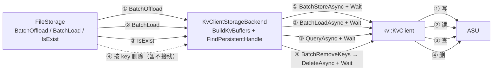

默认是“写完即下沉”：`PutEnd` 成功后 Master 把对象放进 owner 的 offload 队列，下一次心跳由 `FileStorage` 调 `BatchOffload` 写入 ASU；内存副本在 `NotifyOffloadSuccess` 前不可淘汰。

### 1.2 本版范围

| 在范围内 | 说明 |
| --- | --- |
| 写 `BatchOffload` | `BuildKvBuffers` 编码进 tensor 区间，`BatchStoreAsync` + `Wait`，只上报成功 key |
| 读 `BatchLoad` | `BuildKvBuffers` + `BatchLoadAsync` + `Wait`，校验记录头，支持前缀读 |
| 查 `IsExist` | `QueryAsync` + `Wait`，同时看 `exists` 与 `entryStatus` |
| 删（backend 内） | 新增**非 override** 成员函数 `BatchRemoveKeys(scoped_keys)`：backend → `kv::KvClient::DeleteAsync` + `Wait`；FileStorage / Master 接线暂不做 |
| `Init` / `IsEnableOffloading` | 注册 `KVCacheRegistration`；`IsEnableOffloading` 在 `kReady` 后返回 true，未就绪返回错误|
| `ScanMeta` | **不实现枚举**，返回 OK 空扫描；3.5 5种当前scanMeta方案 |

## 2. 总体设计

### 2.1 模块与依赖


- UCM 头只在 `backend.cpp` 包含；`backend.h` 只前置声明 `namespace kv { class KvClient; }`。
- 不新增端口层/适配器层；key 编码、记录编解码、注册区域内的 tensor 区间分配都是 `backend.cpp` 的私有 helper。
- `backend.h` 不暴露 `kv::` 类型，避免 UCM 头进入 Mooncake 公共头。

### 2.2 线程与锁

| 线程 | 入口 | 行为 |
| --- | --- | --- |
| Heartbeat | `BatchOffload` | 串行写 |
| RPC worker（多） | `BatchLoad` | 并发读 |
| dangling probe | `IsExist` | 低频并发查 |
| SDK worker | `KvClientImpl` 内部 | 提交/等待，不回调 Mooncake |

锁纪律：

1. `write_mutex_` 只串行化写路径与 tensor 区间分配。
2. `regions_mutex_` 只保护注册区域的空闲/隔离 tensor 区间集合，**绝不覆盖 `Wait`**。
3. 任何 ASU `Wait` 期间不持锁；`complete_handler` 回调期间不持锁。
4. 无索引锁——读长度以 Master 的 `slice.size` 为准，不依赖本地索引。

---

## 3. 功能实现

entry 构造沿用 asuStore 命名：

- `BlockId`（16B）由 `key_namespace + '\0' + scoped_key` 的 128-bit 哈希派生；
- `MakeAsuKey(BlockId)` 生成 8B `kv::CacheKey`；
- 一个 Mooncake 对象 = 一个 `Shard` + 一个 tensor：`tensorSizes[0] = align_up(24 + Σ slice.size, 512)`，`offset = 0`；
- 注册内存 = `KVCacheRegistration`，Init 时 `RegisterKVCaches`（backend helper，封装 `kv::KvClient::RegisterRegions`）注册一次，返回 `RegisteredPersistentRegion{region, handle}`；
- `BuildKvBuffers(TaskDesc, tensorSizes)` 生成 `vector<kv::KVBuffer>`；`buffer.handle` 由 `FindPersistentHandle(region)` 解析；`mrKey` 留空，由 SDK 提交时写入。

---

### 3.1 写：`BatchOffload`

#### 3.1.1 类图

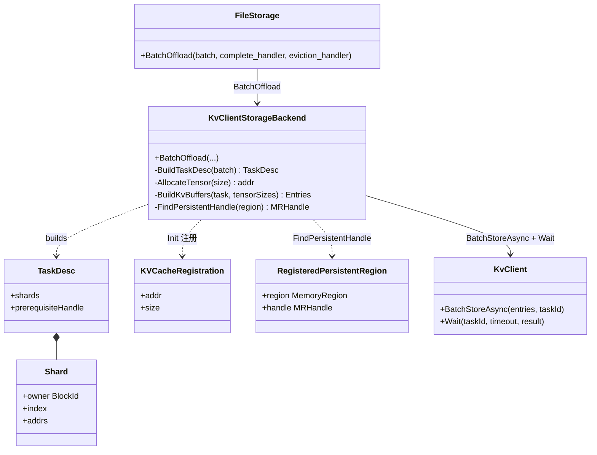

#### 3.1.2 时序图

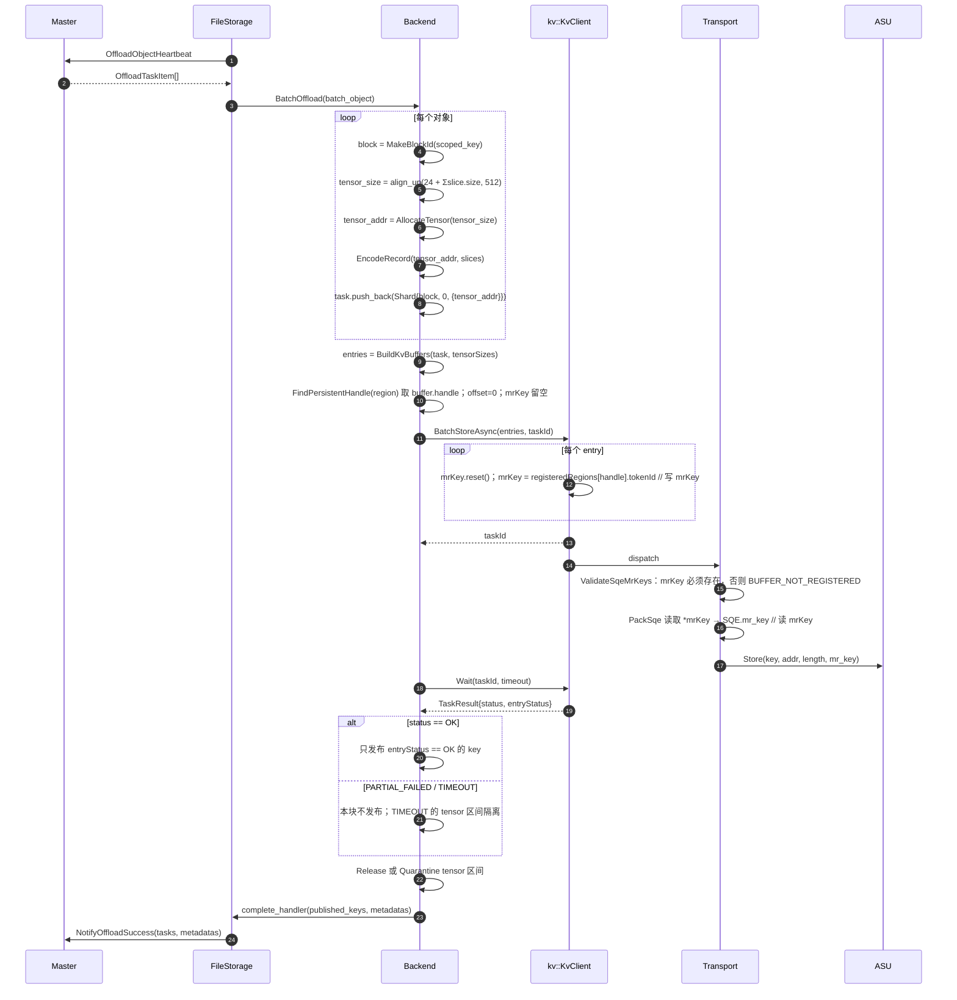

#### 3.1.3 实现

```cpp
// Init：注册区域
KVCacheRegistration reg{kv_cache_addr, kv_cache_size};
RegisterKVCaches(&reg, 1);   // backend helper -> kv::RegisterRegions

// BatchOffload
tl::expected<int64_t, ErrorCode> BatchOffload(batch, complete_handler, ...) {
    if (!ready) return INTERNAL_ERROR;

    Detail::TaskDesc task;
    std::vector<std::size_t> tensorSizes;
    std::vector<std::string> keys;
    for (auto& [scoped_key, slices] : batch) {
        if (over_quota(scoped_key, slices)) continue;   // 配额在这里逐 key 跳过

        const auto block = MakeBlockId(scoped_key);
        const auto tensor_size = AlignUp(kRecordHeaderSize + SumSliceSize(slices),
                                         kv::kAlignmentBytes);
        auto tensor_addr = AllocateTensor(tensor_size);  // 注册区域内的连续区间
        EncodeRecord(tensor_addr, slices);               // header + payload + zero padding
        task.push_back(Detail::Shard{block, 0, {tensor_addr}});
        tensorSizes.push_back(tensor_size);
        keys.push_back(scoped_key);
    }

    auto entries = BuildKvBuffers(task, tensorSizes);   // key/handle/offset 在这里填
    if (entries.empty()) return int64_t{0};

    kv::TaskId taskId{};
    if (!client_->BatchStoreAsync(entries, taskId).ok()) {
        ReleaseTensors(task);                           // 没有 task，立即释放
        return int64_t{0};
    }

    kv::TaskResult result;
    auto st = client_->Wait(taskId, wait_timeout_ms, result);   // 只 Wait 一次
    if (!st.ok() || result.status.code == TIMEOUT ||
        result.status.code == TASK_NOT_FOUND) {
        QuarantineTensors(task);                        // 底层可能仍在飞
        return Map(st);
    }
    if (result.status.code == PARTIAL_FAILED) {
        ReleaseTensors(task);                           // 保守：本块不发布
        return int64_t{0};
    }

    std::vector<std::string> published;
    for (std::size_t i = 0; i < result.entryStatus.size(); ++i) {
        if (result.entryStatus[i].ok()) published.push_back(keys[i]);
    }
    ReleaseTensors(task);

    std::vector<StorageObjectMetadata> metadatas;
    BuildMetadatas(published, metadatas);
    complete_handler(published, metadatas);
    return published.size();
}
```
---

### 3.2 读：`BatchLoad`

#### 3.2.1 类图

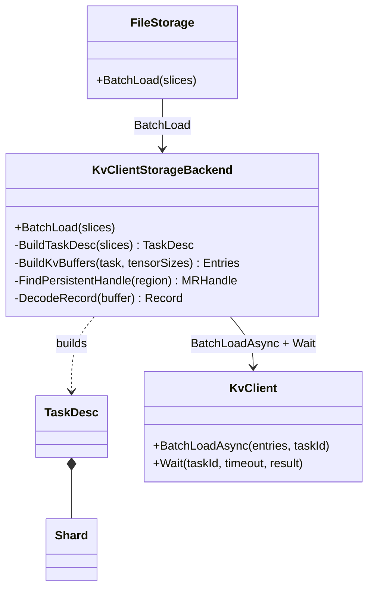

#### 3.2.2 时序图

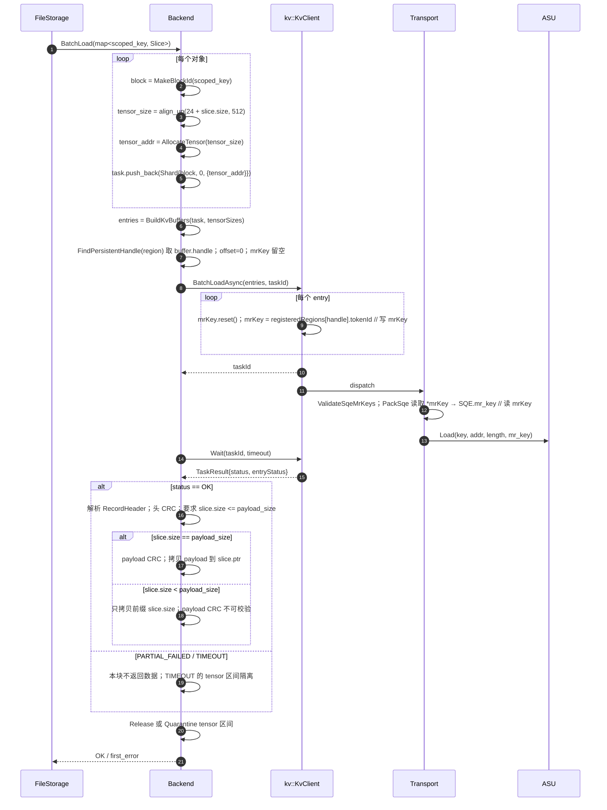

#### 3.2.3 实现

```cpp
tl::expected<void, ErrorCode> BatchLoad(std::unordered_map<std::string, Slice>& slices) {
    Detail::TaskDesc task;
    std::vector<std::size_t> tensorSizes;
    std::vector<Slice*> sliceList;
    std::vector<std::uintptr_t> tensorAddrs;
    for (auto& [scoped_key, slice] : slices) {
        if (slice.ptr == nullptr || slice.size == 0) return INVALID_PARAMS;

        const auto block = MakeBlockId(scoped_key);
        const auto tensor_size = AlignUp(kRecordHeaderSize + slice.size,
                                         kv::kAlignmentBytes);
        auto tensor_addr = AllocateTensor(tensor_size);  // 读入目标区间
        task.push_back(Detail::Shard{block, 0, {tensor_addr}});
        tensorSizes.push_back(tensor_size);
        sliceList.push_back(&slice);
        tensorAddrs.push_back(tensor_addr);
    }

    auto entries = BuildKvBuffers(task, tensorSizes);
    kv::TaskId taskId{};
    auto submit = client_->BatchLoadAsync(entries, taskId);
    if (!submit.ok()) {
        ReleaseTensors(task);
        return Map(submit);
    }

    kv::TaskResult result;
    auto st = client_->Wait(taskId, wait_timeout_ms, result);   // 只 Wait 一次
    if (!st.ok() || result.status.code == TIMEOUT ||
        result.status.code == TASK_NOT_FOUND) {
        QuarantineTensors(task);
        return Map(st);
    }
    if (result.status.code == PARTIAL_FAILED) {
        ReleaseTensors(task);                           // 本块不返回数据
        return Map(result.status);
    }

    std::optional<ErrorCode> first_error;
    for (std::size_t i = 0; i < entries.size(); ++i) {
        if (!result.entryStatus[i].ok()) { first_error = Map(result.entryStatus[i]); continue; }
        auto record = DecodeRecord(tensorAddrs[i]);     // magic/version/flags/头 CRC
        if (!record) { first_error = record.error(); continue; }
        if (sliceList[i]->size > record->payload_size) { first_error = INVALID_PARAMS; continue; }
        if (sliceList[i]->size == record->payload_size && !VerifyPayloadCrc(record)) {
            first_error = CHECKSUM_MISMATCH; continue;
        }
        std::memcpy(sliceList[i]->ptr, record->payload, sliceList[i]->size);
    }
    ReleaseTensors(task);
    return first_error ? tl::make_unexpected(*first_error) : tl::expected<void, ErrorCode>{};
}
```
---

### 3.3 查：`IsExist`

#### 3.3.1 类图

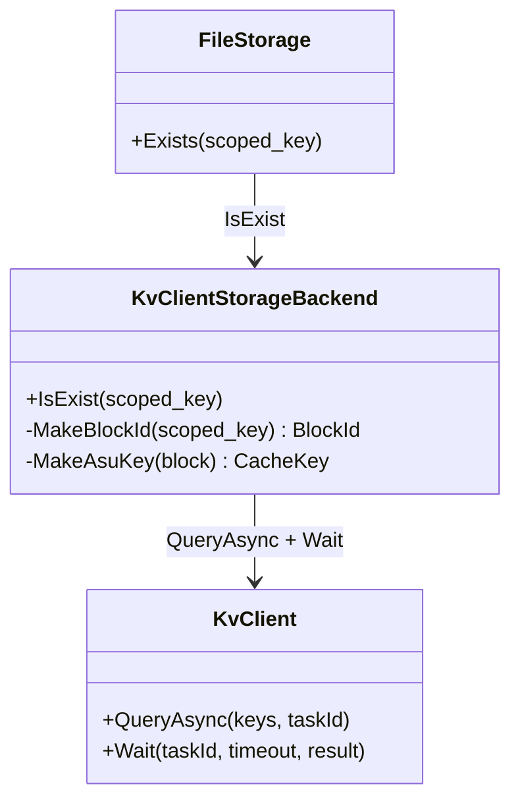

#### 3.3.2 时序图

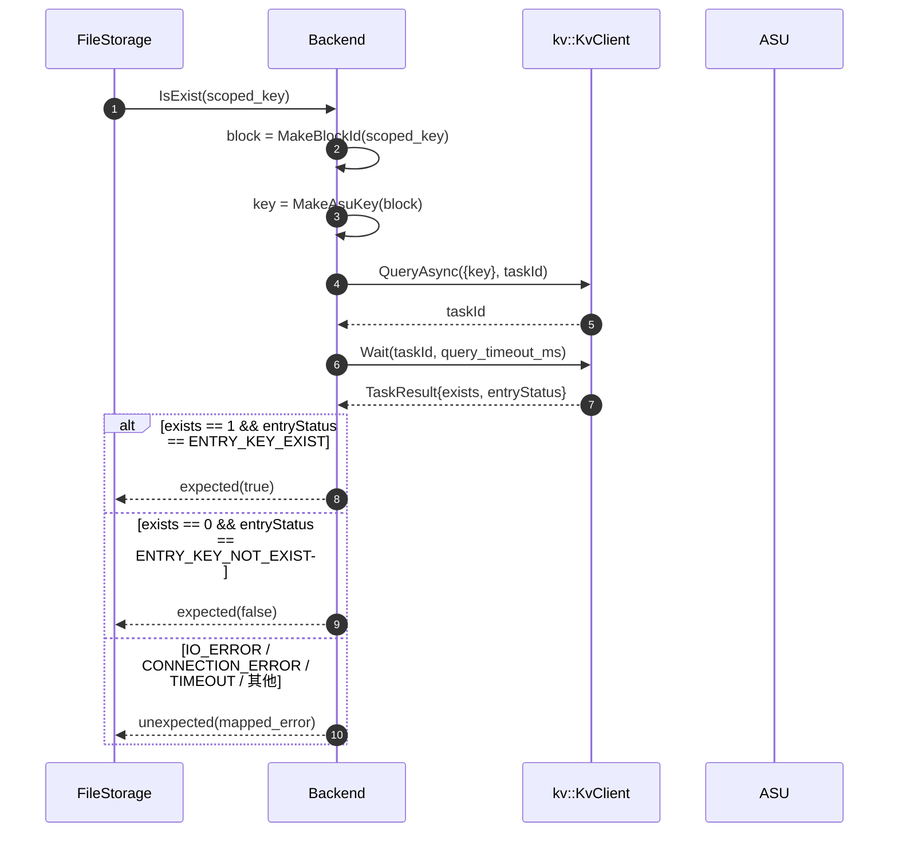

#### 3.3.3 实现

```cpp
tl::expected<bool, ErrorCode> IsExist(const std::string& scoped_key) {
    if (!ready) return INTERNAL_ERROR;

    const auto block = MakeBlockId(scoped_key);
    const auto key = MakeAsuKey(block);

    kv::TaskId taskId{};
    auto submit = client_->QueryAsync({key}, taskId);
    if (!submit.ok()) return Map(submit);

    kv::TaskResult result;
    auto st = client_->Wait(taskId, query_timeout_ms, result);   // 只 Wait 一次
    if (!st.ok()) return Map(st);
    if (!result.queryResult || result.queryResult->exists.size() != 1) {
        return INTERNAL_ERROR;
    }

    const bool exists = result.queryResult->exists[0] != 0;
    const auto entry = result.entryStatus[0];
    if (exists && entry.code == ENTRY_KEY_EXIST) return true;
    if (!exists && entry.code == ENTRY_KEY_NOT_EXIST) return false;
    return tl::make_unexpected(Map(entry));   // 分片失败不能当“不存在”
}
```
---

### 3.4 删

**已定方案**：`KvClientStorageBackend`继承 `StorageBackendInterface` 后，新增一个**非 override** 成员函数
`BatchRemoveKeys(scoped_keys)`：按批接收 key、逐 key 返回结果，只打通 **backend → `kv::KvClient`** 的按 key 删除流程。
`FileStorage` / `Master` 与 backend 之间的接线**暂不实现**；因此该方法当前没有生产调用者，只能由测试或后续调用方直接调用。

#### 3.4.1 类图

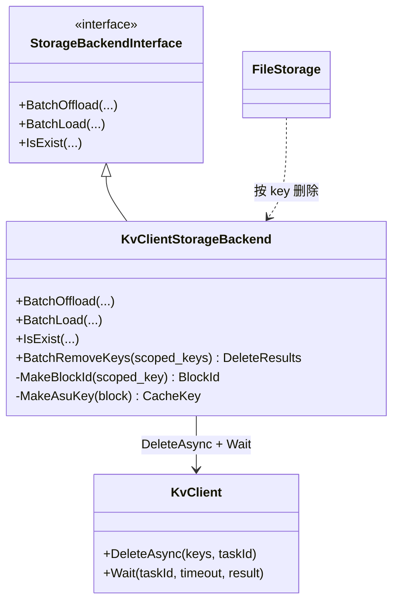

#### 3.4.2 时序图

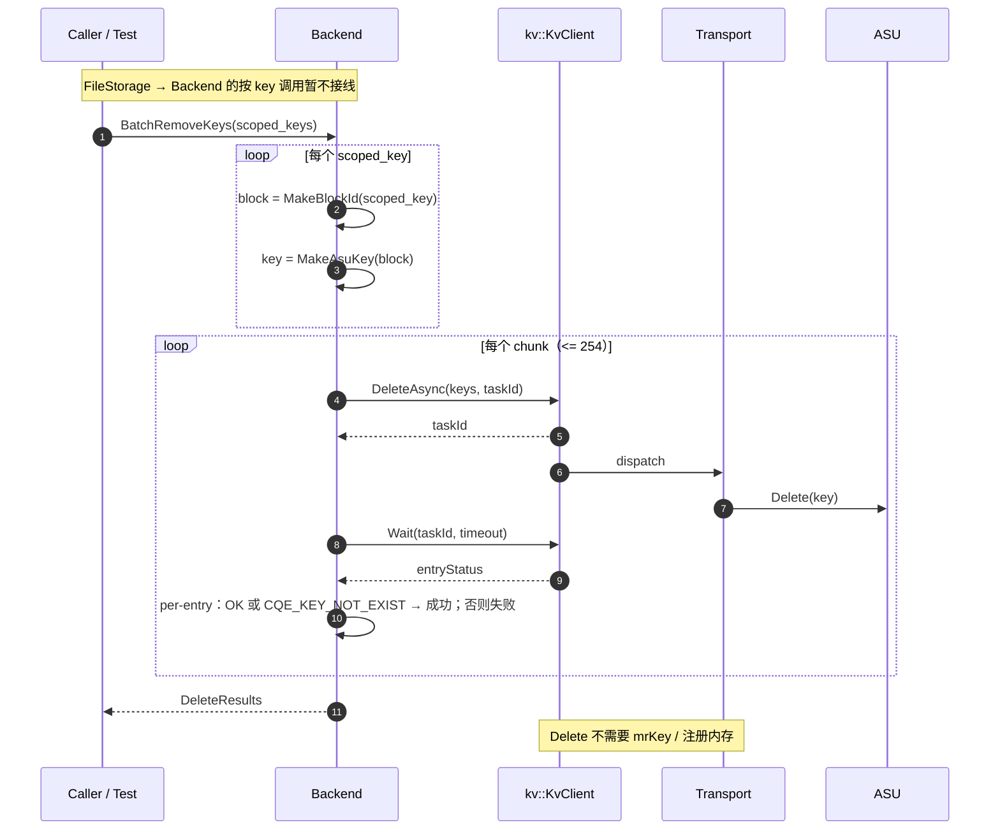

#### 3.4.3 实现

```cpp
// 新增成员函数，不是 StorageBackendInterface::BatchRemoveKeys 的 override。
// FileStorage / Master 的调用暂不接线；本函数只负责 backend -> KvClient。
std::vector<tl::expected<void, ErrorCode>>
KvClientStorageBackend::BatchRemoveKeys(const std::vector<std::string>& scoped_keys) {
    std::vector<tl::expected<void, ErrorCode>> results(scoped_keys.size());
    if (initialized_ != InitState::kReady) {
        std::fill(results.begin(), results.end(),
                  tl::make_unexpected(ErrorCode::INTERNAL_ERROR));
        return results;
    }

    std::vector<kv::CacheKey> keys;
    keys.reserve(scoped_keys.size());
    for (const auto& scoped_key : scoped_keys) {
        const auto block = MakeBlockId(scoped_key);
        keys.push_back(MakeAsuKey(block));   // 与写/读/查同一套 key 编码
    }

    constexpr std::size_t kDeleteIoNum = 254;   // deleteIoNum 默认值
    for (std::size_t begin = 0; begin < keys.size(); begin += kDeleteIoNum) {
        const auto end = std::min(begin + kDeleteIoNum, keys.size());
        std::vector<kv::CacheKey> chunk(keys.begin() + begin, keys.begin() + end);

        kv::TaskId taskId{};
        auto submit = client_->DeleteAsync(chunk, taskId);
        if (!submit.ok()) {                     // 没有 task；本 chunk 全部失败
            for (std::size_t i = begin; i < end; ++i)
                results[i] = tl::make_unexpected(Map(submit));
            continue;
        }

        kv::TaskResult result;
        auto st = client_->Wait(taskId, wait_timeout_ms, result);   // 每 chunk 只 Wait 一次
        if (!st.ok()) {                         // 超时/任务丢失：本 chunk 全部失败
            for (std::size_t i = begin; i < end; ++i)
                results[i] = tl::make_unexpected(Map(st));
            continue;
        }

        for (std::size_t i = begin; i < end; ++i) {
            const auto& entry = (i - begin < result.entryStatus.size())
                                    ? result.entryStatus[i - begin]
                                    : result.status;
            const bool ok = entry.ok() ||
                            entry.code == kv::StatusCode::CQE_KEY_NOT_EXIST;  // 幂等
            results[i] = ok ? tl::expected<void, ErrorCode>{}
                            : tl::make_unexpected(Map(entry));
        }
    }
    return results;
}
```
---
### 3.5 ScanMeta：已落地的 5 种方案（对照）

#### 3.5.1 总结表

| 后端 | 数据来源 | 是否读盘/远端 | 恢复能力 | 锁与阻塞 | 主要边界/失败 | 对本后端的启示 |
| --- | --- | --- | --- | --- | --- | --- |
| `StorageBackendAdaptor` | 文件内容里的 `KVEntry.key` | 读盘，O(总字节) | 可恢复 | `mutex_` 整段扫描；handler 同步 RPC 持锁 | 单文件读失败静默跳过；`from_pb` 可能抛 | 文件名是 `SanitizeKey` 后的有损形式，必须读内容；代价最高 |
| `BucketStorageBackend` | Init 从 `*.meta` 重建的 `buckets_` | 不读盘 | 可恢复 | `iterator_mutex_`；`BucketScan` 持 `mutex_` shared | 单桶 > limit → `KEYS_EXCEED_BUCKET_LIMIT`；扫完要 `ResetScanIterator` | 需要持久元数据 + 内存索引 |
| `OffsetAllocatorStorageBackend` | 内存 `shards_[i].map` | 不读盘 | 取决于 `persist_mode`；默认 `kDisabled` → 空 | 1024 个 shard 全部 shared_lock；handler 在锁区 | 默认空扫描；handler 阻塞写索引提交 | checkpoint 决定可恢复性 |
| `DistributedStorageBackend`（OSS/S3） | 对象存储 LIST | 远端 LIST | 可恢复 | 无本地扫描锁；非流式 | 每页 1000；任一分页失败整次失败；posix/hf3fs → `NOT_SUPPORTED` | 依赖外部对象索引 |
| `NvmeKvStorageBackend` | 无枚举 | 不读盘 | 不可恢复 | 无 | 未初始化 → `INTERNAL_ERROR`；handler 零调用 | 与本后端最接近：设备无 enumerate |

#### 3.5.2 StorageBackendAdaptor —— 扫目录 + 读文件内容

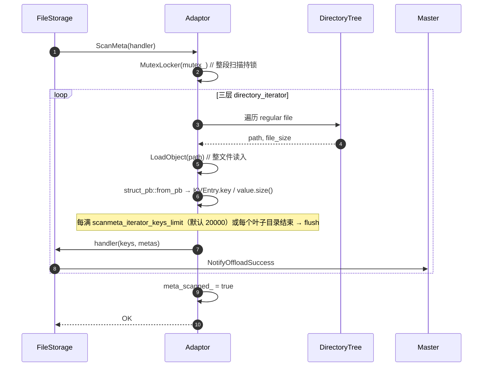

- 数据来源：文件内容里的 `KVEntry.key`；文件名是 `SanitizeKey` 后的有损形式，不能反解。
- 代价：O(总字节数) 的磁盘读；handler 里的同步 RPC 全程持 `mutex_`。
- 失败：单文件读失败静默跳过；坏文件可能让 `struct_pb::from_pb` 抛异常。
- handler 返回非 OK 会提前返回，`meta_scanned_` 不会置 true。
- 代码：`storage_backend.cpp:1411-1496`；`LoadObject` 在 1466-1468。

#### 3.5.3 BucketStorageBackend —— 内存索引游标

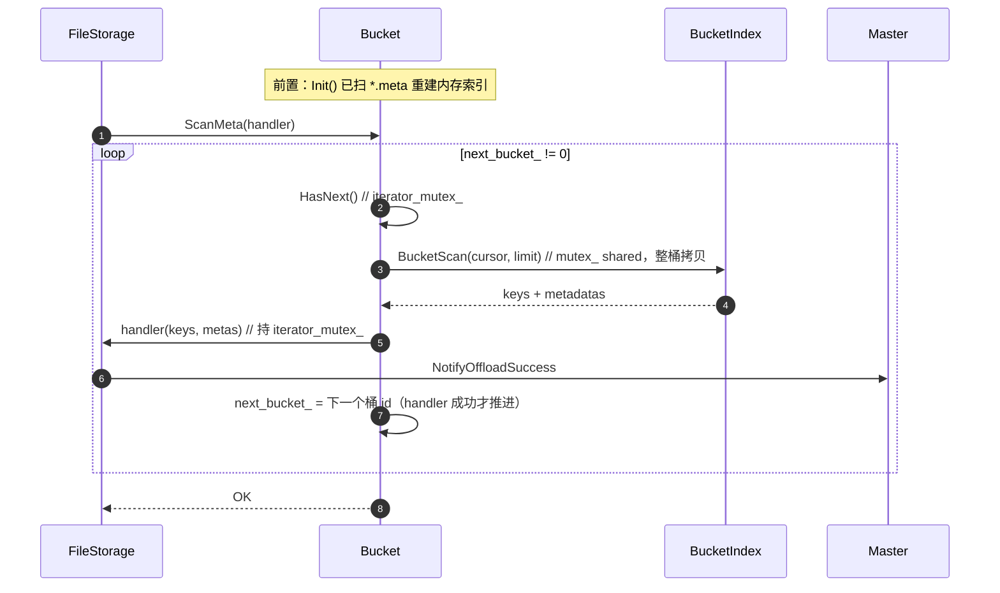

- 数据来源：Init 时从 `<id>.meta` 重建的 `buckets_`；`ScanMeta` 本身不读盘。
- 游标初值 `-1`、`0` 为结束；扫完必须 `ResetScanIterator()` 才能再扫。
- 单桶是原子单位；单个桶超过 `scanmeta_iterator_keys_limit` 直接 `KEYS_EXCEED_BUCKET_LIMIT`。
- handler 在 `iterator_mutex_` 内执行；`BucketScan` 的 `mutex_` shared 锁在拷贝完成后释放。
- 代码：`storage_backend.cpp:2279-2301`（ScanMeta）、`2303-2331`（BucketScan）、`3601-3629`（HandleNext/HasNext）。

#### 3.5.4 OffsetAllocatorStorageBackend —— 内存 shard 快照

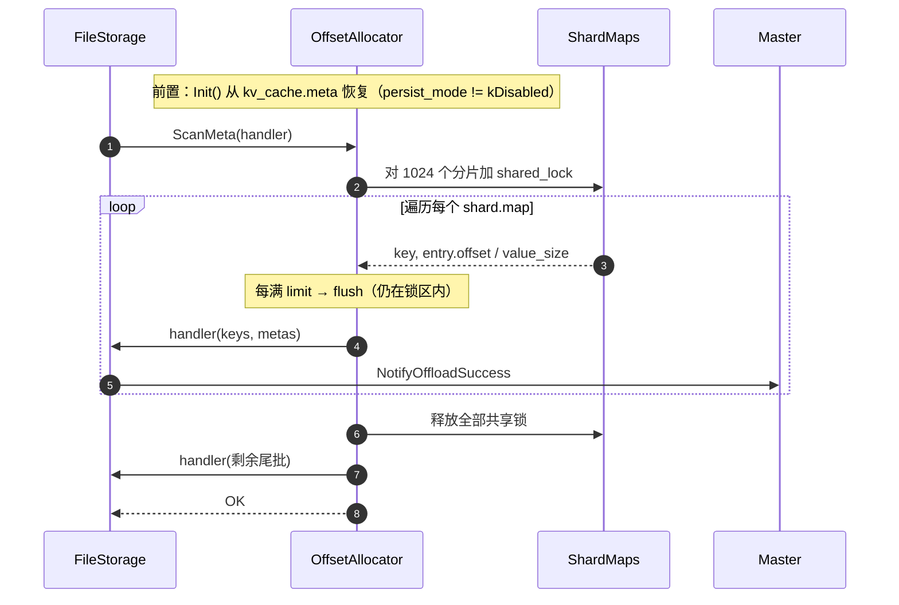

- 数据来源：内存 `shards_[i].map`；源码注释明确 “no disk scanning”。
- 默认 `persist_mode = kDisabled` → map 为空 → 零回调、零告警。
- 循环内 flush 时 handler 仍在全部 shard 的共享锁内，会阻塞 `BatchOffload` 的索引提交。
- 尾批在释放锁之后发送。
- 代码：`storage_backend.cpp:5518-5601`；默认 `persist_mode` 见 `offset_allocator_backend_config.h:52`。

#### 3.5.5 DistributedStorageBackend（OSS/S3）—— 远端 LIST

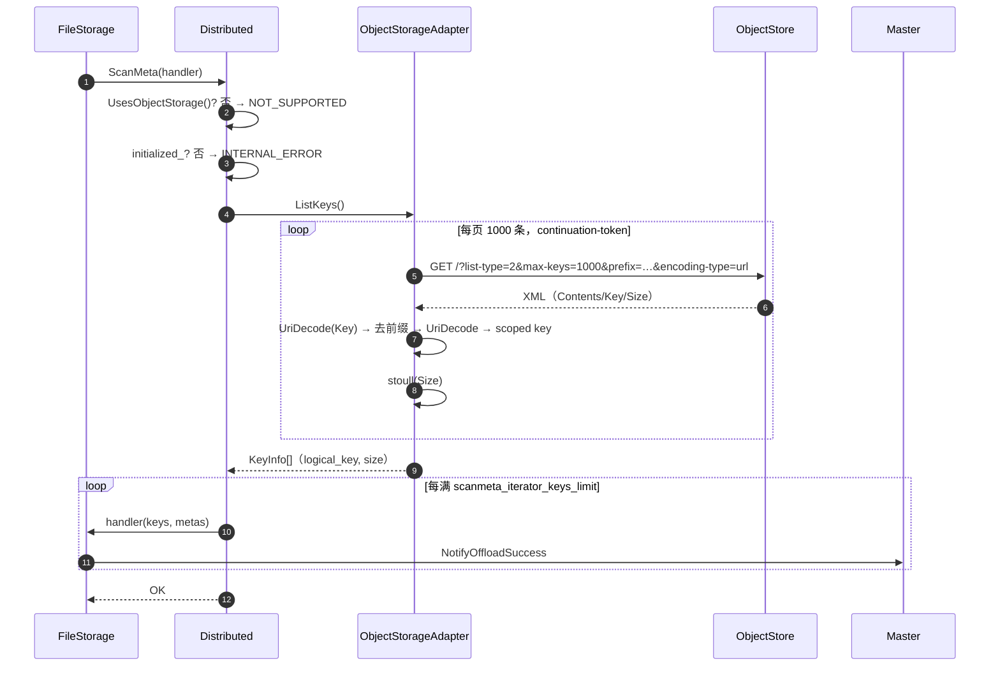

- 数据来源：对象存储服务端维护的对象索引，不是 Mooncake 写的任何元数据。
- 两层分页：HTTP 页 1000 / 回调批 `scanmeta_iterator_keys_limit`。
- 非流式：全部页攒成 `vector` 才返回；任一分页失败 → 整次失败。
- posix/hf3fs 模式返回 `NOT_SUPPORTED`。
- 代码：`distributed_storage_backend.cpp:863-904`；OSS `ListKeys` 见 `oss_adapter.cpp:876-921`。

#### 3.5.6 NvmeKvStorageBackend —— 空实现

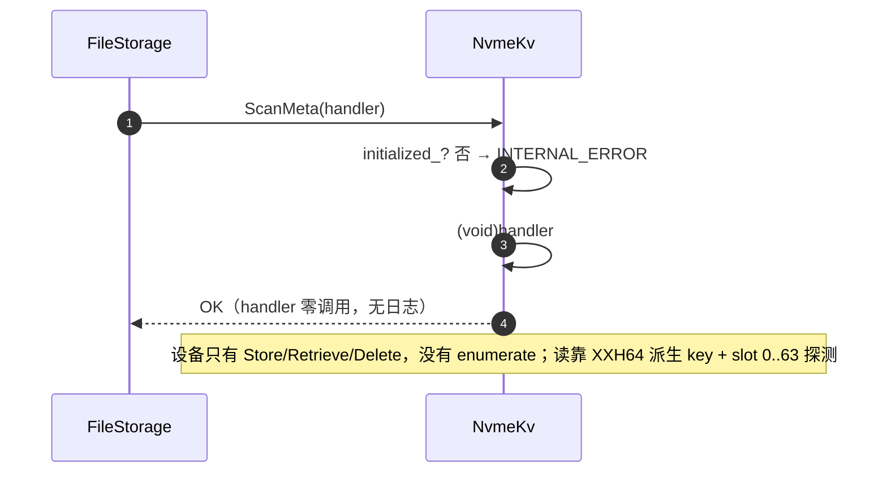

- 设备侧只有 Store/Retrieve/Delete，没有 enumerate，不是实现取舍。
- 读不依赖索引（XXH64 派生 key + slot 0..63 探测），所以客户端重启无害；Master 丢元数据即孤儿。
- 代码：`nvme_kv/backend.cpp:1516-1525`；slot 数见 `nvme_kv/key_codec.h:18`。

#### 3.5.7 对本后端的结论

- ASU 的 `kv::KvClient` 没有 enumerate，只有按 key 的 Query/Load/Store/Delete；没有外部索引就无法重建 `(scoped_key, size)` 清单。
- 因此 `KvClientStorageBackend` 的 `ScanMeta` 与 `NvmeKvStorageBackend` 同类：返回 OK、零回调、不恢复账本；Master 丢元数据即孤儿。
- 若后续要求恢复，只有两条路：另建外部 key 索引（本地或 ASU 上的独立 key），或接受“无恢复”；不在 V1 范围。

---

## 4. SFMEA 分析与测试设计

### 4.1 失效模式与影响

> 严重度：S1 数据损坏/误删；S2 功能不可用/永久停；S3 性能/配额退化。

| ID | 功能 | 失效模式 | 影响 | 严重度 | 检测/缓解 | 测试 |
| --- | --- | --- | --- | --- | --- | --- |
| FM-INIT-01 | Init | `KvClient::Init` / `RegisterKVCaches` 失败或返回空结果 | 节点不参与 offload | S2 | 失败回滚 `kUninit`；空结果当失败 | TC-INIT-01 |
| FM-ENTRY-01 | BuildKvBuffers | `FindPersistentHandle` 找不到 / handle 非注册返回值 | `BUFFER_NOT_REGISTERED` | S2 | 边界检查；只用注册区域 handle | TC-ENTRY-02 |
| FM-ENTRY-02 | Key | `MakeAsuKey` 全零或 64-bit 碰撞 | 写错对象/覆盖先写 | S1 | 全零重映射；碰撞作为已知风险接受 | TC-ENTRY-03 |
| FM-ENTRY-03 | BuildKvBuffers | `tensorSizes[0]` 超 24-bit 或未 512B 对齐 | SDK `INVALID_ARGUMENT` | S2 | 提交前校验；超限 key 跳过 | TC-ENTRY-04 |
| FM-WRITE-01 | 写 | `PARTIAL_FAILED` 下把 OK entry 当成功 | 假成功，Master 指向未发送数据 | S1 | 本块整体不发布 | TC-STORE-01 |
| FM-WRITE-02 | 写 | `Wait` 超时/`TASK_NOT_FOUND` 后复用 tensor | 数据串写 / use-after-free | S1 | tensor 区间隔离，不复用 | TC-STORE-01 |
| FM-WRITE-03 | 写/配额 | 返回 `KEYS_ULTRA_LIMIT` 或硬错误 | offload 永久关闭 / 心跳中断 | S2 | 逐 key 跳过，返回 `expected(count)` | TC-STORE-02 |
| FM-WRITE-04 | 写 | `complete_handler` 失败 | 数据在 ASU、Master 未登记 | S2 | 返回错误、记日志；重试 Put 覆盖 | TC-STORE-03 |
| FM-READ-01 | 读 | 前缀读被拒绝 / `slice.size > payload_size` | ranged read 失败或超读 | S2 | 允许 `slice.size <= payload_size` | TC-LOAD-02 |
| FM-READ-02 | 读 | 头 / payload CRC 损坏 | 返回错误数据 | S1 | 头 CRC + payload CRC | TC-LOAD-03 |
| FM-QUERY-01 | 查 | `IO_ERROR`/超时返回 false | probe 误删 Master 元数据 | S1 | 一律 `unexpected`，绝不返回 false | TC-QUERY-01 |
| FM-DEL-01 | 删 | key 编码与写/读/查不一致 | 删错/漏删 | S1 | 复用同一 `BlockId` + `MakeAsuKey` | TC-DEL-01 |
| FM-DEL-02 | 删 | `DeleteAsync` 失败/超时/部分失败 | 残留对象；结果不准 | S3 | 逐 key 结果；失败日志；幂等重试 | TC-DEL-02 |
| FM-CONC-01 | 并发 | `Wait` 持锁 / tensor 未完成就复用 | 心跳阻塞 / 数据损坏 | S1/S2 | `Wait` 不持锁；超时隔离 | TC-CONC-01 |

### 4.2 测试用例与验收点

| 编号 | 场景 | 注入/前置 | 验收点 |
| --- | --- | --- | --- |
| TC-INIT-01 | Init 注册失败 / 空结果 | 注入注册失败或空 vector | 回滚 `kUninit`、不进入 `kReady`；FileStorage Init 失败 |
| TC-ENTRY-01 | Store entry 构造 | 正常注册区域 | `mrKey` 非空且等于 `tokenId`；`region.size` 512B 对齐；handle 来自 `FindPersistentHandle` |
| TC-ENTRY-02 | 伪造 / 未注册 handle | 伪造 `buffer.handle` | `BUFFER_NOT_REGISTERED`；不发布；tensor 释放 |
| TC-ENTRY-03 | Key 编码稳定性 | 同一 `scoped_key` 写/读/查 | 得到同一非零 `MakeAsuKey(BlockId)`；不同 namespace 不同 |
| TC-ENTRY-04 | 超 24-bit / 未对齐 | `payload_size` 超限 | 该 key 跳过、不提交；其他 key 正常 |
| TC-STORE-01 | OK / `PARTIAL_FAILED` / 超时 | 注入部分失败/延迟 | OK 只发布成功 entry；PARTIAL 不发布；超时 tensor 隔离 |
| TC-STORE-02 | 超配额 | 计数超 limit | 超限 key 跳过；返回 `expected(count)`；不返回 `KEYS_ULTRA_LIMIT` |
| TC-STORE-03 | `complete_handler` 失败 | handler 返回错误 | 数据仍可读；返回错误；不回滚 |
| TC-LOAD-01 | 全长读 + CRC | 写入后按全长读 | 字节一致；head/payload CRC 通过 |
| TC-LOAD-02 | 前缀读 | `slice.size < payload_size` | 返回前缀；不越界 |
| TC-LOAD-03 | 数据损坏 | 篡改头 / payload | `INVALID_READ` / `CHECKSUM_MISMATCH`；不拷贝 |
| TC-QUERY-01 | 查询错误 | `exists=0` + `IO_ERROR` / 超时 | 返回 `unexpected`；绝不返回 false |
| TC-DEL-01 | backend 按 key 删除 | 直接调用 `BatchRemoveKeys(N keys)` | 与写/读/查同一套 key 编码；254 分块；`DeleteAsync` + 每块 `Wait` 一次；逐 key 结果 |
| TC-DEL-02 | 删除失败 / 超时 / 部分失败 | 注入 `ENTRY_DELETE_FAILED`、`PARTIAL_FAILED`、`Wait` 超时 | 失败 key 有错误结果/日志；`CQE_KEY_NOT_EXIST` 归一成功；不自动重试；不崩溃 |
| TC-CONC-01 | 多读并发 + 写 | 多线程读写 | TSAN/ASAN 干净；tensor 区间全部归还 |

---

## 5. 风险与待确认

| # | 风险 | 影响 | 处置 |
| --- | --- | --- | --- |
| R1 | FileStorage 接线未做，生产删除仍为逻辑删除 | ASU 残留；backend `BatchRemoveKeys` 暂无生产调用者 | 后续接 FileStorage/Master；当前文档化 |
| R2 | 前缀读的 payload CRC 无法覆盖完整 value | 完整性拦截面收窄 | V1 接受并文档化；或用本地长度索引做全长读（多 I/O） |
| R3 | 默认 16 MiB 超过 24-bit 传输上限 | 满尺寸写全部失败 | 默认改 2 MiB，硬上限 `16,776,680` |
| R4 | 64-bit `MakeAsuKey(BlockId)` 哈希碰撞 | 后写覆盖先写，读错对象 | 默认假设不发生；P1 可加碰撞检测/版本化 key |
| R5 | `Wait` 超时后 tensor 区间永久隔离 | 反复超时会耗尽注册区域 | 监控隔离区间数量；P1 研究取消/回收 |
| R6 | 子区间 MR 寻址未被真机验证 | 可能只能每个 tensor 区间单独注册 | 真机确认；不支持则退化注册 |
| R7 | `ScanMeta` 不实现 | Master 丢元数据后无法重建账本 | 已明确不在本版；3.5 对照现有 5 种方案；文档化 |
| R8 | HEAD 漂移 / `RemoveAll` 死代码 | 行号与可达性变化 | 评审前重新核对；不要引用旧行号 |
| R9 | ASU 同 key 覆盖写语义未验证 | 若 Store 对已存在 key 返回 `CQE_KEY_ALREADY_EXISTED`，逻辑删除后的同 key 覆盖也会失败 | 真机验证；必要时先 `DeleteAsync` 再 `StoreAsync` |
