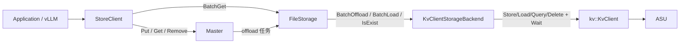
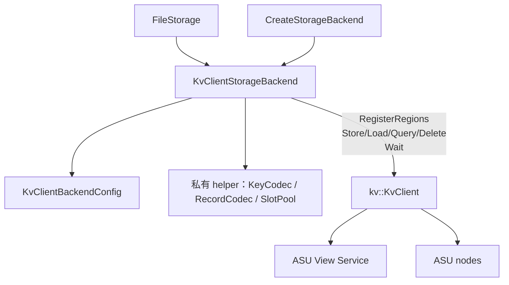
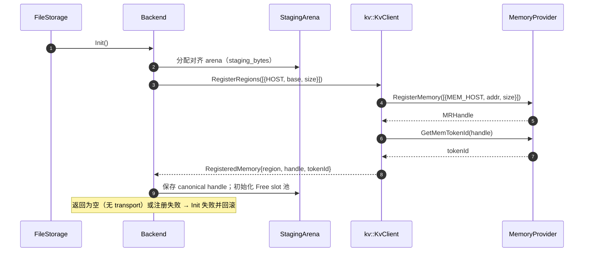
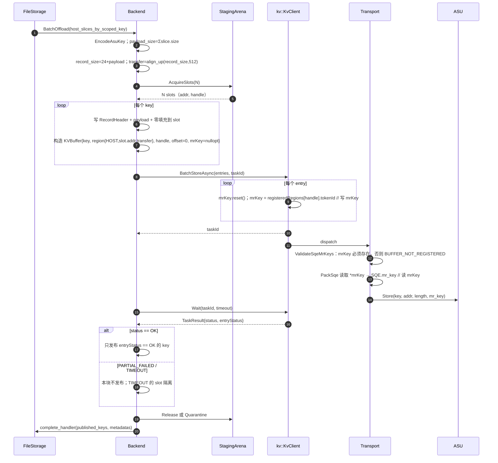
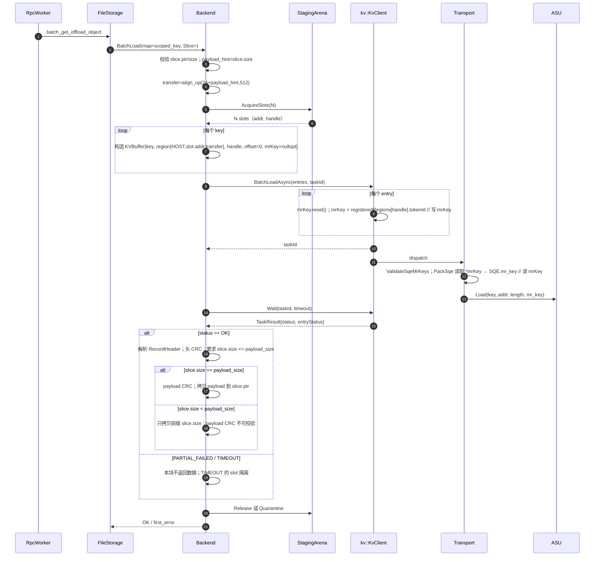

# KvClientStorageBackend 方案评审（讲解版）

> 基于 `kv-client-storage-backend.md`（Draft v1）整理，面向评审会讲解。
> 只保留需要拍板的内容，不复述全部实现细节。
>
> - 代码基线：Mooncake `522b716e`；UCM `kv_semantics`（`kv::KvClient`）
> - SDK 接口：`kv_semantics/include/kv_client.h`；不是旧分支的 `UC::ASU::AsuClient`
> - 接口基线：`mooncake-store/include/storage_backend.h:263-331`
> - 讲解顺序建议：5 min 背景 → 10 min 删除专题 → 8 min entry/mrKey → 5 min 测试与风险

---

## 0. 一页结论

### 0.1 四句话

| # | 问题 | 结论 |
| --- | --- | --- |
| 1 | 按 key 删除能不能只靠后端实现？ | **不能**。Mooncake 的 `Client::Remove`/`BatchRemove` 只删 Master 元数据和客户端内存副本，不经过 `StorageBackendInterface`；现有接口也没有任何方法能携带“要删除的 key 集合”。 |
| 2 | 那是否必须改 `StorageBackendInterface`？ | **要物理删除就必须扩展后端契约**。接口本身只需增加一个带默认实现的虚函数（非破坏性）；真正成本在 Master→owner 的按 key 删除任务路由，约 500–900 行 / 10 个文件。 |
| 3 | 有没有不改接口也能交付的方案？ | **有，但只能把删除降级为“逻辑删除”**：`Remove` 后 ASU 上的值仍在，靠同 key 覆盖写 / ASU GC / 命名空间轮转回收。不能宣称“删除释放 ASU 容量”。 |
| 4 | 写/读的 entry 和内存怎么落？ | 启动时分配一块对齐的 staging arena，**整块注册一次**；每次读写从 slot 池取子区间，构造 `KVBuffer` 后提交。`mrKey` 不由后端填写，由 SDK 在提交时按 `buffer.handle` 解析并写入，transport 组 SQE 时读取。 |

### 0.2 需要评审拍板的三件事

1. **V1 是否要求 `Remove` 立即释放 ASU 容量？**
   - 是 → 选方案 A（扩展后端契约 + Master→owner 路由），单独立项。
   - 否 → 选方案 B（逻辑删除，零接口改动，明确对外口径）。
2. **读路径是否必须支持“前缀读”？**
   Mooncake 的 LOCAL_DISK ranged read 会传 `src_offset + size`，`slice.size` 可能小于对象全长（`real_client.cpp:5128-5138`）。必须支持，否则合法 ranged read 全部失败。
3. **单对象上限取多少？**
   原方案默认 `max_payload_bytes = 16 MiB` 不可用：`24 + 16 MiB` 对齐后超过 SQE 的 24-bit length 上限。建议默认 2 MiB，硬上限 `payload_size ≤ 16,776,680`。

### 0.3 已确定

- **`IsEnableOffloading()`：`kReady` 后直接返回 true；未就绪返回错误，让 `FileStorage::Init` 明确失败。** 不在该方法里读计数或查 ASU 容量/水位。
- **容量/配额控制放在 `BatchOffload` 内逐批/逐 key 做**：超限 key 跳过，返回 `expected(success_count)` 或 `expected(0)`，下一轮心跳重试；绝不返回 `KEYS_ULTRA_LIMIT`。

---

## 1. 背景与边界

### 1.1 链路



默认是“写完即下沉”：`PutEnd` 成功后 Master 把对象放进 owner 的 offload 队列，下一次心跳由 `FileStorage` 调 `BatchOffload` 写入 ASU；内存副本在 `NotifyOffloadSuccess` 前不可淘汰。本后端不感知触发时机。

### 1.2 本版范围

| 在范围内 | 说明 |
| --- | --- |
| 写 `BatchOffload` | 编码进 staging，`BatchStoreAsync` + `Wait`，只上报成功 key |
| 读 `BatchLoad` | `BatchLoadAsync` + `Wait`，校验记录头，支持前缀读 |
| 查 `IsExist` | `QueryAsync` + `Wait`，同时看 `exists` 与 `entryStatus` |
| 删 | 见第 3 节：V1 建议逻辑删除；物理删除单列 P1 |
| `Init` / `IsEnableOffloading` | 注册 staging；`IsEnableOffloading` 在 `kReady` 后返回 true，未就绪返回错误；不查 ASU、不读计数 |
| `ScanMeta` | **不实现枚举**，返回 OK 空扫描；本文不讨论恢复 |

不在本版：`RemoveByRegex`、水位淘汰、ASU GC 对接、恢复 manifest、chunk 分片、多副本、压缩/加密/TTL、零拷贝、批量查询。

### 1.3 与现有后端的关系

| 后端 | 删除能力 | 恢复能力 |
| --- | --- | --- |
| `StorageBackendAdaptor` | `RemoveAll` | `ScanMeta` 目录扫描 |
| `BucketStorageBackend` | `RemoveAll` / 水位淘汰 | 内存索引 + 持久化元数据 |
| `NvmeKvStorageBackend` | 无 | 无（`ScanMeta` 空实现） |
| `KvClientStorageBackend` | 见第 3 节 | 无（`ScanMeta` 空实现） |

---

## 2. 总体设计

### 2.1 模块与依赖



- UCM 头只在 `backend.cpp` 包含；`backend.h` 只前置声明 `namespace kv { class KvClient; }`。
- 不新增端口层/适配器层；key 编码、记录编解码、slot 池都是 `backend.cpp` 的私有 helper。
- `backend.h` 不暴露 `kv::` 类型，避免 UCM 头进入 Mooncake 公共头。

### 2.2 线程与锁

| 线程 | 入口 | 行为 |
| --- | --- | --- |
| Heartbeat | `BatchOffload` | 串行写 |
| RPC worker（多） | `BatchLoad` | 并发读 |
| dangling probe | `IsExist` | 低频并发查 |
| SDK worker | `KvClientImpl` 内部 | 提交/等待，不回调 Mooncake |

锁纪律：

1. `write_mutex_` 只串行化写路径与 slot 写侧分配。
2. `slots_mutex_` 只保护 Free/InUse/Quarantined 集合，**绝不覆盖 `Wait`**。
3. 任何 ASU `Wait` 期间不持锁；`complete_handler` 回调期间不持锁。
4. 无索引锁——读长度以 Master 的 `slice.size` 为准，不依赖本地索引。

---

## 3. 删除专题（重点）

### 3.1 现状：按 key 删除在 Mooncake 里走到哪

| 用户操作 | 实际动作 | 到 `StorageBackendInterface`？ | 证据 |
| --- | --- | --- | --- |
| `Client::Remove(key)` | 删 Master 元数据 + hot cache；物理删除调用被注释 | **否** | `client_service.cpp:3795-3812`，`3801-3803` 为注释 |
| `Client::BatchRemove(keys)` | Master 逐 key 删元数据 | **否** | `client_service.cpp:3848-3870`；`master_service.cpp:7437-7530` |
| `Client::RemoveByRegex` | Master 扫描删元数据 | **否** | `client_service.cpp:3814-3831` |
| `Client::RemoveAll` | Master 删元数据；客户端物理清空当前不可达 | **否（当前 HEAD）** | `file_storage.cpp:912-921` 零调用者；`local_ssd/manager` 的 `RequestRemoveAll` 也无调用者 |
| `EvictAboveDiskWatermark` | 后端选 key，通知 Master 后物理删 | 是，但**不是用户按 key** | `storage_backend.h:323-328` |
| KvClient | `DeleteAsync(vector<CacheKey>)` | 是（若被调用） | `kv_client.h:50` |

关键事实：

- 当前 HEAD 的 `Client::Remove`/`BatchRemove` 是 **master-first、metadata-only**；offload 数据面完全不知道用户删了哪个 key。
- `RemoveAll` 链路两端都是死的：`RequestRemoveAll()` 无调用者，`FileStorage::RemoveAll()` 无调用者，`Client::PollRemoveAll()` 无调用者。RPC 还在，但标志位永远不会被置起。
- `KvClient` 没有 `RemoveAll`/drop/scan；只能按 8 字节 key 调 `DeleteAsync`。
- `Client::Remove` 里被注释的 `storage_backend_` 是客户端本地文件后端的 `std::shared_ptr<StorageBackend>`（`client_service.h:1178`），不是 `FileStorage` 持有的 `StorageBackendInterface`（`file_storage.h:291`）。即使取消注释，也不会到达 offload 后端。

### 3.2 现有后端接口能否承载“按 key 删除”

`StorageBackendInterface` 能到达后端的只有这几个方法：

| 方法 | 语义 | 能否表达“删除这些 key” |
| --- | --- | --- |
| `BatchOffload` | 写/覆盖 | 否，会把 key 写回 |
| `BatchLoad` | 读 | 否 |
| `IsExist` | 查询 | 否，约定无副作用 |
| `GetObjectDataSize` | 查询长度（可选） | 否 |
| `RemoveAll` | 全清 | 只能全量，不能按 key；且当前不可达 |
| `EvictAboveDiskWatermark` | 后端自选 victim | 后端不知道用户删了哪些 key |

**结论：不改接口就不可能把“要删的 key”传到后端。** 唯一不改接口的选择是把删除降级为逻辑删除，而不是物理删除。

### 3.3 方案对比

| 方案 | 做法 | 按 key 物理删除 | 容量回收 | 改动面 | 主要风险 | 结论 |
| --- | --- | --- | --- | --- | --- | --- |
| **A. 扩展基类接口 + 路由** | `StorageBackendInterface` 加 `BatchRemoveKeys`（默认 `NOT_SUPPORTED`）；Master 删元数据前捕获 LOCAL_DISK owner，投递按 key 删除任务；owner 心跳取任务后调 backend `DeleteAsync` | 是 | 立即 | 约 500–900 行 / 10 文件 | owner 捕获顺序、HA/oplog、无持久化重试、任务通道 | 需要容量回收时**唯一正确方案** |
| **A'. 旁路能力接口 + 同样路由** | 不动基类，新增 `KeyDeleteCapable` 侧接口，`FileStorage` `dynamic_cast` | 是 | 立即 | 同 A（路由成本不变） | RTTI/可选能力；仍要改 FileStorage | 不想动公共基类时的备选 |
| **B. 逻辑删除** | 不改任何接口；`Remove` 只删元数据 | 否 | 靠同 key 覆盖写 / ASU GC / 命名空间轮转 | 0 | 容量泄漏；无回收保证；不能对外宣称“删除” | **V1 推荐**，需明确口径 |
| **C. 本地 key 集合 + `RemoveAll` 全清** | 记录本进程写过的 key，`RemoveAll` 时按 254 分批 `DeleteAsync` | 否（只能全清） | 全清 | 需新增 key 集合 + 恢复 `RemoveAll` 两端接线 | 重启后集合为空；租户隔离被破坏；当前链路已死 | 只适合运维重置，不作为按 key 删除 |
| **D. 哨兵复用 `BatchOffload`** | Master 把删除 key 当 offload 任务下发，空 slice 表示删除 | 名义上是 | 是 | 仍需 Master 路由 | 语义滥用；FileStorage/bucket/D2H/complete_handler 全假设有数据 | **否决** |

### 3.4 推荐决策

**建议 V1 选 B，物理删除单列 P1。** 理由：

- 当前 HEAD 的删除通道本身不可达，V1 若强行做 A，会把“后端实现”变成“跨 Master/Client/FileStorage/local_ssd 的协议改造”，评审范围和风险都失控。
- `Client::Remove` 的语义本来就是“让对象不可路由”；在 ASU 作为 cache tier 的定位下，逻辑删除 + 同 key 覆盖写可以满足大部分场景。
- 对外必须明确：**`Remove` 不释放 ASU 容量；ASU 残留由覆盖写 / ASU GC / 命名空间轮转回收。**

如果评审认为“删除必须释放 ASU 容量”，则选 A（或 A'），并接受：

- `StorageBackendInterface` 增加一个带默认实现的虚函数，对现有后端非破坏；
- Master 必须在 `EraseMetadata` **之前**捕获 LOCAL_DISK replica 的 owner，否则删除任务没有投递对象；
- HA/oplog 路径要把“捕获 owner”和“元数据删除”放在同一个持久化语义里；
- 本版没有持久化删除任务队列，owner 重启会丢任务；需要带外清理兜底。

反过来说，**只加接口方法、不接路由也不够**：方法会永远没有调用者；如果只在 `Client::Remove` 里本地调用，则调用方不一定是 owner，多 client 场景会漏删，且可能用了错误的 `key_namespace`。所以“改接口”和“接路由”必须成对出现。

### 3.5 若选 A：最小改动清单

| 层 | 改动 |
| --- | --- |
| `storage_backend.h` | 新增 `virtual BatchRemoveKeys(const vector<string>& scoped_keys)`，默认逐 key 返回 `NOT_SUPPORTED` |
| `file_storage.{h,cpp}` | 转发 `BatchRemoveKeys`；提供删除任务消费入口 |
| `local_ssd/manager.{h,cpp}` | 新增按 key 删除任务邮箱/队列（现有只有 `RemoveAll` 布尔位） |
| `master_service.{h,cpp}` | `Remove`/`BatchRemove` 成功删元数据前捕获 owner，投递按 key 任务 |
| `rpc_service` / `master_client` / `RpcNameTraits` | 新增拉取删除任务的 RPC，或扩展心跳响应（不建议改 `PollRemoveAll` 返回值） |
| `client_service` / `FileStorage::Heartbeat` | 拉取删除任务并调用 backend |
| `kv_client/backend.cpp` | `scoped_key → asu_key`；按 254 切块 `DeleteAsync`；每块只 `Wait` 一次；`CQE_KEY_NOT_EXIST` 视为成功；失败保留索引/日志 |

注意：

- 删除按 key 是幂等的；重复删除返回 `CQE_KEY_NOT_EXIST`，归一为成功。
- 非 owner 的调用方不能直接算 ASU key（`key_namespace` 只有 owner 知道），所以必须 Master→owner 路由。
- 单次 `DeleteAsync` 的 key 数按 `deleteIoNum` 默认 254 切块；本次后端自己切，不依赖 transport 内部再拆。
- 删除不需要注册内存，因此不走 staging。

### 3.6 若选 B：必须写进对外口径

| 项 | 说明 |
| --- | --- |
| `Remove` 的实际效果 | Master 元数据 + hot cache 删除；ASU 上的 value 仍在 |
| 回收路径 | 同 key 再次 Put（Store 是 upsert，覆盖旧 value；需真机确认 ASU 的覆盖写语义）；ASU 自身 GC/容量淘汰；运维轮转 `key_namespace` |
| 不可观测 | 没有 ASU 容量查询；无法确认残留何时消失 |
| 监控 | 只能看 ASU 侧容量/GC 指标；Mooncake 侧无 per-key 删除成功率 |
| 禁止宣称 | “删除会释放 ASU 空间”或“`Remove` 后 ASU 立即不可见” |

---

## 4. Entry 构造、内存注册与 mrKey（重点）

### 4.1 Init：注册 staging arena



实现要点：

- **整块注册一次**：`RegisterRegions` 接收 `vector<MemoryRegion>`，每个 region 返回一个 `RegisteredMemory{region, handle, tokenId}`（`kv_client_impl.cc:321-425`）。
- 每个 slot 是已注册 arena 的**子区间**：`buffer.region.addr = slot_base`、`buffer.region.size = transfer_size`、`buffer.handle = arena_handle`。subrange 寻址是否被 transport 接受需真机确认；若不支持，退化为每 slot 单独注册（会多出 handle/token）。
- **陷阱**：`RegisterRegions` 在 `transports.empty()` 时返回 OK 且 `registeredRegions` 为空（`kv_client_impl.cc:337-339`）。必须把“空结果”当失败，否则后续所有提交都会 `BUFFER_NOT_REGISTERED`。
- `UnregisterRegions` 只能在所有 task 完成且没有 `Quarantined` slot 后调用；`Shutdown` 只是有界 drain。

```cpp
std::vector<kv::RegisteredMemory> regs;
auto st = client_->RegisterRegions(
    {kv::MemoryRegion{kv::MemoryType::HOST,
                      reinterpret_cast<uint64_t>(arena_base),
                      static_cast<uint64_t>(arena_bytes)}},
    regs);
if (!st.ok() || regs.size() != 1) {
    // 注册失败或 transports 为空：回滚 Init，不要进入 kReady
    return MapStatus(st.code);
}
arena_handle_ = regs[0].handle;   // 唯一需要长期保存的注册结果
```

### 4.2 slot 与对齐

| 项 | 规则 |
| --- | --- |
| slot 大小 | `slot_size = align_up(24 + max_payload_bytes, 512)` |
| slot 数量 | `max(1, staging_bytes / slot_size)` |
| 传输长度 | `transfer_size = align_up(24 + payload_size, 512)` |
| 512B 对齐 | `buffer.region.size` 与 `offset` 必须 512B 对齐；建议 `slot_base` 至少 512B 对齐（推荐 2 MiB 页对齐） |
| 24-bit 上限 | `transfer_size <= 0xFFFFFF`，即最大 `16,776,704`；对应 `payload_size <= 16,776,680` |
| 零填充 | 记录尾部补零到 `transfer_size`，填充不参与 payload CRC |

固定 slot 的取舍：实现最简单，但 `max_payload_bytes` 大时 slot 数少、读并发受限。V1 接受；P1 可改 size-class slot 或按需分配。

两个 Init 校验：

- 必须满足 `slot_size <= staging_bytes`，否则一个 slot 都放不下，Init 直接失败；若 `slot_count < batch_size`，实际每块大小取 `min(batch_size, slot_count)`。
- `staging_bytes` / `slot_size` / arena 地址都按 512B 对齐；建议 arena 用 2 MiB 页对齐分配，减少跨页注册问题。

**原方案默认值需要修正**：`max_payload_bytes = 16 MiB` 时 `transfer_size = 16,777,728 > 0xFFFFFF`，满尺寸写会被 SDK 直接 `INVALID_ARGUMENT`。建议默认 2 MiB。

### 4.3 Store entry 构造

每个 key 的构造步骤：

1. `scoped_key` 来自 `FileStorage`（`tenant_id + '\0' + local_key`）。
2. `asu_key = XXH64("mooncake/kvclient/v1" + key_namespace + 0x00 + scoped_key)`；结果为全零时重映射（SDK 拒绝全零 key）。
3. `payload_size = Σ slice.size`；`record_size = 24 + payload_size`；`transfer_size = align_up(record_size, 512)`。
4. 超 `slot_size`、超 24-bit、超 `max_payload_bytes` → 跳过该 key，不提交。
5. 从 slot 池 `Acquire` 一个 slot，写入 `RecordHeader`（24B）+ payload + 零填充。
6. 上报 Master 的元数据：`data_size = payload_size`（不含 24B 头），`key_size = scoped_key.size()`，`offset = 0`，`bucket_id = -1`。
7. 构造 `KVBuffer`：

```cpp
kv::KVBuffer e{};
e.key = EncodeAsuKey(ns, scoped_key);          // 8B CacheKey，非全零
e.buffer.region = kv::MemoryRegion{
    kv::MemoryType::HOST,                       // host staging，provider 按 MEM_HOST 注册
    reinterpret_cast<uint64_t>(slot.addr),      // slot 起始地址
    static_cast<uint64_t>(transfer_size)        // 512B 对齐
};
e.buffer.handle = arena_handle;                 // RegisterRegions 返回的 canonical handle
e.offset = 0;                                   // 远端 value 内偏移
e.mrKey.reset();                                // 关键：不要填，SDK 负责写
```

`KVBuffer` 字段归属：

| 字段 | 谁填 | 值 |
| --- | --- | --- |
| `key` | backend | `asu_key`（8B） |
| `buffer.region.memoryType` | backend | `HOST` |
| `buffer.region.addr` | backend | slot 起始地址 |
| `buffer.region.size` | backend | `transfer_size` |
| `buffer.handle` | backend | arena canonical handle |
| `offset` | backend | `0` |
| `mrKey` | **SDK** | 提交时由 `handle → tokenId` 解析 |

### 4.4 Load entry 构造与前缀读

Load 的 entry 构造与 Store 相同，只有长度来源不同：

```text
payload_hint = slice.size                 // Master 可能给前缀长度，不保证是全长
transfer_size = align_up(24 + payload_hint, 512)
```

步骤：

1. 校验 `slice.ptr != nullptr`、`slice.size > 0`。
2. `transfer_size` 不超过 slot 大小；否则 `INVALID_PARAMS`。
3. 取 slot，构造与 Store 相同的 `KVBuffer`（`key/region/handle/offset/mrKey` 规则完全一致）。
4. `BatchLoadAsync` + `Wait`。
5. 解析 slot 头部：magic → version → flags → `payload_size` → 头 CRC。
6. 要求 `slice.size <= header.payload_size`；否则 `INVALID_PARAMS`，不拷贝。通过后按 `slice.size` 拷贝（前缀读时就是前缀长度）。
7. 全长读时校验 payload CRC；前缀读时 payload CRC 无法覆盖完整 value，只能校验头 CRC（见风险）。

后端只写 `slice.ptr` 指向的内存，不改写 `slice.ptr` / `slice.size`。

**前缀读是必须支持的**：Mooncake 的 LOCAL_DISK ranged read 会传 `src_offset + size`（`real_client.cpp:5128-5138`）。原方案“头里的 `payload_size` 必须等于 `slice.size`，否则 `INVALID_PARAMS`”会让合法前缀读全部失败，需要改成上面的“`slice.size <= payload_size`”规则。

**长度契约**：上面的请求长度公式隐含 `slice.size <= 对象实际 payload_size`。如果 Master 给出的长度超过 ASU 上存储的长度，请求会超过存储长度；V1 依赖调用方契约，不做本地长度索引。需要真机确认：超长读的返回行为，以及截断读是否被支持。

### 4.5 Store / Load 时序：entry、注册内存与 mrKey

#### 4.5.1 Store 时序



#### 4.5.2 Load 时序



Load 与 Store 的 entry 构造、`buffer.handle` 和 mrKey 流程完全一致；差别只有两点：`transfer_size` 由 `slice.size` 推导，以及 `Wait` 后要从 slot 解析记录并拷回调用方 buffer。

### 4.6 mrKey 的写与读（明确到代码）

| 阶段 | 执行者 | 动作 | 证据 |
| --- | --- | --- | --- |
| 构造 entry | backend | `mrKey` 留空 / `reset()` | `kv_types.h:122-128` |
| 提交 | `KvClientImpl::SubmitAsync` | 忽略调用方传入值，`mrKey.reset()`；按 `buffer.handle` 查 `registeredRegions_`，命中则 `mrKey = tokenId` | `kv_client_impl.cc:451-459` |
| 校验 | transport | `ValidateSqeMrKeys`：任一 entry 没有 `mrKey` → `BUFFER_NOT_REGISTERED` | `sqe_request.cc:45-52` |
| 组 SQE | transport | `*entry.mrKey` 写入 SQE 的 `mr_key` 字段 | `sqe_request.cc:189, 207, 224, 250` |

**后端不要自己填 `mrKey`，也不要缓存 `tokenId` 后手工赋值**：SDK 会无条件 `reset()` 再用 handle 解析。后端唯一要保证的是 `buffer.handle` 是 `RegisterRegions` 返回的 canonical handle，而不是自己编的 slot id。

### 4.7 Wait、部分成功与 slot 回收

| 情况 | 处理 |
| --- | --- |
| `Submit` 失败（`RESOURCE_BUSY`/`NOT_INITIALIZED`） | 没有 task，立即释放 slot；可下一轮重试 |
| `Wait` 返回 OK | 逐 `entryStatus` 判定；只发布 OK 的 entry |
| `Wait` 返回 `PARTIAL_FAILED` | 本块整体不发布（“entryStatus=OK 但实际未发送”的保守处理）；释放 slot |
| `Wait` 返回 `TIMEOUT`/`TASK_NOT_FOUND` | task 已被移除、底层可能仍在飞；slot 进入 `Quarantined`，不复用、不注销 |
| `CONNECTION_ERROR`/`IO_ERROR`/`CANCELED` | task 已结束；释放 slot；不发布；返回错误 |

`Wait` 是破坏性读：成功、失败、超时都会移除 task（`task_manager.cc:108-116`），二次 `Wait` 得到 `TASK_NOT_FOUND`。`Wait(id, 0)` 表示使用默认 100ms（`kv_client_impl.cc:301-303`），不是无限等待；必须显式传 `wait_timeout_ms`。

### 4.8 错误映射（只列关键）

| SDK 状态 | Mooncake | 说明 |
| --- | --- | --- |
| `BUFFER_NOT_REGISTERED` / `BUFFER_NOT_SUPPORTED` | `INVALID_PARAMS` | handle 错误或注册失败；属于实现 bug，应告警 |
| `PARTIAL_FAILED` | 首个失败 entry 的错误 | 写/读本块不发布 |
| `TIMEOUT` / `TASK_NOT_FOUND` | `RPC_TIMEOUT` | slot 隔离 |
| `RESOURCE_BUSY` / `CQE_OUT_OF_CREATE_SIZE` | `UNAVAILABLE_IN_CURRENT_STATUS` | 本批跳过，下一轮重试 |
| Query `exists=0` + `ENTRY_KEY_NOT_EXIST` | `expected(false)` | 未命中不是失败 |
| Query `exists=0` + `IO_ERROR` 等 | `unexpected(...)` | **不能当不存在**，否则 probe 误删 Master 元数据 |
| Delete `CQE_KEY_NOT_EXIST` | 成功 | 幂等删除 |
| Delete `ENTRY_DELETE_FAILED` | `FILE_WRITE_FAIL` | 保留索引/日志 |

---

## 5. Init / IsEnableOffloading / BatchOffload 的边界

### 5.1 Init

- 三态 `atomic<InitState>`：`kUninit → kInitializing → kReady`；二次 `Init` 返回 `INTERNAL_ERROR`。
- 任一步失败：`Shutdown` client、`reset` 指针、回滚 `kUninit`；重试时新建 client，不复用失败实例。
- **不建 backend 线程池**；连接/视图/transport 线程由 `KvClient` 内部管理，backend 只持有 staging slot 池。

### 5.2 IsEnableOffloading（已定）

调用链（`file_storage.cpp`）：

```text
FileStorage::Init
  storage_backend_->Init()                 // backend 进入 kReady
  IsEnableOffloading()                     // 只在这里调用一次
  enable_offloading_ = result
  MountLocalDiskSegment(enable_offloading_)
       -> Master: RegisterClient(client_id, enabled)
       -> mailbox.enable_offloading_ = enabled

FileStorage::Heartbeat（每次 tick）
  OffloadObjectHeartbeat(enable_offloading_, ...)
       -> Master: SetOffloadingAndTakePending(client_id, enabled)
       -> enabled=false 时：EnqueueOffload 返回 UNABLE_OFFLOADING；
          已排队的 offload 任务在下一次心跳被取走并清理
```

- `IsEnableOffloading` **只在 `FileStorage::Init` 调用一次**（`file_storage.cpp:148-168`），返回值被冻结到成员 `enable_offloading_`，之后每次心跳都用这个 bool（`file_storage.cpp:815`）。
- 代码里唯一再次修改 `enable_offloading_` 的地方是 `KEYS_ULTRA_LIMIT` 时置 false（`file_storage.cpp:615`）；**没有任何路径把它设回 true，也没有再次调用 `IsEnableOffloading()`**。因此 Init 时返回 false 等价于本进程直到重启都不再 offload。
- `MountLocalDiskSegment(false)` 不是“暂时不接活”：Master 侧 `RegisterClient(client_id, false)` 后，mailbox 的 `EnqueueOffload` 直接返回 `UNABLE_OFFLOADING`（`local_ssd/manager.cpp:16-18`），Master 不会给这个 client 派 offload 任务。

**确定方案**：

```cpp
tl::expected<bool, ErrorCode> KvClientStorageBackend::IsEnableOffloading() {
    if (initialized_.load(std::memory_order_acquire) != InitState::kReady) {
        return tl::make_unexpected(ErrorCode::INTERNAL_ERROR);
    }
    return true;
}
```

- `kReady` 后直接返回 true；`kUninit` / `kInitializing` / Init 失败返回错误，让 `FileStorage::Init` 明确失败。
- **不读 `total_keys_` / `total_size_`，不查 ASU 容量/水位**。该方法是一次性特性门槛，不是实时配额探针；用动态量返回 false 会把一次瞬时状态变成永久关闭。
- 容量/配额控制放到 `BatchOffload`：逐批/逐 key 检查，超限 key 跳过，返回 `expected(success_count)`/`expected(0)`；下一轮心跳重试；**绝不返回 `KEYS_ULTRA_LIMIT`**（它会触发 `enable_offloading_ = false`，永久关闭 offload）。

### 5.3 BatchOffload 不得中断心跳

- `FileStorage` 只放行 `INVALID_READ`/`OBJECT_ALREADY_EXISTS` 作为软错误；其他错误会 `abort_error` 并中断整个心跳周期（`file_storage.cpp:612-625`）。
- **配额/容量控制在这里逐批/逐 key 做**：`total_keys_ >= total_keys_limit` 或 `total_size_ + transfer_size > total_size_limit` 时跳过该 key；本批全部跳过返回 `expected(0)`。计数只作本地硬上限参考，重启归零，不代表 ASU 实际容量；本版不做写前淘汰。
- 可恢复情形一律返回 `expected(success_count)`；**绝不返回 `KEYS_ULTRA_LIMIT`**，该码会永久关闭 offload。
- 0 个成功也返回 `expected(0)`，不要返回硬错误。

---

## 6. 测试与验收

### 6.1 关键测试

| 编号 | 场景 | 通过标准 |
| --- | --- | --- |
| TC-ENTRY-01 | 注册后提交 Store | transport 收到的 entry `mrKey` 非空且等于注册返回的 `tokenId`；`region.size` 512B 对齐；`handle` 为 arena handle |
| TC-ENTRY-02 | 用未注册/伪造 handle 提交 | `BUFFER_NOT_REGISTERED`；不发布；slot 释放；无泄漏 |
| TC-ENTRY-03 | 同一 arena 的多个子区间 slot | 每个 entry 的 `addr` 不同、`handle` 相同；transport 按子区间寻址成功（真机确认） |
| TC-ENTRY-04 | `payload_size` 超 24-bit / 超 slot | 该 key 跳过；不提交；其他 key 正常 |
| TC-STORE-01 | OK / `PARTIAL_FAILED` / `Wait` 超时 | 只发布 OK；PARTIAL 不发布；超时 slot 隔离且不复用 |
| TC-LOAD-01 | 全长读 + payload CRC | 字节一致；CRC 通过 |
| TC-LOAD-02 | 前缀读（`slice.size < payload_size`） | 返回前缀；头 CRC 通过；不越界 |
| TC-QUERY-01 | `exists=0` + `IO_ERROR` | 返回 `unexpected`，不返回 false |
| TC-QUOTA-01 | `kReady` 后调 `IsEnableOffloading`；再构造 `kUninit`/`kInitializing` | `kReady` 返回 true，且未调用 ASU/计数；未就绪返回错误 |
| TC-QUOTA-02 | 计数超 `total_keys_limit`/`total_size_limit` 时调 `BatchOffload` | 超限 key 跳过；返回 `expected(success_count)`/`expected(0)`；不返回 `KEYS_ULTRA_LIMIT`；handler 只收到成功 key |
| TC-DEL-01（选 A） | 多 client、非 owner 调用 Remove | Master 通知 owner；owner 删除；调用方不直接删；254 分块；`CQE_KEY_NOT_EXIST` 成功 |
| TC-DEL-02（选 B） | `Client::Remove` 后 ASU 值仍在 | 行为与文档一致；再次 Put 覆盖；不崩溃 |
| TC-CONC-01 | 多读并发 + 写 | TSAN/ASAN 干净；slot 全部归还；无 use-after-free |

### 6.2 验收标准

- 写 → 读回字节一致（含前缀读）。
- 不出现 `BUFFER_NOT_REGISTERED`（除非注入未注册 handle）。
- `Wait` 超时后 slot 不再被复用；进程退出前不提前 `UnregisterRegions`。
- `IsEnableOffloading` 只依赖初始化状态：`kReady` 返回 true，未就绪返回错误；超配额只在 `BatchOffload` 内跳过并返回成功计数，不返回 `KEYS_ULTRA_LIMIT`。
- 删除选项与第 3 节的决策一致：选 A 则容量回收可观测；选 B 则明确“不回收”。

---

## 7. 风险与待确认

| # | 风险 | 影响 | 处置 |
| --- | --- | --- | --- |
| R1 | 删除方案未拍板 | V1 范围可能膨胀到跨层协议改造 | 评审先定 B 或 A |
| R2 | 前缀读的 payload CRC 无法覆盖完整 value | 完整性拦截面收窄 | V1 接受并文档化；或用本地长度索引做全长读（多 I/O） |
| R3 | 默认 16 MiB 超过 24-bit 传输上限 | 满尺寸写全部失败 | 默认改 2 MiB，硬上限 `16,776,680` |
| R4 | 64-bit `asu_key` 哈希碰撞 | 后写覆盖先写，读错对象 | 默认假设不发生；P1 可加碰撞检测/版本化 key |
| R5 | `Wait` 超时后 slot 永久隔离 | 反复超时会耗尽 staging | 监控 `Quarantined` 数量；P1 研究取消/回收 |
| R6 | 子区间 MR 寻址未被真机验证 | 可能只能每 slot 单独注册 | 真机确认；不支持则退化注册 |
| R7 | `ScanMeta` 不实现 | Master 丢元数据后无法重建账本 | 已明确不在本版；文档化 |
| R8 | HEAD 漂移 / `RemoveAll` 死代码 | 行号与可达性变化 | 评审前重新核对；不要引用旧行号 |
| R9 | ASU 同 key 覆盖写语义未验证 | 若 Store 对已存在 key 返回 `CQE_KEY_ALREADY_EXISTED`，Put 覆盖会失败，B 方案的“覆盖回收”也不成立 | 真机验证；必要时先 `DeleteAsync` 再 `StoreAsync`（代价是一次额外删除） |

---

## 附：一句话总结

写、读、查可以闭环；entry 构造的关键是“整块注册 + 子区间 slot + 后端不填 mrKey”；删除的关键不是接口本身，而是“后端有没有收到 key”——不改接口就只能逻辑删除，要物理删除就必须补 Master→owner 的按 key 路由。
