# KvClientStorageBackend 第一版最小实现设计（写 / 读 / 查 / 删）

本文给出 `KvClientStorageBackend` 第一版最小实现的设计方案，**本版实现写、读、查、删四步操作**。
它新增一个 `StorageBackendInterface` 实现类，参考 `NvmeKvStorageBackend` 的组织方式，
**在 backend 内直接调用 `kv::KvClient`**，把 Mooncake KV client 的 offload 数据面落到 ASU。

- 状态：Draft v1（写 / 读 / 查 / 删）
- 适用代码：`mooncake-store`（C++）
- 接口基线：`mooncake-store/include/storage_backend.h`
- 参考实现：`NvmeKvStorageBackend`（KV 客户端型后端）
- ASU 访问工具：`kv::KvClient`，来自
  [ModelEngine-Group/unified-cache-management](https://github.com/ModelEngine-Group/unified-cache-management)

## 1. 概述

### 1.1 背景

Mooncake 的 KV client 通过 `StorageBackendInterface` 把 KV cache 对象下沉到 ASU，并在内存 miss
时按 `LOCAL_DISK` replica 读回。默认模式是**写完即下沉**，不是“因淘汰而 offload”：

1. `PutEnd` 成功后，Master 立即把对象加入 owner 的 offload 队列，并对源 `MEMORY` 副本
   `inc_refcnt`（`mooncake-store/src/master_service.cpp` 的 `PushOffloadingQueue` 分支，
   约 5785–5811 行）。
2. `refcnt > 0` 期间该内存副本不可淘汰（`IsEvictableMemoryReplica` 返回 false），淘汰线程碰不到它。
3. 下一次心跳由 `FileStorage` 调 `BatchOffload` 把对象写进 ASU。
4. `NotifyOffloadSuccess` 成功后 Master 对源副本 `dec_refcnt`（`master_service.cpp`，约
   9063–9069 行），这份内存副本才重新成为可淘汰候选。

因此，即使对象一直很热、永远不会被淘汰，它也会在写完后就下沉。`offload_on_evict=true` 时才把
下沉推迟到淘汰时刻，该开关默认 `false`（`mooncake-store/include/master_config.h`，约 184 行）。
本版后端只实现写、读、查、删，不感知触发时机，两种模式都适用。

现有后端都把对象写到本地文件或本地块设备：

| 后端 | 数据面 | 恢复方式 |
| --- | --- | --- |
| `StorageBackendAdaptor` | 每 key 一个本地文件 | 目录扫描 `ScanMeta` |
| `BucketStorageBackend` | bucket 数据文件 + 元数据文件 | 内存索引 + 持久化元数据 |
| `OffsetAllocatorStorageBackend` | 单数据文件 + extent 分配器 | allocator checkpoint 重建 |
| `NvmeKvStorageBackend` | 本地 NVMe-KV 设备 | 无（`ScanMeta` 为空实现） |
| `KvClientStorageBackend`（本文） | ASU（直接调用 `kv::KvClient`） | **本版不实现恢复**（`ScanMeta` 返回空） |

### 1.2 本版范围

**实现**：

| 操作 | 入口 | 说明 |
| --- | --- | --- |
| 写 | `BatchOffload` | 把 Mooncake 对象写入 ASU；逐 key 部分成功 |
| 读 | `BatchLoad` | 按 Master 提供的 key + size 从 ASU 读回；校验 `RecordHeader` 与 CRC |
| 查 | `IsExist` | 用 ASU `QueryAsync` 判断存在性 |
| 删 | `Client::Remove` / `Client::BatchRemove` → `BatchRemoveKeys` | **仅支持用户按 key 删除**；Master 先删元数据，再通知盘副本 owner 逐 key `DeleteAsync` |

**接口必需但不实现业务逻辑**：

| 入口 | 本版行为 |
| --- | --- |
| `Init` | 创建 `kv::KvClient` → `Init` → `RegisterRegions(staging)` → 置零索引/计数；不打开设备、不建 backend 线程池；失败回滚 `initialized_` 为 `kUninit` 并 `Shutdown` client |
| `IsEnableOffloading` | 已初始化且本地 `total_keys_ < total_keys_limit`、`total_size_ < total_size_limit` → true；否则 false；不查 ASU 容量、不发 RPC |
| `ScanMeta` | 返回 `OK`，不枚举、不注册任何对象 |
| `ResetScanIterator` | 空实现 |
| `EvictAboveDiskWatermark` | **不实现**；返回空（本版不支持水位淘汰） |
| `RemoveAll` | **不实现**；空实现（本版不支持全清） |
| `SetTestFailurePredicate` | 保留，用于部分成功测试 |

**明确不在本版**：`RemoveByRegex`、`RemoveAll`、水位淘汰、ASU GC 对接、恢复 manifest、
`ScanMeta` 枚举、chunk 分片、多副本、压缩/加密/TTL、零拷贝、批量查询。

### 1.3 实现注意事项（语义不统一点）

| 关注点 | Mooncake 侧语义 | KvClient 侧语义（不统一点） | 直接照搬的后果 | 实现处理 |
| --- | --- | --- | --- | --- |
| 调用模型 | 同步，返回 `tl::expected` | 异步 task：`XxxAsync` 返回 `taskId`，`Check`/`Wait` 取结果 | 把提交当完成；`Wait` 期间持锁；缓冲提前复用 | 每批 `submit + Wait`；`Wait` 不持元数据锁；slot 结果消费后释放 |
| 失败/部分成功 | 逐 key 部分成功，返回成功数；`KEYS_ULTRA_LIMIT` 会永久关闭 offload | 聚合 `status` + 逐 entry `status`；`PARTIAL_FAILED` | 把聚合失败当整批失败；误用 `KEYS_ULTRA_LIMIT` | 只按逐 entry 判断；只上报成功 key；0 成功返回 `expected(0)` |
| 批量大小 | 一次一个 map | `Batch*Async` 受 server 上限约束 | 超限 `INVALID_ARGUMENT` | 有效批量 = `min(config.batch_size, 上限)`；切块保持下标对齐 |
| key | 变长 `scoped_key`（`tenant\0local_key`） | 8 字节 `asu_key`（`kv::CacheKey`），不可逆 | 碰撞读错对象；无法反解 | `XXH64(domain + key_namespace + scoped_key)`；128-bit fingerprint |
| 长度 | Master `data_size` 是权威 | Query 只有存在性，没有长度 | 想从 ASU 查长度会失败 | 写时计算；读时用 `slice.size`；头里 `payload_size` 交叉校验 |
| value/内存 | `Slice` 任意内存，无需注册 | `KVBuffer` 必须引用注册内存；长度/offset 512B 对齐 | `BUFFER_NOT_REGISTERED`/`INVALID_ARGUMENT` | staging arena 注册；`transfer_size = align_up(40+payload,512)` |
| 查询 | `IsExist` bool；`ScanMeta` 可枚举 | `QueryAsync` exists 位图；无长度、无枚举 | 试图重建长度/恢复索引会失败 | `IsExist` 直接映射；`ScanMeta` 空实现 |
| task/内存生命周期 | backend 自身线程安全；Slice 调用方管理 | KvClient 内部 worker；调用方保证 task 完成前注册内存有效 | 提前 `Unregister`/复用 slot → 数据损坏 | slot 生命周期覆盖 `Wait`；shutdown 前 drain |
| 生命周期 | `Init`；无 `Shutdown`；二次 Init 失败 | `Init`/`Shutdown`；Shutdown drain task | 析构时 task 未完成 | 先 drain 再 `Shutdown`；CAS 保证二次 Init 失败 |
| 容量/配额 | `total_size_limit`、淘汰 | 无容量查询；ASU 自管 | 计数重启归零；超量写 | 计数仅参考；超配额跳过；不返回 `KEYS_ULTRA_LIMIT` |
| 删除/清空 | `Client::Remove`/`BatchRemove` 先删 Master 元数据；后端需要按 key 物理删除 | `DeleteAsync` 逐 key；无枚举、无前缀/租户删除 | 调用方可能不是 ASU 数据的 owner；`key_namespace` 不同无法算 key；重启后无法枚举 | Master 按 key 通知盘副本 owner → owner `BatchRemoveKeys` → `DeleteAsync`；`NOT_FOUND` 视为成功；本版不支持 `RemoveAll`/正则/水位 |
| 恢复 | 启动 `ScanMeta` 重新注册 | 无枚举 | Master 重启后不可注册 | `ScanMeta` 返回空；读/查不依赖索引 |
| 完整性 | 各后端自选：CRC-32C / XXH32+verify_hash | 无 per-value checksum | 撕裂/串写/碰撞被当有效数据 | 自建 `RecordHeader`（40B）+ 头 CRC + payload CRC + fingerprint |
| 错误码 | `ErrorCode` | `StatusCode` + `ENTRY_*`/`CQE_*` | 透传错误码触发错误分支 | backend 内映射；未知归 `INTERNAL_ERROR` |

## 2. 系统上下文与模块架构

### 2.1 参与者与部署边界

| 参与者 | 运行位置 | 职责 |
| --- | --- | --- |
| Application / vLLM | 客户端进程 | 调用 Store API |
| `StoreClient` / `Client` | 客户端进程 | 路由、内存副本、RPC |
| `FileStorage` | 客户端进程 | offload/restore 编排（默认写完即下沉）、心跳、缓冲、接收 owner 删除任务 |
| `KvClientStorageBackend` | 客户端进程 | 配额、索引、编解码、写/读/查/按 key 删；直接调用 `kv::KvClient` |
| UCM `KvClient` | 客户端进程 | ASU 连接、视图路由、task 管理、内存注册 |
| ASU View Service | 控制面 | 提供 ASU 视图/路由 |
| ASU 节点 | 进程外 | 持久化 KV，拥有自身容量/GC 策略 |
| Master | 控制面进程 | 逻辑对象与 `LOCAL_DISK` replica 元数据的权威 |


### 2.2 系统上下文图

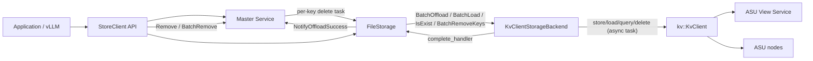

### 2.3 模块分层与依赖规则

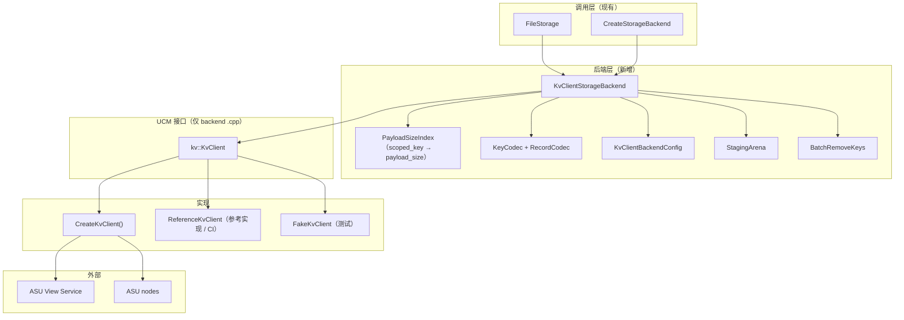

依赖规则：

- `KvClientStorageBackend` 直接依赖 `kv::KvClient`；UCM 头文件只在 `kv_client/backend.cpp`
  中包含，不进入 Mooncake 公共头。
- `FakeKvClient` / `ReferenceKvClient` 实现 `kv::KvClient`，用于测试/参考。
- `StagingArena` 持有 ASU 注册句柄；`UnregisterRegions` 只在 shutdown 时、所有 task 完成后调用。

### 2.4 线程模型与所有权

| 线程 | 入口 | 与后端的关系 |
| --- | --- | --- |
| Heartbeat 线程 | `Heartbeat()` → `BatchOffload` / `PollDeleteTasks` | 串行写、按 key 删除 |
| RPC worker | `BatchGet` → `BatchLoad` | 并发读 |
| dangling replica probe | `FileStorage::Exists` → `IsExist` | 低频并发查 |
| Master 触发的按 key 删除 | `FileStorage::BatchRemoveKeys` → `BatchRemoveKeys` | 删除本 client 拥有的盘副本 |
| 重启/重注册 | `FileStorage::Init` → `ScanMeta` | 空实现，直接返回 |
| UCM KvClient worker | `KvClientImpl::WorkerLoop` | 提交 task、等待完成；不回调 Mooncake |

锁纪律：

1. `write_mutex_`：串行化 `BatchOffload`、`BatchRemoveKeys` 和 `Init`；保护跨 key 的原子序列和
   `complete_handler` 的顺序。
2. `metadata_mutex_`：读写锁，保护 `index_`、`total_keys_`、`total_size_`；**绝不跨 ASU
   `Wait` 或 Master 回调持有**。
3. `staging_mutex_`：只保护 slot 分配/释放，不覆盖 `Wait`。
4. 加锁顺序固定为 `write_mutex_` → `metadata_mutex_`。
5. 读/查只在需要更新/读取索引时短暂持有 `metadata_mutex_`；ASU I/O 期间不持锁。
6. `complete_handler` 约定不得重入本后端。

### 2.5 对象状态机

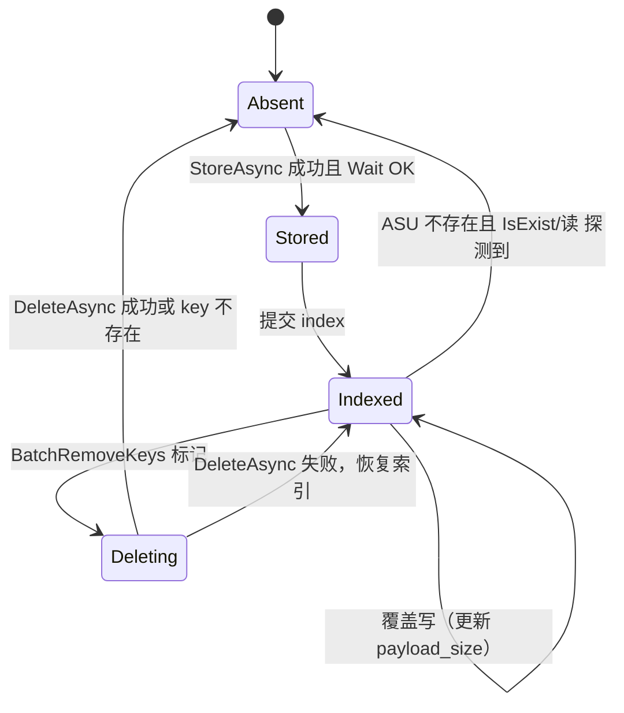

**状态机说明**

这张图描述的是 **backend 本地索引/删除簿记** 中单个 key 的生命周期。

### 2.6 副本 / 元数据 / 句柄：三层关系

这张图把 Mooncake 读路径上的三种投影画在一起，用来定位 `KvClientStorageBackend` 在链路中的确切位置：
**副本**回答"数据在哪里"，**元数据**回答"对象有哪些副本、多大、校验值是多少"，**句柄**回答"本进程怎么引用、何时释放"。
三者都不携带 payload——payload 始终在共享内存、本地盘或 ASU 上。

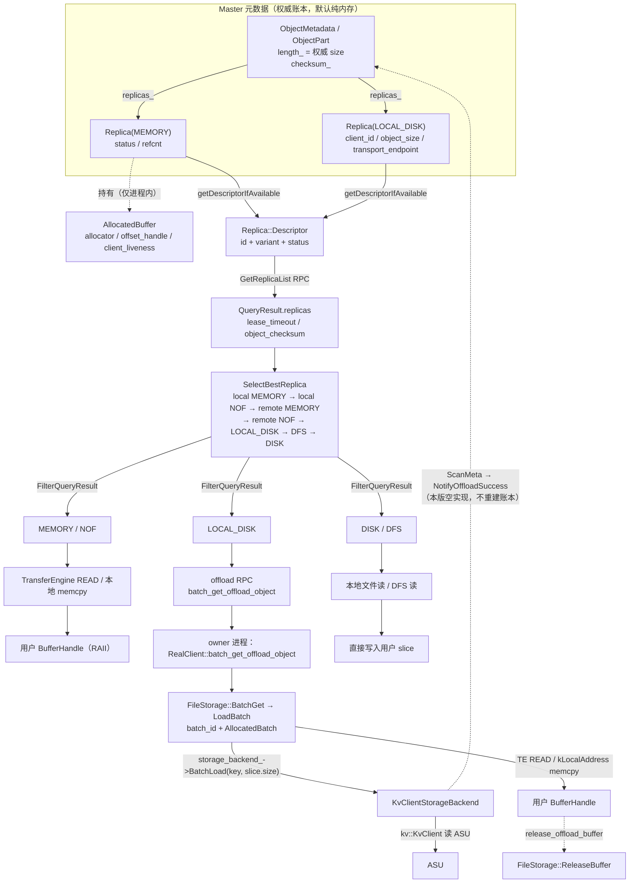

图上四条不可省略的边界：

1. **Master 从不访问客户端磁盘。** 它只保存 `Replica` 记录；`LOCAL_DISK` 分支里没有 file_path，
   只有 owner 的 `client_id` 与 `transport_endpoint`。
2. **`LOCAL_DISK` 不是"本机文件直读"。** 读方按 `transport_endpoint` 发 RPC 给 owner，由 owner 现读自己的
   本地 tier；只有当 owner 就是本进程且 pinned restore arena 可用时，才短路成
   `FileStorage::BatchGetLocal`。
3. **`KvClientStorageBackend` 只在 owner 侧的 `BatchLoad` 出现一次**（图中唯一与 ASU 相邻的节点），
   输入只有 `(scoped_key, slice.size)`，不含 value 定位之外的任何上下文。
4. **`batch_id` 是唯一跨进程有生命周期的句柄。** owner 分配，reader 用完通过 `release_offload_buffer`
   归还，否则由 `client_buffer_gc_ttl_ms` 兜底回收。

三种投影的字段对照：

| 形态 | 所在位置 | 装什么 | 明确不含 |
| --- | --- | --- | --- |
| `Replica` | Master 内存 | 定位信息 + `status` + `refcnt` | value 字节 |
| `Replica::Descriptor` | RPC / `QueryResult` | `id` + 类型化定位信息 + `status` | `refcnt`、allocator 绑定、`client_liveness` |
| `ObjectMetadata` / `ObjectPart` | Master 内存 | `length_`（权威 size）、`checksum_`、`replicas_` | value 字节 |
| `StorageObjectMetadata` | backend → FileStorage → Master | `bucket_id` / `offset` / `key_size` / `data_size` / `transport_endpoint` | key 本身（在平行数组里）、value |
| `AllocatedBuffer` / `BufferHandle` | owner / 调用方进程 | 引用 + 生命周期（RAII） | value（仅通过 `ptr()` 访问） |
| `batch_id` | owner 进程 | 一批已读入 client buffer 的数据 | — |

对本后端的直接约束：

- 图中 `BatchLoad(key, slice.size)` 是唯一读入口，所以 backend 必须能**仅凭 key 与 Master 给的 size**
  定位并校验 value。ASU 的 `QueryAsync` 只有存在性、没有长度，长度必须由 backend 自己记录
  （对应 §3.6 记录布局中的 `payload_size`）。
- `ScanMeta` 是图中唯一一条从 backend 指回 Master 的虚线：它不参与稳态读写，只在启动/重注册时把
  ASU 上已有的 key/size 重新上报。本版为空实现，等价于放弃"Master 丢元数据后重建账本"的能力。
- backend 不接触 `Replica` / `Descriptor` / `BufferHandle` 中的任何一个；它看到的只有
  `StorageObjectMetadata`（上报）和 `Slice`（读写）。

## 3. 功能分解与接口契约

### 3.1 功能分解

| 编号 | 功能 | 入口 | 优先级 | 本版边界 |
| --- | --- | --- | --- | --- |
| F1 | 初始化与注册内存 | `Init` | P0 | 初始化 `kv::KvClient`、注册 staging、二次 Init 失败 |
| F2 | 写 / offload | `BatchOffload` | P0 | 单段记录；部分成功；跳过超限 key |
| F3 | 读 / restore | `BatchLoad` | P0 | 读入 staging、校验、拷贝到 Slice；索引可选 |
| F4 | 查 / 存在性 | `IsExist` | P0 | ASU Query 位图；传输错误不误报 false |
| F5 | 删 / 按 key | `Client::Remove` / `Client::BatchRemove` → `BatchRemoveKeys` | P0 | 仅用户按 key 删除；Master 先删元数据，再通知 owner；`DeleteAsync` 逐 key；失败恢复索引 |
| F6 | 配置与工厂 | `FromEnvironment` / `CreateStorageBackend` | P0 | 环境变量、校验、工厂分支 |
| F7 | staging 内存 | `StagingArena` | P0 | 注册、slot 分配、生命周期 |
| F8 | 可观测性 | 日志 / `SsdMetric` | P1 | 复用现有指标 |
| F9 | 空实现 | `ScanMeta` / `ResetScanIterator` | P0 | 返回 OK / 空操作 |


### 3.2 `StorageBackendInterface` 契约（本版）

本版实现以下方法：

```cpp
tl::expected<void, ErrorCode> Init();
tl::expected<int64_t, ErrorCode> BatchOffload(
    const std::unordered_map<std::string, std::vector<Slice>>& batch_object,
    std::function<ErrorCode(const std::vector<std::string>& keys,
                            std::vector<StorageObjectMetadata>& metadatas)>
        complete_handler,
    EvictionHandler eviction_handler = nullptr);
tl::expected<void, ErrorCode> BatchLoad(
    std::unordered_map<std::string, Slice>& batched_slices);
tl::expected<bool, ErrorCode> IsExist(const std::string& key);
tl::expected<bool, ErrorCode> IsEnableOffloading();
tl::expected<void, ErrorCode> ScanMeta(
    const std::function<ErrorCode(
        const std::vector<std::string>& keys,
        std::vector<StorageObjectMetadata>& metadatas)>& handler);
void ResetScanIterator();
void SetTestFailurePredicate(std::function<bool(const std::string& key)>);

// 本版新增：仅支持 Client::Remove / BatchRemove 触发的按 key 删除。
virtual std::vector<tl::expected<void, ErrorCode>> BatchRemoveKeys(
    const std::vector<std::string>& scoped_keys);
```

不重写、沿用基类默认：

```cpp
void RemoveAll() {}  // 本版不支持全清
tl::expected<std::vector<std::string>, ErrorCode>
EvictAboveDiskWatermark(double, double, EvictionHandler = nullptr) {
    return std::vector<std::string>{};  // 本版不支持水位淘汰
}
```

内部辅助：

```cpp
struct RemoveOutcome {
    std::vector<std::string> removed;
    std::vector<std::string> not_found;
    std::vector<std::string> failed;
};
tl::expected<RemoveOutcome, ErrorCode> RemoveKeys(
    const std::vector<std::string>& scoped_keys);
```

关键语义：

- `BatchOffload` 的 `keys` 必须是调用方传入的 **`scoped_key`**（`tenant\0local_key`），不是 ASU key。
- `StorageObjectMetadata` 的 `data_size` 必须填 **payload 大小（不含 `RecordHeader`，40B）**。
- `BatchLoad` 的 `Slice` 由调用方按 `data_size` 预分配；后端不得改写 `slice.ptr`。
- `IsExist` 的“不存在”是 `expected(false)`；传输错误必须返回 `unexpected`。
- `ScanMeta` 本版返回 `OK` 且不调用 handler；`ResetScanIterator` 空实现。
- `BatchRemoveKeys` 只处理 **本 client 拥有的 ASU 对象**；调用前 Master 已删除元数据
  （master-first）；`NOT_FOUND` 视为成功；失败 key 返回错误并恢复索引。
- `BatchRemoveKeys` 的输入是 `scoped_key`；只有 owner 知道自己的 `key_namespace`，因此不能由任意
  client 直接算 ASU key。
- `RemoveAll`/`EvictAboveDiskWatermark` 本版不支持，继承基类空实现；`RemoveByRegex` 不支持。
- `RemoveKeys` 逐 entry 处理：`NOT_FOUND` 视为成功；失败 key 恢复索引并保留重试。

**本版 `Init` / `IsEnableOffloading` 的实现契约**：

`initialized_` 使用三态 `std::atomic<InitState>`（`kUninit` / `kInitializing` / `kReady`），
而不是 `bool`：只有 `kReady` 才允许对外服务，`kInitializing` 期间并发进入的调用一律失败，
不会把半初始化的实例当成可用。

```cpp
enum class InitState { kUninit, kInitializing, kReady };

tl::expected<void, ErrorCode> KvClientStorageBackend::Init() {
    InitState expected = InitState::kUninit;
    if (!initialized_.compare_exchange_strong(expected, InitState::kInitializing)) {
        return tl::make_unexpected(ErrorCode::INTERNAL_ERROR);  // 已初始化 / 并发 Init
    }
    if (!config_.Validate()) {
        initialized_.store(InitState::kUninit);
        return tl::make_unexpected(ErrorCode::INVALID_PARAMS);
    }

    client_ = kv::CreateKvClient();
    auto init_status = client_->Init(config_.ucm_config_path);
    if (!init_status.ok()) {
        client_->Shutdown();
        client_.reset();
        initialized_.store(InitState::kUninit);
        return tl::make_unexpected(MapStatus(init_status.code));
    }

    auto staging_result = staging_.Init(config_.staging_bytes, slot_size);
    if (!staging_result) {
        staging_.Shutdown();
        client_->Shutdown();
        client_.reset();
        initialized_.store(InitState::kUninit);
        return staging_result;
    }

    total_keys_ = 0;
    total_size_ = 0;
    index_.clear();
    initialized_.store(InitState::kReady, std::memory_order_release);
    return {};
}

tl::expected<bool, ErrorCode> KvClientStorageBackend::IsEnableOffloading() {
    if (initialized_.load(std::memory_order_acquire) != InitState::kReady) {
        return tl::make_unexpected(ErrorCode::INTERNAL_ERROR);
    }
    return total_keys_.load(std::memory_order_relaxed) <
               file_storage_config_.total_keys_limit &&
           total_size_.load(std::memory_order_relaxed) <
               file_storage_config_.total_size_limit;
}
```

要点：

- `Init` **不打开设备、不建 backend 线程池**；ASU 连接、view 路由、task worker、transport
  线程由 `kv::KvClient` 内部管理。backend 只初始化 staging slot 池。
- `Init` 任一步失败都要 `Shutdown` client、`reset` 指针、把 `initialized_` 回滚为 `kUninit`，
  允许部署侧重试；不能留下半初始化状态。只有全部步骤成功才置 `kReady`。
- `IsEnableOffloading` **不查 ASU 容量、不发 RPC**；只读本进程计数和配置硬上限。
- `IsEnableOffloading` 在 `FileStorage::Init` 调一次，也在 `BatchOffload` 每批调用；返回 false
  时 `BatchOffload` 跳过本批并返回 `expected(0)`，不返回 `KEYS_ULTRA_LIMIT`。
- 计数只统计本进程写入，重启后为 0；它是“本地硬上限”判断，不代表 ASU 实际容量。瞬时容量
  不足由 `BatchOffload` 的逐 key `RESOURCE_BUSY`/`OUT_OF_CREATE_SIZE` 处理。

### 3.3 直接使用 `kv::KvClient`

`KvClientStorageBackend` 直接调用 `kv::KvClient`，不再定义 Mooncake 自有的端口类型。
使用的 API：

| 用途 | `kv::KvClient` API / 类型 |
| --- | --- |
| 创建 | `std::unique_ptr<KvClient> CreateKvClient()` |
| 初始化 | `Status Init(const KvClientConfig&)` / `Status Init(const std::string& configPath)` |
| 注册内存 | `Status RegisterRegions(const std::vector<MemoryRegion>&, std::vector<RegisteredMemory>&)` |
| 注销内存 | `Status UnregisterRegions(const std::vector<MRHandle>&)` |
| 写 | `Status BatchStoreAsync(const std::vector<KVBuffer>&, TaskId&)` / `StoreAsync` |
| 读 | `Status BatchLoadAsync(const std::vector<KVBuffer>&, TaskId&)` / `LoadAsync` |
| 查 | `Status QueryAsync(const std::vector<CacheKey>&, TaskId&)` |
| 删 | `Status DeleteAsync(const std::vector<CacheKey>&, TaskId&)` |
| 等待 | `bool Check(TaskId)` / `Status Wait(TaskId, uint64_t timeoutMs, TaskResult&)` |
| 关停 | `Status Shutdown()` |
| key | `kv::CacheKey = std::array<std::byte, 8>` |
| 值 | `KVBuffer{key, Buffer{MemoryRegion, MRHandle}, offset, std::optional<uint32_t> mrKey}` |
| 结果 | `TaskResult{Status status, vector<Status> entryStatus, optional<QueryResult> queryResult}` |

约束：

- `KVBuffer.region.size` 是本次传输长度，`region.size` 和 `offset` 都必须 512B 对齐。
- `QueryResult.exists` 是存在性位图，没有长度。
- `TaskResult.status` 是聚合状态；必须逐 `entryStatus` 判断成功/失败。
- `kv::Status` / `StatusCode` 在 backend 内映射为 Mooncake `ErrorCode`，不向外透传。
- `KvClient` 是纯虚接口；测试用 `FakeKvClient : public kv::KvClient` 注入，不需要生产 .so。
- UCM 头文件只在 `kv_client/backend.cpp` 中包含；backend 头文件只前置声明
  `namespace kv { class KvClient; }`。

### 3.4 错误码映射

| `kv::StatusCode`（旧分支 `UC::ASU::StatusCode`）/ 本地条件 | Mooncake `ErrorCode` | 说明 |
| --- | --- | --- |
| `NOT_FOUND`, `ENTRY_KEY_NOT_FOUND`, `ENTRY_DATA_NOT_EXIST`, `CQE_KEY_NOT_EXIST` | `OBJECT_NOT_FOUND` | 读时返回；查时 `false` |
| `INVALID_ARGUMENT` | `INVALID_PARAMS` | |
| `NOT_INITIALIZED` | `INTERNAL_ERROR` | |
| `TIMEOUT`, `CQE_IO_TIMEOUT` | `RPC_TIMEOUT` | 不无限重试 |
| `PARTIAL_FAILED` | 首个 entry 错误 | 部分成功继续 |
| `CONNECTION_ERROR` | `UNAVAILABLE_IN_CURRENT_STATUS` | |
| `IO_ERROR`, `CQE_WRITE_FAULT` | `FILE_WRITE_FAIL` | |
| `CQE_UNRECOVERED_READ_ERROR` | `FILE_READ_FAIL` | |
| `BUFFER_NOT_REGISTERED`, `BUFFER_NOT_SUPPORTED` | `INVALID_PARAMS` | staging 生命周期错误 |
| `RESOURCE_BUSY`, `IN_PROGRESS` | `UNAVAILABLE_IN_CURRENT_STATUS` | 可重试 |
| `CQE_OUT_OF_CREATE_SIZE`, `CQE_RESOURCE_BUSY` | `UNAVAILABLE_IN_CURRENT_STATUS` | ASU 容量/资源不足；本批跳过 |
| `UNSUPPORTED` | `NOT_SUPPORTED` | |
| `CANCELED` | `INTERNAL_ERROR` | |
| `ENTRY_RETRY_ADVISED` | 重试一次；仍失败按对应错误 | |
| `ENTRY_NO_RETRY_ADVISED` | `INTERNAL_ERROR` | |
| `ENTRY_KEY_EXIST`, `CQE_KEY_ALREADY_EXISTED` | 视为成功（upsert） | 本版不依赖条件写 |
| `ENTRY_DELETE_FAILED` | `FILE_WRITE_FAIL` | 删除失败；恢复索引 |
| `RecordHeader` magic/version/length/fingerprint 不符 | `INVALID_READ` | 内容损坏或 key 碰撞 |
| 记录 CRC-32C 不符 | `CHECKSUM_MISMATCH` | 撕裂/位翻转 |
| 本地 `ptr == nullptr` / `size == 0` | `INVALID_PARAMS` | 读 |

### 3.5 语义规约

| 属性 | 规约 |
| --- | --- |
| 写原子性 | 单 key 一个 ASU task 条目；ASU 负责该条目的可见性 |
| 写幂等 | 同 key 同 payload 重复 Store 字节确定；Store 是 upsert |
| 批量原子性 | 无事务；`PARTIAL_FAILED`/逐 entry 失败是正常结果 |
| 读一致性 | 返回最近一次成功 Store 的完整 value；CRC 检测撕裂 |
| 读的输入 | key + `slice.size` 由 Master 提供；索引缺失时以 `slice.size` 为准 |
| 查语义 | 以 ASU `QueryResult.exists` 为准；索引不参与 |
| 长度来源 | Master metadata（读）、写路径计算（写）；ASU 不提供长度 |
| 可见性 | `complete_handler` 成功之前，Master 不知道该副本 |
| 容量计数 | `total_size_` 计 `align_up(40 + payload, 512)`；仅统计本进程写入，重启后从 0 开始 |
| 删除 | master-first（Master 先删元数据）；`BatchRemoveKeys` 逐 key `DeleteAsync`；`NOT_FOUND` 视为成功；失败恢复索引 |
| RemoveAll | 本版不支持；继承空实现；`Client::RemoveAll` 不会物理删除 ASU |
| 恢复 | 本版不恢复；`ScanMeta` 返回 OK 空扫描 |
| 二次 Init | 返回 `INTERNAL_ERROR` |

### 3.6 Key 与记录布局

**`asu_key`（`kv::CacheKey`）**

```text
asu_key = XXH64("mooncake/kvclient/v1" + key_namespace + 0x00 + scoped_key, seed=0)
```

- `asu_key` 是 `kv::CacheKey`（8 字节），按小端写入。
- `key_namespace` 由配置必填；它参与哈希，不同命名空间的同一 `scoped_key` 得到不同 `asu_key`。
  它只是 ASU 侧的逻辑命名空间，与 Master 的 `TenantId` 无关（见 §3.7）。
- 64-bit 碰撞概率约 `N^2 / 2^65`；1 亿对象约 `5e-4`。`RecordHeader` 存 128-bit fingerprint 检测碰撞。

**记录布局（`RecordHeader` + payload）**

```text
0   u32 magic          0x4B564331 ("KVC1")
4   u16 version        1
6   u16 flags          bit0 chunked（本版必须 0）; bit1 has_payload_crc
8   u64 fingerprint_lo XXH64(scoped_key, seed=1)
16  u64 fingerprint_hi XXH64(scoped_key, seed=2)
24  u32 payload_size   单 payload <= UINT32_MAX
28  u32 reserved       0
32  u32 payload_crc32c
36  u32 header_crc32c  对 [0,36) 计算，本字段按 0 参与
40  ... payload        各 Slice 按序拼接，无补齐
```

- `record_size = 40 + payload_size`；`transfer_size = align_up(record_size, 512)`。
- `KVBuffer`：`key = asu_key`、`offset = 0`、`region.size = transfer_size`、`handle = slot.handle`。
- 上报 Master 的 `data_size = payload_size`。
- 读校验顺序：`transfer_size >= 40` → magic → version → flags → `payload_size` 在
  `transfer_size - 40` 以内 → `RecordHeader` CRC → fingerprint → payload CRC。
- 单对象上限：`min(config.max_payload_bytes, ASU 单 payload 上限) - 40`，再受 staging slot 大小约束；
  超限 key 在写路径跳过并记录。

**CRC-32C 的定位**：`mooncake-store/include/crc32c.h` 是 Mooncake 自己的 CRC-32C 实现；
它是标准算法，但不是 ASU 或 Mooncake 的全局强制格式。`NvmeKvStorageBackend` 使用
XXH32 + 32 字节 `verify_hash`，与本后端的 key/记录格式不互通。ASU 公共 `KvClient` 没有
per-value checksum；transport 校验不覆盖 at-rest 数据。因此本后端读到的每条 value（一条 `Record`）
都必须按 `KVC1` 记录格式校验。

**是否必须**：

| 校验 | 本版 | 理由 |
| --- | --- | --- |
| `RecordHeader` CRC-32C（40B） | **必须** | 只覆盖 36B，成本极低；保护 `payload_size`/flags/fingerprint，防止按错误长度拷贝 |
| 128-bit fingerprint | **必须** | ASU key 只有 64 bit；没有它无法区分碰撞/串写 |
| payload CRC-32C | **本版固定开启** | ASU 不提供 per-value checksum；撕裂/位翻转只能靠它发现。后续性能评估可加 `enable_payload_crc`，但 KV cache 场景不建议关闭 |
| 替代算法 | 不采用 | XXH32/XXH3 更快，但哈希不是纠错码；对 burst error 的检测弱于 CRC-32C |

**写批次（`PreparedOffloadBatch`）**

`PrepareBatch` 的返回值：一批已通过预检查、记录已编码进 staging slot 的 key 集合。

```cpp
struct PreparedOffloadBatch {
    struct PreparedEntry {
        std::string scoped_key;  // tenant\0local_key，用于索引与 complete_handler
        kv::CacheKey asu_key;    // 8B ASU key（哈希后）
        uint64_t fingerprint_lo; // 128-bit fingerprint，写入 RecordHeader
        uint64_t fingerprint_hi;
        uint32_t payload_size;   // 不含 RecordHeader（40B）
        uint32_t transfer_size;  // align_up(40 + payload_size, 512)
        StagingSlot slot;        // 已注册内存；生命周期覆盖到 Wait 完成
    };
    std::vector<PreparedEntry> entries;  // 通过预检查、可提交 ASU 的 key
    std::vector<std::string> skipped;    // 超限/超配额/编码失败，仅用于日志与计数
};
```

- `entries` 与 `skipped` 互斥且不重不漏：每个输入 `scoped_key` 恰好落在一侧。
- `slot` 在 `Wait` 返回且 entry 状态消费后才 `Release`；`PreparedOffloadBatch` 析构不释放 slot。

**与 NVMeKV 是否互斥**：

- **同一 FileStorage / client 进程内互斥**：`FileStorageConfig.storage_backend_type` 是单值，
  `FileStorage` 只持有一个 `StorageBackendInterface`；`CreateStorageBackend` 按枚举选一个。
  NVMeKV 和 KVClient 可以同时编译进二进制，但运行时只实例化一个。
- **数据格式互斥**：NVMeKV 是 16B 物理 key + `NvmeKvObjectHeader`；KVClient 是 8B ASU key +
  `KVC1`。两者不能互读同一份数据，不能指向同一个 ASU namespace/设备。
- **集群层面**：Master 只看到 `LOCAL_DISK` replica，不关心后端类型；理论上不同 client 可以用
  不同后端，但删除/恢复/容量语义不同，运维复杂。建议同一个 pool 使用同一种后端。
- **迁移**：换后端必须 drain 旧后端并重新 offload，不能双读；不存在“NVMeKV 和 KVClient 同时
  服务同一 key”的模式。

### 3.7 配置契约

```cpp
enum class KvClientImplType { kUcm, kReference };  // 选哪个 kv::KvClient 实现
std::ostream& operator<<(std::ostream& os, KvClientImplType impl);  // 日志输出 "ucm"/"reference"

struct KvClientBackendConfig {
    KvClientImplType client_impl = KvClientImplType::kUcm;
    std::string ucm_config_path;      // UCM 的 view/transport 配置文件（不是 Mooncake 配置）
    std::string client_id;            // KvClientConfig.clientId
    std::string key_namespace;        // 必填，参与 ASU key 哈希；与 TenantId 无关
    int64_t staging_bytes = 128 * 1024 * 1024;
    size_t batch_size = 32;
    int64_t max_payload_bytes = 16 * 1024 * 1024;
    uint64_t wait_timeout_ms = 5000;
    uint64_t query_timeout_ms = 500;

    static KvClientBackendConfig FromEnvironment();
    bool Validate() const;
};
```

- `client_impl` 是枚举而不是字符串：`kUcm`（生产）/ `kReference`（参考实现，仅 CI/单测）。
  枚举名加 `Type` 后缀是为了避开 UCM 自己的实现类 `kv::KvClientImpl`；`operator<<` 让日志直接输出
  `ucm` / `reference`，与 `BucketEvictionPolicy`、`OffsetPersistMode` 的做法一致。生产部署出现
  `kReference` 视为配置错误（与 FM-CFG-02 一致）。
- `ucm_config_path` 是 UCM 的 view/transport 配置文件路径，不是 Mooncake 自己的配置文件。
- `key_namespace` 只用于 ASU key 哈希的域隔离；它**不是** Master 的 `TenantId`：租户隔离由
  `scoped_key` 的 `tenant\0local_key` 前缀表达，不参与 ASU key 计算。
- `max_payload_bytes` 是 payload 大小（不含 `RecordHeader`，40B），与上报 Master 的 `data_size` 同义。
- 字节配置沿用仓库的 `int64_t`（`bucket_size_limit`、`total_size_limit`）；两个超时用 `uint64_t`，
  因为 UCM `Wait` 接收 `uint64_t`。`Validate()` 检查 `staging_bytes`、`batch_size`、
  `max_payload_bytes`、`wait_timeout_ms`、`query_timeout_ms` 均 `> 0`，并检查 `key_namespace` 非空。

环境变量（沿用现有 offload 配置的 `MOONCAKE_OFFLOAD_*` 前缀）：

| 变量 | 字段 |
| --- | --- |
| `MOONCAKE_OFFLOAD_KV_CLIENT_IMPL` | `client_impl`（`ucm` / `reference`） |
| `MOONCAKE_OFFLOAD_KV_CLIENT_UCM_CONFIG_PATH` | `ucm_config_path` |
| `MOONCAKE_OFFLOAD_KV_CLIENT_ID` | `client_id` |
| `MOONCAKE_OFFLOAD_KV_CLIENT_KEY_NAMESPACE` | `key_namespace` |
| `MOONCAKE_OFFLOAD_KV_CLIENT_STAGING_BYTES` | `staging_bytes` |
| `MOONCAKE_OFFLOAD_KV_CLIENT_BATCH_SIZE` | `batch_size` |
| `MOONCAKE_OFFLOAD_KV_CLIENT_MAX_PAYLOAD_BYTES` | `max_payload_bytes` |
| `MOONCAKE_OFFLOAD_KV_CLIENT_WAIT_TIMEOUT_MS` | `wait_timeout_ms` |
| `MOONCAKE_OFFLOAD_KV_CLIENT_QUERY_TIMEOUT_MS` | `query_timeout_ms` |

**`FileStorageConfig` 的 descriptor 与 `Validate()` 配套修改**：

- 新增 descriptor 字符串 `kv_client_storage_backend`（与 `file_per_key_storage_backend`、
  `nvme_kv_storage_backend` 同风格），在 `file_storage_config.cpp` 的解析分支里映射到
  `StorageBackendType::kKvClient`。
- `kFilePerKey` / `kBucket` / `kOffsetAllocator` / `kDistributed`：保持现有本地路径校验。
- `kKvClient`：跳过 `ValidatePath`；改为校验 `KvClientBackendConfig::Validate()` 的字段
  （`key_namespace`、`staging_bytes`、`batch_size`、`max_payload_bytes`、两个超时等）。
- `total_keys_limit > 0` 与 `total_size_limit != 0` 仍要求。

### 3.8 能力与限制矩阵（本版）

| 能力/限制 | 本版处理 |
| --- | --- |
| key 8 字节 | 哈希映射 + 128-bit fingerprint 检测碰撞 |
| 无长度查询 | 写时计算；读时用 Master 的 `slice.size` |
| 无枚举 | `ScanMeta` 返回 OK 空扫描；不做恢复 |
| 512B 对齐 | `transfer_size = align_up(record_size, 512)`；`offset=0` |
| 注册内存 | staging arena；读写都经过 staging |
| 单 payload 上限 | `min(config.max_payload_bytes, ASU 上限) - 40` |
| 批量 key 上限 | `min(config.batch_size, ASU 上限)` |
| 异步 task | 每批提交后 `Wait`；超时 `RPC_TIMEOUT` |
| ASU 自身 GC | 无法观测；查/读遇到 `NOT_FOUND` 按缺失处理 |
| 删除 | 仅 `Client::Remove`/`BatchRemove` 触发的按 key 删除；无 `RemoveAll`/正则/水位淘汰 |

## 4. 功能实现设计

### 4.1 公共类图

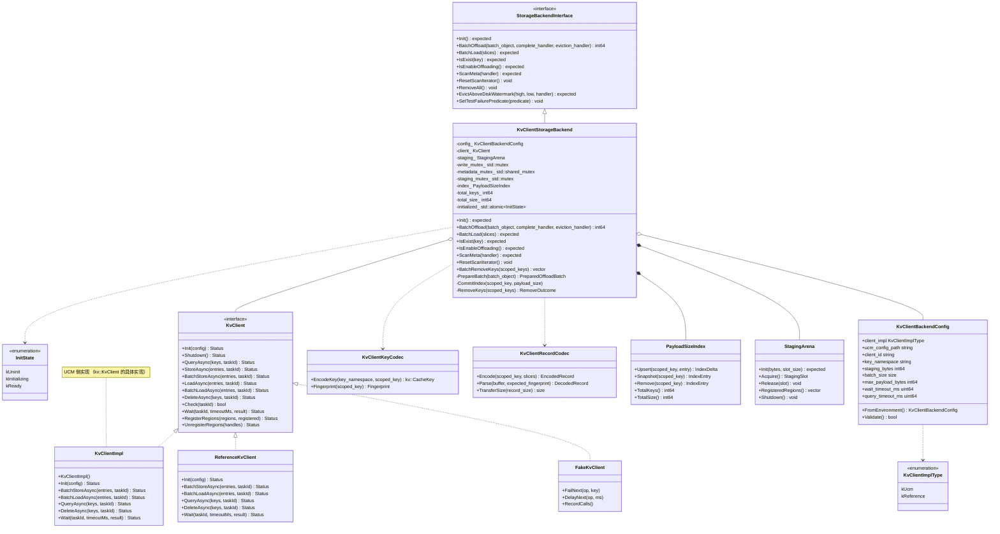

### 4.2 写：`BatchOffload`

#### 4.2.1 写操作类图

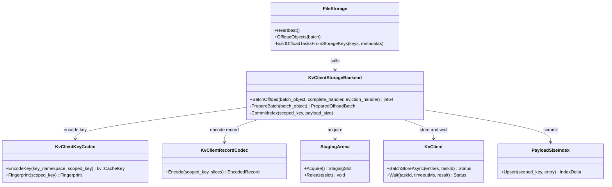

#### 4.2.2 写时序图

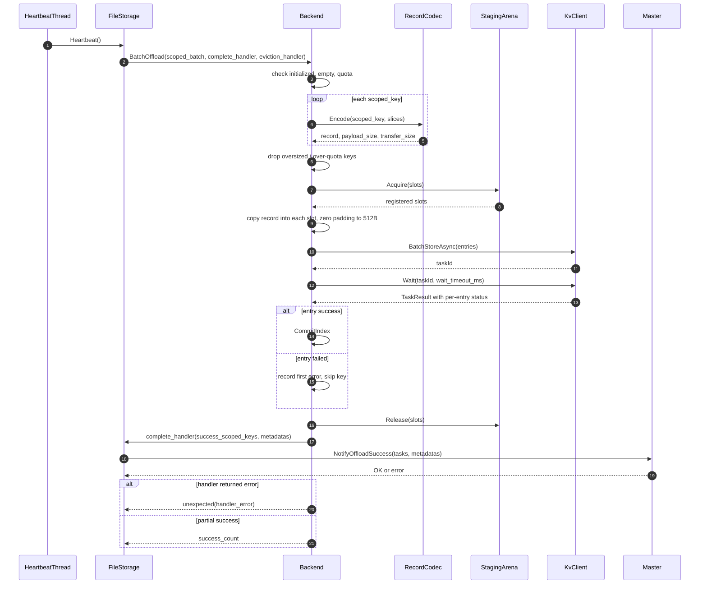

#### 4.2.3 实现步骤

触发时机不在后端：默认 `offload_on_evict=false`，Master 在 `PutEnd` 后就把对象放进 owner 的
offload 队列，下一次心跳调用本方法；`offload_on_evict=true` 时同一方法在淘汰时刻被调用。

1. `initialized_ != kReady`（未初始化或初始化中）→ `INTERNAL_ERROR`。
2. `batch_object` 为空 → `INVALID_KEY`。
3. `IsEnableOffloading()` 为假 → 本批全部跳过，返回 `expected(0)`；不返回
   `KEYS_ULTRA_LIMIT`。
4. 逐 key 预处理：
   - `scoped_key` 为空 → 跳过并记录 `INVALID_KEY`。
   - 计算 `asu_key`（`kv::CacheKey`，8B）和 128-bit fingerprint；payload 超
     `effective_max_payload_bytes - 40`、超 `UINT32_MAX`、或 `transfer_size` 超过 staging slot
     → 跳过并记录 `INVALID_PARAMS`。
   - 拼接 Slice 为连续 payload；生成 `RecordHeader`（40B）；尾部补零到 `transfer_size`。
   - 若 `total_size_ + transfer_size > total_size_limit` 或
     `total_keys_ >= total_keys_limit`，跳过该 key；本版不做淘汰来腾空间。
5. 从 `StagingArena` 分配 slot；把记录拷入 slot 的已注册内存。
6. 按 `min(config.batch_size, ASU 上限)` 切块：
   - 多 key 用 `BatchStoreAsync`，单 key 用 `StoreAsync`。
   - 每块提交后 `Wait(task_id, wait_timeout_ms, result)`。
   - 逐 entry 检查 `entryStatus`；聚合 `PARTIAL_FAILED` 不当作整批失败。
7. 对每个成功 entry，在 `metadata_mutex_` 独占锁内提交索引：
   - `old = index_[scoped_key]`；`total_size_ += transfer_size - old.transfer_size`；
     `total_keys_ += (old 存在 ? 0 : 1)`。
8. 只把成功 key 上报：

   ```cpp
   StorageObjectMetadata{
       .bucket_id = -1,
       .offset = 0,
       .key_size = static_cast<int64_t>(scoped_key.size()),
       .data_size = static_cast<int64_t>(payload_size),  // 不含 RecordHeader（40B）
       .transport_endpoint = "",
   }
   ```

9. `complete_handler` 返回非 OK → 原样返回该错误；已写入的数据不回滚。
10. 返回成功上报的 key 数量；若 0 个成功，仍返回 `expected(0)`。

失败处理：

- 单个 entry 的 ASU 错误：跳过，保留首错用于日志；不影响其他 entry。
- `Wait` 超时：记录 `RPC_TIMEOUT`，不通知 Master；ASU 侧可能稍后完成，形成一个未被 Master
  登记的孤儿对象。重试 Put 会覆盖它。
- `StagingArena` 分配失败/耗尽：本批剩余 key 跳过，返回已成功数量；不长期阻塞心跳。
- 超限 key 会被反复选中：进程内维护有界“跳过集合”，避免重复编码和日志。
- `BatchOffload` 本身不删除 key；删除由 `Client::Remove`/`BatchRemove` 经 Master→owner 触发
  （§4.5）。

### 4.3 读：`BatchLoad`

读路径在 Mooncake 侧的完整分层（副本 / 元数据 / 句柄、owner 侧 offload RPC 与 client buffer）见 §2.6；
本节只展开图中 `KvClientStorageBackend` 这一个节点。

#### 4.3.1 读操作类图

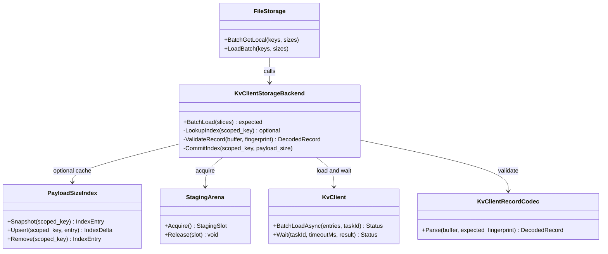

#### 4.3.2 读时序图

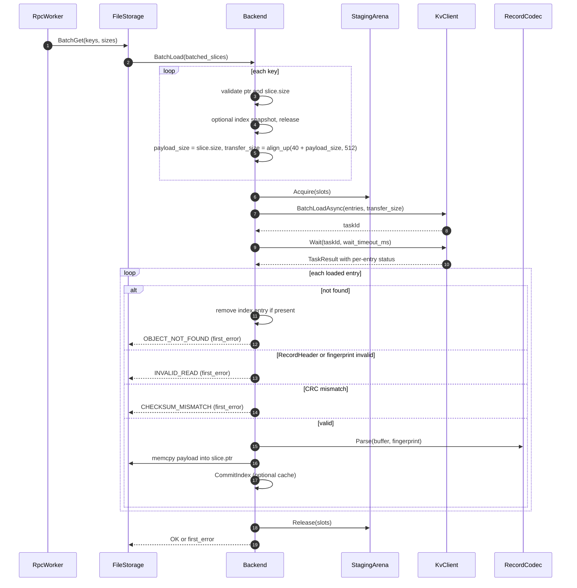

#### 4.3.3 实现步骤

1. 空 map → `OK`。
2. 对每个输入 key：
   - `slice.ptr == nullptr` 或 `slice.size == 0` → `INVALID_PARAMS`。
   - **`payload_size = slice.size`**（Master 提供的权威长度）；`transfer_size =
     align_up(40 + payload_size, 512)`；超过 staging slot → `INVALID_PARAMS`。
   - 索引是可选缓存：命中时可用于日志/统计；**不要求命中**。
3. 分配 staging slot，构造 `KVBuffer{key, offset=0, region.size=transfer_size, handle}`。
4. 按 `batch_size` 切块，`BatchLoadAsync` + `Wait`；逐 entry 检查状态。
5. 逐结果校验：
   - `NOT_FOUND`：从索引删除（若存在），记 `OBJECT_NOT_FOUND`。
   - `TIMEOUT`/`CONNECTION_ERROR`/`IO_ERROR`：映射后记首错。
   - `transfer_size < 40`：`INVALID_READ`。
   - magic/version/flags 不符：`INVALID_READ`。
   - `payload_size` 超出 buffer 或与 `slice.size` 不一致：`INVALID_PARAMS`。
   - `RecordHeader` CRC 不符：`INVALID_READ`。
   - fingerprint 不符：`INVALID_READ`（key 碰撞或串写）。
   - payload CRC 不符：`CHECKSUM_MISMATCH`。
   - 全部通过：`memcpy(slot + 40, slice.ptr, payload_size)`，并按 `payload_size` 更新索引。
6. 释放 slot；返回 `OK` 或首个错误；已经写入的 slice 不回滚。**不改写 `slice.ptr`**。

**为什么需要两层 CRC 和 fingerprint**：

- 头 CRC-32C 保护“怎么读”：magic/version/flags/payload_size 决定拷贝长度和记录类型。
- payload CRC-32C 保护“读到的内容”：检测撕裂、位翻转、写入中断。
- fingerprint 不是校验和，而是身份校验：ASU key 只有 64 bit，两个 `scoped_key` 可能碰撞。
- CRC-32C 只检测偶然损坏，不防恶意篡改；512B padding 不参与 payload CRC。

### 4.4 查：`IsExist`

#### 4.4.1 查询类图

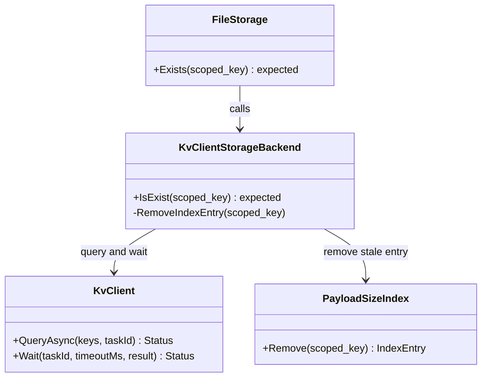

#### 4.4.2 查询时序图

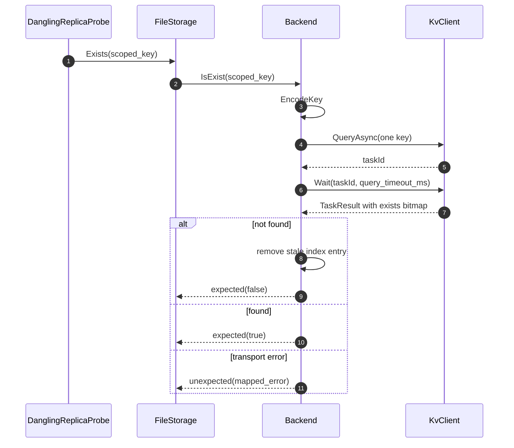

#### 4.4.3 实现步骤

1. 未初始化 → `INTERNAL_ERROR`。
2. 编码 8 字节 ASU key。
3. `QueryAsync({key})` + `Wait(query_timeout_ms)`：
   - `exists[0] == 0` → 删除索引条目（若存在）→ `expected(false)`。
   - `exists[0] != 0` → `expected(true)`。
4. 传输/超时/IO 错误 → `unexpected(mapped)`，**绝不能**返回 `false`。
5. 本版不做懒修复：Query 只返回存在性，没有长度；读路径以 Master 的 `slice.size` 为准。

### 4.5 删：仅支持 `Client::Remove` / `Client::BatchRemove`

本版删除只支持两种用户操作：

- `Client::Remove(key, force)`：删除单个对象。
- `Client::BatchRemove(keys, force)`：批量删除对象。

**不支持**：`Client::RemoveByRegex`、`Client::RemoveAll`、`EvictAboveDiskWatermark`、按 tenant/
前缀删除。接口里的 `RemoveAll`/`EvictAboveDiskWatermark` 不重写，沿用基类空实现。

#### 4.5.1 删除类图

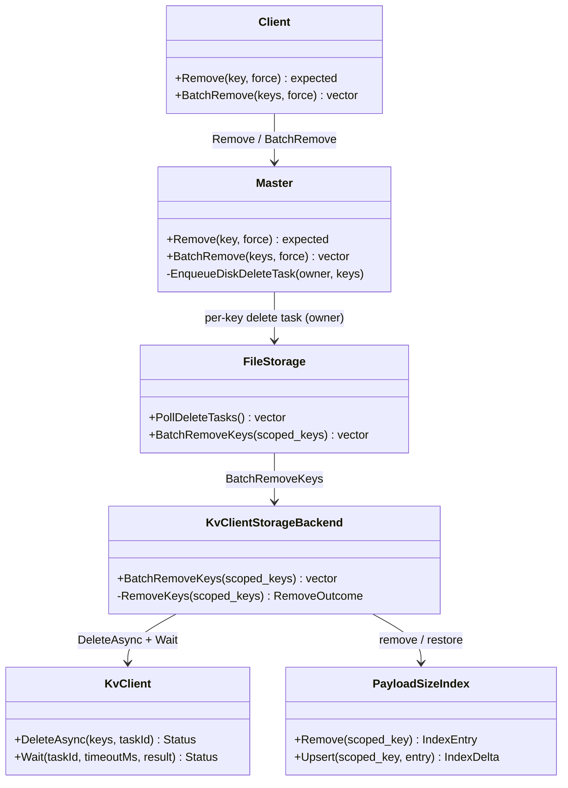

#### 4.5.2 删除时序图

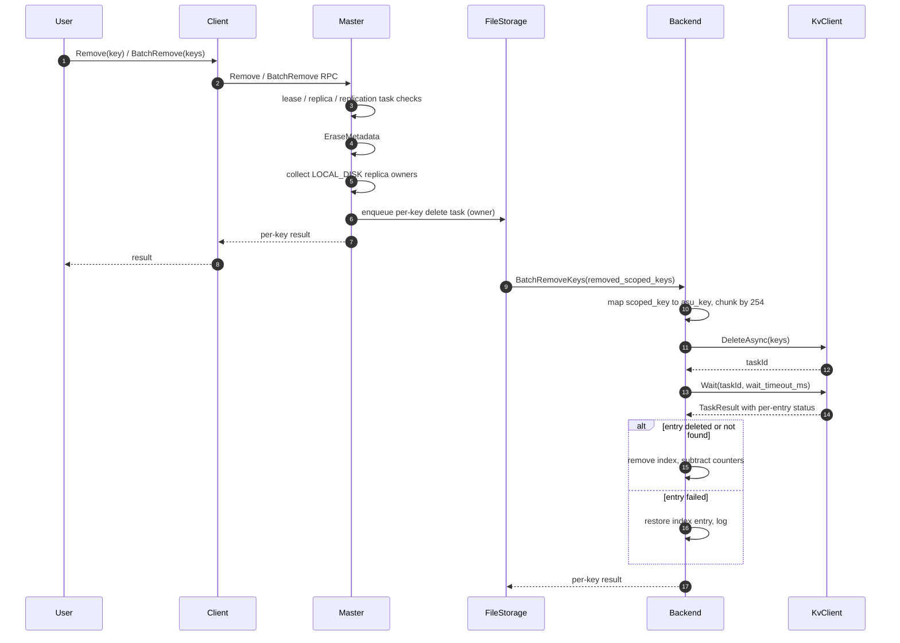

#### 4.5.3 实现步骤

1. **Master 侧（元数据先删）**：
   - `Client::Remove`/`BatchRemove` 仍先走 Master RPC；Master 的 lease/副本完整性/复制任务检查
     不变。
   - `EraseMetadata` 成功后，Master 收集该对象 `LOCAL_DISK` 副本的 owner client。
   - 对每个成功删除的 key，向 owner 的本地 SSD 任务邮箱投递一条 **按 key 删除任务**。
2. **owner 侧（物理删除）**：
   - owner 心跳 `PollDeleteTasks` 取出任务，调用 `FileStorage::BatchRemoveKeys`。
   - `FileStorage` 透传给 `StorageBackendInterface::BatchRemoveKeys`。
   - 只删除本 client 命名空间下、自己拥有的 key；不处理其他 client 的 namespace。
3. **backend 侧**：
   - `BatchRemoveKeys` 输入 `scoped_key` 列表；为空返回空结果。
   - 每个 `scoped_key` 映射为 `asu_key`（`kv::CacheKey`）；按 `min(254, deleteKeys)` 切块。
   - 每块 `DeleteAsync` + `Wait`；逐 entry 检查 `entryStatus`。
   - 成功或 `NOT_FOUND`/`KEY_NOT_EXIST`：从索引删除，`total_keys_--`、
     `total_size_ -= transfer_size`。
   - 失败：保留/恢复索引，记录 `first_error`；返回该 key 的错误。
4. **返回**：`BatchRemoveKeys` 返回与输入等长的 `vector<expected<void, ErrorCode>>`；
   `Client::BatchRemove` 的逐 key 结果可直接使用；`Client::Remove` 取单元素。
5. **失败处理**：Master 元数据已删，物理删除失败只记日志；本版没有持久化重试队列，失败对象会
   残留到后续覆盖写或带外清理。这是本版的明确限制。
6. **幂等**：ASU fake provider 把删除不存在的 key 视为成功；真实 ASU 可能返回
   `CQE_KEY_NOT_EXIST(0x10701)`，backend 统一归一为成功。

#### 4.5.4 接线与 owner 路由（必须）

`Client::Remove` 的调用方不一定是 ASU 数据的 owner；而且 ASU key 包含 per-client
`key_namespace`，其他 client 无法算出同一个 key。因此不能只在 `KvClientStorageBackend` 内部删，
必须补三段接线：

| 位置 | 改动 |
| --- | --- |
| `StorageBackendInterface` | 新增 `BatchRemoveKeys(scoped_keys)`，默认逐 key 返回 `NOT_SUPPORTED` |
| `FileStorage` | 新增 `BatchRemoveKeys`，透传给 backend；提供 `PollDeleteTasks` |
| `local_ssd` manager / Master | 现有 `PollRemoveAll` 只有布尔位；新增按 key 的删除任务邮箱/队列 |
| `Master::Remove` / `BatchRemove` | 元数据删除成功后，收集 `LOCAL_DISK` owner 并投递按 key 删除任务 |
| `Client::Remove` / `BatchRemove` | 仍只发 Master RPC；不直接调用本地 backend |

如果不做 owner 路由，只有“调用方恰好是 owner 且 `key_namespace` 已知”时才能本地删；
多客户端/共享 ASU 场景会漏删或删错 namespace。

#### 4.5.5 Mooncake 删除形式与本后端支持矩阵

##### Mooncake 的删除形式（背景）

| 形式 | 触发方 | 物理删除 | 到 StorageBackend | 说明 |
| --- | --- | --- | --- | --- |
| `Client::Remove(key, force)` | 用户 | 否 | 否 | 只删 Master 元数据和 hot cache；`storage_backend_->RemoveFile(key)` 已被注释 |
| `Client::BatchRemove(keys, force)` | 用户 | 否 | 否 | 逐 key `EraseMetadata` |
| `Client::RemoveByRegex(pattern, force)` | 用户 | 否 | 否 | Master 扫 shard 删元数据；客户端物理 `RemoveByRegex` 已注释 |
| `Client::RemoveAll(force)` | 用户/Master 广播 | 是（视后端） | 是：`RemoveAll()` | Master 置 `PollRemoveAll`，client 心跳调 `FileStorage::RemoveAll` |
| `RemoveAll(force, tenant_id)` | RPC/HTTP | 部分 | 是：`RemoveAll()` | Master 只广播该租户 owner；client 侧仍是租户无关全局清空（已知限制） |
| `EvictDiskReplica` / `BatchEvictDiskReplica` | Master/owner | 否 | 否（只作 handler） | 只删 Master 副本元数据；是淘汰的 master-first 通知 |
| `EvictAboveDiskWatermark` | 心跳 | 是（视后端） | 是 | file/bucket 实现；其他后端默认返回空 |

其中只有 `RemoveAll`（全清广播）和 `EvictAboveDiskWatermark` 会在现有后端里触发物理删除；
`Client::Remove`/`BatchRemove`/`RemoveByRegex` 只删 Master 元数据（物理调用已注释）。本版若要
支持用户按 key 删除，必须新增 `BatchRemoveKeys` 并补 Master→owner 路由（见 §4.5.4）。

##### 本后端的支持矩阵

| Mooncake 形式 | 本后端 | 说明 |
| --- | --- | --- |
| `Client::Remove(key, force)` | **支持** | Master 元数据先删；owner 收到按 key 任务后 `DeleteAsync` |
| `Client::BatchRemove(keys, force)` | **支持** | 逐 key；成功删除的 key 才投递删除任务 |
| `Client::RemoveByRegex(pattern, force)` | 不支持 | 没有 ASU 枚举；本版不接 |
| `Client::RemoveAll(force)` | 不支持 | 没有枚举/drop；接口 `RemoveAll` 继承空实现 |
| `RemoveAll(force, tenant_id)` | 不支持 | 同上，且 ASU 没有 tenant 作用域 |
| `EvictAboveDiskWatermark` | 不支持 | 不重写，基类返回空 |
| `BatchOffload` reactive eviction | 不支持 | 不做写前淘汰 |
| 覆盖写 / `Upsert` | 不显式删除 | 同 key 覆盖；本后端用 `payload_size` 忽略旧尾部 |
| Offload / `complete_handler` 回滚 | 不在本版 | 可后续用 `DeleteAsync` 删本次写入 key |
| `PutRevoke` / 租约 / TTL / 内存淘汰 | 不涉及 | 只删元数据/内存副本 |
| dangling probe | 不涉及 | 物理丢失时删 Master 元数据，不删 ASU |
| ASU 自身 GC | 不可控 | 读/查遇到 `NOT_FOUND` 清理索引 |

**ASU `KvClient` 能力**：

| 能力 | 本后端用法 |
| --- | --- |
| `DeleteAsync({key})` | 按 8B key 删除整个对象（所有 segment/offset） |
| `DeleteAsync(keys)` | 批量；单子批默认 254，受 `deleteKeys` 收紧 |
| 逐 entry `entryStatus` | 驱动逐 key 成功/失败；`PARTIAL_FAILED` 按部分成功 |
| `KEY_NOT_EXIST`/`NOT_FOUND` | 归一为“已删除=成功” |
| 前缀/tenant/namespace 删除 | 不支持 |
| `RemoveAll`/drop/scan | 不支持 |
| CAS/版本/条件删除 | 不支持 |

**NVMeKV 参照**：

| 形式 | NVMeKV |
| --- | --- |
| `RemoveAll` | 不重写，默认 no-op |
| `EvictAboveDiskWatermark` | 不重写，默认空 |
| 用户按 key 删除 | 不暴露；`Delete` 只用于写失败回滚 |
| 批量删除 | 无；`Delete` 是单 16B 物理 key |
| ScanMeta | 空实现，重启不可枚举 |

因此 NVMeKV 不是删除能力的模板；本版按 `Client::Remove`/`BatchRemove` 的按 key 语义单独实现。

### 4.6 `Init` 与空实现

#### 4.6.1 初始化时序图

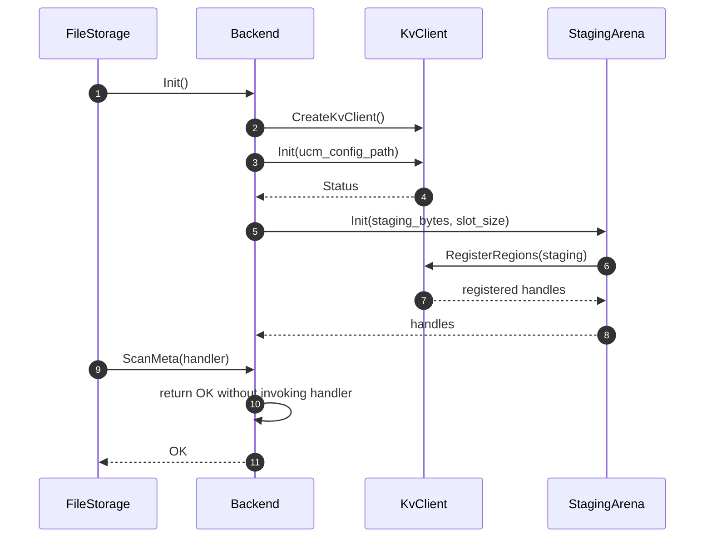

#### 4.6.2 `Init`

- `initialized_` 用 `compare_exchange_strong(kUninit → kInitializing)`：已就绪或正在初始化的
  实例再次 `Init` 都返回 `INTERNAL_ERROR`；全部步骤成功后置 `kReady`。
- 校验 `KvClientBackendConfig::Validate()`；`client_ = kv::CreateKvClient()`；按
  `ucm_config_path` 或 `KvClientConfig` 初始化。**不打开设备、不建 backend 线程池**；
  UCM 内部管理连接/worker/transport 线程。
- 计算 slot size：`align_up(40 + max_payload, 512)`；slot 数 = `staging_bytes / slot_size`，
  至少 1，且不超过 `max_batch_size`。`StagingArena::Init` 分配对齐内存并 `RegisterRegions`；
  失败时注销已注册的部分区域。
- 计数置 0，索引为空。
- 任一步失败：`client_->Shutdown()`、`client_.reset()`、`initialized_.store(InitState::kUninit)`，
  返回对应错误；允许部署侧重试，不能留下半初始化状态。
- `IsEnableOffloading` 见 §3.2 的实现契约：只读本地计数/配置硬上限，不查 ASU、不发 RPC。

#### 4.6.2.1 `Init` 与 `IsEnableOffloading` 的实现边界

这两个方法都必须实现（都是纯虚函数），但“打开设备、建线程池”的 NVMeKV 式实现不能直接照搬：

| 项 | 本版实现 | 优势 | 风险/劣势 |
| --- | --- | --- | --- |
| `Init` | 创建 `kv::KvClient`、加载 view/transport 配置、`KvClient::Init`、注册 staging、初始化索引/计数、CAS 置 `kInitializing`，成功后置 `kReady` | 连接/版本/配置 fail-fast；staging 只注册一次；二次 Init 可拒绝；生命周期清晰 | 启动依赖 UCM/ASU 可用；失败会让 FileStorage Init 失败，需要部署侧重试；没有后台重连 |
| `Init` 中“打开设备/建线程池” | **不做**。ASU 连接、视图路由、task worker、transport 线程由 `kv::KvClient` 内部管理；backend 只持有 staging slot 池 | 不重复 UCM 的线程/连接管理；避免多套线程池和生命周期冲突 | 如果未来需要并行提交多个 chunk 的 `Wait`，再引入一个小的 `ThreadPool`；v1 串行 `Wait` 足够 |
| `IsEnableOffloading` | 已初始化且本地 `total_keys_/total_size_` 未超过硬上限 → true；否则 false | 便宜、无 RPC；可阻止明显超配的写入；FileStorage Init 能决定是否 MountLocalDiskSegment | 计数只统计本进程、重启归零；ASU 实际容量不可查；FileStorage 只在 Init 调用它，返回 false 可能让本进程永久不 offload |
| `IsEnableOffloading` 查询 ASU 容量 | **不做**。ASU 公共 API 没有容量/水位查询；容量不足由 `BatchOffload` 的 `RESOURCE_BUSY`/`OUT_OF_CREATE_SIZE` 逐 key 反馈 | 不引入额外 RPC/依赖；不把瞬时容量当成永久状态 | 无法提前阻止写满；依赖逐 key 跳过和日志 |

关键结论：

- `IsEnableOffloading` 在 `FileStorage::Init` 里被调用一次，用来设置 `enable_offloading_` 并
  `MountLocalDiskSegment(enable_offloading_)`；它不是每次心跳重新求值。**不要因为瞬时容量不足
  返回 false**，否则本进程可能永久停止 offload。瞬时容量问题应在 `BatchOffload` 里逐 key 跳过。
- `IsEnableOffloading` 的“容量判断”只能是本地计数/配置上限，不能代表 ASU 实际容量。
- `Init` 不要重复创建 UCM 已经管理的连接/worker/transport 线程；backend 需要的是 staging slot
  池，不是线程池。

#### 4.6.3 `ScanMeta` / `ResetScanIterator` / 恢复限制

- `ScanMeta`：返回 `expected<void>` OK，不调用 handler，不枚举 ASU；记一次 WARNING。
- `ResetScanIterator`：空实现。
- `RemoveAll`/`EvictAboveDiskWatermark` 本版不支持，继承基类空实现；按 key 删除见 §4.5。
- 结果：进程重启后，Master 若仍有 `LOCAL_DISK` 元数据，读/查仍可用；若 Master 也丢失元数据，
  对象不会自动重新注册。这是本版的明确限制。

#### 4.6.4 现有五套 `ScanMeta` 实现对照

五套实现（`StorageBackendAdaptor` / `BucketStorageBackend` / `OffsetAllocatorStorageBackend` /
`DistributedStorageBackend` / `NvmeKvStorageBackend`）的对照表、逐后端要点与逐行代码注解，已移到
《FileStorage-offload-实现解读.md》的 6.9 节与附录 C——那里是它们真正的归属地。

本版只需记住结论：**只有 file-per-key、bucket、对象存储三种能在 Master 丢元数据后完整重建账本；
OffsetAllocator 取决于 `persist_mode`（默认不恢复）；NVMe KV 完全不恢复。**

### 4.7 并发与一致性（写/读/查/删）

| 场景 | 结果 | 处理 |
| --- | --- | --- |
| Store 成功、handler 失败 | 数据在 ASU、本进程索引有记录、Master 不知道 | 不恢复；重试 Put 覆盖 |
| Store 成功、Wait 超时 | ASU 可能稍后完成 | 不通知 Master；孤儿对象；重试覆盖 |
| 覆盖写 | 单 key 一条 ASU value 原子替换；索引按 delta 更新 | last-writer-wins |
| 读与写并发 | 读到旧值或新值 | 二者都是完整对象；CRC 保证完整性 |
| 读时索引缺失 | 仍可读 | 以 Master 的 `slice.size` 为准；成功后补索引 |
| ASU 自身 GC/删除 | 索引暂时陈旧 | 读/查遇到 `NOT_FOUND` 时删索引 |
| 删除与并发读 | 读到旧值或 `OBJECT_NOT_FOUND` | 不允许半对象；CRC 保证完整性 |
| Master 已删元数据、owner 未收到删除任务 | ASU 残留对象 | 本版无持久化任务队列；后续覆盖/带外清理 |
| `DeleteAsync` 失败 | 索引恢复、计数不变 | 保留重试信息；本版只记日志 |
| 重复删除 | `KEY_NOT_EXIST` 归一为成功 | 幂等 |
| 重复删除 | `NOT_FOUND` 视为成功 | 幂等 |
| 进程重启 | 索引为空 | 读/查不依赖索引；写重新累计计数 |
| 二次 `Init` | `INTERNAL_ERROR` | 与现有共享契约一致 |
| 多客户端共享 ASU | key 哈希包含 `key_namespace` | 逻辑隔离；`key_namespace` 唯一性由部署保证 |

### 4.8 可观测性

- 复用 `SsdMetric`：`FileStorage` 已记录 read/write ops、bytes、latency，本版不新增指标文件。
- 结构化日志字段：`backend=kv_client_storage_backend`、`key_namespace`、`op`、`keys`、`entries`、`success`、
  `skipped`、`failed`、`first_error`、`task_id`。
- 建议的后端计数器（本版只记日志）：提交 task 数、Wait 超时数、逐 entry 失败数、
  staging 等待时间。

## 5. SFMEA 分析与测试设计

### 5.1 分析方法

- **范围**：写（`BatchOffload`）、读（`BatchLoad`）、查（`IsExist`），以及 Init、staging、配置、
  错误映射、并发和按 key 删除。水位淘汰/RemoveAll 不在本版，因此不作为本版测试项。
- **FMEA 方法**：对每个功能列出失效模式、局部影响、系统影响、严重度、检测/缓解和对应测试。
  本版不计算 RPN，按严重度优先；发生概率和可检测性写在“检测/缓解”列。
- **严重度定义**：

| 级别 | 含义 |
| --- | --- |
| S1 | 数据损坏、读到错误对象、Master 元数据被误删；必须零容忍 |
| S2 | 操作不可用、offload 永久停止、重启后不可恢复；必须可检测并快速失败 |
| S3 | 性能/配额/部分功能退化，无数据损坏 |
| S4 | 仅可观测性/诊断问题 |

- **测试方法**：单元测试覆盖 codec/CRC；契约测试覆盖写/读/查/删；故障注入用
  `FakeKvClient : public kv::KvClient`；并发用 TSAN/ASAN；端到端用 `FileStorage` +
  `ReferenceKvClient`（CI）和 UCM FAKE provider（可选集成）。

### 5.2 失效模式与影响（FMEA）

| ID | 功能 | 失效模式 | 局部影响 | 系统影响 | 严重度 | 检测/缓解 | 测试 |
| --- | --- | --- | --- | --- | --- | --- | --- |
| FM-INIT-01 | Init | `KvClient::Init` 或握手失败 | 后端 Init 返回错误，无 staging | FileStorage Init 失败，节点不提供 offload | S2 | 错误码/日志；不进入可用状态 | TC-INIT-01 |
| FM-INIT-02 | Init | `RegisterRegions` 失败 | 无可用 staging slot | 写/读全部不可用 | S2 | 返回错误；不保留部分句柄 | TC-INIT-02 |
| FM-INIT-03 | Init | 二次 Init | 计数/索引被重置或重复注册 | 状态不一致、重复 task | S2 | CAS 保护；第二次返回 `INTERNAL_ERROR` | TC-INIT-03 |
| FM-INIT-04 | Init | `key_namespace` 为空或配置非法 | 使用无效 key 启动 | 写入错误对象或全部失败 | S2 | `Validate` 失败；`INVALID_PARAMS` | TC-INIT-04 |
| FM-INIT-05 | Init | 失败后未 `Shutdown`/未复位 `initialized_` | client/内存泄漏；无法重试 | 节点只能重启 | S2 | 失败路径统一 Shutdown + reset + 复位；单测覆盖 | TC-INIT-05 |
| FM-WRITE-01 | 写 | 8B key 碰撞 | 两个 `scoped_key` 覆盖同一 ASU key | 一个对象丢失或读错 | S1 | 128-bit fingerprint 读校验；日志 | TC-WRITE-01 |
| FM-WRITE-02 | 写 | `RecordHeader` 编码错误 | 读端拒收合法数据 | offload 数据不可读 | S2 | `RecordHeader` 单测；头 CRC | TC-WRITE-02 |
| FM-WRITE-03 | 写 | payload 超 slot/单值上限 | 该 key 跳过 | offload 不完整，Master 仍持有内存副本 | S3 | 跳过集合；日志；返回成功数 | TC-WRITE-03 |
| FM-WRITE-04 | 写 | staging 耗尽 | 批次阻塞或跳过 | 心跳延迟或丢批 | S3 | 有界等待/跳过；slot 计数 | TC-WRITE-04 |
| FM-WRITE-05 | 写 | `BatchStoreAsync` 提交失败 | 无 entry 写入 | 本批失败 | S2 | 错误映射；不更新索引 | TC-WRITE-05 |
| FM-WRITE-06 | 写 | `Wait` 超时 | task 可能稍后完成 | 不通知 Master；孤儿对象 | S2 | `RPC_TIMEOUT`；slot 释放；重试覆盖 | TC-WRITE-06 |
| FM-WRITE-07 | 写 | 把 `PARTIAL_FAILED` 当整批失败 | 成功 entry 被丢弃 | offload 回退/重试放大 | S2 | 逐 entry 判断 | TC-WRITE-07 |
| FM-WRITE-08 | 写 | 逐 entry 失败未跳过 | 整批返回错误 | 心跳失败或 offload 停用 | S2 | 只上报成功 key；0 成功返回 `expected(0)` | TC-WRITE-07 |
| FM-WRITE-09 | 写 | `complete_handler` 失败 | 数据已写、Master 不知 | 悬挂副本；重启不可见 | S2 | 返回错误；不回滚；日志 | TC-WRITE-08 |
| FM-WRITE-10 | 写 | 覆盖写计数 delta 错误 | 配额/水位漂移 | 过早停写或超配额 | S3 | 原子更新 index+counters | TC-WRITE-09 |
| FM-WRITE-11 | 写 | 空间不足返回 `KEYS_ULTRA_LIMIT` | FileStorage 永久关闭 offload | 节点不再 offload | S2 | 禁止该码；返回 success count | TC-WRITE-03 |
| FM-DEL-01 | 删除 | Master 删元数据成功但 owner 未收到删除任务 | 元数据已删、ASU 残留 | 对象不可路由但占容量 | S2 | 任务队列/日志；带外清理 | TC-DEL-01 |
| FM-DEL-02 | 删除 | owner 路由错误 / `key_namespace` 不匹配 | 删不到或删错对象 | 数据丢失或残留 | S1 | Master 记录 owner；按 `scoped_key` 校验 `key_namespace`；审计 | TC-DEL-02 |
| FM-DEL-03 | 删除 | `DeleteAsync` 逐 entry 失败 | 该 key 索引保留/恢复 | 残留对象；计数不扣 | S3 | 逐 entry 状态；恢复索引；日志 | TC-DEL-03 |
| FM-DEL-04 | 删除 | 调用方非 owner 直接本地删 | 漏删 | ASU 残留 | S2 | 必须 Master→owner；caller 不直接删 | TC-DEL-02 |
| FM-DEL-05 | 删除 | 进程重启后在途任务丢失 | 删除任务丢失 | ASU 残留 | S2 | 本版接受；文档化；后续持久化队列 | TC-DEL-04 |
| FM-DEL-06 | 删除 | 删除与并发读 | 读到旧值或 `OBJECT_NOT_FOUND` | 不允许半对象 | S1 | 单 key 原子 + CRC；读到旧值可接受 | TC-DEL-06 |
| FM-DEL-07 | 删除 | 删除后计数 delta 错误 | 配额漂移 | 过早停写或超配额 | S3 | 成功/缺失才扣减；失败恢复 | TC-DEL-07 |
| FM-DEL-08 | 删除 | 重复删除 | `KEY_NOT_EXIST` 被当失败 | 误报错误 | S3 | `KEY_NOT_EXIST`/`NOT_FOUND` 视为成功 | TC-DEL-08 |
| FM-DEL-09 | 删除 | 批量 > 254 | 超限 `INVALID_ARGUMENT` | 部分 key 未删 | S3 | 按 `min(254, deleteKeys)` 切块 | TC-DEL-09 |
| FM-READ-01 | 读 | `slice.size` 与头 `payload_size` 不一致 | 返回 `INVALID_PARAMS` | 该对象读失败 | S2 | 交叉校验；不拷贝 | TC-READ-01 |
| FM-READ-02 | 读 | ASU `NOT_FOUND` | 返回 `OBJECT_NOT_FOUND` | Master 路由悬挂 | S2 | 清索引；probe 修复 | TC-READ-02 |
| FM-READ-03 | 读 | magic/version/flags 损坏 | `INVALID_READ` | 不返回错误数据 | S1 | 头校验 | TC-READ-03 |
| FM-READ-04 | 读 | `RecordHeader` CRC 损坏 | `INVALID_READ` | `RecordHeader` 不可信 | S1 | CRC-32C | TC-READ-03 |
| FM-READ-05 | 读 | fingerprint 不匹配 | `INVALID_READ` | key 碰撞/串写被发现 | S1 | 128-bit fingerprint | TC-READ-04 |
| FM-READ-06 | 读 | payload CRC 损坏 | `CHECKSUM_MISMATCH` | 不返回撕裂数据 | S1 | CRC-32C | TC-READ-05 |
| FM-READ-07 | 读 | 读回长度不足/超出 | `INVALID_READ`/`INVALID_PARAMS` | 不越界拷贝 | S1 | `transfer_size` 校验 | TC-READ-06 |
| FM-READ-08 | 读 | 索引缺失但对象存在 | 若强制查索引则读失败 | 重启后读不可用 | S2 | 以 `slice.size` 为准；成功后补索引 | TC-READ-07 |
| FM-READ-09 | 读 | 与覆盖写并发 | 读到旧值或新值 | 不允许半对象 | S1 | 单 key 原子 + CRC | TC-READ-08 |
| FM-QUERY-01 | 查 | 超时/传输错误返回 `false` | probe 误删 Master 元数据 | 数据不可路由 | S1 | 必须 `unexpected`，不得 `false` | TC-QUERY-01 |
| FM-QUERY-02 | 查 | 索引陈旧/假阳性 | 读时 `NOT_FOUND` | 读失败 | S2 | 以 Query 为准；读时清索引 | TC-QUERY-02 |
| FM-QUERY-03 | 查 | 编码 key 与写不一致 | 永远查不到 | 对象被视为不存在 | S1/S2 | 同一 codec；单测 | TC-QUERY-03 |
| FM-CONC-01 | 并发 | `Wait` 期间持有 `metadata_mutex_` | 读写互相阻塞/死锁 | 心跳超时 | S2 | 锁纪律；`Wait` 外置 | TC-CONC-01 |
| FM-CONC-02 | 并发 | task 未完成就复用 slot | 数据被覆盖 | 写坏对象 | S1 | slot 生命周期覆盖 `Wait` | TC-CONC-02 |
| FM-LIFE-01 | 关停 | 有在途 task 就 `Unregister`/`Shutdown` | 崩溃/数据损坏 | 进程异常 | S1 | 先 drain 再注销 | TC-LIFE-01 |
| FM-LIFE-02 | 生命周期 | 二次 Init/重新 Init | 状态/句柄错乱 | 行为不可预测 | S2 | CAS/禁止重入 | TC-INIT-03 |
| FM-STUB-01 | ScanMeta | 返回空 | Master 重启后不注册 | 冷数据不可达 | S2（本版接受） | 文档/日志 | TC-STUB-01 |
| FM-STUB-02 | RemoveAll | 本版不支持，继承空实现 | 元数据可能已删 | ASU 数据残留；容量不释放 | S2（本版接受） | 文档/日志 | TC-DEL-05 |
| FM-STUB-03 | 容量 | ASU 容量满/资源不足 | 写入失败 | offload 停止 | S2 | 映射 `RESOURCE_BUSY`/`OUT_OF_CREATE_SIZE`；跳过 key | TC-STUB-02 |
| FM-CAP-01 | 配额 | 重启后计数归零 | 配额失真 | 超量写或提前停写 | S3 | 计数仅参考；ASU 容量为准 | TC-CAP-01 |
| FM-CAP-02 | IsEnableOffloading | 误查 ASU/按瞬时容量返回 false | 本进程永久停 offload | 节点不再下沉 | S2 | 只读本地硬上限；不查 ASU；false 时 BatchOffload 跳过并返回 expected(0) | TC-CAP-02 |
| FM-CFG-01 | 工厂 | UCM 未编译但选了 `kKvClient` | 创建失败 | 节点启动失败 | S2 | 编译开关；清晰错误 | TC-CFG-01 |
| FM-CFG-02 | 工厂 | 生产误用 FAKE provider | 数据未落 ASU | 数据丢失 | S1 | 配置校验/健康检查 | TC-CFG-02 |
| FM-OBS-01 | 可观测性 | 无 task/entry 日志 | 无法定位 | 诊断困难 | S4 | 结构化日志 | TC-OBS-01 |

### 5.3 测试用例与通过标准

| TC | 覆盖失效模式 | 注入/前置 | 步骤 | 通过标准 |
| --- | --- | --- | --- | --- |
| TC-INIT-01 | FM-INIT-01 | `FakeKvClient::Init` 返回错误 | 调 `KvClientStorageBackend::Init` | 返回对应错误；无 staging 注册；无崩溃；FileStorage Init 失败 |
| TC-INIT-02 | FM-INIT-02 | `RegisterRegions` 返回失败 | 调 Init | 返回错误；无部分句柄泄漏；修复后重试成功 |
| TC-INIT-03 | FM-INIT-03 | 连续两次 Init | 两次调用 | 第一次 OK；第二次 `INTERNAL_ERROR`；索引/计数不变 |
| TC-INIT-04 | FM-INIT-04 | `key_namespace` 为空/配置非法 | 调 Validate/Init | Validate false；Init `INVALID_PARAMS`；不调用 KvClient |
| TC-INIT-05 | FM-INIT-05 | `RegisterRegions` 失败 | 调 Init，再重试 | 首次失败后 `initialized_ == kUninit`、client 已 Shutdown；第二次 Init 成功 |
| TC-CAP-02 | FM-CAP-02 | 计数超过 hard limit | 调 IsEnableOffloading/BatchOffload | `false`；BatchOffload 返回 expected(0)，不返回 KEYS_ULTRA_LIMIT；FakeKvClient 未收到 Query/Store |
| TC-WRITE-01 | FM-WRITE-01 | 注入两个 `scoped_key` 映射到同一 8B key | 写两个对象，再读第一个 | 读返回 `INVALID_READ`；不返回错误字节；日志含碰撞提示 |
| TC-WRITE-02 | FM-WRITE-02 | 固定 payload/`RecordHeader` 向量 | 编码后再解码 | 字段/CRC/fingerprint 与向量一致；篡改任一字段解码失败 |
| TC-WRITE-03 | FM-WRITE-03/11 | payload 超 slot、超配额、空 key | 批量写 3 个 key | 超限 key 跳过；其余成功；handler 只收到成功 key；不返回 `KEYS_ULTRA_LIMIT` |
| TC-WRITE-04 | FM-WRITE-04 | staging slot=1，延长 Wait | 并发两个写 | 有界等待；无死锁；slot 全部归还；成功数正确 |
| TC-WRITE-05 | FM-WRITE-05 | `BatchStoreAsync` 返回错误 | 调 BatchOffload | 无 handler 调用；返回错误；索引/计数不变 |
| TC-WRITE-06 | FM-WRITE-06 | `Wait` 延迟超过 timeout | 调 BatchOffload | 返回 `RPC_TIMEOUT`；无 handler；slot 释放；重试写成功 |
| TC-WRITE-07 | FM-WRITE-07/08 | 3 个 key，entry 2 注入失败 | 调 BatchOffload | 返回 2；handler keys 为 k1/k3 的 `scoped_key`；k2 不存在；计数 +2 |
| TC-WRITE-08 | FM-WRITE-09 | `complete_handler` 返回错误 | 调 BatchOffload | 数据仍可读；返回该错误；不回滚；日志记录 |
| TC-WRITE-09 | FM-WRITE-10 | 同 key 先写 4K 再写 8K | 两次写 | 读到 8K 新值；`total_size_` 按 delta 更新；`total_keys_` 不变 |
| TC-DEL-01 | FM-DEL-01 | Master Remove 成功但删除任务未投递 | 模拟 owner 不收任务 | 元数据已删；ASU 残留；日志可追踪；不崩溃 |
| TC-DEL-02 | FM-DEL-02/04 | 两个 client，A 删 B 拥有的 key | 调 Client::Remove | Master 通知 B；B 的 backend 删除；A 不直接删；结果正确 |
| TC-DEL-03 | FM-DEL-03 | 3 个 key，entry 2 `DeleteAsync` 失败 | 调 BatchRemoveKeys | 返回 2 成功/1 失败；失败 key 索引保留；计数只扣 2 |
| TC-DEL-04 | FM-DEL-05 | 删除任务入队后重启 owner | 重启 + PollDeleteTasks | 在途任务丢失；ASU 残留；行为与文档一致；不崩溃 |
| TC-DEL-05 | RemoveAll/RemoveByRegex 不支持 | 调用这两个 API | 观察 ASU 数据与日志 | 元数据删除；ASU 数据不删；日志说明；不崩溃 |
| TC-DEL-06 | FM-DEL-06 | 读与删除并发 | 多线程 | 读到旧值或 `OBJECT_NOT_FOUND`；不出现半对象；CRC 通过 |
| TC-DEL-07 | FM-DEL-07 | 覆盖写后再删除 | 写两次、删一次 | `total_keys_`/`total_size_` 归零；无重复扣减 |
| TC-DEL-08 | FM-DEL-08 | 删除不存在的 key | 调 BatchRemoveKeys | `KEY_NOT_EXIST` 归一成功；计数不变 |
| TC-DEL-09 | FM-DEL-09 | 300 个 key | 调 BatchRemoveKeys | 分成 2 块（254+46）；逐 key 结果；无超限错误 |
| TC-READ-01 | FM-READ-01 | 写入 4096B，读时 `slice.size=4097` | 调 BatchLoad | 返回 `INVALID_PARAMS`；`slice.ptr` 内容不变 |
| TC-READ-02 | FM-READ-02 | ASU 无该 key | 调 BatchLoad | 返回 `OBJECT_NOT_FOUND`；索引条目被清理；无崩溃 |
| TC-READ-03 | FM-READ-03/04 | 篡改 magic/version/`RecordHeader` CRC | 调 BatchLoad | 返回 `INVALID_READ`；不拷贝 payload；缓冲区不变 |
| TC-READ-04 | FM-READ-05 | 篡改 fingerprint | 调 BatchLoad | 返回 `INVALID_READ`；不返回错误字节 |
| TC-READ-05 | FM-READ-06 | 篡改 payload 一个字节 | 调 BatchLoad | 返回 `CHECKSUM_MISMATCH`；不拷贝 payload |
| TC-READ-06 | FM-READ-07 | fake 返回短读/超长 | 调 BatchLoad | 返回 `INVALID_READ`/`INVALID_PARAMS`；ASAN 无越界 |
| TC-READ-07 | FM-READ-08 | 清空索引，Master 提供 `slice.size` | 调 BatchLoad | 读成功；字节一致；索引被补回 |
| TC-READ-08 | FM-READ-09 | 读与覆盖写并发 | 多线程读写 | 读到旧值或新值；两者 CRC 均通过；无半对象 |
| TC-QUERY-01 | FM-QUERY-01 | Query 超时/传输错误 | 调 IsExist | 返回 `unexpected`（`RPC_TIMEOUT`/`UNAVAILABLE`）；绝不返回 `false`；Master 元数据不变 |
| TC-QUERY-02 | FM-QUERY-02 | 索引有陈旧条目，ASU 无数据 | 调 IsExist | 返回 `false`；索引条目删除；其他 key 不受影响 |
| TC-QUERY-03 | FM-QUERY-03 | 同一 `scoped_key` 走写/读/查 | 比较编码结果 | 三次得到同一 8B key；无 mismatch |
| TC-CONC-01 | FM-CONC-01 | 阻塞 Wait + 并发写 | 两线程 | 写不被读的 Wait 阻塞（或仅在索引提交短暂等待）；TSAN 无数据竞争；无死锁 |
| TC-CONC-02 | FM-CONC-02 | 1 个 slot + 多读多写 | 并发压测 | ASAN/TSAN 干净；无 use-after-free；slot 全部归还 |
| TC-LIFE-01 | FM-LIFE-01 | 有在途 task 时 Shutdown | 调 Shutdown/析构 | 等待 task 完成；不提前 `UnregisterRegions`；无崩溃/泄漏 |
| TC-STUB-01 | FM-STUB-01 | 正常 backend | 调 ScanMeta | 返回 OK；handler 未被调用；不注册任何对象 |
| TC-STUB-02 | FM-STUB-03 | 模拟 ASU 容量不足 | 调写 | 该 key 跳过/可重试；不崩溃；其他 key 正常 |
| TC-CFG-01 | FM-CFG-01 | 未编译 UCM，选 `kKvClient` | 调 CreateStorageBackend | 返回清晰错误（`INVALID_PARAMS`/`NOT_SUPPORTED`）；无崩溃 |
| TC-CFG-02 | FM-CFG-02 | 生产配置使用 FAKE provider | 启动/健康检查 | 配置校验拒绝或显著告警；不静默写成功 |
| TC-CAP-01 | FM-CAP-01 | 重启 backend | 读计数并写新 key | 计数从 0 开始；写仍可用；ASU 容量错误被正确映射 |
| TC-OBS-01 | FM-OBS-01 | 注入一次 entry 失败 | 检查日志 | 日志含 `task_id`、entry 下标/状态、首错、key；可定位到具体 entry |
| TC-PERF-01 | 性能/批量 | N=100，batch=32 | 调 BatchOffload/BatchLoad | TaskId 数 ≤ `ceil(100/32)=4`；p99 在基线内；无 per-key task |

### 5.4 故障注入能力

`FakeKvClient : public kv::KvClient` 提供：

- `FailNext(op, key, StatusCode)`：对下一次 Query/Store/Load/Delete 注入错误。
- `DelayNext(op, ms)`：模拟 `Wait` 超时。
- `PartialFailure(indices)`：让指定 entry 在 `entryStatus` 中失败，聚合状态为 `PARTIAL_FAILED`。
- `FailDelete(key, StatusCode)`：删除失败，用于验证索引恢复。
- `CorruptValue(key, field)`：篡改 magic/version/`RecordHeader` CRC/fingerprint/payload CRC。
- `RejectUnregisteredBuffer()`：模拟 `BUFFER_NOT_REGISTERED`。
- `RecordCalls()`：记录提交/等待顺序和 task 数。

### 5.5 覆盖结论与残余风险

- S1/S2 失效模式都有对应测试；S3 覆盖配额、staging、覆盖写；S4 只做日志断言。
- 残余风险：
  - 删除依赖 Master→owner 的按 key 任务；任务在途丢失/owner 重启后本版没有持久化重试队列。
  - `RemoveAll`/`RemoveByRegex`/水位淘汰不支持；这些操作只删元数据，ASU 数据残留。
  - 真实 ASU 对“删除不存在的 key”的返回码需实测；本版按 `KEY_NOT_EXIST`/`NOT_FOUND` 归一成功。
  - owner 路由/`key_namespace` 配置错误会导致漏删或删错，需要审计与配置校验。


## 6. Mooncake 改动量

### 6.1 文件级清单

| # | 文件 | 改动 | 行数（本版） | 优先级 |
| --- | --- | --- | --- | --- |
| 1 | `mooncake-store/include/storage_backend.h` | `StorageBackendType::kKvClient`；`BatchRemoveKeys` 虚函数 | +10~20 | 必须 |
| 2 | `mooncake-store/src/storage_backend.cpp` | 工厂 `case kKvClient`；include | +15~25 | 必须 |
| 3 | `mooncake-store/src/config/file_storage_config.cpp` | descriptor `kv_client_storage_backend` 的解析分支；`Validate()` 对 `kKvClient` 跳过本地路径 | +25~40 | 必须 |
| 4 | `mooncake-common/include/environment_variables.h` | `MOONCAKE_OFFLOAD_KV_CLIENT_*` 9 个变量 | +10~18 | 必须 |
| 5 | `mooncake-store/include/config/kv_client_backend_config.h` | 配置结构 | +50~70 | 必须 |
| 6 | `mooncake-store/src/config/kv_client_backend_config.cpp` | 环境变量解析 + `Validate` | +100~140 | 必须 |
| 7 | `mooncake-store/include/kv_client/backend.h` | 后端声明；前置声明 `kv::KvClient`；`BatchRemoveKeys` | +140~190 | 必须 |
| 8 | `mooncake-store/src/kv_client/backend.cpp` | 写/读/查/按 key 删、索引、task 编排、UCM 类型/错误映射 | +1,200~1,600 | 必须 |
| 9 | `mooncake-store/include/kv_client/record.h` + `mooncake-store/src/kv_client/record.cpp` | `KvClientRecordCodec`：`RecordHeader`（40B）、CRC、fingerprint | +140~200 | 必须 |
| 10 | `mooncake-store/include/kv_client/key_codec.h` + `mooncake-store/src/kv_client/key_codec.cpp` | `KvClientKeyCodec`：8B key + 128-bit fingerprint | +80~120 | 必须 |
| 11 | `mooncake-store/include/kv_client/staging.h` + `mooncake-store/src/kv_client/staging.cpp` | `StagingArena`：注册内存、slot 池 | +180~280 | 必须 |
| 12 | `mooncake-store/include/kv_client/factory.h` + `mooncake-store/src/kv_client/factory.cpp`；`mooncake-store/include/kv_client/reference_kv_client.h` + `mooncake-store/src/kv_client/reference_kv_client.cpp`（`ReferenceKvClient`） | 工厂 + 参考实现（各自独立文件） | +200~300 | 必须 |
| 13 | `mooncake-store/src/CMakeLists.txt` | 源文件 + UCM include/link；`USE_UCM` | +20~40 | 必须 |
| 14 | `dependencies.sh` / `third_party` | UCM `kv_client`/`kv_transport` 引入方式 | +20~60 | 必须 |
| 15 | `mooncake-store/include/file_storage.h` + `src/file_storage.cpp` | `BatchRemoveKeys` 转发 + `PollDeleteTasks` | +40~80 | 必须（接线） |
| 16 | `mooncake-store/include/local_ssd/manager.h` + `src/local_ssd/manager.cpp` | 按 key 删除任务邮箱/队列（现有只有 RemoveAll 布尔位） | +120~220 | 必须（接线） |
| 17 | `mooncake-store/src/master_service.cpp` + 头文件 | `Remove`/`BatchRemove` 成功后收集 `LOCAL_DISK` owner 并投递删除任务 | +80~160 | 必须（接线） |
| 18 | `mooncake-store/src/client_service.cpp` | `Remove`/`BatchRemove` 不再尝试本地物理删除；日志/结果映射 | +0~20 | 必须（接线） |
| 19 | `mooncake-store/tests/CMakeLists.txt` | `add_store_test` | +4~6 | 必须 |
| 20 | `mooncake-store/tests/storage_backend_test_utils.h` + `storage_backend_test.cpp` | 抽取共享 helper | +80~140 / +10~20 | 必须 |
| 21 | `mooncake-store/tests/kv_client/backend_test.cpp` | 写/读/查/删契约、故障、并发、owner 路由 | +900~1,300 | 必须 |
| 22 | `mooncake-store/tests/kv_client/record_test.cpp` | `RecordHeader`/`Record` 测试 | +140~200 | 必须 |
| 23 | `mooncake-store/tests/kv_client/key_codec_test.cpp` | key/fingerprint 测试 | +80~120 | 必须 |
| 24 | `mooncake-store/tests/kv_client/staging_test.cpp` | 对齐/注册/池测试 | +100~160 | 必须 |
| 25 | `mooncake-store/tests/kv_client/fake_kv_client.h` | `FakeKvClient : public kv::KvClient` | +200~300 | 必须 |
| 26 | `mooncake-store/tests/kv_client/kv_client_backend_config_test.cpp` | 配置/能力校验 | +100~150 | 必须 |
| 27 | `mooncake-store/tests/file_storage_config_test.cpp` | `Validate` 分支断言 | +30~50 | 必须 |
| 28 | `docs/source/design/store/kv-client-storage-backend.md` | 本设计页 | +250~400 | 必须 |
| 29 | `docs/source/design/store/mooncake-store.md` | toctree 条目 | +1 | 必须 |
| 30 | `mooncake-store/benchmarks/storage_backend_bench.cpp` | 性能基准 | +200~300 | 可延后 |
| 31 | `docs/source/deployment/ssd/ssd-offload.md` | 部署说明 | +40~80 | 可延后 |
| 32 | `mooncake-store/include/storage_backend.h` | `RemoveAll`/`EvictAboveDiskWatermark`/`RemoveByRegex` 支持 | — | 后续版本 |

### 6.2 汇总与估算依据

- **核心实现（1–18）**：约 **2,400–3,600 行**。
- **测试（19–27）**：约 **1,650–2,450 行**。
- **文档（28–29）**：约 **250–400 行**。
- **本版总计**：约 **4,300–6,450 行**，新增文件约 20 个，修改文件约 14 个。
- **可延后项（30–31）**：约 **240–380 行**。
- **后续版本（32）**：`RemoveAll`/`EvictAboveDiskWatermark`/`RemoveByRegex` 支持。


估算依据：

| 参照 | 行数 |
| --- | --- |
| `mooncake-store/src/nvme_kv/backend.cpp` | 1,527 |
| `mooncake-store/src/storage/distributed/distributed_storage_backend.cpp` | 906 |
| `mooncake-store/tests/storage_backend_test.cpp` | 5,392 |
| `kv_semantics/src/client/kv_client_impl.cc` | 约 990 |

区间误差约 ±30%。

### 6.3 分期

| 阶段 | 内容 | 退出条件 |
| --- | --- | --- |
| P0（本版） | 后端 + 直接调用 `kv::KvClient` + staging + owner 按 key 删除接线 + 写/读/查/删契约测试 | 四步操作闭环；`make` + 测试通过 |
| P1 | `BatchQueryStat`、性能基准 | 端到端压测通过 |
| P2 | 删除任务持久化、`RemoveAll`/`RemoveByRegex`/水位淘汰、恢复 manifest、零拷贝、大对象分片 | 单独设计评审 |


## 附录 A：术语

| 术语 | 含义 |
| --- | --- |
| ASU | 存储节点/设备：持久化 KV，拥有自身的容量与 GC 策略 |
| UCM | 客户端库/接入层：提供 `kv::KvClient`、视图路由、task 管理与内存注册 |
| KVClient | 本文专指 UCM 的 `kv::KvClient`（旧分支 `UC::ASU::AsuClient`） |
| `asu_key` | ASU key 变量名，类型 `kv::CacheKey`（8 字节）；由 `XXH64` 从 `key_namespace` + `scoped_key` 得到 |
| `kv::CacheKey` | ASU key 的类型：`std::array<std::byte, 8>` |
| KVBuffer | ASU 的一次读写描述：key + 注册内存区间 + offset |
| `scoped_key` | `TenantId::MakeScopedKey(tenant, key)`，即 `tenant_id + '\0' + local_key`；backend 接口统一用该名称，`FileStorage` 现有的 `storage_key` 指同一对象 |
| key_namespace | 配置项，参与 ASU key 哈希的域隔离；与 Master 的 `TenantId` 无关 |
| TenantId | Master 的多租户标识，编码在 `scoped_key` 的 `tenant` 前缀中；不参与 ASU key 计算 |
| `RecordHeader` | 40 字节记录头：magic/version/flags/fingerprint/payload_size/CRC |
| `Record` | `RecordHeader` + payload，即写入 ASU 的一条 value |
| payload | 对象字节（value bytes），各 `Slice` 按序拼接，不含 `RecordHeader`；等于上报 Master 的 `data_size` |
| transfer_size | `align_up(40 + payload_size, 512)`，ASU 实际传输长度 |
| staging arena | backend 持有、向 ASU 注册的读写中转内存 |
