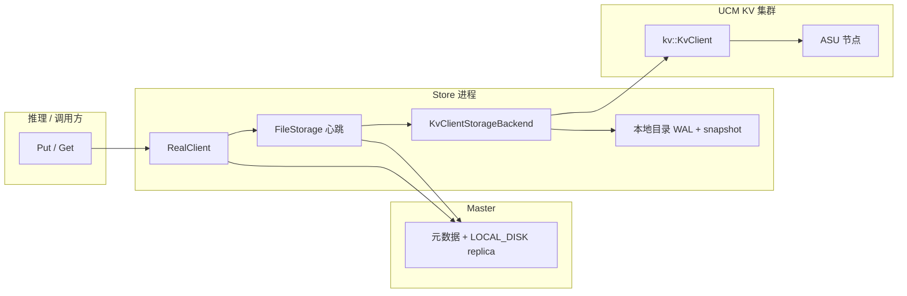
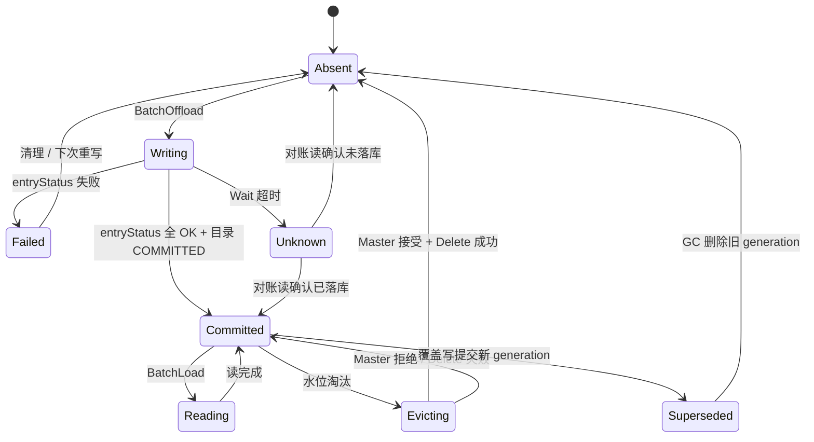
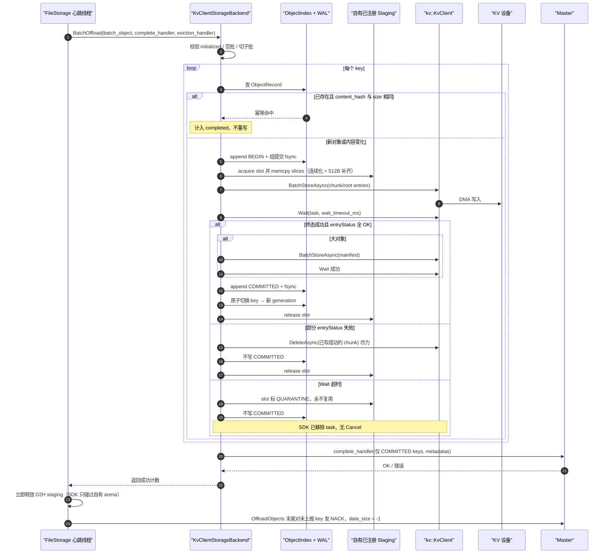
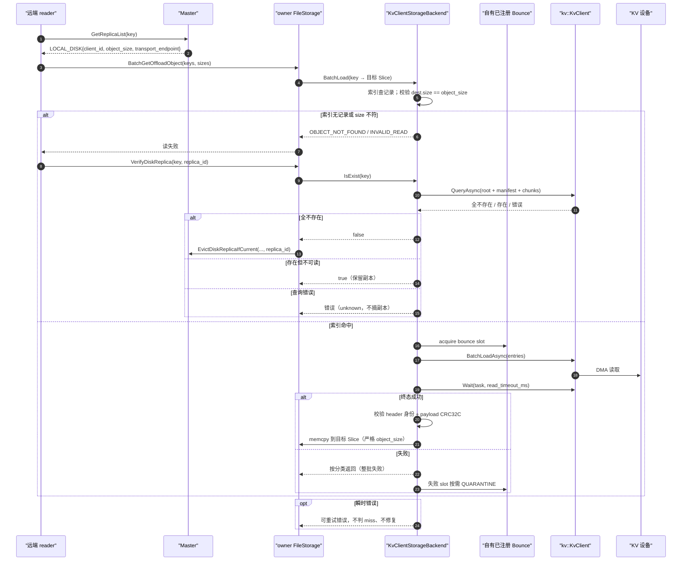
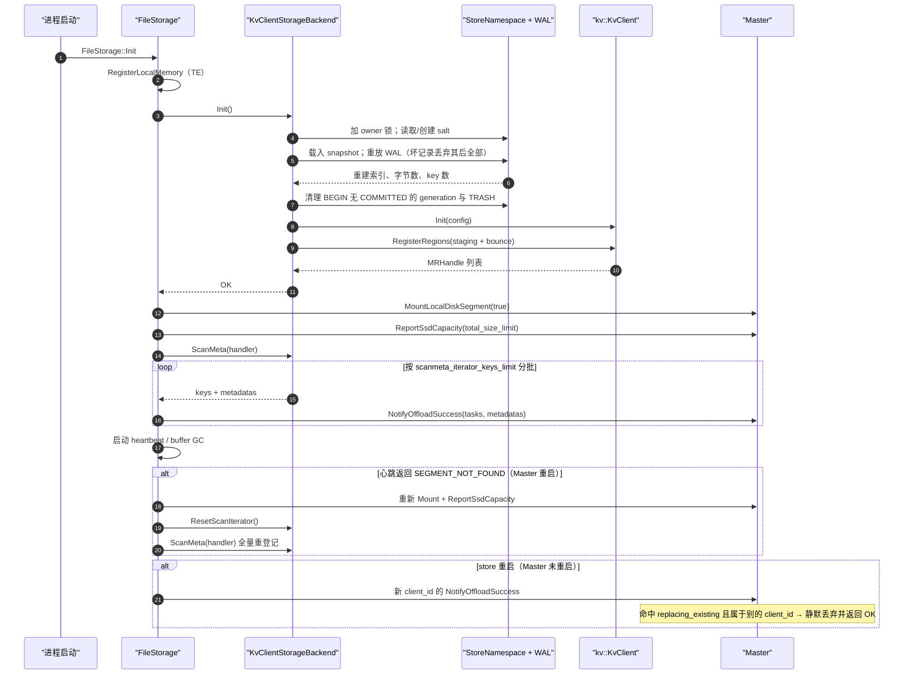
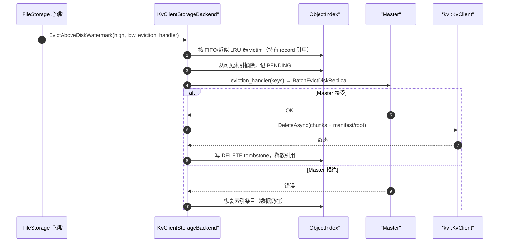
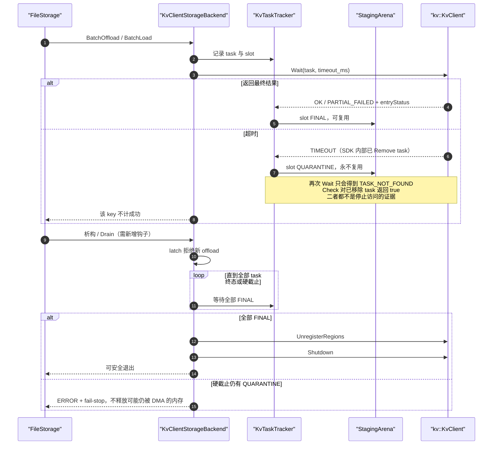
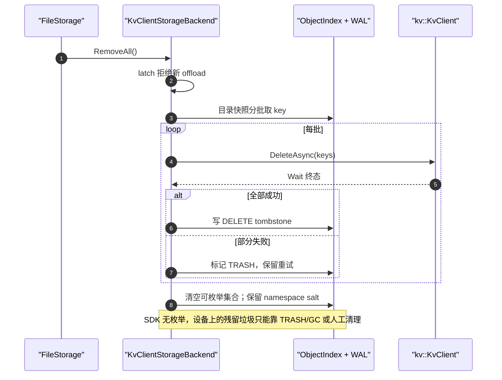

# kvclient 作为 StorageBackendInterface 的设计与实验方案

## 文档信息

| 项目 | 内容 |
| --- | --- |
| 文档编号 | MC-DESIGN-KVCLIENT-L2-001 |
| 版本 / 状态 | v0.3 / 设计评审稿 |
| 日期 | 2026-10-27 |
| 适用模块 | `mooncake-store` L2 offload（`StorageBackendInterface`） |
| 关联文档 | 《mooncake 接入 kvclient put 及 remove 模块设计》（直通双写方案） |
| 参考实现 | UCM `kv_semantics` C++ SDK |
| 渲染要求 | Mermaid ≥ 10.9；类图使用自定义 `<<external>>` 注解与带引号 participant 别名 |

### 修订记录

| 版本 | 日期 | 变更 |
| --- | --- | --- |
| v0.1 | 2026-10-26 | 初稿：契约分析、能力差距、方案与实验方案 |
| v0.2 | 2026-10-27 | 规范化为“表格 + 图”结构；补齐类图、状态机图与 5 张时序图 |
| v0.3 | 2026-10-27 | 事实复核修正：任务级 status 与 entryStatus 分层、错误码、16MiB 上限；补背景/目标、SDK 硬约束、RemoveAll 图与兼容性表 |

### 文档地图

| 章节 | 内容 | 主要图表 |
| --- | --- | --- |
| 0 | 背景、目标、结论与推荐路线 | 表 0-1～0-6 |
| 1 | 范围与术语 | 表 1-1～1-2 |
| 2 | 接入点对比与需求差距 | 表 2-1～2-3、图 2-1 |
| 3 | 接口契约与现状流程 | 表 3-1～3-3 |
| 4 | 方案设计 | 图 4-1～4-9、表 4-1～4-23 |
| 5 | 注意事项清单 | 表 5-1～5-3 |
| 6 | 实验方案 | 表 6-1～6-10 |
| 附录 A/B | 源码依据、实现清单 | 表 A-1、表 B-1 |

---

## 0. 背景、目标与结论

### 0.1 背景与问题

**表 0-1** 背景与问题

| 现状 | 问题 | 为什么现有 backend 不够 |
| --- | --- | --- |
| Mooncake L2 由每个 store 的本地 SSD 承担 | 容量受单机盘限制；store 重启/换机后数据不可迁移 | Bucket/OffsetAllocator 绑定本地路径；NvmeKv 绑定本地设备 |
| Master 只登记 `LOCAL_DISK{client_id, object_size, transport_endpoint}` | 读必须经 owner；容量按 store 记账 | 远端共享存储不属于任何 store |
| kvclient 提供 8B key 的远端 KV 与自身 DHT/传输 | key 空间、枚举、容量、完成语义与接口不匹配 | 直通方案（`ExternalStoreBackend`）不覆盖 L2 offload 路径 |

### 0.2 目标与非目标

**表 0-2** 目标与非目标

| 类别 | 内容 | 验收 / 原因 |
| --- | --- | --- |
| 目标 G1 | 新增 `KvClientStorageBackend`，实现全部接口方法 | E1 通过 |
| 目标 G2 | offload 写、读、恢复、淘汰闭环，无假成功 | E4/E5/E8/E9 |
| 目标 G3 | 对象数据不占本地 SSD，跨 store 重启可恢复 | E9/E12 |
| 目标 G4 | 失败可观测、可回滚 | 表 6-6 指标、表 6-9 回滚 |
| 非目标 N1 | reader 直读 | Phase 2；需改 Master descriptor |
| 非目标 N2 | 共享全局 tier 容量模型 | Phase 2 |
| 非目标 N3 | 零拷贝读写 | Phase 1 默认关闭 |
| 非目标 N4 | kvclient SDK 修改 | 只做适配 |
| 非目标 N5 | 物理整盘擦除的 `RemoveAll` | SDK 无枚举 |

### 0.3 总体结论

**表 0-3** 总体结论

| 结论项 | 结论 | 影响 / 依据 |
| --- | --- | --- |
| 可行性 | 可行，但 kvclient 只承担“字节存储”角色 | 枚举、容量、逐 key 删除、同步完成、宿主缓冲需 Mooncake 补齐 |
| 接入方式 | 新增 `KvClientStorageBackend : StorageBackendInterface`，`StorageBackendType::kKvClient` | Master 侧零改动；复用既有 offload/淘汰/悬空修复链路 |
| 读路径 | Phase 1 保持 owner 代理读 | 收益是容量与持久性，不是读局部性 |
| 恢复 | 依赖 Mooncake 自建的本地目录 | SDK 无枚举；`ScanMeta` 无法直接实现 |
| 内存安全 | SDK 只访问 backend 自有已注册 arena | `Wait` 超时不取消、FileStorage 返回后立即释放 staging |

### 0.4 三个 P0 阻塞项

**表 0-4** P0 阻塞项

| 编号 | 问题 | 事实依据 | 方案对策 |
| --- | --- | --- | --- |
| R1 | “`BatchOffload` 返回即安全”不成立 | `Wait` 超时后无条件移除 task；底层 DMA 可能仍在访问 buffer；FileStorage 返回后立即 `Release` staging | 写前拷入自有 staging、读后拷出 bounce；超时 slot 永久隔离 |
| R2 | `ScanMeta` 无枚举能力 | SDK 无 list/scan/前缀/全量删除；`prefixHitKeys` 只是给定键序列的连续前导命中数 | 本地 WAL + snapshot 作为唯一可枚举集合 |
| R3 | Master 的 LOCAL_DISK 模型与共享远端存储不匹配 | descriptor 只有 `client_id/object_size/transport_endpoint`；读只能经 owner；client_id 是进程级 UUID；容量按 store 记账 | Phase 1 per-store namespace + owner 代理读；共享 tier 放 Phase 2 |

### 0.5 推荐路线

**表 0-5** 推荐路线

| 阶段 | 范围 | 退出条件 |
| --- | --- | --- |
| Phase 1 | 新增 backend、本地目录、COW、自有 arena、owner 代理读 | E1–E10 通过，P0 均有测试证据 |
| Phase 1.5 | 并发/批量优化、指标、GC、`RemoveAll` | E11/E12 达标 |
| Phase 2 | reader 直读、共享全局 tier、SDK `CancelAsync`、目录放入 kvclient | Master descriptor/RPC 与 SDK 扩展就绪 |

### 0.6 收益与边界

**表 0-6** 收益与边界

| 收益 | 边界 |
| --- | --- |
| 对象数据不占本地 SSD | 索引目录（WAL/snapshot）仍需本地可写盘；纯无盘节点必须额外提供该目录 |
| 跨 store 重启保留数据 | 依赖目录不丢；目录丢失视为“不可达”，由悬空修复收敛 |
| 容量弹性（按 namespace 配额） | 共享全局容量与配额在 Phase 2 |
| 故障可观测、可回滚 | owner 代理读，不降低 owner 出流量 |

> 阶段划分的权威表为 §4.14 表 4-20；本节仅为摘要。

---

## 1. 范围与术语

### 1.1 范围

**表 1-1** 范围

| 类别 | 内容 |
| --- | --- |
| 范围内 | `StorageBackendInterface` 的新实现；offload 写、读、恢复、淘汰、`RemoveAll`；配置、指标、测试方案 |
| 范围外 | `ExternalStoreBackend` 直通双写；Master 协议变更；reader 直读；kvclient SDK 修改 |
| 前提 | FileStorage 的心跳线程是唯一 offload 生产者；一个 store 一个 backend 实例 |

### 1.2 术语

**表 1-2** 术语

| 术语 | 含义 |
| --- | --- |
| L1 / L2 | L1 = Master 管理的 MEMORY 副本；L2 = offload 后的持久层 |
| LOCAL_DISK replica | Master 元数据中指向某个 store owner 的 L2 副本 |
| staging / bounce | backend 自有的写中转区 / 读中转区（均已注册到 kvclient） |
| generation | 一次对象写入的代号；覆盖写生成新 generation，实现 COW |
| COMMITTED | 目录中“对象已完整可读”的状态；也是 `complete_handler` 的准入条件 |
| QUARANTINE | `Wait` 超时后永不重用、也暂不释放的 buffer slot |

---

## 2. 接入点对比与需求差距

### 2.1 两个接入点

**表 2-1** 接入点对比

| 维度 | 直通双写（`ExternalStoreBackend`） | L2 offload（本文） |
| --- | --- | --- |
| 挂载位置 | `Client::Put/Remove` 同步路径 | `FileStorage` 心跳线程 |
| 触发者 | 应用 Put | Master 下发 offload 任务 |
| 外部对象对 Master 可见 | 否 | 是（登记 LOCAL_DISK） |
| 完成语义 | 提交返回 task，稍后 `Wait` 汇合 | `BatchOffload` 返回前必须落地并回调 |
| 读路径 | 调用方自行读外部 | owner 代读 + TE 推送 |
| 失败影响 | 本次 Put/Remove | 整个心跳周期的 offload/promotion/淘汰 |
| 可复用结论 | key 映射、512B 对齐、Wait 超时、断链、错误码 | 同左；但“双写汇合/外部不登记/逐 key Remove/force 租约”不可照搬 |

### 2.2 需求与能力差距

**表 2-2** 需求与能力差距

| 接口要求 | kvclient 现状 | 方案 |
| --- | --- | --- |
| 字符串 key | 8B 定长；命名空间只有 transport 配置级 `kv_ns_id`（同一 transport 固定），无按 key/租户的命名空间语义 | 64 位哈希 + 记录头内嵌完整身份；碰撞拒绝 |
| 枚举（`ScanMeta`） | 不提供 | 本地 WAL/snapshot 目录；Phase 2 可放入 kvclient |
| 全量删除（`RemoveAll`） | 只能按显式 key 删 | 目录枚举后批量 `DeleteAsync`，尽力而为 |
| 逐 key 成功/失败 | `entryStatus` 逐条 | 只把成功 key 交给 `complete_handler` |
| 同步完成 | 异步 + `Wait`，超时不取消 | 自有 arena + 超时隔离 |
| 目标 buffer | 必须先 `RegisterRegions` | backend 自有 bounce；零拷贝作为开关 |
| 容量 / 水位 | 无查询 API | 本地目录记账 + 配置配额 |
| 服务端淘汰可见性 | 无 | 读 miss → 悬空修复链 |
| 多租户 | key 由调用方决定 | tenant 进哈希 + 记录头校验 |

### 2.3 SDK 硬约束

**表 2-3** SDK 硬约束

| 项 | 约束 | 对 backend 的影响 |
| --- | --- | --- |
| key | 8B；全 0 被协议拒绝 | 稳定哈希 + 记录头身份校验 |
| 命名空间 | 只有 transport 级 `kv_ns_id` | 不能按 key/租户物理隔离 |
| 长度 | 取 `KVBuffer.buffer.region.size`；`%512==0`；`≤0xFFFFFF`；实际最大 `0xFFFFE00`（16MiB−512B） | 连续化 + 补齐；大对象分块 |
| offset | `%512==0`；24 位 | 多段写必须对齐 |
| 批量上限 | `batchStoreIoNum/batchLoadIoNum=110`、`deleteIoNum=254`、`queryIoNum=256` | 内部切批 |
| in-flight | `maxInflightTasks=1024`、`maxInflightBytes=1GiB` | 与 staging 尺寸联合调参 |
| 内存注册 | `buffer.handle` 必须来自 `RegisterRegions` | 所有 I/O buffer 必须在自有 arena |
| 完成 | 异步 + `Wait`；超时即移除 task；无 `Cancel` | 超时 slot 永久隔离 |
| `Check` | 已移除 task 返回 `true` | 不能当完成判据 |
| 枚举 / 容量 | 不提供 | 本地目录 + 本地记账 |
| 覆盖写 | 客户端与 FakeProvider 支持；设备 `CQE_KEY_ALREADY_EXISTED(0x723)` 语义未定义 | COW + 设备实测 |
| HOST 注册 | `INDEPENDENT` + AICPU provider 拒绝 HOST arena；FAKE 接受 | `SHARED` 模式或确认 provider |

### 2.4 部署与数据流

**图 2-1** 部署与数据流



---

## 3. 接口契约与现状流程

### 3.1 方法契约

**表 3-1** 方法契约

| 方法 | 调用者 / 时机 | 关键约束 | 不实现的后果 |
| --- | --- | --- | --- |
| `Init()` | `FileStorage::Init` 最前 | 失败直接导致 `RealClient::init` 失败 | client 起不来 |
| `BatchOffload` | 心跳线程，单写者 | 返回前完成落地并调用 `complete_handler`；只上报可读 key | 错报 → Master 登记读不到的副本；漏报 → 本次 `OffloadObjects` 末尾差集 NACK（`data_size=-1`），Master 立即 reset task/dec_refcnt；仅 NACK RPC 失败才由 TTL（默认 600s）兜底 |
| `BatchLoad` | 读 RPC / promotion，多线程 | 整批成败；写入长度必须等于 `Slice.size` | 错长度被上层当对象读走 |
| `IsExist` | 悬空探测、Put 命中已存在 key | 只有“证明不在”才能返回 false | 误摘健康副本或永久留坏副本 |
| `IsEnableOffloading` | Init、每次 `BatchOffload` 开头 | false → `KEYS_ULTRA_LIMIT` → **永久关闭本节点 offload** | 误用会一刀切停写 |
| `ScanMeta` | Init、Master 重启后的 rescan | 必须枚举全部持久对象并逐批回调 | Init 失败（仅 `enable_dfs` 容忍 `NOT_SUPPORTED`） |
| `ResetScanIterator` | 每次 rescan 前 | 游标型 backend 必须复位 | 第二次扫描为空 |
| `RemoveAll` | `RemoveAll` / 清理 | 无错误返回通道 | 本地残留、Master 已删元数据 |
| `EvictAboveDiskWatermark` | 每个心跳 tick（开关打开时） | 先通知 Master，再删数据 | 空间只增不减 |
| `SetTestFailurePredicate` | 测试 | 默认 no-op；注入单 key 失败 | 部分成功路径在 CI 中不可测 |
| `Quiesce(deadline_ms)`（建议新增，默认 no-op） | FileStorage 析构 / Drain | 拒绝新 offload → 等全部 task FINAL → `UnregisterRegions` → `Shutdown`；超时 fail-stop | 退出安全只能靠进程级强制终止 |

### 3.2 现状 offload 步骤

**表 3-2** 现状 offload 步骤

| 步骤 | 执行者 | 动作 | 关键点 |
| --- | --- | --- | --- |
| 1 | Master | 下发 `OffloadTaskItem{tenant,key,size}` | 无租约字段；TTL 约 600s |
| 2 | FileStorage | `BatchQuerySegmentSlices` 取本机 MEMORY replica 的 `{ptr,size}` | 每对象 1 个 slice；地址不保证 512B |
| 3 | FileStorage | 可选 D2H staging | device → `PinnedBufferPool` |
| 4 | FileStorage | `BatchOffload(host_slices)` | 同步调用；单写者 |
| 5 | backend | 落地 + `complete_handler(keys, metadatas)` | 未上报的 key 由第 7 步 NACK |
| 6 | FileStorage | `NotifyOffloadSuccess` | Master 登记 LOCAL_DISK |
| 7 | FileStorage | 差集 NACK（`data_size=-1`） | 只释放 task/refcnt，不删已登记副本 |
| 8 | FileStorage | `Release` 所有 staging buffer | **返回后立即执行** |

### 3.3 错误分类（决定 FileStorage 行为）

**表 3-3** 错误分类

| 类别 | 错误码 | FileStorage 行为 |
| --- | --- | --- |
| 单桶软失败 | `INVALID_READ`、`OBJECT_ALREADY_EXISTS` | NACK 本桶，继续下一个桶 |
| 需人工介入 | `KEYS_ULTRA_LIMIT` | NACK 已排空 key，置 `enable_offloading_=false`，并**跳出本轮剩余 bucket** |
| 整轮中止 | 其他任何错误码 | NACK 已排空 key，跳出本轮剩余 bucket |
| 读失败 | 任意 | 整批失败；上层按错误类型决定是否修复 |

---

## 4. 方案设计

### 4.1 设计原则

**表 4-1** 设计原则

| 编号 | 原则 | 说明 |
| --- | --- | --- |
| D1 | SDK 只碰自有内存 | 写前拷入 staging、读后拷出 bounce；调用方 buffer 永不进入 `KVBuffer` |
| D2 | 成功即上报，失败不外溢 | 逐 key 结果收敛到 `complete_handler`；单 key 失败不返回整批错误 |
| D3 | 元数据自描述 | 每条 value 自带 magic/version/身份/长度/CRC |
| D4 | 写用 COW，读用快照 | 覆盖写生成新 generation；根/manifest 是唯一提交点 |
| D5 | 可枚举性由 Mooncake 保证 | 不把 `ScanMeta` 建立在 kvclient 能力上 |
| D6 | 不静默降级 | 不支持的能力返回 `NOT_SUPPORTED` 或显式错误，不返回假成功 |

### 4.2 总体架构

**图 4-1** 类图


**表 4-2** 组件职责

| 组件 | 职责 | 不负责 |
| --- | --- | --- |
| `KvClientStorageBackend` | 实现接口、编排读写、错误映射 | 决定哪些 key 该 offload（Master） |
| `StoreNamespace` | 生成/持久化 salt，单写者文件锁 | 跨 store 共享 |
| `ObjectIndex` | 内存索引、字节/key 计数、FIFO | 设备侧真实容量 |
| `IndexJournal` | BEGIN/COMMITTED/DELETE 的 WAL + snapshot | 设备数据事务 |
| `KvKeyCodec` | 8B key 派生、全 0 规避 | 业务 key 语义 |
| `KvRecordCodec` | 记录头 + payload 对齐、CRC | 加密/压缩 |
| `KvTaskTracker` | task 生命周期、终态、隔离 | SDK 内部重试 |
| `ArenaRegistry` | 注册区间表、地址→handle | provider 选择 |
| `StagingArena` | 写 staging / 读 bounce 槽位 | 调用方 buffer 管理 |

### 4.3 对象状态机

**图 4-2** ObjectRecord 状态机



**表 4-3** ObjectRecord 字段

| 字段 | 用途 | 备注 |
| --- | --- | --- |
| `storage_key` | 完整 `tenant\0logical_key` | 不依赖反解，直接保存原值 |
| `tenant` | 头校验与租户隔离 | 与 `storage_key` 冗余校验 |
| `generation` | COW 代号 | 每次覆盖写递增/随机 |
| `object_size` | 真实对象长度 | 用于 `data_size` 与长度校验 |
| `chunk_count` / `chunk_crcs` | 大对象分块 | 小对象为 1/空 |
| `content_hash` | 幂等判定 | 相同则跳过重写 |
| `state` | 状态机 | 见 图 4-2 |
| `wal_seq` | 崩溃恢复 | 与 WAL 对齐 |

### 4.4 key 映射与碰撞

**表 4-4** key 映射规则

| 项 | 规则 |
| --- | --- |
| identity | `tenant_id ‖ 0x00 ‖ logical_key`（即 scoped storage key） |
| root_key | `LE64(XXH3_64(salt ‖ 0x01 ‖ identity))`，为 0 则置 1 |
| chunk_key | `LE64(XXH3_64(salt ‖ 0x02 ‖ identity ‖ generation ‖ chunk_index))` |
| manifest_key | `LE64(XXH3_64(salt ‖ 0x03 ‖ identity))` |
| salt | 每 store 首次启动 CSPRNG 生成，持久化到 `<storage_filepath>/kvclient/namespace.json` 并 fsync |
| 跨重启 | 依赖 salt，不使用进程级 `client_id` |
| tenant | 进入哈希 + 明文写入记录头 |
| 内嵌 `\0` | 索引保存原始 `{tenant,key}`，`ScanMeta` 不依赖 `ParseScopedKey` |

**表 4-5** 碰撞处理

| 项 | 规则 |
| --- | --- |
| 概率 | N 个对象期望碰撞 ≈ N²/2⁶⁵；N=1e7 约 2.7e-6，N=1e8 约 2.7e-4；chunk 条目会放大 |
| 检测 | 记录头内嵌完整 identity + size + CRC；读时逐字节校验 |
| 写前 | `QueryAsync(root_key)`；若被别的身份占用 → 拒绝该 key（NACK） |
| 处理 | **绝不覆盖**；计 `collision_detected` 指标 + ERROR 日志 |
| 不做 | Phase 1 不做 open addressing / 多 slot 探测（增加 RTT 与复杂度） |

### 4.5 对象布局与对齐

**图 4-3** 记录布局

```text
0                    512B 边界                       align512(...)
┌───────────────┬──────────────────┬──────────────┬──────────┐
│ RecordHeader  │ 完整 identity     │   payload    │  zero    │
│ 定长 + CRC     │ 变长, ≤ 4KiB      │              │ padding  │
└───────────────┴──────────────────┴──────────────┴──────────┘
                                └──── length = region.size ≡ 0 (mod 512) ────┘
```

**表 4-6** RecordHeader 字段

| 字段 | 类型 / 长度 | 说明 / 校验 |
| --- | --- | --- |
| `magic` | u32 | 固定标识；不匹配按 `UNSUPPORTED` |
| `version` | u16 | 记录格式版本；高版本不静默兼容 |
| `flags` | u16 | 保留位；未知位置 0 |
| `role` | u8 | `root` / `chunk` / `manifest` |
| `generation` | u64 | COW 代号 |
| `object_size` | u64 | 真实对象长度，用于读长度校验 |
| `chunk_index` / `chunk_count` | u32 × 2 | 大对象分块定位 |
| `payload_len` | u32 | 本记录 payload 长度 |
| `payload_crc32c` | u32 | payload 校验 |
| `identity_len` | u32 | 完整 identity 长度（≤ 4KiB） |
| `header_crc32c` | u32 | 头部校验 |
| `identity` | 变长 | 完整 `tenant\0logical_key`，逐字节比对 |

**表 4-7** 对象形态

| 对象大小 | 形态 | 写次数 | 提交点 |
| --- | --- | --- | --- |
| `≤ max_inline_bytes`（默认 16MiB−64KiB） | 单 entry，root_key 直写 | 1 | 该 entry 完成 |
| `> max_inline_bytes` | chunk + manifest；chunk 不可变，manifest 指向 generation | `ceil(size/chunk_bytes)+1` | manifest 写完成 |

**表 4-8** 记录约束

| 约束 | 值 / 处理 |
| --- | --- |
| 单 entry 长度 | `>0`、`%512==0`、`≤0xFFFFFF`（24 位上限，16MiB−1B）；因要求 `%512==0`，实际最大 `0xFFFFE00`（16MiB−512B） |
| `max_inline_bytes` | `≤ 0xFFFFE00 − (RecordHeader + identity + padding)`，默认 16MiB−64KiB |
| `chunk_bytes` | 默认 1MiB，必须是 512 的倍数，`chunk_bytes + RecordHeader + identity ≤ 0xFFFFFF` |
| manifest 大小 | 必须装进单条 entry：`chunk_count × ~32B + 头 ≤ 16MiB` |
| padding | 每对象最多多 511B payload + 512B 头；计入写放大 |
| 多 slice | 写前连续化 + 末尾补齐；不使用“同 key 多 offset”依赖设备语义 |

### 4.6 写路径

**图 4-4** `BatchOffload` 时序



**表 4-9** 写路径规则

| # | 规则 | 原因 |
| --- | --- | --- |
| W1 | 返回前拿到每个 task 的最终 `Wait` 结果 | 超时结果未知，不能算成功 |
| W2 | 只把 COMMITTED 且可读的 key 交给 `complete_handler` | 错报会产生读不到的副本 |
| W3 | 元数据与 key 等长，`data_size` 用真实对象大小 | Master 用它做 `object_size` 与 used_bytes |
| W4 | 单 key 失败返回成功，交给 NACK sweep | 返回错误会把已成功的 key 也 NACK |
| W5 | `complete_handler` 失败不删已写数据 | 可能覆盖了旧有效值；记 `orphan_intent` |
| W6 | 相同内容幂等跳过，不同内容 COW | 避免无谓写与撕裂 |
| W7 | 瞬时背压按单 key 失败处理 | `KEYS_ULTRA_LIMIT` 会永久停写 |

### 4.7 读路径

**图 4-5** `BatchLoad` 与 miss 修复时序



**表 4-10** 任务级 status 与 entryStatus 分层

| 层级 | 取值 | 说明 |
| --- | --- | --- |
| 任务级 `TaskResult.status` | `OK` / `PARTIAL_FAILED` / `TIMEOUT` / `TASK_NOT_FOUND` / `NOT_INITIALIZED` | `PARTIAL_FAILED` 只表示至少一个 entry 失败；全部 entry 失败时也是它，不代表“部分 key 成功” |
| 逐条 `TaskResult.entryStatus[i]` | `OK` / `ENTRY_*` / `CQE_*` / `INVALID_ARGUMENT` / `BUFFER_NOT_REGISTERED` / `CONNECTION_ERROR` / `CQE_RESOURCE_BUSY` | 每 key 的真实结果；必须逐条检查 |
| QUERY 的 entryStatus | 非 OK 的 `ENTRY_KEY_EXIST`（存在）/ `ENTRY_KEY_NOT_EXIST`（不存在） | 仅 QUERY 产生；不能按 `status.ok()` 判命中 |
| 同步提交 | `SubmitAsync` 同步返回 `RESOURCE_BUSY` 等 | 整次提交失败，不是单 key 失败 |

**表 4-11** 读结果分类

| 来源 | 结果 | Mooncake 映射 | 触发修复 |
| --- | --- | --- | --- |
| 任务级 | `TIMEOUT` | `RPC_TIMEOUT` | 否 |
| 任务级 | `TASK_NOT_FOUND` / `NOT_INITIALIZED` | `INTERNAL_ERROR` | 否 |
| entryStatus | `ENTRY_KEY_NOT_FOUND` / `ENTRY_DATA_NOT_EXIST` / `CQE_KEY_NOT_EXIST`，且 `QueryAsync` 复核仍不存在 | `OBJECT_NOT_FOUND` | 是 |
| entryStatus | `ENTRY_RETRY_ADVISED` / `CONNECTION_ERROR` / `CQE_IO_TIMEOUT` / `CQE_RESOURCE_BUSY` | `RPC_TIMEOUT` / `TRANSFER_FAIL` | 否 |
| entryStatus | `CQE_UNRECOVERED_READ_ERROR` / `IO_ERROR` | `TRANSFER_FAIL` | 否（可重试一次） |
| backend 自校验 | RecordHeader 身份 / payload CRC32C 不符 | `CHECKSUM_MISMATCH` | 按确定损坏处理，ERROR + suspect |
| entryStatus | `INVALID_ARGUMENT` / `BUFFER_NOT_REGISTERED` | `INVALID_READ` / `INTERNAL_ERROR` | 否 |

### 4.8 启动与恢复

**图 4-6** 启动、ScanMeta 与重启恢复



**表 4-12** 恢复方案对比

| 方案 | 可枚举来源 | 优点 | 缺点 | 建议 |
| --- | --- | --- | --- | --- |
| A 本地 WAL + snapshot | 本地目录 | 与 Bucket/Offset 一致、快、无需改 Master | 目录丢失 = 数据不可达 | **Phase 1 推荐** |
| B 目录对象放入 kvclient | 确定性 head key + catalog chunk | 无本地盘、跨节点可恢复 | 写放大、head 单点、GC 复杂 | Phase 2 |
| C Master 枚举（新 RPC） | Master 元数据 | 无本地状态 | 非 HA Master 重启后元数据丢失，恰好失效 | 仅 HA |
| D 不做恢复（NvmeKv 现状） | 无 | 最简单 | Master 重启后 L2 全丢 | 不推荐 |

### 4.9 容量与淘汰

**图 4-7** 水位淘汰时序



**表 4-13** 权威划分

| 问题 | 权威 | 说明 |
| --- | --- | --- |
| 哪些 key 属于本 store | Master | LOCAL_DISK replica |
| 我们写了多少 / 有哪些 key | 本地目录 | 唯一可枚举集合；驱动配额与水位 |
| 这一次写是否成功 | 设备 | kvclient 无容量查询 |
| 设备是否已静默淘汰 | 读路径 | miss → 悬空修复链 |

淘汰规则：

**表 4-14** 淘汰规则

| 场景 | 处理 |
| --- | --- |
| `index_bytes ≥ total_size_limit` 或 `index_keys ≥ total_keys_limit` | `IsEnableOffloading=false`（经 `KEYS_ULTRA_LIMIT` 永久停写，并中止本轮剩余 bucket，需人工介入） |
| staging 满 / `CQE_RESOURCE_BUSY` / `CQE_OUT_OF_CREATE_SIZE` | 单 key 失败 + NACK，**不要**返回 `KEYS_ULTRA_LIMIT` |
| 设备侧静默淘汰 | 读 miss → `IsExist` → `EvictDiskReplicaIfCurrent` |
| `RemoveAll` | 目录枚举批量 `DeleteAsync`，逻辑清空 + 残留垃圾 |

### 4.10 超时、退出与内存安全

**图 4-8** 超时与退出时序



**表 4-15** SDK 行为事实

| # | 事实 | 后果 |
| --- | --- | --- |
| S1 | `Wait` 超时后无条件 `Remove(taskId)` | 超时后无法再观察完成 |
| S2 | `Check` 对已移除 task 返回 `true` | 不能当完成判据 |
| S3 | 无 `Cancel` API | 无法主动收敛在途 DMA |
| S4 | `Shutdown` 的 `Drain` 对每个剩余 task 只用 `defaultWaitTimeoutMs`（默认 100ms）等待；超时后仍继续 Shutdown transport 并 `UnregisterRegions` | 不能把 `Shutdown` 当作“DMA 已停止”的保证 |
| S5 | `UnregisterRegions` 要求 in-flight handle 保持注册 | 反注册前必须确认终态 |
| S6 | 退出保证只能由上层 `Quiesce` 提供 | latch → 等 FINAL → `UnregisterRegions` → `Shutdown`；超时 fail-stop |

### 4.11 错误映射

**表 4-16** 错误映射

| 层级 | 结果 | Mooncake | FileStorage 行为 |
| --- | --- | --- | --- |
| 任务级 | `OK` + entryStatus 全 OK | 成功 | 上报 |
| 任务级 | `PARTIAL_FAILED`（含全部 entry 失败） | 逐条看 entryStatus | 不上报失败 key；NACK sweep（软） |
| entryStatus | `ENTRY_KEY_NOT_FOUND` / `ENTRY_DATA_NOT_EXIST` / `CQE_KEY_NOT_EXIST` | `OBJECT_NOT_FOUND` | 整批读失败，触发修复 |
| 任务级 | `TIMEOUT` | `RPC_TIMEOUT` | 可重试，不修复；slot 隔离 |
| entryStatus | `CONNECTION_ERROR` / `IO_ERROR` / `ENTRY_RETRY_ADVISED` | `TRANSFER_FAIL` | 可重试，不修复 |
| entryStatus | `CQE_RESOURCE_BUSY` / `CQE_OUT_OF_CREATE_SIZE` | 单 key 失败 | NACK（软） |
| entryStatus | `BUFFER_NOT_REGISTERED` | `INTERNAL_ERROR` | 整轮中止（应断言不发生） |
| 任务级 | `NOT_INITIALIZED` | `INTERNAL_ERROR` | 整轮中止 |
| backend 自校验 | RecordHeader / payload CRC32C 不符 | `CHECKSUM_MISMATCH` | 不重试，记 suspect |
| entryStatus | `INVALID_ARGUMENT` | `INVALID_READ` / `INVALID_PARAMS` | 不重试，暴露 bug |
| 容量/quota | 需人工介入 | `KEYS_ULTRA_LIMIT` | 永久关闭 offload + 中止本轮 |
| 任务级/同步 | `UNSUPPORTED` / `BUFFER_NOT_SUPPORTED` | `NOT_SUPPORTED` | 仅 `enable_dfs` 容忍 |
| 同步 | `SubmitAsync` 返回 `RESOURCE_BUSY` | 本次提交失败 | 退避重试，不对单 key 发 NACK |

### 4.12 并发与顺序

**表 4-17** 并发与顺序约束

| 项 | 规则 |
| --- | --- |
| 写者 | 只有 FileStorage 心跳线程；backend 内不再开第二写者 |
| 读者 | `BatchLoad` 可并发；只持 `shared_ptr<const ObjectRecord>` 快照，不持锁做 I/O |
| 锁顺序 | key 分片锁 → 索引锁；淘汰先取索引锁选 victim，释放后再取 key 锁 |
| 同 key 覆盖 | generation 精确匹配；旧 generation 迟到写只产生垃圾 |
| 同 key 排队 | `WRITING` 状态让同 key 后续操作排队，避免长持锁 |
| 跨 store | per-store salt 让 key 空间实质不相交；碰撞由头校验拒绝 |

### 4.13 配置

**表 4-18** 配置项

| 配置 | 默认 | 说明 |
| --- | --- | --- |
| `kvclient_config_path` / 内联 `clientId/viewServiceAddrs/transportConfigs` | — | SDK 初始化 |
| `chunk_bytes` | 1 MiB | 512 的倍数 |
| `max_inline_bytes` | 16 MiB − 64 KiB | `≤ 0xFFFFE00 − (RecordHeader + identity + padding)` |
| `max_chunks` | 4096 | 与 `chunk_bytes` 联合校验 |
| `entries_per_task` | 110 | 对齐 `batchStoreIoNum` |
| `wait_timeout_ms` | 5000 | 必须 > transport `timeoutMs` |
| `staging_arena_bytes` | 64 MiB | 写 staging |
| `bounce_arena_bytes` | 16 MiB | 读 bounce |
| `index_dir` | `<storage_filepath>/kvclient` | 本地目录/WAL |
| `max_quarantine_bytes` | 64 MiB | 超限 fail-stop |
| `enable_zero_copy_read` | false | Phase 2 开关 |

部署形态：

**表 4-19** 部署形态

| 形态 | 说明 | 建议 |
| --- | --- | --- |
| 一 store 一 namespace | 容量按 store 记账，Master 模型不变 | **推荐** |
| 多 store 共享 namespace | 容量是软约束，本地索引看不到别人占用 | 不推荐 Phase 1 |
| 纯无盘节点 | `ValidatePath` 仍要求本地可写目录，需给索引目录 | 可接受 |
| HA | 快照持久化 LOCAL_DISK 描述符，容量/队列不恢复 | 需演练 |

### 4.14 分期与范围

**表 4-20** 阶段与范围

| 阶段 | 范围 | 退出条件 |
| --- | --- | --- |
| Phase 1 | backend + 本地目录 + COW + 自有 arena + owner 代理读 | E1–E10 通过 |
| Phase 1.5 | 并发/批量优化、指标、GC、`RemoveAll` | E11/E12 达标 |
| Phase 2 | reader 直读、共享全局 tier、`CancelAsync`、目录入 kvclient | Master/SDK 扩展就绪 |

Phase 1 明确不做：

**表 4-21** Phase 1 明确不做

| 不做项 | 原因 |
| --- | --- |
| 零拷贝写 | 调用方 buffer 生命周期不可控 |
| 零拷贝读直读 | 同上；Phase 2 再评估 |
| 物理整盘擦除的 `RemoveAll` | SDK 无枚举 |
| kvclient 侧枚举/前缀扫描 | SDK 不提供 |
| 跨 store 去重/共享 | Master 单 owner 模型 |
| 设备容量查询与硬配额 | SDK 不提供 |
| `DEVICE` 内存直通 | 先走 D2H staging |
| >4GiB 对象、超长 key、租户级设备配额 | Phase 2 |

### 4.15 Phase 2 演进

**表 4-22** Phase 2 演进

| 改动 | 原因 | 风险 |
| --- | --- | --- |
| descriptor 增加 tier 句柄 | reader 目前只知道 owner 的 `transport_endpoint` | proto/oplog/HA 快照同步 |
| 读路由区分 owner-proxy / direct | 直读绕过 `BatchGetLocal` | 权限、租户、限流重做 |
| tier 级容量/水位 | 按 client 累加会重复计数 | `SSD_FREE_RATIO_FIRST` 失去信号 |
| 目录不再依赖本地盘 | 无盘节点 | 目录对象/HA 二选一 |
| SDK `CancelAsync` | 直读超时风险更高 | 需 UCM 配合 |

### 4.16 RemoveAll、GC 与兼容性

**图 4-9** RemoveAll 与 TRASH 清理时序



**表 4-23** 兼容性与升级

| 场景 | 行为 | 回退 |
| --- | --- | --- |
| 首次启用 | 创建 namespace + 空目录；不接管旧 Bucket 数据 | 改回旧 backend，旧数据仍可读 |
| 从 Bucket/Offset 切换 | 旧 L2 对象不被扫描；Master 旧记录按 TTL/摘除收敛 | 切回旧 backend |
| 滚动升级 | 目录格式 version 向后兼容；新字段忽略 | 保留旧二进制与目录快照 |
| 降级 | 目录 version 更高 → 明确报错，不静默清空 | 恢复目录快照 |
| 目录丢失 | `ScanMeta` 为空；Master 悬空修复收敛 | 重新 offload |

---

## 5. 注意事项清单

### 5.1 P0（不解决不得上线）

**表 5-1** P0 事项

| # | 事项 | 处理 |
| --- | --- | --- |
| P0-1 | `Wait` 超时 ≠ 停止访问；FileStorage 返回后立即释放 staging | SDK 只碰自有 arena；超时 slot 隔离；退出 fail-stop |
| P0-2 | 错报 `complete_handler` → Master 登记读不到的副本 | 只有 COMMITTED 且可读的 key 上报 |
| P0-3 | `ScanMeta` 无法枚举 → Init 失败或重启后 L2 全丢 | 本地 WAL/snapshot；不返回假空成功 |
| P0-4 | 8B key 碰撞 → 读错/覆盖/误删 | 记录头完整身份 + CRC；碰撞拒绝并计数 |
| P0-5 | 非 512 对齐/超 16MiB → 写失败或越界 | 连续化 + 补齐；大对象 chunk + manifest |
| P0-6 | 瞬时错误误判 miss → 误摘健康副本 | 严格区分 miss / 未就绪 / 损坏 |
| P0-7 | 多写者/迟到写 → 旧写覆盖新写 | 单写者 + generation COW + 头校验 |

### 5.2 P1（影响可用性/成本）

**表 5-2** P1 事项

| # | 事项 | 处理 |
| --- | --- | --- |
| P1-1 | `KEYS_ULTRA_LIMIT` 永久关闭 offload 并中止本轮剩余 bucket | 只用于需人工介入的容量场景 |
| P1-2 | 返回硬错误会中止整轮 bucket | 单 key 失败返回成功 |
| P1-3 | 心跳线程被慢 I/O 拖住（默认 10s） | 子批切分、总 deadline |
| P1-4 | 设备侧静默淘汰 → Master 元数据陈旧 | 读 miss + 悬空修复 |
| P1-5 | 容量按 store 记账 vs 共享池 | Phase 1 per-store namespace |
| P1-6 | store 重启换 client_id → 新注册被静默丢弃 | 稳定身份或 TTL 后重试 |
| P1-7 | `RemoveAll` 无法物理清空 | 逻辑清空 + 残留垃圾，文档显式说明 |
| P1-8 | WAL fsync 在关键路径 | 组提交 + 时延指标 |
| P1-9 | 一次注册过大 arena 可能超 provider 限制 | Phase 1 自有 arena 合计 80MiB；Phase 2 若注册 FileStorage client buffer（`local_buffer_size` 默认 1280MB）需分片注册 |
| P1-10 | `INDEPENDENT` + AICPU（默认 provider）拒绝 HOST arena | `BindMemory` 只接受 DEVICE → `RegisterRegions` 返回 `PARTIAL_FAILED`；用 `SHARED` 模式或确认 provider（FAKE 接受 HOST，AIV 待确认） |

### 5.3 待确认问题

**表 5-3** 待确认问题

| # | 问题 | 影响 |
| --- | --- | --- |
| Q1 | per-store namespace 还是共享 tier | Phase 划分与 Master 改动 |
| Q2 | 是否接受本地索引目录 | `ScanMeta` 方案 |
| Q3 | 设备覆盖写/`0x723`/TTL/单 value 上限 | 写路径与恢复 |
| Q4 | 是否允许增加 `Quiesce()` 钩子 | 退出安全 |
| Q5 | owner 代理读是否满足性能目标 | Phase 2 优先级 |

---

## 6. 实验方案

### 6.1 目标与假设

**表 6-1** 目标与假设

| 假设 | 内容 | 验证 |
| --- | --- | --- |
| H1 | 不改 FileStorage/Master 即可满足接口契约 | E1 |
| H2 | 真实 KV cache 尺寸大多满足 512B 对齐；不满足可补齐 | E3 |
| H3 | 64 位哈希 + 头校验把碰撞降为可检测失败 | E2 |
| H4 | `Wait` 终态成功等价于其他客户端可读 | E4 |
| H5 | 自有 arena 一次性注册后次数不随请求增长 | E7 |
| H6 | owner 代理读性能损失可接受 | E11 |
| H7 | 故障/重启后元数据与数据能收敛，无假成功 | E8/E9 |

### 6.2 环境矩阵

**表 6-2** 环境矩阵

| 维度 | 取值 |
| --- | --- |
| 设备集群 | ASU 集群；规模 1 / 8 / 64 节点 |
| 传输协议 | UB、RoCE、TCP |
| provider | AICPU、AIV、FAKE |
| Master | 单机、HA |
| store 数 | 1、8、64 |
| 源内存 | HOST、DEVICE（D2H staging） |
| 对象大小 | 512B、4KiB、256KiB、1MiB、16MiB−512、16MiB、16MiB+512、64MiB、1GiB |
| 对齐 | 512B 对齐/非对齐；单 slice/多 slice；末 slice 非对齐 |
| key 规模 | 1e5、1e6、1e7、1e8 |
| 并发 | 读 8/32/128；写 1（心跳）/并发注入 |
| 对照 | Bucket、OffsetAllocator、kvclient-staged、kvclient-zero-copy |
| 故障注入 | netem、kill -9、view service 重启、节点下线、`CQE_RESOURCE_BUSY`/超时、WAL 损坏 |

### 6.3 功能类实验

**表 6-3** 功能类实验

| 编号 | 目的 | 方法 / 负载 | 关键指标 | 通过标准 | 优先级 |
| --- | --- | --- | --- | --- | --- |
| E1 | 契约一致性 | 复用 `storage_backend_test.cpp` 模式 + fake SDK：空批、未 Init、`IsEnableOffloading`、`ScanMeta`、`RemoveAll`、`complete_handler` 失败、短读、重复写、超限、损坏 header | 返回码 / 副作用 | 与 §4.11 表 4-16 逐条一致；拒绝调用无副作用；CI 不依赖真实设备 | P0 |
| E2 | key 映射与碰撞 | 1e7/1e8 合成 key（真实前缀、内嵌 `\0`、超长）；强制碰撞；重启；跨 tenant；`kv_ns_id` | 碰撞数、误命中、重启查找率、跨 tenant 读 | 误命中=0；碰撞被拒绝并计数；重启查找 100%；跨 tenant 读=0 | P0 |
| E3 | 完整性与对齐 | 6.2 尺寸 × 对齐 × slice 数矩阵；canary/guard page；CRC；逐字节比较；覆盖写 | mismatch、OOB、padding、写放大、单 entry 上限 | mismatch/OOB=0；>16MiB 走 chunk 成功 | P0 |
| E4 | 写路径语义 | 注入 per-entry 失败、`PARTIAL_FAILED`、`TIMEOUT`、`0x723`、`CQE_RESOURCE_BUSY`；覆盖写；重复 offload；`complete_handler` 失败；另一客户端立即读 | 假成功、上报⊆可读、元数据偏差、NACK 数 | 假成功=0；NACK 与未上报完全一致；可见性 100% | P0 |
| E5 | 读路径语义 | 命中、从未写入、设备淘汰、半写、大小不符、目标未注册/非对齐、错误 generation、`IsExist` 三种返回 | 分类准确率、误修复、漏修复 | 瞬时错误 0 次触发修复；确定 miss 100% 触发 | P0 |
| E6 | 并发与顺序 | 8/32/128 读；offload×读；淘汰×读；覆盖×读；put→delete→put；两 store 同 key；读时 kill -9 | 撕裂、死锁、顺序违例 | 撕裂=0；死锁=0；顺序违例=0 | P0 |

### 6.4 故障与恢复类实验

**表 6-4** 故障与恢复类实验

| 编号 | 目的 | 方法 / 负载 | 关键指标 | 通过标准 | 优先级 |
| --- | --- | --- | --- | --- | --- |
| E7 | 内存安全与生命周期 | ASAN/TSAN/UBSAN；注册次数；返回后复用 staging；超时后复用 slot；view 刷新 in-flight；带 in-flight 反注册；kill -9 | ASAN 报告、注册次数、隔离字节、fail-stop | ASAN=0；注册次数 O(arena)；隔离有界；无法证明安全时 fail-stop | P0 |
| E8 | 故障注入 | view down/restart；节点 down；链路错误超 `maxErrorCount`；`CQE_IO_TIMEOUT`；`CQE_RESOURCE_BUSY`/`CQE_OUT_OF_CREATE_SIZE`；`PARTIAL_FAILED`；SDK Init 失败；重连 | 假成功、分类正确率、恢复时间、刷新次数 | 假成功=0；瞬时错误不触发删除；无永久卡死 | P0 |
| E9 | 恢复 | store 重启；Master 重启；两者同时；WAL 撕裂/坏记录/snapshot 损坏/目录丢失；client_id 变化；`ResetScanIterator`；HA 切换 | 重登记覆盖率、孤儿率、陈旧副本率、不可达数据量 | 与 §4.8 表 4-12 语义一致；不可达数据有指标/日志 | P0 |
| E10 | 容量与淘汰 | 填到 quota；`IsEnableOffloading` 翻转；`KEYS_ULTRA_LIMIT` latch；两阶段淘汰；设备淘汰；`RemoveAll`；共享 namespace | 记账误差、淘汰正确性、陈旧元数据、残留垃圾 | 误差≤容差；先通知后删除；无长期漂移 | P1 |

### 6.5 性能与长稳类实验

**表 6-5** 性能与长稳类实验

| 编号 | 目的 | 方法 / 负载 | 关键指标 | 通过标准 | 优先级 |
| --- | --- | --- | --- | --- | --- |
| E11 | 性能 | offload 吞吐/延迟、读/promotion 延迟、心跳时长、CPU、memcpy、注册耗时、批量/并发扫描；对照 Bucket/OffsetAllocator；参数扫描 | GB/s、ops/s、P50/P99/P999、心跳 P99、CPU、写放大 | offload ≥ 本地基线 80%；读 P99 ≤ 基线 2×；心跳 P99 ≤ 间隔 50%；写放大 ≤ 1.05 | P1 |
| E12 | 长稳与端到端 | 24–72h 混合读写 + churn + 周期重启；vLLM/SGLang + UCM 回放 | RSS/fd/线程/MR、错误预算、命中率、TTFT、吞吐 | RSS 增长<5%；无泄漏；错误率在预算内；收益可量化 | P1 |

### 6.6 指标定义

**表 6-6** 指标定义

| 类别 | 指标 | 类型 | 说明 / 阈值 |
| --- | --- | --- | --- |
| 正确性 | `false_success_total` | counter | 必须为 0 |
| 正确性 | `metadata_divergence_total` | counter | Master 与后端不一致次数，必须为 0 |
| 正确性 | `checksum_mismatch_total` | counter | 头/CRC 失败；>0 触发告警 |
| 正确性 | `collision_detected_total` | counter | 8B key 碰撞；>0 需评审 |
| 正确性 | `torn_read_total` | counter | 必须为 0 |
| 任务 | `kv_tasks_total{op,status}` | counter | 任务级结果分布 |
| 任务 | `kv_entries_total{op,status}` | counter | 逐 key 结果分布 |
| 任务 | `wait_timeout_total` | counter | 超时次数 |
| 任务 | `quarantine_bytes` | gauge | 超过 80% 上限告警 |
| 任务 | `inflight_tasks` | gauge | 接近 `maxInflightTasks` 告警 |
| 数据 | `object_committed_total` | counter | 提交对象数 |
| 数据 | `object_aborted_total` | counter | 中止对象数 |
| 数据 | `chunk_written_total` | counter | 分块写入数 |
| 数据 | `padding_ratio` | histogram | 写放大观察 |
| 数据 | `write_amplification` | histogram | 目标 ≤ 1.05（大对象） |
| 恢复 | `scanmeta_keys_total` | counter | 重登记 key 数 |
| 恢复 | `wal_replay_entries_total` | counter | WAL 重放条目 |
| 恢复 | `wal_torn_tail_dropped_total` | counter | 撕裂尾丢弃 |
| 恢复 | `orphan_intents` | gauge | `complete_handler` 失败的孤儿 |
| 恢复 | `repair_total` | counter | 悬空修复次数 |
| 容量 | `index_objects` | gauge | 目录对象数 |
| 容量 | `index_bytes` | gauge | 目录字节数 |
| 容量 | `evict_total{reason}` | counter | 淘汰原因 |
| 容量 | `device_pushback_total{code}` | counter | `CQE_RESOURCE_BUSY` / `CQE_OUT_OF_CREATE_SIZE` 等 |
| 性能 | `kv_read_latency_ms` | histogram | P50/P99/P999 |
| 性能 | `kv_write_latency_ms` | histogram | P50/P99/P999 |
| 性能 | `offload_throughput_bytes` | histogram | GB/s |
| 性能 | `heartbeat_duration_ms` | histogram | P99 ≤ 心跳间隔 50% |
| 性能 | `cpu_seconds_total` | counter | CPU 开销 |
| 性能 | `memcpy_duration_ms` | histogram | staging/bounce 开销 |

### 6.7 阶段与门槛

> 命名约定：**S0–S4** 为测试阶段，**P0/P1** 为优先级，**Phase 1/1.5/2** 为交付阶段。

**表 6-7** 阶段与门槛

| 阶段 | 环境 | 内容 | 退出 / 准入 |
| --- | --- | --- | --- |
| S0 单元 | fake SDK + 本地 | E1–E3 确定性用例、错误映射单测 | 契约与完整性全绿，可进 CI |
| S1 单节点 | 1 store + 1 设备 | E4、E5、E7、E10 基础路径 | 假成功=0、ASAN=0；未支持能力显式拒绝 |
| S2 多节点故障 | 8 stores + 集群 | E6、E8、E9 | 无静默不一致；P0 均有证据 |
| S3 性能/长稳 | 8–64 stores | E11、E12 | 达性能门槛；72h 无泄漏 |
| S4 灰度/端到端 | 真实推理 | E12 端到端、运维演练 | 回滚方案验证；收益可量化 |

发布门槛：

**表 6-8** 发布门槛

| # | 门槛 |
| --- | --- |
| G1 | P0-1～P0-7 均有测试证据 |
| G2 | 未验证的入口/组合返回 `NOT_SUPPORTED`，不静默 |
| G3 | 每个降级都有指标/日志 |
| G4 | “不做清单”逐条 sign-off |

### 6.8 风险与回滚

**表 6-9** 风险与回滚

| 风险 | 触发信号 | 回滚 |
| --- | --- | --- |
| 设备覆盖写/可见性不符预期 | E4 假成功>0 | 禁用 backend，回退 Bucket/Offset |
| 超时隔离导致内存增长 | `quarantine_bytes` 逼近上限 | fail-stop + 重启；回退 |
| WAL/目录丢失 | `scanmeta_keys` 骤降、`repair_total` 上升 | 重新 offload；接受 L2 冷启动 |
| 共享 namespace 超卖 | `CQE_OUT_OF_CREATE_SIZE` | 改回 per-store namespace |
| 心跳被拖慢 | heartbeat P99 超阈值 | 降低批大小/缩短 wait |
| client_id 重启问题 | 重启后登记覆盖率低 | 稳定身份或 TTL 后重扫 |

### 6.9 交付物

**表 6-10** 交付物

| # | 交付物 |
| --- | --- |
| D1 | 设计文档（本文）+ 类图/状态机图/时序图 |
| D2 | backend 实现与配置 |
| D3 | fake SDK / 故障注入工具 |
| D4 | 一致性测试套件（CI） |
| D5 | 性能/长稳报告 |
| D6 | 运维手册：目录备份、容量、恢复语义、告警、回滚 |

---

## 附录 A：源码依据

**表 A-1** 源码依据

| 核对点 | 位置 |
| --- | --- |
| `StorageBackendInterface` / `StorageBackendType` | `mooncake-store/include/storage_backend.h:165-318` |
| 创建入口与配置 | `mooncake-store/src/storage_backend.cpp:5579-5661` |
| FileStorage Init / ScanMeta / 重注册 | `mooncake-store/src/file_storage.cpp:129-228,712-766,1216-1286` |
| offload 写路径 / D2H / NACK | `mooncake-store/src/file_storage.cpp:302-577` |
| 读路径 / AllocateBatch | `mooncake-store/src/file_storage.cpp:230-300,1018-1090,1093-1162` |
| 水位淘汰 / 通知 | `mooncake-store/src/file_storage.cpp:579-647` |
| `Slice` / `StorageObjectMetadata` / `ErrorCode` | `mooncake-store/include/types.h:303-419,445-452,539-547` |
| 现有 backend 参考 | `mooncake-store/src/nvme_kv/backend.cpp`、`mooncake-store/src/storage/distributed/distributed_storage_backend.cpp` |
| Master LOCAL_DISK 模型 | `mooncake-store/include/replica.h:252-262,294-299`；`mooncake-store/src/master_service.cpp:5898-5966,9001-9149` |
| kvclient API | `D:/xiaojun/work/DramPool/unified-cache-management/kv_semantics/include/kv_client.h`、`kv_types.h` |
| kvclient 协议校验 | `.../kv_semantics/src/trans/proto/kv_protocol.cc:183-230,495-546,701-727` |
| kvclient SQE 长度来源 | `.../kv_semantics/src/trans/proto/sqe_request.cc:184-213,245-252` |
| Wait / Check / Shutdown | `.../kv_semantics/src/client/task/task_manager.cc:102-132,366-384`；`src/client/kv_client_impl.cc:187-241` |
| 超时测试 | `.../kv_semantics/tests/client/kv_client_impl_test.cc:1959-1986` |
| 覆盖写测试 | `.../kv_semantics/tests/client/kv_client_e2e_metrics_test.cc:812-820` |
| FakeProvider 写入语义 | `.../kv_semantics/src/trans_provider/fake/fake_trans_provider.cc:386-427` |

## 附录 B：实现清单

**表 B-1** 实现清单

| # | 任务 | 完成判据 |
| --- | --- | --- |
| B1 | `StorageBackendType::kKvClient` + `CreateStorageBackend` + config | 配置校验通过 |
| B2 | `StoreNamespace`：salt 持久化 + owner 锁 | 重启 salt 不变 |
| B3 | `ObjectIndex`：分片锁 + 计数 + FIFO + generation | E6 通过 |
| B4 | `IndexJournal`：WAL/snapshot + 撕裂尾处理 | E9 通过 |
| B5 | `KvKeyCodec` / `KvRecordCodec` | E2/E3 通过 |
| B6 | `StagingArena` + `ArenaRegistry` | E7 通过 |
| B7 | `KvTaskTracker`：切批 + Wait 终态 + entryStatus | E4/E7 通过 |
| B8 | `BatchOffload`：幂等/COW/部分失败/回调 | E4 通过 |
| B9 | `BatchLoad`：索引校验 + bounce + CRC | E5 通过 |
| B10 | `IsExist` / `ScanMeta` / `ResetScanIterator` / `RemoveAll` | E1/E9 通过 |
| B11 | `EvictAboveDiskWatermark` 两阶段 | E10 通过 |
| B12 | `Quiesce` + fail-stop | E7 通过 |
| B13 | 错误映射 + 指标 + 结构化日志 | E1/E11 通过 |
| B14 | fake SDK + 故障注入 + CI 套件 | 可重复执行 |
