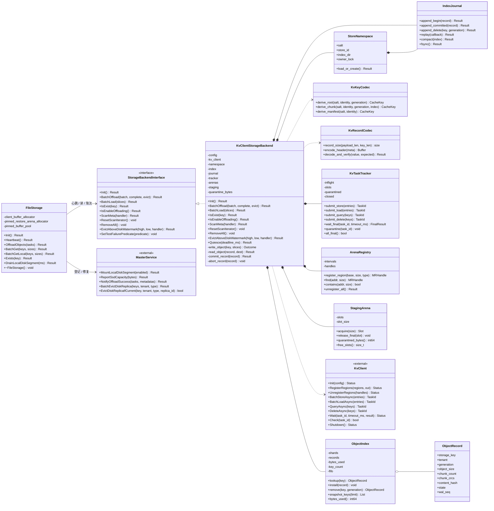
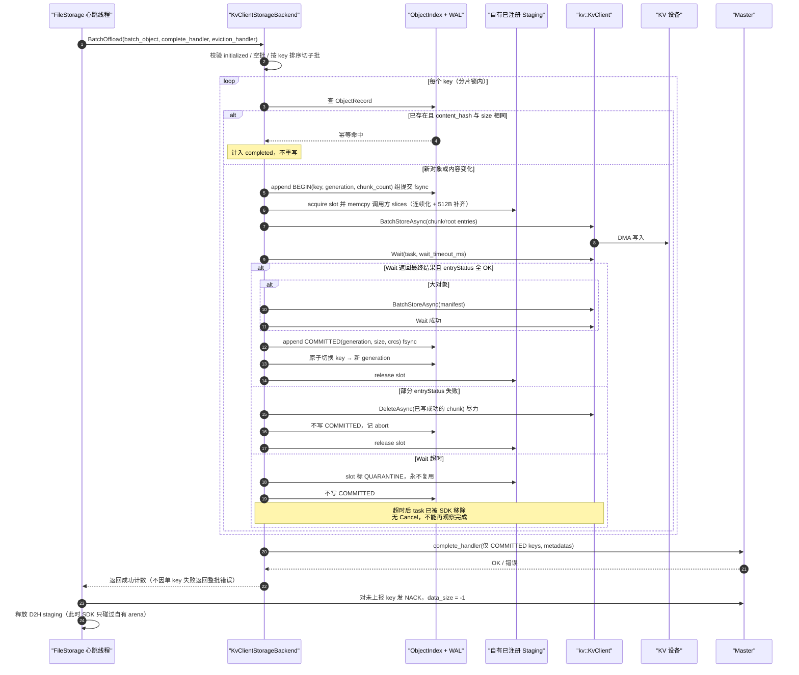
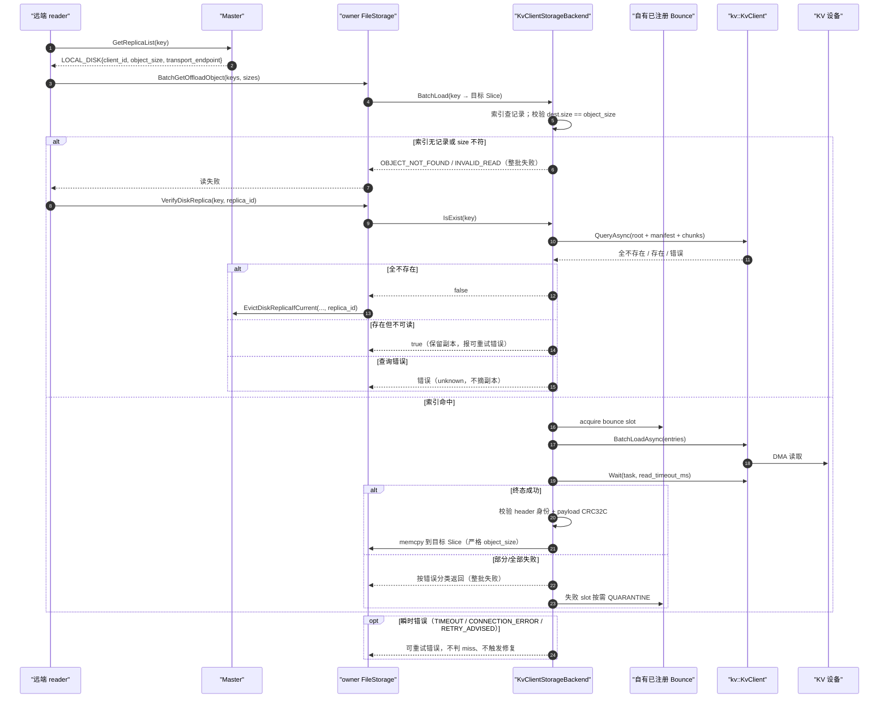
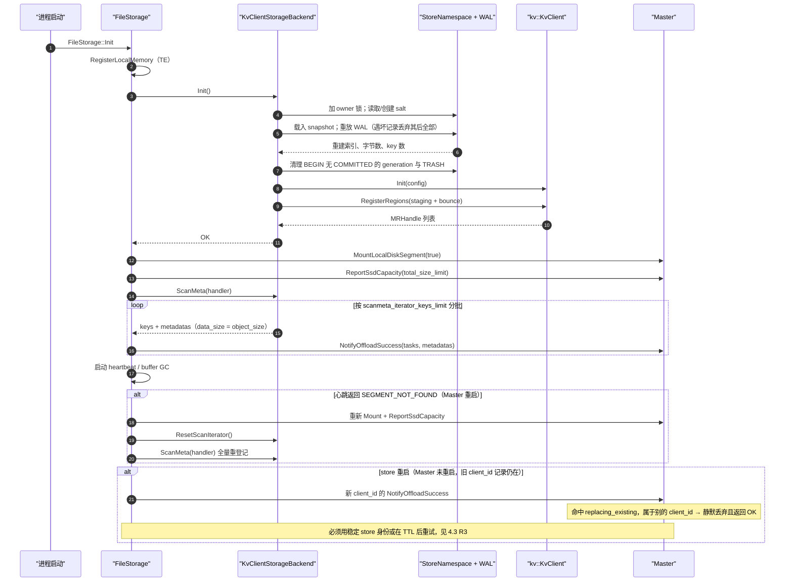
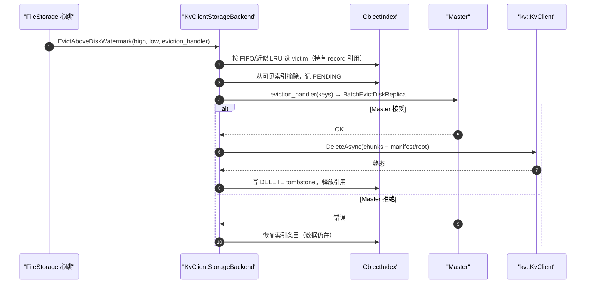

# kvclient 作为 StorageBackendInterface 的设计与实验方案

**日期：2026-10-26｜状态：设计评审稿｜适用范围：Mooncake L2 offload 层**

> 说明：你消息中“至少包含：”之后的枚举清单没有传过来。本文按完整的实验方案维度展开（契约一致性、key 与碰撞、数据完整性与对齐、写/读语义、并发与顺序、内存安全、故障注入、恢复、容量与淘汰、性能、长稳、端到端）。如果原清单有指定项，告诉我即可按项收窄或加深度。

---

## 0. 结论摘要

**可行性判断：可行，但 kvclient 只能承担“字节存储”角色。** `StorageBackendInterface` 要求的能力（枚举、容量、逐 key 删除、同步完成、宿主内存缓冲）kvclient 大多不提供，必须由 Mooncake 侧补齐。直接照搬现有 backend 的写法会踩三个 P0：

| 编号 | 结论 | 依据 |
| --- | --- | --- |
| **R1** | **不能假设“BatchOffload 返回即安全”。** kvclient 的 `Wait` 超时会无条件移除 task 记录，底层 DMA 可能仍在访问 buffer；而 FileStorage 在 `BatchOffload` 返回后立即释放 D2H staging buffer。 | [task_manager.cc:108-116](../../DramPool/unified-cache-management/kv_semantics/src/client/task/task_manager.cc)、[kv_client_impl_test.cc:1959-1986](../../DramPool/unified-cache-management/kv_semantics/tests/client/kv_client_impl_test.cc)；[file_storage.cpp:501-510](../Mooncake/mooncake-store/src/file_storage.cpp) |
| **R2** | **ScanMeta 无法用 kvclient 直接实现。** SDK 无枚举、无前缀扫描、无全量删除；`prefixHitKeys` 只是“调用方给定键序列的连续前导命中数”。 | [kv_client.h:33-64](../../DramPool/unified-cache-management/kv_semantics/include/kv_client.h)、[task_manager.cc:230-238](../../DramPool/unified-cache-management/kv_semantics/src/client/task/task_manager.cc) |
| **R3** | **Master 的 LOCAL_DISK 模型假设“owner 本地盘 + 每 key 单 owner + 按 store 记账”。** 共享远端存储会打破 owner 绑定、容量口径与重启后的 owner 连续性（client_id 是进程级 UUID）。 | [replica.h:252-262,294-299](../Mooncake/mooncake-store/include/replica.h)；[master_service.cpp:5898-5966](../Mooncake/mooncake-store/src/master_service.cpp) |

**推荐路线（Phase 1，本文主方案）：**

1. 新增 `KvClientStorageBackend : StorageBackendInterface`，`StorageBackendType::kKvClient`，Master 侧零改动；
2. **安全不变量：kvclient 只访问 backend 自有的、已注册的 arena**——写前 `memcpy` 进 staging，读后 `memcpy` 出 bounce；调用方 buffer 永不交给 SDK。这一条同时消解 R1；
3. 8 字节 key = `hash(salt ‖ tenant ‖ logical_key)`，记录头内嵌完整身份 + CRC32C，碰撞**拒绝而非覆盖**；
4. 小对象单 entry 直写，大对象（>16MiB）走“不可变 chunk + 根 manifest”两阶段提交；
5. 本地持久化目录（WAL + snapshot）作为唯一可枚举集合，支撑 `ScanMeta` / `IsExist` / 容量 / 淘汰；
6. 读仍由 owner 代理（沿用 `transport_endpoint`），直读与共享全局 tier 放到 Phase 2。

**收益边界要说清楚：** Phase 1 换来的是**容量与持久性**（不占本地 SSD、store 重启后数据还在），不是读局部性；读仍经过 owner 的 `BatchLoad` + TE 推送。若目标是降低 owner 出流量或跨节点直读，必须走 Phase 2，并改 Master descriptor 与读路由。

---

## 1. 背景：两个接入点不是一回事

| 维度 | 直通双写（`ExternalStoreBackend`） | L2 offload（`StorageBackendInterface`，本文） |
| --- | --- | --- |
| 挂载位置 | `Client::Put/Remove` 同步路径 | `FileStorage` 心跳线程 |
| 触发者 | 应用 Put | Master 下发 offload 任务 |
| 外部对象对 Master 可见 | **否**（不逐项登记） | **是**（登记 LOCAL_DISK replica） |
| 完成语义 | 提交返回 task，稍后 `Wait` 汇合 | `BatchOffload` 返回前必须落地并回调 |
| 读路径 | 外部读由调用方负责 | owner 代读 + TE 推送 |
| 失败影响 | 本次 Put/Remove | 整个心跳周期的 offload/promotion/水位淘汰 |
| 语义 | 至少一端成功即可 | 成功才允许登记，未登记则 NACK |

**结论：** 已有的直通方案文档（`mooncake接入kvclient put及remove模块设计.md`）里的 key 映射、512B 对齐、Wait 超时、ASU 断链等结论可以复用；但“双写汇合”“外部对象不登记 Master”“逐 key Remove”“force 租约”这些语义在 L2 层**没有对应返回位**，不能照搬。

---

## 2. 契约刻画与能力差距

### 2.1 `StorageBackendInterface` 契约

| 方法 | 调用者 / 时机 | 关键约束 | 不实现的后果 |
| --- | --- | --- | --- |
| `Init()` | `FileStorage::Init` 最前 | 失败直接导致 `RealClient::init` 失败 | client 起不来 |
| `BatchOffload(batch, complete_handler, eviction_handler)` | 心跳线程，单写者 | 返回前必须完成落地并调用 `complete_handler`；只上报真正可读的 key | 错报 → Master 登记读不到的副本；漏报 → NACK，源副本 refcnt 挂到 TTL |
| `BatchLoad(map<key,Slice>)` | 读 RPC / promotion，多线程 | 整批成败；写入长度必须等于 `Slice.size` | 错长度被上层当对象读走 |
| `IsExist(key)` | 悬空副本探测、`Put` 命中已存在 key | 只有“证明不在”才能返回 false | 误摘健康副本或永久留着坏副本 |
| `IsEnableOffloading()` | Init、每次 BatchOffload 开头 | false → `KEYS_ULTRA_LIMIT` → **永久关闭本节点 offload**（`enable_offloading_` 不再恢复） | 误用会一刀切停写 |
| `ScanMeta(handler)` | Init、Master 重启后的 rescan | 必须能枚举全部持久对象并逐批回调 | Init 失败（仅 `enable_dfs` 容忍 `NOT_SUPPORTED`） |
| `ResetScanIterator()` | 每次 rescan 前 | 游标型 backend 必须复位 | 第二次扫描为空 |
| `RemoveAll()` | `RemoveAll` / 清理 | 无错误返回通道 | 本地残留、Master 已删元数据 |
| `EvictAboveDiskWatermark(high, low, handler)` | 每个心跳 tick（开关打开时） | 先通知 Master，再删数据 | 空间只增不减 |

补充事实（均已核对源码）：

- `BatchOffload` 的 `int64_t` 返回值**被 FileStorage 忽略**，只判断 `has_value()`；真正的逐 key 成功集合只能走 `complete_handler`。
- `complete_handler` 可以一次都不调用，也可以多次调用；FileStorage 用 `reported_keys` 累积，返回后对 `host_batch_object` 做差集，把未上报的 key 用 `StorageObjectMetadata{-1,0,0,-1,""}`（`data_size = -1`）NACK 给 Master。Master 的 NACK 分支只释放 offloading task 与源副本引用，**不删除已登记的 LOCAL_DISK 副本**。
- 软/硬错误只有两类：`INVALID_READ`、`OBJECT_ALREADY_EXISTS` 是**单桶软失败**（NACK 本桶后继续下一个桶）；其他任何错误码都会**中止本轮剩余 bucket**。
- `KEYS_ULTRA_LIMIT` 是唯一会永久关闭 offload 的错误码；**绝不能**用它表达瞬时背压。
- FileStorage 只对 `BucketStorageBackend` 分桶；其他 backend 一次拿到**全部 key 一个桶**，新 backend 必须自己切批。
- 单写者：`BatchOffload` 只来自心跳线程；`BatchLoad` 可并发；`RemoveAll`/水位淘汰也在心跳线程。

### 2.2 数据面与生命周期

```
Master ──offload task(tenant,key,size)──▶ FileStorage::Heartbeat
   └─ BatchQuerySegmentSlices: 取本机 MEMORY replica 的 {ptr,size}（每对象 1 个 slice）
   └─ 可选 D2H staging（device → PinnedBufferPool）
   └─ BatchOffload(host_slices) ──▶ backend
                                     ├─ 落地
                                     └─ complete_handler(keys, metadatas)
   └─ client_->NotifyOffloadSuccess(tasks, metadatas) ──▶ Master 登记 LOCAL_DISK
   └─ 返回后立即 Release 所有 staging buffer
```

- 源 slice 地址来自 Mooncake allocator：`ClientBufferAllocator` 基址仅 64B 对齐，cachelib slab 按 class 对齐，**都不保证 512B**；`Slice.size` 是任意对象大小（`kMaxSliceSize = 16MiB − 16` 只是切分粒度）。
- 读目标由 `AllocateBatch` 分配：`use_uring=false` 时不做 4096 对齐；`use_uring=true` 时指针按 4096 对齐，但 `Slice.size` 仍是真实对象大小。
- Master 的 `LocalDiskDescriptor` **只有** `client_id / object_size / transport_endpoint`；`bucket_id / offset / key_size` 在 `NotifyOffloadSuccess` 里被丢弃。读只能经 owner。

### 2.3 kvclient SDK 能力与硬约束

| 能力 | 事实 | 对 backend 的影响 |
| --- | --- | --- |
| key | `CacheKey = std::array<std::byte,8>`；全 0 被协议拒绝 | 必须自建稳定映射 + 碰撞检测 |
| 枚举 / 前缀 / 正则 / 全量删除 | **不提供**；`DeleteAsync` 只接受显式 key 列表 | `ScanMeta`、`RemoveAll` 必须有上层目录 |
| 容量 / 已用空间查询 | **不提供**（`ServerKvCapabilities` 只有批量/长度限制） | 容量只能本地记账 |
| value 长度 | **取 `KVBuffer.buffer.region.size`**；必须 `>0`、`%512==0`、`≤0xFFFFFF` | 单 entry 最大约 **16MiB−256B**；非 512 对齐必须补齐/复制 |
| offset | 必须 `%512==0`，24bit | 多段写要对齐；`buffer_addr` 只校验非 0，不校验对齐 |
| 批量上限 | `batchStoreIoNum=110`、`batchLoadIoNum=110`、`deleteIoNum=254`、`queryIoNum=256`；`maxInflightTasks=1024`、`maxInflightBytes=1GiB` | 必须内部切批 |
| 内存注册 | 每个 entry 的 `buffer.handle` 必须在 `RegisterRegions` 返回的集合里，否则 `BUFFER_NOT_REGISTERED` | 写/读 buffer 必须属于已注册 arena |
| 完成语义 | `StoreAsync/LoadAsync` 异步；`Wait(taskId, timeoutMs, TaskResult)` | `TaskResult.status` 只会是 OK/PARTIAL_FAILED；真实结果看 `entryStatus` |
| 超时 | `Wait` 超时只返回 `TIMEOUT`，**随后无条件 `Remove(taskId)`**；无 `Cancel` API | 超时后**无法再观察完成**，只能隔离 buffer |
| `Check` | `return !task \|\| task->Done()` | 已移除 task 返回 **true**，不能当完成判据 |
| 覆盖写 | 客户端与 FakeProvider 支持同 key 覆盖；`ENTRY_KEY_EXIST` 只用于 QUERY；设备透传码 `CQE_KEY_ALREADY_EXISTED(0x723)` 语义未定义 | 覆盖写需在真实设备上验证；不能依赖 CAS |
| 无副本 / 无重试 / 无迁移 | 视图变化会改变 key 归属，旧 key 读到 NOT_FOUND | miss 可能只是路由变化，不能一律当删除 |
| HOST 内存 | `AICPU` provider 在 `INDEPENDENT` 模式下 `BindMemory` 只支持 device | 用 HOST staging 需 `SharedProviderMode::SHARED` 或确认 provider |
| Shutdown | `Drain` 只等待仍在 task table 里的任务；超时后照常反注册 | 超时任务不会在 Shutdown 里被兜底 |

### 2.4 能力差距矩阵（核心）

| 接口要求 | kvclient 现状 | 方案 |
| --- | --- | --- |
| 字符串 key | 8B 定长、无命名空间语义 | 64 位哈希 + 记录头内嵌完整身份；碰撞拒绝 |
| 枚举（ScanMeta） | 不提供 | 本地 WAL/snapshot 目录；Phase 2 可把目录放进 kvclient |
| 全量删除（RemoveAll） | 只能按 key 删 | 目录枚举后批量 `DeleteAsync`，尽力而为 |
| 逐 key 成功/失败 | `entryStatus` 逐条 | 只把成功 key 交给 `complete_handler` |
| 同步完成 | 异步 + `Wait`，超时不取消 | 先拷入自有 arena；超时 slot 隔离 |
| 固定目标 buffer | 必须先注册 | backend 自有 bounce；零拷贝作为 Phase 2 开关 |
| 容量 / 水位 | 无 | 本地目录记账 + 配置配额；两阶段淘汰 |
| 服务端淘汰可见性 | 无 | 读 miss → 悬空修复链收敛 |
| 多租户 | key 由调用方决定 | tenant 进哈希 + 记录头校验 |

---

## 3. 方案设计

### 3.1 设计原则

1. **SDK 只碰自有内存。** 写前拷入 staging，读后拷出 bounce；调用方/FileStorage 的 buffer 永不进入 `KVBuffer`。这是唯一不依赖“超时后是否停止访问”的安全边界。
2. **成功即上报，失败不外溢。** 逐 key 结果收敛到 `complete_handler`；`BatchOffload` 尽量返回成功，让 FileStorage 用 NACK sweep 处理失败 key，避免整轮中止。
3. **元数据自描述。** 每条 value 自带 magic/version/身份/长度/CRC；不依赖外部长度或设备语义。
4. **写用 COW，读用快照。** 覆盖写生成新 generation，根/manifest 是唯一提交点；读者要么看到旧对象，要么看到新对象。
5. **可枚举性由 Mooncake 自己保证。** 不把 `ScanMeta` 建立在 kvclient 的能力上。

### 3.2 总体架构（类图）



### 3.3 组件职责

| 组件 | 职责 | 不负责 |
| --- | --- | --- |
| `KvClientStorageBackend` | 实现接口、编排读写、错误映射 | 决定哪些 key 该 offload（Master） |
| `StoreNamespace` | 生成/持久化 salt，单写者文件锁 | 跨 store 共享 |
| `ObjectIndex` | 内存索引、字节/key 计数、FIFO | 设备侧真实容量 |
| `IndexJournal` | BEGIN/COMMITTED/DELETE 的 WAL + snapshot | 设备数据事务 |
| `KvKeyCodec` | 8B key 派生、全 0 规避 | 业务 key 语义 |
| `KvRecordCodec` | 记录头 + payload 对齐、CRC | 加密/压缩 |
| `KvTaskTracker` | task 生命周期、终态、隔离 | SDK 内部重试 |
| `ArenaRegistry` | 注册区间表、地址→handle | provider 选择 |
| `StagingArena` | 写 staging / 读 bounce 槽位 | 调用方 buffer 管理 |

### 3.4 key 映射与命名空间

**映射：**

```
identity   = tenant_id ‖ 0x00 ‖ logical_key        // 即 FileStorage 的 scoped storage key
root_key   = LE64( XXH3_64( salt ‖ 0x01 ‖ identity ) )    // 0 则置 1
chunk_key  = LE64( XXH3_64( salt ‖ 0x02 ‖ identity ‖ generation ‖ chunk_index ) )
manifest_key = LE64( XXH3_64( salt ‖ 0x03 ‖ identity ) )
```

**约束与处理：**

| 问题 | 处理 |
| --- | --- |
| 8 字节空间碰撞 | 记录头内嵌完整 `identity` + size + CRC；读时逐字节校验。写前 `QueryAsync(root_key)`，若被别的身份占用 → **拒绝该 key**（NACK），计 `collision_detected`；绝不覆盖 |
| 碰撞概率 | 64 位均匀哈希，N 个对象期望碰撞 ≈ N²/2⁶⁵；N=1e7 约 2.7e-6，N=1e8 约 2.7e-4。加上 chunk 条目会放大，必须监控 |
| 跨重启稳定 | `salt` 持久化在 `<storage_filepath>/kvclient/namespace.json`，首次启动 CSPRNG 生成并 fsync；**不要**用进程级 `client_id`（每次启动都变） |
| tenant 隔离 | tenant 进入哈希，同时明文写进记录头；跨 tenant 串读会在头校验处失败 |
| 内嵌 `\0` | `MakeScopedKey` 用 `\0` 分隔；`ParseScopedKey` 在第一个 `\0` 处切分。用户 key 内嵌 `\0` 会反解错误 → 在 `ScanMeta` 前用索引里保存的 `{tenant,key}` 原值，不依赖反解 |
| 全 0 key | 协议拒绝；哈希结果为 0 时置 1 |

> **为什么不直接把 `scoped_key` 哈希了事？** 可以，但覆盖写只能原地改，断电/失败会撕裂当前可见对象。用 `generation` 派生 key 可以做 COW，旧写/迟到删除只会落在旧 generation 的垃圾上。

### 3.5 对象布局与对齐

**记录布局（每条 kvclient value）：**

```
0                   512B 边界                      align512(...)
┌──────────────┬──────────────────┬──────────────┬─────────┐
│ RecordHeader │ 完整 identity     │   payload    │  zero   │
│ (定长+CRC)    │ (变长, ≤4KiB)     │              │ padding │
└──────────────┴──────────────────┴──────────────┴─────────┘
                                └──── length = region.size ≡ 0 (mod 512) ────┘
```

`RecordHeader`：`magic / version / flags / role(root|chunk|manifest) / generation / object_size / chunk_index / chunk_count / payload_len / payload_crc32c / identity_len / header_crc32c`。

**对象形态选择：**

| 对象大小 | 形态 | 写次数 | 提交点 |
| --- | --- | --- | --- |
| `≤ max_inline_bytes`（默认 16MiB−4KiB，留头空间） | **单 entry**，root_key 直写 | 1 | 该 entry 完成 |
| `> max_inline_bytes` | **chunk + manifest**；chunk 不可变，manifest 指向 generation | `ceil(size/chunk_bytes)+1` | manifest 写完成 |

- **chunk_bytes 默认 1MiB**，必须是 512 的倍数，且 `chunk_bytes + header ≤ 0xFFFFFF`。
- **manifest 必须装进单条 entry**：`chunk_count × ~32B + 头 ≤ 16MiB`；因此 `max_chunks ≈ 400K`，配合 1MiB chunk 覆盖 400GiB，足够。
- **覆盖写**：生成新 `generation`，写新 chunk（新 key），再写 manifest/root；旧 generation 的 chunk 变垃圾，由后台 GC 按代际删除。
- **为什么不用“同一 key 多 entry 不同 offset 拼对象”？** FakeProvider 支持按 offset 写，但真实设备语义未验证；而且多 entry 写没有原子提交点，覆盖时会撕裂。仅在实测确认设备支持后，才可作为大对象优化。
- **padding 代价**：每对象最多多 511B payload + 512B 头；对 KV block（通常 ≥256KiB）可忽略，对小对象要计入写放大指标。

### 3.6 写路径



**关键规则：**

1. **返回前必须拿到每个 task 的最终 `Wait` 结果**（`OK` 或 `PARTIAL_FAILED` + `entryStatus`）。超时即视为“结果未知”，该 key 不计成功、slot 隔离。
2. **只把 COMMITTED 且可读的 key 交给 `complete_handler`**；元数据必须与 key 等长，`data_size` 用真实对象大小。
3. **`BatchOffload` 对单 key 失败返回成功**，让 FileStorage 走 NACK sweep；只有“backend 整体不可用”（未 Init、注册失效、索引损坏）才返回硬错误。
4. **`complete_handler` 失败**：不删除已写数据（可能覆盖了旧值），记 `orphan_intent`，返回错误。Bucket 能回滚是因为它有本地索引；这里回滚会误删仍被 Master 引用的数据。
5. **重复 offload**：content_hash + size 相同则幂等跳过；不同则 COW。不要用 `OBJECT_ALREADY_EXISTS` 表达“已存在”，除非确实想软失败。

### 3.7 读路径



**miss 与“未就绪”必须分开：**

| kvclient 结果 | Mooncake 映射 | 是否触发修复 |
| --- | --- | --- |
| `ENTRY_KEY_NOT_FOUND` / `ENTRY_DATA_NOT_EXIST` / `CQE_KEY_NOT_EXIST`，且 `QueryAsync` 复核仍不存在 | `OBJECT_NOT_FOUND` | 是（由 reader 走 `VerifyDiskReplica` → `EvictDiskReplicaIfCurrent`） |
| `TIMEOUT` / `CONNECTION_ERROR` / `ENTRY_RETRY_ADVISED` / `IN_PROGRESS` | `RPC_TIMEOUT` / `TRANSFER_FAIL` | **否** |
| `CHECKSUM_MISMATCH` / header 身份不符 | `CHECKSUM_MISMATCH` | 按“确定损坏”处理，但必须 ERROR + suspect 计数 |
| 长度/参数不符 | `INVALID_READ` | 否（让上层重新取 descriptor） |

> `BatchLoad` 的接口是整批成败：任一 key 失败返回错误，已拷贝的字节不会被上层使用。不要做“部分成功”。

### 3.8 启动与恢复



**恢复策略的四种选择：**

| 方案 | 可枚举来源 | 优点 | 缺点 | 建议 |
| --- | --- | --- | --- | --- |
| A. 本地 WAL + snapshot | 本地目录 | 与 Bucket/Offset 一致、快、无需改 Master | 本地目录丢失 = 数据不可达；依赖本地磁盘 | **Phase 1 推荐** |
| B. 目录对象放在 kvclient | 确定性 head key + 不可变 catalog chunk | 无本地盘、跨节点可恢复 | 额外写放大、head 是单点、GC 复杂 | Phase 2 |
| C. Master 枚举（新 RPC） | Master 元数据 | 无需本地状态 | 非 HA Master 重启后元数据就没了，恰好失效 | 仅 HA 部署可选 |
| D. 不做恢复（NvmeKv 现状） | 无 | 最简单 | Master 重启后 L2 全丢，静默降级 | 不推荐 |

**索引丢失的语义要显式：** `ScanMeta` 返回空而不是报错，进程能起来；Master 侧通过悬空修复收敛（`IsExist=false` → 摘副本 → 下次 Put 重写）。这等于“数据不可达即视为不存在”，必须写进运维文档。

### 3.9 容量与淘汰



- **权威划分：** Master 权威 = “哪些 key 属于本 store”；本地索引权威 = “我们写了多少、有哪些 key”；设备权威 = “这一次写是否成功”。kvclient 没有容量查询，所以配额与水位只能建在本地记账上。
- **`IsEnableOffloading`**：`index_bytes ≥ total_size_limit` 或 `index_keys ≥ total_keys_limit` 或 backend 处于 fail-stop 时返回 false。注意这会经 `KEYS_ULTRA_LIMIT` 变成**永久关闭**，只能用于“需要人工介入”的场景。
- **瞬时背压**（staging 满、设备 `RESOURCE_BUSY`、`OUT_OF_CREATE_SIZE`）：按单 key 失败 + NACK 处理，不要返回 `KEYS_ULTRA_LIMIT`。
- **设备侧静默淘汰**：如果 kvclient/设备会自行淘汰，Mooncake 的 LOCAL_DISK 元数据会变陈旧；读 miss 走悬空修复链收敛。必须用实验测出设备是否有 TTL/淘汰。
- **`RemoveAll`**：按本地索引枚举批量 `DeleteAsync`，尽力而为；无法物理清空设备上不属于本索引的残留。日志与文档必须写清“逻辑清空 + 残留垃圾”。

### 3.10 超时、退出与内存安全


**必须写死的 SDK 事实（否则实现者会踩坑）：**

1. `Wait` 超时后 task 被移除，**不能再 Wait**；
2. `Check` 对已移除 task 返回 **true**，不能当完成判据；
3. 没有 `Cancel`，`Shutdown` 的 `Drain` 也不会兜底已移除的 task；
4. `UnregisterRegions` 要求 in-flight task 引用的 handle 保持注册。

**因此：**

- 超时 slot 只能隔离（QUARANTINE），不能复用；隔离字节数设上限，超限 fail-stop。
- 退出需要接口增加一个默认空实现的 `Quiesce(deadline_ms)`（或等价钩子），由 `FileStorage` 析构 / `DrainLocalDiskSegment` 调用；不要依赖 `~KvClientStorageBackend` 里的 `Shutdown`。
- `wait_timeout_ms` 必须**大于**所有 `transportConfigs.timeoutMs`（默认 100ms），建议默认 5s，并远小于心跳周期（默认 10s）。

### 3.11 错误映射表

| kvclient | 场景 | Mooncake | FileStorage 行为 |
| --- | --- | --- | --- |
| `OK` + entryStatus 全 OK | 成功 | 上报 | — |
| `PARTIAL_FAILED` / 单 entry 失败 | 部分 key | 不上报失败 key | NACK sweep（软） |
| `ENTRY_KEY_NOT_FOUND`（读） | 确定不存在 | `OBJECT_NOT_FOUND` | 整批读失败，触发修复 |
| `TIMEOUT` | 超时，结果未知 | `RPC_TIMEOUT` | 可重试，不修复 |
| `CONNECTION_ERROR` / `IO_ERROR` | 链路 | `TRANSFER_FAIL` | 可重试，不修复 |
| `RESOURCE_BUSY` / `OUT_OF_CREATE_SIZE` | 设备背压 | 单 key 失败，不上报 | NACK（软） |
| `BUFFER_NOT_REGISTERED` | 编程错误 | `INTERNAL_ERROR` | 整轮中止（应断言不发生） |
| `NOT_INITIALIZED` | 初始化失败 | `INTERNAL_ERROR` | 整轮中止 |
| `CHECKSUM_MISMATCH` / 头校验失败 | 损坏 | `CHECKSUM_MISMATCH` | 不重试，记 suspect |
| `INVALID_ARGUMENT`（长度/对齐） | 参数 | `INVALID_READ` / `INVALID_PARAMS` | 不重试，暴露 bug |
| 容量/quota 触顶 | 需人工介入 | `KEYS_ULTRA_LIMIT` | **永久关闭 offload** |
| `NOT_SUPPORTED` | 未实现入口 | `NOT_SUPPORTED` | 仅 `enable_dfs` 容忍 |

### 3.12 并发与顺序

- **单写者**：保留 FileStorage 的“心跳线程是唯一 offload 生产者”假设，backend 内部不再开第二个写者。索引/淘汰加锁，但写路径的 `Wait` 在 key 锁内会阻塞同 key 的后续操作；建议 key 锁只覆盖“查 → BEGIN → 换 generation”，`Wait` 期间用 record 状态 `WRITING` 让同 key 排队。
- **读**：只取 `shared_ptr<const ObjectRecord>` 快照，不持锁做设备 I/O；淘汰摘除索引后延迟到引用归零或宽限期再删。
- **加锁顺序**：key 分片锁 → 索引锁；淘汰/GC 先取索引锁选 victim，释放后再取 key 锁。写进代码注释。
- **同 key 迟到写/删**：generation 精确匹配；旧 generation 的迟到写只产生垃圾，删除只删旧 generation，绝不误删新对象。
- **跨 store 同 key**：Phase 1 用 per-store salt 让 key 空间实质不相交；即使碰撞也会被记录头身份校验拒绝。不要依赖“Master 单写者”作为唯一防线。

### 3.13 配置与部署形态

新增 `KvClientBackendConfig::FromEnvironment()`（沿用仓库现有 config 风格）：

| 配置 | 默认 | 说明 |
| --- | --- | --- |
| `kvclient_config_path` 或内联 `clientId/viewServiceAddrs/transportConfigs` | — | SDK 初始化 |
| `chunk_bytes` | 1 MiB | 512 的倍数 |
| `max_inline_bytes` | 16 MiB − 4 KiB | 单 entry 上限内留头 |
| `max_chunks` | 4096 | 与 chunk_bytes 联合校验 |
| `entries_per_task` | 110 | 对齐 `batchStoreIoNum` |
| `wait_timeout_ms` | 5000 | 必须 > transport timeout |
| `staging_arena_bytes` | 64 MiB | 写 staging |
| `bounce_arena_bytes` | 16 MiB | 读 bounce |
| `index_dir` | `<storage_filepath>/kvclient` | 本地目录/WAL |
| `max_quarantine_bytes` | 64 MiB | 超限 fail-stop |
| `enable_zero_copy_read` | false | Phase 2；打开即接受“超时 buffer 可能被写”的风险 |

**部署形态：**

1. **一 store 一 namespace（推荐）**：容量按 store 记账，Master 模型不变；
2. **多 store 共享一个设备命名空间**：可运行，但容量是软约束，本地索引看不到别人的占用；不推荐 Phase 1；
3. **纯无盘节点**：`FileStorageConfig::ValidatePath` 仍要求 `storage_filepath` 是存在的可写本地目录；必须给一个小的本地索引目录；
4. **HA**：Master 的 HA 快照会持久化 LOCAL_DISK 描述符，但 `LocalSsdManager` 的容量/队列不恢复；容量靠客户端重新 mount/重报。

### 3.14 分期与明确不做

| 阶段 | 范围 | 退出条件 |
| --- | --- | --- |
| **Phase 1** | `KvClientStorageBackend` + 本地目录 + COW + 自有 arena + owner 代理读 | E1–E10 通过，P0 均有证据 |
| **Phase 1.5** | 并发优化、批量切分、指标、GC、RemoveAll | E11/E12 达标 |
| **Phase 2** | reader 直读；共享全局 tier 容量模型；SDK `CancelAsync`；目录放进 kvclient；client 子分配 512B 对齐 | 需要 Master descriptor/RPC 与 SDK 扩展 |

**Phase 1 明确不做：**

- 零拷贝写（对调用方 buffer 做注册/反注册）
- 零拷贝读直读（开关默认关）
- 物理整盘擦除语义的 `RemoveAll`
- kvclient 侧枚举/前缀扫描
- 跨 store 去重/共享
- 设备容量查询与硬配额
- `DEVICE` 内存直通（先走 D2H staging）
- >4GiB 对象、超长 key、多租户设备级配额
- WAL 丢失后的自动重建
- 后台 scrub / 写后校验

### 3.15 共享全局 tier 与直读演进

如果目标是“集群共享 L2 + reader 直接读 kvclient”，需要同时改：

| 改动 | 原因 | 风险 |
| --- | --- | --- |
| `LocalDiskDescriptor` 增加 tier 句柄（`object_id`/`namespace`） | reader 目前只知道 owner 的 `transport_endpoint` | proto/oplog/HA 快照同步 |
| 读路由：`BatchGet` 区分 owner-proxy 与 direct | 直读绕过 owner 的 `BatchGetLocal` | 权限、租户、限流要重做 |
| 容量模型：tier 级配额/水位 | 当前 `ReportSsdCapacity` 按 client 累加，共享会重复计数 | `SSD_FREE_RATIO_FIRST` 放置策略失去信号 |
| 恢复：目录不再依赖本地盘 | 共享 tier 的节点可能无盘 | 目录对象/HA Master 二选一 |
| SDK：`CancelAsync` | 直读时调用方 buffer 超时风险更高 | 需要 UCM 配合 |

**Phase 1 的收益边界：** 不占本地 SSD、跨 store 重启保留数据、容量弹性；**不降低 owner 出流量**。如果压测显示 owner 代理读成为瓶颈，Phase 2 的优先级要提前。

---

## 4. 注意事项清单

### 4.1 P0（不解决不得上线）

| # | 事项 | 处理 |
| --- | --- | --- |
| P0-1 | `Wait` 超时 ≠ 停止访问；FileStorage 返回后立即释放 staging | SDK 只碰自有 arena；超时 slot 隔离；退出 fail-stop |
| P0-2 | 错报 `complete_handler` → Master 登记读不到的副本 | 只有 COMMITTED 且可读的 key 上报；元数据与 key 等长 |
| P0-3 | `ScanMeta` 无法枚举 → Init 失败或重启后 L2 全丢 | 本地 WAL/snapshot 目录；不返回假的空成功 |
| P0-4 | 8B key 碰撞 → 读错/覆盖/误删 | 记录头完整身份 + CRC；碰撞拒绝并计数 |
| P0-5 | 非 512 对齐/超 16MiB → 写失败或越界 | 连续化 + 补齐；大对象 chunk + manifest |
| P0-6 | 瞬时错误误判 miss → 误摘健康副本 | 严格区分 miss / 未就绪 / 损坏 |
| P0-7 | 多写者/迟到写 → 旧写覆盖新写 | 单写者 + generation COW + 记录头校验 |

### 4.2 P1（影响可用性/成本）

| # | 事项 | 处理 |
| --- | --- | --- |
| P1-1 | `KEYS_ULTRA_LIMIT` 永久关闭 offload | 只用于需人工介入的容量场景；瞬时背压走 NACK |
| P1-2 | 返回硬错误会中止整轮 bucket | 单 key 失败返回成功；只有整体不可用才返回错误 |
| P1-3 | 心跳线程被慢 I/O 拖住（默认 10s） | 子批切分、总 deadline、失败留给下一轮 |
| P1-4 | 设备侧静默淘汰 → Master 元数据陈旧 | 读 miss + 悬空修复；监控修复率 |
| P1-5 | 容量按 store 记账 vs 共享池 | Phase 1 per-store namespace；共享形态标为不推荐 |
| P1-6 | store 重启换 client_id → 新注册被静默丢弃 | 稳定 store 身份或 TTL 后重试；实验覆盖 |
| P1-7 | `RemoveAll` 无法物理清空 | 逻辑清空 + 残留垃圾；文档/日志显式说明 |
| P1-8 | WAL 在关键路径 fsync | 组提交；fsync 时延指标；按批切片 |
| P1-9 | 一次注册 1.2GB arena 可能超 provider 限制 | 分片注册；失败明确降级为只注册自有 arena |
| P1-10 | HOST 内存在 `INDEPENDENT` 模式注册失败 | `SharedProviderMode::SHARED` 或确认 provider |

### 4.3 设计时必须回答的问题

1. `Wait` 返回 OK 是否等价于“其他客户端可读”？仓库内 Fake/E2E 是；真实设备未验证 → E4。
2. 设备是否支持同 key 覆盖、`0x723` 在什么条件下出现？→ E4。
3. 设备是否有 TTL/容量淘汰？→ E10。
4. 单 value 实际上限是协议 16MiB 还是 `ServerKvCapabilities` 更低？→ E3。
5. 设备是否要求 `buffer_addr` 512B/4KiB 对齐（代码不校验，硬件可能要求）？→ E3。
6. `kv_ns_id` 是否是真正的命名空间隔离，能否 per-store？→ E2/E13。
7. 视图变更后 key 归属变化，miss 是否重试/重写？→ E8。
8. 稳定 `client_id` 是否可行，会不会影响其他客户端路径？→ E9。

---

## 5. 实验方案

### 5.1 目标与假设

| 假设 | 内容 | 验证实验 |
| --- | --- | --- |
| H1 | `KvClientStorageBackend` 可在不改 FileStorage/Master 的前提下满足接口契约 | E1 |
| H2 | 真实 KV cache 的对象/切片尺寸大多满足 512B 对齐；不满足时可被补齐覆盖 | E3 |
| H3 | 64 位哈希 + 记录头校验把碰撞从“静默读错”降为“可检测失败” | E2 |
| H4 | `Wait` 终态成功等价于数据可被其他客户端读到 | E4 |
| H5 | 自有 arena 一次性注册后，注册次数不随请求增长 | E7 |
| H6 | owner 代理读的性能损失可接受（相对本地 SSD） | E11 |
| H7 | 故障/重启后 Master 元数据与实际数据能收敛，无假成功 | E8/E9 |

### 5.2 环境与矩阵

| 维度 | 取值 |
| --- | --- |
| 设备/协议 | ASU 集群 × {UB, RoCE, TCP}；provider {AICPU, AIV, FAKE} |
| Mooncake | Master × {单机, HA}；store 数 {1, 8, 64} |
| 源内存 | HOST（CPU KV）、DEVICE（NPU/GPU，D2H staging） |
| 对象大小 | 512B、4KiB、256KiB、1MiB、16MiB−512、16MiB、16MiB+512、64MiB、1GiB |
| 对齐 | 512B 对齐/非对齐；单 slice/多 slice；末 slice 非对齐 |
| key 规模 | 1e5、1e6、1e7、1e8 |
| 并发 | 读 8/32/128；写 1（心跳）/并发注入 |
| 对照 | Bucket、OffsetAllocator、kvclient-staged、kvclient-zero-copy(开关) |
| 故障注入 | tc netem、进程 kill -9、view service 重启、节点下线、设备返回 BUSY/超时、WAL 损坏 |

### 5.3 实验分组

#### E1 契约一致性（功能）

- **目的**：证明 backend 满足 `StorageBackendInterface` 全部方法契约。
- **方法**：复用 `storage_backend_test.cpp` 的一致性用例模式 + fake SDK：
  - 空批 → `INVALID_KEY`；未 Init → `INTERNAL_ERROR`；
  - `IsEnableOffloading` 与 `BatchOffload` 的先后依赖；
  - `ScanMeta`：空 backend 不回调、全量分批、重启后恢复、`ResetScanIterator` 后重扫；
  - `RemoveAll`、`EvictAboveDiskWatermark`、`complete_handler` 失败、短读、重复写、超限、out-of-space、损坏 header；
  - `SetTestFailurePredicate` 复用 `TestPartialSuccessBehavior`。
- **观测**：每个入口的返回码与副作用。
- **通过**：与第 3.11 节映射表逐条一致；被拒绝的调用不产生外部副作用；CI 不依赖真实设备。

#### E2 key 映射与碰撞

- **目的**：验证 8B 映射的稳定性、碰撞可检测、tenant 隔离。
- **方法**：
  - 1e7/1e8 合成 key（含真实前缀、内嵌 `\0`、超长 key）；
  - 强制碰撞（固定 salt/替换哈希实现）；
  - 写入 → 重启 → 读回；跨 tenant 同名 key；`kv_ns_id` 不同值。
- **观测**：碰撞数 vs 生日界、误命中数、重启查找成功率、跨 tenant 读成功数。
- **通过**：误命中 = 0；碰撞被拒绝且计数；重启查找 100%；跨 tenant 读 = 0。

#### E3 数据完整性与对齐

- **目的**：验证任意尺寸/对齐下的字节级正确性。
- **方法**：5.2 的对象大小 × 对齐 × slice 数矩阵；buffer 前后放 canary/guard page；CRC；读回逐字节比较；覆盖写（同大小/更大/更小）；padding 检查。
- **观测**：mismatch、OOB（ASAN）、padding 比例、写放大、单 entry 实际上限。
- **通过**：mismatch/OOB = 0；>16MiB 走 chunk 成功；padding 比例在预期内。

#### E4 写路径语义

- **目的**：验证“成功即可见、失败不外溢”。
- **方法**：
  - 注入 per-entry 失败、`PARTIAL_FAILED`、`TIMEOUT`、`0x723`、`RESOURCE_BUSY`；
  - 覆盖写同 key 不同内容；重复 offload 幂等；
  - `complete_handler` 失败；NACK 计数对账；
  - 写后立即从另一个客户端 `Load`（可见性）。
- **观测**：假成功数、上报 key ⊆ 可读 key、Master 元数据偏差、NACK 数。
- **通过**：假成功 = 0；NACK 与未上报 key 完全一致；可见性 100%。

#### E5 读路径语义

- **目的**：验证 hit/miss/未就绪/损坏的分类。
- **方法**：命中、从未写入、设备淘汰后、半写（注入）、大小不符、目标未注册/非对齐、错误 generation、`IsExist` 的三种返回。
- **观测**：分类准确率、误修复数、漏修复数。
- **通过**：瞬时错误 0 次触发修复；确定 miss 100% 触发；`IsExist` 与真实可读性一致。

#### E6 并发与顺序

- **目的**：验证并发读、写/淘汰/覆盖/重启交叉下无撕裂、无死锁。
- **方法**：8/32/128 读线程；offload 与读并发；淘汰与读并发；覆盖写与读；同 key put→delete→put；两个 store 同 key；读时 kill -9。
- **观测**：撕裂读、死锁、顺序违例、宽限期删除延迟。
- **通过**：撕裂 = 0；死锁 = 0；顺序违例 = 0；读失败可重试且不误删。

#### E7 内存安全与生命周期

- **目的**：验证“SDK 只碰自有 arena”的不变量。
- **方法**：ASAN/TSAN/UBSAN；注册次数统计；`BatchOffload` 返回后复用 staging；`Wait` 超时后复用 slot（应被隔离）；view 刷新时 in-flight；带 in-flight 反注册；`kill -9` 时 DMA。
- **观测**：ASAN 报告、注册次数、隔离字节、fail-stop 次数。
- **通过**：ASAN = 0；注册次数 O(arena) 且不随请求增长；隔离有界；无法证明安全时 fail-stop 而非继续。

#### E8 故障注入

- **目的**：验证错误映射、重试边界、恢复。
- **方法**：view service down/restart；ASU 节点 down；链路错误累计超过 `maxErrorCount`；`CQE_IO_TIMEOUT`；`RESOURCE_BUSY`；`OUT_OF_CREATE_SIZE`；`PARTIAL_FAILED`；SDK Init 失败；重连。
- **观测**：假成功、错误分类正确率、恢复时间、视图刷新次数。
- **通过**：假成功 = 0；瞬时错误不触发删除；恢复后读写正常；无永久卡死。

#### E9 恢复

- **目的**：验证四种恢复路径与语义边界。
- **方法**：
  - store 重启（Master 存活）；Master 重启（store 存活，`SEGMENT_NOT_FOUND`）；
  - 两者同时；WAL 撕裂尾/坏记录/snapshot 损坏/目录丢失；
  - client_id 变化；`ResetScanIterator` 后重扫；HA 切换。
- **观测**：重登记覆盖率、孤儿率、陈旧副本率、恢复耗时、不可达数据量。
- **通过**：每种组合的语义与 3.8 节一致；不可达数据有明确指标/日志，不静默。

#### E10 容量与淘汰

- **目的**：验证配额、水位、设备淘汰与 Master 一致性。
- **方法**：填到 quota；`IsEnableOffloading` 翻转；`KEYS_ULTRA_LIMIT` latch；水位淘汰两阶段；设备侧淘汰（如存在）；`RemoveAll`；共享 namespace 多 store。
- **观测**：容量记账误差、淘汰正确性、陈旧元数据数、残留垃圾。
- **通过**：误差 ≤ 配置容差；先通知后删除；无“Master 在、设备无”长期漂移。

#### E11 性能

- **目的**：量化代价与瓶颈。
- **方法**：offload 吞吐/延迟、读/promotion 延迟、心跳时长、CPU、memcpy 开销、注册耗时、批量/并发扫描；与 Bucket/OffsetAllocator 对照；chunk_bytes/entries_per_task/arena 尺寸扫描。
- **观测**：GB/s、ops/s、P50/P99/P999、心跳 P99、CPU、写放大。
- **建议门槛**：offload 吞吐 ≥ 本地 SSD 基线的 80%；读 P99 ≤ 本地基线 2×；心跳 P99 ≤ 心跳间隔的 50%；注册耗时 ≤ Init 预算；写放大 ≤ 1.05（大对象）。
- **通过**：达到门槛，或给出明确的容量/延迟权衡结论。

#### E12 长稳与端到端

- **目的**：验证泄漏、错误预算与业务收益。
- **方法**：24–72h 混合读写 + churn + 周期重启；vLLM/SGLang + UCM 回放。
- **观测**：RSS/fd/线程/MR 增长；错误预算；L2 命中率；TTFT；吞吐；重算节省。
- **通过**：RSS 增长 < 5%；无 fd/线程/MR 泄漏；错误率在预算内；端到端有可量化收益或明确无收益。

### 5.4 指标定义

| 类别 | 指标 |
| --- | --- |
| 正确性 | `false_success_total`、`metadata_divergence_total`、`checksum_mismatch_total`、`collision_detected_total`、`torn_read_total` |
| 任务 | `kv_tasks{op,status}`、`entry{op,status}`、`wait_timeout_total`、`quarantine_bytes`、`inflight_tasks` |
| 数据 | `object_committed`、`object_aborted`、`chunk_written`、`padding_ratio`、`write_amplification` |
| 恢复 | `scanmeta_keys`、`wal_replay_entries`、`wal_torn_tail_dropped`、`orphan_intents`、`repair_total` |
| 容量 | `index_objects`、`index_bytes`、`evict{reason}`、`device_pushback{code}` |
| 性能 | 读写 P50/P99/P999、offload GB/s、heartbeat duration、CPU、memcpy 时间 |

### 5.5 分阶段执行与门槛

| 阶段 | 环境 | 内容 | 退出/准入 |
| --- | --- | --- | --- |
| **P0 单元** | fake SDK + 本地 | E1/E2/E3 的确定性用例、错误映射单测 | 契约与完整性全绿；可作为 CI |
| **P1 单节点集成** | 1 store + 1 设备 | E4/E5/E7/E10 基础路径 | 假成功=0、内存安全=0；允许功能不完整但必须显式拒绝 |
| **P2 多节点故障** | 8 stores + 设备集群 | E6/E8/E9 | 故障/恢复无静默不一致；P0 控制项均有证据 |
| **P3 性能/长稳** | 8–64 stores | E11/E12 | 达到性能门槛；72h 无泄漏 |
| **P4 灰度/端到端** | 真实推理 | E12 端到端、运维演练 | 灰度回滚方案验证；收益可量化 |

**发布门槛：**

1. P0-1…P0-7 全部有测试证据；
2. 未验证的入口/组合不得启用（返回 `NOT_SUPPORTED`，不要静默）；
3. 每个“降级”都有指标/日志，不能静默；
4. 文档中的“不做清单”逐条 sign-off。

### 5.6 风险登记与回滚

| 风险 | 触发信号 | 回滚 |
| --- | --- | --- |
| 设备覆盖写/可见性不符合预期 | E4 假成功 > 0 | 禁用 backend，回退 Bucket/Offset |
| 超时隔离导致内存持续增长 | `quarantine_bytes` 逼近上限 | fail-stop + 重启；回退 |
| WAL/目录丢失 | `scanmeta_keys` 骤降、`repair_total` 上升 | 从 Master 重新 offload；接受 L2 冷启动 |
| 共享 namespace 容量超卖 | 设备 `OUT_OF_CREATE_SIZE` | 改回 per-store namespace |
| 心跳被拖慢 | heartbeat P99 超阈值 | 降低 entries/批、缩短 wait、异步化（需接口改造） |
| client_id 重启问题 | 重启后 `NotifyOffloadSuccess` 覆盖率低 | 稳定身份配置；或 TTL 后重扫 |

### 5.7 交付物

- 设计文档（本文）+ 类图/时序图；
- backend 实现与配置；
- fake SDK/故障注入工具；
- 一致性测试套件（可进 CI）；
- 性能/长稳报告；
- 运维手册：目录备份、容量、恢复语义、指标告警、回滚步骤。

---

## 6. 待确认问题

1. 你的原清单“至少包含：”后面具体列了哪些项？我可以按项加深度。
2. 目标部署是 **per-store 独立 namespace** 还是 **集群共享 tier**？前者 Phase 1 可交付，后者需要先定 Master 协议与容量模型。
3. 是否接受**本地索引目录**这一依赖？如果要求纯无盘，`ScanMeta` 只能走“目录放进 kvclient”或 HA Master，成本与风险都更高。
4. 真实设备对**同 key 覆盖写**、`0x723`、TTL/淘汰、单 value 实际上限的语义，需要 UCM/设备侧给出书面确认。
5. 是否允许给 `StorageBackendInterface` 增加 `Quiesce()`/`RegisterArena()` 这类默认空实现的钩子？不加的话退出安全只能靠进程级 fail-stop。
6. 读性能目标：owner 代理读是否足够？如果要求直读，需要把 Phase 2 提前并改 Master descriptor。

---

## 附录 A：源码依据

| 核对点 | 位置 |
| --- | --- |
| `StorageBackendInterface` / `StorageBackendType` | `mooncake-store/include/storage_backend.h:165-318` |
| 创建入口与配置 | `mooncake-store/src/storage_backend.cpp:5579-5661` |
| FileStorage Init/ScanMeta/重注册 | `mooncake-store/src/file_storage.cpp:129-228,712-766,1216-1286` |
| offload 写路径 / D2H / NACK | `mooncake-store/src/file_storage.cpp:302-577` |
| 读路径 / AllocateBatch | `mooncake-store/src/file_storage.cpp:230-300,1018-1090,1093-1162` |
| 水位淘汰 / 通知 | `mooncake-store/src/file_storage.cpp:579-647` |
| `Slice` / `StorageObjectMetadata` / `ErrorCode` | `mooncake-store/include/types.h:303-419,445-452,539-547` |
| 现有 backend 参考 | `mooncake-store/src/nvme_kv/backend.cpp`、`mooncake-store/src/storage/distributed/distributed_storage_backend.cpp` |
| Master LOCAL_DISK 模型 | `mooncake-store/include/replica.h:252-262,294-299`；`mooncake-store/src/master_service.cpp:5898-5966,9001-9149` |
| kvclient API | `D:/xiaojun/work/DramPool/unified-cache-management/kv_semantics/include/kv_client.h`、`kv_types.h` |
| kvclient 协议校验 | `.../kv_semantics/src/trans/proto/kv_protocol.cc:183-230,495-546,701-727` |
| kvclient SQE 长度来源 | `.../kv_semantics/src/trans/proto/sqe_request.cc:184-213,245-252` |
| Wait / Check / Shutdown | `.../kv_semantics/src/client/task/task_manager.cc:102-132,366-384`；`src/client/kv_client_impl.cc:187-241` |
| 超时测试 | `.../kv_semantics/tests/client/kv_client_impl_test.cc:1959-1986` |
| 覆盖写测试 | `.../kv_semantics/tests/client/kv_client_e2e_metrics_test.cc:812-820` |
| FakeProvider 写入语义 | `.../kv_semantics/src/trans_provider/fake/fake_trans_provider.cc:386-427` |

## 附录 B：一页纸实现清单

```
[ ] StorageBackendType::kKvClient + CreateStorageBackend case + config
[ ] StoreNamespace: salt 持久化 + owner 锁
[ ] ObjectIndex: 分片锁 + 字节/key 计数 + FIFO + generation
[ ] IndexJournal: BEGIN/COMMITTED/DELETE + snapshot + 撕裂尾处理
[ ] KvKeyCodec: root/chunk/manifest 派生 + 全 0 规避
[ ] KvRecordCodec: 512B 对齐头 + 身份 + 长度 + CRC32C
[ ] StagingArena: 写 staging + 读 bounce + QUARANTINE
[ ] ArenaRegistry: 区间表 + RegisterRegions + 反注册栅栏
[ ] KvTaskTracker: 子批切分 + Wait 终态 + entryStatus 聚合
[ ] BatchOffload: 幂等/COW/部分失败/complete_handler
[ ] BatchLoad: 索引校验 + bounce + 身份/CRC 校验
[ ] IsExist: Query 全 chunk + unknown 语义
[ ] ScanMeta/ResetScanIterator: 目录分批回调
[ ] RemoveAll: 目录枚举批量 Delete
[ ] EvictAboveDiskWatermark: 两阶段 + 恢复
[ ] Quiesce: latch + 终态等待 + fail-stop
[ ] 错误映射表 + 单测
[ ] 指标 + 结构化日志（batch_id 贯穿 WAL）
[ ] fake SDK + 故障注入 + CI 一致性套件
```
