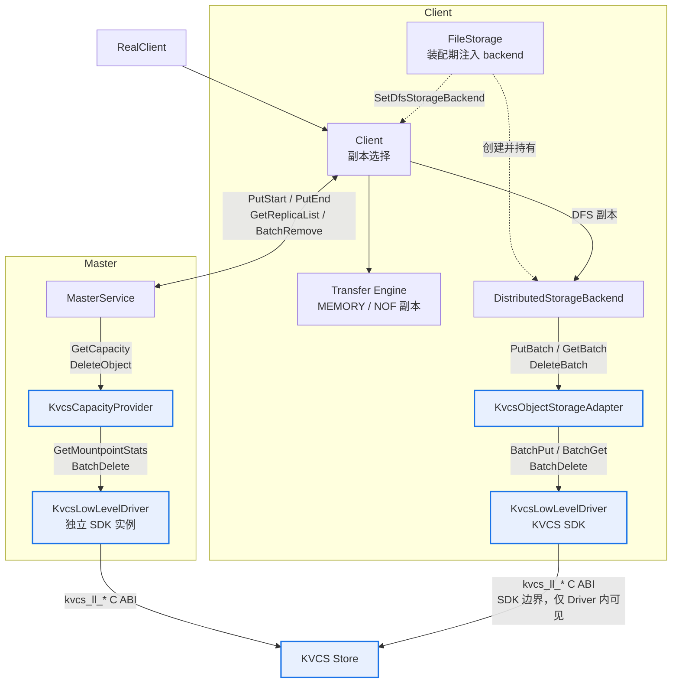

## 每条边对应的抽象层

| 边 | 契约 | 定义位置 |
| --- | --- | --- |
| `Client → DistributedStorageBackend` | DFS 数据面（`DfsWriteRequest` / `DfsReadRequest`） | [distributed_storage_backend.h:83-90](../Mooncake/Mooncake/mooncake-store/include/storage/distributed/distributed_storage_backend.h) |
| `DistributedStorageBackend → KvcsObjectStorageAdapter` | `ObjectStorageAdapter`：逻辑 key、整对象、逐请求结果 | [object_storage_adapter.h:44-149](../Mooncake/Mooncake/mooncake-store/include/storage/distributed/object_storage_adapter.h) |
| `KvcsObjectStorageAdapter → KvcsLowLevelDriver` | `KvcsDriver`：provider key、批量、deadline、mountpoint_index | [kvcs_driver.h:62-78](../Mooncake/Mooncake/mooncake-store/include/storage/distributed/kvcs/kvcs_driver.h) |
| `KvcsLowLevelDriver → KVCS Store` | `kvcs_ll_*` C ABI，**只有 Driver 这一层能看见** | [kvcs_capi_driver.cpp:250](../Mooncake/Mooncake/mooncake-store/src/storage/distributed/kvcs/kvcs_capi_driver.cpp) / [297](../Mooncake/Mooncake/mooncake-store/src/storage/distributed/kvcs/kvcs_capi_driver.cpp) / [349](../Mooncake/Mooncake/mooncake-store/src/storage/distributed/kvcs/kvcs_capi_driver.cpp) |
| `MasterService → KvcsCapacityProvider` | 控制面专用：容量 + 单 key 删除 | [kvcs_capacity_provider.h:23-24](../Mooncake/Mooncake/mooncake-store/include/storage/distributed/kvcs/kvcs_capacity_provider.h) |
| `KvcsCapacityProvider → KvcsLowLevelDriver` | 同一个 `KvcsDriver` 契约 | [kvcs_capacity_provider.cpp:26](../Mooncake/Mooncake/mooncake-store/src/storage/distributed/kvcs/kvcs_capacity_provider.cpp) / [55](../Mooncake/Mooncake/mooncake-store/src/storage/distributed/kvcs/kvcs_capacity_provider.cpp) |
